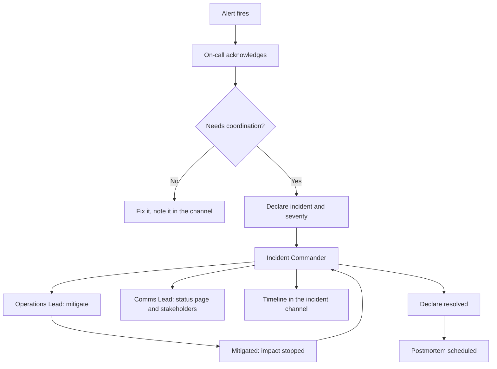

## 37.7 Incident management

### 37.7.1 What an incident is, and severity levels

#### Concept

An **incident** is any unplanned event that degrades a service below its expected level and requires a coordinated response. The word "coordinated" is doing the work: a bug one engineer fixes in ten minutes is not an incident. A bug that needs three people, a customer communication and a decision about rolling back is.

The purpose of severity levels is **not** to rank how bad you feel. It is to answer three operational questions instantly: who gets woken up, how often do we communicate, and does this need a postmortem.

| Sev | Definition | Concrete examples | Response | Comms | Postmortem |
|---|---|---|---|---|---|
| **SEV1** | Complete outage of a critical journey, or data loss, or a security breach | Checkout returns 500 for everyone; the orders table was truncated; customer data exposed | Page immediately, 24x7, wake whoever is needed, exec notified | Status page within 15 min, updates every 30 min | Mandatory, within 5 business days |
| **SEV2** | Major degradation of a critical journey, or complete outage of a non-critical one | Checkout p99 at 12 s and 8 % failing; payments work for cards but not UPI; the entire admin panel is down | Page immediately, 24x7 | Status page within 30 min, updates hourly | Mandatory |
| **SEV3** | Partial or minor degradation with a workaround, or a non-critical outage | Order confirmation emails delayed 40 min; search is stale by an hour; one merchant's exports fail | Page during business hours; ticket out of hours | Internal only unless a customer asks | Recommended |
| **SEV4** | Cosmetic, or affecting a small number of users with no revenue impact | A label is wrong; one legacy integration times out; a dashboard panel is broken | Ticket | None | No |

Two rules that make severity levels work in practice:

1. **Start high and downgrade.** It is easy to say "actually this is a SEV3" fifteen minutes in. It is very hard to catch up when you started at SEV3 and it was always a SEV1. Anyone may declare; nobody is criticized for over-declaring.
2. **Severity is about impact, not about cause.** "It is only a config typo" is not a severity. If checkout is down, it is a SEV1 whether the cause is a typo or a datacentre fire.

### 37.7.2 The roles

#### Concept

Three distinct jobs, and in anything above a SEV3 they must be three different people.

**Incident Commander (IC).** Owns the incident, not the fix. Decides. Delegates. Keeps the timeline. Asks "what do we know, what are we doing, who is doing it, when do we next check in". Explicitly does **not** type into a terminal. The IC is the only person who can declare severity changes and resolution.

**Communications Lead.** Owns everything outside the war room: the status page, the internal Slack channel, the message to support, the update to the executive who is asking. Translates "the Kafka consumer group is rebalancing continuously" into "some order confirmation emails are delayed; orders are unaffected".

**Operations Lead.** Owns the hands on keyboard. Runs commands, reads dashboards, proposes and executes mitigations. Reports findings to the IC. May have helpers (a database expert, a network expert) whom the IC assigns.

#### Why one person cannot hold all three

Because the modes are incompatible, and I have watched this fail every time it is attempted.

The Operations Lead is deep in a terminal reading a query plan. That requires uninterrupted focus. Meanwhile the VP of Sales is asking in Slack whether to call the customer, support wants a line for the ticket queue, and someone needs to decide whether to roll back. If those are the same person, one of two things happens: either they stop debugging to answer messages, and the incident lasts three times longer, or they ignore the messages, and the company finds out about a two-hour outage from Twitter.

The IC exists because **decisions and diagnosis compete for the same brain**. The Comms Lead exists because **communication is a full-time job during an incident** and it is the part engineers are worst at.



For a small team where three people is not realistic at 03:00: the on-call is the IC *and* the Operations Lead initially, and their **first action after acknowledging is to pull in a second person** for comms if severity is 1 or 2. "I am the IC, you are ops, I will handle comms" is a valid three-role split across two people. One person doing all three alone for a SEV1 is not a staffing plan, it is a hope.

### 37.7.3 Declaring, the war room, the status page

**Declaring** should take one command and no permission. A Slack command that creates a dedicated channel, a video bridge link, an incident record with a timestamp, and pages the IC rotation. The friction of declaring is directly proportional to how long your incidents last, because engineers who must ask permission will instead "just have a quick look" for forty minutes.

**The war room** is a dedicated channel plus a voice bridge. Rules that make it work:

- All decisions and findings go in the **channel**, not only the voice call. The channel is the timeline and the record for the postmortem. If it was only said on the call, it did not happen.
- Anyone not actively working the incident stays out of the voice call and reads the channel. An executive on the bridge asking for updates costs you an engineer.
- The IC posts a structured update at a fixed cadence, even when the update is "no change":

```text
[14:32] SEV2 checkout-latency
Impact: ~8 % of checkouts failing, p99 11 s. Started 14:02.
Current theory: connection pool exhaustion after the 13:58 deploy.
Actions: Priya rolling back to 2.14.2 (ETA 14:38). Arun checking pg_stat_activity.
Next update: 14:45.
```

Four lines: impact, theory, actions with owners, next update time. That format survives handoffs, feeds the postmortem timeline directly, and answers every question an observer would otherwise ask.

**The status page.** Publish before you are certain, in plain language, without causes. "We are investigating reports of errors during checkout" at 14:15 is infinitely better than a precise explanation at 16:00. Customers forgive outages; they do not forgive silence. Update on a schedule even when there is nothing new, and post a resolution note plus a link to the public postmortem if you write one.

Never put an internal cause on a public status page. "A Kafka consumer group rebalance caused duplicate deliveries" tells attackers about your stack and tells customers nothing. "Some customers received duplicate order confirmation emails. Orders and payments were not affected." is what they need.

**Escalation.** Every rotation needs a written escalation path with time bounds: primary has 5 minutes to acknowledge, then secondary is paged, then the engineering manager, then the head of engineering. And a **subject-matter escalation** list: who to call for PostgreSQL, for Kafka, for the payment integration, for the cloud account. At 03:00 nobody should be searching a wiki for a phone number.

### 37.7.4 The first ten minutes

This is the most important section in this part, and its entire content is one instruction.

> **Mitigate first. Diagnose later.**

The natural engineering instinct is to understand the problem before acting. That instinct is correct in every context except an active incident. During an incident, every minute of understanding costs real money and real customers. Understanding is what the postmortem is for. Your job right now is to make the bleeding stop.

The first-ten-minutes checklist:

```text
FIRST TEN MINUTES — do these before diagnosing

[ ] 1. Acknowledge the page. Say in the channel that you have it.
[ ] 2. Confirm the impact in 60 seconds. Which journey, what fraction of users,
       since when. One dashboard. Do not go deeper yet.
[ ] 3. Declare the incident and severity. Start the channel and the timeline.
[ ] 4. DID ANYTHING CHANGE? Check the deploy log, the feature-flag log, the
       config/migration log, and the cloud provider's status page. Last 2 hours.
[ ] 5. If yes: ROLL IT BACK NOW. Do not verify the theory first. Rolling back
       a good deploy costs 5 minutes. Not rolling back a bad one costs an hour.
[ ] 6. If no change: try the standard mitigations, in this order.
       [ ] Scale out. More replicas is cheap and instant.
       [ ] Shed load. Turn on aggressive rate limiting; protect the core journey
           by rejecting the periphery.
       [ ] Disable the feature. Kill switches for non-essential paths:
           recommendations, personalization, the new checkout variant.
       [ ] Fail over. Switch provider, promote the replica, drain the AZ.
       [ ] Restart the sick component. Crude, often effective, buys time.
[ ] 7. Confirm the mitigation worked by looking at the user-facing SLI,
       not at the thing you changed.
[ ] 8. Only now: start diagnosing. Preserve evidence first — take a heap dump,
       copy the logs, screenshot the dashboards, note the pod names.
       Rolling back destroys the evidence you will want tomorrow.
[ ] 9. Post an update every 15 to 30 minutes whether or not anything changed.
```

Step 5 deserves its own paragraph, because it is where teams lose hours. **Roll back before you know it was the deploy.** The cost matrix is completely lopsided: rolling back an innocent deploy costs a few minutes and some mild embarrassment; failing to roll back a guilty one costs the whole incident. If a deploy went out in the two hours before the symptoms started, it is the most likely cause by a large margin, and you can prove or disprove it far more comfortably once customers are being served again.

The same applies to step 8's evidence note, which is the one thing people forget under pressure. A pod that is restarted is a pod whose heap you cannot inspect. Thirty seconds of `kubectl logs --previous > incident.log` and a screenshot will save your postmortem.

#### Failure scenario

At 02:14 the on-call is paged: checkout error rate 22 percent. She spends 35 minutes reading logs and tracing a suspicious query, builds a solid theory about lock contention, and is preparing a hotfix when a colleague asks whether anything deployed. A feature flag had been enabled at 02:09 by a scheduled rollout. Turning it off took eleven seconds. Total impact: 47 minutes and roughly 900 failed orders, of which 46 minutes and 880 orders were avoidable.

Nothing she did was incompetent. The theory was even partly right — the flag caused the lock contention. The process was wrong: she diagnosed before she mitigated, and there was no checklist telling her not to.

## 37.8 On-call

### 37.8.1 Designing a rotation

#### Concept

On-call is a system with humans in it, and like any system it can be designed well or badly. Badly designed on-call does not fail loudly; it fails by attrition, and by the time you notice, your two most experienced engineers have resigned.

The design parameters:

| Parameter | Reasonable | Why |
|---|---|---|
| Rotation size | 6 to 8 people minimum | Fewer than 6 means one week in five or worse, which is unsustainable |
| Shift length | 1 week, handing over midweek | Weekly is long enough for context, short enough to survive. Midweek handover avoids ruining two weekends for the same person |
| Layers | Primary plus secondary | The secondary catches missed pages and provides a second brain for SEV1s |
| Follow-the-sun | Only if you genuinely have teams in two timezones | Better than night shifts; do not fake it with one person in another country |
| Out-of-hours pages | Target fewer than 2 per week | Above this, the rotation is a burnout machine and alert quality is the bug |
| Compensation | Paid, at a rate people notice | Unpaid on-call is a tax on the conscientious |

**Handover** is a five-minute conversation and a written note, not a calendar change. The outgoing engineer states: what fired this week, what is still degraded, what is deliberately silenced and until when, what is deploying next, and what they would worry about. Skipping it means the incoming person meets a known problem as a novel one — and 37.14 covers the special horror of an incident starting exactly at handover.

### 37.8.2 Paging versus ticketing

#### Concept

A **page** wakes a human immediately. A **ticket** enters a queue and is triaged in working hours.

The rule for a page, and it has exactly two clauses:

> Page only if it is **urgent** (waiting until morning makes it materially worse) **and actionable** (a human can do something now that improves it).

Both clauses. An urgent alert with no action is a notification that ruins sleep and changes nothing. An actionable alert that is not urgent is a ticket.

Apply it honestly:

| Alert | Page? | Why |
|---|---|---|
| Checkout burn rate 14.4x | **Yes** | Urgent, and the runbook has mitigations |
| Checkout burn rate 3x over a day | No, ticket | A week of runway; nobody needs to be awake |
| Disk 90 percent full, filling at 1 GB/h | **Yes** | ~10 hours to failure; and there is an action |
| Disk 75 percent full, stable | No, ticket | Not urgent |
| CPU above 80 percent | **No** | Not a symptom of user pain; it is a dashboard panel |
| Pod restarted once | **No** | That is Kubernetes working |
| Pod in CrashLoopBackOff for 10 min | **Yes** | Capacity is gone and it will not self-heal |
| Dead-letter queue grew by 50 in 15 min | **Yes** | Work is being lost now |
| Certificate expires in 14 days | No, ticket | Ticket at 30 days, page at 24 hours |
| Payment provider error rate above 5 % | **Yes** | Revenue, and there is a failover action |
| A nightly batch job failed | Depends | Page if it must complete before business hours; otherwise ticket |

Note the CPU row. Alerting on causes rather than symptoms is the single largest source of alert fatigue. High CPU that is not hurting users is not a problem; low CPU while users are failing is still an incident. Alert on the symptom — burn rate, backlog age, error ratio — and put the causes on the dashboard the runbook tells you to open.

### 37.8.3 Rotation health metrics

Measure the rotation the way you measure a service. These four numbers, reviewed monthly, with the on-call engineers in the room:

1. **Pages per shift.** Target under 5 per week. Above 10 and people stop reading them carefully; that is when a real page gets acknowledged and ignored.
2. **Out-of-hours pages** (22:00 to 08:00, weekends). Target under 2 per week. This is the number that predicts resignations.
3. **Time to acknowledge.** p90 under 5 minutes. Rising TTA means either the paging path is broken (test it monthly) or people have stopped trusting the alerts.
4. **Actionability ratio.** The fraction of pages where the responder actually did something. Below 70 percent, you have an alerting bug, not an operations problem.

Also track **which alert fired most**. There is nearly always one alert responsible for a third of all pages, and it is nearly always fixable in a day. Finding it is the highest-leverage reliability work available to most teams.

#### Alert quality is an engineering deliverable

This is the mindset shift. A noisy alert is a **bug in the alerting system**, with the same status as a bug in the product. It gets a ticket, an owner and a fix. Acceptable fixes: tune the threshold, add a `for:` duration, make it a ticket instead of a page, group it with related alerts, automate the response so no human is needed, or delete it.

"Delete it" is a real and underused fix. An alert nobody has acted on in six months is not protecting you; it is training you to ignore your pager.

Every alert must have, before it is allowed to page:

- [ ] An owning team named in the labels.
- [ ] A link to a runbook that exists and has been read.
- [ ] A `for:` duration so a 30-second blip does not fire it.
- [ ] A description of user impact, not internal state.
- [ ] A severity that matches the paging policy above.

An alert without a runbook is a page that says "good luck". Make the runbook a required field in your alerting config and this problem disappears permanently.

## 37.9 Runbooks

### 37.9.1 Structure

#### Concept

A runbook is a document written for a specific person: a competent engineer, at 03:00, who has never seen this alert, is not an expert in this service, and is slightly panicking. Everything about its structure follows from that reader.

The seven sections, always in this order:

1. **Symptom** — what fired and what it means, in one sentence.
2. **Impact** — who is affected and how badly. Determines urgency.
3. **Dashboards** — direct links. Not "the Grafana folder". Links.
4. **Diagnosis** — ordered, concrete steps with the exact commands, each with an "if this, then that".
5. **Mitigation** — how to make it stop. Before the root cause is known.
6. **Escalation** — who to call, when, and how.
7. **Verification** — how to confirm it is actually fixed, from the user's side.

Rules that keep runbooks useful:

- **Commands must be copy-pasteable**, with real cluster names and namespaces, no `<placeholders>` you have to guess.
- **Mitigation comes before deep diagnosis**, mirroring the first-ten-minutes rule.
- **Every runbook is dated and owned.** A runbook that has not been touched in a year is a liability, because it will confidently tell you to do something that no longer exists.
- **Test them in game days.** A runbook that has never been executed is fiction.

### 37.9.2 A complete worked runbook

```markdown
# RUNBOOK: Checkout latency SLO burning at 14x

Alert: CheckoutErrorBudgetFastBurn (latency variant)
Owner: Orders team  |  Slack: #orders  |  On-call: orders-primary
Last reviewed: 2026-08-14 by A. Sharma  |  Last executed: 2026-08-27 (game day)

### 1. Symptom

The fraction of POST /api/orders requests completing under 800 ms has dropped
far enough that we are consuming the 30-day error budget 14.4 times faster than
sustainable. At this rate the entire month's latency budget is gone in ~50 hours.

This alert requires both the 1-hour and 5-minute windows to be burning, so it is
not a blip. Something is genuinely slow right now.

### 2. Impact

Customers pressing "Place order" are waiting more than 800 ms. Above ~2 s a
measurable fraction abandon; above the 30 s gateway timeout they get an error
and may retry, creating duplicate order attempts.

Rough revenue impact: at peak (400 orders/min) each 1 % of abandonment is
about 4 orders/min, roughly 12,000 rupees/min.

Severity: SEV2 if p99 is between 800 ms and 5 s. SEV1 if requests are timing out
or the success rate has also dropped below 99 %.

### 3. Dashboards

- Checkout SLO:        https://grafana.internal/d/checkout-slo
- Orders API service:  https://grafana.internal/d/orders-api
- PostgreSQL primary:  https://grafana.internal/d/pg-primary
- Redis:               https://grafana.internal/d/redis-prod
- Deploy timeline:     https://grafana.internal/d/deploys?var-service=orders-api
- Traces (last 15m, >800ms): https://tempo.internal/explore?q=checkout-slow

### 4. Diagnosis (do step 5 first if a deploy happened)

4.1 Where is the time going? Open the Orders API dashboard, row "Latency by span".

    Look at the p99 breakdown: db, redis, payment_gateway, inventory_service, app.

    - db dominant            -> go to 4.2
    - payment_gateway        -> go to 4.3
    - inventory_service      -> go to 4.4
    - app (no dependency)    -> go to 4.5
    - nothing dominant, gaps -> go to 4.6

4.2 PostgreSQL is slow.

    kubectl -n prod exec deploy/psql-jump -- psql -c "
      SELECT pid, now()-query_start AS dur, state, wait_event_type, wait_event,
             left(query,120) AS q
      FROM pg_stat_activity
      WHERE state <> 'idle' AND now()-query_start > interval '2 seconds'
      ORDER BY dur DESC LIMIT 20;"

    - Many rows with wait_event_type='Lock'   -> lock contention, go to 5.4
    - One long query repeated                 -> plan regression, go to 5.5
    - Connections near max_connections        -> pool exhaustion, go to 5.2
    - High CPU on the instance, no locks      -> go to 5.2 then 5.6

    Check for a stuck migration or a long transaction:
    kubectl -n prod exec deploy/psql-jump -- psql -c "
      SELECT pid, now()-xact_start AS xact_age, left(query,120)
      FROM pg_stat_activity WHERE xact_start < now() - interval '5 minutes';"

4.3 The payment gateway is slow.

    Check https://status.<provider>.com and our client metrics:
    - p99 of payment_client_duration_seconds
    - circuit breaker state gauge: payment_circuit_breaker_state
    If their p99 > 3 s: go to 5.3 (fail over to the secondary provider).

4.4 The inventory service is slow.

    Open its own SLO dashboard and page its on-call (#inventory, rota
    inventory-primary). Meanwhile consider 5.7 (serve from the cached snapshot).

4.5 The application itself is slow.

    Check event loop lag: nodejs_eventloop_lag_p99_seconds on the orders-api
    dashboard. Above 200 ms means we are CPU-blocked in-process.
    - Correlate with a deploy (step 5.1).
    - Check for a large-payload endpoint being hammered:
      sum by (route) (rate(http_request_size_bytes_sum[5m]))
    - Check GC: nodejs_gc_duration_seconds. Sustained major GC means a leak;
      restart the pods (5.6) to buy time and capture a heap snapshot first.

4.6 Time is unaccounted for (gaps in traces).

    Usually queueing before the handler: not enough replicas, or a saturated
    connection pool, or the ingress is at its worker limit.
    Check: replica count, HPA status, pg pool pending_requests gauge,
    ingress nginx_ingress_controller_nginx_process_connections.

### 5. Mitigation (prefer these over finishing diagnosis)

5.1 A deploy or flag change in the last 2 hours? ROLL BACK NOW.

    kubectl -n prod rollout undo deployment/orders-api
    kubectl -n prod rollout status deployment/orders-api --timeout=180s
    # Feature flags:
    curl -X POST -H "$FLAG_TOKEN" https://flags.internal/api/flags/checkout-v2/off

    Do not wait to confirm the theory. Verify with section 7 afterwards.

5.2 Scale out and relieve the pool.

    kubectl -n prod scale deployment/orders-api --replicas=12
    # If PgBouncer pools are saturated, raise default_pool_size in the
    # pgbouncer configmap and reload. Do NOT raise Postgres max_connections.

5.3 Fail over the payment provider.

    curl -X POST -H "$FLAG_TOKEN" \
      https://flags.internal/api/flags/payment-primary -d '{"value":"provider-b"}'
    Watch payment_client_duration_seconds for provider-b. Expect ~90 s to settle.

5.4 Break lock contention.

    Identify the blocking pid from 4.2, confirm with the team, then:
    SELECT pg_cancel_backend(<pid>);      -- try this first
    SELECT pg_terminate_backend(<pid>);   -- only if cancel does not work
    Never terminate a pid you have not identified. Check it is not a migration.

5.5 Disable the expensive code path.

    Kill switches available for checkout:
      checkout.recommendations   -> hides the upsell panel
      checkout.loyalty_preview   -> skips the loyalty tier calculation
      checkout.address_validation-> falls back to basic format validation
    Turning all three off removes ~180 ms of p99 and 3 database queries.

5.6 Restart the unhealthy pods (buys time, destroys evidence).

    # Capture first:
    kubectl -n prod logs deploy/orders-api --previous > /tmp/incident-$(date +%s).log
    kubectl -n prod exec <pod> -- kill -USR2 1   # heap snapshot, if enabled
    kubectl -n prod rollout restart deployment/orders-api

5.7 Shed load.

    Raise rate limits on non-critical routes to protect checkout:
    curl -X POST -H "$FLAG_TOKEN" https://flags.internal/api/flags/shed-search -d '{"value":true}'
    This returns 429 to search and browse traffic above 200 RPS, freeing
    database capacity for checkout.

### 6. Escalation

- No mitigation working after 20 minutes -> page the secondary (orders-secondary)
  and declare SEV1.
- PostgreSQL-specific and unclear         -> page @db-oncall.
- Payment provider unresponsive           -> page @payments-oncall and email
  their support alias (support@<provider>) with our merchant id.
- Suspected security or data issue        -> page @security-oncall immediately
  and stop mitigating until they advise.
- Customer-visible for over 30 minutes    -> Comms Lead updates the status page
  and notifies the Head of Support.

### 7. Verification

Do NOT declare resolved by looking at the thing you changed. Check the SLI.

1. sli:checkout_latency:ratio_rate5m is back above 0.99 and stable for 10 min.
2. The fast-burn alert has resolved (both windows below threshold).
3. Place a real test order end to end and confirm it completes in under 800 ms:
   ./scripts/synthetic-checkout.sh prod
4. Order confirmation queue: job_queue_oldest_waiting_seconds{queue="notifications"}
   is under 60 s, confirming the downstream pipeline drained.
5. Post the resolution in the incident channel with start time, end time,
   mitigation applied, and the estimated number of affected requests.
6. Schedule the postmortem before you close the channel.
```

That is what a finished runbook looks like. It is long, and that is fine — nobody reads it top to bottom; they jump to section 4 or 5. The length is what makes it usable at 03:00 by someone who does not know this service.

#### Common mistakes

- Runbooks that explain the architecture instead of giving commands. Architecture belongs in the design doc.
- Placeholders like `<your-namespace>` that require knowledge the reader does not have.
- No mitigation section, so the reader diagnoses for forty minutes.
- Links to dashboards that were reorganized six months ago.
- A runbook stored somewhere the alert does not link to.

#### Interview questions

1. *What are the three incident roles and why must they be different people?* Expected: IC decides, Ops executes, Comms informs; diagnosis and coordination compete for the same attention, and comms is a full-time job during an incident.
2. *What is the first thing you do when paged for a checkout outage?* Expected: acknowledge, confirm impact in a minute, declare, check for recent changes, and roll back before diagnosing.
3. *Why roll back before confirming the deploy is the cause?* Expected: asymmetric costs — a wasted rollback costs minutes, a delayed one costs the incident.
4. *What earns a page?* Expected: urgent and actionable, both clauses; symptoms not causes; everything else is a ticket.
5. *How do you know your on-call rotation is unhealthy?* Expected: pages per shift, out-of-hours pages, time to acknowledge, actionability ratio; plus the single alert responsible for most pages.
6. *What sections must a runbook have and who is it written for?* Expected: symptom, impact, dashboards, diagnosis, mitigation, escalation, verification; written for a competent engineer at 3 a.m. who does not know this service.

#### Practical exercise

Write a complete runbook for the alert that has paged your team most often in the last quarter, using the seven-section structure.

Acceptance criteria: every command is copy-pasteable with real names; the mitigation section comes before deep diagnosis and contains at least three options including a rollback; verification checks a user-facing SLI and includes a synthetic transaction; the alert definition links to it; and a teammate who does not own that service executes it in a game day without asking you a question.
