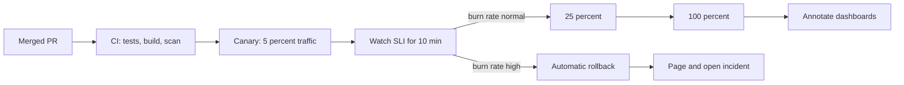

## 37.12 Change management, game days and drills

### 37.12.1 Most incidents follow a change

The single most useful prior in incident response: **roughly 60 to 75 percent of incidents are caused by a change your organization made**. A deploy, a config edit, a feature flag, a migration, an infrastructure update, a certificate rotation, a dependency bump.

Two consequences. First, "what changed in the last two hours?" belongs at the top of every diagnosis, which is why it is step 4 of the first-ten-minutes checklist. Second, the highest-leverage reliability investment is usually **making changes safer**, not making the steady state more redundant.

Safer changes, concretely:

- **Small and frequent beats large and rare.** Ten small deploys a week have a smaller blast radius each and a much easier bisection than one weekly release. The instinct to batch changes because deploys are risky makes each deploy riskier.
- **Progressive delivery.** Canary a small fraction of traffic, watch the SLI, then ramp. Automate the rollback on burn rate: if the canary's error ratio exceeds the baseline by a threshold, abort without a human.
- **Feature flags decoupled from deploys.** Ship the code dark, enable it separately, and you can turn it off in seconds without a rollout. This converts a 6-minute rollback into an 11-second flag flip, which directly moves your MTTR and therefore your availability.
- **Every change has a documented rollback**, and the rollback is tested. A migration that cannot be reversed is not a change, it is a commitment (Part 31 — Database Migrations).
- **An audit trail with timestamps** for deploys, flags, config and infrastructure, all on the same timeline and annotated on your dashboards. "What changed?" should take ten seconds, not ten minutes.

### 37.12.2 Freeze windows and when they are theatre

A **freeze** stops changes during a high-risk period: the sale weekend, the last week of the financial year, the two days before a big customer's audit.

Freezes are legitimate when three things are true: the period is genuinely exceptional, the freeze is short, and there is a documented exception path for security and P0 fixes.

Freezes are theatre when they are long or routine. A four-week December freeze produces a January release containing 400 commits, which is the most dangerous deploy of the year — you have converted many small risks into one enormous one, and you have destroyed your ability to bisect. Worse, teams learn to smuggle changes in through config and flags, which is the same risk with none of the review.

The better instrument is a **heightened-care period**: deploys continue, but only during business hours, only with two reviewers, only one service at a time, with a named engineer watching the SLI dashboard for thirty minutes after each. You keep the ability to fix things, which during a sale weekend is exactly what you need.

### 37.12.3 Game days and chaos experiments

#### Concept

A **game day** is a scheduled exercise where you deliberately break something in a controlled way and practise responding. A **chaos experiment** is the narrower automated version: inject a specific fault and assert the system behaves as designed.

The purpose is not to discover that things break. It is to discover that the things you believed would save you do not work: the failover that was never exercised, the runbook whose first command references a deleted namespace, the alert that was silenced eight months ago, the secondary on-call whose phone number is wrong.

Run it properly:

1. **Write the hypothesis first.** "If we kill the PostgreSQL primary, the replica is promoted within 60 seconds, checkout sees fewer than 30 seconds of errors, the failover alert fires, and no orders are lost." A prediction you can be wrong about.
2. **Announce it.** Game days are not surprise attacks. Surprising your team teaches them to distrust you, and a real incident during the exercise becomes very confusing.
3. **Have an abort condition and a person who owns it**, decided before you start.
4. **Run it in production eventually.** Staging game days find staging bugs. Start in staging, graduate to production during low traffic with a small blast radius.
5. **Write it up like an incident**, with action items. Most of the value is in the write-up.

A useful starter menu for a NestJS-on-Kubernetes stack:

| Experiment | Hypothesis to test |
|---|---|
| Kill a random API pod | Requests drain gracefully; no 5xx; the readiness probe removes it before the SIGTERM |
| Kill the PostgreSQL primary | Failover under 60 s; the connection pool reconnects; checkout errors are bounded |
| Add 300 ms of latency to Redis | Requests degrade to the database path; latency SLI dips but no errors |
| Make the payment provider return 503 | The circuit breaker opens; we fail over to provider B; the burn-rate alert fires |
| Fill a worker's disk | The pod is evicted, jobs are requeued, and nothing is lost |
| Scale workers to zero for 20 minutes | Backlog grows, the oldest-waiting-job alert fires, everything drains on recovery |
| Expire a TLS certificate in staging | The renewal alarm fires at least 24 hours before expiry |
| Page the on-call rotation with a test alert | Everyone's device is configured and the escalation path works end to end |

That last one is the cheapest and finds a broken paging path roughly once a year in every organization I have worked in.

### 37.12.4 DR drills and capacity reviews

**Disaster recovery drills** test the big, rare, terrifying scenarios: the region is gone, the database is corrupted, the account is compromised. The measurements that matter are **RTO** (how long until service is restored) and **RPO** (how much data is lost). Both are fiction until you have restored from a backup with a stopwatch running. Part 38 covers backups and disaster recovery in depth; the SRE-side rule is simply that an untested backup is not a backup, and a DR plan that has never been executed is a document, not a capability.

**Capacity reviews** are the quiet practice that prevents the loudest incidents. Quarterly, ask: what is our peak now, what will it be next quarter, where is the first thing that breaks, and what is the lead time to fix it? Databases have the longest lead times — a bigger instance is a maintenance window, a shard split is a project, a connection-limit ceiling is an architecture change. Find those before the sale, not during it.

## 37.13 Reliability practice for the NestJS stack

Concretely, here is what "we do SRE" should mean for a NestJS service in front of PostgreSQL, Redis and Kafka. Six artefacts, all of which are code or configuration, none of which are slideware.

**1. A per-service dashboard with a fixed shape**, so any engineer can read any service's dashboard. Five rows: SLI and error budget at the top; RED metrics (rate, errors, duration) by route; dependencies (PostgreSQL pool and query latency, Redis latency and hit rate, Kafka lag and rebalance rate, queue depth and oldest-waiting-job age); runtime (event loop lag, heap, GC, replica count, restarts); and deploy annotations across every panel. Part 25 — Observability builds these.

**2. SLO alerts, and almost nothing else that pages.** Burn-rate alerts per journey, plus a small set of hard-failure alerts that are urgent and actionable: CrashLoopBackOff, dead-letter queue growth, replication lag above the threshold, certificate expiry within 24 hours, disk filling. Everything else is a ticket or a dashboard panel.

**3. A dependency map that is maintained.** For each service: what it calls synchronously, what it calls asynchronously, what the timeout is, what happens when each one fails, and whose on-call owns it. Keep it next to the code (a `DEPENDENCIES.md` reviewed in PRs that add a client) so it cannot rot silently.

**4. Documented degradation modes.** For every dependency, a written answer to "what does the user see when this is down?" — and code that implements it. This is the table that turns a serial-dependency chain into a resilient one:

| Dependency down | Designed behaviour | Implemented with |
|---|---|---|
| Redis | Read through to PostgreSQL; latency rises ~40 ms; no errors | Cache wrapper with a fail-open path and a short timeout |
| Recommendation service | Panel renders empty | 250 ms timeout, empty-array fallback |
| Inventory service | Serve the last known snapshot, flag "stock may be inaccurate" | Cached snapshot with a documented 5-minute staleness bound |
| Payment provider A | Automatic failover to provider B | Circuit breaker plus a runtime flag |
| Email provider | Queued and retried; the order still completes | BullMQ with retries and a DLQ (Part 36) |
| Kafka | Events buffered in the outbox; published on recovery | Transactional outbox with a relay |
| PostgreSQL primary | Reads served from the replica; writes fail fast with a clear error | Read replica routing plus a fast-fail write path |

**5. Kill switches, tested.** A runtime flag for every non-essential feature in a critical path, flippable in under 60 seconds without a deploy, listed in the runbook, and exercised in a game day. Their value is measured in MTTR, and MTTR is measured in money.

**6. DLQ replay tooling** behind admin auth: a summary endpoint that groups failures by reason, and a replay endpoint that is capped and spaced. Building this before you need it turns a two-hour manual recovery into a five-minute one, and it is 60 lines of code (Part 36).

## 37.14 Edge cases and failure modes

**SLOs measured server-side only.** The pods were down, so they emitted no metrics, so the error ratio was 0/0 and the dashboard was green through a 40-minute outage. *Fix:* compute availability at the ingress or load balancer, and add a black-box probe as a liveness canary on your monitoring of your monitoring.

**Alert fatigue.** Forty pages a week, most of them nothing. People acknowledge without reading. Eventually a real one is acknowledged without reading. *Fix:* treat noisy alerts as bugs with owners and due dates; review the top-firing alert every month; delete anything nobody has acted on in six months.

**Unowned services.** `legacy-sync` has no team, no runbook and no dashboard, and it is in the checkout path. *Fix:* a service catalogue where every service has an owning team, an on-call rota, an SLO and a runbook, and a rule that a service without an owner cannot be deployed to production.

**Postmortem actions that never ship.** The document is excellent. Six months later, the same incident. *Fix:* tickets created in the meeting, P0s in the current sprint, monthly review of open actions with an age report, and budget-policy time reserved for them.

**Silence during an incident.** Engineering is working hard and telling nobody. Support invents answers, the exec escalates, the customer finds out from a competitor's tweet. *Fix:* a Comms Lead role, a fixed update cadence enforced by the IC, and a status page updated within 15 minutes even when the message is only "we are investigating".

**Hero culture.** One engineer fixes every incident, at 2 a.m., alone, and is praised for it. This looks like strength and is a single point of failure with a pulse. *Fix:* rotate the IC role, require runbooks written by the hero and executed by someone else, praise the person who made the incident boring rather than the one who was awake for it.

**Single-person knowledge.** Only Arun understands the payment reconciliation. Arun is on holiday. *Fix:* runbooks executed by non-experts in game days, pairing on incident response, and a rule that a system with one knowledgeable person is a P1 risk, tracked like any other.

**Stale runbooks.** The first command references a namespace deleted last year, so the reader loses trust and improvises. *Fix:* a review date in every runbook, an automated check that flags any runbook older than 6 months, and execution in game days which finds the rot.

**An ignored error budget.** The budget has been exhausted for four consecutive months and nothing has changed. The SLO is now decoration and everyone knows it. *Fix:* the policy's escalation clause — either the target comes down or reliability work gets staffed. Say it out loud to management. An SLO nobody enforces is worse than none, because it creates false confidence.

**Retries masking failures.** The client retries three times, so the SLI measured at the ingress looks fine, while users wait 9 seconds and a third of them give up. Your dashboard shows 99.97 percent and your conversion rate is falling. *Fix:* measure at the *user journey* level — one attempt per user action — and add a latency SLI, not just availability. Also count retries explicitly: a rising retry rate with a flat error rate is the signature of exactly this.

**Monitoring down during the incident.** Prometheus runs in the cluster that is failing, so during the outage you are blind. *Fix:* host monitoring outside the blast radius (a different cluster, a different account, or a managed service), and keep an external black-box probe and an out-of-band paging path that does not depend on your own infrastructure.

**A status page nobody updates.** It exists, it says "all systems operational", and it has said that through the last three outages. It is now actively harmful: it teaches customers your communications are worthless. *Fix:* make updating it a step in the incident process owned by a named role, and audit it after every incident.

**An incident starting at on-call handoff.** 09:58, the outgoing engineer is mentally finished and the incoming one has no context. Both assume the other has it. *Fix:* an explicit handoff protocol — the outgoing on-call stays engaged until the incoming one confirms context in writing; and if an incident is active at handoff, the outgoing engineer remains the IC until the incident is resolved or a formal IC handoff is announced in the channel.

**A dependency whose SLA is worse than your SLO.** You promise 99.95 percent; the SMS provider offers 99.5 percent and sits in your signup flow. *Fix:* the arithmetic in 37.6 — remove it from the synchronous path, add a second provider, degrade gracefully, or lower your promise. And check every vendor's SLA against your own SLO before signing, not after the first breach.

**The SLI that measures the wrong thing.** Availability was 99.99 percent all month because a bug made the API return `200 OK` with an empty body. *Fix:* correctness SLIs and synthetic transactions that assert on content, not status codes. A synthetic checkout that verifies an order row appears is worth more than a hundred `/health` probes.

#### How a Senior Backend Engineer thinks about all of this

They know reliability is bought, not wished for, and they can say what it costs. They measure from the user's side because that is the only side that matters. They keep a small number of alerts that all mean something. They mitigate before they diagnose, and they can prove they do because their runbooks are ordered that way. They write postmortems that make the system safer rather than making someone feel bad. And they know that the highest-leverage reliability work is almost never more redundancy: it is faster rollback, better alerts, fewer synchronous dependencies, and a team that is not exhausted.

#### Interview questions

1. *What makes a postmortem blameless, in practice rather than in name?* Expected: system-focused language, action items that change systems, the person closest to the trigger present and comfortable, no counterfactuals; and the recognition that a single mistake taking down production is a design defect.
2. *Distinguish trigger, root cause and contributing factors with an example.* Expected: node drain, non-idempotent consumer, and the poll interval / membership / monitoring gaps; fixing only the trigger leaves the class of incident armed.
3. *What are the limits of five whys?* Expected: it yields one linear chain while incidents are trees; ask why in several directions and keep a long contributing-factors list.
4. *Why is "human error" never a root cause?* Expected: human error rate is a constant; the question is what made the error possible or undetectable; translate to a system property that engineering can change.
5. *Your team wants a four-week code freeze before the holidays. What do you say?* Expected: it converts many small risks into one enormous January release and destroys bisection; propose a heightened-care period with an exception path instead.
6. *What would you run in your first game day, and what is the hypothesis?* Expected: a specific, falsifiable prediction with an abort condition, announced in advance, written up like an incident.
7. *Your availability SLI says 99.99 percent and customers are complaining. Name four reasons.* Expected: measured server-side while pods were down; retries masking failures; wrong SLI (200 with an empty body); journey-level failure spread across services each of which looks fine; a threshold that does not match user experience.

#### Practical exercise

Run a full incident lifecycle as a drill, end to end, within one week.

1. Schedule a game day. Write the hypothesis: "if we make the payment provider return 503 for 20 minutes, the circuit breaker opens within 30 seconds, we fail over to provider B, the fast-burn alert fires within 10 minutes, and no order is lost."
2. Run it in staging with production-like traffic. Assign a real IC, Ops Lead and Comms Lead. Post updates on the real cadence to a real channel.
3. Have someone who does not own the service execute the runbook.
4. Write the postmortem using the full template, including "where we got lucky".
5. Create every action item as a ticket during the meeting.

Acceptance criteria: the hypothesis was written before the exercise and at least one part of it turned out to be wrong; the runbook was executed by a non-expert without asking the owner a question, or the gaps it exposed became action items; the alert fired within the predicted window; the postmortem contains at least six contributing factors and zero instances of "be more careful"; every action item has a named person and a date; and the P0 items are in the current sprint.

## Senior Checklist — Part 37

- [ ] I understand the concept
- [ ] I can explain it simply
- [ ] I can implement it
- [ ] I understand its failure modes
- [ ] I understand its scaling limitations
- [ ] I understand its security implications
- [ ] I understand its operational implications
- [ ] I can choose between alternatives
- [ ] I can explain the tradeoffs
- [ ] I can answer senior-level interview questions
- [ ] I can explain reliability as a feature with a cost, and name what we would give up to add a nine
- [ ] I can identify toil in my team's week and name the top item to eliminate this quarter
- [ ] I can define an SLI as a ratio of good to valid events for availability, latency, correctness and freshness
- [ ] My availability SLI is measured at the edge, not inside the service, and I can explain why that matters
- [ ] I have written histogram buckets that bracket my latency SLO thresholds
- [ ] I can write the PromQL and recording rules for every SLI I own
- [ ] I have SLOs per user journey, with targets justified by user need, historical achievability and dependency ceilings
- [ ] I can explain the difference between SLO and SLA and why the SLA must be looser
- [ ] I can compute an error budget in minutes and in failed requests, and state my current remaining budget
- [ ] I can explain and configure multi-window multi-burn-rate alerting, and justify the 14.4 / 6 / 3 / 1 rates
- [ ] There is a written, signed error budget policy that says what happens when the budget is exhausted
- [ ] I can multiply a serial dependency chain and tell product why a target is impossible
- [ ] I know my journey's MTTR and I can name the cheapest thing that would halve it
- [ ] We have severity levels with concrete examples, and anyone may declare an incident without permission
- [ ] I can run an incident as IC without touching a terminal
- [ ] I mitigate before I diagnose, and my runbooks are ordered that way
- [ ] Every alert that pages has an owner, a runbook link, a `for:` duration and a user-impact description
- [ ] I track pages per shift, out-of-hours pages, time to acknowledge and actionability, and review them monthly
- [ ] I can write a runbook a non-expert can execute at 3 a.m. without asking me a question
- [ ] I can write a blameless postmortem with impact numbers, a timeline including wrong turns, contributing factors, luck, and owned action items with dates
- [ ] I never write "human error" as a root cause
- [ ] We run game days, and at least one of our beliefs has been proven wrong by one

## Part 37 — Key Takeaways

- Reliability is a product feature with a price. The right amount is the least that keeps users happy and the business safe; more than that is capital you could have spent shipping.
- An SLI is always a ratio of good events to valid events. CPU is not an SLI; users do not experience CPU.
- Measure availability at the edge. A crashed service emits no metrics, and its error ratio looks perfect while customers get 502s.
- Write SLOs per user journey, not per service, and give different journeys different targets on purpose.
- The SLA is always looser than the SLO. The gap between them is your warning margin, and it is the difference between a feature freeze and a refund.
- The error budget turns "it feels risky" into arithmetic both engineering and product can read, and it gives product the right to spend it.
- Alert on burn rate with paired long and short windows: page for fast burns, ticket for slow bleeds, and let the short window resolve the alert quickly.
- Serial dependencies multiply. Four services at 99.9 percent give 99.6 percent, and no amount of enthusiasm changes that.
- You cannot be more available than a dependency you must call synchronously. Remove it, degrade around it, add real redundancy, or lower the promise.
- MTTR is usually the cheapest lever on availability. A rollback button and a kill switch beat another replica.
- In the first ten minutes: mitigate. Roll back, scale, shed load, disable the feature. Diagnosis is what the postmortem is for.
- One person cannot be Incident Commander, Operations Lead and Communications Lead. Decisions and debugging compete for the same brain.
- A page must be urgent and actionable. Everything else is a ticket, and a noisy alert is a bug with an owner and a due date.
- A runbook is written for a competent engineer at 3 a.m. who does not know your service: symptom, impact, dashboards, diagnosis, mitigation, escalation, verification.
- Blameless means asking what made the wrong action look right. "Human error" is never a root cause; it is where the analysis should start.
- Most incidents follow a change, so making changes safer beats making the steady state more redundant.
- An untested failover is not redundancy, and an unexecuted runbook is fiction. Game days are how you find out which of your safety nets are real.
