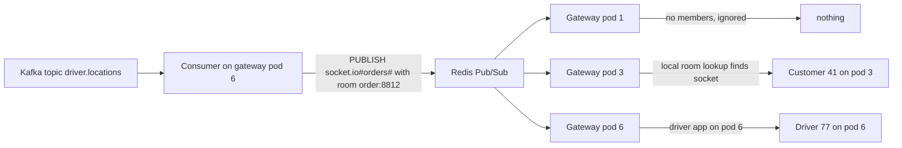
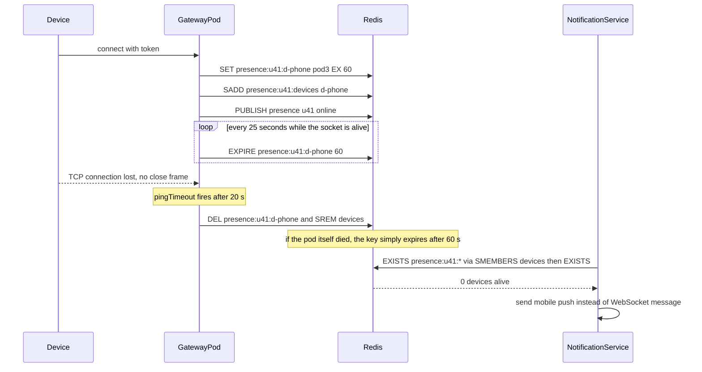

## 38.5 Pub/Sub for fan-out across pods

### 38.5.1 Why a message on pod A must reach a client on pod B

#### Concept

A WebSocket connection lives on exactly one process. When your gateway runs as 8 pods behind a load balancer, the customer watching order 8812 is connected to pod 3, and the Kafka consumer that learns the driver moved is running on pod 6. Pod 6 calling `server.to('order:8812').emit(...)` reaches only the sockets that pod 6 holds. The customer sees nothing. Fan-out across pods needs a shared channel that every pod subscribes to: a **Pub/Sub** layer.

#### Why does it exist?

Rooms are in-memory data structures. Horizontal scaling is the whole reason you have more than one pod. The two are in direct conflict unless something carries "emit this to room X" from the pod that knows to the pods that hold the sockets. Every real-time system that runs on more than one process has this layer; the only question is whether it is Redis Pub/Sub, Redis Streams, Kafka, NATS or a vendor.

#### Mental model

Imagine a hotel with eight reception desks, each with its own list of guests who asked to be woken at 7 a.m. A wake-up call for room 812 must go to the desk that has 812 on its list. Instead of each desk phoning the other seven, they all listen to one intercom: whoever learns about 812 announces it, and the desk that has 812 acts. The intercom is Pub/Sub. If the intercom is broken, every desk is an island.

#### How it works



With the Socket.IO Redis adapter:

1. Every pod, on startup, opens two Redis connections: one to publish, one subscribed to the adapter's channels (a subscribed connection cannot run other commands, so a second connection is mandatory).
2. `server.to('order:8812').emit('driver.location', payload)` on pod 6 emits locally *and* publishes a compact message (`rooms`, `event`, `payload`, and the origin pod's id) to Redis.
3. Every other pod receives it, looks up the room in its own memory, and emits to its own matching sockets. Pods with no members do nothing.
4. `client.join` and `client.leave` stay local; membership never leaves the pod. That is why the adapter is cheap: it broadcasts intent, not state.
5. Adapter requests that need cluster-wide answers (`fetchSockets()`, `serverSideEmit`, counting sockets in a room) use a request-response protocol over the same channels with a timeout. They are slow (a Redis round trip plus the slowest pod) and should not be on a hot path.

Three backends for the channel:

| Backend | Durability | Ordering | Throughput | Use when |
|---|---|---|---|---|
| Redis Pub/Sub | None; a message published while a pod is disconnected is gone | Per channel, per publisher | Very high, sub-millisecond, but every subscriber receives every message | The default. Live fan-out where a missed message is recovered by the client's resume logic, not by the channel |
| Redis Streams | Persistent up to `MAXLEN`; consumers read from an id | Per stream | High | Replay on reconnect (`XRANGE` since the last id), and as the source of `Last-Event-ID` for SSE |
| Kafka | Durable, partitioned, retained for days | Per partition | Very high but with 5 to 50 ms latency | The upstream source of truth for events (driver locations, order status). Gateways consume it; they do not use it as the pod-to-pod channel because a rebalance across 8 gateway pods on every deploy is painful |

The common production shape is all three: Kafka carries the business events from producers to the gateway fleet; the gateway consumer writes the last N events per room to a Redis Stream for replay; the Socket.IO Redis adapter (Pub/Sub) does the live fan-out between pods.

#### NestJS example

NestJS lets you replace the Socket.IO server factory with a custom adapter class. This is where the Redis adapter is installed.

```ts
// realtime/redis-io.adapter.ts
import { IoAdapter } from '@nestjs/platform-socket.io';
import { INestApplicationContext } from '@nestjs/common';
import { ServerOptions } from 'socket.io';
import { createAdapter } from '@socket.io/redis-adapter';
import Redis from 'ioredis';

export class RedisIoAdapter extends IoAdapter {
  private adapterConstructor?: ReturnType<typeof createAdapter>;

  constructor(app: INestApplicationContext, private readonly redisUrl: string) {
    super(app);
  }

  async connectToRedis(): Promise<void> {
    const pub = new Redis(this.redisUrl, { maxRetriesPerRequest: 3, enableOfflineQueue: false });
    const sub = pub.duplicate();            // subscriber connection must be separate
    await Promise.all([pub.connect?.(), sub.connect?.()].filter(Boolean));
    pub.on('error', (err) => console.error('redis pub error', err.message));
    sub.on('error', (err) => console.error('redis sub error', err.message));
    this.adapterConstructor = createAdapter(pub, sub, {
      requestsTimeout: 5_000,               // fetchSockets and friends give up after 5 s
      publishOnSpecificResponseChannel: true,
    });
  }

  createIOServer(port: number, options?: ServerOptions) {
    const server = super.createIOServer(port, {
      ...options,
      transports: ['websocket', 'polling'],
      allowEIO3: false,
    });
    server.adapter(this.adapterConstructor);
    return server;
  }
}
```

```ts
// main.ts
const app = await NestFactory.create(AppModule);
const ioAdapter = new RedisIoAdapter(app, process.env.REDIS_URL!);
await ioAdapter.connectToRedis();
app.useWebSocketAdapter(ioAdapter);
app.enableShutdownHooks();
await app.listen(3000);
```

After this change, nothing in the gateway code changes; `server.to(room).emit` is cluster-wide. That transparency is a trap as well as a gift, because the failure modes of Redis become the failure modes of your rooms (see 38.15).

#### PostgreSQL example

PostgreSQL has its own Pub/Sub, `LISTEN`/`NOTIFY`, and it is tempting for small systems: a trigger on `orders` runs `pg_notify('order_events', json)` and each gateway pod runs `LISTEN order_events`. It works for tens of events per second across a handful of pods. It does not scale: every listener holds a dedicated connection, `NOTIFY` payloads are capped at 8,000 bytes, notifications are queued per connection and dropped if the queue (8 GB by default, but shared) overflows, and a long transaction delays every notification issued inside it until commit. Use it for admin dashboards and internal tools, not for customer-facing fan-out.

```sql
-- Fire an event on status change; the gateway's LISTEN picks it up within a few ms of commit.
CREATE OR REPLACE FUNCTION notify_order_status() RETURNS trigger AS $$
BEGIN
  PERFORM pg_notify('order_events', json_build_object('orderId', NEW.id, 'status', NEW.status, 'seq', NEW.version)::text);
  RETURN NEW;
END $$ LANGUAGE plpgsql;

CREATE TRIGGER orders_status_notify AFTER UPDATE OF status ON orders
FOR EACH ROW EXECUTE FUNCTION notify_order_status();
```

#### Production scenario

A gateway fleet of 8 pods, 200,000 connections, 6,000 emits per second, each to a room with 1 to 3 members. Redis Pub/Sub receives 6,000 publishes per second and delivers 48,000 messages per second (one per pod), each about 300 bytes: 15 MB per second of Redis output, comfortably within one Redis instance's capacity and well under 1 ms per message. CPU on each pod for the adapter is under 5 percent. The first thing that breaks as this grows is not Redis throughput; it is that every pod pays to receive every message, so at 80 pods the adapter traffic is 480,000 deliveries per second and the design needs sharded channels (the adapter supports a sharded mode on Redis 7 with `SSUBSCRIBE`) or a partitioning scheme where a room's members are pinned to a subset of pods.

#### Failure scenario

At 21:10 the Redis instance backing the adapter is failed over by the cloud provider's maintenance. For 40 seconds each pod's subscriber connection is dead. The adapter emits locally only, so a customer connected to pod 3 receives updates only if the Kafka partition with their driver's location happens to be consumed by pod 3, about one in eight. The dashboard's `messages_emitted_total` looks normal because emits are counted at the publisher. Nobody notices for 6 minutes until a support ticket says "my driver is not moving". The retrospective adds a Redis adapter health check to the readiness probe, a metric for adapter publish failures, and a synthetic test that connects to two different pods and asserts a message published via one arrives at the other.

#### Edge cases & failure modes

- **The subscriber connection drops and reconnects.** ioredis resubscribes automatically, but messages published in between are gone. Pub/Sub has no memory. The client's resume-by-sequence logic (38.9) is what covers the gap; if you do not have that, you have a silent data loss window on every Redis blip.
- **`fetchSockets` across a large fleet** is a scatter-gather with a 5 second timeout; a slow pod makes the call slow for everyone. Use it for admin tooling, not for authorization checks.
- **Serialization cost.** The adapter serializes the payload once per publish, and every pod deserializes it. A 50 KB payload emitted 100 times per second is 40 MB per second of Redis traffic across 8 pods.
- **Room names with user input.** `order:${dto.orderId}` where `orderId` is validated as a UUID is safe; a free-form room name lets a client join `admin` or `*`.
- **A pod that publishes but cannot subscribe** (a firewall rule that allows one connection but rate-limits the second) is the hardest to spot: it sends everyone's messages and receives none.

#### How a Senior Backend Engineer thinks about this

They install the Redis adapter on day one, before the second pod exists, because the cost is thirty lines and the alternative is a production bug that appears exactly when traffic grows. They keep Kafka as the source of truth and Redis as the transport, and never make the client's correctness depend on Pub/Sub delivering every message. They put the adapter's Redis in the readiness probe and its publish errors on the dashboard. They plan for the day one Redis is not enough by using room names that could be sharded (`order:{id}` hashes evenly) and by keeping the gateway stateless enough to run as a separate deployment with its own scaling rules.

#### Common mistakes

- Running two gateway pods without an adapter and debugging "messages arrive sometimes".
- Using the Pub/Sub channel as the replay buffer. It has none.
- Holding room membership in Redis "so it is shared" and then doing a Redis round trip per emit to look it up. Membership belongs on the pod; intent goes through Redis.
- Reusing the application's main ioredis connection for the subscriber. A subscribed connection cannot run `GET`, and every cache read starts failing.

## 38.6 Presence

### 38.6.1 Online, offline, last seen and multiple devices

#### Concept

Presence is the answer to "is user 41 online right now, and on which devices?" It looks trivial (set a flag on connect, clear it on disconnect) and is one of the most bug-prone features in real-time systems, because disconnects are not always observed, users have several devices, and the pod that saw the connection may die without saying goodbye.

#### Why does it exist?

Chat shows a green dot. A dispatch system routes an order only to drivers who are actually connected. A collaborative editor shows who is in the document. A notification service decides between a WebSocket push and a mobile push notification based on whether the user is reachable. All of these need a presence answer that is correct within a few seconds and does not go stale when a pod crashes.

#### Mental model

Imagine a building's sign-in sheet, but every visitor must re-sign every minute. If a name has not been re-signed for two minutes, the visitor is assumed to have left, whether or not they signed out. Crashed pods, dead phones and NAT timeouts all look the same: the name stops being refreshed.

#### How it works



1. On connect, the gateway writes a key per device: `presence:{userId}:{deviceId}` with the pod id as the value and a TTL of 60 seconds. It adds the device id to a set `presence:{userId}:devices`, and publishes an `online` event if this is the user's first live device.
2. Every 25 seconds (the same cadence as the ping), while the socket is alive, the gateway refreshes the TTL. The refresh is the heartbeat; it proves the pod and the socket both still exist.
3. On a clean disconnect, the gateway deletes the key, removes the device from the set, and publishes `offline` if no devices remain. It also records `last_seen:{userId}` with a timestamp.
4. On a pod crash, nothing is deleted, and the keys expire on their own within 60 seconds. Presence is eventually correct, with a bounded staleness of one TTL.
5. A reader asks "is u41 online" by reading the devices set and checking which device keys still exist. A read that finds a device in the set whose key is gone cleans the set up lazily.

Why a TTL and not a "connected" flag: a flag set on connect and cleared on disconnect is wrong forever after a single pod crash. The TTL makes the *absence of a heartbeat* the source of truth, which matches reality.

#### NestJS example

```ts
// realtime/presence.service.ts
import { Injectable, Logger, OnModuleDestroy } from '@nestjs/common';
import Redis from 'ioredis';

const TTL_SECONDS = 60;
const REFRESH_MS = 25_000;

@Injectable()
export class PresenceService implements OnModuleDestroy {
  private readonly log = new Logger(PresenceService.name);
  private readonly timers = new Map<string, NodeJS.Timeout>();   // socketId -> refresh timer

  constructor(private readonly redis: Redis, private readonly podId: string) {}

  async connected(socketId: string, userId: string, deviceId: string): Promise<void> {
    const key = `presence:${userId}:${deviceId}`;
    const wasOnline = await this.isOnline(userId);
    await this.redis.multi()
      .set(key, this.podId, 'EX', TTL_SECONDS)
      .sadd(`presence:${userId}:devices`, deviceId)
      .expire(`presence:${userId}:devices`, TTL_SECONDS * 2)
      .exec();
    if (!wasOnline) await this.redis.publish('presence', JSON.stringify({ userId, state: 'online' }));

    // Heartbeat: refresh the TTL while this socket lives. If the pod dies, the key expires on its own.
    const timer = setInterval(() => {
      this.redis.expire(key, TTL_SECONDS).catch((err) => this.log.warn({ err: err.message }, 'presence refresh failed'));
    }, REFRESH_MS);
    this.timers.set(socketId, timer);
  }

  async disconnected(socketId: string, userId: string, deviceId: string): Promise<void> {
    clearInterval(this.timers.get(socketId));
    this.timers.delete(socketId);
    await this.redis.multi()
      .del(`presence:${userId}:${deviceId}`)
      .srem(`presence:${userId}:devices`, deviceId)
      .set(`last_seen:${userId}`, Date.now().toString())
      .exec();
    if (!(await this.isOnline(userId))) {
      await this.redis.publish('presence', JSON.stringify({ userId, state: 'offline', lastSeen: Date.now() }));
    }
  }

  async isOnline(userId: string): Promise<boolean> {
    const devices = await this.redis.smembers(`presence:${userId}:devices`);
    if (devices.length === 0) return false;
    const alive = await this.redis.mget(devices.map((d) => `presence:${userId}:${d}`));
    const stale = devices.filter((_, i) => alive[i] === null);
    if (stale.length) await this.redis.srem(`presence:${userId}:devices`, ...stale);   // lazy cleanup
    return alive.some((v) => v !== null);
  }

  onModuleDestroy() {
    for (const t of this.timers.values()) clearInterval(t);
  }
}
```

Wire it into the gateway's `handleConnection` and `handleDisconnect`. The device id comes from the client (a stable id per install, sent in the handshake `auth`), and `socketId` is `client.id`.

#### PostgreSQL example

Presence itself never lives in PostgreSQL; a `UPDATE users SET online = true` per connect is a write per socket event and a hot row per active user. What does belong in PostgreSQL is `last_seen_at`, written lazily (at most once per minute per user, from the disconnect path or a periodic flush), because product features like "active in the last 7 days" need durable history and are queried by cohort, not by socket.

```sql
-- Written at most once per minute per user; never on every heartbeat.
UPDATE users SET last_seen_at = GREATEST(last_seen_at, $2) WHERE id = $1;
CREATE INDEX users_last_seen_idx ON users (last_seen_at DESC);
```

#### Production scenario

A chat product with 300,000 online users across 12 gateway pods. Each connection refreshes its TTL every 25 seconds: 12,000 `EXPIRE` commands per second on Redis, trivially cheap. `isOnline` is called by the notification service about 2,000 times per second; each call is `SMEMBERS` plus one `MGET`, about 0.6 ms. Presence staleness after a pod crash is bounded at 60 seconds, which product accepted after being shown the alternative (a distributed sweep that costs more than the feature).

#### Failure scenario

The first version of presence used a plain `SET presence:u41 true` on connect and `DEL` on disconnect. A gateway pod was OOMKilled at 14:00. Every user connected to it stayed "online" in Redis forever; the notification service kept trying WebSocket delivery to 25,000 users who were not reachable and never fell back to mobile push. Users missed messages for six hours until someone ran `FLUSHDB` on the presence keyspace. The rewrite to TTL-refreshed keys took one afternoon and the bug class disappeared.

#### Edge cases & failure modes

- **Multi-device.** A user with a phone and a laptop must stay online when the laptop closes. Key per device, set of devices per user; `offline` only when the set is empty of live keys.
- **Reconnect flapping.** A mobile user on a train produces connect and disconnect every few seconds; publishing `online`/`offline` each time floods the presence channel. Debounce the offline event: wait 10 seconds and re-check before publishing.
- **Clock skew is irrelevant here** because TTLs are relative and computed by Redis, one of the reasons to prefer TTLs over stored timestamps compared against local clocks.
- **The refresh timer keeps running after a disconnect** if the disconnect handler throws before `clearInterval`. Clear timers first, then do I/O.
- **Redis restart without persistence** empties presence; everyone appears offline until the next refresh cycle repopulates within 25 seconds. Acceptable; document it.
- **Privacy.** Presence and last-seen are personal data in many jurisdictions; expose them only to contacts the user has allowed, and never broadcast them to a room.

#### How a Senior Backend Engineer thinks about this

They define presence as "has heartbeated within the last N seconds" and refuse any design where correctness depends on observing a disconnect. They put the TTL in the product conversation: "you will see someone as online for up to 60 seconds after their phone dies; is that acceptable, or do you want a 20 second TTL at three times the Redis load?" They keep presence in Redis and history in PostgreSQL, and they debounce the visible state so a flapping network does not make the green dot blink.

