## 38.13 Worked example: live order tracking for food delivery

### 38.13.1 The requirement and the architecture

#### Concept

A customer places an order and opens the tracking screen. They must see the order's status changes (`accepted`, `preparing`, `picked_up`, `on_the_way`, `delivered`) within a second of them happening, and the driver's position on a map, updated every few seconds while the order is `on_the_way`. The driver's app sends its GPS position every 3 seconds to the driver service. Restaurants and support agents may also watch orders. There are 60,000 concurrent orders at peak, roughly 250,000 connected clients, and the gateway must survive deploys and pod failures without the customer noticing.

#### The flow

```mermaid
flowchart LR
    DA["Driver app"] -->|"POST /locations every 3 s"| DS["Driver service"]
    DS -->|"produce keyed by orderId"| KL["Kafka driver.locations"]
    OSvc["Order service"] -->|"outbox then produce keyed by orderId"| KO["Kafka order.events"]
    KL --> GC["Gateway Kafka consumer, one partition per pod at a time"]
    KO --> GC
    GC -->|"XADD replay stream"| RS["Redis Streams stream:order:id"]
    GC -->|"server.to room order:id emit"| AD["Redis adapter Pub/Sub"]
    AD --> P1["Gateway pod 1"]
    AD --> P2["Gateway pod 2"]
    P1 --> CA["Customer app in room order:8812"]
    P2 --> SA["Support dashboard in room order:8812"]
    CA -->|"reconnect with lastSeq"| P2
    P2 -->|"XRANGE replay"| RS
```



Design decisions, each with the reason:

- **Kafka is the source of events, not the gateway.** The order service writes an outbox row in the same transaction as the status change and a relay publishes it; the driver service publishes locations directly because losing one location is acceptable. Both topics are keyed by `orderId` so each order's events stay ordered on one partition.
- **The gateway is a separate NestJS deployment** that consumes both topics, writes the replay stream, and emits to rooms. It reads PostgreSQL only through a cached `canView` check on join.
- **Rooms are `order:{id}`**. Customers, drivers, restaurant staff and support join the same room with different authorization rules; the payload carries nothing the least-privileged member may not see (no phone numbers, no addresses; those are fetched via REST with their own guards).
- **Status events are at-least-once with replay**; location events are at-most-once and coalesced (`volatile`), because the next one supersedes.
- **Presence** tracks drivers so dispatch can tell "connected" from "app killed", and tracks customers so the notification service can fall back to push.

### 38.13.2 The code

#### NestJS example: module and adapter

```ts
// realtime/realtime.module.ts
import { Module } from '@nestjs/common';
import { JwtModule } from '@nestjs/jwt';
import { OrdersGateway } from './orders.gateway';
import { OrderStreamService } from './order-stream.service';
import { PresenceService } from './presence.service';
import { OrderEventsConsumer } from './order-events.consumer';
import { OrdersAccessService } from './orders-access.service';
import { RealtimeMetrics } from './realtime.metrics';
import { REDIS } from '../redis/redis.module';

@Module({
  imports: [JwtModule.register({ secret: process.env.JWT_PUBLIC_KEY, verifyOptions: { algorithms: ['RS256'] } })],
  providers: [
    OrdersGateway, OrderStreamService, OrdersAccessService, OrderEventsConsumer, RealtimeMetrics,
    { provide: PresenceService, inject: [REDIS], useFactory: (redis) => new PresenceService(redis, process.env.HOSTNAME ?? 'local') },
  ],
})
export class RealtimeModule {}
```

The `RedisIoAdapter` from 38.5 is installed in `main.ts` exactly as shown there; nothing in this module needs to know about it.

#### NestJS example: the gateway

```ts
// realtime/orders.gateway.ts
import {
  ConnectedSocket, MessageBody, OnGatewayConnection, OnGatewayDisconnect, OnGatewayInit,
  SubscribeMessage, WebSocketGateway, WebSocketServer, WsException,
} from '@nestjs/websockets';
import { BeforeApplicationShutdown, Logger, UseGuards, UsePipes, ValidationPipe } from '@nestjs/common';
import { JwtService } from '@nestjs/jwt';
import { Server, Socket } from 'socket.io';
import { WsAuthGuard } from './ws-auth.guard';
import { WsRateLimitGuard } from './ws-rate-limit.guard';
import { OrdersAccessService } from './orders-access.service';
import { OrderStreamService } from './order-stream.service';
import { PresenceService } from './presence.service';
import { RealtimeMetrics } from './realtime.metrics';
import { ResumeOrderDto } from './dto/resume-order.dto';

interface Handshake { token: string; deviceId: string; role: 'customer' | 'driver' | 'staff'; }

@WebSocketGateway({
  namespace: '/tracking',
  cors: { origin: (process.env.WS_ORIGINS ?? '').split(','), credentials: true },
  transports: ['websocket'],
  pingInterval: 25_000,
  pingTimeout: 20_000,
  maxHttpBufferSize: 32 * 1024,
})
export class OrdersGateway implements OnGatewayInit, OnGatewayConnection, OnGatewayDisconnect, BeforeApplicationShutdown {
  @WebSocketServer() server: Server;
  private readonly log = new Logger(OrdersGateway.name);
  private draining = false;

  constructor(
    private readonly jwt: JwtService,
    private readonly access: OrdersAccessService,
    private readonly stream: OrderStreamService,
    private readonly presence: PresenceService,
    private readonly metrics: RealtimeMetrics,
  ) {}

  afterInit(server: Server) {
    // Refuse new upgrades while draining; the LB will route elsewhere once readiness flips.
    server.use((socket, next) => (this.draining ? next(new Error('DRAINING')) : next()));
  }

  async handleConnection(client: Socket) {
    const hs = client.handshake.auth as Partial<Handshake>;
    try {
      if (!hs.token || !hs.deviceId) throw new Error('missing credentials');
      const payload = await this.jwt.verifyAsync<{ sub: string; exp: number; role: string }>(hs.token);
      client.data.userId = payload.sub;
      client.data.role = payload.role;
      client.data.deviceId = hs.deviceId;
      client.data.tokenExp = payload.exp * 1000;
      await this.presence.connected(client.id, payload.sub, hs.deviceId);
      this.metrics.connections.inc({ role: payload.role });
      this.log.log({ userId: payload.sub, role: payload.role, deviceId: hs.deviceId }, 'ws connected');
    } catch (err) {
      this.metrics.authFailures.inc();
      client.emit('error', { code: 'UNAUTHORIZED' });
      client.disconnect(true);
    }
  }

  async handleDisconnect(client: Socket) {
    if (!client.data.userId) return;
    this.metrics.connections.dec({ role: client.data.role });
    this.metrics.disconnects.inc({ reason: (client as any).disconnectReason ?? 'unknown' });
    await this.presence.disconnected(client.id, client.data.userId, client.data.deviceId);
  }

  // Join or resume: the client always sends its lastSeq (0 for a fresh open).
  @UseGuards(WsAuthGuard, WsRateLimitGuard)
  @UsePipes(new ValidationPipe({ whitelist: true }))
  @SubscribeMessage('order.watch')
  async watch(@ConnectedSocket() client: Socket, @MessageBody() dto: ResumeOrderDto) {
    const allowed = await this.access.canView(client.data.userId, client.data.role, dto.orderId);
    if (!allowed) throw new WsException('FORBIDDEN');
    await client.join(`order:${dto.orderId}`);
    const missed = await this.stream.replaySince(dto.orderId, dto.lastSeq);
    if (missed === null) { this.metrics.resyncs.inc(); return { status: 'RESYNC' }; }
    for (const ev of missed) client.emit('order.event', { orderId: dto.orderId, ...ev });
    this.metrics.replayed.inc(missed.length);
    return { status: 'OK', replayed: missed.length };
  }

  @UseGuards(WsAuthGuard)
  @SubscribeMessage('order.unwatch')
  async unwatch(@ConnectedSocket() client: Socket, @MessageBody() dto: ResumeOrderDto) {
    await client.leave(`order:${dto.orderId}`);
    return { status: 'OK' };
  }

  // Called by the Kafka consumer. Status events are durable and sequenced.
  emitStatus(orderId: string, ev: { seq: number; type: string; payload: unknown }) {
    this.server.to(`order:${orderId}`).emit('order.event', { orderId, ...ev });
    this.metrics.emitted.inc({ kind: 'status' });
  }

  // Location events are best-effort: volatile drops them for clients whose transport is not writable.
  emitLocation(orderId: string, loc: { lat: number; lng: number; heading: number; at: number }) {
    this.server.to(`order:${orderId}`).volatile.emit('driver.location', { orderId, ...loc });
    this.metrics.emitted.inc({ kind: 'location' });
  }

  async beforeApplicationShutdown() {
    this.draining = true;
    this.log.warn({ clients: this.server.engine.clientsCount }, 'draining');
    await new Promise((r) => setTimeout(r, 5_000));                    // readiness has flipped; LB stops routing
    const sockets = await this.server.local.fetchSockets();
    for (const s of sockets) s.emit('server.reconnect', { afterMs: Math.floor(Math.random() * 10_000) });
    await new Promise((r) => setTimeout(r, 2_000));
    this.server.local.disconnectSockets(true);
  }
}
```

```ts
// realtime/dto/resume-order.dto.ts
import { IsInt, IsUUID, Min } from 'class-validator';
export class ResumeOrderDto {
  @IsUUID() orderId: string;
  @IsInt() @Min(0) lastSeq: number;
}
```

#### NestJS example: authorization with a cache

```ts
// realtime/orders-access.service.ts
import { Injectable } from '@nestjs/common';
import { InjectRepository } from '@nestjs/typeorm';
import { Repository } from 'typeorm';
import Redis from 'ioredis';
import { Order } from '../orders/order.entity';

@Injectable()
export class OrdersAccessService {
  constructor(@InjectRepository(Order) private readonly orders: Repository<Order>, private readonly redis: Redis) {}

  async canView(userId: string, role: string, orderId: string): Promise<boolean> {
    if (role === 'staff') return true;                       // support and restaurant staff: role-based
    const key = `order:${orderId}:viewers`;
    let viewers = await this.redis.smembers(key);
    if (viewers.length === 0) {
      const order = await this.orders.findOne({ where: { id: orderId }, select: ['customerId', 'driverId'] });
      if (!order) return false;
      viewers = [order.customerId, order.driverId].filter(Boolean) as string[];
      await this.redis.multi().sadd(key, ...viewers).expire(key, 300).exec();   // 5 minute cache; driver reassignment invalidates it
    }
    return viewers.includes(userId);
  }

  async invalidate(orderId: string): Promise<void> {
    await this.redis.del(`order:${orderId}:viewers`);
  }
}
```

The order service calls `invalidate` (through an event) when a driver is reassigned, so the old driver loses access within one event rather than five minutes. That still leaves the old driver *in the room* until their socket rejoins; 38.15 covers evicting them.

#### NestJS example: the Kafka consumer

```ts
// realtime/order-events.consumer.ts
import { Injectable, OnModuleDestroy, OnModuleInit, Logger } from '@nestjs/common';
import { Consumer, Kafka } from 'kafkajs';
import { OrdersGateway } from './orders.gateway';
import { OrderStreamService } from './order-stream.service';
import { OrdersAccessService } from './orders-access.service';

@Injectable()
export class OrderEventsConsumer implements OnModuleInit, OnModuleDestroy {
  private readonly log = new Logger(OrderEventsConsumer.name);
  private consumer: Consumer;

  constructor(
    private readonly gateway: OrdersGateway,
    private readonly stream: OrderStreamService,
    private readonly access: OrdersAccessService,
  ) {}

  async onModuleInit() {
    const kafka = new Kafka({ clientId: 'tracking-gateway', brokers: process.env.KAFKA_BROKERS!.split(',') });
    this.consumer = kafka.consumer({ groupId: 'tracking-gateway', sessionTimeout: 30_000 });
    await this.consumer.connect();
    await this.consumer.subscribe({ topics: ['order.events', 'driver.locations'] });
    await this.consumer.run({
      eachMessage: async ({ topic, message }) => {
        const orderId = message.key!.toString();
        const body = JSON.parse(message.value!.toString());
        if (topic === 'order.events') {
          const ev = { seq: body.seq as number, type: body.type as string, payload: body.payload };
          await this.stream.append(orderId, ev);          // durable replay first, then live emit
          this.gateway.emitStatus(orderId, ev);
          if (body.type === 'order.driver_assigned') await this.access.invalidate(orderId);
        } else {
          // Drop stale locations: if the message is older than 15 s the next one is already on its way.
          if (Date.now() - body.at > 15_000) return;
          this.gateway.emitLocation(orderId, { lat: body.lat, lng: body.lng, heading: body.heading, at: body.at });
        }
      },
    });
  }

  async onModuleDestroy() {
    await this.consumer?.disconnect();   // leave the group cleanly so the rebalance is fast
  }
}
```

Writing to the replay stream before emitting means a client that reconnects during the emit finds the event in the stream. The order (stream first, then emit) is what makes the at-least-once promise true.

#### PostgreSQL example

The order service's side of the contract: the status change, its sequence and its outbox row commit together.

```sql
BEGIN;
UPDATE orders SET status = 'on_the_way', version = version + 1, updated_at = now()
WHERE id = $1 AND status = 'picked_up'
RETURNING version;                                     -- suppose it returns 4

INSERT INTO outbox (id, aggregate_type, aggregate_id, event_type, seq, payload, created_at)
VALUES (gen_random_uuid(), 'order', $1, 'order.status', 4,
        jsonb_build_object('status', 'on_the_way', 'eta', $2), now());
COMMIT;
```

The relay publishes to `order.events` with `key = aggregate_id` and `seq` in the body. See Part 31 — Messaging: Queues, Topics, Kafka, RabbitMQ and SQS for the outbox relay itself.

#### Client behaviour summary

The customer app opens the socket with `{ token, deviceId, role: 'customer' }`, emits `order.watch { orderId, lastSeq }` on every `connect` (including reconnects), applies `order.event` in sequence with dedup, applies `driver.location` immediately (latest wins, no sequence), and on `server.reconnect` closes and reconnects after the given delay. On `RESYNC` it calls `GET /orders/:id` and resets `lastSeq` to the returned `version`.

#### Production scenario

Peak numbers for this design: 60,000 active orders, 250,000 sockets on 12 gateway pods, 20,000 location messages per second and 300 status events per second consumed from Kafka across 48 partitions, Redis adapter at 20,300 publishes and 244,000 deliveries per second, replay streams totalling 1.2 GB in Redis (60,000 orders times about 20 KB), presence at 10,000 `EXPIRE`s per second. p99 from Kafka produce to customer screen is 220 ms for status and 90 ms for location. A rolling deploy of the gateway takes 9 minutes and produces zero customer-visible errors.

## 38.14 Observability for real-time systems

### 38.14.1 The gauges and rates that matter

#### Concept

Real-time systems fail quietly. A REST API that breaks returns 500s and the error ratio alert fires. A WebSocket gateway that breaks keeps connections open and simply stops delivering, or delivers to half the clients, and nothing in the standard RED metrics changes. The metrics here are chosen to make silence visible.

#### How it works

```ts
// realtime/realtime.metrics.ts
import { Injectable } from '@nestjs/common';
import { Counter, Gauge, Histogram } from 'prom-client';
import { registry } from '../metrics/registry';

@Injectable()
export class RealtimeMetrics {
  readonly connections = new Gauge({ name: 'ws_connections', help: 'Open sockets on this pod', labelNames: ['role'], registers: [registry] });
  readonly emitted = new Counter({ name: 'ws_messages_emitted_total', help: 'Room emits by kind', labelNames: ['kind'], registers: [registry] });
  readonly disconnects = new Counter({ name: 'ws_disconnects_total', help: 'Disconnects by reason', labelNames: ['reason'], registers: [registry] });
  readonly authFailures = new Counter({ name: 'ws_auth_failures_total', help: 'Handshakes rejected', registers: [registry] });
  readonly replayed = new Counter({ name: 'ws_events_replayed_total', help: 'Events replayed on resume', registers: [registry] });
  readonly resyncs = new Counter({ name: 'ws_resyncs_total', help: 'Resumes that fell back to REST', registers: [registry] });
  readonly handshakeDuration = new Histogram({ name: 'ws_handshake_duration_seconds', help: 'Connect to authenticated', buckets: [0.005, 0.01, 0.025, 0.05, 0.1, 0.25, 0.5, 1], registers: [registry] });
  readonly slowClients = new Gauge({ name: 'ws_slow_clients', help: 'Sockets with a write backlog over the threshold', registers: [registry] });
  readonly deliveryLag = new Histogram({ name: 'ws_delivery_lag_seconds', help: 'Kafka message timestamp to emit', buckets: [0.01, 0.05, 0.1, 0.25, 0.5, 1, 2.5, 5], registers: [registry] });
}
```

| Metric | What it catches |
|---|---|
| `ws_connections` per pod | Uneven distribution (one pod at 60,000 while others idle), a pod silently losing all clients, HPA input |
| `rate(ws_disconnects_total[5m])` by reason | A reconnect storm (`transport close` spikes), a load balancer timeout (`ping timeout` every N seconds), a deploy |
| `rate(ws_messages_emitted_total[5m])` versus Kafka consume rate | Emits dropping while consumption continues means the adapter or rooms are broken |
| `ws_delivery_lag_seconds` p99 | Consumer lag plus processing delay, the customer-facing latency |
| `ws_events_replayed_total` and `ws_resyncs_total` | Reconnect health; resyncs rising means the replay buffer is too small or Redis lost data |
| `ws_slow_clients` | Backpressure building; a precursor to memory growth |
| `ws_auth_failures_total` | Token rollout problems or an attack |
| Kafka consumer lag for `tracking-gateway` | The gateway is behind; delivery lag will follow |
| Redis adapter publish errors (from ioredis `error` events, counted) | The cluster is splitting into islands |

Alerts, symptom-based as always: delivery lag p99 above 2 seconds for 5 minutes; disconnect rate above 5 times the 1 hour baseline; emitted rate dropping below 50 percent of the consumed rate; any pod at more than 80 percent of its connection ceiling. Plus a **synthetic end-to-end check**: a probe connects to the gateway, publishes a test event to a test order through the real Kafka path, and asserts it arrives within 3 seconds. That single check catches every "everything is green but nothing arrives" failure in this part.

Traces cross this system too. The Kafka message carries `traceparent` from the order service; the consumer span in the gateway is the child of the outbox relay's produce span; the emit is an event on that span with the room and member count. A customer complaint with an order id becomes a trace search on `order.id`, showing the status change, the outbox relay delay, the consumer lag and the emit, in one timeline.

## 38.15 Edge cases & failure modes

- **Load balancer killing idle connections.** An ALB with a 60 second idle timeout and a client that stops answering pings in the background produces a disconnect every minute per backgrounded app. Symptom: `ws_disconnects_total{reason="transport close"}` at a steady rate that matches the timeout. Fix: idle timeout well above the ping interval, and treat backgrounded mobile as expected disconnect.
- **Pod restart dropping 50,000 connections at once.** Without jitter, the reconnect wave overloads the survivors and cascades. With full-jitter backoff (1 s base, 30 s cap) and pods at 60 percent capacity, the wave drains in 10 to 20 seconds. Keep per-pod connection counts low enough that any single pod's loss is absorbable, and scale on connections with a replica floor.
- **Messages lost during reconnect.** Anything emitted between the disconnect and the rejoin is gone unless it went to the replay stream first. The consumer writes the stream before emitting; the client resumes with `lastSeq`; a gap larger than the buffer triggers `RESYNC` via REST.
- **Duplicate delivery after replay.** Joining the room before replaying means a live event can arrive during replay and again from it. The client's sequence dedup makes this harmless; without sequences, the customer sees "on the way" twice and support gets a ticket.
- **Slow consumer memory growth.** One client on a congested link stops reading; every emit to its room appends to its buffer. With `volatile` for high-frequency events and a per-socket backlog limit that disconnects the client at 1 MB, the pod is protected. Without either, one bad client can take a pod to OOMKilled, which drops the other 20,000.
- **Redis adapter down, cluster splits.** Each pod keeps serving its own sockets but only sees events its own consumer processed. Readiness must include the adapter's Redis so the pod is removed from rotation, the synthetic check must fail loudly, and the client's resume covers the gap once Redis returns.
- **Auth token expiring mid-connection.** The connection was authenticated an hour ago; the token expired 30 minutes ago; the user was disabled 10 minutes ago. Check `exp` on every message and on a periodic timer, emit `auth.expired` and disconnect; subscribe to a `user.disabled` event and disconnect that user's sockets fleet-wide with `server.in(`user:${id}`).disconnectSockets()`.
- **Room membership stale after user removal.** A driver reassigned away from an order is still in `order:8812` and keeps receiving events until they disconnect. Authorization on join is not enough; on a reassignment event, make the old driver leave: `server.in(`user:${oldDriverId}`).socketsLeave(`order:${orderId}`)`, which the Redis adapter propagates across pods.
- **Message ordering across pods.** Two pods emitting for the same room interleave arbitrarily. Kafka keyed by order id and one consumer per partition means one pod emits per order at a time; the sequence number covers the rebalance windows where two might.
- **Huge fan-out: one event to 1,000,000 clients.** A "restaurant closed" broadcast to a city, or a system-wide notice. One emit becomes one million socket writes across the fleet, tens of seconds of CPU, and a reply storm if clients react by fetching something. Batch by pod and spread over 30 to 60 seconds; send a reference the client fetches from a cached endpoint rather than the content; use a CDN-cached poll for truly global notices.
- **Sticky sessions breaking on deploy.** With long-polling enabled and cookie-based stickiness, a rolling deploy makes each client's next poll land on a different pod that does not know its session; Socket.IO reports `Session ID unknown` and the client reconnects, paying the full handshake. Prefer websocket-only, or accept the reconnect and make sure resume covers it.
- **Proxies buffering SSE.** Covered in 38.3: the stream opens fine and nothing arrives. Ingress annotations plus a synthetic SSE check.
- **Consumer group rebalance on every gateway deploy.** With 12 pods and a rolling deploy, the `tracking-gateway` group rebalances 12 times, each pausing consumption for a few seconds; delivery lag spikes to 3 to 5 seconds during the deploy. Use cooperative sticky assignment where the client supports it, or a slower rollout, and put the deploy annotation on the lag panel so nobody pages for it.
- **Replay stream on a non-persistent Redis.** A failover wipes the buffer; every resume becomes a RESYNC; REST takes a 100x spike. Persist the replay Redis (AOF), and add jitter to the client's resync fetch.
- **JSON serialization CPU at scale.** A pod at 100,000 emits per second spends most of its CPU in `JSON.stringify` and socket writes. Measure before optimizing; then binary encoding, coalescing, and reducing payload size, in that order.
- **The `disconnect` handler never runs** for sockets killed by the process dying; presence keys expire on their own, room membership evaporates with the process, and nothing needs cleanup. Designs that require the handler to run are the designs that break.

### 38.15.1 How a Senior Backend Engineer thinks about this

They design the real-time path as an optimization over a REST path that must work on its own: every screen can be reloaded, every client can resync, and the WebSocket only makes it faster. They pick SSE when the server is the only talker, WebSockets when both sides talk, and they never let the choice leak state into the API pods. They assume every connection will drop, every pod will die and every Redis will fail over, and they make each of those events boring: jittered reconnect, sequence-based resume, TTL-based presence, symptom-based alerts and one synthetic check that proves messages actually arrive.

### 38.15.2 Common mistakes

- Emitting from the API pod that handled the `PATCH`, skipping Kafka, so the event exists only if that pod also held the socket.
- Storing room membership or presence in the process and being surprised after the first deploy.
- No sequence numbers, then trying to debug "sometimes the status goes backwards".
- A single Redis for adapter, replay and cache with no persistence and no memory limit.
- Treating the WebSocket handler as trusted because "the user is authenticated".
- Alerting only on REST metrics for a system whose failure mode is silence.

### 38.15.3 Interview questions

1. *Design live order tracking for 250,000 concurrent clients.* Expected: Kafka keyed by order id as the event source, a separate gateway deployment consuming it, Redis adapter for fan-out, Redis Streams for replay, rooms per order with authorization on join, sequence numbers from the database, jittered reconnect with resume, presence with TTL keys, synthetic end-to-end check. Why it matters: covers every concept in the part in one answer.
2. *How do you evict a user from a room across all pods?* Expected: `server.in(userRoom).socketsLeave(room)` through the adapter, triggered by a domain event; authorization on join alone is insufficient.
3. *What breaks when the Redis adapter's Redis fails, and how do you detect it?* Expected: pods become islands, emits still counted; readiness on Redis, publish error counter, synthetic check.
4. *Why write to the replay stream before emitting?* Expected: a client that reconnects during the emit must find the event in the stream; ordering makes at-least-once true.
5. *What metrics make a silent gateway failure visible?* Expected: emitted versus consumed rate, delivery lag, disconnect rate by reason, connections per pod, synthetic check.
6. *How do you handle a broadcast to a million clients?* Expected: it is a fan-out problem: batch and spread, send references not content, CDN-cached polling for global notices.

### 38.15.4 Practical exercise

Build the tracking gateway end to end:

1. A NestJS `tracking-gateway` deployment with the module, gateway, consumer, access service, presence and metrics from this section; the Redis adapter from 38.5; the drain logic from 38.7.
2. An `orders` service that changes status via `PATCH /orders/:id/status`, writing the order and an outbox row in one transaction, and a relay that publishes to `order.events` keyed by order id with `seq`.
3. A driver simulator that publishes locations for 200 orders every 3 seconds.
4. A browser client with jittered reconnect, `order.watch` with `lastSeq`, sequence dedup and reorder, `RESYNC` handling, and a map.
5. Acceptance: with three gateway pods, status changes appear on the map within 500 ms; killing a pod under 3,000 connections produces no missed or duplicated status events on any client; reassigning a driver removes the old driver's socket from the room within one event; the synthetic check fails within 30 seconds when the adapter's Redis is stopped and the pod's readiness flips to 503; Grafana shows connections per pod, delivery lag p99, disconnect rate by reason and resync count; the `ws_slow_clients` gauge rises and the offending socket is disconnected when a client is throttled to 1 KB per second while receiving locations.

## Senior Checklist — Part 38

- [ ] I understand the concept
- [ ] I can explain it simply
- [ ] I can implement it
- [ ] I understand its failure modes
- [ ] I understand its scaling limitations
- [ ] I understand its security implications
- [ ] I understand its operational implications
- [ ] I can choose between alternatives
- [ ] I can explain the tradeoffs
- [ ] I can answer senior-level interview questions
- [ ] I can choose between WebSockets, SSE, long polling and polling from the direction of traffic and the proxy path, and defend the choice
- [ ] I can implement a NestJS gateway with handshake authentication, per-room authorization, validated DTOs, guards and acknowledgements
- [ ] I can implement an `@Sse()` endpoint with `Last-Event-ID` replay from a Redis Stream and the ingress settings it needs
- [ ] I can install the Socket.IO Redis adapter and explain what it does and does not carry between pods
- [ ] I can implement presence with TTL keys refreshed by heartbeat, multi-device sets and lazy cleanup, and state the staleness bound
- [ ] I can size a gateway pod from memory, file descriptors and reconnect arithmetic, and configure the load balancer's timeouts
- [ ] I can drain a pod on `SIGTERM` without a visible client error
- [ ] I can implement client reconnect with full-jitter backoff and resume by sequence with a RESYNC fallback
- [ ] I can explain per-key ordering from the database version column through Kafka keys to client-side dedup
- [ ] I can list the WebSocket-specific security controls and the metrics that make silent failures visible
- [ ] I can design fan-out for a million clients without taking the fleet down

## Part 38 — Key Takeaways

- Ask who initiates. Server-only pushes are SSE over plain HTTP; bidirectional, low-latency or binary traffic is WebSockets; long polling is the fallback you get for free from a good resume contract.
- A WebSocket is authenticated once at the handshake; token expiry, revocation and room authorization are your problem on every message and every join.
- Rooms live in one process. Two pods need a Pub/Sub adapter, and Kafka stays the source of truth for events; Redis Pub/Sub carries intent, not state, and remembers nothing.
- Presence is "has heartbeated recently", implemented as TTL keys, never as a flag that depends on observing a disconnect.
- Size gateway pods by the reconnect wave their death would cause; keep them out of the API pods; make every layer's idle timeout longer than the one below it.
- Every stream has a sequence assigned where truth is decided (the database row); clients dedup and reorder by it, resume from it, and fall back to REST when the buffer cannot cover the gap.
- Write the replay buffer before emitting live; join the room before replaying; accept at-least-once and dedup at the edge.
- Reconnect with exponential backoff and full jitter; a synchronized retry is a self-inflicted outage.
- Bound everything: payload size, per-socket message rate, write backlog, replay stream length, connections per pod.
- Real-time systems fail silently. Alert on delivery lag, emitted-versus-consumed ratio and disconnect rate, and run a synthetic check that proves a message actually arrives.
- The REST path must work on its own; the real-time path only makes it faster.
