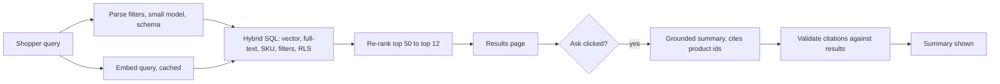

## 38.7 Guardrails and tenant isolation for RAG and agents

### 38.7.1 Making isolation structural

#### Concept

A **guardrail** is a check that runs on every request, outside the model, and that the model cannot talk its way past. There are four layers: **input** guardrails (size, scope and injection checks on what the user sends), **retrieval** guardrails (the database only returns rows this tenant and user may see), **output** guardrails (the answer is checked for leaked data, fabricated citations and unsafe content before it is shown), and **action** guardrails (tool calls are authorized and approved, 38.3). The most important is retrieval, because data the model never receives is data it cannot leak.

#### Why does it exist?

In a multi-tenant system, the prompt is assembled from rows your code selected. If one query forgets `WHERE tenant_id = ...`, the model receives another tenant's documents and will happily use and cite them; no prompt instruction can undo that. Isolation that depends on every developer remembering a filter in every query will eventually fail (Part 90 — Enterprise and Multi-Tenant SaaS Architecture). Guardrails exist to make the safe path the only path: the filter is enforced by the database itself, verified again in code, and tested in CI.

#### Mental model

Imagine a shared office building. You could ask every visitor to "please only enter your own company's floor" (a prompt instruction), or you could give each badge access to one floor only (row-level security), and also have the receptionist check badges at the lift (post-retrieval verification), and log every door opening (audit). Only the badge system actually prevents the mistake; the other two catch what slips through.

#### How it works

1. A request arrives with an authenticated user, which determines the **tenant** and the user's **groups** (for document-level permissions inside a tenant, such as "HR documents only for HR").
2. Retrieval runs inside a transaction that first sets the tenant (and groups) as **transaction-local** settings.
3. PostgreSQL **row-level security** (RLS) policies on the chunk table add `tenant_id = current tenant` to every query, including ones a developer writes later and forgets to filter.
4. The retriever **verifies** every returned row's tenant again in code; a mismatch is treated as a security incident (throw, alert), not as a warning.
5. The **output** guardrail checks the answer: citations must point at supplied chunks, and the text must not contain identifiers (emails, order ids) that were not in the supplied context.

#### PostgreSQL example

```sql
-- Enforce tenant isolation in the database, for every query on the table.
ALTER TABLE doc_chunks ENABLE ROW LEVEL SECURITY;
ALTER TABLE doc_chunks FORCE ROW LEVEL SECURITY;   -- applies even to the table owner

ALTER TABLE doc_chunks ADD COLUMN allowed_groups text[] NOT NULL DEFAULT '{all}';

CREATE POLICY chunk_tenant_isolation ON doc_chunks
  USING (
    tenant_id = current_setting('app.tenant_id', true)::uuid       -- unset -> NULL -> no rows
    AND allowed_groups && string_to_array(current_setting('app.user_groups', true), ',')
  );

-- The application role must not be a superuser and must not have BYPASSRLS.
-- Per request, inside a transaction (is_local = true: reset at COMMIT, safe with poolers):
BEGIN;
SELECT set_config('app.tenant_id', $1, true), set_config('app.user_groups', $2, true);
SELECT id, document_id, content FROM doc_chunks ORDER BY embedding <=> $3::vector LIMIT 8;
COMMIT;
```

The `true` second argument to `current_setting` means "return NULL if unset", so a code path that forgets to set the tenant gets **no rows** rather than all rows: the policy fails closed. RLS predicates are applied like a `WHERE` filter, so the filtered-HNSW behavior from 38.1.2 applies; enable iterative scans for tenant-scoped vector queries.

#### NestJS example

```ts
// rag/tenant-scoped-retriever.ts -- the only way the RAG code can read chunks
import { Injectable, InternalServerErrorException, Logger } from '@nestjs/common';
import { DataSource } from 'typeorm';

export interface RetrievalContext { tenantId: string; groups: string[] }
export interface RetrievedChunk { id: string; tenant_id: string; document_id: string; content: string }

@Injectable()
export class TenantScopedRetriever {
  private readonly logger = new Logger(TenantScopedRetriever.name);
  constructor(private readonly ds: DataSource) {}

  async nearest(ctx: RetrievalContext, queryVec: number[], k = 8): Promise<RetrievedChunk[]> {
    const rows: RetrievedChunk[] = await this.ds.transaction(async (m) => {
      await m.query(`SELECT set_config('app.tenant_id', $1, true), set_config('app.user_groups', $2, true)`,
        [ctx.tenantId, ctx.groups.concat('all').join(',')]);
      await m.query(`SET LOCAL hnsw.iterative_scan = relaxed_order`);
      return m.query(
        `SELECT id, tenant_id, document_id, content
           FROM doc_chunks
          WHERE tenant_id = $1                       -- explicit filter too: belt and braces with RLS
          ORDER BY embedding <=> $2::vector
          LIMIT $3`,
        [ctx.tenantId, JSON.stringify(queryVec), k]);
    });

    // Post-retrieval verification: never let a foreign row reach a prompt.
    const foreign = rows.filter((r) => r.tenant_id !== ctx.tenantId);
    if (foreign.length) {
      this.logger.error({ event: 'cross_tenant_retrieval', tenant: ctx.tenantId, rows: foreign.map((r) => r.id) });
      throw new InternalServerErrorException('Retrieval failed'); // page someone: this must never happen
    }
    return rows;
  }
}
```

Make this class the only code with access to the chunk table (a lint rule or module boundary that forbids raw queries on `doc_chunks` elsewhere), and the structural guarantee becomes real.

#### Production scenario

On a support platform with 900 tenants and 6 million chunks, RLS plus verification adds about 1–2 ms to a retrieval that takes 8 ms. Input guardrails are cheap rules (length limit, a block-list of known injection phrasings that only flags for review, a language check); an optional small-model classifier for off-topic requests runs **in parallel** with retrieval so it adds no latency on the happy path. The output guardrail rejects about 0.2% of answers, almost all for citing chunk numbers that were not supplied. The `cross_tenant_retrieval` alert has fired once in a year, during a staging test that deliberately disabled RLS, which is exactly what the CI eval case (38.6) checks.

#### Failure scenario

A team set the tenant with a plain session-level `SET app.tenant_id = '...'` at the start of each request and relied on RLS. It worked in development. In production, the database sat behind a connection pooler in **transaction mode**, so consecutive transactions from different requests ran on the same server connection, and a session-level setting survived from one request into the next. Under load, a request that took a code path which skipped the `SET` inherited the previous request's tenant, and RLS faithfully filtered by the wrong tenant. It was caught in a load test, because the post-retrieval check (comparing each row's tenant with the request's tenant) threw. The fix was `set_config(..., true)` inside an explicit transaction for every retrieval, so the setting is transaction-local and cannot leak. The lesson: RLS is only as good as the way the tenant reaches the database; the code-level verification is what caught it.

#### Edge cases & failure modes

- **Session vs transaction settings** with connection poolers: always transaction-local.
- **Background workers** (re-indexers) need a deliberate, audited way to write across tenants; give them a separate role, never disable RLS for the app role.
- **Caches above the database** (query-embedding cache is fine; a cache of *retrieved chunks* or *answers*) must include the tenant and groups in the key.
- **Permissions change after indexing**: if a document's access groups change, the chunks' `allowed_groups` must change in the same outbox event.
- **Shared public documents** (a global help center) belong in a separate table or tenant id, not in a bypass flag.
- **Logs and traces** of prompts contain another layer of tenant data; scope access to them too.

#### How a Senior Backend Engineer thinks about this

A senior puts isolation where it cannot be forgotten: in the database with row-level security, in a single retriever class that every RAG path must use, and in a CI test that tries to cross the boundary. They treat code-level verification as a tripwire for bugs in that structure, and they never rely on the model to respect a boundary it can see across. When asked "what stops tenant A from seeing tenant B's documents?", they can answer with three independent mechanisms, none of them a prompt.

#### Common mistakes

- Relying on `WHERE tenant_id` written by hand in every query.
- Session-level `SET` behind a transaction-mode pooler.
- An application role with `BYPASSRLS`, or RLS enabled without `FORCE` for the owner role the app uses.
- Answer caches keyed without tenant and groups.
- Telling the model "only use documents for tenant X" as if that were a control.

#### Interview questions

1. **How do you guarantee tenant isolation in a RAG system?** Enforce it structurally: RLS on chunk tables with transaction-local tenant settings that fail closed, a single retriever that every path uses, post-retrieval verification that alerts on mismatches, tenant-aware cache keys, and a CI eval case that attempts cross-tenant retrieval.
2. **Why is a prompt instruction not a guardrail?** The model can be confused or manipulated; a guardrail is enforced by code or the database regardless of what the model does.
3. **What breaks RLS in practice?** Session-level settings with transaction poolers, privileged roles that bypass RLS, missing `FORCE`, and caches or background jobs that read outside the policy.

#### Practical exercise

Enable RLS with a fail-closed tenant policy on your chunk table, route all retrieval through a `TenantScopedRetriever` that sets transaction-local settings and verifies rows, and add document-level groups. Write integration tests that (a) run a query without setting the tenant and expect zero rows, (b) run two tenants' requests interleaved through a pooled connection and expect no crossover, and (c) remove the explicit `WHERE` and expect RLS alone to keep results correct. Acceptance criteria: all three pass, and a deliberately inserted foreign row triggers the alert.

## 38.8 Worked example: product-catalog RAG search with pgvector

### 38.8.1 The requirement

A marketplace platform hosts 120 store tenants and 2.5 million products. Shoppers type queries like "latex-free gloves under $20 for sensitive skin". The search page must return relevant, in-stock products from **that store only** within 300 ms at p95, at a peak of 150 searches per second. An optional "Ask" button produces a two-sentence grounded summary of the results, citing the products it mentions. Budget: under $3 per 1,000 searches, all-in.

### 38.8.2 The design



The schema reuses the pieces of this Part: a `products` table with a weighted `search_tsv` and a GIN index; a `product_embeddings` table with `tenant_id`, `embedding vector(1024)`, `embedding_model` and `content_hash`, an HNSW index, RLS, and partial HNSW indexes for the five largest tenants (each over 150,000 products); and an outbox from product writes to the re-index worker (38.2). The embedded text is built from the fields a shopper would describe, not the raw description alone: `name | brand | category | key attributes (material, size, latex-free) | first 600 characters of description`.

### 38.8.3 The query path in code

Filters are extracted with a small model and a strict schema, then validated, so "under $20" becomes a SQL parameter rather than something the vector search has to "understand".

```ts
// catalog/query-parser.ts -- natural language -> validated filters
import { z } from 'zod';

export const ParsedQuery = z.object({
  searchText: z.string().max(200),                       // the query minus the filter phrases
  maxPriceCents: z.number().int().positive().max(10_000_000).nullable(),
  mustHaveAttributes: z.array(z.enum(['latex_free', 'powder_free', 'sterile', 'autoclavable'])).max(4),
  category: z.enum(['gloves', 'instruments', 'consumables', 'equipment', 'other']).nullable(),
});
export type ParsedQuery = z.infer<typeof ParsedQuery>;
// Called with messages.parse({ model: 'claude-haiku-5-5', output_config: { format: zodOutputFormat(ParsedQuery), effort: 'low' }, ... })
// and a 250 ms deadline. On timeout or failure: { searchText: raw, maxPriceCents: null, mustHaveAttributes: [], category: null }.
```

```ts
// catalog/catalog-search.service.ts -- orchestration with parallel steps and degradation
import { Injectable } from '@nestjs/common';
import { QueryParser } from './query-parser.service';
import { EmbeddingService } from '../embeddings/embedding.service';
import { CatalogRepository } from './catalog.repository';
import { Reranker } from './reranker';

@Injectable()
export class CatalogSearchService {
  constructor(
    private readonly parser: QueryParser,
    private readonly embeddings: EmbeddingService,
    private readonly repo: CatalogRepository,
    private readonly reranker: Reranker,
  ) {}

  async search(tenantId: string, raw: string) {
    const q = raw.trim().slice(0, 200);
    // Parse and embed in parallel: both are network calls, neither depends on the other.
    const [parsed, vec] = await Promise.all([
      this.parser.parseOrDefault(q),             // 250 ms deadline inside
      this.embeddings.embedQuery(q).catch(() => null), // degrade to keyword-only
    ]);

    const candidates = await this.repo.hybrid(tenantId, {
      vec, text: parsed.searchText, maxPriceCents: parsed.maxPriceCents,
      attributes: parsed.mustHaveAttributes, category: parsed.category, limit: 50,
    });                                           // RLS + tenant filter inside (60.7)

    const top = await this.reranker.rerankOrPassThrough(q, candidates, 12, { deadlineMs: 120 });
    return { products: top, appliedFilters: parsed, mode: vec ? 'hybrid' : 'keyword' };
  }
}
```

The "Ask" summary uses the numbered results as context and must cite by product id; the server keeps only citations to products that were actually on the page:

```ts
// catalog/summary.service.ts (excerpt)
const context = products.map((p, i) => `[${i + 1}] id=${p.id} | ${p.name} | $${(p.priceCents / 100).toFixed(2)} | ${p.attributes.join(', ')}`).join('\n');
const system = 'Summarize which of the numbered products fit the shopper\'s request, in at most two sentences. ' +
  'Mention only numbered products and cite them like [2]. Never mention prices, stock or features not shown.';
// ... call the large model with the cached system prompt, then:
const { sources, hasInvalid } = checkCitations(answer, products.map((p) => ({ documentId: p.id })));
if (hasInvalid || sources.length === 0) return { summary: null };   // show results without a summary
return { summary: answer, citedProductIds: sources };
```

### 38.8.4 Numbers

```text
Latency budget (p95 target 300 ms)          measured p50 / p95
  parse filters (small model, parallel)       140 / 230 ms   (deadline 250 ms)
  embed query (parallel, 52% cache hits)        2 / 70 ms
  hybrid SQL (RLS, HNSW iterative + GIN)        9 / 24 ms
  re-rank 50 -> 12                             60 / 110 ms
  total (parse and embed overlap)             215 / 290 ms

Cost per 1,000 searches
  filter parsing    ~300 in / 60 out tokens on a small model   ~$0.06
  query embeddings  48% of queries, ~12 tokens each             <$0.01
  re-ranking        hosted re-rank API, 50 docs per query       ~$1.00
  "Ask" summaries   clicked on 8% of searches, large model,
                    ~2,000 in (1,200 cached) / 120 out          ~$0.47
  total                                                         ~$1.55 (budget $3)
```

Database sizing: 2.5 million vectors of 1,024 dimensions are about 10 GB plus about 8 GB of HNSW index; the primary has 64 GB of RAM and two read replicas serve search. Re-indexing handles about 400,000 product updates a day; with content hashes, only about 15% of those change the embedded text and trigger an embedding call.

### 38.8.5 What the evaluation caught before launch

The 300-case evaluation (38.6) included SKU lookups, attribute filters, price filters, typos, other-language queries and cross-tenant probes. It caught two problems before launch: the filter parser sometimes turned "under 20" into 20 cents (fixed by a prompt rule plus a sanity check that rejects prices below the store's cheapest product), and the re-ranker demoted exact SKU matches (fixed by pinning exact-SKU hits to the top before re-ranking). Recall@12 ended at 0.91 against labelled relevant products, up from 0.78 for the original keyword search.

#### Edge cases & failure modes

- **Contradictory filters** ("cheap premium gloves"): the parser may produce no price filter; that is acceptable, ranking does the rest.
- **Out-of-stock but perfect matches**: show them below in-stock results with a label, a business choice the eval must reflect.
- **New products not yet embedded**: the keyword branch finds them meanwhile; monitor the embedding backlog.
- **Huge tenants**: partial HNSW indexes keep their filtered queries fast; small tenants are served by exact search over the tenant index.
- **Summary hallucinating a feature**: the prompt forbids it, the output check rejects uncited products, and the eval measures groundedness.
- **Re-ranker outage**: pass through the hybrid order; the search still works.

#### How a Senior Backend Engineer thinks about this

The senior moves in this design are small and boring on purpose: filters become SQL parameters instead of hopes, independent network calls run in parallel, every LLM-dependent step has a deadline and a degraded mode, tenant isolation is enforced by the database, and the expensive large-model call happens only when a shopper asks for it. The result is a search that is mostly PostgreSQL with two small, optional model calls around it, which is why it is fast, cheap and debuggable.

#### Interview questions

1. **Design semantic product search for a multi-tenant marketplace.** Hybrid retrieval in PostgreSQL (pgvector HNSW plus full-text plus exact SKU) with RLS, structured filter extraction into SQL parameters, re-ranking, query-embedding cache, outbox-driven re-indexing with content hashes, optional grounded summaries with validated citations, and an eval set covering all query types.
2. **Where does the latency go, and how do you keep p95 under 300 ms?** In network calls to models: run parsing and embedding in parallel with deadlines, cache embeddings, keep the SQL in the low tens of milliseconds with the right indexes, and make re-ranking optional under a deadline.
3. **Why extract filters with a model instead of letting vector search handle "under $20"?** Embeddings are poor at numeric constraints; extracting them into validated parameters gives exact filtering, and the vector search handles meaning.

#### Practical exercise

Implement the catalog search end to end for at least two tenants and 50,000 products: schema with RLS and both indexes, outbox re-indexing with content hashes, the filter parser with a strict schema and fallback, hybrid retrieval, a pass-through-capable re-ranker interface, and the "Ask" summary with citation validation. Acceptance criteria: p95 under 300 ms in a load test at 50 searches per second, no cross-tenant result in a 1,000-query randomized test, keyword-only mode works with the embedding provider blocked, and every summary cites only products on the page.
