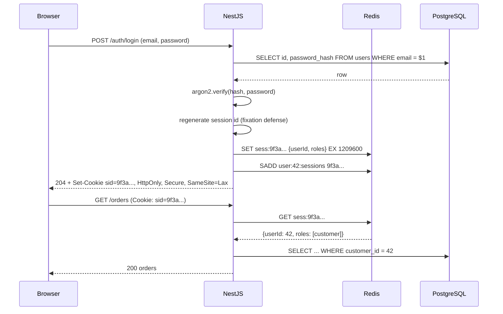

# Part 39 — Security

Security is the one area of backend engineering where a single missing `if` statement is a headline. A slow query costs you latency. A missing index costs you money. A missing ownership check on `GET /orders/:id` costs you every customer's address, and possibly the company.

This part is written for the engineer who ships NestJS services against PostgreSQL and Redis and wants to stop treating security as "the thing the pentest company finds once a year". We go through identity and access (who are you, what may you do), the small amount of cryptography you actually need to understand, the OWASP Top 10 as it appears in a real NestJS + PostgreSQL codebase, and finally a complete, production-shaped auth module you can lift into a project.

Three rules run through everything that follows:

1. **Never trust input.** Not the body, not the headers, not the URL, not the JWT until it is verified, not the row you just read from the database if a user wrote it.
2. **Deny by default.** Every route is private unless explicitly marked public. Every query is filtered by owner or tenant unless there is a written reason not to be.
3. **Defense in depth.** Assume each layer will fail at some point. The guard will be forgotten on one route; the row-level security policy catches it. The API key will leak into a log; the key is hashed and scoped so the damage is bounded.

Keep the senior mantra in mind, with a security twist: *Can it be forged? Can it be replayed? Can it be guessed? Can it be bypassed? Can it leak? Can it be abused at scale?*

## 39.1 Authentication vs Authorization

#### Concept

**Authentication** (AuthN) answers *who are you?* **Authorization** (AuthZ) answers *what are you allowed to do?*

In one sentence: authentication turns an anonymous request into a request from a known principal; authorization decides whether that principal may perform this action on this resource.

In code, they are two different checks that run at two different times:

```ts
// Authentication: turn credentials into an identity, or reject.
const user = await authService.validateAccessToken(token); // who are you?
if (!user) throw new UnauthorizedException();              // HTTP 401

// Authorization: decide if THIS identity may do THIS thing to THIS resource.
const order = await ordersRepo.findOneBy({ id: orderId });
if (order.customerId !== user.id && !user.roles.includes('support')) {
  throw new ForbiddenException();                          // HTTP 403
}
```

The two HTTP status codes encode the difference. `401 Unauthorized` (badly named; it means *unauthenticated*) says "I do not know who you are; present credentials". `403 Forbidden` says "I know exactly who you are, and the answer is no".

#### Why does it exist?

Without authentication every request is anonymous and the system cannot tell a customer from an attacker. Without authorization every authenticated user is an administrator. Real systems break in both directions, but the second failure is far more common. Most production data leaks are not "someone broke the login". They are "someone logged in as themselves and then asked for someone else's data, and the server said yes".

Separating the two concepts matters because they are implemented in different places and fail in different ways. Authentication is centralised: one login flow, one token format, one guard. Authorization is spread across the whole codebase: every controller, every service method, every query. That is why authorization bugs outnumber authentication bugs ten to one.

#### Mental model

Imagine an office building. At the front desk you show your ID and the receptionist hands you a badge. That is authentication: one check, at one door, producing a badge that proves who you are. Now you walk around the building. The badge opens the floors you work on and refuses the server room and the CEO's office. Every door does its own check of your badge against its own list. That is authorization: many checks, at many doors, each about a specific resource.

A building with a strict front desk and no locks on internal doors is exactly a backend with a strong login and no ownership checks.

#### How it works

1. A request arrives with a credential: a session cookie, a `Authorization: Bearer <token>` header, an API key, or a client certificate.
2. The **authentication layer** validates the credential. For a session it looks up the session store. For a JWT it verifies the signature and expiry. For an API key it hashes the key and looks it up. The result is a *principal*: `{ id, roles, tenantId, scopes }`. In NestJS this is a Passport strategy plus an `AuthGuard`, and the principal lands on `request.user`.
3. If no valid credential is present and the route is not public, the request stops here with 401.
4. The **coarse authorization layer** checks route-level rules: does this route require the `admin` role? Does the token carry the `orders:write` scope? In NestJS this is a `RolesGuard` or `ScopesGuard` running after the auth guard.
5. The **fine-grained authorization layer** runs inside the service, where the resource is loaded: is this user the owner of this order? Is this support agent in the same region as this customer? This check needs data and therefore belongs next to the data access.
6. Optionally the **database** enforces a last line of defense with PostgreSQL row-level security, so that even a query that forgot the `WHERE tenant_id = ...` returns nothing it should not.

```text
 request --> [AuthGuard: who?] --> [RolesGuard: role ok?] --> [Controller]
                  |                       |                       |
                401                     403                 [Service: owner?]
                                                                  |
                                                                403 / data
                                                                  |
                                                     [PostgreSQL RLS: tenant?]
```

#### Practical example

A food-delivery platform has three kinds of principals: customers, restaurant staff and internal support agents. All of them log in with the same `POST /auth/login` endpoint and receive the same token format. That is authentication, and it is identical for everyone.

Then they diverge. A customer may read their own orders. Restaurant staff may read orders for their restaurant and change the status from `accepted` to `preparing`. Support agents may read any order in their region and issue refunds up to a limit. None of those rules live in the login code. They live in guards and services, and each of them is a separate decision.

#### NestJS example

The cleanest way to keep the two concerns separate is to give each its own guard and keep resource ownership in the service.

```ts
// orders.controller.ts
import { Controller, Get, Param, ParseUUIDPipe, UseGuards } from '@nestjs/common';
import { AuthGuard } from '@nestjs/passport';
import { CurrentUser } from '../auth/current-user.decorator';
import { AuthenticatedUser } from '../auth/authenticated-user';
import { OrdersService } from './orders.service';

@Controller('orders')
@UseGuards(AuthGuard('jwt')) // AuthN: reject anonymous requests with 401
export class OrdersController {
  constructor(private readonly orders: OrdersService) {}

  @Get(':id')
  getOne(
    @Param('id', ParseUUIDPipe) id: string,
    @CurrentUser() user: AuthenticatedUser,
  ) {
    // AuthZ happens in the service, where the order is loaded.
    return this.orders.getForPrincipal(id, user);
  }
}
```

```ts
// orders.service.ts
import { ForbiddenException, Injectable, NotFoundException } from '@nestjs/common';
import { InjectRepository } from '@nestjs/typeorm';
import { Repository } from 'typeorm';
import { Order } from './order.entity';
import { AuthenticatedUser } from '../auth/authenticated-user';

@Injectable()
export class OrdersService {
  constructor(@InjectRepository(Order) private readonly repo: Repository<Order>) {}

  async getForPrincipal(id: string, user: AuthenticatedUser): Promise<Order> {
    const order = await this.repo.findOne({ where: { id } });
    // Return 404 for both "missing" and "not yours" to avoid leaking existence.
    if (!order) throw new NotFoundException();
    const isOwner = order.customerId === user.id;
    const isSupport = user.roles.includes('support') && order.region === user.region;
    if (!isOwner && !isSupport) throw new NotFoundException();
    return order;
  }
}
```

Note the deliberate choice to return 404 rather than 403 for a foreign order. A 403 tells an attacker that the order id exists. With UUIDs this matters little; with sequential integer ids it turns your API into an oracle for counting orders.

#### PostgreSQL example

Authentication data and authorization data are different tables with different access patterns.

```sql
-- Authentication: credentials and identity.
CREATE TABLE users (
  id            uuid PRIMARY KEY DEFAULT gen_random_uuid(),
  email         citext NOT NULL UNIQUE,      -- citext: case-insensitive unique email
  password_hash text   NOT NULL,             -- argon2id hash, never the password
  status        text   NOT NULL DEFAULT 'active'
                CHECK (status IN ('active','locked','disabled')),
  created_at    timestamptz NOT NULL DEFAULT now()
);

-- Authorization: what each user may do.
CREATE TABLE roles (
  id   smallint PRIMARY KEY,
  name text NOT NULL UNIQUE                   -- 'customer', 'support', 'admin'
);

CREATE TABLE user_roles (
  user_id uuid     NOT NULL REFERENCES users(id) ON DELETE CASCADE,
  role_id smallint NOT NULL REFERENCES roles(id),
  PRIMARY KEY (user_id, role_id)
);

-- Lookups during login hit users(email); lookups during authz hit user_roles(user_id).
-- The PK on user_roles already covers user_id as the leading column.
```

The `citext` extension (`CREATE EXTENSION IF NOT EXISTS citext;`) avoids the classic bug where `Alice@Example.com` and `alice@example.com` become two accounts, which later enables account takeover through password reset.

#### Production scenario

A B2B invoicing product with 40,000 companies and 300,000 users. Login traffic is tiny (about 5 requests per second) and is dominated by the cost of argon2 (roughly 50 to 100 ms per attempt by design). Authorization, on the other hand, runs on every one of the 3,000 requests per second the API serves. That asymmetry decides the architecture: the roles and tenant id are placed in the access token so that the coarse check costs nothing, while fine-grained ownership is checked against the row already being loaded, so it adds no extra query.

#### Failure scenario

At 11:40 on a Tuesday, a customer emailed support: "Why can I see invoices from a company I have never heard of?" A new `GET /invoices/export` endpoint had been added the week before. It was protected by `AuthGuard('jwt')`, so the developer's manual test with their own token worked, and code review focused on the CSV formatting. The service method built its query from the `companyId` in the *query string*, not from the token. Anyone could export any company's invoices by changing a number. The system authenticated perfectly and authorized nothing.

The fix was three lines. The incident response, customer notification and regulator report took three weeks.

#### Edge cases & failure modes

- A route with no guard at all: NestJS routes are public by default. The fix is a global guard with an explicit `@Public()` opt-out (see 39.37).
- Guard applied to the controller but a new method added with a different guard that accidentally overrides it.
- Authorization data in the token drifts from the database: a user demoted from `admin` keeps the role until the token expires.
- 401 vs 403 confusion in clients: a 401 should trigger token refresh; a 403 should not, or you get a refresh loop.
- Identity present but account disabled: authentication succeeds cryptographically, but the principal must still be rejected. Check `status` on every request or on every refresh.
- Service-to-service calls with no principal: internal endpoints often skip authorization "because only our services call it", until an SSRF bug (39.23) lets an attacker call it too.

#### How a Senior Backend Engineer thinks about this

The senior engineer treats authentication as a solved, centralised problem and authorization as the real work. Their questions on every new endpoint: *Who can call this? What resource does it touch? Where is the ownership check, and does it use the principal from the token or a value from the request?* They refuse to accept "it is behind the auth guard" as an answer to "is it secure". To a product manager they explain: "Login proves who you are. It does not decide what you can see; that is a separate rule for every screen, and every rule needs to be written down."

#### Common mistakes

- Using `userId` from the request body or query string instead of from the verified token. The attacker controls the request; they do not control the token.
- Returning 403 on missing resources, leaking existence.
- Treating "is logged in" as the only authorization rule.
- Putting authorization only in the controller and not in the service, so the same service called from a job or another controller has no check at all.
- Skipping authorization on internal or admin endpoints because "they are not linked from the UI".

#### Interview questions

1. *What is the difference between 401 and 403, and why does it matter for clients?* Expected: 401 means unauthenticated, retry with credentials or refresh; 403 means authenticated but not permitted, do not retry. Follow-up: when would you return 404 instead of 403?
2. *Where should an ownership check live: controller, guard or service?* Expected: in the service next to the data load, because it needs the resource; guards are for route-level rules. Follow-up: how would you make it impossible to forget?
3. *Roles in the token or roles from the database on each request?* Expected: token for speed, with short expiry and a revocation path; database when changes must be immediate. Follow-up: how would you handle "demote an admin now"?
4. *A developer says an endpoint is secure because it is behind the JWT guard. What do you ask next?*
5. *How would you design authorization for a multi-tenant SaaS so that a missing filter cannot leak data?* Expected: tenant id from token, repository-level filtering, PostgreSQL row-level security as defense in depth.

#### Practical exercise

Take an existing NestJS service with an orders module. Write an integration test that logs in as user A, creates an order, then logs in as user B and requests `GET /orders/:id` with A's order id. Acceptance criteria: the response is 404 (or 403 by documented policy), no order fields are present in the body, and the test fails if the ownership check is removed from the service.

## 39.2 Sessions

#### Concept

A session is server-side state that remembers who a client is between requests. After login the server creates a record (in Redis, PostgreSQL, or memory), gives the client an opaque random identifier, usually in a cookie, and on each request looks the identifier up to recover the user.

The important word is *opaque*. A session id carries no information. It is a random 128-bit or larger string whose only job is to be unguessable and to serve as a lookup key. Everything about the user lives on the server.

#### Why does it exist?

HTTP is stateless. Each request arrives with no memory of the previous one. Something has to bridge "the user typed a correct password ten minutes ago" and "this request should be treated as that user". Sessions are the oldest and simplest bridge, and they solve a problem tokens struggle with: **instant revocation**. Delete the session record and the user is logged out on the next request, everywhere. There is no waiting for expiry.

#### Mental model

Imagine a coat check at a theatre. You hand over your coat and get a numbered ticket. The ticket says nothing about your coat. It is just a number. When you come back, the attendant looks up the number and returns your coat. If the theatre wants to end your visit, they simply throw away the coat check record; your ticket becomes a meaningless piece of paper. If someone steals your ticket, they can claim your coat, which is why the ticket must be hard to forge and kept in your pocket, not pinned to your back.

The ticket is the session id. The coat check book is Redis. The pocket is an `HttpOnly` cookie.

#### How it works

1. `POST /auth/login` with email and password. The server verifies the password hash (39.14).
2. The server **regenerates** the session: any session id that existed before login is discarded and a fresh random id is generated. This defeats *session fixation*, an attack where the attacker plants a known session id in the victim's browser before login and then uses that same id after the victim logs in.
3. The server writes `{ userId, roles, createdAt, ip, userAgent }` to Redis under key `sess:<id>` with a TTL, and adds `<id>` to a set `user:<userId>:sessions` so it can find all sessions of a user later.
4. The server sends `Set-Cookie: sid=<id>; HttpOnly; Secure; SameSite=Lax; Path=/; Max-Age=1209600`.
5. On every subsequent request the browser attaches the cookie automatically. Middleware reads the cookie, loads `sess:<id>` from Redis (about 0.3 ms on the same network) and sets `request.session.userId`.
6. A guard converts `request.session.userId` into the principal, or rejects with 401.
7. `POST /auth/logout` deletes `sess:<id>` and clears the cookie. "Logout everywhere" reads the set `user:<userId>:sessions` and deletes every member.
8. Sliding expiry: on each request the TTL is refreshed, so an active user stays logged in while an idle one is logged out after the TTL. An absolute maximum (say 30 days) is enforced separately using `createdAt`.



**Cookie flags, and what each one defends against:**

| Flag | Meaning | Attack it blocks |
|---|---|---|
| `HttpOnly` | JavaScript cannot read the cookie | XSS stealing the session id |
| `Secure` | Sent only over HTTPS | Network sniffing on plain HTTP |
| `SameSite=Lax` | Not sent on cross-site POSTs; sent on top-level GET navigations | Most CSRF |
| `SameSite=Strict` | Never sent cross-site, even on links | All CSRF, but breaks "click link in email, land logged in" |
| `Path=/` | Scope within the site | Minor; keeps cookies off unrelated paths |
| `Domain` (omitted) | Only the exact host | Subdomain takeover reading cookies |
| `__Host-` prefix | Browser enforces Secure, no Domain, Path=/ | Cookie injection from sibling subdomains |
| `Max-Age` | Lifetime in seconds | Sessions that live forever in a stolen laptop |

#### Practical example

An e-commerce storefront rendered by a Next.js frontend on `shop.example.com` with the NestJS API on `api.example.com`. The team chooses cookie sessions because they want instant logout, they want the "sign out of all devices" button on the account page, and the frontend is a browser they control. Mobile apps for the same platform use JWTs (39.3) instead, because cookies are awkward in native HTTP clients.

#### NestJS example

NestJS runs on Express by default, so the well-trodden `express-session` plus `connect-redis` combination is the standard approach. It is configured in `main.ts`, not in a module, because it is HTTP-layer middleware.

```ts
// main.ts
import { NestFactory } from '@nestjs/core';
import session from 'express-session';
import { RedisStore } from 'connect-redis';
import { createClient } from 'redis';
import { AppModule } from './app.module';

async function bootstrap() {
  const app = await NestFactory.create(AppModule);
  const redis = createClient({ url: process.env.REDIS_URL });
  await redis.connect();

  app.set('trust proxy', 1); // behind a load balancer: needed for Secure cookies
  app.use(
    session({
      name: '__Host-sid',                 // prefix forces Secure, Path=/, no Domain
      secret: process.env.SESSION_SECRET!, // signs the cookie; rotate via array of secrets
      store: new RedisStore({ client: redis, prefix: 'sess:', ttl: 60 * 60 * 24 * 14 }),
      resave: false,
      saveUninitialized: false,           // no session row for anonymous visitors
      rolling: true,                      // sliding expiry
      cookie: {
        httpOnly: true,
        secure: true,
        sameSite: 'lax',
        maxAge: 1000 * 60 * 60 * 24 * 14, // 14 days
      },
    }),
  );
  await app.listen(3000);
}
bootstrap();
```

The login service regenerates the session and records it in the per-user index so "logout everywhere" is possible.

```ts
// session-auth.service.ts
import { Injectable, UnauthorizedException } from '@nestjs/common';
import type { Request } from 'express';
import { UsersService } from '../users/users.service';
import { RedisService } from '../redis/redis.service'; // thin wrapper over the redis client

@Injectable()
export class SessionAuthService {
  constructor(private users: UsersService, private redis: RedisService) {}

  async login(req: Request, email: string, password: string): Promise<void> {
    const user = await this.users.verifyCredentials(email, password); // argon2 verify inside
    if (!user) throw new UnauthorizedException('Invalid credentials');

    // Session fixation defense: discard whatever id the browser had before login.
    await new Promise<void>((res, rej) => req.session.regenerate((e) => (e ? rej(e) : res())));

    req.session.userId = user.id;
    req.session.roles = user.roles;
    req.session.createdAt = Date.now();
    await this.redis.client.sAdd(`user:${user.id}:sessions`, req.sessionID);
  }

  async logoutEverywhere(userId: string): Promise<void> {
    const key = `user:${userId}:sessions`;
    const ids = await this.redis.client.sMembers(key);
    if (ids.length) await this.redis.client.del(ids.map((id) => `sess:${id}`));
    await this.redis.client.del(key);
  }
}
```

A guard turns the session into a principal. It also fails closed: if Redis is unreachable, `express-session` leaves `req.session` empty, and the guard rejects. Users get a 401 during the outage, which is the correct behaviour; the wrong behaviour would be to let requests through as anonymous-but-trusted.

```ts
// session-auth.guard.ts
import { CanActivate, ExecutionContext, Injectable, UnauthorizedException } from '@nestjs/common';
import type { Request } from 'express';

@Injectable()
export class SessionAuthGuard implements CanActivate {
  private readonly absoluteMaxMs = 1000 * 60 * 60 * 24 * 30; // 30-day hard cap

  canActivate(ctx: ExecutionContext): boolean {
    const req = ctx.switchToHttp().getRequest<Request>();
    const s = req.session;
    if (!s?.userId) throw new UnauthorizedException();
    if (Date.now() - (s.createdAt ?? 0) > this.absoluteMaxMs) {
      s.destroy(() => undefined);
      throw new UnauthorizedException('Session expired');
    }
    req.user = { id: s.userId, roles: s.roles ?? [] };
    return true;
  }
}
```

You will need a small type augmentation so TypeScript knows about `userId` on the session:

```ts
// express-session.d.ts
import 'express-session';
declare module 'express-session' {
  interface SessionData {
    userId?: string;
    roles?: string[];
    createdAt?: number;
  }
}
```

#### PostgreSQL example

Sometimes you want sessions in PostgreSQL instead of Redis: an audit requirement to keep login history, or a small system with no Redis. The table below doubles as the "active devices" list in an account page.

```sql
CREATE TABLE sessions (
  id           text PRIMARY KEY,            -- 32+ random bytes, base64url; never sequential
  user_id      uuid NOT NULL REFERENCES users(id) ON DELETE CASCADE,
  created_at   timestamptz NOT NULL DEFAULT now(),
  last_seen_at timestamptz NOT NULL DEFAULT now(),
  expires_at   timestamptz NOT NULL,
  ip           inet,
  user_agent   text,
  revoked_at   timestamptz
);

-- "Logout everywhere" and "list my devices" both need this.
CREATE INDEX sessions_user_active_idx ON sessions (user_id) WHERE revoked_at IS NULL;
-- Cleanup job: DELETE FROM sessions WHERE expires_at < now() - interval '7 days';
CREATE INDEX sessions_expires_idx ON sessions (expires_at);

-- Lookup on every request (about 1 ms on a warm cache):
-- SELECT user_id FROM sessions WHERE id = $1 AND revoked_at IS NULL AND expires_at > now();
```

The cost is one PostgreSQL round trip per request rather than one Redis round trip. At 3,000 requests per second that is 3,000 small indexed reads per second on top of your real workload; PostgreSQL handles that easily, but it is one more reason the read replica and connection pool sizing in Part 26 matter.

#### TypeORM example

```ts
@Entity('sessions')
export class Session {
  @PrimaryColumn('text') id: string;
  @Column('uuid') userId: string;
  @CreateDateColumn({ type: 'timestamptz' }) createdAt: Date;
  @Column({ type: 'timestamptz' }) expiresAt: Date;
  @Column({ type: 'timestamptz', nullable: true }) revokedAt: Date | null;
  @Column({ type: 'inet', nullable: true }) ip: string | null;
}

// Revoke all sessions of a user, e.g. after a password change:
await dataSource
  .createQueryBuilder()
  .update(Session)
  .set({ revokedAt: () => 'now()' })
  .where('user_id = :userId AND revoked_at IS NULL', { userId })
  .execute();
```

#### Production scenario

A marketplace with 1.2 million monthly active users keeps sessions in a Redis cluster with three primaries and three replicas. Session records are about 300 bytes; 2 million live sessions occupy roughly 600 MB. Every API request costs one `GET` (0.2 to 0.5 ms). Login rate at peak is 40 per second; each login costs an argon2 verify (about 60 ms of CPU) and two Redis writes. The `rolling: true` sliding expiry means every request also issues an `EXPIRE`, which doubles Redis command volume; the team accepted that cost for the UX. A nightly job scans `user:*:sessions` sets and removes ids whose `sess:` key has expired, so the per-user index does not grow forever.

Monitoring: Redis memory, `GET` p99 latency, 401 rate (a sudden jump means Redis trouble or a cookie change), and login failure rate (a spike means credential stuffing, 39.25).

#### Failure scenario

At 02:14 the on-call was paged: 401 rate went from 0.3 percent to 92 percent in one minute. Every logged-in user was thrown out. Cause: a config change had rotated `SESSION_SECRET` to a single new value. `express-session` signs the cookie with the secret; every existing cookie now failed the signature check and was treated as absent. The fix was to set `secret` to an array `[newSecret, oldSecret]`: the first is used to sign new cookies, all are accepted for verification. After 14 days (the session TTL) the old secret is removed. Rotation without an overlap window is a self-inflicted outage.

#### Edge cases & failure modes

- **Session fixation**: forgetting `regenerate()` on login. Any pre-login session id survives into the authenticated session.
- **Redis down**: fail closed (401), never fail open. Add a circuit breaker so the app does not hang on Redis timeouts; a 2-second connect timeout is better than a 30-second one.
- **Session store restart with no persistence**: everyone is logged out. Acceptable if documented; enable AOF or accept the blast radius.
- **Cookie too large**: browsers cap cookies at about 4 KB. Sessions store data server-side, so this only bites you if someone stores state in the cookie itself.
- **Cross-subdomain leaks**: setting `Domain=example.com` sends the cookie to `blog.example.com` too; if that host is compromised, so is the session.
- **Privilege change while logged in**: roles cached in the session are stale until re-login. Either reload roles from the DB every request, or bump a `rolesVersion` in Redis and reject sessions with an older version.
- **Concurrent logins**: allow many sessions per user, but cap them (for example 20) and evict the oldest, or one leaked credential creates thousands of sessions.
- **Clock skew**: sliding expiry uses server time. If two app nodes disagree by minutes, sessions expire unpredictably. Run NTP.
- **Sticky sessions** are not needed with a shared store; if someone proposes them, the store is probably in memory, which is wrong for more than one replica.

#### How a Senior Backend Engineer thinks about this

The senior engineer's first question is: *do I need instant revocation?* If yes (banking, admin panels, anything where "log them out now" is a real requirement), sessions are the honest answer, and they accept the Redis dependency. If the clients are mobile apps or third-party services, or the system spans many services that must all validate identity without a shared store, they lean towards tokens (39.3) and accept the revocation compromise.

They also insist on the `__Host-` prefix, `SameSite=Lax`, secret rotation with overlap, and an index of sessions per user from day one, because retrofitting "logout everywhere" after an account-takeover incident is painful.

#### Common mistakes

- Storing sessions in process memory (`MemoryStore`) and then scaling to two replicas.
- Skipping `regenerate()` on login and on privilege change.
- Setting `saveUninitialized: true`, which creates a Redis key for every anonymous crawler hit and turns a bot scan into a memory problem.
- Rotating the cookie secret without the overlap array.
- Setting a `Domain` attribute "so it works on all subdomains" and thereby sharing the session with the marketing site.
- Not indexing sessions by user, making "logout everywhere" impossible.

#### Interview questions

1. *What is session fixation and how do you prevent it?* Expected: attacker plants a session id before login; regenerate the id at login so the planted one is worthless. Follow-up: does the same risk exist with JWTs?
2. *Explain each cookie flag and the attack it prevents.* Expected: table above. Follow-up: when would you choose `SameSite=Strict` over `Lax`?
3. *How do you implement "log out of all devices"?* Expected: per-user index of session ids (Redis set or DB index) and delete them all. Follow-up: how do you keep that index from growing unbounded?
4. *Redis is down. What should the auth layer do?* Expected: fail closed with 401 and a short timeout; never treat the user as anonymous-but-allowed.
5. *How do you rotate the session signing secret with zero logouts?*
6. *Compare a session table in PostgreSQL with Redis sessions on cost, latency and features.*

#### Practical exercise

Implement session login in a NestJS app with `express-session` and `connect-redis`. Add `POST /auth/logout-all` and `GET /auth/sessions` (listing active devices with IP, user agent and last-seen time). Acceptance criteria: logging in from two browsers and calling logout-all from one invalidates both within one request; the cookie carries `HttpOnly`, `Secure`, `SameSite=Lax` and the `__Host-` prefix; stopping Redis causes 401 responses within 2 seconds rather than hanging requests.

### 39.2.1 Session vs token: the decision table

| Dimension | Server-side session | Stateless token (JWT) |
|---|---|---|
| Revocation | Instant: delete the record | Wait for expiry, or add a denylist (state again) |
| Per-request cost | One store lookup (Redis 0.2 to 1 ms) | Signature verify (HS256 microseconds, RS256 about 0.1 to 0.3 ms) |
| Horizontal scaling | Needs shared store | Any node can verify with the key |
| Cross-service auth | Each service needs the store | Each service needs only the public key |
| Client type | Browsers (cookies) | Mobile, SPAs, service-to-service |
| CSRF exposure | Yes when cookie-based; mitigate with SameSite and tokens | No if sent in a header; yes if placed in a cookie |
| XSS exposure | Cookie unreadable with HttpOnly | localStorage readable by any script |
| Data in credential | None (opaque) | Claims visible to anyone who holds it (base64, not encrypted) |
| Best fit | Web apps, admin panels, anything needing "log out now" | APIs consumed by many clients and services |

Many mature systems use both: a short-lived JWT as the access credential and a server-side record for the refresh token, which gives you cheap stateless verification for 99 percent of requests and a revocation point for the remaining 1 percent. That design is the subject of the next section.
