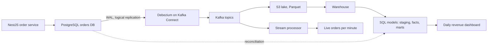

# Part 39 — Data Engineering for Backend Engineers

A backend engineer does not need to become a data engineer, but at any company past a certain size the two worlds meet constantly, and the backend engineer who understands the data side is far more effective. The production database you own is the source of the analytics the business runs on; the events you emit are the raw material of the data warehouse; the schema you change can break a dashboard; the GDPR deletion you implement must reach the warehouse too. This Part teaches the data-engineering concepts a backend engineer needs to work well across that boundary: why analytics and transactional workloads must be separated, how data flows from your database into analytics systems, and how to build analytics features into your own product.

The topics: OLTP versus OLAP (why analytics queries hurt your production database), **change data capture** (streaming database changes to other systems), **ETL versus ELT** and batch pipelines, **data warehouses and lakes** (columnar storage, Parquet), **stream processing** (windows, watermarks, late events), **data contracts** between backend and data teams, **data quality**, **privacy in pipelines** (PII masking, deletion propagation), and **building analytics features in the product** (pre-aggregated tables, materialized views, read models). The running example is deriving daily revenue dashboards from the orders database.

This Part builds on the transactional outbox (see Part 30 — Distributed Transactions, 30.10), keeping a search index in sync (see Part 34 — Search, 34.10), Kafka (see Part 28 — Messaging, 28.3), partitioning (see Part 23 — Database Scaling, 23.7) and caching (see Part 27 — Caching and Redis), going wider into the data pipeline those feed. Sections 39.1 to 39.6 introduce each idea; sections 39.7 to 39.11 take the same ideas into production depth (logical replication slots, Debezium configuration, warehouse DDL, Flink SQL windows, contract enforcement); and 39.12 builds the whole pipeline end to end: CDC from the orders database into a warehouse that feeds the daily revenue dashboard.



## 39.1 OLTP versus OLAP

### 39.1.1 Why analytics queries hurt the production database

#### Concept

**OLTP** (Online Transaction Processing) is what your production database does: many small, fast reads and writes serving the application — fetch an order, insert a payment, update inventory. **OLAP** (Online Analytical Processing) is analytics: a few large queries that scan huge amounts of data to compute aggregates — total revenue by month, top products by region, cohort retention. These two workloads are so different that running OLAP queries on your OLTP database degrades or crashes the application, which is why analytics belongs in a separate system.

#### Why does it exist?

A transactional database is tuned for OLTP: row-oriented storage, indexes for point lookups, serving thousands of small operations per second with low latency. An analytics query is the opposite: it reads millions of rows, scans whole columns, and runs for seconds or minutes. Run that on the production database and it saturates CPU and I/O, competes with and slows the application's queries, holds locks, blows the cache, and can bring the application down. The separation exists because the two workloads need opposite optimizations and must not fight over the same resources. The distinction drives the entire data pipeline: get analytics off the production database and into a system built for it.

#### Mental model

Your production database is a busy restaurant kitchen during service — a stream of quick orders, each served fast, everyone moving. An OLAP query is someone walking into that kitchen mid-service to do a full monthly inventory count, blocking the stoves and counters for twenty minutes while service grinds to a halt. You do not do inventory in the kitchen during service; you do it in a back room with a copy of the stock records (the warehouse). OLTP is service; OLAP is inventory; they belong in different rooms.

#### How it works — the differences

| | OLTP (production database) | OLAP (analytics system) |
|---|---|---|
| Workload | Many small, fast reads/writes | Few large, scanning queries |
| Query shape | Point lookups, small ranges, by key | Aggregations over millions of rows |
| Storage | Row-oriented (whole rows together) | Column-oriented (whole columns together) |
| Optimized for | Low-latency transactions | High-throughput scans and aggregates |
| Latency | Milliseconds | Seconds to minutes (acceptable) |
| Example | "Get order 1001" | "Total revenue by month for 2 years" |
| Freshness need | Real-time | Minutes to hours old is usually fine |

The heart of it is **row-oriented versus column-oriented storage**. OLTP databases store each row's fields together, so fetching one order reads one place — great for point lookups, bad for "sum one column across ten million rows" (which must read every row to get one field). Analytics systems store each column together, so summing a column reads only that column's contiguous data — great for aggregates, and highly compressible (a column of similar values compresses well). That storage difference is why a dedicated analytics system answers "revenue by month" in a fraction of the time and resources, and why forcing it on the row-oriented OLTP database is so costly.

Put numbers on it. An `orders` row in PostgreSQL is about 200 bytes with headers, so 120 million orders is roughly 24 GB of heap. A query that needs two columns (`created_at`, `total_cents`, 16 bytes together) still reads all 24 GB from a row store, because those 16 bytes are scattered inside every 8 KB page. A column store reads only those two columns, which after compression (dates and integers compress 5–10x) is around 200–400 MB. That is a 60–120x difference in bytes read before any other optimization, and bytes read is what costs time and money in analytics.

#### Practical example

The finance team asks for "revenue by month for the last two years, split by country". The orders service already has `orders(id, customer_id, country, status, total_cents, created_at)` with 120 million rows and a B-tree index on `customer_id` and on `created_at`. The application issues about 3,000 queries per second against this database, each touching a handful of rows through those indexes. The finance query touches 60 million rows (two years) and returns 48 rows (24 months times 2 countries). That ratio, millions in and dozens out, is the signature of OLAP. Whenever you see it, the query belongs somewhere other than the primary.

#### PostgreSQL example

```sql
EXPLAIN (ANALYZE, BUFFERS)
SELECT date_trunc('month', created_at) AS month, country, sum(total_cents) AS revenue_cents
  FROM orders
 WHERE created_at >= now() - interval '2 years' AND status = 'paid'
 GROUP BY 1, 2
 ORDER BY 1, 2;
```

```text
Finalize GroupAggregate  (cost=4120334.10..4120402.61 rows=48 width=48) (actual time=41873.2..41890.6 rows=48 loops=1)
  Group Key: (date_trunc('month'::text, created_at)), country
  Buffers: shared hit=212344 read=2861902, temp read=40211 written=40388
  ->  Gather Merge  (cost=4120334.10..4120399.73 rows=144 width=48) (actual time=41870.9..41890.1 rows=144 loops=1)
        Workers Planned: 2
        Workers Launched: 2
        ->  Partial HashAggregate  (actual time=41801.4..41801.6 rows=48 loops=3)
              ->  Parallel Seq Scan on orders  (actual time=0.41..36120.7 rows=19870112 loops=3)
                    Filter: ((status = 'paid'::text) AND (created_at >= (now() - '2 years'::interval)))
                    Rows Removed by Filter: 20129880
                    Buffers: shared hit=212344 read=2861902
Planning Time: 0.31 ms
Execution Time: 41893.0 ms
```

Read it like an incident report. `read=2861902` buffers is about 22 GB pulled from disk, which evicts the hot pages the application relies on from `shared_buffers` (see Part 19 — PostgreSQL Internals, 19.4). Three processes (the leader plus two parallel workers) burn CPU for 42 seconds. The index on `created_at` is not used, correctly, because the planner knows half the table qualifies and a sequential scan is cheaper than 60 million random index lookups. That is the core reason "just add an index" fails for OLAP: an index helps when you want a few rows, and analytics wants most of them.

#### Production scenario

An analyst needed a monthly revenue breakdown and ran a large aggregating query directly against the production orders database during business hours. The query scanned two years of orders, saturated the database's I/O for several minutes, and the application's normal queries slowed from 3 ms to 800 ms — checkout latency spiked and customers noticed. The fix was to stop running analytics on the production database and instead replicate the data to an analytics system where such queries run without touching production. The lesson, learned the hard way at many companies, is that OLAP on the OLTP database is a production incident waiting to happen.

#### Failure scenario

A reporting dashboard was wired directly to the production database, running dozens of aggregating queries every few minutes to refresh its tiles. Under normal load it was tolerable; during a traffic peak, the combination of application load and the dashboard's heavy queries pushed the database past its limits and it fell over, taking the application down with it. The root cause was OLAP and OLTP sharing one database. The fix: move the dashboard's queries to a read replica at minimum (see Part 23 — Database Scaling, 23.3), and properly to an analytics warehouse fed by the pipeline in the rest of this Part. The lesson: never let analytics queries run against the production transactional database.

#### Edge cases & failure modes

- **The read replica is not free either.** A 40-second aggregate on a hot standby conflicts with WAL replay. With `hot_standby_feedback = off` the replica cancels the query (`canceling statement due to conflict with recovery`); with it `on`, the primary keeps dead rows for the replica and bloats. Either way, analytics on a replica is a stopgap (see Part 23 — Database Scaling, 23.5).
- **`statement_timeout` as a seat belt.** Give the reporting role `ALTER ROLE reporting SET statement_timeout = '30s'` so a runaway report dies before it hurts anyone.
- **Long transactions block vacuum.** An analyst's open `BEGIN` in a SQL client holds back the xmin horizon and causes table bloat for hours (see Part 19 — PostgreSQL Internals, 19.8). Set `idle_in_transaction_session_timeout` for human roles.
- **Connection exhaustion.** BI tools open many connections; one dashboard with 30 tiles can take 30 connections from the pool the API needs.
- **"Small" tables grow.** A report that was fine at 2 million rows becomes an incident at 200 million; OLAP-shaped queries have no natural upper bound.

#### How a Senior Backend Engineer thinks about this

A senior treats the production transactional database as sacred for OLTP and keeps analytics off it entirely. They recognize an OLAP query — a large scan or aggregation — as something that belongs in a separate analytics system, never on the production primary, and at minimum on a read replica for lighter needs. They understand the row-versus-column storage reason, which is why they do not just "add an index" to make an analytics query fast on the OLTP database (an index helps point lookups, not full-column aggregates). They design the data pipeline (the rest of this Part) to move data from the OLTP source into an OLAP system, so analysts and dashboards get their answers without ever threatening the application. When someone proposes running a report against production, the senior's answer is "not against production — here is the analytics system".

#### Common mistakes

- Running analytics queries against the production transactional database, degrading or crashing the application.
- Wiring a dashboard directly to the production database.
- Trying to make an analytics query fast with indexes on the OLTP database (wrong tool for full-column aggregates).
- Not separating OLTP and OLAP until an incident forces it.

#### Interview questions

1. **What is the difference between OLTP and OLAP?** OLTP is many small fast transactional reads/writes on the production database; OLAP is few large scanning/aggregating analytics queries; they need opposite optimizations and must not share resources.
2. **Why do analytics queries hurt the production database?** They scan millions of rows, saturating CPU and I/O, competing with and slowing the application's transactional queries, and can crash the database.
3. **Why does column-oriented storage help analytics?** Analytics aggregates read whole columns; storing columns contiguously (and compressing them) makes those scans far faster and cheaper than the row-oriented OLTP layout.
4. **Why not just add an index to make an analytics query fast on the OLTP database?** Indexes speed point lookups and small ranges, not full-column aggregates over millions of rows; the fix is a separate analytics system, not an index.

#### Practical exercise

Take an analytics query (monthly revenue over two years) and run `EXPLAIN (ANALYZE, BUFFERS)` against an orders table to see it scan the whole table, noting the cost. Then describe how the same query would run against a column-oriented analytics system and why it would be dramatically cheaper. Acceptance criteria: you can quantify why the OLTP database struggles with the aggregate and explain the column-store advantage.

## 39.2 Change data capture and pipelines

### 39.2.1 Change data capture

#### Concept

**Change Data Capture (CDC)** is streaming every change (insert, update, delete) from your production database to other systems in near real time, by reading the database's internal change log rather than querying tables. It is how data flows reliably from your OLTP database into analytics systems, search indexes, caches and other services, keeping them in sync without burdening the production database with repeated queries.

#### Why does it exist?

Other systems need to know about changes in your database: the analytics warehouse needs new orders, the search index needs updated products (Part 34), a downstream service needs new events. Polling the database ("give me everything changed since last time") is inefficient and can miss changes or burden the database. CDC reads the database's **write-ahead log** (the log the database already keeps for durability and replication; see Part 19 — PostgreSQL Internals, 19.5, and Part 21 — Database Transactions, 21.9) and turns each committed change into an event stream, so downstream systems get every change in order, reliably, with minimal load on the source. It exists to propagate changes out of the database the right way.

#### Mental model

Imagine the production database keeps a perfect running journal of everything that happens — every insert, update and delete, in order (it does; this is the write-ahead log). CDC is a reader who tails that journal and broadcasts each entry to everyone who needs to know. The warehouse, the search index and the downstream services all subscribe to the broadcast and apply the changes, staying in step with the database without ever having to interrogate it. The journal is the WAL; the reader-broadcaster is CDC (a tool like Debezium feeding Kafka).

#### How it works

```text
PostgreSQL ---(logical replication / WAL)---> Debezium ---> Kafka topic (order changes)
                                                               |
                          +------------------+-----------------+-----------------+
                          v                  v                 v                 v
                   Analytics warehouse   Search index      Cache invalidation   Other service
                   (39.3)                (Part 34.10)       (Part 27)            (Part 12)
```

The common stack: PostgreSQL's **logical replication** exposes committed changes from the WAL; **Debezium** (often via **Kafka Connect**) reads them and publishes a stream of change events to **Kafka** (Part 28); downstream consumers apply the changes to their systems. Each change event describes what changed (the table, the operation, the before/after values), in commit order. Because it reads the log the database already maintains, CDC adds little load to the source and does not miss changes.

**Handling schema changes** is a key CDC concern: when you change the source table's schema (add a column, Part 24), the change stream's shape changes, and downstream consumers must cope. This is a data-contract problem (39.4): schema changes in the source ripple through the pipeline, so they must be made compatibly (additive where possible, Part 25) and coordinated with the data team. Section 39.7 shows the concrete mechanics: publications, replication slots, the Debezium connector configuration and what each schema change does to the stream.

A single change event, as Debezium emits it for an update to an order, looks like this (trimmed):

```json
{
  "before": { "id": "7f3c9a20-1d1e-4c55-9a8e-0b6f2f1a9c11", "status": "pending", "total_cents": 45900 },
  "after":  { "id": "7f3c9a20-1d1e-4c55-9a8e-0b6f2f1a9c11", "status": "paid",    "total_cents": 45900 },
  "source": { "connector": "postgresql", "db": "orders", "schema": "public", "table": "orders",
              "lsn": 2398541736, "txId": 918273, "ts_ms": 1767225600123 },
  "op": "u",
  "ts_ms": 1767225600456
}
```

`op` is `c` (create), `u` (update), `d` (delete) or `r` (read, a row from the initial snapshot). `source.lsn` is the position in the WAL, which gives you a total order per database and a natural idempotency key. The gap between `source.ts_ms` (commit time in PostgreSQL) and `ts_ms` (when Debezium processed it) is your capture lag. The populated `before` block appears only when the table has `REPLICA IDENTITY FULL`; with the default setting, `before` is `null` on updates.

#### Practical example

The orders service has three downstream readers of order changes: the warehouse (daily revenue), the search index (order lookup for support agents) and a loyalty service that awards points when an order becomes `paid`. Before CDC, each had a nightly or every-five-minutes polling job running `SELECT * FROM orders WHERE updated_at > $last_seen`. Polling missed hard deletes entirely, missed updates where a bug forgot to touch `updated_at`, and ran three overlapping index scans on the primary every five minutes. Moving to one Debezium connector replaced three polling jobs with one WAL reader, captured deletes, and dropped end-to-end latency from five minutes to about two seconds.

#### CDC versus the outbox pattern

Part 30 (30.10) taught the **outbox pattern**: write an event to an outbox table in the same transaction as the data change, and a worker publishes it. CDC and the outbox solve related problems and are often combined:

- **Outbox**: you explicitly write a business event ("order placed") in the same transaction; a relay (often CDC reading the outbox table) publishes it. Precise, semantic events you control.
- **CDC on the tables directly**: captures every row change automatically, no code to emit events, but the events are row changes, not business events.

A common robust pattern is CDC reading the outbox table: you get the transaction-safe semantic events of the outbox, delivered by the reliable log-reading mechanism of CDC. Delivery is still at least once, so consumers stay idempotent. The two are complementary, not competing.

| Need | Raw-table CDC | Outbox read by CDC | Polling `updated_at` |
|---|---|---|---|
| Analytics copy of every column | Best fit | Only what you put in the payload | Misses deletes |
| Business events for other services | Leaks table structure | Best fit | Poor |
| Captures hard deletes | Yes | Only if you write a delete event | No |
| Code changes in the service | None | Insert into outbox in every write path | Query per consumer |
| Coupling to schema | High (table is the contract) | Low (payload is the contract) | High |

#### Production scenario

A marketplace with 400,000 orders per day (peaks of 60 writes per second to `orders`, about 250 per second across `orders`, `order_items` and `payments`) runs one Debezium PostgreSQL connector on a three-worker Kafka Connect cluster. Capture lag (commit to Kafka) is 300–800 ms at p99. The connector holds one logical replication slot; normal retained WAL behind the slot is under 200 MB. Monitoring alerts when retained WAL exceeds 5 GB, when the connector task state is not `RUNNING`, or when the last event is older than 2 minutes during business hours. Load on the primary from WAL decoding is about 3–5% of one vCPU.

#### Failure scenario

At 03:40 the database disk alarm fired at 85% full on a 500 GB volume that normally sat at 40%. The cause was not data growth. A Kafka Connect deploy the previous evening had failed to start the Debezium task (a missing secret), so nothing was reading the replication slot, and PostgreSQL was keeping every WAL segment since then for a consumer that might come back. The slot had retained 210 GB of WAL in nine hours during a promotion. The on-call engineer fixed the secret, the connector caught up in 40 minutes, and the WAL was recycled. The postmortem added three things: an alert on `pg_replication_slots` retained WAL (39.7 has the query), `max_slot_wal_keep_size` as a hard cap so a dead consumer can never fill the disk again, and a runbook step for dropping an abandoned slot. The lesson: a replication slot is a promise PostgreSQL keeps even when it hurts, so someone must watch every slot.

#### Edge cases & failure modes

- **Inactive slot fills the disk** (the story above). Cap with `max_slot_wal_keep_size`, alert on retained WAL.
- **Duplicate events after a connector restart.** Debezium resumes from the last committed offset, so events since then are replayed; consumers dedupe on `(source.lsn, table, primary key)` or upsert by key.
- **Updates without a before image.** With the default `REPLICA IDENTITY DEFAULT`, `before` is `null` for updates and holds only the primary key for deletes; set `REPLICA IDENTITY FULL` on tables where consumers need old values (at a WAL-size cost, and see 39.7 for how it interacts with publication column lists).
- **Large transactions.** A backfill updating 30 million rows in one transaction arrives as 30 million events in a burst, after the commit; consumers and Kafka must absorb it.
- **Failover loses the slot.** Before PostgreSQL 17, logical slots lived only on the primary; after a failover the new primary has no slot and Debezium must re-snapshot. PostgreSQL 17 can synchronize failover slots to a physical standby; managed services vary, so test failover with CDC attached.
- **TOAST columns.** An update that does not touch a large toasted column sends it as an "unchanged" placeholder rather than the value; consumers must not overwrite the stored value with the placeholder.

#### How a Senior Backend Engineer thinks about this

A senior uses CDC (often with the outbox pattern, Part 20 — 30.10) as the reliable way to get changes out of the database into the rest of the system — warehouse, search, cache, other services — because it reads the WAL the database already keeps, adding minimal load and missing nothing, unlike polling. They treat the change stream as a product with a contract (39.4): downstream systems depend on its shape, so schema changes in the source are made compatibly and coordinated, not sprung on consumers. They design for the stream's realities: it is ordered per source but delivered at least once (so consumers are idempotent; see Part 28 — Messaging, 28.9), and it lags slightly (eventual consistency downstream). They reach for CDC rather than ad-hoc polling or dual writes, because dual writes (write to the database and also to Kafka separately) can diverge if one fails, whereas CDC derives everything from the one committed log.

#### Common mistakes

- Polling tables for changes instead of CDC, burdening the database and risking missed changes.
- Dual writes (to the database and a stream separately) that diverge when one fails; CDC from the single committed log avoids this.
- Making a source schema change that breaks downstream consumers, with no coordination (39.4).
- Non-idempotent consumers of the at-least-once change stream, double-applying changes.

#### Interview questions

1. **What is CDC and why use it over polling?** Streaming database changes by reading the write-ahead log (via Debezium/Kafka); it captures every change in order with minimal load on the source, unlike polling which burdens the database and can miss changes.
2. **How do CDC and the outbox pattern relate?** The outbox writes semantic events in the same transaction as the change; CDC reliably delivers them (often by reading the outbox table via the WAL); combined, you get transaction-safe semantic events delivered reliably.
3. **Why is CDC better than dual writes?** Dual writes (database plus a separate stream) can diverge if one write fails; CDC derives the stream from the single committed log, so it cannot diverge from what was committed.
4. **What must downstream CDC consumers handle?** At-least-once delivery (be idempotent, Part 28.9 and Part 30.12), eventual consistency (slight lag), and source schema changes (coordinated, compatible — the data contract).

#### Practical exercise

Describe (or set up) a CDC pipeline from a PostgreSQL orders table through Debezium and Kafka to a downstream consumer, and make the consumer idempotent so re-delivered change events do not double-apply. Then reason about what happens to the consumer when a new column is added to the orders table and how you would make that change compatibly. Acceptance criteria: the consumer handles at-least-once delivery without double-applying, and you can describe a compatible schema-change process for the source.
