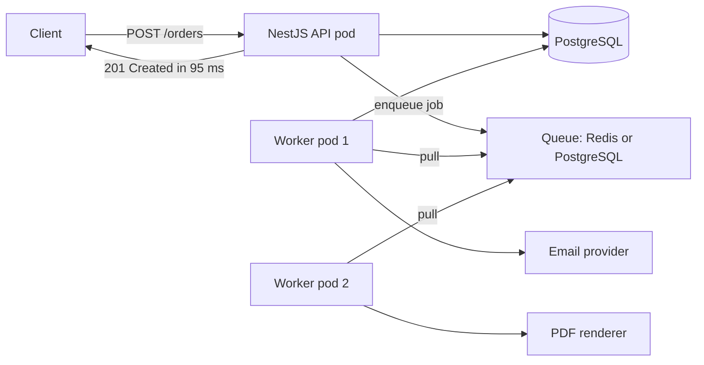
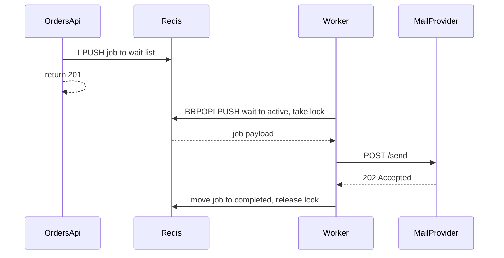
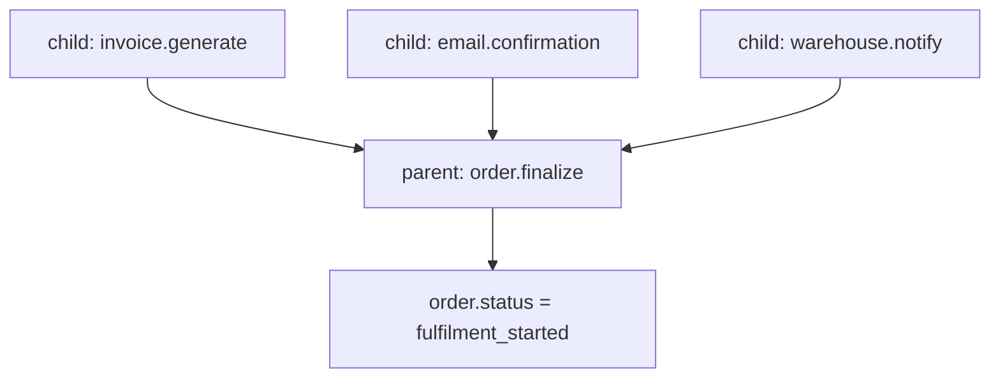

# Part 39 — Background Jobs and Schedulers

## 39.1 Why background jobs exist

There is a moment in every backend engineer's career when a `POST /orders` endpoint that used to answer in 90 ms starts answering in 6 seconds, and nobody changed the order logic. What changed is that somebody added "send the confirmation email" to it, then "generate the invoice PDF", then "push the order to the warehouse system", then "notify the loyalty service". Each addition was small. Each one was synchronous. Together they turned a fast, reliable endpoint into a slow, fragile one.

This part is about the machinery that fixes that: queues, workers, schedulers, retries, dead-letter queues, and the operational discipline that keeps them honest. The main example is NestJS with `@nestjs/bullmq` (BullMQ on Redis), with a PostgreSQL-backed queue using `FOR UPDATE SKIP LOCKED` as the durable alternative, and `@nestjs/schedule` for cron.

### 39.1.1 Moving work out of the request path

#### Concept

A **background job** is a unit of work that is *recorded now* and *executed later*, by a different process, outside the HTTP request that asked for it. The request records an intent ("this order needs a confirmation email") and returns. Some other process picks that intent up and does the work.

The word "later" is doing a lot of work in that sentence. "Later" can mean 20 milliseconds later on an idle worker, or 15 minutes later for a deliberately delayed job, or three attempts and four hours later after a third-party outage. The point is that the user is not waiting.

#### Why does it exist?

Two reasons, and they are different. Confusing them leads to bad architecture.

**Latency.** The user is holding a phone. Every millisecond your endpoint spends on something they do not need in the response is a millisecond of their attention you are burning. Checkout conversion drops measurably as latency rises; the industry rule of thumb is roughly 1 to 2 percent of conversions lost per extra 100 ms on a checkout flow. If your order endpoint spends 4.5 s generating a PDF, you are paying for that PDF in lost revenue.

**Reliability.** This is the bigger one. When you call a third-party email API inside your HTTP handler, you have welded their availability to yours. If SendGrid has a bad ten minutes, your `POST /orders` returns 500, the customer's card was charged, and the order was never created because your transaction rolled back. Your availability is now the *product* of your own availability and every synchronous dependency's availability. Four dependencies at 99.9 percent give you 99.6 percent (we do this arithmetic properly in Part 53 — Site Reliability Engineering).

A queue breaks that welding. The email API being down becomes "some emails are delayed by eleven minutes", which is an inconvenience, not an outage.

#### Mental model

Imagine a restaurant. The waiter takes your order and walks away in 40 seconds. They do not stand at your table while the chef cooks, while the dishwasher runs, while the accountant files the receipt. The *order ticket* goes on a rail in the kitchen; cooks pull tickets off the rail at their own pace; if the dessert station is backed up, your main course still arrives.

The ticket rail is the queue. The ticket is the job. The cooks are the workers. And critically: the ticket contains a table number, not the food. The chef looks up what is needed. We will come back to that when we talk about payload design, because it is the single most common mistake.

#### How it works



1. The request handler does only the work whose result the client needs: validate, write the order row, reserve stock, take payment authorization.
2. It appends a job record to a queue. On Redis with BullMQ that is a few Lua-scripted commands, roughly 0.3 to 1 ms. On PostgreSQL it is one `INSERT`, roughly 0.5 to 2 ms.
3. It returns `201 Created`.
4. Workers, running in separate pods with their own scaling and their own memory limits, pull jobs and execute them. If they fail, the queue retries them.

#### Practical example

Here is the real arithmetic for a checkout endpoint at an e-commerce company doing 400 orders per minute at peak.

| Step | Synchronous cost | Failure probability | Belongs in the request? |
|---|---|---|---|
| Validate DTO | 1 ms | ~0 | Yes |
| Load cart, price it | 12 ms | low | Yes |
| Reserve inventory (`UPDATE ... RETURNING`) | 8 ms | low | Yes — the user must know if it is out of stock |
| Authorize payment | 350 ms p50, 2.5 s p99 | 0.4 percent | Yes — the user must know if the card failed |
| Write order + items | 9 ms | low | Yes |
| Send confirmation email | 220 ms p50, 8 s p99, provider outages | 0.6 percent | **No** |
| Generate invoice PDF | 1.4 s, 180 MB peak RSS | 0.2 percent | **No** |
| Push to warehouse API | 400 ms, their maintenance window is Sunday 02:00 | 1.1 percent | **No** |
| Recalculate loyalty tier | 90 ms | low | **No** |
| Reindex the product in search | 40 ms | low | **No** |

Synchronous everything: p50 around 2.5 s, p99 around 12 s, and the endpoint fails whenever any of five dependencies fails — a combined failure rate around 2.3 percent. Move the bottom five to a queue and the endpoint is p50 380 ms, p99 2.6 s, failing only when payment or the database fails.

That is the whole argument. It is not about elegance. It is 2.3 percent of orders versus 0.4 percent.

#### What must stay synchronous

Junior engineers, having discovered queues, try to move everything. Do not. Work belongs in the request path when **the client's next decision depends on its result**, or when **not doing it immediately would let the system enter an inconsistent state a user can observe**.

Stays synchronous:

- Anything whose result is in the response body. If the response says `orderId`, the order row must exist.
- Authorization and authentication checks. Never "we will check permissions later".
- Inventory reservation for a purchasable item. If you queue it, you will oversell.
- Payment authorization, because the user must be told their card was declined *now*.
- Any write that a subsequent read in the same user flow will look for. Queue the write, and the user's "My Orders" page shows nothing, and they order again.

Goes to a queue:

- Notifications of all kinds: email, SMS, push, webhooks to partners.
- Document generation: invoices, shipping labels, statements, exports.
- Media processing: image resizing, video transcoding, virus scanning.
- Third-party synchronization: ERP, warehouse, accounting, CRM, tax service.
- Analytics, search index updates, cache warming, recommendation refreshes.
- Reports and aggregations over large row counts.
- Anything that takes longer than about 200 ms and is not in the response.

#### Failure scenario

At 02:14 on a Sunday, the warehouse partner starts a maintenance window and their API begins returning `503`. Because the previous team called it inside `OrdersService.create()` inside the order transaction, every checkout now takes 30 s (their client timeout) and then returns `500`. The order transaction rolls back. But payment was already authorized, because the payment call happened before the warehouse call. Ninety-one customers are charged with no order. Support spends Monday issuing refunds, and finance spends the week reconciling.

The fix that shipped that week was four lines: remove the warehouse call from the transaction, enqueue a `warehouse.sync` job after commit. The partner's next maintenance window produced zero customer impact and a queue depth graph that rose to 1,100 and drained in eight minutes.

#### How a Senior Backend Engineer thinks about this

They ask, for every line in a request handler: *does the caller need this to have happened before I answer?* If the answer is no, it is a job. Then they ask the second question, which juniors skip: *what happens if this job runs twice, or runs three hours late, or never runs?* If any of those answers is "we lose money silently", the job needs idempotency, a dead-letter queue and an alert — which is the rest of this part.

They also refuse to use a queue as an excuse for not fixing slow code. A 4-second query does not become fast by moving it to a worker; it becomes invisible. Sometimes that is right. Often it hides a missing index.

## 39.2 Job queues

### 39.2.1 Producer, queue, worker

#### Concept

Three roles, and you should be able to name which process plays which in your system.

- **Producer** — the code that creates a job. Usually an API request handler, sometimes a scheduler, sometimes another worker.
- **Queue** — durable storage that holds jobs and hands each one to exactly one consumer at a time. It provides ordering (loosely), visibility (a job being processed is not handed to someone else), and persistence.
- **Worker** — a long-running process that pulls jobs, runs a handler, and reports success or failure.

The queue is the boundary. Producers do not know who consumes. Workers do not know who produced. That decoupling is the point.

#### Mental model

Imagine a post office sorting shelf with numbered pigeonholes. Anyone can drop a letter in. Sorters take letters one at a time, and while a sorter is holding a letter, nobody else can take it. If a sorter drops dead mid-letter, the letter falls back on the shelf after a while — that "after a while" is the visibility timeout or lock duration, and it is why a job can genuinely run twice. Hold that thought; it is section 39.7.

#### How it works



BullMQ implements this with Redis lists and sorted sets, driven by Lua scripts so that "move from waiting to active and take the lock" is a single atomic operation. The important structures:

| Redis key | Type | Holds |
|---|---|---|
| `bull:<queue>:wait` | list | jobs ready to run, FIFO |
| `bull:<queue>:active` | list | jobs currently held by a worker |
| `bull:<queue>:delayed` | sorted set | jobs scored by their run-at timestamp |
| `bull:<queue>:prioritized` | sorted set | jobs scored by priority |
| `bull:<queue>:completed` / `:failed` | sorted set | finished jobs, trimmed by `removeOnComplete` |
| `bull:<queue>:<jobId>` | hash | the job's data, options, attempt count, stacktrace |

Knowing this is not trivia. When somebody says "Redis memory went from 400 MB to 9 GB overnight", you will know to look at the `completed` sorted set and the job hashes, and you will know the fix is `removeOnComplete`.

### 39.2.2 Payload design: pass ids, never whole objects

#### Concept

A job payload should be the **smallest identifier the handler needs to find the truth**, plus anything genuinely not derivable later.

```ts
// Good
{ orderId: 'ord_8812', attemptReason: 'created' }

// Bad
{ order: { id, userId, items: [...42 items...], address: {...}, totals: {...} } }
```

#### Why does it exist?

Four concrete reasons, all of which you will meet.

1. **Staleness.** A job enqueued at 14:02 may run at 14:09 after a retry. Between those times the order was cancelled, the address was corrected, the price was adjusted. A payload-carrying job emails the customer the old address. An id-carrying job reloads the row and sees the truth.
2. **Size.** Redis holds every job in memory. A 40 KB payload times 200,000 queued jobs is 8 GB of RAM, and Redis is not a database you want to run at 8 GB for this. An id is 24 bytes.
3. **Schema evolution.** Payloads are serialized contracts. If you change the shape of `order` and deploy, the jobs already sitting in the queue carry the old shape, and your new worker code crashes on all of them. Ids never change shape. (This is the same compatibility problem as Part 28 — Backward Compatibility: APIs, Schemas, Events and Clients.)
4. **Secrets.** Whole objects tend to carry emails, phone numbers, addresses. Redis is often less protected than PostgreSQL, is dumped to RDB files, and appears in Bull Board screenshots pasted into Slack. Do not put personal data in job payloads.

#### Practical example

```ts
// jobs/order-jobs.types.ts
// Payloads are versioned, tiny, and contain no personal data.
export interface SendOrderConfirmationJob {
  v: 1;                 // payload version, so a handler can branch during a rollout
  orderId: string;      // the only thing we need; everything else is loaded fresh
  correlationId: string; // Part 47: the request id that caused this job
}

export interface ReindexProductJob {
  v: 1;
  productId: string;
  reason: 'price_change' | 'stock_change' | 'content_edit';
}
```

The one legitimate exception: data that **cannot be reconstructed later**. If the job's purpose is "record that the user saw variant B of the banner at 14:02", the timestamp and variant must be in the payload, because nothing in the database will tell you afterwards. Snapshot-style jobs (audit, analytics, "email exactly this rendered content") carry data by design. Everything else carries ids.

#### Common mistakes

- Putting an entire TypeORM entity in the payload. It serializes lazily-loaded relations as `undefined`, or worse, triggers loads and serializes half your schema.
- Putting a `Date` object in and being surprised it arrives as a string. JSON has no date type. Always `toISOString()` and parse explicitly.
- Putting a file buffer in the payload. Upload to S3 first, pass the key (Part 36 — File Storage).
- Putting an access token in the payload so the worker can "act as the user". Pass the user id and let the worker mint its own service credential.

### 39.2.3 Job options

Every serious queue library gives you the same handful of knobs. Knowing what each one does in production is what separates a working queue from a queue that pages you.

| Option | What it does | Sensible default | Gotcha |
|---|---|---|---|
| `attempts` | total tries including the first | 3 to 5 for network work, 1 for non-idempotent work | `attempts: 1` means no retry at all, not one retry |
| `backoff` | delay between attempts | `{ type: 'exponential', delay: 2000 }` | without jitter, all retries from an outage fire together |
| `delay` | milliseconds before the job becomes runnable | 0 | delayed jobs sit in a sorted set; a million of them is a memory problem |
| `priority` | lower number runs first | leave unset | priorities move jobs to a different structure and can starve low-priority work |
| `jobId` | explicit id; a duplicate id is silently ignored | derive it for dedupe | only dedupes while the job still exists in Redis |
| `removeOnComplete` | drop or cap finished jobs | `{ age: 3600, count: 1000 }` | leaving it `false` is the classic Redis OOM |
| `removeOnFail` | same for failures | `{ age: 604800 }` (7 days) | never `true`; you lose your dead letters |
| `lifo` | push to the front | rarely | useful for interactive "retry now" buttons |
| `timeout` (worker-side) | abort a stuck handler | set it | BullMQ v5 has no per-job timeout option; enforce it in your handler |

A note on that last row, because it trips people up: in BullMQ v5 the old `timeout` job option was removed. You enforce time limits yourself, which is honest — only your handler knows how to abort safely.

```ts
// common/with-timeout.ts
export async function withTimeout<T>(p: Promise<T>, ms: number, label: string): Promise<T> {
  let timer: NodeJS.Timeout;
  const guard = new Promise<never>((_, reject) => {
    timer = setTimeout(() => reject(new Error(`${label} timed out after ${ms}ms`)), ms);
  });
  try {
    return await Promise.race([p, guard]);
  } finally {
    clearTimeout(timer!);
  }
}
```

Pair it with an `AbortSignal` on your HTTP client so the underlying socket actually closes; a raced Promise alone leaves the request running and the socket held.

### 39.2.4 BullMQ in NestJS

#### NestJS example

Registration. Note the shared `defaultJobOptions` — this is where you stop the Redis-OOM class of incident once, for the whole app.

```ts
// queues/queues.module.ts
import { Module } from '@nestjs/common';
import { BullModule } from '@nestjs/bullmq';
import { ConfigModule, ConfigService } from '@nestjs/config';

@Module({
  imports: [
    BullModule.forRootAsync({
      imports: [ConfigModule],
      inject: [ConfigService],
      useFactory: (cfg: ConfigService) => ({
        connection: {
          host: cfg.getOrThrow<string>('REDIS_HOST'),
          port: cfg.getOrThrow<number>('REDIS_PORT'),
          // BullMQ requires this; ioredis would otherwise retry commands forever.
          maxRetriesPerRequest: null,
          enableReadyCheck: false,
        },
        // Keys are prefixed per environment so staging can never eat prod jobs.
        prefix: `bull:${cfg.getOrThrow<string>('NODE_ENV')}`,
        defaultJobOptions: {
          attempts: 5,
          backoff: { type: 'exponential', delay: 2_000 },
          removeOnComplete: { age: 3_600, count: 1_000 }, // keep 1h or 1000, whichever first
          removeOnFail: { age: 7 * 24 * 3_600 },          // keep failures for a week
        },
      }),
    }),
    BullModule.registerQueue(
      { name: 'notifications' },
      { name: 'documents' },
      { name: 'integrations' },
    ),
  ],
  exports: [BullModule],
})
export class QueuesModule {}
```

Producing. The producer is a thin service, not raw `queue.add` calls scattered through controllers, so that payload shape and job naming stay in one place.

```ts
// notifications/notification-jobs.service.ts
import { Injectable, Logger } from '@nestjs/common';
import { InjectQueue } from '@nestjs/bullmq';
import { Queue } from 'bullmq';

@Injectable()
export class NotificationJobsService {
  private readonly log = new Logger(NotificationJobsService.name);

  constructor(@InjectQueue('notifications') private readonly queue: Queue) {}

  async enqueueOrderConfirmation(orderId: string, correlationId: string): Promise<void> {
    await this.queue.add(
      'order.confirmation',                      // job name, used to route inside the processor
      { v: 1, orderId, correlationId },          // payload: ids only
      {
        // Deterministic id: enqueueing twice for the same order is a no-op.
        jobId: `order-confirmation:${orderId}`,
        attempts: 5,
        backoff: { type: 'exponential', delay: 5_000 },
      },
    );
    this.log.log({ orderId, correlationId }, 'enqueued order.confirmation');
  }
}
```

Consuming. `@Processor` plus `WorkerHost` is the modern `@nestjs/bullmq` pattern; the class *is* the worker.

```ts
// notifications/notification.processor.ts
import { Processor, WorkerHost, OnWorkerEvent } from '@nestjs/bullmq';
import { Logger } from '@nestjs/common';
import { Job, UnrecoverableError } from 'bullmq';

@Processor('notifications', {
  concurrency: 10,        // how many jobs this single worker process runs at once
  lockDuration: 30_000,   // how long the worker owns a job before it is considered stalled
  limiter: { max: 100, duration: 1_000 }, // queue-level: at most 100 jobs/second
})
export class NotificationProcessor extends WorkerHost {
  private readonly log = new Logger(NotificationProcessor.name);

  constructor(
    private readonly orders: OrdersService,
    private readonly mail: MailService,
  ) {
    super();
  }

  async process(job: Job): Promise<unknown> {
    switch (job.name) {
      case 'order.confirmation':
        return this.sendOrderConfirmation(job);
      default:
        // An unknown name means a deploy skew or a typo. Do not retry it forever.
        throw new UnrecoverableError(`unknown job name ${job.name}`);
    }
  }

  private async sendOrderConfirmation(job: Job<{ orderId: string; correlationId: string }>) {
    const { orderId, correlationId } = job.data;

    // Reload the truth. Never trust the payload's view of the world.
    const order = await this.orders.findForNotification(orderId);
    if (!order) throw new UnrecoverableError(`order ${orderId} no longer exists`);
    if (order.status === 'cancelled') {
      this.log.warn({ orderId }, 'order cancelled before confirmation was sent, skipping');
      return { skipped: true };
    }

    await this.mail.sendOrderConfirmation(order, { correlationId });
    return { sent: true, attempt: job.attemptsMade + 1 };
  }

  @OnWorkerEvent('failed')
  onFailed(job: Job | undefined, err: Error) {
    this.log.error(
      { jobId: job?.id, name: job?.name, attempt: job?.attemptsMade, err },
      'job failed',
    );
  }
}
```

Three things in that code are load-bearing and easy to miss:

1. `process()` dispatches on `job.name`. One processor class per queue, many job names inside it. Do not create a queue per job type; queues are not free (each one costs connections, dashboards and alerts) and you lose the ability to reason about a single depth number.
2. The handler **reloads the order**. The payload said `orderId`, not "here is the order".
3. `UnrecoverableError` stops retries immediately. Retrying "this order does not exist" five times with exponential backoff wastes 90 seconds of worker capacity and adds five stack traces to your log budget for no possible benefit.

### 39.2.5 Flows and parent-child jobs

#### Concept

A **flow** is a tree of jobs where a parent job does not become runnable until all its children have completed. BullMQ implements this natively with `FlowProducer`.

#### Why does it exist?

Because real pipelines have fan-out and a join. "Generate the invoice, send the email, notify the warehouse — and when all three are done, mark the order as `fulfilment_started` and emit an analytics event." Without flows you either chain jobs manually (each handler enqueues the next, which serializes work that could be parallel and scatters the pipeline across five files) or you invent a counter in Redis and reinvent the join badly.

#### Mental model

Imagine assembling a bicycle. Wheels, frame and handlebars can be built in parallel by three people. Final assembly cannot start until all three are on the bench. The flow is the work order; the parent job is final assembly; it becomes runnable exactly when the last child reports done.

#### How it works



Children are added to their own queues (so they scale independently), each with its own retry policy. The parent sits in a `waiting-children` state, invisible to normal workers, until the last child completes. If a child exhausts its attempts and fails, the parent stays waiting forever unless you configure `failParentOnFailure` — which is exactly the "orphaned parent flow" failure mode we cover in 39.13.

```ts
// orders/order-flow.service.ts
import { Injectable } from '@nestjs/common';
import { InjectFlowProducer } from '@nestjs/bullmq';
import { FlowProducer } from 'bullmq';

@Injectable()
export class OrderFlowService {
  constructor(@InjectFlowProducer('orders') private readonly flow: FlowProducer) {}

  async startFulfilment(orderId: string, correlationId: string) {
    await this.flow.add({
      name: 'order.finalize',
      queueName: 'orders',
      data: { v: 1, orderId, correlationId },
      opts: { jobId: `finalize:${orderId}`, attempts: 3 },
      children: [
        {
          name: 'invoice.generate',
          queueName: 'documents',
          data: { v: 1, orderId, correlationId },
          // If the invoice can never be produced, the parent must not hang forever.
          opts: { jobId: `invoice:${orderId}`, attempts: 5, failParentOnFailure: true },
        },
        {
          name: 'order.confirmation',
          queueName: 'notifications',
          data: { v: 1, orderId, correlationId },
          opts: { jobId: `confirm:${orderId}`, attempts: 5 },
        },
        {
          name: 'warehouse.notify',
          queueName: 'integrations',
          data: { v: 1, orderId, correlationId },
          opts: { jobId: `wh:${orderId}`, attempts: 8, backoff: { type: 'exponential', delay: 10_000 } },
        },
      ],
    });
  }
}
```

Register the flow producer alongside the queues with `BullModule.registerFlowProducer({ name: 'orders' })`.

The parent reads its children's return values with `job.getChildrenValues()`, which is how the invoice's S3 key reaches the finalize step without a database round trip.

### 39.2.6 Rate limiting and concurrency

These two are constantly confused, and confusing them causes both wasted money and third-party bans.

- **Concurrency** is per worker process: how many jobs this process runs at the same time. It is a *resource* control. Ten concurrent jobs each holding a 40 MB PDF buffer is 400 MB of RSS; that is how workers get OOMKilled.
- **Rate limiting** is per queue, coordinated across all worker processes through Redis: how many jobs may *start* per time window in total. It is a *politeness* control, for third parties who will ban you.

```ts
@Processor('integrations', {
  concurrency: 20,                          // this pod runs 20 at once
  limiter: { max: 50, duration: 1_000 },    // all pods together: 50 jobs/second
})
export class IntegrationProcessor extends WorkerHost { /* ... */ }
```

With three pods at concurrency 20 you have 60 potential parallel jobs, but the limiter guarantees the *start rate* never exceeds 50 per second across the fleet. If the partner's contract says 3,000 requests per minute, set `{ max: 45, duration: 1_000 }` and sleep well.

For per-tenant fairness — "no single merchant may consume more than 20 percent of the warehouse worker" — a global limiter is not enough. Use BullMQ's group rate limiting if you have it available, or shard by tenant into several queues, or implement a token bucket in Redis inside the handler and call `job.moveToDelayed()` when the tenant is over budget. The last option is the most portable and is worth knowing:

```ts
const allowed = await this.tokenBucket.tryConsume(`tenant:${tenantId}`, 1);
if (!allowed) {
  // Put the job back with a short delay; do not burn an attempt.
  await job.moveToDelayed(Date.now() + 2_000, token);
  // Signal BullMQ that this worker deliberately released the job.
  throw new DelayedError();
}
```

`DelayedError` and the `token` argument (available as the second parameter of `process(job, token)`) are real BullMQ APIs and exist precisely for this pattern.

#### Interview questions

1. *Why do we pass ids in job payloads instead of the full object?* Expected: staleness, memory, schema evolution, PII. Follow-up: name a case where you would embed data anyway (audit or snapshot jobs).
2. *What is the difference between worker concurrency and a queue limiter?* Expected: per-process resource control versus fleet-wide start-rate control coordinated in Redis. Follow-up: which one protects a third-party API?
3. *Your Redis memory grew 20x in a week with no traffic change. Where do you look?* Expected: `removeOnComplete`/`removeOnFail` unset, large payloads, a huge `delayed` set, a repeatable job creating jobs faster than they drain.
4. *What is a flow, and what breaks if a child fails permanently?* Expected: parent waits on children; without `failParentOnFailure` the parent stalls in `waiting-children` forever and needs monitoring.
5. *Why does `attempts: 1` surprise people?* Expected: it means one total attempt, so no retries at all.

#### Practical exercise

Take an existing `POST /orders` handler that does five things synchronously. Measure it with `autocannon` at 50 RPS for 60 seconds and record p50/p99. Then:

1. Move email, PDF and warehouse sync to a `notifications`, `documents` and `integrations` queue with deterministic `jobId`s.
2. Set `defaultJobOptions` with retention limits and exponential backoff.
3. Re-run the load test.

Acceptance criteria: p99 drops by at least 60 percent; killing the mail provider container causes zero HTTP 5xx and a visible rise in `notifications` queue depth that drains within two minutes of the provider returning; `redis-cli MEMORY USAGE` on the completed set stays under 5 MB after 3,000 jobs.
