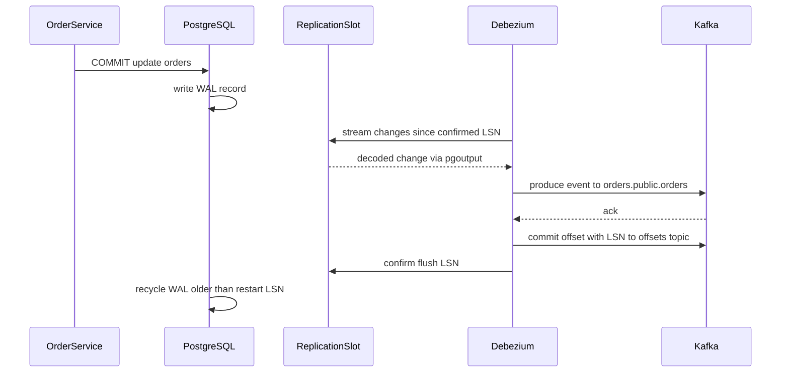
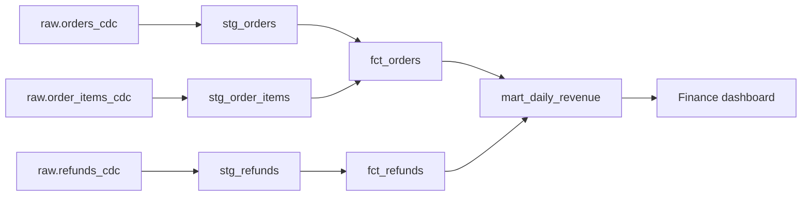

## 39.7 Change data capture in practice: logical replication, Debezium and Kafka Connect

#### Concept

Section 39.2.1 explained what CDC is. This section is the operator's view: the PostgreSQL settings and objects CDC depends on (logical decoding, publications, replication slots), how Debezium runs as a Kafka Connect connector, how the initial copy of existing data (the **snapshot**) works, how source schema changes flow through, and what you must monitor so CDC never becomes the thing that takes the production database down.

#### Why does it exist?

CDC looks like "install Debezium, get events". In production it is a long-lived consumer attached to your primary database, with the power to fill its disk (an unread slot keeps WAL forever), bloat its tables (a long snapshot transaction blocks vacuum), and silently stop (a failed task produces no errors in the application). The mechanics in this section exist so a backend engineer can set it up safely, review the connector config like any other production change, and recognize the three or four failure modes that cause nearly every CDC incident.

#### Mental model

Imagine the WAL as a conveyor belt of every change, running past the database's back door. A **publication** is a list on the door saying which tables' boxes may leave. A **replication slot** is a named bookmark that tells PostgreSQL "this reader has taken everything up to here; keep everything after it". PostgreSQL never throws away belt contents past the oldest bookmark. Debezium is the courier who reads from its bookmark, carries each box to Kafka, and then moves the bookmark forward. If the courier goes home without telling anyone, the belt piles up behind the bookmark until the room is full.

#### How it works



1. `wal_level = logical` makes PostgreSQL write enough information in the WAL to reconstruct row changes, not just physical page changes.
2. A **publication** (`CREATE PUBLICATION`) names the tables whose changes are exposed. Since PostgreSQL 15 it can also restrict columns and filter rows.
3. A **logical replication slot** using the built-in `pgoutput` plugin decodes the WAL for that publication and remembers how far the consumer has confirmed (`confirmed_flush_lsn`). WAL older than the slot's `restart_lsn` can be recycled; WAL newer must be kept.
4. Debezium, running as a **source connector** inside a **Kafka Connect** cluster (a separate JVM service that runs connectors, stores their offsets in Kafka topics and restarts failed tasks), first takes a **snapshot** of existing rows, then streams changes from the slot.
5. Each change becomes a Kafka record on a topic named `<topic.prefix>.<schema>.<table>`, keyed by the row's primary key, so all changes to one order land in one partition in commit order.
6. After Kafka acknowledges the records, Connect commits the source offset (which contains the LSN) and Debezium confirms that LSN to the slot, letting PostgreSQL recycle WAL.

#### PostgreSQL example

```sql
-- Server settings (self-managed). On Amazon RDS set the parameter rds.logical_replication = 1
-- in the DB parameter group instead; both require a restart.
ALTER SYSTEM SET wal_level = 'logical';
ALTER SYSTEM SET max_replication_slots = 10;
ALTER SYSTEM SET max_wal_senders = 10;
ALTER SYSTEM SET max_slot_wal_keep_size = '100GB';  -- PG13+: a dead consumer cannot fill the disk

-- A dedicated, least-privilege role. On RDS use: GRANT rds_replication TO debezium;
CREATE ROLE debezium WITH LOGIN REPLICATION;     -- set the password with \password, from the secret manager
GRANT USAGE ON SCHEMA public TO debezium;
GRANT SELECT ON orders, order_items, payments, refunds TO debezium;  -- needed for snapshots

-- Helper tables Debezium writes to (heartbeats) and reads from (signals)
CREATE TABLE debezium_heartbeat (id int PRIMARY KEY, ts timestamptz NOT NULL);
CREATE TABLE debezium_signal (id varchar(64) PRIMARY KEY, type varchar(32) NOT NULL, data text);
GRANT INSERT, UPDATE ON debezium_heartbeat TO debezium;
GRANT SELECT ON debezium_signal TO debezium;

-- Create the publication yourself so the connector does not need table-owner rights.
-- PG15+ column list: keep raw PII columns out of the stream entirely.
CREATE PUBLICATION dbz_orders FOR TABLE
  orders (id, customer_id, seller_id, status, currency, total_cents, created_at, updated_at, paid_at),
  order_items, payments, refunds, debezium_heartbeat, debezium_signal;

-- Optional: full before-images for updates and deletes (larger WAL, roughly 1.3-2x for these tables).
-- Only on tables WITHOUT a column list: with a column list, REPLICA IDENTITY FULL would require every
-- column to be listed, and UPDATEs on orders would fail with "column list ... does not cover the replica identity".
ALTER TABLE payments REPLICA IDENTITY FULL;
```

Monitor every slot. This one query is worth an alert:

```sql
SELECT slot_name, active, wal_status,
       pg_size_pretty(pg_wal_lsn_diff(pg_current_wal_lsn(), restart_lsn))        AS retained_wal,
       pg_size_pretty(pg_wal_lsn_diff(pg_current_wal_lsn(), confirmed_flush_lsn)) AS unconfirmed,
       pg_size_pretty(safe_wal_size)                                             AS safe_before_loss
  FROM pg_replication_slots
 WHERE slot_type = 'logical';
```

```text
 slot_name  | active | wal_status | retained_wal | unconfirmed | safe_before_loss
------------+--------+------------+--------------+-------------+------------------
 dbz_orders | t      | reserved   | 142 MB       | 3104 kB     | 99 GB
 old_search | f      | extended   | 61 GB        | 61 GB       | 38 GB
```

The second row is the incident waiting to happen: an abandoned slot (`active = f`) from a search-sync experiment holding 61 GB. `wal_status` moves from `reserved` to `extended` to `unreserved` and finally `lost`, at which point the slot is useless and the consumer must re-snapshot. If nobody owns it, `SELECT pg_drop_replication_slot('old_search');` and move on.

#### Practical example: the Debezium connector

Kafka Connect is configured over REST. This is the full config for the orders connector (Debezium 2.x/3.x property names), applied with `PUT /connectors/orders-cdc/config`:

```json
{
  "connector.class": "io.debezium.connector.postgresql.PostgresConnector",
  "tasks.max": "1",
  "plugin.name": "pgoutput",
  "database.hostname": "orders-db.internal.example.com",
  "database.port": "5432",
  "database.user": "debezium",
  "database.password": "${file:/opt/connect/secrets/orders-db.properties:password}",
  "database.dbname": "orders",
  "topic.prefix": "orders",
  "slot.name": "dbz_orders",
  "publication.name": "dbz_orders",
  "publication.autocreate.mode": "disabled",
  "table.include.list": "public.orders,public.order_items,public.payments,public.refunds,public.debezium_heartbeat,public.debezium_signal",
  "column.exclude.list": "public.orders.customer_email,public.orders.shipping_phone,public.orders.shipping_address",
  "snapshot.mode": "initial",
  "signal.data.collection": "public.debezium_signal",
  "incremental.snapshot.chunk.size": "5000",
  "heartbeat.interval.ms": "10000",
  "heartbeat.action.query": "INSERT INTO debezium_heartbeat (id, ts) VALUES (1, now()) ON CONFLICT (id) DO UPDATE SET ts = EXCLUDED.ts",
  "decimal.handling.mode": "precise",
  "tombstones.on.delete": "true",
  "key.converter": "io.confluent.connect.avro.AvroConverter",
  "key.converter.schema.registry.url": "http://schema-registry.internal:8081",
  "value.converter": "io.confluent.connect.avro.AvroConverter",
  "value.converter.schema.registry.url": "http://schema-registry.internal:8081"
}
```

The lines that matter in review:

- `database.password` uses Kafka's built-in `FileConfigProvider` (enabled in the worker with `config.providers=file`), so the secret is a mounted file from the secret manager, not text in the REST call or in Connect's config topic.
- `publication.autocreate.mode: disabled` means the connector uses the publication you created, with its column list, rather than creating one for all tables. `column.exclude.list` repeats the PII exclusion on the Debezium side, so the event schema agrees with what the publication sends and a later publication change cannot leak those columns by accident.
- `heartbeat.*` keeps the slot advancing even when the captured tables are quiet but other databases on the same server are busy; without it, the slot's `restart_lsn` can fall far behind on a low-traffic database and retain WAL.
- `signal.data.collection` enables **incremental snapshots** on demand, which matter more than the initial snapshot (failure scenario below).
- Avro with a schema registry gives every event a registered schema, so downstream sinks (Parquet files, 39.12) and the compatibility checks in 39.11 work.

#### NestJS example

A NestJS service that maintains a support-agent read model from the order change stream. The guard on `source_lsn` makes it idempotent and safe against reordering after a replay.

```ts
// order-changes.consumer.ts
import { Injectable, Logger, OnModuleDestroy, OnModuleInit } from '@nestjs/common';
import { ConfigService } from '@nestjs/config';
import { DataSource } from 'typeorm';
import { Consumer, Kafka } from 'kafkajs';
import { SchemaRegistry } from '@kafkajs/confluent-schema-registry';

interface OrderRow { id: string; customer_id: string; status: string; total_cents: number; updated_at: string }
interface ChangeEvent { op: 'c' | 'u' | 'd' | 'r'; before: OrderRow | null; after: OrderRow | null; source: { lsn: number } }

@Injectable()
export class OrderChangesConsumer implements OnModuleInit, OnModuleDestroy {
  private readonly logger = new Logger(OrderChangesConsumer.name);
  private consumer!: Consumer;
  private registry!: SchemaRegistry;

  constructor(private readonly config: ConfigService, private readonly dataSource: DataSource) {}

  async onModuleInit(): Promise<void> {
    const kafka = new Kafka({ clientId: 'support-read-model', brokers: this.config.getOrThrow<string>('KAFKA_BROKERS').split(',') });
    this.registry = new SchemaRegistry({ host: this.config.getOrThrow<string>('SCHEMA_REGISTRY_URL') });
    this.consumer = kafka.consumer({ groupId: 'support-read-model' });
    await this.consumer.connect();
    await this.consumer.subscribe({ topic: 'orders.public.orders', fromBeginning: true });
    await this.consumer.run({
      eachMessage: async ({ message }) => {
        if (!message.value) return;                        // tombstone after a delete: nothing to do
        const evt = (await this.registry.decode(message.value)) as ChangeEvent;
        await this.apply(evt);                             // throw -> kafkajs retries, offset not committed
      },
    });
  }

  private async apply(evt: ChangeEvent): Promise<void> {
    if (evt.op === 'd' && evt.before) {
      await this.dataSource.query(
        `DELETE FROM support_order_view WHERE order_id = $1 AND source_lsn < $2`, [evt.before.id, evt.source.lsn]);
      return;
    }
    const row = evt.after!;
    // Upsert only if this event is newer than what we stored: replays and duplicates become no-ops.
    await this.dataSource.query(
      `INSERT INTO support_order_view (order_id, customer_id, status, total_cents, updated_at, source_lsn)
       VALUES ($1, $2, $3, $4, $5, $6)
       ON CONFLICT (order_id) DO UPDATE
         SET customer_id = EXCLUDED.customer_id, status = EXCLUDED.status, total_cents = EXCLUDED.total_cents,
             updated_at = EXCLUDED.updated_at, source_lsn = EXCLUDED.source_lsn
       WHERE support_order_view.source_lsn < EXCLUDED.source_lsn`,
      [row.id, row.customer_id, row.status, row.total_cents, row.updated_at, evt.source.lsn]);
  }

  async onModuleDestroy(): Promise<void> {
    await this.consumer?.disconnect();                   // commit offsets and leave the group cleanly
  }
}
```

One subtlety: all changes from one transaction share the commit's ordering but each row change has its own LSN, and rows of the same order always share a partition because the record key is the primary key. The LSN guard therefore works per row. If you need "the whole transaction or nothing" downstream, read the outbox instead (39.2.1), where one event carries the business fact.

#### How schema changes flow through

`pgoutput` does not stream DDL statements. When a table's structure changes, the next row change is preceded by a relation message describing the new columns, and Debezium registers a new schema version for the topic. What that does downstream depends on the change:

| Source change | What the stream does | Safe? | What to do |
|---|---|---|---|
| Add nullable column | New optional field appears from the next change | Yes (backward compatible) | Announce it; consumers ignore unknown fields |
| Add `NOT NULL DEFAULT x` column | New field, existing rows only show it when next updated | Mostly | Backfill reads need the default; document it |
| Drop column | Field disappears | Breaks consumers that read it | Expand/contract (see Part 24 — Database Migrations, 24.5); deprecate first |
| Rename column | Looks like drop plus add | Breaking | Add new, dual-write, migrate consumers, drop old |
| `integer` to `bigint` | Avro `int` to `long` | Yes (type promotion) | None |
| `text` to `integer` | Incompatible type | Breaking; registry rejects it | New column instead |
| New table | Nothing, until added to the publication | n/a | `ALTER PUBLICATION ... ADD TABLE`, add to include list, incremental snapshot |

An incremental snapshot is started by inserting a signal row; Debezium reads the table in primary-key chunks while streaming continues, without a long-running transaction:

```sql
INSERT INTO debezium_signal (id, type, data)
VALUES ('snap-refunds-2026-11-05', 'execute-snapshot',
        '{"data-collections": ["public.refunds"], "type": "incremental"}');
```

#### Production scenario

Orders database: PostgreSQL 17 on a `db.r6g.2xlarge`, 700 million `orders` rows, 2.1 billion `order_items`. The connector runs on a three-worker Kafka Connect cluster (2 vCPU, 4 GB each) on ECS, producing to a 3-broker Kafka cluster. Steady state: about 250 change events per second, 1,800 per second during sales, p99 capture lag under 1 second, retained WAL under 300 MB. A full incremental snapshot of `orders` at 5,000-row chunks runs at about 25,000 rows per second, so roughly 8 hours, while normal streaming continues. Alerts: retained WAL over 5 GB, slot inactive for more than 5 minutes, connector or task not `RUNNING`, heartbeat older than 1 minute in Kafka, schema-registry compatibility failure.

#### Failure scenario

The first CDC rollout used `snapshot.mode: initial` on the 700-million-row `orders` table. A blocking initial snapshot reads all rows inside one long `REPEATABLE READ` transaction so it sees a consistent picture. It ran for 14 hours. For those 14 hours the xmin horizon was pinned, autovacuum could not remove any dead tuples created after the snapshot began, and the busiest tables bloated: `orders` grew 35%, index scans slowed, p99 checkout latency rose from 120 ms to 260 ms by the afternoon. The team cancelled the snapshot at hour 14, ran `VACUUM` to recover, and restarted with `snapshot.mode: no_data` (named `never` in older Debezium releases) plus an incremental snapshot via the signal table, which reads in small chunks with short transactions. The lesson: a snapshot is a long-running reader on your primary, and long-running transactions are one of PostgreSQL's oldest foot-guns (see Part 19 — PostgreSQL Internals, 19.8). Prefer incremental snapshots on large tables, and snapshot at night.

#### Edge cases & failure modes

- **Abandoned or inactive slot fills the disk.** Cap with `max_slot_wal_keep_size`; alert on retained WAL; drop slots nobody owns.
- **Slot lost after failover.** Before PostgreSQL 17 logical slots are not on standbys; after failover, re-create the slot and incremental-snapshot. On 17, create the slot with failover enabled and set `sync_replication_slots` on the standby, then test it.
- **Wrong user privileges on managed databases.** RDS has no superuser; the `REPLICATION` attribute is replaced by the `rds_replication` role.
- **Connector restarts replay events.** Up to the last committed offset; at-least-once by design. Consumers dedupe by LSN or upsert by key.
- **Huge transaction.** A one-statement backfill of 30 million rows arrives as 30 million events after the commit; batch backfills into small transactions (see Part 24 — Database Migrations, 24.7).
- **`TRUNCATE`.** Captured as a truncate event only if the publication publishes truncates; many sinks ignore it. Forbid `TRUNCATE` on CDC tables.
- **Unchanged TOAST values.** Updates that do not touch a large column send a placeholder (`__debezium_unavailable_value`); never write it over the stored value.
- **Time and money types.** `numeric` without `decimal.handling.mode: precise` (or `string`) can lose precision as a double; store money as integer cents anyway.

#### How a Senior Backend Engineer thinks about this

A senior treats the CDC connector as part of the database's production surface, reviewed and monitored like the database itself. Before enabling it they ask: who owns this slot, what is the WAL cap, what alerts fire if it stops, how will we snapshot 700 million rows without a 14-hour transaction, which columns are we deliberately not publishing, and what happens on failover? They create the publication by hand with a column list rather than letting a tool capture every table. They keep consumers idempotent with an LSN guard or a key upsert, and they route breaking schema changes through expand/contract and the data contract, because CDC turns the table schema into a public API. They also know when not to use it: for business events that other services act on, the outbox (read by the same CDC machinery) is the better contract.

#### Common mistakes

- No `max_slot_wal_keep_size` and no slot alert; one dead connector fills the primary's disk.
- Blocking initial snapshot of a huge table during business hours.
- Letting the connector auto-create a publication for all tables, streaming PII and internal tables no one asked for.
- Putting the database password in the connector JSON sent over REST.
- Renaming a column on a CDC'd table without telling the data team.
- Assuming exactly-once; writing consumers that blindly insert.

#### Interview questions

1. **What is a logical replication slot and why can it take down a database?** It is a server-side bookmark for a logical decoding consumer; PostgreSQL retains all WAL after the slot's restart LSN, so an inactive consumer causes unbounded WAL retention until the disk fills. Mitigate with `max_slot_wal_keep_size` and alerts on `pg_replication_slots`. Follow-up: what happens when the cap is hit? The slot becomes `lost` and the consumer must re-snapshot.
2. **How does Debezium take the initial copy of a large table, and what is the risk?** A blocking snapshot reads all rows in one long repeatable-read transaction, pinning the xmin horizon and blocking vacuum; incremental snapshots read in primary-key chunks while streaming continues.
3. **What is a publication and why create it yourself?** The set of tables (and since PostgreSQL 15, columns and row filters) exposed to logical decoding; creating it by hand limits what leaves the database and avoids granting the connector ownership rights.
4. **How do you make a CDC consumer idempotent and order-safe?** Upsert by primary key with a guard that only applies an event whose LSN is newer than the stored one; deletes check the LSN too.
5. **Which source schema changes are breaking for CDC consumers?** Drops, renames and incompatible type changes; adding nullable columns and widening integer types are safe. Breaking changes go through expand/contract and the data contract.
6. **What does the heartbeat setting do?** Periodically produces an event (optionally by writing to a heartbeat table) so the slot's confirmed position keeps moving even when captured tables are idle, preventing WAL retention on low-traffic databases.

#### Practical exercise

With Docker Compose, run PostgreSQL 17, Kafka, a schema registry and Kafka Connect with the Debezium PostgreSQL connector. Create the publication with a column list, deploy the connector config above, and build the NestJS read-model consumer. Then: stop Connect for 10 minutes while a script writes 100,000 updates and watch `retained_wal` grow; restart and watch it fall; add a nullable column and observe the new schema version; trigger an incremental snapshot of `refunds` with a signal row. Acceptance criteria: the slot query shows retention rising and recovering; the read model ends identical to the source table after replaying the topic twice from the beginning; no PII column appears in any topic.

## 39.8 Batch pipelines in practice: ELT models, idempotent loads and backfills

#### Concept

Once raw change events land in the warehouse (39.12 shows how), batch ELT turns them into tables people can trust. The common shape is three layers of SQL **models**: **staging** (clean and deduplicate raw data, one row per source row's latest version), **facts and dimensions** (business entities such as `fct_orders` and `dim_customers`), and **marts** (aggregates for a specific use, such as `mart_daily_revenue`). Tools like dbt let you write each model as a `SELECT` with dependencies declared through `ref()`, and the tool builds them in order; plain SQL run by a scheduler works on the same principles.

#### Why does it exist?

Raw CDC data has every version of every row, deletes as flags, events in technical units (cents, UTC, LSNs) and duplicates from at-least-once delivery. Analysts should not repeat that cleanup in every query, each slightly differently, producing five versions of revenue. Layered models put each rule (dedupe, time zone, what counts as revenue) in exactly one place, under version control and code review, with tests, and with an orchestrator that knows the dependency order.

#### How it works



1. **Staging** picks the latest version of each row by LSN and drops deleted rows.
2. **Facts** apply business rules: which statuses count, which time zone defines the business day, how refunds net out.
3. **Marts** aggregate to the grain the dashboard needs and are rebuilt for a trailing window so late refunds land on the right day.
4. **Tests** run after each model: uniqueness of keys, not-null, accepted status values, referential integrity, and freshness of sources.
5. The **orchestrator** runs the graph on a schedule, one run per data interval, with retries, a concurrency limit of one run at a time, and gates for input completeness (39.2.2).

#### PostgreSQL example (warehouse SQL, dbt-style)

```sql
-- models/staging/stg_orders.sql : latest version of each order from raw CDC rows
with ranked as (
  select
    id                                  as order_id,
    customer_id, seller_id, status, currency, total_cents,
    cast(created_at as timestamp)       as created_at_utc,
    cast(paid_at as timestamp)          as paid_at_utc,
    __deleted                           as is_deleted,
    __source_lsn                        as source_lsn,
    row_number() over (partition by id order by __source_lsn desc) as rn
  from {{ source('raw', 'orders_cdc') }}
)
select * from ranked
where rn = 1 and not coalesce(is_deleted, false)
```

```sql
-- models/marts/mart_daily_revenue.sql : one row per business day and currency
{{ config(materialized='incremental', unique_key=['business_date', 'currency'],
          incremental_strategy='merge') }}
with paid as (
  select date(convert_timezone('UTC', 'Asia/Kolkata', paid_at_utc)) as business_date,
         currency, total_cents
  from {{ ref('fct_orders') }}
  where status in ('paid', 'shipped', 'delivered', 'refunded', 'partially_refunded')
), refunds as (
  select date(convert_timezone('UTC', 'Asia/Kolkata', refunded_at_utc)) as business_date,
         currency, amount_cents
  from {{ ref('fct_refunds') }}
)
select d.business_date, d.currency,
       count(*)                                         as orders,
       sum(d.total_cents)                               as gross_cents,
       coalesce(max(r.refund_cents), 0)                 as refund_cents,
       sum(d.total_cents) - coalesce(max(r.refund_cents), 0) as net_cents
from paid d
left join (select business_date, currency, sum(amount_cents) as refund_cents
             from refunds group by 1, 2) r
       on r.business_date = d.business_date and r.currency = d.currency

where d.business_date >= dateadd(day, -7, current_date)  -- recompute a trailing week for late refunds

group by d.business_date, d.currency
```

`convert_timezone` and `dateadd` are Snowflake/Redshift functions; in BigQuery you would write `DATE(paid_at_utc, 'Asia/Kolkata')` and `DATE_SUB(CURRENT_DATE(), INTERVAL 7 DAY)`. dbt adapters hide some of those differences through macros, but the business rules (statuses, time zone, refund netting, seven-day lookback) are the part that matters.

Tests and source freshness are declared next to the models:

```yaml
# models/schema.yml
version: 2
sources:
  - name: raw
    loaded_at_field: _loaded_at
    freshness:
      warn_after: { count: 30, period: minute }
      error_after: { count: 2, period: hour }
    tables:
      - name: orders_cdc
      - name: refunds_cdc
models:
  - name: stg_orders
    columns:
      - name: order_id
        tests: [unique, not_null]
      - name: status
        tests:
          - accepted_values:
              values: ['pending', 'paid', 'shipped', 'delivered', 'cancelled', 'refunded', 'partially_refunded']
  - name: mart_daily_revenue
    columns:
      - name: net_cents
        tests: [not_null]
```

Without dbt, the same idempotent load is a transaction that replaces one interval:

```sql
BEGIN;
DELETE FROM mart_daily_revenue WHERE business_date BETWEEN DATE '2026-10-29' AND DATE '2026-11-04';
INSERT INTO mart_daily_revenue (business_date, currency, orders, gross_cents, refund_cents, net_cents)
SELECT ... FROM fct_orders ... WHERE business_date BETWEEN DATE '2026-10-29' AND DATE '2026-11-04' GROUP BY 1, 2;
COMMIT;
```

Rerun it any number of times and the result is the same, which is the only property that makes retries and backfills safe.

#### Choosing how to orchestrate

| Option | Good for | Weak at |
|---|---|---|
| Warehouse scheduled queries | 5–20 simple models, one team | Dependencies, tests, backfills |
| cron or Kubernetes `CronJob` running SQL | Small teams that already run Kubernetes | Dependency graph, retries per step, visibility |
| dbt plus a scheduler (dbt Cloud, or a CronJob) | Most analytics teams: SQL models, tests, lineage | Non-SQL steps (API extracts, ML) |
| Airflow or Dagster | Many pipelines mixing extracts, SQL, ML, file drops | Operating another platform |
| Stream processor (39.10) | Seconds-fresh results | Complex joins over history, cheap backfills |

#### Production scenario

The finance marts above run hourly (for an intraday view) and nightly at 01:30 local time with a seven-day lookback. A full rebuild of `mart_daily_revenue` over five years, needed when the definition of "revenue" changed to exclude gift cards, scanned about 90 GB and took 7 minutes on a medium warehouse. Tests run on every build; a failing `accepted_values` test on `status` (a new `on_hold` status appeared) stopped the nightly run at 01:42, the on-call data engineer added the value with a mapping, and the marts were published at 02:30, well inside the 06:00 SLA.

#### Failure scenario

A product engineer added `status = 'payment_review'` for orders held by the fraud model. The fact model's `where status in (...)` list did not include it, so those orders vanished from revenue until they cleared, and on a heavy fraud-review day the dashboard dropped 6%. There was no `accepted_values` test, so nothing failed. The fix was the test above (new statuses now fail the build loudly instead of silently disappearing) and a line in the orders team's contract: "new status values are announced one release ahead". The lesson: business rules expressed as allow-lists need a test that fails when the world grows a new value.

#### Edge cases & failure modes

- **Deduplication by the wrong column.** Ordering by `updated_at` instead of LSN picks the wrong row when two updates share a timestamp.
- **Merge without a unique key.** An incremental model with no `unique_key` appends duplicates on every run.
- **Full refresh of a huge table by accident.** `dbt run --full-refresh` on a 2 TB fact table costs real money; restrict it in production.
- **Lookback too short.** Chargebacks arrive up to 120 days later; decide which numbers are final and when.
- **Mixed currencies.** Summing INR and USD cents is meaningless; aggregate per currency or convert with a dated rate table.

#### How a Senior Backend Engineer thinks about this

A senior sees the staging model as the place where the backend's technical reality (LSNs, delete flags, UTC, cents) is translated once, and they help write it, because they know what the source columns mean. They insist on idempotent loads by interval, a trailing recompute window sized to how late facts really arrive, and tests that fail loudly when the source grows a new enum value. They right-size the orchestration: dbt plus a scheduler for SQL, a full workflow engine only when there are genuinely many non-SQL steps.

#### Common mistakes

- `INSERT`-only loads that double on retry.
- Business rules copied into dashboard queries instead of a model.
- No tests on status values or keys.
- Computing "yesterday" in UTC for a business that runs in another time zone.
- Backfills done by hand-editing tables rather than rerunning models.

#### Interview questions

1. **How do you make a daily batch load idempotent?** Each run owns an interval and replaces it (delete-then-insert in a transaction, or `MERGE` by a unique key), so reruns produce the same result.
2. **Why recompute a trailing window instead of only yesterday?** Late facts (refunds, chargebacks, late CDC delivery) change past days; a trailing recompute puts them on the right day.
3. **What tests would you put on an orders staging model?** Unique and not-null primary key, accepted status values, relationships to customers, freshness of the raw source, and a reconciliation against the source.
4. **When is Airflow worth it over dbt plus cron?** When pipelines mix many non-SQL steps (API extracts, file transfers, ML training) with dependencies and backfills across them.

#### Practical exercise

Write `stg_orders`, `fct_orders`, `fct_refunds` and `mart_daily_revenue` against a raw CDC table with duplicates, deletes and out-of-order versions. Add the tests and freshness checks above. Acceptance criteria: running the build twice yields identical marts; inserting a new status value fails the build; a refund inserted for a date six days ago changes that day's `net_cents` on the next run.
