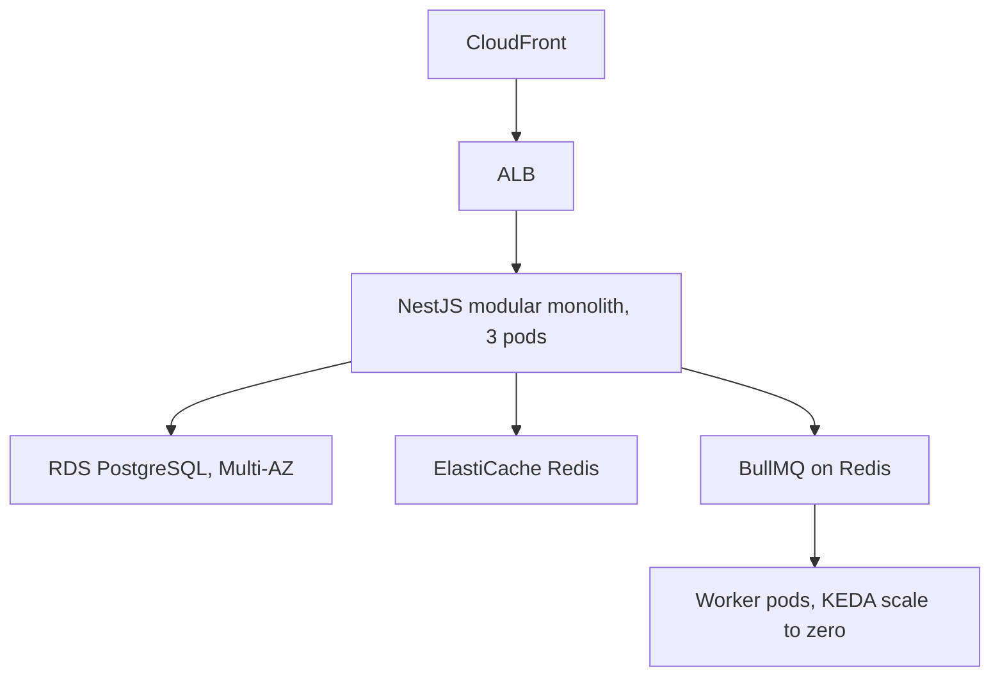
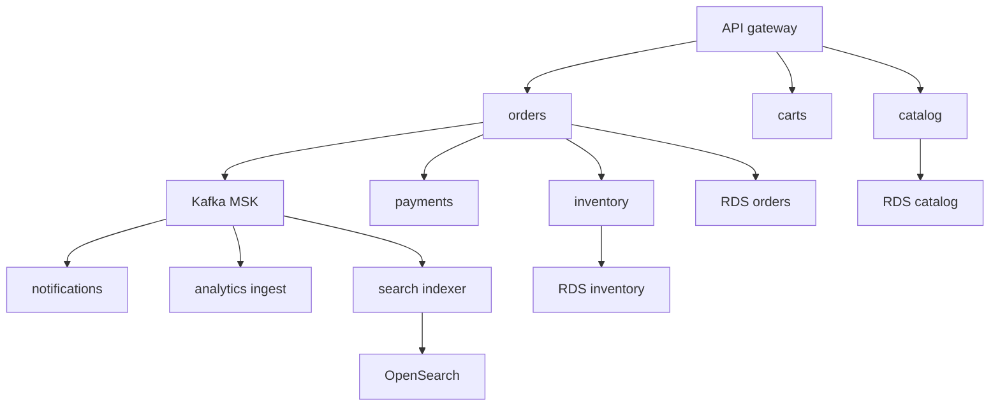

## 39.6 Architecture cost trade-offs

#### Concept

Every architectural choice has a recurring monthly price attached, and most of that price is *baseline* — cost you pay before serving a single request. Baseline cost is where architecture shows up on the bill, and it is the part that scales with the number of moving parts rather than with traffic.

#### Why does it exist?

Because distributed systems are not free at the boundaries. Every service you split out needs, at minimum: a place to run with a redundant minimum replica count, a way to be reached, a way to be observed, a way to be deployed, and a person who understands it. Those costs are per-service and mostly fixed.

#### Mental model

Imagine splitting one shop into twelve specialist shops. Each needs its own rent, its own till, its own alarm system, its own insurance, its own opening-hours rota. The total number of customers has not changed. Some of the twelve will genuinely serve customers better. All twelve will send you a rent bill.

#### How it works

**Microservices multiply the baseline.** Here is what each additional service costs before it does any work. Approximate monthly figures:

| Item | Per service | Notes |
|---|---|---|
| Minimum pod count for HA | $40 to $120 | 2 to 3 pods, even at 5 RPS |
| Load balancer or ingress rule | $0 to $25 | Shared ALB with host rules is cheap; a dedicated ALB is about $20 plus LCU charges |
| Observability agent and telemetry | $30 to $150 | Per-host or per-container APM pricing, plus that service's metrics, logs and traces |
| CI pipeline minutes | $15 to $60 | Build, test, image scan, per commit |
| Container registry storage | $2 to $10 | Image history |
| Secrets and config | $2 to $8 | Per secret per month, plus API calls |
| Its own database, if it has one | $175 to $700 | The big one; see below |
| **Baseline per service** | **$90 to $350**, or **$300 to $1,000 with its own database** | |

Twelve services is therefore roughly $1,100 to $4,200 a month of baseline before traffic, and considerably more if several own databases. That is the number to put in a design review when someone proposes splitting a module out.

The costs that do not appear on the bill are larger:

- **On-call surface.** Twelve services means twelve sets of alerts, twelve runbooks, twelve deploy pipelines to keep green, twelve dependency upgrade streams.
- **Cross-service debugging.** A latency regression that spans four services takes far longer to diagnose than one inside a single process, and distributed tracing is a mitigation, not a cure.
- **Cross-AZ and cross-service network traffic** (39.4), which grows with the square of chattiness.
- **Data consistency work.** Transactions that used to be one `BEGIN`/`COMMIT` become sagas, outboxes and reconciliation jobs (Part 19 — Distributed Transactions). That is permanent engineering cost.

None of this is an argument against microservices. It is an argument for knowing the price, so the benefit can be weighed against it.

**Managed services versus self-hosted, with engineer time priced in.** The comparison people run is "RDS costs $700 a month, an EC2 instance running PostgreSQL costs $250, so self-hosting saves $450". That comparison is wrong because it omits the largest term.

```text
Self-hosted PostgreSQL on EC2, honestly costed:
  Instance (r6g.2xlarge)                       $370/month
  EBS storage + snapshots                      $250/month
  Standby instance for HA                      $370/month
  Engineer time: patching, upgrades, backups,
  monitoring, failover testing, incident response
    ~6 hours/month at a fully loaded ~$120/hour $720/month
  Plus the risk premium: a botched major version
  upgrade or a failed failover has a real cost
  --------------------------------------------------------
  Total                                        ~$1,710/month

RDS PostgreSQL Multi-AZ (db.r6g.2xlarge, reserved)
  Instances + storage + backups                ~$1,050/month
  Engineer time                                ~1 hour/month = $120
  --------------------------------------------------------
  Total                                        ~$1,170/month
```

Managed is usually cheaper once engineer time is priced honestly, and it is *always* cheaper in risk. The cases where self-hosting genuinely wins: very large scale where the managed premium becomes millions, a requirement the managed service cannot meet, or a team that already has deep operational expertise and spare capacity in it.

The same arithmetic applies to Kafka (MSK versus self-managed), Redis (ElastiCache versus a StatefulSet), and search (OpenSearch Service versus running Elasticsearch yourself). In each case, self-hosting on Kubernetes looks cheap on the infrastructure line and expensive on the calendar.

**Kubernetes cluster baseline versus ECS.** EKS charges about $0.10 per hour per cluster ($73 a month) for the control plane. That is not the real cost.

```text
Realistic EKS baseline, before any application pod:
  Control plane                                        $73
  System workloads: CoreDNS, kube-proxy, CNI, CSI      included in node cost
  Cluster autoscaler / Karpenter                       small
  Ingress controller (2 replicas)                      ~$40 of node capacity
  Observability DaemonSets (agent per node)            ~5 to 10 percent of every node
  Cert-manager, external-secrets, ArgoCD               ~$60 of node capacity
  Node overhead: kubelet + OS reserved, ~10 percent    ~$80 on an 8-node cluster
  --------------------------------------------------------------------------
  Effective baseline                                   $250 to $400/month
  Plus: a person who understands it. This is the real cost.

ECS on Fargate baseline:
  No control plane charge, no nodes, no DaemonSets, no CNI to tune
  --------------------------------------------------------------------------
  Effective baseline                                   ~$0 to $40/month
```

For a team running 6 services with modest traffic, ECS or App Runner is cheaper in dollars *and* dramatically cheaper in attention. Kubernetes starts paying for itself when you have enough workloads that bin-packing, spot flexibility, and a shared platform genuinely amortise — typically dozens of services and a team big enough to have someone who owns the platform.

The question to ask is not "is Kubernetes good?" but "do we have enough workloads for a shared platform to be cheaper than a managed one, including the person who runs it?"

**Multi-region roughly doubles everything.** Not exactly double, but close enough to plan with:

| Component | Multi-region effect |
|---|---|
| Compute | ~2x (both regions must handle failover load, or you accept degraded capacity) |
| Database | ~2x, plus cross-region replication transfer at about $0.02 per GB |
| Object storage | ~2x with Cross-Region Replication, plus per-GB transfer |
| Kafka | ~2x plus MirrorMaker traffic |
| Observability | ~2x volume |
| Engineering | Every deployment, migration and incident now has two of everything |

Part 38's DR ladder is the disciplined way to buy a fraction of this: pilot light gives you most of the resilience for roughly 15 to 25 percent of the cost of full active-active, and that is the trade most companies should make.

#### Failure scenario

A 14-person startup adopted microservices at the design stage, before they had users. Eighteen months later: 19 services, an EKS cluster, a service mesh, MSK, four RDS instances, and a monthly bill of $23,000 serving 90 requests per second — about 230 million requests a month, which is $0.0001 per request against a product generating very little revenue per request.

Two engineers spent most of their time on platform work. Feature velocity was roughly a third of what it had been at service number four. The CTO's summary in the retrospective: "We bought the operational complexity of a company with 200 engineers and we have 14."

They consolidated to four services and one database over two quarters. The bill fell to $4,800, and — the number that actually mattered — the number of pull requests shipped per week roughly doubled, because a change no longer required coordinating three deploys.

#### How a Senior Backend Engineer thinks about this

They put the recurring monthly cost of an architecture in the design document, next to the latency and availability targets. Not as an objection, as a fact.

They price engineer time in every build-versus-buy comparison, at a fully loaded rate, and they include the on-call and interrupt cost, not just the build cost.

They count baseline separately from marginal cost. Baseline is what an architecture costs to *exist*; marginal is what it costs to serve traffic. Distributed architectures have terrible baselines and often good marginal costs, which is exactly why they are wrong for small systems and right for large ones.

And they are willing to say the unpopular thing in a design review: "this split does not pay for itself yet; let us keep it as a module and revisit at 10x traffic."

## 39.7 The best architecture is not the most sophisticated architecture

This section is an argument, so let me make it concretely, with two systems that serve identical traffic.

**System A: a modular monolith.** One NestJS application, organised into modules with enforced boundaries (`orders`, `inventory`, `catalog`, `payments`, `notifications`), each with its own service layer, its own schema in one PostgreSQL database, and no cross-module imports except through published interfaces. Three pods. One RDS instance. One Redis. One queue for background work.



```text
System A monthly cost, 500 RPS peak:
  3 Fargate tasks (1 vCPU / 2 GB)                     $108
  Workers, KEDA scale-to-zero, ~0.6 avg tasks          $22
  RDS db.r6g.large Multi-AZ, reserved                 $220
  ElastiCache cache.t4g.medium x2                      $90
  ALB                                                  $25
  S3 + CloudFront (modest asset volume)                $60
  Logs, metrics, traces (one service)                 $120
  NAT + endpoints                                     $110
  ---------------------------------------------------------
  Total                                              ~$755/month
  Team: 4 engineers, no platform specialist.
  Deploy: one pipeline, ~7 minutes.
  Debugging a slow request: one stack trace.
```

**System B: twelve microservices.** The same product, decomposed: `orders`, `order-items`, `inventory`, `reservations`, `catalog`, `search`, `pricing`, `payments`, `notifications`, `users`, `carts`, `analytics-ingest`. EKS, a service mesh, MSK for inter-service events, three separate RDS instances, OpenSearch, Redis.



```text
System B monthly cost, the SAME 500 RPS peak:
  EKS control plane                                     $73
  Nodes: 6 x m7g.xlarge (mesh sidecars add ~30% CPU)   $714
  Platform workloads (ingress, mesh, agents, ArgoCD)   $180
  MSK: 3 x kafka.m5.large + storage                    $560
  RDS x3 (orders, inventory, catalog), Multi-AZ         $840
  OpenSearch 3 nodes                                   $420
  ElastiCache                                          $150
  ALBs and ingress                                      $90
  Cross-AZ transfer (mesh doubles the hops)            $380
  NAT + endpoints                                      $210
  Logs, metrics, traces (12 services, 12x cardinality) $1,150
  CI minutes (12 pipelines)                            $180
  ---------------------------------------------------------
  Total                                             ~$4,947/month

  Plus one platform engineer, fully loaded ~$12,000/month.
  Deploy: 12 pipelines; a cross-cutting change needs coordination.
  Debugging a slow request: a distributed trace across 6 hops,
  if sampling captured it.
```

**Infrastructure: 6.5x. Including the platform engineer: about 22x. Same traffic. Same product.**

The complexity is not free even when the money is available, and the money is rarely the binding constraint. The binding constraint is that System B needs a person, and that person is not building the product.

**When the sophisticated option genuinely pays for itself.** This is not an argument that microservices are wrong. They are right when the thing they buy is worth the baseline. Real reasons, in rough order of how often they are actually true:

1. **Independent scaling of a genuinely different workload.** The image processor needs 32 GB of RAM and GPU-adjacent CPU for 20 minutes a day. Running that inside the API's pods means every API pod is sized for it. Splitting it out saves money rather than costing it.
2. **Team autonomy at scale.** Above roughly 30 to 50 engineers, the coordination cost of one deployable becomes the dominant cost, and service boundaries that match team boundaries buy back velocity. Below that, they mostly buy overhead. (This is Conway's Law used deliberately rather than suffered accidentally.)
3. **Genuinely different availability or compliance requirements.** The payments module needs PCI scope isolation; keeping it in the monolith drags the whole application into scope. That is a legitimate, expensive-to-ignore reason.
4. **Different technology needs.** A machine learning inference service in Python, a real-time gateway in Go. A polyglot boundary is a real boundary.
5. **Independent failure domains that matter.** The analytics ingest pipeline must not be able to take checkout down. Sometimes a bulkhead inside one process is enough (Part 20); sometimes it genuinely is not.

Notice what is not on that list: "it is more modern", "it scales better" (a monolith on 30 pods scales fine), "it is what the big companies do" (they have the engineers), and "we might need it later" (you can split later, and splitting a well-modularised monolith is far easier than merging twelve services).

**Boring technology.** There is a discipline, sometimes called the innovation-token model, that is worth adopting explicitly: you get a small number of tokens to spend on unproven technology, and everything else should be boring. Boring means: you know its failure modes, you can hire for it, its documentation exists, and its problems have been solved publicly by thousands of people.

PostgreSQL is boring. It also does full-text search, JSON documents, queues (`SELECT ... FOR UPDATE SKIP LOCKED`), geospatial, time-series with partitioning, and pub/sub. A very large number of systems that run Elasticsearch, MongoDB, Redis Streams and a message broker could run on PostgreSQL alone until they are considerably larger than they are — with one thing to back up, one thing to monitor, one thing to be on call for, and one set of failure modes to learn.

Spend your tokens where the product is differentiated. Nobody has ever won a market because their queue was interesting.

**The cost of complexity, measured in people.** This is the part that dollar figures hide, and it is the real argument.

```text
System A: 4 engineers, all building product.
System B: 4 engineers building product, 1 building and running the platform,
          and each of the 4 spends roughly 20 percent of their time on
          cross-service coordination, distributed debugging, and deploys.

Effective product capacity:
  System A: 4.0 engineers
  System B: 3.2 engineers, from a team of 5

System B costs 25 percent more headcount and delivers 20 percent less.
That is a 45 percent swing in the only metric that determines whether
the company survives.
```

The senior position is not "monoliths good, microservices bad". It is this: **complexity must be paid for, in money and in attention, and attention is the scarcer currency.** Adopt complexity when you can name what it buys, and when what it buys is worth more than what it costs. Otherwise, choose the boring option, keep your modules clean so you can split later, and spend the difference on the product.

The simplest architecture that meets the requirement wins. That has been the position of this entire book, and cost is simply the most measurable evidence for it.
