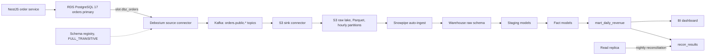
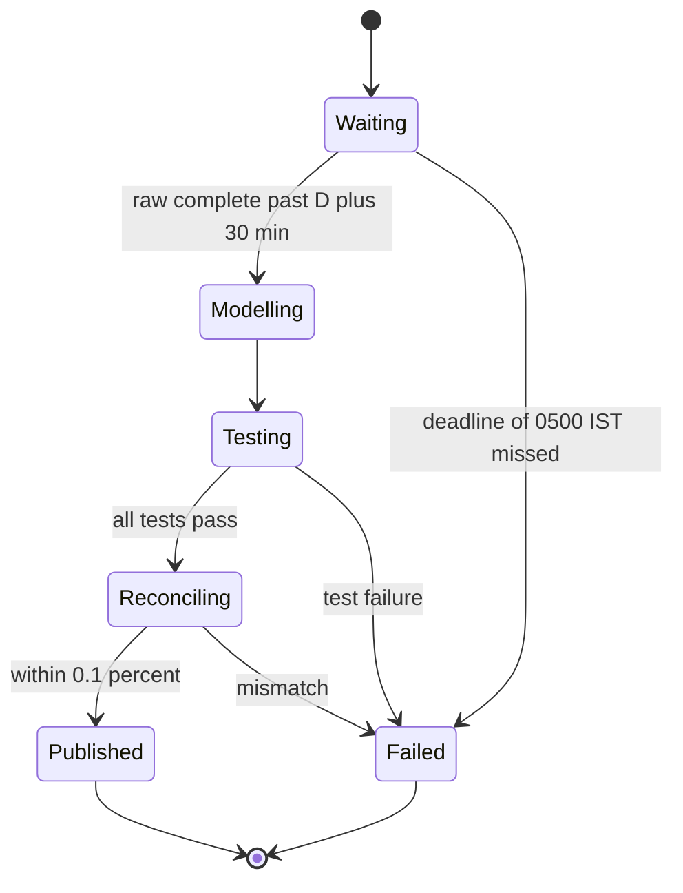

## 39.12 Worked example: CDC from the orders database into a warehouse for daily revenue dashboards

This section assembles everything in the Part into one pipeline you could build in a quarter: the orders database stays untouched by analytics, changes flow out through CDC, land in a lake as Parquet, load into a warehouse, are modelled into a daily revenue mart, are checked against the source every night, and respect erasure requests. Each step points back to the section that explains it.

### 39.12.1 Requirements and numbers

The business is a marketplace selling in India and the UAE.

- **Dashboard:** gross revenue, refunds, net revenue, order count and average order value per day, per currency, per seller category; yesterday final by 06:00 IST; an intraday view refreshed hourly.
- **Correctness:** must match the finance payout ledger within 0.1% for closed days.
- **Safety:** no analytics query ever runs on the orders primary; the pipeline must not be able to fill the primary's disk or bloat its tables.
- **Privacy:** no email, phone or address in the warehouse; GDPR erasure completed in every store within 30 days.
- **History:** 5 years, replayable.

| Quantity | Value |
|---|---|
| Orders per day | 400,000 (peak hour 45,000) |
| Order items per day | 1.2 million |
| Refunds per day | 30,000 |
| Change events per day (all tables, including status updates) | about 3.5 million |
| Average and peak event rate | about 40 per second, 1,800 per second in flash sales |
| Raw CDC per day as Parquet | about 300 MB |
| History | 700 million orders, 2.1 billion items, about 1.4 TB Parquet |

Back-of-the-envelope check: 3.5 million events a day is tiny for Kafka (a single partition handles thousands per second); the hard parts are not throughput but correctness, safety and privacy.

### 39.12.2 Architecture



Why each choice: CDC rather than polling because it captures deletes and costs the primary almost nothing (39.2.1); raw-table CDC rather than the outbox because analytics wants every column change, not only business events; a lake in the middle because it decouples the warehouse from Kafka retention and makes five-year replay cheap (39.9); a warehouse rather than PostgreSQL because history is over a terabyte and three teams query it (39.9); batch models rather than stream processing for the final numbers because finance needs reconciled, not provisional, values (39.10).

### 39.12.3 Step 1: prepare the source

Use the settings, role, publication and slot from 39.7, with one deliberate decision: the publication's column list on `orders` excludes `customer_email`, `shipping_phone` and `shipping_address`. PII that never enters the stream never has to be erased from Kafka, the lake, the warehouse or their backups. `customer_id` (a UUID) does flow, because per-customer metrics need a stable key; it is replaced by a random surrogate in staging (Step 5).

Add the alert on retained WAL (39.7), set `max_slot_wal_keep_size = '100GB'` on a 1 TB volume, and run the initial copy as an incremental snapshot at night.

### 39.12.4 Step 2: capture with Debezium

Deploy the connector config from 39.7 unchanged. Set the schema-registry subjects for the three topics to `FULL_TRANSITIVE` (39.11) so a breaking change to the orders table fails loudly at the connector, the moment it happens, rather than three systems later.

### 39.12.5 Step 3: land raw changes in S3 as Parquet

A Kafka Connect sink writes the topics to S3, flattening Debezium's envelope and keeping the metadata needed for deduplication:

```json
{
  "connector.class": "io.confluent.connect.s3.S3SinkConnector",
  "tasks.max": "3",
  "topics": "orders.public.orders,orders.public.order_items,orders.public.refunds",
  "s3.region": "ap-south-1",
  "s3.bucket.name": "acme-lake-raw",
  "topics.dir": "cdc",
  "storage.class": "io.confluent.connect.s3.storage.S3Storage",
  "format.class": "io.confluent.connect.s3.format.parquet.ParquetFormat",
  "parquet.codec": "snappy",
  "partitioner.class": "io.confluent.connect.storage.partitioner.TimeBasedPartitioner",
  "path.format": "'dt'=YYYY-MM-dd/'hr'=HH",
  "partition.duration.ms": "3600000",
  "locale": "en-US",
  "timezone": "UTC",
  "timestamp.extractor": "RecordField",
  "timestamp.field": "__source_ts_ms",
  "flush.size": "200000",
  "rotate.interval.ms": "600000",
  "behavior.on.null.values": "ignore",
  "transforms": "unwrap",
  "transforms.unwrap.type": "io.debezium.transforms.ExtractNewRecordState",
  "transforms.unwrap.add.fields": "op,source.lsn,source.ts_ms",
  "transforms.unwrap.delete.tombstone.handling.mode": "rewrite",
  "key.converter": "io.confluent.connect.avro.AvroConverter",
  "key.converter.schema.registry.url": "http://schema-registry.internal:8081",
  "value.converter": "io.confluent.connect.avro.AvroConverter",
  "value.converter.schema.registry.url": "http://schema-registry.internal:8081"
}
```

The decisions in it: partitions by the **commit time** (`__source_ts_ms`), not the time the sink ran, so a replay writes files into the same hour folders; a file is closed after 200,000 records or when its records span 10 minutes of commit time, which gives files of tens of megabytes rather than millions of tiny ones; deletes become rows with `__deleted = true` instead of being lost; each row carries `__op`, `__source_lsn` and `__source_ts_ms`. Because both the partitioner and the rotation are driven by record data rather than the wall clock, the S3 sink writes each Kafka offset range to a deterministic file name, so a task restart overwrites a file rather than duplicating it. (The wall-clock option, `rotate.schedule.interval.ms`, closes files on quiet topics sooner but gives up that guarantee.) Duplicates can still arrive from Debezium after a source-connector restart, and staging removes them.

An S3 lifecycle rule expires these raw files after 35 days, the retention the privacy policy states for data that still carries `customer_id`; a compacted Iceberg copy keyed by order and carrying only the surrogate `customer_key` (39.9, Step 5) holds the five-year history for replay.

### 39.12.6 Step 4: load into the warehouse

In Snowflake, an external stage over the bucket and an auto-ingest pipe per table load files within a minute or two of arrival:

```sql
CREATE TABLE raw.orders_cdc (
  id VARCHAR, customer_id VARCHAR, seller_id VARCHAR, status VARCHAR, currency VARCHAR,
  total_cents NUMBER(18,0), created_at VARCHAR, updated_at VARCHAR, paid_at VARCHAR,
  "__op" VARCHAR, "__source_lsn" NUMBER(20,0), "__source_ts_ms" NUMBER(20,0), "__deleted" VARCHAR,
  _loaded_at TIMESTAMP_LTZ DEFAULT CURRENT_TIMESTAMP()
);

CREATE STAGE raw.cdc_stage
  URL = 's3://acme-lake-raw/cdc/'
  STORAGE_INTEGRATION = s3_acme_lake
  FILE_FORMAT = (TYPE = PARQUET);

CREATE PIPE raw.orders_cdc_pipe AUTO_INGEST = TRUE AS
  COPY INTO raw.orders_cdc
  FROM @raw.cdc_stage/orders.public.orders/
  FILE_FORMAT = (TYPE = PARQUET)
  MATCH_BY_COLUMN_NAME = CASE_INSENSITIVE;
```

`MATCH_BY_COLUMN_NAME` means a new nullable source column simply loads as soon as you add it to the raw table, and files without it load as null. Snowpipe remembers which files it loaded (for 14 days), so the same file is not loaded twice. With BigQuery the equivalent is a load job or a BigLake external table over the same prefix; with Redshift, `COPY ... FORMAT AS PARQUET` or auto-copy from S3.

### 39.12.7 Step 5: model the revenue

The models are the ones in 39.8, with two additions for this business.

First, a surrogate key that replaces `customer_id` everywhere downstream of staging. Deleting a customer's row in this table is what breaks the link during erasure:

```sql
-- models/staging/customer_keys.sql (incremental): one random key per customer id ever seen
{{ config(materialized='incremental', unique_key='customer_id') }}
select customer_id, uuid_string() as customer_key
from (select distinct customer_id from {{ source('raw', 'orders_cdc') }} where customer_id is not null) s

where customer_id not in (select customer_id from {{ this }})

```

Second, the business-day rule lives in one macro used by every model: IST for India, Gulf Standard Time for the UAE, chosen by the order's `currency`. The mart grain is `business_date x currency x seller_category`, about 2 x 1,826 x 40 = 146,000 rows for five years: the dashboard reads a table smaller than one hour of raw events.

```sql
-- the dashboard's query: tiny, partition-pruned, served in well under a second
SELECT business_date, currency, sum(gross_cents) / 100.0 AS gross, sum(refund_cents) / 100.0 AS refunds,
       sum(net_cents) / 100.0 AS net, sum(orders) AS orders,
       sum(gross_cents) / nullif(sum(orders), 0) / 100.0 AS avg_order_value
  FROM marts.mart_daily_revenue
 WHERE business_date >= dateadd(day, -90, current_date)
 GROUP BY 1, 2
 ORDER BY 1, 2;
```

### 39.12.8 Step 6: quality gates

The nightly run for business date D has three gates, and the dashboard is published only if all pass:

1. **Completeness gate before modelling.** The heartbeat rows (39.7) flow through the same path, so `max("__source_ts_ms")` in `raw.orders_cdc` must be later than the end of day D plus 30 minutes. If not by 05:00 IST, the run fails and pages, and the dashboard shows "yesterday not yet final" rather than a low number.
2. **Model tests** from 39.8: unique keys, accepted statuses, not-null revenue.
3. **Reconciliation** from 39.11: paid-order count and gross revenue for D and D minus 7 against the read replica, tolerance 0.1%. A mismatch blocks publication of the mart (the previous version stays visible) and opens an incident.



### 39.12.9 Step 7: a schema change, end to end

Product wants `discount_cents` on orders so finance can report gross before discounts.

1. The orders team adds `discount_cents bigint` as a nullable column (no default rewrite, no lock problem; see Part 24 — Database Migrations, 24.5) and adds it to the publication's column list with `ALTER PUBLICATION dbz_orders SET TABLE orders (..., discount_cents), order_items, ...`.
2. The contract file gains the field with its meaning: "discount applied to the order total, in minor units, before tax; null for orders created before 2026-11-10". The data team approves the pull request.
3. The next order change registers a new Avro version; `FULL_TRANSITIVE` accepts it because the field is optional.
4. The data team runs `ALTER TABLE raw.orders_cdc ADD COLUMN discount_cents NUMBER(18,0)`; new files load it, old files load null.
5. Staging and facts expose it; the mart adds `discount_cents` after a backfill decision: nulls for old orders are documented, not guessed.

Nothing broke and no consumer was surprised. The same change done as "rename `total_cents` to `net_total_cents`" would have been rejected by the registry at step 3 and by the contract test before merge.

### 39.12.10 Step 8: erasure

An erasure request for customer C produces `customer.erased` through the outbox (Part 20 — 30.10). The erasure workflow (39.11) then: anonymizes C in production (orders are kept for tax law, the customer row is scrubbed); deletes C's row from `customer_keys` in the warehouse, which orphans every analytical row (they now belong to an unknown key and no longer identify C); deletes C's rows from the raw warehouse tables and the Iceberg history, then expires snapshots; and records that raw S3 files containing `customer_id` expire under the 35-day lifecycle rule. Aggregates in the mart need nothing, because they never identified anyone.

### 39.12.11 Step 9: run it

| Signal | Alert when |
|---|---|
| Retained WAL on `dbz_orders` | Over 5 GB, or slot inactive 5 minutes |
| Connector and task state | Not `RUNNING` for 2 minutes |
| Capture lag (commit to Kafka) | p99 over 60 seconds for 10 minutes |
| Newest file in S3 per topic | Older than 20 minutes in business hours |
| Snowpipe load errors | Any |
| Nightly gates | Any failure, or not published by 06:00 IST |
| Reconciliation | Mismatch over 0.1% |
| Warehouse spend | Daily credits over 150% of the 30-day average |

Monthly cost at these volumes, roughly: managed Kafka with three small brokers about $500, Kafka Connect on three Fargate tasks about $180, S3 storage and requests about $60, warehouse loading and modelling about $400–700, schema registry and monitoring about $100. Around $1,300–1,600 a month, against a checkout that no longer slows down every time finance asks a question.

What happens when each piece fails:

| Failure | Effect | Why it is safe |
|---|---|---|
| Debezium down for 3 hours | Dashboard intraday view stale | Slot retains WAL (capped); connector resumes; gate stops a wrong final number |
| Kafka Connect replays after restart | Duplicate rows in raw | Staging dedupes by LSN |
| S3 sink falls behind | Files late | Partitioned by commit time, so late files land in the right hour |
| Snowpipe misses a notification | Missing file | Hourly `ALTER PIPE ... REFRESH` and the completeness gate |
| Source failover | Slot must be re-created on PostgreSQL before 17 | Incremental snapshot re-syncs; reconciliation proves the result |
| A refund for last week | Changes an old day | Seven-day lookback, D minus 7 reconciliation |

#### How a Senior Backend Engineer thinks about this

The senior's contribution to this pipeline is mostly on the left side of the diagram and in the contracts: a publication that leaves PII out, a slot that cannot hurt the primary, a schema-change process the data team trusts, an outbox event for erasure, and help writing the staging model, because they know what `paid_at` really means. They push for the completeness gate and reconciliation early, because a pipeline that is sometimes quietly wrong destroys trust in every number it produces. And they keep it boring: no stream processor for the final numbers, no custom code where a connector does the job.

#### Interview questions

1. **Walk me through how an order placed at 23:58 IST on 4 November ends up in the right day of the revenue dashboard.** It commits in PostgreSQL; Debezium captures it within a second with its commit timestamp; the S3 sink files it under its commit-time UTC hour; Snowpipe loads it; staging keeps the latest version by LSN; the fact model converts `paid_at` to IST, giving 4 November; the nightly run for 4 November waits for completeness past 00:30 IST on the 5th, so the order is included even if delivery was delayed.
2. **How do you stop this pipeline from ever hurting the production database?** A capped slot with alerts, a column-limited publication, incremental snapshots, reconciliation against a read replica rather than the primary, and no analytics queries on the primary at all.
3. **The dashboard shows yesterday 20% low. How do you debug it?** Check the gates first: was the run published, did the completeness gate pass, what does reconciliation say? Then walk the pipeline left to right: slot lag, connector state, newest S3 file per topic, Snowpipe history, staging row counts for the day.
4. **How would you add a near-real-time view without changing the batch path?** Add the Flink SQL job or a NestJS bucket consumer from 39.10 reading the same topics, label it provisional, and keep the reconciled mart as the number of record.
5. **Why put a lake between Kafka and the warehouse?** It decouples the warehouse from Kafka retention, allows cheap replay and re-modelling of five years, and lets other engines read the same data.

#### Practical exercise

Build a scaled-down version locally: PostgreSQL with `orders`, `order_items` and `refunds`; Debezium; Kafka; the S3 sink writing to MinIO; DuckDB reading the Parquet files as the "warehouse"; the staging, fact and mart models as SQL files run by a script; and a reconciliation script. Generate two days of orders with refunds, status updates, deletes and 1% duplicate deliveries (restart the connector mid-run). Acceptance criteria: the mart matches a direct SQL aggregate on PostgreSQL for both days; restarting every component mid-load does not change the result; adding `discount_cents` flows through without errors; an erasure for one customer leaves zero rows with that customer's id in raw and staging data.

## Senior Checklist — Part 39

- [ ] I understand the concept
- [ ] I can explain it simply
- [ ] I can implement it
- [ ] I understand its failure modes
- [ ] I understand its scaling limitations
- [ ] I understand its security implications
- [ ] I understand its operational implications
- [ ] I can choose between alternatives
- [ ] I can explain the tradeoffs
- [ ] I can answer senior-level interview questions
- [ ] I can explain OLTP vs OLAP and read an `EXPLAIN (ANALYZE, BUFFERS)` that proves an aggregate does not belong on the primary
- [ ] I can set up PostgreSQL logical replication for CDC: `wal_level`, a column-limited publication, a slot, and `max_slot_wal_keep_size`
- [ ] I monitor every replication slot's retained WAL and know what an inactive slot does to the disk
- [ ] I can review a Debezium connector config, including snapshot mode, heartbeats, signals and secrets
- [ ] I know which source schema changes are safe for CDC consumers and route breaking ones through expand/contract
- [ ] I write CDC consumers that are idempotent and order-safe (LSN guard or key upsert)
- [ ] I understand ETL/ELT, layered SQL models, idempotent interval loads and trailing-window recomputes
- [ ] I understand warehouses, lakes, Parquet, table formats, partitioning and how pricing shapes queries
- [ ] I understand stream processing: window types, watermarks, idle partitions, checkpoints and where exactly-once stops
- [ ] I treat event schemas as data contracts, enforced by registry compatibility and producer CI tests
- [ ] I champion completeness gates and reconciliation so wrong numbers fail loudly instead of publishing quietly
- [ ] I propagate PII masking and erasure across every store, including lake snapshots and backups
- [ ] I build in-product analytics with idempotent pre-aggregated tables, materialized views and read models

## Part 39 — Key Takeaways

- OLTP (row-oriented, many small transactions) and OLAP (column-oriented, large scans) need opposite optimizations; analytics on the production primary is an incident waiting to happen, and no index fixes it.
- CDC reads the WAL through a publication and a replication slot; it is cheap and complete, but an unread slot retains WAL until the disk fills, so cap it and alert on it.
- Large-table snapshots are long-running readers that block vacuum; prefer incremental snapshots driven by a signal table.
- CDC turns your table schema into a public API: publish only the columns you mean to, and change them with expand/contract and a data contract enforced by the schema registry and CI.
- Delivery is at least once everywhere in the pipeline; every consumer, load and aggregate must be idempotent (LSN guards, key upserts, interval replacement).
- Batch ELT works in layers (staging, facts, marts), owns one data interval per run, recomputes a trailing window for late facts, and tests that fail when the source grows a new value.
- Warehouses and lakes are fast because of columnar storage, compression and partition pruning; their bill is their performance metric, so design partitioning for the dominant query and enforce partition filters.
- Stream processing runs on event time; watermarks close windows, idle partitions stall them, and exactly-once ends at the edge of Kafka.
- A green pipeline proves the code ran, not that the data was complete; completeness gates and reconciliation against the source are the backstop.
- PII flows through every copy: keep it out of the stream when you can, use surrogate keys, and make erasure a tracked workflow that reaches warehouses, lake snapshots and backups.
- For in-product analytics, idempotent summary tables, materialized views and read models in PostgreSQL usually beat both on-the-fly aggregation and the warehouse.
