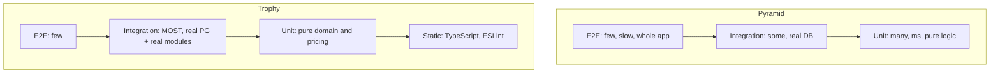
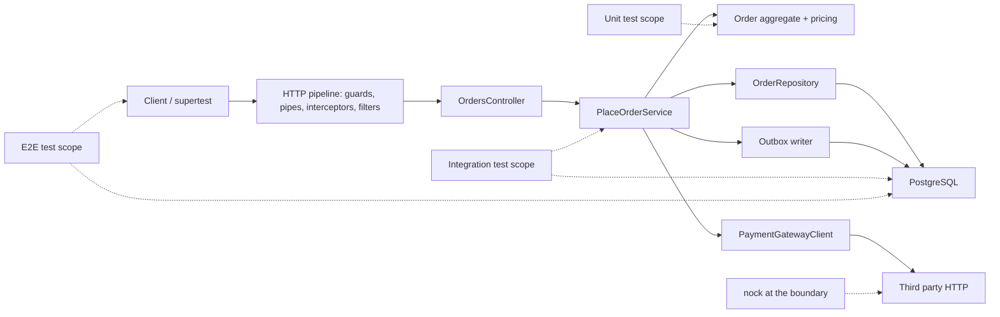

# Part 40 — Testing Backend Systems with Jest and NestJS

A test suite is the only part of your codebase that gets to say "no" to a deploy. Everything else is opinion. That is why senior engineers care so much about *what* the suite is actually proving. A green pipeline that mocks the database, mocks the ORM, mocks time and mocks the payment gateway proves that your mocks agree with each other. It proves nothing about the unique constraint that will reject a duplicate order at 02:14 on a Saturday.

This part is about tests that prove something. We use Jest, `@nestjs/testing`, `supertest`, Testcontainers, `nock` and a real PostgreSQL. We cover the three levels (unit, integration, end-to-end), the doubles you are allowed to use at each level, the things you must never mock, how to test transactions, concurrency, time and async flows, and how to organise all of it in CI so that it stays fast and stays trusted. The running example is the same one used through the book: `PlaceOrder` in an e-commerce backend, with inventory, payment and an outbox event.

Keep the senior mantra next to you: *Can it timeout? Can it fail? Can it become slow? Can it duplicate? Can it return a wrong response? Can it partially succeed?* A good test suite has at least one test per question for every critical path.

## 40.1 The testing pyramid and the testing trophy

#### Concept

The **testing pyramid** is the classic shape: many fast unit tests at the bottom, fewer integration tests in the middle, very few slow end-to-end (e2e) tests at the top. The **testing trophy** is a newer shape that argues the middle layer (integration) should be the widest, because integration tests give the most confidence per minute of maintenance. Both agree on one thing: the higher a test sits, the slower and more expensive it is, and the more real failures it can catch.

For a backend service that sits in front of PostgreSQL, the most expensive bugs live at the boundary between your code and the database (constraints, transactions, locks, migrations) and at the boundary between your service and other services (contracts, timeouts, retries). Unit tests cannot see either boundary. That is the whole argument for the trophy shape.

#### Why does it exist?

Without a shape, teams drift into one of two failure modes. The first is "unit tests only": thousands of tests that mock the repository, run in eight seconds, and never notice that the production schema differs from the entity definition. The second is "e2e only": a hundred tests that each boot the whole app and take twenty minutes, so developers stop running them locally and start ignoring them when they fail. The shape is a budget. It tells you where to spend test time to get the most confidence.

#### Mental model

Imagine inspecting a car. A unit test is checking one spark plug on the bench: fast, precise, and it tells you nothing about whether the car starts. An integration test is starting the engine in the garage: slower, but now you know the fuel line, the battery and the plugs work *together*. An e2e test is driving it around the block: slowest, most realistic, and when it fails you only know "something is wrong somewhere". You want a lot of bench checks, a solid number of engine starts, and a few drives.

#### How it works



The cost, speed and confidence of each layer for a NestJS + PostgreSQL service:

| Layer | Typical runtime per test | What it exercises | What it cannot see | Confidence per test | Maintenance cost |
|---|---|---|---|---|---|
| Static (tsc, ESLint) | 0 ms (once per build) | Types, obvious mistakes | Any runtime behaviour | Low but free | Very low |
| Unit | 1–20 ms | Pure functions, aggregates, one class with fakes | SQL, constraints, wiring, HTTP | Medium for logic, none for I/O | Low if you test behaviour, high if you test implementation |
| Integration | 20–300 ms | Service + real PostgreSQL / Redis / Kafka in a container | Full HTTP stack, auth, other services | High | Medium (needs containers and data builders) |
| E2E | 200 ms – 3 s | Full NestJS app over HTTP with real DB, external HTTP mocked | The real third party | Highest for "does the feature work" | High (slow, brittle if data is shared) |
| Contract | 10–100 ms | Shape of requests/responses/events between services | Business logic | High for integration between teams | Medium |

The recommended ratio for a typical NestJS + PostgreSQL service is discussed in section 40.17. The short version: roughly 40% unit (concentrated on domain logic), 45% integration (services against a real database), 15% e2e and contract. If your domain layer is thin (a CRUD service), shift further toward integration.

#### Practical example

An orders service has these behaviours worth testing:

- Pricing: subtotal, discounts, tax rounding. Pure logic. **Unit.**
- Order state machine: `PENDING -> PAID -> SHIPPED`, with illegal transitions rejected. Pure logic. **Unit.**
- "Two customers cannot buy the last unit." Depends on `SELECT ... FOR UPDATE` and a `CHECK (stock >= 0)` constraint. **Integration** against real PostgreSQL.
- "Payment failure rolls back the order and inventory." Depends on transaction boundaries. **Integration.**
- "`POST /orders` returns 201 with the right body, requires a JWT, and writes an outbox event." **E2E.**
- "Our `order.placed` event still matches what the shipping team consumes." **Contract.**

Notice how quickly the important behaviours leave the unit layer. That is normal for backend systems and it is the reason the trophy exists.

#### How a Senior Backend Engineer thinks about this

A senior engineer asks, for every test: *what production bug would this test have caught?* If the answer is "none, it only checks that I called the mock", the test is deleted. They also ask *what production bug would this test miss?* and add the missing layer. They treat test runtime as a budget: the unit suite must run in under a minute on a laptop, integration under five minutes in CI, e2e in under fifteen. When a suite exceeds the budget, they fix the suite (sharding, container reuse, fewer redundant tests) instead of letting people stop running it.

#### Common mistakes

- Treating the pyramid as a rule about *counts* instead of *cost*. The goal is confidence per minute, not a ratio.
- Writing integration tests that could be unit tests (booting a container to test a rounding rule).
- Writing unit tests that should be integration tests (mocking `repository.findOne` to "test" a query).
- Having no e2e tests at all, so the first time the real HTTP pipeline (guards, pipes, filters, serialization) runs together is in staging.

#### Interview questions

1. *Why does the testing trophy put integration tests in the widest band for backend services?* Expected: the most expensive backend bugs live at the code/database and service/service boundaries, and unit tests cannot observe those boundaries. Follow-up: what does that imply for a thin CRUD service?
2. *How do you decide which layer a test belongs in?* Expected: by what it needs to observe. If the behaviour depends on SQL semantics, it is an integration test. If it depends on HTTP pipeline behaviour, it is e2e.
3. *What is the cost of an e2e test beyond runtime?* Expected: data setup, flakiness from shared state, harder debugging, and slower feedback that pushes developers to skip them.

## 40.2 Where tests sit in the architecture

Before writing a single test it helps to draw where each kind of test cuts the system. Each cut defines what is real and what is a double on either side.



- **Unit** tests touch `AGG` and `SVC` with in-memory fakes for `REPO`, `PAY`, `OUT`.
- **Integration** tests touch `SVC` with a real `PG` in a container, a fake or stubbed `PAY`, and the real `OUT` (it writes to `PG`).
- **E2E** tests go through `C -> GW -> CTRL -> SVC -> PG`, with `STRIPE` replaced by `nock` at the network boundary.

The rule of thumb: the further right on that diagram a component sits, the more it should be real in your tests, until you reach a system you do not own. Systems you do not own are mocked at the *network* boundary, never inside your code.

## 40.3 Unit testing domain logic and services

#### Concept

A unit test exercises a small piece of code in isolation and asserts on its observable behaviour: return values, thrown errors, state changes on the object under test, and calls to collaborators *when the call itself is the behaviour* (for example "the payment gateway was charged exactly once"). "In isolation" means no network, no database, no filesystem, no real clock.

#### Why does it exist?

Domain rules are where money is made and lost: pricing, discounts, tax, stock reservation rules, order state transitions. These rules have many branches. Exercising every branch through HTTP and PostgreSQL would take minutes; through a pure function it takes milliseconds. Unit tests also act as executable documentation of rules that product managers argue about ("is the discount applied before or after tax?").

#### Mental model

Imagine a pharmacist checking a prescription. She does not need the patient present, the pharmacy open, or the insurance company on the phone. She needs the rules (dosage, interactions) and the inputs (patient weight, other medications). A unit test is the same: rules plus inputs, nothing else in the room.

#### How it works

A good unit test has a structure called **AAA**: Arrange (build inputs), Act (call the thing), Assert (check one behaviour). One behaviour per test, named as a sentence that describes the behaviour, not the method name.

1. Arrange: build a valid object using a builder with sensible defaults (section 40.6), then change only the field the test cares about.
2. Act: call exactly one public method.
3. Assert: check the outcome. Prefer asserting on state or return value over asserting on which private method was called.

The most reliable unit tests target code that has no dependencies at all. Push logic into the aggregate and value objects (see Part 13 — Domain-Driven Design) and the tests become trivial.

#### Practical example — the Order aggregate

The aggregate holds the invariants: an order cannot be empty, quantities must be positive, and only certain state transitions are legal.

```ts
// src/orders/domain/order.ts
export type OrderStatus = 'PENDING' | 'PAID' | 'SHIPPED' | 'CANCELLED';

export class DomainError extends Error {}

export interface OrderLine { sku: string; unitPriceCents: number; qty: number }

export class Order {
  private constructor(
    public readonly id: string,
    public readonly customerId: string,
    private lines: OrderLine[],
    private status: OrderStatus,
  ) {}

  static place(id: string, customerId: string, lines: OrderLine[]): Order {
    if (lines.length === 0) throw new DomainError('order must have at least one line');
    for (const l of lines) {
      if (!Number.isInteger(l.qty) || l.qty <= 0) throw new DomainError(`invalid qty for ${l.sku}`);
      if (l.unitPriceCents < 0) throw new DomainError(`negative price for ${l.sku}`);
    }
    return new Order(id, customerId, [...lines], 'PENDING');
  }

  get totalCents(): number {
    // integer cents only; never floats for money
    return this.lines.reduce((sum, l) => sum + l.unitPriceCents * l.qty, 0);
  }

  getStatus(): OrderStatus { return this.status; }

  markPaid(): void { this.transition('PENDING', 'PAID'); }
  ship(): void { this.transition('PAID', 'SHIPPED'); }
  cancel(): void {
    if (this.status === 'SHIPPED') throw new DomainError('cannot cancel a shipped order');
    this.status = 'CANCELLED';
  }

  private transition(from: OrderStatus, to: OrderStatus) {
    if (this.status !== from) throw new DomainError(`cannot go from ${this.status} to ${to}`);
    this.status = to;
  }
}
```

The tests read like a specification:

```ts
// src/orders/domain/order.spec.ts
import { Order, DomainError } from './order';
import { anOrderLine } from '../../../test/builders/order-line.builder';

describe('Order aggregate', () => {
  it('rejects an order with no lines', () => {
    expect(() => Order.place('o1', 'c1', [])).toThrow(DomainError);
  });

  it('rejects a non-positive quantity', () => {
    const line = anOrderLine({ qty: 0 });
    expect(() => Order.place('o1', 'c1', [line])).toThrow(/invalid qty/);
  });

  it('computes the total in integer cents', () => {
    const order = Order.place('o1', 'c1', [
      anOrderLine({ unitPriceCents: 1999, qty: 3 }),
      anOrderLine({ unitPriceCents: 501, qty: 1 }),
    ]);
    expect(order.totalCents).toBe(1999 * 3 + 501);
  });

  it('moves PENDING to PAID to SHIPPED', () => {
    const order = Order.place('o1', 'c1', [anOrderLine()]);
    order.markPaid();
    order.ship();
    expect(order.getStatus()).toBe('SHIPPED');
  });

  it('refuses to ship an unpaid order', () => {
    const order = Order.place('o1', 'c1', [anOrderLine()]);
    expect(() => order.ship()).toThrow(/cannot go from PENDING to SHIPPED/);
  });

  it('refuses to cancel a shipped order', () => {
    const order = Order.place('o1', 'c1', [anOrderLine()]);
    order.markPaid();
    order.ship();
    expect(() => order.cancel()).toThrow(DomainError);
  });
});
```

Every test name is a sentence. Every test asserts one behaviour. No mocks anywhere, because the aggregate has no dependencies. When a product manager asks "what happens if I cancel after shipping?", the answer is a test name.

#### NestJS example — a service with fakes

Services orchestrate: load data, call the aggregate, persist, publish. Their unit tests replace the collaborators with fakes and assert on orchestration behaviour.

```ts
// src/orders/place-order.service.ts
import { Injectable, ConflictException } from '@nestjs/common';
import { Order, OrderLine } from './domain/order';

export interface OrderRepository {
  findByIdempotencyKey(key: string): Promise<Order | null>;
  save(order: Order, idempotencyKey: string): Promise<void>;
}
export interface PaymentGateway {
  charge(input: { orderId: string; amountCents: number }): Promise<{ paymentId: string }>;
}
export interface Clock { now(): Date }
export interface IdGenerator { next(): string }

export const ORDER_REPOSITORY = Symbol('ORDER_REPOSITORY');
export const PAYMENT_GATEWAY = Symbol('PAYMENT_GATEWAY');
export const CLOCK = Symbol('CLOCK');
export const ID_GENERATOR = Symbol('ID_GENERATOR');

@Injectable()
export class PlaceOrderService {
  constructor(
    @Inject(ORDER_REPOSITORY) private readonly orders: OrderRepository,
    @Inject(PAYMENT_GATEWAY) private readonly payments: PaymentGateway,
    @Inject(CLOCK) private readonly clock: Clock,
    @Inject(ID_GENERATOR) private readonly ids: IdGenerator,
  ) {}

  async execute(customerId: string, lines: OrderLine[], idempotencyKey: string): Promise<Order> {
    const existing = await this.orders.findByIdempotencyKey(idempotencyKey);
    if (existing) return existing; // idempotent replay

    const order = Order.place(this.ids.next(), customerId, lines);
    await this.payments.charge({ orderId: order.id, amountCents: order.totalCents });
    order.markPaid();
    await this.orders.save(order, idempotencyKey);
    return order;
  }
}
```

(`Inject` comes from `@nestjs/common`; the import is omitted above to keep the sample focused.) The unit test uses an in-memory fake repository and a Jest mock for the gateway:

```ts
// src/orders/place-order.service.spec.ts
import { PlaceOrderService, PaymentGateway } from './place-order.service';
import { InMemoryOrderRepository } from '../../test/fakes/in-memory-order.repository';
import { anOrderLine } from '../../test/builders/order-line.builder';

describe('PlaceOrderService', () => {
  let repo: InMemoryOrderRepository;
  let gateway: jest.Mocked<PaymentGateway>;
  let service: PlaceOrderService;

  beforeEach(() => {
    repo = new InMemoryOrderRepository();
    gateway = { charge: jest.fn().mockResolvedValue({ paymentId: 'pay_1' }) };
    const clock = { now: () => new Date('2026-09-06T10:00:00Z') };
    const ids = { next: jest.fn().mockReturnValue('order-1') };
    service = new PlaceOrderService(repo, gateway, clock, ids);
  });

  it('charges the exact order total and persists a PAID order', async () => {
    const order = await service.execute('cust-1', [anOrderLine({ unitPriceCents: 2500, qty: 2 })], 'idem-1');

    expect(gateway.charge).toHaveBeenCalledTimes(1);
    expect(gateway.charge).toHaveBeenCalledWith({ orderId: 'order-1', amountCents: 5000 });
    expect(order.getStatus()).toBe('PAID');
    expect(await repo.findByIdempotencyKey('idem-1')).toBe(order);
  });

  it('returns the existing order and does not charge again on idempotent replay', async () => {
    await service.execute('cust-1', [anOrderLine()], 'idem-1');
    const second = await service.execute('cust-1', [anOrderLine()], 'idem-1');

    expect(gateway.charge).toHaveBeenCalledTimes(1);
    expect(second.id).toBe('order-1');
  });

  it('does not persist the order when the charge fails', async () => {
    gateway.charge.mockRejectedValueOnce(new Error('card declined'));

    await expect(service.execute('cust-1', [anOrderLine()], 'idem-2')).rejects.toThrow('card declined');
    expect(await repo.findByIdempotencyKey('idem-2')).toBeNull();
  });
});
```

Note what is asserted: the gateway was charged with the right amount (that *is* the behaviour), the order is persisted, replays are safe. Note what is *not* asserted: the order in which private methods ran, or that `repo.save` was called with a specific internal shape. That is implementation detail and testing it makes refactoring painful.

#### Failure scenario

A team had a `PricingService.spec.ts` with 140 tests, all green, and a production incident where every order in one region was charged 0.00. The root cause: tax rates were loaded from the `tax_rates` table, and the region's row had `rate = NULL`. `NULL * price` in TypeScript became `NaN`, then `Math.round(NaN)` became `NaN`, then the ORM wrote it as `NULL`, then the payment gateway received `amount: null` and defaulted to zero. Not one of the 140 tests loaded a rate from a database; they all passed rates in as numbers. A single integration test that seeded a real row with `NULL` would have failed. The lesson is not "unit tests are bad"; it is "unit tests are blind to the boundary, so the boundary needs its own tests".

#### Edge cases & failure modes

- Tests that assert on `toHaveBeenCalledWith` for every collaborator become a mirror of the implementation; any refactor breaks them without any behaviour change.
- `Number` money arithmetic (`19.99 * 3`) produces `59.97000000000001`; test with integer cents and the tests will force you into the right design.
- Tests that construct entities with 20 fields inline drift from the real shape; use builders.
- Tests that depend on `Date.now()` pass on the day they are written and fail on the first day of the next month.
- `async` tests without `await` on the assertion pass trivially; always `await expect(...).rejects`.

#### How a Senior Backend Engineer thinks about this

They push logic *down* into classes with no dependencies so that most rules can be unit tested with zero doubles. They inject time, randomness and ids as small interfaces (`Clock`, `IdGenerator`) so the service is deterministic. They resist mocking anything they own: if a service is hard to unit test because it needs six mocks, they treat that as a design smell (the service is doing too much) rather than a testing problem.

#### Common mistakes

- Naming tests after methods (`test execute()`) instead of behaviours (`does not charge twice on replay`).
- Asserting multiple unrelated things in one test, so the first failure hides the rest.
- Sharing mutable fixtures across tests via module-level `let` without `beforeEach` reset.
- Mocking the class under test's own private methods with `jest.spyOn(service as any, 'validate')`.
- Using `toEqual` on huge objects instead of asserting the field that matters.

#### Interview questions

1. *What makes a unit test brittle?* Expected: coupling to implementation details (call order, private methods, internal data shapes). Follow-up: how do you refactor a brittle test?
2. *How do you unit test code that depends on the current time?* Expected: inject a `Clock`; in tests supply a fixed one. Fake timers are a second option with pitfalls (section 40.11).
3. *Should a service unit test verify that `repository.save` was called?* Expected: only if persistence is the behaviour under test and there is no better observable outcome; prefer an in-memory fake and assert on what can be read back.

#### Practical exercise

Extract a `Money` value object (integer cents, currency code) from the `Order` aggregate. Write unit tests for: adding two amounts, multiplying by a quantity, rejecting mixed currencies, and rounding a percentage discount half-up. Acceptance: all tests are pure (no doubles), each test name is a full sentence, and `19.99 * 3` style float arithmetic cannot appear anywhere because the type does not allow it.

## 40.4 Test doubles: dummy, stub, spy, mock, fake

#### Concept

A **test double** is any object that stands in for a real dependency in a test. The five kinds have precise meanings, and using the right word makes design conversations clearer:

| Double | What it does | Jest API | Example |
|---|---|---|---|
| **Dummy** | Passed to satisfy a signature, never used | a plain object or `{} as X` | A `Logger` passed to a constructor when the test never logs |
| **Stub** | Returns canned answers, no assertions on it | `jest.fn().mockResolvedValue(...)` | `rates.getFor('IN')` returns `0.18` |
| **Spy** | Wraps the real thing and records calls | `jest.spyOn(obj, 'method')` | Verify `metrics.increment('orders.placed')` was called while the real metrics client runs |
| **Mock** | Pre-programmed with expectations; test fails if they are not met | `jest.fn()` plus `expect(fn).toHaveBeenCalledWith(...)` | `gateway.charge` must be called once with the right amount |
| **Fake** | A working, simplified implementation | Hand-written class | `InMemoryOrderRepository` backed by a `Map` |

#### Why does it exist?

A dependency is replaced for three reasons: it is slow (network, disk), it is non-deterministic (time, random, third-party outages), or it is expensive or dangerous to call for real (charging a card, sending an SMS). Each reason maps to a different double. Slow-but-deterministic (a database) is best handled by a real instance in a container, not by a double, which is why section 40.5 exists.

#### Mental model

Imagine a fire drill. The alarm is real (spy: we record that it rang). The fire is a stub (a sign saying "fire here"). The fire brigade is a mock (we expect them to be called exactly once). The evacuation route is a fake (a real route through the building, just shorter). The receptionist's phone is a dummy (it is on the desk, nobody uses it).

#### How it works — the Jest APIs

```ts
// stub: canned answer, no expectations
const rates = { getFor: jest.fn().mockResolvedValue(0.18) };

// mock: expectation on the interaction
const sms = { send: jest.fn().mockResolvedValue(undefined) };
await service.notify(order);
expect(sms.send).toHaveBeenCalledWith(expect.objectContaining({ to: '+91...' }));

// spy: keep real behaviour, observe calls
const spy = jest.spyOn(metrics, 'increment');
await service.execute(...);
expect(spy).toHaveBeenCalledWith('orders.placed');
spy.mockRestore(); // always restore in afterEach

// spy with replaced behaviour (be careful: this is now a stub on a real object)
jest.spyOn(Date, 'now').mockReturnValue(1_757_152_800_000);
```

A fake is a real class. It is the most valuable double because it can be reused across dozens of tests and it behaves consistently:

```ts
// test/fakes/in-memory-order.repository.ts
import { Order } from '../../src/orders/domain/order';
import { OrderRepository } from '../../src/orders/place-order.service';

export class InMemoryOrderRepository implements OrderRepository {
  private byKey = new Map<string, Order>();
  private byId = new Map<string, Order>();

  async findByIdempotencyKey(key: string): Promise<Order | null> {
    return this.byKey.get(key) ?? null;
  }

  async save(order: Order, idempotencyKey: string): Promise<void> {
    if (this.byKey.has(idempotencyKey) && this.byKey.get(idempotencyKey)!.id !== order.id) {
      // mimic the UNIQUE constraint so unit tests see the same failure shape
      throw new Error('duplicate key value violates unique constraint "orders_idempotency_key_key"');
    }
    this.byKey.set(idempotencyKey, order);
    this.byId.set(order.id, order);
  }

  // helper for assertions only, not part of the interface
  all(): Order[] { return [...this.byId.values()]; }
}
```

The fake mimics the one database rule the service depends on (uniqueness). This is the honest boundary of a fake: it can model *rules you know about*. It cannot model rules you forgot, which is why the integration test still exists.

#### Edge cases & failure modes

- `jest.spyOn` without `mockRestore` leaks into other tests in the same file; use `afterEach(() => jest.restoreAllMocks())`.
- `jest.fn()` with no implementation returns `undefined`; an `await` on it resolves to `undefined` and code that does `result.id` throws a confusing `TypeError` far from the cause.
- Fakes drift from the real implementation. Run the same behavioural test suite against the fake *and* the real repository ("contract tests for fakes") to keep them honest.
- `jest.mock('../module')` auto-mocks every export; an accidental auto-mock of a utility module turns real logic into `undefined`-returning stubs and tests still pass.

#### Common mistakes

- Calling everything a "mock". A stub and a mock have different failure modes: an unmet mock expectation fails the test; an unused stub silently does nothing.
- Using a mock where a fake would make ten tests simpler.
- Spying on the object under test itself.

#### Interview questions

1. *What is the difference between a stub and a mock?* Expected: a stub supplies answers; a mock verifies interactions. Follow-up: when is verifying an interaction the right assertion?
2. *When would you write a fake instead of using `jest.fn()`?* Expected: when the dependency has state that multiple tests rely on (a repository, a cache, a queue) and you want consistent behaviour across tests.
3. *How do you keep a fake from drifting away from the real implementation?* Expected: run the same contract test suite against both.

## 40.5 What SHOULD and SHOULD NOT be mocked

This section is the one to bookmark. Most bad test suites are bad because of a wrong answer to this question.

#### Concept

The rule: **mock what you do not own and cannot control; run for real what you do own and can control.** Third-party HTTP, time, randomness and the network are not yours. Your database schema, your ORM configuration, your transactions, your modules and your own services are yours, and running them for real is cheap once you have containers.

#### The definitive table

| Dependency | Unit test | Integration test | E2E test | Why |
|---|---|---|---|---|
| Third-party HTTP (payment gateway, email/SMS provider, shipping API) | Mock or stub the client interface | Stub the client interface, or `nock` | `nock`/`msw` at the network boundary | You cannot control it, it costs money, it is slow and non-deterministic |
| Time (`Date.now`, cron schedules, TTL expiry) | Inject a `Clock` or use fake timers | Inject a `Clock`; avoid fake timers with real DB calls | Inject a `Clock` via config | Real time makes tests non-deterministic and slow |
| Randomness / ids (`crypto.randomUUID`, `Math.random`) | Inject an `IdGenerator` or seed | Inject | Usually real (assert on shape, not value) | Deterministic assertions |
| Message broker (Kafka/RabbitMQ producer) | Mock the producer interface | Real container, or outbox table assertion | Real container or outbox assertion | The *publish* call is a behaviour, but the broker semantics matter for consumers |
| Message broker consumer logic | Unit test the handler with a fake message | Real container with real messages | Rarely | Ordering, retries, rebalancing only show up for real |
| PostgreSQL | Not present (pure logic only) | **Never mock. Real container.** | Real container | Constraints, transactions, locks, types, `NULL` handling, plans |
| Redis | Fake (in-memory `Map`) acceptable | Real container | Real container | TTL and atomic ops (`SET NX`, Lua) behave differently in fakes |
| ORM (`repository.find`, `queryBuilder`) | Not present | **Never mock.** | Never mock | Mocking `repository.find` tests that you called `find`, nothing more |
| Your own modules and services | Fake at interface boundaries only when needed | Real | Real | Mocking your own internals hides wiring bugs |
| NestJS guards/pipes/interceptors | Unit test them in isolation | Real, or `overrideGuard` for auth convenience | Real (with a test JWT) | They are yours |
| Filesystem / S3 | Fake or in-memory | LocalStack or MinIO container, or a fake | Container or fake | External and slow |
| Logger, metrics | Dummy or spy | Real (silent) | Real (silent) | Rarely the behaviour under test |
| Environment config | Plain object | Plain object or `.env.test` | `.env.test` | Never read real secrets in tests |

#### Why mocking the ORM tests nothing real

Consider this common "repository test":

```ts
// anti-pattern: this test can never fail for a real reason
it('finds orders by customer', async () => {
  const repo = { find: jest.fn().mockResolvedValue([{ id: 'o1' }]) };
  const service = new OrdersQueryService(repo as any);
  expect(await service.forCustomer('c1')).toEqual([{ id: 'o1' }]);
  expect(repo.find).toHaveBeenCalledWith({ where: { customerId: 'c1' } });
});
```

What can break in production here? The column might be named `customer_id` and the entity mapping wrong. The `where` might need `deletedAt: IsNull()`. The query might need an index and time out on 40 million rows. The result might need ordering. None of that is visible to this test; it only checks that a JavaScript object was passed to a function. The test is green, the query is broken, and the team thinks the repository is "covered".

The same test against a real database in a container is about 20 lines and catches all of the above:

```ts
it('finds only the customer\'s non-deleted orders, newest first', async () => {
  await seedOrders(dataSource, [
    anOrder({ customerId: 'c1', createdAt: '2026-09-01' }),
    anOrder({ customerId: 'c1', createdAt: '2026-09-03' }),
    anOrder({ customerId: 'c1', deletedAt: '2026-09-02' }),
    anOrder({ customerId: 'c2' }),
  ]);
  const result = await service.forCustomer('c1');
  expect(result.map((o) => o.createdAt.toISOString().slice(0, 10))).toEqual(['2026-09-03', '2026-09-01']);
});
```

#### When an in-memory fake is acceptable

- **At the unit level**, for a repository or cache interface *you defined* and the test is about orchestration, not persistence.
- When the fake is verified by the same contract tests as the real implementation.
- When the rule the fake models is simple and stable (uniqueness by key, TTL expiry as "now > expiresAt").

An in-memory fake is **not** acceptable as a substitute for integration tests of queries, transactions, locks, migrations or constraints.

A special warning about `pg-mem`. It is an in-memory PostgreSQL emulator for Node with a TypeORM adapter (`newDb().adapters.createTypeormDataSource(...)`). It is fast and fun, and it is not PostgreSQL. It does not implement large parts of the language: many functions, partial and expression indexes, `FOR UPDATE` semantics, most of `ON CONFLICT`, advisory locks, extensions and real transaction isolation. A test that passes on `pg-mem` and fails on PostgreSQL is a common story. Use it only for throwaway experiments, never for the tests that gate a deploy. Testcontainers starts a real PostgreSQL in about two seconds; that cost is worth paying.

#### The "mock everything" anti-pattern

The story repeats in every company. A team is told to reach 80% coverage. The fastest way is to mock every dependency of every class and assert that the mocks were called. Coverage hits 85%. The suite runs in 9 seconds. Six months later:

- A migration renames `orders.total` to `orders.total_cents`; the entity is updated; a raw SQL report query is not. Tests: green. Production: 500s on the finance dashboard.
- A developer wraps two writes in a transaction but passes the wrong `EntityManager` to the second one; it runs outside the transaction. Tests: green (the mock `manager.save` was "called"). Production: orders with missing items after a partial failure.
- `nock` is never used; the payment client is mocked at the class level. The provider changes a response field from `id` to `payment_id`. Tests: green. Production: `undefined` stored as `payment_id`, every refund fails.

The suite was green for every one of these because it never ran anything real. The fix is not more mocks. The fix is the table above.

#### How a Senior Backend Engineer thinks about this

They draw the boundary at "things I do not own". Inside the boundary, everything runs for real in tests, because the cost of a container is small and the cost of a hidden wiring bug is an incident. They accept that this makes the integration suite slower than a mocked suite, and they invest in container reuse, parallel schemas and test sharding to keep it under budget rather than retreating to mocks. When a colleague proposes mocking `DataSource` "just for speed", they ask which production bug the resulting test would catch.

#### Interview questions

1. *Should you mock the database in a repository test?* Expected: no; a repository test that mocks the database tests nothing. Use a real database in a container. Follow-up: how do you keep it fast?
2. *What do you mock in an e2e test?* Expected: only systems you do not own, at the network boundary (`nock`/`msw`), plus time and possibly ids.
3. *What is wrong with `pg-mem` for gating tests?* Expected: it is not PostgreSQL; it lacks many features and semantics (locks, isolation, partial indexes, functions), so green on `pg-mem` does not imply green on PostgreSQL.
4. *Give an example of a bug that a fully mocked suite cannot catch.* Expected: a unique constraint violation, a query outside the transaction, a column rename, a third-party response shape change.

#### Practical exercise

Take one existing test in your codebase that mocks `Repository` or `DataSource`. Rewrite it against a Testcontainers PostgreSQL. Then introduce a deliberate bug the old test could not see (rename a column in the entity but not in a raw query, or drop the `where` clause) and confirm the new test fails. Acceptance: the old test is deleted, the new test runs in under 300 ms after container startup, and the deliberate bug is caught.
