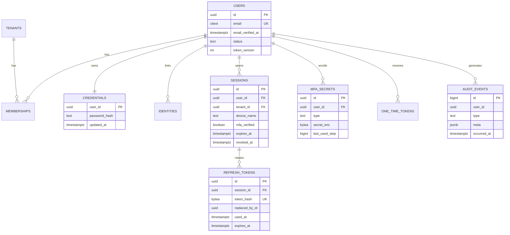
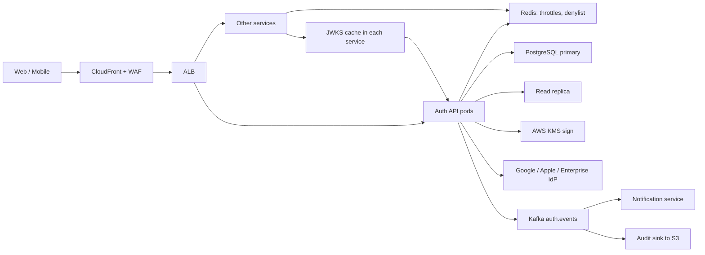
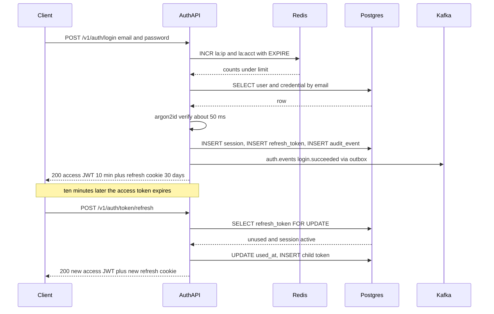
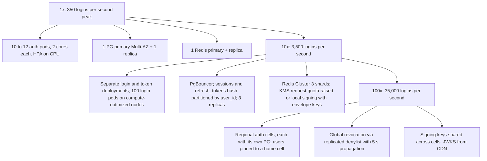

## 40.2 Authentication System

### 40.2.1 Requirements

Every service on the platform needs to know who is calling. The authentication system is the single place that answers that question: it registers users, verifies passwords and second factors, accepts logins from Google and enterprise identity providers, issues tokens that other services can verify on their own, and keeps a record of every security-relevant event. The users are customers on web and mobile, tenant administrators of a multi-tenant SaaS product, and the thirty internal services that must verify identity thousands of times per second without calling anyone.

Imagine a hotel. At the front desk you show your passport (login). The desk gives you a key card that opens your door for the day without anyone checking your passport again (access token). The card expires nightly, so you renew it at a kiosk that recognizes your booking (refresh token). If you report the card stolen, the desk deactivates every card for your room (logout-all). The desk keeps a logbook of every check-in, renewal and lost card (audit log). Our system is the desk, the kiosk and the logbook.

### 40.2.2 Functional requirements

1. Register with email and password; send a verification email; block sensitive actions until verified.
2. Log in with email and password, then with a TOTP code when MFA is enabled; support WebAuthn as a second factor later.
3. Log in with Google or Apple via OpenID Connect; link a social identity to an existing account after verifying the email.
4. Issue a short-lived access token (JWT) plus a long-lived, rotating refresh token; detect and punish refresh token reuse.
5. Log out the current session; log out all sessions; list active device sessions and revoke any one of them.
6. Reset a forgotten password with a single-use emailed token; changing a password invalidates every other session.
7. Multi-tenancy: a user belongs to one or more tenants with roles; tokens carry the active tenant and roles.
8. Enterprise SSO hooks: a tenant can configure its own OIDC or SAML identity provider; users are provisioned on first login.
9. Record every security event in an append-only audit log and show users their recent activity.
10. Publish a JWKS endpoint so every service can verify tokens locally.

### 40.2.3 Non-functional requirements

| Property | Target | Why |
|---|---|---|
| Login latency | p99 under 400 ms including password hashing | Login is the front door; slowness is felt by every user |
| Refresh latency | p99 under 50 ms | Happens silently every 10 minutes per active user |
| Token verification | Under 1 ms, no network call in the common case | Thirty services verify on every request |
| Availability | 99.99 percent for login and refresh | If auth is down, everything is down |
| Revocation propagation | Logout-all takes effect everywhere within 5 seconds | Stolen-device scenario |
| Durability | Audit events never lost; refresh tokens survive failover | Compliance and forensics |
| Password hashing | argon2id, about 50 ms and 64 MB per hash | Slow enough to make offline cracking expensive |

### 40.2.4 Constraints

- SOC 2 and GDPR: passwords never logged, audit log retained 1 year, user data deletable on request.
- Private signing keys must live in AWS KMS; the application never sees a plaintext private key on disk.
- Existing services already read a bearer JWT from the `Authorization` header; the token format must stay compatible.
- Team of three; budget about 3,000 USD per month at the estimated scale.

### 40.2.5 Capacity estimation

| Quantity | Assumption | Calculation | Result |
|---|---|---|---|
| Registered users | | given | 10 million |
| Daily active users | 20 percent | | 2 million |
| Logins per day | 1.5 per DAU (sessions last about a week on mobile, less on web) | 2M x 1.5 | 3 million |
| Logins per second, average | 3M / 86,400 | | 35 per second |
| Logins per second, peak | 10x average at 9 AM local | 35 x 10 | 350 per second |
| Hashing CPU at peak | 350 x 50 ms | | 17.5 cores busy with argon2id |
| Refreshes per day | 2M DAU x 3 hours active x 6 per hour (10-minute access tokens) | 2M x 18 | 36 million |
| Refreshes per second | 36M / 86,400, peak 5x | 420 average | about 2,000 peak |
| Token verifications per second | All services, all requests | | 50,000 peak, all local |
| Read to write ratio on the auth database | Logins and refreshes both write | | roughly 1:1, write-heavy for an API |

Storage:

| Table | Row size | Rows | Total |
|---|---|---|---|
| `users` plus `credentials` | 400 B | 10M | 4 GB |
| `sessions` | 300 B | 3 devices x 10M live, 90-day expiry | 9 GB |
| `refresh_tokens` | 150 B | 2 per session live plus 30-day history: about 100M | 15 GB |
| `audit_events` | 400 B | 5M per day x 365 days | 730 GB per year, partitioned by month |

Cache and connections:

| Item | Calculation | Result |
|---|---|---|
| Redis login throttle counters | 5M active keys x 100 B | 500 MB |
| Redis revocation entries | Logout-all events x 10-minute TTL | a few MB |
| Auth API pods at peak | 350 logins per second x 50 ms CPU = 17.5 cores; 2 cores per pod | 10 to 12 pods |
| PostgreSQL connections | 12 pods x 10 through PgBouncer | 120 client, 30 server |

The numbers say: password hashing dominates CPU, so the login pods must scale separately from the cheap refresh and JWKS traffic; the database is write-heavy because every login and refresh writes rows, so a single primary with modest replicas is the right shape; and the audit log is the largest table by far and must be partitioned from day one.

### 40.2.6 API design

| Method | Path | Request | Response | Status codes | Idempotent | Auth |
|---|---|---|---|---|---|---|
| POST | `/v1/auth/register` | `{ email, password, tenantSlug? }` | `{ userId }` | 201, 400, 409 email taken (only after verification is enforced, see security) | No; duplicate returns 200 with same message to avoid enumeration | None |
| POST | `/v1/auth/verify-email` | `{ token }` | `{}` | 200, 400 invalid or used | Yes | None |
| POST | `/v1/auth/login` | `{ email, password, deviceName? }` | `{ accessToken, expiresIn }` plus refresh cookie, or `{ mfaRequired: true, mfaToken }` | 200, 401, 423 locked, 429 | No | None |
| POST | `/v1/auth/mfa/verify` | `{ mfaToken, code }` | tokens | 200, 401, 429 | No | MFA token |
| POST | `/v1/auth/token/refresh` | refresh cookie or `{ refreshToken }` | `{ accessToken, expiresIn }` plus new refresh | 200, 401 | Yes within a 30 s grace window | Refresh token |
| POST | `/v1/auth/logout` | | | 204 | Yes | Access token |
| POST | `/v1/auth/logout-all` | `{ password }` | | 204, 401 | Yes | Access token |
| GET | `/v1/auth/sessions` | | `[{ id, device, lastSeen, current }]` | 200 | Yes | Access token |
| DELETE | `/v1/auth/sessions/{id}` | | | 204, 404 | Yes | Access token |
| POST | `/v1/auth/password/forgot` | `{ email }` | `{}` always | 200 always | Yes | None |
| POST | `/v1/auth/password/reset` | `{ token, newPassword }` | `{}` | 200, 400 | No | None |
| POST | `/v1/auth/mfa/totp/enroll` | | `{ otpauthUrl, secretId }` | 200 | No | Access token, recent login |
| POST | `/v1/auth/mfa/totp/confirm` | `{ secretId, code }` | `{ recoveryCodes[] }` | 200, 400 | No | Access token |
| GET | `/v1/auth/oidc/{provider}/start` | `?tenant` | 302 to provider with PKCE and state | 302 | Yes | None |
| GET | `/v1/auth/oidc/{provider}/callback` | `?code&state` | tokens, 302 to app | 302, 401 | No | None |
| GET | `/.well-known/jwks.json` | | `{ keys: [] }` | 200, cacheable 10 min | Yes | None |

Refresh tokens are delivered to browsers in a `__Host-refresh` cookie (`HttpOnly`, `Secure`, `SameSite=Lax`, `Path=/v1/auth`) so JavaScript never sees them; mobile apps receive them in the body and store them in the platform keystore.

### 40.2.7 Data model



```sql
CREATE EXTENSION IF NOT EXISTS citext;

CREATE TABLE tenants (
  id          uuid PRIMARY KEY DEFAULT gen_random_uuid(),
  slug        text NOT NULL UNIQUE,                -- serves tenant lookup on login and SSO start
  sso_config  jsonb,                               -- issuer, client id, encrypted client secret, SAML metadata
  created_at  timestamptz NOT NULL DEFAULT now()
);

CREATE TABLE users (
  id                 uuid PRIMARY KEY DEFAULT gen_random_uuid(),
  email              citext NOT NULL,
  email_verified_at  timestamptz,
  status             text NOT NULL DEFAULT 'active' CHECK (status IN ('active', 'locked', 'disabled')),
  token_version      integer NOT NULL DEFAULT 0,   -- bumped by logout-all and password change
  created_at         timestamptz NOT NULL DEFAULT now()
);
CREATE UNIQUE INDEX users_email_uidx ON users (email);   -- serves login and registration uniqueness

CREATE TABLE credentials (
  user_id        uuid PRIMARY KEY REFERENCES users(id) ON DELETE CASCADE,
  password_hash  text NOT NULL,                     -- argon2id encoded string with params and salt
  updated_at     timestamptz NOT NULL DEFAULT now()
);

CREATE TABLE identities (
  id          uuid PRIMARY KEY DEFAULT gen_random_uuid(),
  user_id     uuid NOT NULL REFERENCES users(id) ON DELETE CASCADE,
  provider    text NOT NULL,                        -- 'google', 'apple', or 'tenant:<slug>'
  subject     text NOT NULL,                        -- the provider's stable user id
  created_at  timestamptz NOT NULL DEFAULT now(),
  UNIQUE (provider, subject)                        -- serves the OIDC callback lookup
);

CREATE TABLE memberships (
  user_id    uuid NOT NULL REFERENCES users(id) ON DELETE CASCADE,
  tenant_id  uuid NOT NULL REFERENCES tenants(id) ON DELETE CASCADE,
  roles      text[] NOT NULL DEFAULT '{}',
  PRIMARY KEY (user_id, tenant_id)                  -- serves "which tenants and roles does this user have"
);

CREATE TABLE sessions (
  id             uuid PRIMARY KEY DEFAULT gen_random_uuid(),
  user_id        uuid NOT NULL REFERENCES users(id) ON DELETE CASCADE,
  tenant_id      uuid REFERENCES tenants(id),
  device_name    text,
  user_agent     text,
  ip_hash        bytea,
  mfa_verified   boolean NOT NULL DEFAULT false,
  created_at     timestamptz NOT NULL DEFAULT now(),
  last_seen_at   timestamptz NOT NULL DEFAULT now(),
  expires_at     timestamptz NOT NULL,
  revoked_at     timestamptz,
  revoke_reason  text
);
-- Serves "list my devices" and logout-all; partial so revoked rows do not bloat it
CREATE INDEX sessions_user_active_idx ON sessions (user_id, last_seen_at DESC) WHERE revoked_at IS NULL;
-- Serves the nightly cleanup of expired sessions
CREATE INDEX sessions_expires_idx ON sessions (expires_at) WHERE revoked_at IS NULL;

CREATE TABLE refresh_tokens (
  id              uuid PRIMARY KEY DEFAULT gen_random_uuid(),
  session_id      uuid NOT NULL REFERENCES sessions(id) ON DELETE CASCADE,
  token_hash      bytea NOT NULL,                   -- sha256 of the opaque token; the raw value is never stored
  replaced_by_id  uuid REFERENCES refresh_tokens(id),
  issued_at       timestamptz NOT NULL DEFAULT now(),
  expires_at      timestamptz NOT NULL,
  used_at         timestamptz
);
CREATE UNIQUE INDEX refresh_tokens_hash_uidx ON refresh_tokens (token_hash);   -- serves every refresh call
CREATE INDEX refresh_tokens_session_idx ON refresh_tokens (session_id, issued_at DESC);  -- serves reuse forensics and cleanup

CREATE TABLE mfa_secrets (
  id              uuid PRIMARY KEY DEFAULT gen_random_uuid(),
  user_id         uuid NOT NULL REFERENCES users(id) ON DELETE CASCADE,
  type            text NOT NULL CHECK (type IN ('totp', 'webauthn')),
  secret_enc      bytea NOT NULL,                   -- AES-256-GCM with a KMS data key
  credential_id   bytea,                            -- WebAuthn only
  label           text,
  verified_at     timestamptz,
  last_used_step  bigint,                           -- TOTP replay protection: never accept a step twice
  created_at      timestamptz NOT NULL DEFAULT now()
);
CREATE INDEX mfa_secrets_user_idx ON mfa_secrets (user_id) WHERE verified_at IS NOT NULL;  -- serves "does this user have MFA"

CREATE TABLE recovery_codes (
  user_id    uuid NOT NULL REFERENCES users(id) ON DELETE CASCADE,
  code_hash  bytea NOT NULL,
  used_at    timestamptz,
  PRIMARY KEY (user_id, code_hash)
);

CREATE TABLE one_time_tokens (
  id          uuid PRIMARY KEY DEFAULT gen_random_uuid(),
  user_id     uuid NOT NULL REFERENCES users(id) ON DELETE CASCADE,
  purpose     text NOT NULL CHECK (purpose IN ('email_verify', 'password_reset')),
  token_hash  bytea NOT NULL UNIQUE,                -- serves the verify and reset endpoints
  expires_at  timestamptz NOT NULL,
  used_at     timestamptz
);

CREATE TABLE signing_keys (
  kid              text PRIMARY KEY,
  algorithm        text NOT NULL DEFAULT 'EdDSA',
  public_jwk       jsonb NOT NULL,
  kms_key_arn      text NOT NULL,                   -- private key never leaves KMS
  status           text NOT NULL CHECK (status IN ('next', 'active', 'retiring', 'retired')),
  created_at       timestamptz NOT NULL DEFAULT now()
);

CREATE TABLE audit_events (
  id           bigint GENERATED ALWAYS AS IDENTITY,
  occurred_at  timestamptz NOT NULL DEFAULT now(),
  user_id      uuid,
  tenant_id    uuid,
  session_id   uuid,
  type         text NOT NULL,                       -- 'login.succeeded', 'refresh.reuse_detected', ...
  ip_hash      bytea,
  user_agent   text,
  meta         jsonb NOT NULL DEFAULT '{}',
  PRIMARY KEY (occurred_at, id)
) PARTITION BY RANGE (occurred_at);
CREATE INDEX audit_events_user_time_idx ON audit_events (user_id, occurred_at DESC);  -- serves "recent activity"
```

### 40.2.8 High-level architecture



The login path is the only one that touches KMS, argon2 and the primary in one request. Refresh touches the primary and KMS. Token verification in other services touches nothing but a cached JWKS and, for revocation checks, one Redis `GET`.

### 40.2.9 Component design

| Component | Responsibility |
|---|---|
| Registration service | Create user and credential, issue verification token, publish `user.registered` |
| Login service | Throttle, load credential, verify argon2id, evaluate MFA, create session, issue tokens |
| Token service | Sign access tokens via KMS, create and rotate refresh tokens, detect reuse |
| Session service | List, revoke, logout-all, bump `token_version`, write revocation markers to Redis |
| MFA service | TOTP enroll, verify with step tracking, recovery codes, WebAuthn ceremonies |
| OIDC service | Start and callback flows with PKCE, state and nonce; identity linking; tenant IdP configs |
| Audit service | Append events inside the same transaction as the action; publish to Kafka via outbox |
| JWKS endpoint | Serve active and retiring public keys with `Cache-Control: max-age=600` |

```text
src/
  auth/
    auth.module.ts
    controllers/ login.controller.ts, token.controller.ts, session.controller.ts, mfa.controller.ts, oidc.controller.ts
    services/    login.service.ts, token.service.ts, session.service.ts, mfa.service.ts, oidc.service.ts, audit.service.ts
    guards/      access-token.guard.ts, login-throttle.guard.ts, recent-login.guard.ts
    dto/         login.dto.ts, register.dto.ts, refresh.dto.ts
    keys/        signing-key.service.ts       -- KMS-backed signer and JWKS publisher
  redis/redis.module.ts
```

The login and refresh flow:



The token service is the heart of the system. Refresh tokens are opaque random strings; only their SHA-256 hash is stored. Access tokens are JWTs signed with an Ed25519 key held in KMS, carrying `sub`, `sid` (session id), `tid` (tenant), `roles`, `tv` (token version) and `amr` (which factors were used).

```ts
// auth/services/token.service.ts
import { Injectable, UnauthorizedException } from '@nestjs/common';
import { DataSource, EntityManager } from 'typeorm';
import { createHash, randomBytes } from 'node:crypto';
import { SigningKeyService } from '../keys/signing-key.service';
import { AuditService } from './audit.service';

const ACCESS_TTL_SEC = 600;
const REFRESH_GRACE_MS = 30_000;

@Injectable()
export class TokenService {
  constructor(
    private readonly dataSource: DataSource,
    private readonly keys: SigningKeyService,
    private readonly audit: AuditService,
  ) {}

  /** Creates a refresh token row and signs an access token. Called inside the caller's transaction. */
  async issuePair(em: EntityManager, session: SessionRow, claims: UserClaims, parentId?: string) {
    const raw = randomBytes(32).toString('base64url');
    const hash = createHash('sha256').update(raw).digest();
    const [{ id }] = await em.query(
      `INSERT INTO refresh_tokens (session_id, token_hash, expires_at)
       VALUES ($1, $2, now() + interval '30 days') RETURNING id`,
      [session.id, hash],
    );
    if (parentId) {
      await em.query(`UPDATE refresh_tokens SET replaced_by_id = $2 WHERE id = $1`, [parentId, id]);
    }
    const accessToken = await this.keys.sign({
      sub: claims.userId, sid: session.id, tid: claims.tenantId, roles: claims.roles,
      tv: claims.tokenVersion, amr: session.mfa_verified ? ['pwd', 'otp'] : ['pwd'],
    }, ACCESS_TTL_SEC);
    return { accessToken, refreshToken: raw, expiresIn: ACCESS_TTL_SEC };
  }

  /** Rotation with reuse detection and a short grace window for client retries. */
  async rotate(rawRefresh: string, ctx: RequestContext) {
    const hash = createHash('sha256').update(rawRefresh).digest();
    return this.dataSource.transaction(async (em) => {
      const [row] = await em.query(
        `SELECT rt.id, rt.session_id, rt.used_at, rt.expires_at, rt.replaced_by_id,
                s.user_id, s.tenant_id, s.revoked_at, s.mfa_verified
           FROM refresh_tokens rt JOIN sessions s ON s.id = rt.session_id
          WHERE rt.token_hash = $1 FOR UPDATE OF rt`,
        [hash],
      );
      if (!row || row.revoked_at || row.expires_at < new Date()) throw new UnauthorizedException('invalid_grant');

      if (row.used_at) {
        const ageMs = Date.now() - new Date(row.used_at).getTime();
        if (ageMs > REFRESH_GRACE_MS) {
          // A token that was rotated more than 30 s ago is being replayed: the session is compromised.
          await em.query(`UPDATE sessions SET revoked_at = now(), revoke_reason = 'refresh_reuse' WHERE id = $1`, [row.session_id]);
          await this.audit.record(em, { type: 'refresh.reuse_detected', userId: row.user_id, sessionId: row.session_id, ctx });
          throw new UnauthorizedException('invalid_grant');
        }
        // Inside the grace window: a client retry after a timeout. Re-issue the same child.
        throw new UnauthorizedException('retry_in_progress');
      }

      await em.query(`UPDATE refresh_tokens SET used_at = now() WHERE id = $1`, [row.id]);
      await em.query(`UPDATE sessions SET last_seen_at = now(), ip_hash = $2 WHERE id = $1`, [row.session_id, ctx.ipHash]);
      const claims = await this.loadClaims(em, row.user_id, row.tenant_id);
      return this.issuePair(em, { id: row.session_id, mfa_verified: row.mfa_verified }, claims, row.id);
    });
  }
}
```

The grace window deserves a note. A mobile client on a bad network may send a refresh, time out, and send the same token again while the first request succeeded server-side. Strict reuse detection would log that user out. Within 30 seconds we treat the second call as a retry and tell the client to use the response it may have missed (in a full implementation, the child token is cached in Redis for 30 seconds keyed by the parent hash and returned again). After 30 seconds, reuse is treated as theft.

Logout-all bumps `token_version`, revokes sessions and writes a Redis marker so that already-issued access tokens die immediately:

```ts
// auth/services/session.service.ts
async logoutAll(userId: string, ctx: RequestContext): Promise<void> {
  await this.dataSource.transaction(async (em) => {
    await em.query(`UPDATE sessions SET revoked_at = now(), revoke_reason = 'logout_all' WHERE user_id = $1 AND revoked_at IS NULL`, [userId]);
    await em.query(`UPDATE users SET token_version = token_version + 1 WHERE id = $1`, [userId]);
    await this.audit.record(em, { type: 'session.logout_all', userId, ctx });
  });
  // Any access token issued before this instant is rejected by every service for the next 10 minutes,
  // after which all such tokens have expired on their own.
  await this.redis.set(`deny:user:${userId}`, String(Date.now()), 'PX', ACCESS_TTL_SEC * 1000);
}
```

Every service verifies tokens with the same guard, using a cached JWKS and one Redis read:

```ts
// shared/access-token.guard.ts (used by every service)
import { CanActivate, ExecutionContext, Inject, Injectable, UnauthorizedException } from '@nestjs/common';
import { ConfigService } from '@nestjs/config';
import { createRemoteJWKSet, jwtVerify, JWTPayload } from 'jose';
import type { Redis } from 'ioredis';
import { REDIS_CLIENT } from '../redis/redis.module';

@Injectable()
export class AccessTokenGuard implements CanActivate {
  private readonly jwks: ReturnType<typeof createRemoteJWKSet>;

  constructor(private readonly config: ConfigService, @Inject(REDIS_CLIENT) private readonly redis: Redis) {
    // Cached for 10 minutes; unknown kid triggers one refetch, rate-limited to one per 30 s
    this.jwks = createRemoteJWKSet(new URL(config.getOrThrow('AUTH_JWKS_URL')), { cacheMaxAge: 600_000, cooldownDuration: 30_000 });
  }

  async canActivate(ctx: ExecutionContext): Promise<boolean> {
    const req = ctx.switchToHttp().getRequest();
    const token = (req.headers.authorization ?? '').replace(/^Bearer /, '');
    if (!token) throw new UnauthorizedException();
    let payload: JWTPayload;
    try {
      ({ payload } = await jwtVerify(token, this.jwks, { issuer: 'https://auth.example.com', audience: 'platform', algorithms: ['EdDSA'] }));
    } catch {
      throw new UnauthorizedException('invalid_token');
    }
    const cutoff = await this.redis.get(`deny:user:${payload.sub}`);   // about 0.3 ms; fail open on Redis error
    if (cutoff && (payload.iat ?? 0) * 1000 < Number(cutoff)) throw new UnauthorizedException('revoked');
    req.user = payload;
    return true;
  }
}
```

Login throttling uses two Redis counters, one per IP and one per account, with `INCR` and `EXPIRE` in a pipeline: more than 20 attempts per IP per minute or 5 per account per 15 minutes returns `429` and, for the account, forces an email challenge rather than a hard lock (a hard lock lets an attacker lock anyone out by guessing wrong on purpose).

### 40.2.10 Database design

The auth database is small in rows but hot in writes and must never be wrong. It runs on a Multi-AZ primary with one read replica used only for `GET /sessions`, JWKS, and audit reads; every login and refresh reads and writes on the primary because a replica could be behind by a second, and a second is exactly the window in which a stolen token must already be dead.

Transactions matter in three places: login (session, refresh token and audit event in one transaction so an audit event can never exist without its session), refresh (`SELECT ... FOR UPDATE` on the token row so two concurrent refreshes with the same token serialize and the second sees `used_at`), and logout-all (sessions and `token_version` together).

`audit_events` is range-partitioned by month; the partition manager creates the next month ahead and detaches partitions older than 13 months to S3 as Parquet. `refresh_tokens` rows older than 60 days and `sessions` expired more than 30 days ago are deleted nightly in batches of 10,000 to keep autovacuum comfortable. `citext` on `email` gives case-insensitive uniqueness without a functional index.

### 40.2.11 Caching

| What | Where | TTL | Invalidation | Notes |
|---|---|---|---|---|
| JWKS public keys | In-process in every service (`jose` cache) plus CDN | 10 min | Time; unknown `kid` forces refetch | Key rotation must publish the new key at least 10 minutes before use |
| Revocation markers `deny:user:{id}` | Redis | 10 min (access TTL) | Time | Only users who logged out everywhere have a key, so the set stays tiny |
| Login throttle counters | Redis | 1 min per IP, 15 min per account | Time | Reads and writes in one pipeline |
| Refresh grace child token | Redis | 30 s | Time | Returns the same pair to a retried refresh |
| Tenant SSO config | In-process | 5 min | Pub/sub on config change | Avoids a query on every SSO start |
| User claims (roles, token version) | Not cached | | | Read from the primary at login and refresh only; 2,000 reads per second is trivial |

Stampede protection is not a concern here: nothing is cached that thousands of requests would miss at once. The one hot read, the JWKS, is served by CloudFront with a 10-minute TTL, so a rotation that invalidates every service cache at once produces at most one origin request per service instance.

### 40.2.12 Messaging

| Topic | Key | Events | Consumers |
|---|---|---|---|
| `auth.events` | `user_id` | `user.registered`, `login.succeeded`, `login.failed`, `mfa.enabled`, `password.changed`, `session.revoked`, `refresh.reuse_detected` | Notification service (emails such as "new device login"), audit sink to S3, fraud scoring |
| `auth.outbox` (table, not topic) | | Every event is first written to an `outbox` table inside the business transaction; a relay publishes to Kafka | Guarantees an event exists if and only if the action committed |

Kafka rather than SQS because several independent consumers need the same stream and fraud scoring wants replay. Keying by `user_id` keeps one user's events ordered, which matters for "password changed, then session revoked". Consumers are idempotent by event id: the notification service records `(consumer, event_id)` in an inbox table before acting, so a redelivered `login.succeeded` does not send a second "new device" email. Retries use exponential backoff for 3 attempts, then `auth.events.dlq` with an alert; the DLQ is small and reviewed daily.

### 40.2.13 Scaling



At 1x the whole system is a single deployment. At 10x, argon2 CPU forces a separate login deployment on compute-optimized nodes so that refresh and JWKS traffic never queue behind hashing; KMS signing at 2,000 requests per second approaches the default quota, so either the quota is raised or the private key is wrapped by KMS and unwrapped into memory at pod start (an envelope-key model, with the tradeoff that the key is in process memory). At 100x, a single primary cannot take 35,000 writes per second, so the system becomes cells: each region runs its own database, users have a home cell chosen at registration, and only revocation needs to be global, which a replicated Redis or DynamoDB Global Table handles within 5 seconds.

### 40.2.14 Security

- **Credential stuffing.** Attackers replay email and password pairs from other breaches at low per-IP rates across many IPs. Defenses in layers: per-IP and per-account counters, a device-fingerprint counter, a check of new passwords against the Have I Been Pwned k-anonymity API at registration and password change, an "impossible travel" heuristic (two logins 5,000 km apart within an hour) that forces MFA, CAPTCHA after three failures, and alerts when the global login failure ratio rises above 3x baseline.
- **Password storage.** argon2id with 64 MB memory, 3 iterations, parallelism 1, tuned to about 50 ms. The encoded hash carries its parameters, so parameters can be raised and old hashes rehashed on next successful login.
- **Enumeration.** Registration, forgot-password and login return identical messages and take identical time whether the email exists or not; when the email does not exist, login still runs an argon2 verify against a dummy hash.
- **Token design.** Access tokens are 10-minute Ed25519 JWTs with `alg` pinned in the verifier (never trust the header's `alg`), `iss` and `aud` checked, and a `kid` that maps to a key in the JWKS. Refresh tokens are opaque, hashed at rest, rotated on every use, and bound to a session. No token is ever logged.
- **Cookies and CSRF.** Browser refresh tokens live in a `__Host-` cookie with `SameSite=Lax`; the refresh endpoint additionally requires a custom header (`X-Requested-With`) so a cross-site form post cannot call it.
- **Key rotation.** A new key is created as `next` and published in the JWKS at least 24 hours before promotion; on promotion it becomes `active` and the old key becomes `retiring` for another 24 hours (longer than any access token lifetime plus JWKS cache age); then it is `retired` and removed. Private keys never leave KMS; a KMS policy restricts `Sign` to the auth pods' IAM role.
- **MFA.** TOTP secrets are encrypted with a KMS data key; the last accepted time step is stored so a code cannot be replayed within its 30-second window; recovery codes are hashed like passwords; enrolling or disabling MFA requires a login within the last 5 minutes (`RecentLoginGuard` checks `iat`).
- **OIDC.** PKCE with S256, a random `state` bound to the browser session, a `nonce` checked in the ID token, and the ID token signature verified against the provider's JWKS. A social login with an unverified email never auto-links to an existing account.
- **Multi-tenant isolation.** Every query that returns user data includes the tenant from the token; tenant admins can only see sessions of their own tenant's members; SSO configuration secrets are encrypted per tenant.
- **Audit integrity.** The audit table is append-only (the application role has `INSERT` and `SELECT` only) and mirrored to S3 with object lock.

### 40.2.15 Failure scenarios

| Failure | Detection | Impact | Mitigation | What the user sees |
|---|---|---|---|---|
| Redis down | Connection errors, throttle errors metric | Throttling and revocation checks unavailable | Login fails closed on throttling (503) for 30 s, then falls back to PG-based counters; services fail open on the revocation check and log it | Brief login errors; logged-out tokens live up to 10 min |
| PostgreSQL failover | Write errors for 30 to 60 s | No logins or refreshes | Clients retry with backoff; access tokens keep working, so logged-in users notice nothing | Login button fails for a minute |
| KMS unavailable or throttled | `Sign` errors, latency | No new access tokens | Envelope-key fallback with a 1-hour cached data key; alert | Refresh fails briefly; app retries |
| Kafka lag | Consumer lag alert | "New device login" emails delayed | Outbox holds events; relay catches up | Late emails |
| Duplicate refresh request | Same token twice within 30 s | Would log the user out under strict rules | Grace window returns the cached child pair | Nothing |
| Refresh token theft and replay | `refresh.reuse_detected` audit event | Attacker and victim both hold tokens | Session revoked, user emailed, forced re-login | "You were signed out for security" |
| Clock skew between auth pods and services | Tokens rejected as not yet valid | Fresh tokens fail on some services | Verifiers allow 60 s of clock tolerance; NTP monitored | Nothing |
| Bad deploy changing claim shape | Canary 401 rate rises in downstream services | Every request fails on affected services | Canary plus contract tests on the token payload; rollback | A few 401s during canary |
| Identity provider outage (Google) | OIDC callback errors | Social login unavailable | Password login unaffected; error page suggests it | "Google sign-in is temporarily unavailable" |
| Region outage | Health checks fail | Total outage in single-region | Cross-region replica promoted; Redis rebuilt (throttles and denylist are safe to lose); RTO 15 min | Outage until failover |
| Wrong response: stale roles after role change | User keeps old permissions up to 10 min | Privilege lingers | Role changes bump `token_version` and write the deny marker, forcing refresh | Re-auth once |
| Partial success: session inserted, Kafka publish fails | Outbox row unpublished | No downstream event | Outbox relay retries; the transaction already committed both rows | Nothing |

### 40.2.16 Observability

Metrics:

1. `auth_login_total` by outcome (`success`, `bad_password`, `mfa_required`, `locked`, `throttled`). Alert when failure ratio exceeds 3x the 7-day baseline (credential stuffing signal).
2. `auth_login_duration_seconds` histogram, with a `hash` sub-span. Alert on p99 above 400 ms.
3. `auth_refresh_total` by outcome including `reuse_detected`. Alert on any burst of reuse.
4. `auth_token_sign_duration_seconds` and KMS error count.
5. `auth_throttle_hits_total` by scope (`ip`, `account`).
6. `auth_active_sessions` gauge (from a periodic count).
7. `auth_outbox_backlog` and Kafka consumer lag.
8. `auth_jwks_requests_total` at origin (a spike means caches are failing).
9. PostgreSQL primary write latency and replication lag.
10. Downstream `token_verify_failures_total` by reason, collected from every service, because the auth system's bugs show up there first.

Logs: one structured line per authentication decision with user id (never email), session id, outcome, IP hash, user agent, latency. Never the password, never a token, never a TOTP code. Traces: full traces for login and refresh with spans for throttle, hash, database and KMS. Dashboards: the login funnel (attempts, successes, MFA prompts), a security board (failures by IP prefix, reuse detections, lockouts), and the dependency board (PG, Redis, KMS, IdPs).

### 40.2.17 Deployment

| Workload | Kind | Replicas | Notes |
|---|---|---|---|
| `auth-api` | Deployment | 6 to 24, HPA on CPU (argon2 is CPU-bound) | Readiness checks PG and KMS |
| `auth-outbox-relay` | Deployment | 2, leader-elected | Publishes outbox rows to Kafka |
| `auth-cleanup` | CronJob nightly | 1 | Deletes expired tokens and sessions in batches |
| `auth-key-rotation` | CronJob monthly | 1 | Creates `next` key in KMS, promotes after 24 h |
| `auth-partition-manager` | CronJob daily | 1 | Audit partitions |

Configuration via `@nestjs/config`: issuer, audience, token lifetimes, argon2 parameters, IdP client ids; secrets (IdP client secrets, database password) from Secrets Manager via the CSI driver. Migrations run as a Job before the rollout; the `users.token_version` style of additive change is done in two deploys (add column, then use it). Rollout: canary 5 percent for 15 minutes watching downstream 401 rates, then rolling with `maxUnavailable: 0`. Environments: dev with a local KMS stand-in (a file-backed signer behind the same interface), staging with real KMS and a sandbox IdP tenant, production.

### 40.2.18 Cost considerations

| Item | Sizing | Monthly (USD, approximate) |
|---|---|---|
| EKS nodes for auth | 4 x c6i.xlarge (compute-optimized for argon2) | 550 |
| RDS PostgreSQL | db.r6g.large Multi-AZ plus replica, 1 TB gp3 | 800 |
| ElastiCache Redis | cache.r6g.large with replica | 250 |
| KMS | 1 key plus about 100M `Sign` requests | 300 |
| MSK (shared with the platform) | share of a 3-broker cluster | 200 |
| S3 audit archive | 1 TB per year, object lock | 25 |
| Email for verification and alerts | 5M per month via SES | 500 |
| Total | | about 2,600 |

The biggest drivers are compute for hashing (a direct function of login rate and argon2 parameters) and KMS signing requests, which is why a 10-minute access token rather than a 1-minute one matters: six times fewer refreshes means six times fewer KMS calls and database writes.

### 40.2.19 Tradeoffs

- **JWT access tokens plus rotating refresh tokens, not opaque sessions.** Services verify locally at 50,000 requests per second with no auth call, at the cost of a 10-minute revocation lag that we close with a Redis denylist check. Opaque sessions would give instant revocation but put the auth database on every request.
- **10-minute access tokens.** Long enough to keep refresh traffic at 2,000 per second peak, short enough that the denylist stays tiny and stale roles are bounded.
- **Reuse detection with a 30-second grace window.** Strict detection is safer against replay but logs out honest users on flaky networks; we accept a 30-second replay window.
- **Ed25519 via KMS.** Fast verification and small tokens; every signature is a KMS call, which costs money and adds 2 to 5 ms. RS256 would be more universally supported by old libraries.
- **Soft account lock (email challenge) instead of hard lock.** A hard lock is a denial-of-service vector.
- **Single primary, write-heavy.** Simpler consistency for tokens; caps us at about 5,000 writes per second before cells are needed.

### 40.2.20 Alternative architectures

**Managed identity provider (Amazon Cognito, Auth0, or self-hosted Keycloak).** The provider handles passwords, MFA, social login, SSO and JWKS; your platform keeps only a `users` mapping and the audit trail. This wins for small teams, for companies where auth is not a differentiator, and when enterprise SSO (SAML) must ship quickly. It loses on per-user pricing at 10 million users (commercial providers can cost more than the whole design above), on customization of flows and data residency, and on the ability to tune throttling and reuse detection precisely.

**Opaque tokens with a central session store.** Every request carries a random session id; services call the auth service or read Redis to resolve it. Revocation is instant and tokens carry no data. It wins when instant revocation is a hard requirement (banking) and request volume is moderate. It loses at 50,000 verifications per second because every request now depends on Redis or the auth service, which becomes the platform's single point of failure and its latency floor.

**Embedded in the monolith.** Registration, login and session tables living inside the main application with server-side cookie sessions. Right for a single application below a few thousand users per day: no JWKS, no rotation, no Kafka. It becomes wrong the day a second service or a mobile app needs to verify identity without importing the monolith's session table.
