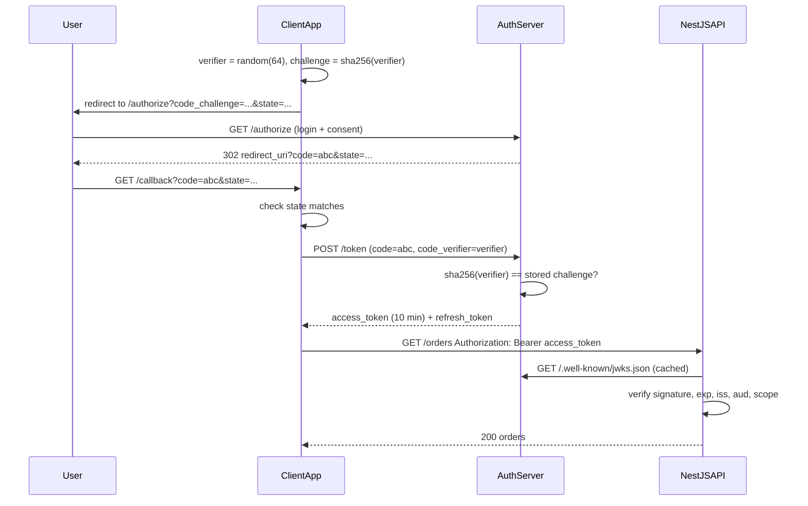
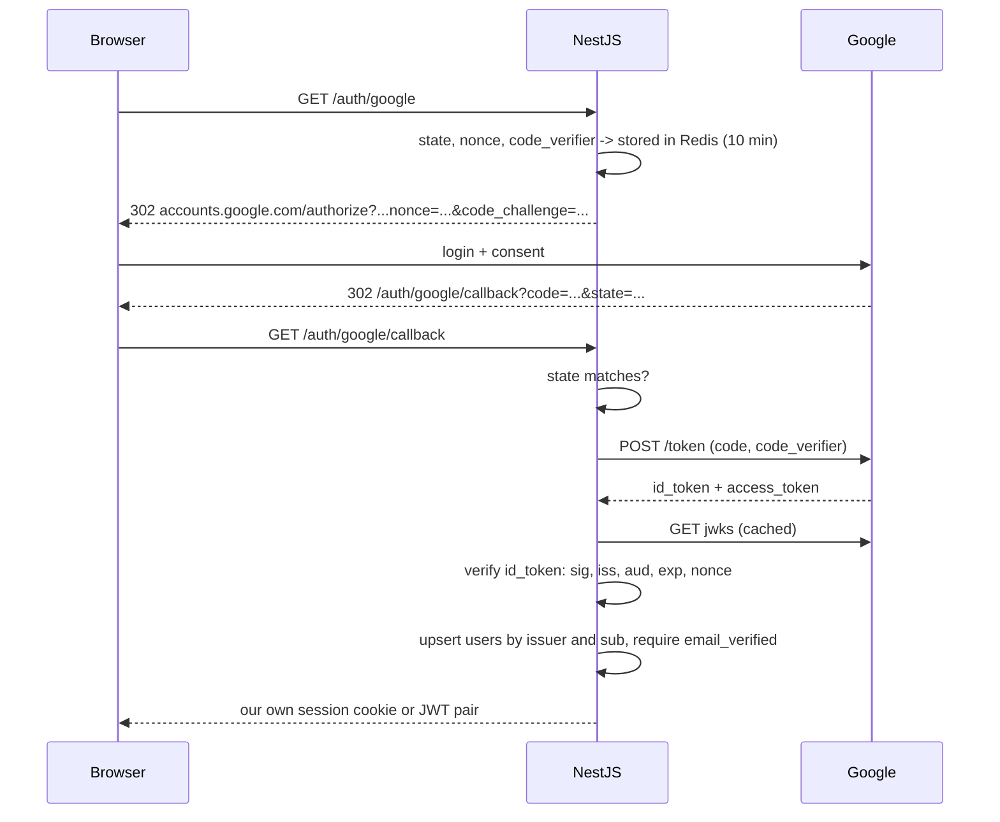

## 40.4 OAuth 2.0

#### Concept

OAuth 2.0 is a protocol for **delegated authorization**: letting one application access a user's data in another application, with the user's consent, without ever giving the first application the user's password. When a scheduling app asks "may I read your Google Calendar?" and you click Allow, that is OAuth. The scheduling app ends up with an *access token* that works only for the calendar, only for you, only until it expires.

OAuth is not a login protocol, even though everyone uses it for login. "Login with Google" is OpenID Connect (40.5), a thin identity layer on top of OAuth. Keep the two separate in your head: OAuth answers "what may this app do on this user's behalf"; OIDC answers "who is this user".

#### Why does it exist?

Before OAuth, integrating with another service meant asking the user for their password to that service and storing it. Every integration was a full-access credential, unrevocable except by changing the password, and stored in dozens of third-party databases. OAuth replaces that with scoped, revocable, expiring tokens issued by the service that owns the data.

Inside a company it solves the same problem: a mobile app, a partner API, and internal services all need bounded, revocable access to the same resources without sharing passwords or a master key.

#### Mental model

Imagine a hotel. You are the guest (resource owner). The room is the resource. The front desk is the authorization server. A valet is a client: he needs to move your car but does not need your room key or your wallet. The front desk gives the valet a key card that opens only the garage, only today. That card is an access token with a `scope` of `garage:drive` and an expiry of tonight. If the valet loses the card, the front desk deactivates it; your room is never at risk.

#### How it works

**The four roles:**

| Role | Meaning | In a NestJS system |
|---|---|---|
| Resource owner | The user who owns the data | The customer |
| Client | The app that wants access | Your SPA, mobile app, or a partner's server |
| Authorization server | Issues tokens after authenticating the user and getting consent | Your auth service, Auth0, Keycloak, Cognito, Google |
| Resource server | Holds the data and accepts tokens | Your NestJS API |

**The grant types that matter today:**

1. **Authorization code with PKCE**: for anything with a user in a browser or on a device. The client redirects the user to the authorization server, the user logs in and consents, the authorization server redirects back with a short-lived *code*, and the client exchanges the code for tokens at the *token endpoint*. PKCE (Proof Key for Code Exchange, pronounced "pixie") binds the code to the client instance that started the flow so that a stolen code is useless.
2. **Client credentials**: for service-to-service calls with no user. The client authenticates with its own id and secret (or a private key) and receives a token representing *itself*.
3. **Refresh token**: exchanges a refresh token for a new access token; not a separate login, a continuation of one of the above.

**Grants that are dead:** the *implicit* grant (tokens in the URL fragment, no PKCE, leaks through browser history and referrers) and the *resource owner password* grant (the client collects the password, which is exactly what OAuth exists to avoid). OAuth 2.1 removes both. If a library or a vendor still proposes them, say no.

**Authorization code + PKCE, step by step:**

1. The client generates a random `code_verifier` (43 to 128 characters) and computes `code_challenge = base64url(sha256(code_verifier))`.
2. It redirects the browser to `GET /authorize?response_type=code&client_id=...&redirect_uri=...&scope=orders:read&state=<random>&code_challenge=...&code_challenge_method=S256`.
3. The authorization server authenticates the user (password, MFA, existing session) and shows a consent screen listing the scopes.
4. It redirects to `redirect_uri?code=<code>&state=<same random>`. The code lives about 60 seconds and can be used once.
5. The client verifies `state` matches what it sent (CSRF defense for the callback), then calls `POST /token` with `grant_type=authorization_code&code=...&redirect_uri=...&client_id=...&code_verifier=<original>`.
6. The server hashes the verifier, compares to the stored challenge, and only then issues `{ access_token, token_type: "Bearer", expires_in: 600, refresh_token, scope }`.
7. The client calls the resource server with `Authorization: Bearer <access_token>`.
8. The resource server validates the token (signature via JWKS, `exp`, `iss`, `aud`, required `scope`) and serves the request.



**Scopes** are strings that name a permission bundle: `orders:read`, `orders:write`, `profile`. The authorization server records which scopes the user consented to; the token carries them; the resource server checks them per endpoint. Scopes are about what the *client app* may do, not what the *user* may do. A user with admin rights using a client that only has `orders:read` still cannot write orders through that client. Both checks apply.

#### Practical example

An e-commerce platform opens its API to third-party inventory tools. A vendor's tool wants to read a merchant's orders and update stock levels. The merchant clicks "Connect" in the vendor's tool, is redirected to `auth.example.com`, logs in, sees "This app wants to: read your orders, update your inventory", and approves. The vendor's server receives tokens scoped to `orders:read inventory:write` for that merchant. The platform's NestJS API checks the scope on every endpoint and the merchant id inside the token on every query. If the merchant disconnects the app, the platform revokes the refresh token; the vendor loses access within the access token's 10-minute life.

For internal traffic, the pricing service calls the catalog service with a client-credentials token (`scope: catalog:read`, `sub: "svc-pricing"`), so the catalog service can enforce which services may call which endpoints and can attribute traffic in its logs.

#### NestJS example

A NestJS API acting as a **resource server** for tokens issued by an external authorization server. The trick is `jwks-rsa`, which fetches and caches the public keys and selects the right one by `kid`.

```ts
// oauth-resource.strategy.ts
import { Injectable } from '@nestjs/common';
import { PassportStrategy } from '@nestjs/passport';
import { ExtractJwt, Strategy } from 'passport-jwt';
import { passportJwtSecret } from 'jwks-rsa';
import { ConfigService } from '@nestjs/config';

@Injectable()
export class OAuthResourceStrategy extends PassportStrategy(Strategy, 'oauth') {
  constructor(cfg: ConfigService) {
    super({
      jwtFromRequest: ExtractJwt.fromAuthHeaderAsBearerToken(),
      secretOrKeyProvider: passportJwtSecret({
        jwksUri: `${cfg.getOrThrow('OAUTH_ISSUER')}/.well-known/jwks.json`,
        cache: true,
        cacheMaxAge: 60 * 60 * 1000,   // 1 hour; refreshed early on unknown kid
        rateLimit: true,
        jwksRequestsPerMinute: 5,      // attacker cannot force JWKS fetches with random kids
        timeout: 3000,
      }),
      algorithms: ['RS256'],
      issuer: cfg.getOrThrow('OAUTH_ISSUER'),
      audience: 'https://api.example.com',
      jsonWebTokenOptions: { clockTolerance: 30 },
    });
  }

  validate(payload: { sub: string; scope: string; client_id?: string; merchant_id?: string }) {
    return {
      id: payload.sub,
      scopes: payload.scope?.split(' ') ?? [],
      clientId: payload.client_id,
      merchantId: payload.merchant_id,
    };
  }
}
```

Scopes are enforced by a small decorator and guard pair using `Reflector`, exactly the same mechanism as roles (40.8).

```ts
// scopes.decorator.ts + scopes.guard.ts
import { CanActivate, ExecutionContext, ForbiddenException, Injectable, SetMetadata } from '@nestjs/common';
import { Reflector } from '@nestjs/core';

export const SCOPES_KEY = 'required_scopes';
export const RequireScopes = (...scopes: string[]) => SetMetadata(SCOPES_KEY, scopes);

@Injectable()
export class ScopesGuard implements CanActivate {
  constructor(private reflector: Reflector) {}
  canActivate(ctx: ExecutionContext): boolean {
    const required = this.reflector.getAllAndOverride<string[]>(SCOPES_KEY, [ctx.getHandler(), ctx.getClass()]) ?? [];
    if (required.length === 0) return true;
    const user = ctx.switchToHttp().getRequest().user as { scopes: string[] } | undefined;
    const ok = required.every((s) => user?.scopes.includes(s));
    if (!ok) throw new ForbiddenException(`Missing scope: ${required.join(' ')}`);
    return true;
  }
}

// usage
// @UseGuards(AuthGuard('oauth'), ScopesGuard)
// @RequireScopes('inventory:write')
// @Patch('inventory/:sku') updateStock(...) {}
```

A **client-credentials** call from one NestJS service to another, with the token cached until shortly before expiry so that you do not hit the token endpoint on every request:

```ts
// service-token.provider.ts
import { Injectable } from '@nestjs/common';
import { ConfigService } from '@nestjs/config';

@Injectable()
export class ServiceTokenProvider {
  private token?: { value: string; expiresAt: number };
  constructor(private cfg: ConfigService) {}

  async get(): Promise<string> {
    if (this.token && this.token.expiresAt - Date.now() > 30_000) return this.token.value; // 30 s safety margin
    const body = new URLSearchParams({
      grant_type: 'client_credentials',
      scope: 'catalog:read',
    });
    const basic = Buffer.from(`${this.cfg.getOrThrow('SVC_CLIENT_ID')}:${this.cfg.getOrThrow('SVC_CLIENT_SECRET')}`).toString('base64');
    const res = await fetch(`${this.cfg.getOrThrow('OAUTH_ISSUER')}/token`, {
      method: 'POST',
      headers: { Authorization: `Basic ${basic}`, 'Content-Type': 'application/x-www-form-urlencoded' },
      body,
      signal: AbortSignal.timeout(3000),
    });
    if (!res.ok) throw new Error(`token endpoint ${res.status}`);
    const json = (await res.json()) as { access_token: string; expires_in: number };
    this.token = { value: json.access_token, expiresAt: Date.now() + json.expires_in * 1000 };
    return this.token.value;
  }
}
```

#### PostgreSQL example

If you run your own authorization server, three tables carry the state: registered clients, consents, and authorization codes (which you may also keep in Redis with a 60-second TTL).

```sql
CREATE TABLE oauth_clients (
  id                 text PRIMARY KEY,                 -- public client_id
  secret_hash        text,                             -- NULL for public clients (SPA, mobile)
  name               text NOT NULL,
  redirect_uris      text[] NOT NULL,                  -- exact-match only, never prefix-match
  allowed_scopes     text[] NOT NULL,
  allowed_grants     text[] NOT NULL DEFAULT '{authorization_code,refresh_token}',
  require_pkce       boolean NOT NULL DEFAULT true,
  created_at         timestamptz NOT NULL DEFAULT now()
);

CREATE TABLE oauth_consents (
  user_id    uuid NOT NULL REFERENCES users(id) ON DELETE CASCADE,
  client_id  text NOT NULL REFERENCES oauth_clients(id) ON DELETE CASCADE,
  scopes     text[] NOT NULL,
  granted_at timestamptz NOT NULL DEFAULT now(),
  revoked_at timestamptz,
  PRIMARY KEY (user_id, client_id)
);

CREATE TABLE oauth_codes (
  code_hash      text PRIMARY KEY,                     -- hash of the code, never the raw code
  client_id      text NOT NULL,
  user_id        uuid NOT NULL,
  redirect_uri   text NOT NULL,
  scopes         text[] NOT NULL,
  code_challenge text NOT NULL,
  expires_at     timestamptz NOT NULL,                 -- now() + 60 s
  used_at        timestamptz                           -- single use; reuse revokes issued tokens
);
```

`redirect_uris` must be matched exactly. Prefix or wildcard matching is the root of a whole family of token-theft bugs: an attacker registers `https://app.example.com.evil.com` or finds an open redirect on your domain and the code is delivered to them.

#### Production scenario

A platform with 3,000 registered third-party apps and 120,000 merchants. The authorization server (Keycloak, tuned) handles about 150 token requests per second at peak, most of them refreshes. The NestJS resource servers verify roughly 6,000 bearer tokens per second using cached JWKS; JWKS is fetched once per hour per pod. Scope checks are metadata lookups and cost nothing measurable. Consent revocation by a merchant marks `oauth_consents.revoked_at` and revokes the client's refresh tokens; existing access tokens die within 10 minutes. The dashboard tracks token requests per client, refresh failure rate per client (a spike means a partner's integration broke), and JWKS fetch errors per pod.

#### Failure scenario

A partner reported that their integration "randomly logs merchants out". Investigation showed their server ran two instances behind a load balancer, each holding its own copy of the refresh token in memory. Instance A refreshed; the token rotated; instance B later used the old token; the authorization server's reuse detection revoked the family. Correct behaviour on our side, but it took the partner three weeks to find. The fix on their side was a shared token store with a lock around refresh. The lesson for us: document rotation and reuse detection loudly in the partner API docs, and expose a clear error code (`invalid_grant` with `error_description: "refresh token reused"`) instead of a generic 401.

#### Edge cases & failure modes

- **Open redirect on your own domain** turns exact-match redirect URIs into token leaks. Audit every redirect in the app.
- **Authorization code reuse**: a code presented twice must fail *and* revoke tokens already issued from it (the spec's recommendation), because it means the code was stolen.
- **Missing `state` check**: the callback becomes a CSRF target: an attacker can log the victim into the attacker's account (login CSRF) and later read what the victim saved there.
- **Scope escalation**: the token request asks for more scopes than the user consented to; the server must issue the intersection, never the request.
- **Token endpoint without rate limits**: brute force on `client_secret` or `code`.
- **Long-lived access tokens for third parties**: revocation becomes impossible in practice; keep them short and use refresh.
- **JWKS unreachable**: cache with stale-while-revalidate; fail closed for unknown `kid`, but do not evict a still-valid cached key just because the refresh failed.
- **Confused deputy**: a resource server accepts a token whose `aud` names a different API; always check `aud`.

#### How a Senior Backend Engineer thinks about this

They do not build an authorization server unless the business is identity. They pick Keycloak, Auth0, Cognito or Ory and spend their effort on scopes, audiences, and the resource-server side, which is where their product's data is. They insist on PKCE for every public client, exact redirect URIs, `aud` per API, and client-credentials tokens (not shared API keys) for service-to-service traffic, because the audit trail of "which service called what" is worth the setup cost. When a vendor proposes the implicit or password grant, that is the end of the evaluation.

#### Common mistakes

- Using OAuth access tokens as proof of identity ("the token is valid so the user is logged in"). Access tokens are for the resource server; identity is OIDC's id token.
- Prefix-matching redirect URIs.
- Skipping `state` or PKCE "because it is a confidential client".
- Treating scopes as user permissions instead of client permissions and skipping the user-level check.
- Calling the token endpoint on every outgoing request instead of caching the token.
- Sharing one client id and secret across all internal services, which makes attribution and revocation impossible.

#### Interview questions

1. *Explain authorization code + PKCE and what PKCE protects against.* Expected: binds the code to the client instance; a stolen code cannot be exchanged without the verifier. Follow-up: why is implicit grant dead?
2. *What is the difference between scopes and roles?* Expected: scopes bound the client app; roles bound the user; both apply.
3. *How does a resource server validate a token from an external authorization server?* Expected: JWKS by `kid`, pinned algorithm, `iss`, `aud`, `exp`, scope; caching and rate-limiting of JWKS fetches.
4. *Client credentials vs a shared API key for service-to-service calls?* Expected: expiring, scoped, attributable tokens vs a static secret.
5. *Why must redirect URIs be matched exactly?*
6. *What should happen when an authorization code is used twice?*

#### Practical exercise

Configure a NestJS API as a resource server for a local Keycloak (or Ory Hydra) instance. Register a public client with PKCE, a confidential client for client credentials, and two scopes. Acceptance criteria: an endpoint annotated with `@RequireScopes('inventory:write')` returns 403 for a token with only `orders:read`; a token with the wrong `aud` returns 401; stopping Keycloak after the first successful request does not break verification for the next hour (cached JWKS); a token with an unknown `kid` triggers at most 5 JWKS fetches per minute.

## 40.5 OpenID Connect (OIDC)

#### Concept

OpenID Connect adds identity to OAuth 2.0. It defines one new token, the **id token** (a JWT that says *who* the user is and *how* and *when* they authenticated), a standard `userinfo` endpoint, a discovery document so clients can configure themselves from a single URL, and a `nonce` parameter that binds the id token to the login request. "Login with Google", "Login with Microsoft", and your company's single sign-on all speak OIDC.

#### Why does it exist?

Teams were using OAuth access tokens as proof of login, which is wrong: an access token proves that *some* client was granted *some* access, not that *this* user just authenticated to *this* client. A malicious app could take a token a user granted to it and present that token to *your* app's "login with X" endpoint; your app would look up the user and log the attacker in as them. OIDC fixes this by issuing an id token with `aud` set to your client id and a `nonce` you chose, so an id token obtained by another app is useless against yours.

#### Mental model

Imagine the hotel again. OAuth gave the valet a garage key card. OIDC is the front desk also handing you a printed slip: "This is guest Priya Sharma, checked in at 14:02 with passport verification, for hotel booking reference 8812." The slip is signed by the hotel, addressed to a specific booking, and useless for any other booking. The valet's key card says nothing about who you are; the slip says nothing about what you can open.

#### How it works

1. **Discovery.** The client fetches `https://accounts.google.com/.well-known/openid-configuration` and learns `authorization_endpoint`, `token_endpoint`, `userinfo_endpoint`, `jwks_uri`, supported scopes and algorithms. No hand-typed URLs.
2. The client starts an authorization code + PKCE flow with `scope=openid email profile`, a random `state`, and a random `nonce`, both stored in the user's pre-login session.
3. On callback, the client checks `state`, exchanges the code, and receives `{ access_token, id_token, refresh_token? }`.
4. The client **verifies the id token**: signature against `jwks_uri`, `iss` equals the discovered issuer, `aud` equals the client id, `exp` valid, and `nonce` equals the stored nonce. Only then is the user considered authenticated.
5. Claims in the id token (`sub`, `email`, `email_verified`, `name`, `picture`) identify the user. `sub` is the stable identifier; email can change. Link accounts on `(issuer, sub)`, never on email alone, and require `email_verified: true` before trusting the email at all.
6. Optionally the client calls `userinfo` with the access token for extra claims.
7. The client then creates its *own* session or its *own* JWT (40.2, 40.3). The Google tokens are not used to authenticate requests to your API; they only established who the user is.



**Id token vs access token:**

| | Id token | Access token |
|---|---|---|
| Audience | Your client (the app that started login) | The resource server (Google's APIs, or your API if you are the issuer) |
| Purpose | Prove who authenticated and how | Authorize API calls |
| Format | Always a JWT | Opaque or JWT; you should not parse Google's |
| Should your API accept it as a bearer credential? | No | Only if your API is its intended audience |

#### Practical example

A food-delivery app offers "Continue with Google". The NestJS backend implements the flow, verifies the id token, upserts a `users` row keyed on `(provider='google', provider_sub)`, and issues its own access and refresh tokens. If the same email later registers with a password, the two are linked only after the password account proves ownership (login) and explicitly links, never automatically, because automatic linking by email is a classic account takeover: an attacker creates a Google account with the victim's unverified email at some identity provider and gets merged into the victim's account.

#### NestJS example

A self-contained implementation using `jose` for id-token verification. Libraries such as `openid-client` do this for you; seeing the steps once makes their configuration options meaningful.

```ts
// google-oidc.service.ts
import { Injectable, UnauthorizedException } from '@nestjs/common';
import { ConfigService } from '@nestjs/config';
import { createRemoteJWKSet, jwtVerify, type JWTPayload } from 'jose';
import { createHash, randomBytes } from 'node:crypto';
import { RedisService } from '../redis/redis.service';

interface Discovery { issuer: string; authorization_endpoint: string; token_endpoint: string; jwks_uri: string; }

@Injectable()
export class GoogleOidcService {
  private discovery?: Discovery;
  private jwks?: ReturnType<typeof createRemoteJWKSet>;
  constructor(private cfg: ConfigService, private redis: RedisService) {}

  private async discover(): Promise<Discovery> {
    if (this.discovery) return this.discovery;
    const res = await fetch('https://accounts.google.com/.well-known/openid-configuration', { signal: AbortSignal.timeout(3000) });
    this.discovery = (await res.json()) as Discovery;
    this.jwks = createRemoteJWKSet(new URL(this.discovery.jwks_uri)); // caches keys, refetches on unknown kid
    return this.discovery;
  }

  async beginLogin(): Promise<{ url: string; flowId: string }> {
    const d = await this.discover();
    const flowId = randomBytes(16).toString('hex');
    const state = randomBytes(16).toString('base64url');
    const nonce = randomBytes(16).toString('base64url');
    const verifier = randomBytes(32).toString('base64url');
    const challenge = createHash('sha256').update(verifier).digest('base64url');
    await this.redis.client.set(`oidc:${flowId}`, JSON.stringify({ state, nonce, verifier }), { EX: 600 });
    const params = new URLSearchParams({
      client_id: this.cfg.getOrThrow('GOOGLE_CLIENT_ID'),
      redirect_uri: this.cfg.getOrThrow('GOOGLE_REDIRECT_URI'),
      response_type: 'code', scope: 'openid email profile',
      state, nonce, code_challenge: challenge, code_challenge_method: 'S256',
    });
    return { url: `${d.authorization_endpoint}?${params}`, flowId };
  }

  async completeLogin(flowId: string, code: string, state: string): Promise<JWTPayload> {
    const d = await this.discover();
    const raw = await this.redis.client.getDel(`oidc:${flowId}`);  // single use
    if (!raw) throw new UnauthorizedException('Login flow expired');
    const flow = JSON.parse(raw) as { state: string; nonce: string; verifier: string };
    if (flow.state !== state) throw new UnauthorizedException('State mismatch');

    const res = await fetch(d.token_endpoint, {
      method: 'POST', headers: { 'Content-Type': 'application/x-www-form-urlencoded' },
      body: new URLSearchParams({
        grant_type: 'authorization_code', code, code_verifier: flow.verifier,
        client_id: this.cfg.getOrThrow('GOOGLE_CLIENT_ID'),
        client_secret: this.cfg.getOrThrow('GOOGLE_CLIENT_SECRET'),
        redirect_uri: this.cfg.getOrThrow('GOOGLE_REDIRECT_URI'),
      }),
      signal: AbortSignal.timeout(5000),
    });
    if (!res.ok) throw new UnauthorizedException('Token exchange failed');
    const { id_token } = (await res.json()) as { id_token: string };

    const { payload } = await jwtVerify(id_token, this.jwks!, {
      issuer: d.issuer, audience: this.cfg.getOrThrow('GOOGLE_CLIENT_ID'), clockTolerance: 30,
    });
    if (payload.nonce !== flow.nonce) throw new UnauthorizedException('Nonce mismatch');
    if (payload.email_verified !== true) throw new UnauthorizedException('Email not verified');
    return payload; // sub, email, name, picture
  }
}
```

The controller stores `flowId` in a short-lived cookie before redirecting and reads it back on the callback, then hands the verified payload to the users service to upsert and to the auth service to issue the app's own tokens.

#### PostgreSQL example

```sql
CREATE TABLE user_identities (
  user_id       uuid NOT NULL REFERENCES users(id) ON DELETE CASCADE,
  provider      text NOT NULL,                  -- 'google', 'microsoft', 'okta:acme'
  provider_sub  text NOT NULL,                  -- stable subject from the id token
  email         citext,                         -- informational; may change
  linked_at     timestamptz NOT NULL DEFAULT now(),
  PRIMARY KEY (provider, provider_sub)          -- one identity maps to exactly one user
);
CREATE INDEX user_identities_user_idx ON user_identities (user_id);

-- Upsert on login:
INSERT INTO user_identities (user_id, provider, provider_sub, email)
VALUES ($1, 'google', $2, $3)
ON CONFLICT (provider, provider_sub) DO UPDATE SET email = EXCLUDED.email
RETURNING user_id;
```

#### Production scenario

A B2C app where 70 percent of sign-ins come through Google and Apple. The OIDC callback handler runs at about 25 requests per second at peak; each does one token-exchange call to the provider (100 to 250 ms) and one upsert. Provider outages happen a few times a year; the app shows "Google sign-in is temporarily unavailable, use email" based on a circuit breaker around the token endpoint rather than letting users stare at a spinner. JWKS from Google rotates roughly daily; `createRemoteJWKSet` handles the refetch on unknown `kid`.

#### Failure scenario

An attacker created an account on a small identity provider using the victim's email address, which that provider did not verify. The app supported "Login with any OIDC provider" for enterprise customers and linked identities by email. The attacker logged in and landed in the victim's account. Root cause: linking by email plus trusting a provider's email claim without `email_verified`. Fix: link on `(provider, sub)`; treat email from a new provider as unverified; require an explicit, authenticated linking step.

#### Edge cases & failure modes

- Missing or unchecked `nonce`: id token replay from another flow.
- `aud` unchecked: an id token issued to another client accepted by yours.
- Account linking by email: takeover through unverified emails.
- Provider changes a user's `sub` (rare, but happens on tenant migration): keep a manual re-link path for support.
- Discovery document fetched on every login: cache it (with a TTL of hours) and refresh in the background.
- Login flow state stored in a cookie without integrity: attacker sets `state` themselves. Store it server-side (Redis) or sign the cookie.
- Provider tokens used as your API's bearer tokens: coupling to the provider's rotation and outages, and no audience separation.

#### How a Senior Backend Engineer thinks about this

The senior engineer treats external identity providers as *sources of identity*, not as session mechanisms. After the id token is verified, the provider is out of the picture; the app runs its own sessions or tokens. They insist on `(provider, sub)` as the linking key, `email_verified`, and an explicit link flow. They also plan for the provider being down and for a customer's IT department moving from Google Workspace to Microsoft, which changes every `sub`.

#### Common mistakes

- Accepting the access token instead of the id token as proof of login.
- Skipping `nonce` because "we already have `state`".
- Linking by email.
- Hard-coding endpoints instead of using discovery.
- Never rotating the client secret.

#### Interview questions

1. *Id token vs access token: what is each for, and which one proves login?* Expected: id token, audience is the client, verified locally. Follow-up: why must your API not accept a Google access token?
2. *What does `nonce` prevent that `state` does not?* Expected: `state` protects the callback against CSRF; `nonce` binds the id token to the login request and prevents replay of an id token obtained elsewhere.
3. *How do you link an external identity to a local user safely?* Expected: `(issuer, sub)`, verified email, explicit link step.
4. *What is the discovery document and why does it matter operationally?*

#### Practical exercise

Implement "Continue with Google" in a NestJS app without a Passport strategy, using discovery, PKCE, `state`, `nonce`, and `jose`. Acceptance criteria: an id token with the wrong `aud` or a mismatched `nonce` is rejected; a login flow older than 10 minutes fails; a second login by the same Google account maps to the same `users` row; a different Google account with the same email does not merge into the existing user.

## 40.6 Single Sign-On (SSO)

#### Concept

Single sign-on lets a user authenticate once at a central identity provider (IdP) and be recognised by many applications (service providers, SPs) without logging in again. In enterprise settings this is how an employee opens their email, the HR system, and your SaaS product with one corporate login. Two protocols dominate: **SAML 2.0** (XML, older, deeply embedded in enterprise IT) and **OIDC** (JSON and JWT, newer, simpler, what everything new should use).

#### Why does it exist?

Companies do not want employees to have 40 passwords, and they need to disable a leaving employee's access everywhere with one click. From your side as a SaaS vendor, "supports SSO with our Okta / Azure AD" is a requirement on every enterprise procurement checklist. SSO also moves password policy, MFA and device checks to the IdP, where the customer's security team controls them.

#### Mental model

Imagine an airport with many airlines. You pass security once (the IdP), and each airline gate (an SP) accepts the boarding pass stamped by security instead of running its own screening. If security revokes your pass, every gate refuses you. Each gate still checks that the pass is for its flight (audience) and has not expired.

#### How it works

**OIDC-based SSO** is the flow from 40.5, with the corporate IdP (Okta, Entra ID, Google Workspace, Keycloak) in the role of Google. The customer's admin registers your app as a client, gives you a client id and secret and the issuer URL; you store those per tenant and run discovery per issuer.

**SAML-based SSO:**

1. The user hits your app; you look up their tenant (by email domain or a subdomain like `acme.yourapp.com`) and find the tenant's IdP metadata (entity id, SSO URL, signing certificate).
2. You redirect the browser to the IdP with a signed `AuthnRequest` (SP-initiated) or the user starts from the IdP's app launcher (IdP-initiated).
3. The IdP authenticates the user and posts a signed XML `Response` containing an `Assertion` (subject, attributes such as email and groups, conditions with audience and validity window) to your Assertion Consumer Service URL.
4. You verify the signature against the tenant's certificate, check `Audience`, `NotBefore` / `NotOnOrAfter`, `InResponseTo` (SP-initiated only), and the `Destination`. You also reject an assertion id you have seen before (replay).
5. You map attributes to a local user (by `NameID`, ideally a persistent id, and never by email alone across tenants), then create your own session or token pair. **Session propagation** ends here: your session is independent of the IdP's session.

Logout is the messy part. Single Logout (SLO) tries to end every SP session when the IdP session ends; in practice it is unreliable, and many vendors implement "logout ends our session; the IdP session is the customer's concern" and enforce short session lifetimes plus periodic re-authentication instead. When an employee is offboarded, the customer expects immediate loss of access; a short session lifetime (8 hours) or SCIM-based deprovisioning (the IdP calls your API to disable the user) is the honest way to deliver that.

**SAML vs OIDC in enterprise:**

| Aspect | SAML 2.0 | OIDC |
|---|---|---|
| Format | XML, signed with XML-DSig | JSON, JWT |
| Complexity and known bugs | XML signature wrapping, comment injection in NameID, canonicalisation issues | Far smaller attack surface |
| Mobile and SPA support | Poor | Native |
| Enterprise IdP support | Universal, including 15-year-old systems | Universal in modern IdPs |
| Library in Node | `@node-saml/passport-saml` | `openid-client`, `jose`, `passport-jwt` |
| Choose when | The customer only offers SAML | Everything else |

#### NestJS example

Per-tenant IdP configuration stored in PostgreSQL, selected at login time. The SAML strategy is created per request via `@node-saml/passport-saml`'s `MultiSamlStrategy`, which calls `getSamlOptions` with the request so the tenant's settings can be loaded.

```ts
// saml.strategy.ts
import { Injectable, UnauthorizedException } from '@nestjs/common';
import { PassportStrategy } from '@nestjs/passport';
import { MultiSamlStrategy, type Profile, type SamlConfig } from '@node-saml/passport-saml';
import type { Request } from 'express';
import { TenantsService } from '../tenants/tenants.service';
import { SamlReplayCache } from './saml-replay.cache';

@Injectable()
export class SamlStrategy extends PassportStrategy(MultiSamlStrategy, 'saml') {
  constructor(private tenants: TenantsService, private replay: SamlReplayCache) {
    super(
      {
        passReqToCallback: true,
        getSamlOptions: async (req: Request, done: (err: Error | null, opts?: SamlConfig) => void) => {
          const tenant = await this.tenants.findBySlug(req.params.tenant);
          if (!tenant?.saml) return done(new UnauthorizedException('SSO not configured'));
          done(null, {
            entryPoint: tenant.saml.ssoUrl,                       // IdP SSO URL
            issuer: `https://app.example.com/saml/${tenant.slug}`, // our SP entity id
            callbackUrl: `https://app.example.com/saml/${tenant.slug}/acs`,
            idpCert: tenant.saml.certificatePem,                  // verify assertion signature
            audience: `https://app.example.com/saml/${tenant.slug}`,
            wantAssertionsSigned: true,
            acceptedClockSkewMs: 30_000,
            identifierFormat: 'urn:oasis:names:tc:SAML:2.0:nameid-format:persistent',
          });
        },
      },
      async (req: Request, profile: Profile | null, done: (err: Error | null, user?: unknown) => void) => {
        if (!profile?.nameID) return done(new UnauthorizedException());
        if (await this.replay.seen(profile.ID)) return done(new UnauthorizedException('Assertion replay'));
        const user = await this.tenants.resolveSsoUser(req.params.tenant, profile.nameID, profile);
        done(null, user);
      },
    );
  }
}
```

#### PostgreSQL example

```sql
CREATE TABLE tenant_sso (
  tenant_id        uuid PRIMARY KEY REFERENCES tenants(id) ON DELETE CASCADE,
  protocol         text NOT NULL CHECK (protocol IN ('saml', 'oidc')),
  issuer           text,             -- OIDC issuer URL or SAML IdP entity id
  sso_url          text,             -- SAML only
  certificate_pem  text,             -- SAML signing cert
  client_id        text,             -- OIDC
  client_secret_enc bytea,           -- OIDC secret, encrypted with the app data key (22.16)
  email_domains    citext[] NOT NULL,-- 'acme.com' -> route login to this tenant
  enforce_sso      boolean NOT NULL DEFAULT false, -- block password login for these domains
  updated_at       timestamptz NOT NULL DEFAULT now()
);
CREATE INDEX tenant_sso_domains_idx ON tenant_sso USING gin (email_domains);
```

#### Production scenario

A SaaS with 900 enterprise tenants: 600 on OIDC, 300 on SAML. Login volume is low (a few per second), but every failure is a support ticket from an IT admin. The team runs a self-service SSO setup page that validates metadata, tests a login, and shows the exact failed check ("audience mismatch: expected X, got Y"). They log every assertion's id, issuer and validity window (never the attributes) for 30 days, which resolves most "SSO stopped working" tickets in minutes (usually an expired IdP certificate).

#### Failure scenario

On a Monday morning 40 tenants could not log in. All used the same IdP vendor, which had rotated its signing certificate over the weekend and published the new one via metadata. The SaaS stored a static certificate per tenant. Fix: support IdP metadata URLs with periodic refresh, and accept both current and previous certificates for a grace period.

#### Edge cases & failure modes

- Expired or rotated IdP certificates.
- Clock skew between IdP and SP causing `NotBefore` failures; allow 30 to 60 seconds.
- Assertion replay: cache assertion ids until their `NotOnOrAfter`.
- IdP-initiated SAML has no `InResponseTo`, which makes it easier to spoof; many teams disable it.
- Email-domain routing with a personal email domain (`gmail.com`) listed by a careless admin, which would route every Gmail user to that tenant.
- `enforce_sso` not applied to API keys and existing sessions, leaving a bypass.
- Offboarding expectations: without SCIM or short sessions, a fired employee keeps access until session expiry.

#### How a Senior Backend Engineer thinks about this

They never write SAML parsing themselves. They isolate SSO behind an interface ("resolve an external identity for tenant T into a local user") so the rest of the system does not know whether SAML or OIDC happened. They build the self-service setup page early because SSO support tickets otherwise consume an engineer permanently. They set session lifetimes with offboarding in mind and offer SCIM to customers who need instant deprovisioning.

#### Common mistakes

- Mapping SSO users by email across tenants.
- Trusting unsigned assertions or only the response signature but not the assertion signature.
- No replay cache.
- Static certificates with no rotation path.
- Leaving password login enabled for domains that require SSO.

#### Interview questions

1. *SAML or OIDC for a new enterprise integration, and why?* Expected: OIDC unless the customer cannot; smaller attack surface, better tooling.
2. *What checks must you perform on a SAML assertion?* Expected: signature, audience, validity window, `InResponseTo`, destination, replay.
3. *How does session propagation work between the IdP and your app, and what happens on logout?* Expected: your session is independent after login; SLO is unreliable; use short sessions and SCIM.
4. *A customer rotates their IdP certificate. What breaks and how do you prevent it?*

#### Practical exercise

Add per-tenant OIDC SSO to a NestJS app. Store issuer, client id and encrypted secret per tenant; route `POST /auth/sso/start` by email domain; run discovery per issuer with a cached document; enforce `enforce_sso` by rejecting password login for those domains. Acceptance criteria: two tenants with different IdPs can log in concurrently; a user from tenant A cannot be resolved into tenant B even with the same email; discovery is fetched at most once per hour per issuer.
