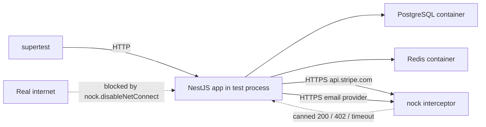

## 40.13 End-to-end testing the NestJS app with supertest and nock

#### Concept

An **e2e test** boots the whole NestJS application (all modules, global pipes, guards, interceptors, filters), talks to it over real HTTP with `supertest`, uses a real PostgreSQL and Redis from containers, and replaces only the systems you do not own by intercepting their HTTP calls at the network boundary with `nock` (or `msw`). It asserts on the HTTP response *and* on the resulting database state, because a 201 with nothing persisted is a bug.

#### Why does it exist?

Unit and integration tests prove the pieces. E2E proves the wiring: that `@UseGuards` is on the route, that `ValidationPipe` is global, that the exception filter maps errors, that the serializer hides `passwordHash`, that the DTO shape in the OpenAPI spec is what the handler actually accepts. Every one of those has been broken in production by a change that passed all lower-level tests.

#### Mental model

Imagine a restaurant's soft opening. Real kitchen, real waiters, real tables, invited guests. The only thing that is not real is the credit card terminal, which is in demo mode. You are not testing whether the chef can cook (unit) or whether the oven works (integration); you are testing whether a guest can walk in, order, eat and pay.

#### How it works



1. `beforeAll`: create the app with `Test.createTestingModule({ imports: [AppModule] })`, apply the *same* global setup as `main.ts` (a shared `configureApp(app)` function is the trick), `await app.init()`.
2. `nock.disableNetConnect()` and `nock.enableNetConnect('127.0.0.1')` so any un-mocked external call fails loudly instead of hitting the internet.
3. Per test: seed data, set up `nock` interceptors, send the request, assert status, body, headers, database rows, outbox rows, and that every `nock` scope was consumed (`scope.isDone()`).
4. `afterEach`: `nock.cleanAll()`, truncate tables.
5. `afterAll`: `await app.close()`.

#### NestJS example — the e2e harness

```ts
// src/app.setup.ts  (shared by main.ts and tests, so tests boot the real pipeline)
import { INestApplication, ValidationPipe, ClassSerializerInterceptor } from '@nestjs/common';
import { Reflector } from '@nestjs/core';
import { DomainErrorFilter } from './common/domain-error.filter';

export function configureApp(app: INestApplication): void {
  app.useGlobalPipes(new ValidationPipe({ whitelist: true, forbidNonWhitelisted: true, transform: true }));
  app.useGlobalInterceptors(new ClassSerializerInterceptor(app.get(Reflector)));
  app.useGlobalFilters(new DomainErrorFilter());
  app.enableShutdownHooks();
}
```

```ts
// test/e2e/app.harness.ts
import { INestApplication } from '@nestjs/common';
import { Test } from '@nestjs/testing';
import { DataSource } from 'typeorm';
import nock from 'nock';
import { JwtService } from '@nestjs/jwt';
import { AppModule } from '../../src/app.module';
import { configureApp } from '../../src/app.setup';
import { truncateAll } from '../db';

export async function createE2EApp() {
  process.env.DATABASE_URL = JSON.parse(require('fs').readFileSync('.test-db.json', 'utf8')).uri;
  process.env.DATABASE_SCHEMA = `w${process.env.JEST_WORKER_ID ?? '1'}`;
  process.env.PAYMENT_BASE_URL = 'https://api.payments.test';

  const moduleRef = await Test.createTestingModule({ imports: [AppModule] }).compile();
  const app: INestApplication = moduleRef.createNestApplication();
  configureApp(app);
  await app.init();

  nock.disableNetConnect();
  nock.enableNetConnect('127.0.0.1');

  const jwt = app.get(JwtService);
  const ds = app.get(DataSource);
  return {
    app,
    ds,
    tokenFor: (sub: string, roles: string[] = ['customer']) => jwt.sign({ sub, roles }),
    reset: async () => { nock.cleanAll(); await truncateAll(ds); },
    close: async () => { nock.enableNetConnect(); await app.close(); },
  };
}
```

Two important details. The app reads config from `process.env`, so the harness sets env before compiling the module; `@nestjs/config` reads it at that moment. The test signs a JWT with the app's own `JwtService`, so the real `JwtAuthGuard` runs with a real signature; there is no `overrideGuard` here.

```ts
// test/e2e/orders.e2e-spec.ts
import request from 'supertest';
import nock from 'nock';
import { createE2EApp } from './app.harness';
import { aProduct, seedProducts } from '../builders/product.builder';

describe('POST /orders (e2e)', () => {
  let h: Awaited<ReturnType<typeof createE2EApp>>;
  beforeAll(async () => { h = await createE2EApp(); });
  afterEach(() => h.reset());
  afterAll(() => h.close());

  it('creates a PAID order, decrements stock and writes an outbox event', async () => {
    const [p] = await seedProducts(h.ds, [aProduct({ stock: 5, priceCents: 1200 })]);
    const payment = nock('https://api.payments.test')
      .post('/v1/charges', (body) => body.amount === 2400 && body.currency === 'INR')
      .reply(200, { id: 'ch_123', status: 'succeeded' });

    const res = await request(h.app.getHttpServer())
      .post('/orders')
      .set('Authorization', `Bearer ${h.tokenFor('cust-1')}`)
      .set('Idempotency-Key', 'idem-e2e-1')
      .send({ lines: [{ sku: p.sku, qty: 2 }] })
      .expect(201);

    expect(res.body).toMatchObject({ id: expect.any(String), status: 'PAID', totalCents: 2400 });
    expect(res.body).not.toHaveProperty('customerInternalNotes'); // serializer hides @Exclude fields
    expect(payment.isDone()).toBe(true);

    const [stock] = await h.ds.query(`SELECT stock FROM products WHERE id = $1`, [p.id]);
    expect(stock.stock).toBe(3);
    const outbox = await h.ds.query(`SELECT event_type, payload FROM outbox WHERE aggregate_id = $1`, [res.body.id]);
    expect(outbox).toEqual([{ event_type: 'order.placed', payload: expect.objectContaining({ orderId: res.body.id }) }]);
  });

  it('returns 402 and rolls back stock when the gateway declines', async () => {
    const [p] = await seedProducts(h.ds, [aProduct({ stock: 5 })]);
    nock('https://api.payments.test').post('/v1/charges').reply(402, { error: { code: 'card_declined' } });

    await request(h.app.getHttpServer())
      .post('/orders')
      .set('Authorization', `Bearer ${h.tokenFor('cust-1')}`)
      .set('Idempotency-Key', 'idem-e2e-2')
      .send({ lines: [{ sku: p.sku, qty: 1 }] })
      .expect(402);

    const [stock] = await h.ds.query(`SELECT stock FROM products WHERE id = $1`, [p.id]);
    expect(stock.stock).toBe(5);
    expect(await h.ds.query(`SELECT 1 FROM orders`)).toHaveLength(0);
  });

  it('returns 401 without a token and 400 with an invalid body', async () => {
    await request(h.app.getHttpServer()).post('/orders').send({ lines: [] }).expect(401);
    await request(h.app.getHttpServer())
      .post('/orders').set('Authorization', `Bearer ${h.tokenFor('cust-1')}`)
      .send({ lines: [{ sku: 'X', qty: -1 }] })
      .expect(400)
      .expect((r) => expect(r.body.message).toEqual(expect.arrayContaining([expect.stringMatching(/qty/)])));
  });

  it('treats a replay with the same Idempotency-Key as the same order and charges once', async () => {
    const [p] = await seedProducts(h.ds, [aProduct({ stock: 5 })]);
    const payment = nock('https://api.payments.test').post('/v1/charges').once().reply(200, { id: 'ch_1', status: 'succeeded' });
    const send = () => request(h.app.getHttpServer()).post('/orders')
      .set('Authorization', `Bearer ${h.tokenFor('cust-1')}`).set('Idempotency-Key', 'idem-e2e-3')
      .send({ lines: [{ sku: p.sku, qty: 1 }] });

    const first = await send().expect(201);
    const second = await send().expect(201);
    expect(second.body.id).toBe(first.body.id);
    expect(payment.isDone()).toBe(true); // .once() means a second call would have failed with "no match"
  });

  it('times out the gateway and returns 503 without charging or persisting', async () => {
    const [p] = await seedProducts(h.ds, [aProduct({ stock: 5 })]);
    nock('https://api.payments.test').post('/v1/charges').delayConnection(3_000).reply(200, {});

    await request(h.app.getHttpServer()).post('/orders')
      .set('Authorization', `Bearer ${h.tokenFor('cust-1')}`).set('Idempotency-Key', 'idem-e2e-4')
      .send({ lines: [{ sku: p.sku, qty: 1 }] })
      .expect(503);
    expect(await h.ds.query(`SELECT 1 FROM orders`)).toHaveLength(0);
  }, 10_000);
});
```

The last test is the senior mantra in code: *can it timeout?* The payment client has a 2 s timeout; the test proves that a hung gateway does not become a hung order.

**msw** is an alternative to `nock` with the same idea and a request-handler style:

```ts
import { http, HttpResponse } from 'msw';
import { setupServer } from 'msw/node';
const server = setupServer(
  http.post('https://api.payments.test/v1/charges', () => HttpResponse.json({ id: 'ch_1', status: 'succeeded' })),
);
beforeAll(() => server.listen({ onUnhandledRequest: 'error' }));
afterEach(() => server.resetHandlers());
afterAll(() => server.close());
```

`msw` intercepts `fetch` and `undici` as well as `http`; `nock` (v13+) intercepts `http`/`https` and, from v14, `fetch` via `undici` interception. Pick one per repository.

#### Smoke tests against staging

E2E tests in CI run against containers. A **smoke test** runs a tiny subset (health, login, one read, one write with a test account) against the *deployed* staging environment after each deploy and against production after a release, with real third parties in sandbox mode. It is the only automated check that catches a wrong environment variable, a broken secret, or a firewall rule. Keep it under ten requests and under a minute, and make it the gate between "deployed" and "traffic shifted".

#### Edge cases & failure modes

- `nock` set up *after* the request, or with a path or body matcher that does not match, produces `Nock: No match for request` and a 500 from your app; assert `scope.isDone()` so unused interceptors also fail the test.
- Persisted interceptors (`.persist()`) leak between tests; `nock.cleanAll()` in `afterEach`.
- `app.getHttpServer()` with the Fastify adapter needs `await app.getHttpAdapter().getInstance().ready()` before the first request.
- Forgetting `configureApp(app)` means the e2e app has no global pipe; validation tests then fail or, worse, pass because the test expected the unvalidated behaviour.
- Running e2e files in parallel against one schema; use the same per-worker schema strategy.

#### Interview questions

1. *What do you assert in an e2e test beyond the status code?* Expected: body shape, hidden fields, headers, database state, outbox/side-effects, and that every external interceptor was consumed.
2. *Why mock at the network boundary rather than the client class?* Expected: it exercises your real client code (serialization, headers, timeouts, error mapping), which is where third-party integration bugs live.
3. *How do you test a third-party timeout?* Expected: `nock(...).delayConnection(ms)` beyond your client timeout; assert the app responds with a fast, correct failure and no partial state.

## 40.14 Contract testing

#### Concept

A **contract test** checks that two parties agree on the shape of what passes between them, without running both parties together. The two common shapes: **consumer-driven contracts** (Pact) between HTTP services, and **schema tests** for events on Kafka.

#### Why does it exist?

Service A changes a response field from `id` to `orderId`. Service B's tests are green (they mock A). A's tests are green (nobody told A that B reads `id`). Production breaks. A contract test makes B's expectation of A executable and runs it in A's pipeline.

#### How it works — Pact concept

1. The **consumer** (B) writes a test describing the request it sends and the minimal response it needs (`{ id: like("uuid"), status: like("PAID") }`). Running it produces a *pact file*.
2. The pact file is published to a broker.
3. The **provider** (A) runs *provider verification*: replays every consumer's requests against a running instance of A and checks the responses match. A's CI fails if A breaks any consumer.
4. `can-i-deploy` asks the broker whether the versions about to deploy are compatible.

The NestJS side for provider verification is the same e2e harness with a `@pact-foundation/pact` `Verifier` pointed at the running test app, plus *state handlers* that seed data ("an order with id X exists").

#### OpenAPI response validation in tests

If you publish an OpenAPI document (with `@nestjs/swagger`), your e2e tests can assert every response conforms to it. `jest-openapi` adds `toSatisfyApiSpec()`:

```ts
import jestOpenAPI from 'jest-openapi';
jestOpenAPI(require('path').resolve('openapi.json')); // generated in CI from SwaggerModule.createDocument

it('GET /orders/:id matches the published schema', async () => {
  const res = await request(h.app.getHttpServer()).get(`/orders/${orderId}`).set('Authorization', `Bearer ${token}`);
  expect(res).toSatisfyApiSpec();
});
```

Now a DTO change that is not reflected in the spec (or a spec change with no implementation) fails a test instead of surprising a mobile team.

#### Event schema tests for Kafka payloads

Events are contracts too. Keep a JSON Schema (or Avro/Protobuf) per event version in the repo and validate what your producer writes to the outbox:

```ts
import Ajv from 'ajv';
import orderPlacedV1 from '../../contracts/events/order.placed.v1.schema.json';
const validate = new Ajv({ allErrors: true }).compile(orderPlacedV1);

it('order.placed payload in the outbox satisfies schema v1', async () => {
  // ...place an order via the service...
  const [row] = await ds.query(`SELECT payload FROM outbox WHERE event_type = 'order.placed'`);
  expect(validate(row.payload)).toBe(true);
  expect(validate.errors).toBeNull();
});
```

Backward compatibility rule enforced by tests: a new schema version must accept every fixture that the previous version accepted (keep a folder of historical payloads and run all of them through the current schema). With a schema registry, the same check is the registry's compatibility mode; the test guards the moment before you publish there.

#### Interview questions

1. *What problem does consumer-driven contract testing solve that e2e across services does not?* Expected: fast, independent verification without deploying both services together; the provider learns what consumers depend on.
2. *How do you keep events backward compatible?* Expected: schema per version, additive changes only, historical payload fixtures validated against the current schema, registry compatibility mode.

## 40.15 Load tests, property-based tests and mutation tests

#### Load and performance tests (k6, autocannon)

A load test is a test with a *budget assertion* on latency and error rate under a chosen traffic profile. It runs against staging or a dedicated performance environment, never against the Jest test app (single process, `fsync=off` database: the numbers mean nothing).

```ts
// perf/place-order.k6.js
import http from 'k6/http';
import { check, sleep } from 'k6';

export const options = {
  stages: [
    { duration: '1m', target: 50 },   // ramp up
    { duration: '3m', target: 50 },   // steady
    { duration: '1m', target: 0 },    // ramp down
  ],
  thresholds: {
    http_req_failed: ['rate<0.01'],           // < 1% errors
    http_req_duration: ['p(95)<300', 'p(99)<800'], // ms budgets
  },
};

export default function () {
  const res = http.post(`${__ENV.BASE_URL}/orders`, JSON.stringify({ lines: [{ sku: 'SKU-LOAD-1', qty: 1 }] }), {
    headers: { 'Content-Type': 'application/json', Authorization: `Bearer ${__ENV.TOKEN}`, 'Idempotency-Key': `${__VU}-${__ITER}` },
  });
  check(res, { 'status is 201': (r) => r.status === 201 });
  sleep(1);
}
```

`k6 run -e BASE_URL=https://staging.example.com -e TOKEN=... perf/place-order.k6.js` exits non-zero when a threshold fails, which makes it a CI gate. For a quick local sanity check, `autocannon -c 50 -d 20 -m POST -H 'content-type=application/json' -b '{"lines":[...]}' http://localhost:3000/orders` prints p50/p97.5/p99 and requests per second in twenty seconds. How to design ramp profiles, find the knee and read the results is covered in Part 41 — Performance Engineering.

#### Property-based testing with fast-check

A property-based test generates hundreds of random inputs and checks a *property* that must hold for all of them. It shines for money and pricing, where example-based tests cover the five cases you thought of and the bug is in the sixth.

```ts
import fc from 'fast-check';
import { Money } from './money';
import { applyPercentDiscount, splitEvenly } from './pricing';

describe('pricing properties', () => {
  it('a discount never increases the price and never goes negative', () => {
    fc.assert(fc.property(
      fc.integer({ min: 0, max: 10_000_000 }), fc.integer({ min: 0, max: 100 }),
      (cents, pct) => {
        const out = applyPercentDiscount(Money.cents(cents, 'INR'), pct).cents;
        return out <= cents && out >= 0;
      },
    ));
  });

  it('splitting a total across N payers conserves every cent', () => {
    fc.assert(fc.property(
      fc.integer({ min: 0, max: 10_000_000 }), fc.integer({ min: 1, max: 20 }),
      (cents, n) => {
        const parts = splitEvenly(Money.cents(cents, 'INR'), n);
        const sum = parts.reduce((s, p) => s + p.cents, 0);
        const spread = Math.max(...parts.map((p) => p.cents)) - Math.min(...parts.map((p) => p.cents));
        return sum === cents && spread <= 1;
      },
    ));
  });
});
```

When a property fails, `fast-check` *shrinks* the input to the smallest failing case and prints it (for example `cents = 1, n = 3`), plus a seed to reproduce. Good properties for backends: round-trips (serialize then parse equals original), invariants (stock never negative), idempotence (applying twice equals applying once), commutativity where expected (order of discount application).

#### Mutation testing with Stryker

Coverage tells you which lines ran. **Mutation testing** tells you whether your tests would notice if those lines were wrong. Stryker changes your code in small ways (flip `>=` to `>`, delete a statement, replace `true` with `false`), runs the tests, and reports each *mutant* as killed (a test failed) or survived (nothing noticed). Survivors are gaps.

```json
{
  "$schema": "./node_modules/@stryker-mutator/core/schema/stryker-schema.json",
  "testRunner": "jest",
  "jest": { "configFile": "jest.config.ts" },
  "mutate": ["src/orders/domain/**/*.ts", "src/pricing/**/*.ts", "!src/**/*.spec.ts"],
  "thresholds": { "high": 85, "low": 70, "break": 60 },
  "concurrency": 4
}
```

Run it on the domain and pricing modules only (it multiplies test runtime by the number of mutants, so a full-repo run is hours). A typical first run on a "well-covered" pricing module shows 30–40% surviving mutants: `>=` boundaries with no test at the boundary, error messages that no test asserts, branches that only run with mocked inputs. Fixing the top survivors is the fastest way to turn coverage into confidence.

## 40.16 Coverage: what the number means and what it does not

#### Concept

Line coverage is the percentage of lines executed by at least one test. Branch coverage counts each side of every `if`, `?:`, `&&` and `catch`. Neither says anything about whether an assertion checked the result.

A file can reach 100% line coverage with a test that calls every function and asserts nothing. A service can reach 90% with mocks that make every branch trivially true. Coverage measures *execution*, not *verification*.

#### How to use it well

- Treat coverage as a **floor, not a target**. A floor ("do not merge if coverage of `src/orders/domain` drops below 90% branches") prevents regression. A target ("reach 80%") invites gaming.
- Use **branch** coverage, not line coverage, for critical modules; a missing `else` is where the bug is.
- Scope the floor per directory. Domain and money code: 90%+ branches. Controllers: covered by e2e, do not chase unit coverage. Generated code and migrations: excluded.
- Combine with mutation testing on the critical modules once a quarter; a high coverage number with a low mutation score is the signature of assertion-free tests.

```ts
// jest.config.ts (excerpt)
collectCoverageFrom: ['src/**/*.ts', '!src/**/*.spec.ts', '!src/migrations/**', '!src/main.ts'],
coverageThreshold: {
  global: { branches: 70, lines: 80 },
  './src/orders/domain/': { branches: 90, lines: 95 },
  './src/pricing/': { branches: 95, lines: 95 },
},
```

#### Coverage gaming, and how to spot it

- Tests with no `expect`. Enable the `jest/expect-expect` ESLint rule.
- `it.skip` and `xit` sprinkled around failing tests; grep the repo for them in CI and fail if the count grows.
- Giant snapshot tests (`expect(res.body).toMatchSnapshot()`) of a 400-line JSON: they cover everything and verify nothing, and everyone presses `u` to update them. Snapshot only small, stable shapes, and review snapshot diffs in PRs.
- `/* istanbul ignore next */` on anything but genuinely unreachable code.

#### Interview questions

1. *Is 100% coverage a good goal?* Expected: no; it measures execution, not verification, and chasing it produces assertion-free tests. Use it as a floor on critical modules and pair it with mutation testing.
2. *Line vs branch coverage?* Expected: branch coverage catches untested `else`/`catch` paths, which is where most bugs hide.
3. *How do you detect tests that cover but do not verify?* Expected: `expect-expect` lint rule, mutation testing, code review of assertions.
