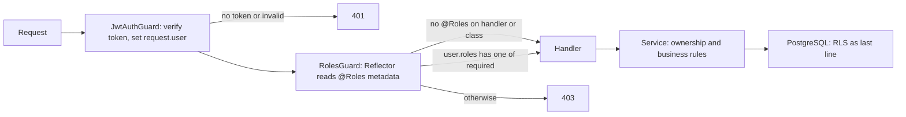

## 40.7 Multi-Factor Authentication (MFA)

#### Concept

Multi-factor authentication requires two or more independent proofs of identity from different categories: something you *know* (password), something you *have* (phone, hardware key), something you *are* (fingerprint). A password plus a six-digit code from an authenticator app is the common form. A password plus a security question is not MFA; both are things you know.

The mainstream mechanisms, in rising order of strength: SMS codes (phishable, SIM-swappable, better than nothing), TOTP apps (phishable in real time but not SIM-swappable), and WebAuthn / passkeys (bound to the site's origin, so phishing does not work).

#### Why does it exist?

Passwords leak. Billions of email-and-password pairs from past breaches are traded and replayed against every login form on the internet (credential stuffing, 40.25). People reuse passwords. MFA makes a leaked password insufficient. For a backend engineer the question is not whether to offer MFA but how to make it mandatory for admins, available to everyone, and impossible to bypass through a side door (password reset, API keys, "remember this device").

#### Mental model

Imagine a bank vault that needs two keys turned at the same time, held by two different people. Stealing one key from one person's pocket is not enough. TOTP is a key that changes every 30 seconds; a passkey is a key that only fits the door of the real bank and will not turn in a fake door that looks the same.

#### How it works

**TOTP (RFC 6238):**

1. During enrolment the server generates a random secret (20 bytes, base32-encoded) and shows it as a QR code (`otpauth://totp/Example:alice@example.com?secret=...&issuer=Example`). The authenticator app stores the secret.
2. Both sides compute `HMAC-SHA1(secret, floor(now / 30s))`, truncate to 6 digits. The app shows the digits; the user types them.
3. The server accepts the code for the current 30-second step and typically one step on each side (window of 1) to absorb clock drift, and **records the last used step** so the same code cannot be replayed within its window.
4. The secret must be stored encrypted (40.16); a database leak that exposes TOTP secrets removes the second factor for everyone.

**Backup codes:** 8 to 10 single-use codes generated at enrolment, shown once, stored hashed like passwords (argon2 or at least a keyed hash; they are low-entropy compared to tokens). Each successful use deletes the code.

**WebAuthn / passkeys:** the browser creates a key pair per site. The public key is stored on your server; the private key stays in the device's secure hardware or the platform's password manager. Login is a challenge-response signature over a server-issued random challenge *and the origin*. A phishing site on a different origin cannot produce a valid signature. Use `@simplewebauthn/server` on the NestJS side; do not implement the CBOR and attestation parsing yourself.

**Step-up authentication:** the session or token records *when* and *how* the user authenticated (`auth_time`, `amr: ["pwd","otp"]`). Sensitive actions (change email, add a payout account, pay above a threshold) require a recent strong authentication, for example MFA within the last 5 minutes; otherwise the API returns `403` with a reason code and the client prompts for the second factor again.

**Rate limiting OTP attempts:** a 6-digit code has one million possibilities; with a window of 3 steps, an attacker who can make 300,000 guesses has a 90 percent chance. Limit to about 5 attempts per user per 15 minutes, lock the MFA step after that, and alert.

```mermaid
sequenceDiagram
    participant C as Client
    participant A as NestJS
    participant R as Redis
    participant P as PostgreSQL
    C->>A: POST /auth/login (email, password)
    A->>P: verify password hash
    A-->>C: 200 mfa_required, mfa_token (5 min, aud mfa)
    C->>A: POST /auth/mfa/verify (mfa_token, code 493 210)
    A->>R: INCR mfa:attempts:user42 (EX 900)
    R-->>A: 1 (under limit 5)
    A->>P: SELECT totp_secret_enc, last_totp_step FROM user_mfa
    A->>A: decrypt secret, verify code with window 1, check step is newer
    A->>P: UPDATE user_mfa SET last_totp_step = step
    A-->>C: access + refresh tokens (amr pwd,otp; auth_time now)
```

#### Practical example

A ride-booking company's driver-payout portal. Every finance user must enrol TOTP or a passkey; admins cannot disable MFA for themselves. Changing a driver's bank account requires MFA within the last 5 minutes (step-up). Backup codes exist for lost phones, and using one triggers an email and an audit entry. OTP verification is limited to 5 attempts per 15 minutes per user; the sixth attempt locks the MFA step for an hour and pages nobody but shows on the security dashboard.

#### NestJS example

Enrolment, verification with replay protection and rate limiting, using `otplib`.

```ts
// mfa.service.ts
import { Injectable, UnauthorizedException, HttpException, HttpStatus } from '@nestjs/common';
import { InjectRepository } from '@nestjs/typeorm';
import { Repository } from 'typeorm';
import { authenticator } from 'otplib';
import * as argon2 from 'argon2';
import { randomInt } from 'node:crypto';
import { UserMfa } from './user-mfa.entity';
import { FieldCipher } from '../crypto/field-cipher';   // AES-256-GCM wrapper from 22.16
import { RedisService } from '../redis/redis.service';

@Injectable()
export class MfaService {
  constructor(
    @InjectRepository(UserMfa) private mfa: Repository<UserMfa>,
    private cipher: FieldCipher,
    private redis: RedisService,
  ) {
    authenticator.options = { window: 1, step: 30 }; // accept previous/next 30 s step
  }

  async beginEnrolment(userId: string, email: string) {
    const secret = authenticator.generateSecret(20);              // base32, 160 bits
    await this.mfa.upsert({ userId, totpSecretEnc: this.cipher.encrypt(secret), confirmed: false }, ['userId']);
    return { otpauthUrl: authenticator.keyuri(email, 'Example', secret) }; // render as QR on the client
  }

  async confirmEnrolment(userId: string, code: string) {
    const row = await this.mfa.findOneByOrFail({ userId });
    if (!this.verifyTotp(this.cipher.decrypt(row.totpSecretEnc), code, row)) throw new UnauthorizedException('Invalid code');
    const backupCodes = Array.from({ length: 10 }, () => String(randomInt(0, 1e8)).padStart(8, '0'));
    row.backupCodeHashes = await Promise.all(backupCodes.map((c) => argon2.hash(c)));
    row.confirmed = true;
    await this.mfa.save(row);
    return { backupCodes }; // shown exactly once
  }

  async verify(userId: string, code: string): Promise<void> {
    const key = `mfa:attempts:${userId}`;
    const attempts = await this.redis.client.incr(key);
    if (attempts === 1) await this.redis.client.expire(key, 900);
    if (attempts > 5) throw new HttpException('Too many attempts', HttpStatus.TOO_MANY_REQUESTS);

    const row = await this.mfa.findOneByOrFail({ userId });
    const secret = this.cipher.decrypt(row.totpSecretEnc);
    if (/^\d{6}$/.test(code) && this.verifyTotp(secret, code, row)) {
      row.lastTotpStep = Math.floor(Date.now() / 30_000);          // replay protection
      await this.mfa.save(row);
      await this.redis.client.del(key);
      return;
    }
    if (await this.consumeBackupCode(row, code)) { await this.redis.client.del(key); return; }
    throw new UnauthorizedException('Invalid code');
  }

  private verifyTotp(secret: string, code: string, row: UserMfa): boolean {
    const step = Math.floor(Date.now() / 30_000);
    if (row.lastTotpStep !== null && step <= row.lastTotpStep) return false; // code for this step already used
    return authenticator.verify({ token: code, secret });
  }

  private async consumeBackupCode(row: UserMfa, code: string): Promise<boolean> {
    for (const [i, hash] of row.backupCodeHashes.entries()) {
      if (await argon2.verify(hash, code)) {
        row.backupCodeHashes.splice(i, 1);          // single use
        await this.mfa.save(row);
        return true;
      }
    }
    return false;
  }
}
```

A step-up guard that requires a recent strong authentication, read from claims placed in the access token at MFA time:

```ts
// recent-mfa.guard.ts
import { CanActivate, ExecutionContext, ForbiddenException, Injectable, SetMetadata } from '@nestjs/common';
import { Reflector } from '@nestjs/core';

export const RequireRecentMfa = (maxAgeSeconds = 300) => SetMetadata('recent_mfa', maxAgeSeconds);

@Injectable()
export class RecentMfaGuard implements CanActivate {
  constructor(private reflector: Reflector) {}
  canActivate(ctx: ExecutionContext): boolean {
    const maxAge = this.reflector.get<number>('recent_mfa', ctx.getHandler());
    if (maxAge === undefined) return true;
    const user = ctx.switchToHttp().getRequest().user as { amr: string[]; authTime: number };
    const strong = user.amr.includes('otp') || user.amr.includes('hwk');
    const fresh = Date.now() / 1000 - user.authTime <= maxAge;
    if (!strong || !fresh) throw new ForbiddenException({ code: 'STEP_UP_REQUIRED', maxAge });
    return true;
  }
}
```

#### PostgreSQL example

```sql
CREATE TABLE user_mfa (
  user_id            uuid PRIMARY KEY REFERENCES users(id) ON DELETE CASCADE,
  totp_secret_enc    bytea NOT NULL,          -- AES-256-GCM: iv || ciphertext || tag, key id prefixed
  confirmed          boolean NOT NULL DEFAULT false,
  last_totp_step     bigint,                  -- replay protection
  backup_code_hashes text[] NOT NULL DEFAULT '{}',
  enrolled_at        timestamptz NOT NULL DEFAULT now()
);

CREATE TABLE webauthn_credentials (
  id               bytea PRIMARY KEY,         -- credential id from the authenticator
  user_id          uuid NOT NULL REFERENCES users(id) ON DELETE CASCADE,
  public_key       bytea NOT NULL,
  sign_count       bigint NOT NULL DEFAULT 0, -- clone detection: must increase
  transports       text[],
  name             text,                      -- "MacBook Touch ID"
  created_at       timestamptz NOT NULL DEFAULT now(),
  last_used_at     timestamptz
);
CREATE INDEX webauthn_user_idx ON webauthn_credentials (user_id);
```

#### Production scenario

A fintech app with 2 million users, 35 percent enrolled in TOTP and 10 percent in passkeys. MFA verifications run at about 60 per second at peak. TOTP verification is microseconds; the cost is the decrypt of the secret and the row update. Backup-code verification with argon2 costs 50 ms per code hash checked, so up to 10 hashes per attempt; it is rare enough not to matter. The security dashboard tracks MFA failure rate per user (attack indicator), backup-code usage (lost phones), and step-up prompts per sensitive action.

#### Failure scenario

Support received a wave of "my code is always wrong" tickets after a deploy. The new pods had a clock 90 seconds behind; with a TOTP window of one step (30 seconds each side) every code failed. NTP on the node image had been disabled by a hardening script. Clock skew alerting (compare each pod's clock to an NTP source and alert over 5 seconds) was added the same day.

#### Edge cases & failure modes

- Clock drift on server or phone; window of 1 step plus NTP.
- TOTP code replay within the window; store `last_totp_step`.
- Brute force on the code; rate limit per user and per IP; lock the MFA step.
- Backup codes stored in plaintext or shown more than once.
- MFA bypass through password reset: reset must not disable MFA; recovery needs a separate, slower path with identity verification.
- MFA bypass through API keys or long-lived sessions created before enrolment.
- "Remember this device" cookies that never expire or are not bound to the user.
- Secret leak via a database dump if secrets are not encrypted.
- WebAuthn `sign_count` going backwards indicates a cloned authenticator; treat as compromise.
- Users losing both phone and backup codes: a recovery process with human verification and a waiting period, or you have built a lockout machine.

#### How a Senior Backend Engineer thinks about this

They make MFA mandatory for staff and admins first, because those accounts have the widest blast radius. They prefer passkeys because phishing resistance removes an entire class of incident, and they keep TOTP for users without passkey support. They design step-up from the start by putting `amr` and `auth_time` in the token, because retrofitting "prove it again for this action" is expensive. And they audit every alternative path into an account (reset, recovery, API keys, SSO) with the question: *does this path skip the second factor?*

#### Common mistakes

- SMS as the only second factor for high-value accounts.
- No rate limit on the OTP endpoint.
- Not recording the last used TOTP step.
- Allowing enrolment without confirming the first code (locks the user out).
- Storing the TOTP secret in plaintext next to the password hash.
- Letting a password reset remove MFA.

#### Interview questions

1. *How does TOTP work and why does a window of 1 exist?* Expected: HMAC of a time counter; window absorbs clock drift. Follow-up: how do you stop replay inside the window?
2. *Why are passkeys phishing-resistant when TOTP is not?* Expected: the signature covers the origin.
3. *Design step-up authentication for payouts.* Expected: `amr` and `auth_time` in the token; a guard enforcing freshness; a client flow to re-prompt.
4. *What is the attack if the OTP endpoint has no rate limit? Do the arithmetic.*
5. *How would you store backup codes and why?*
6. *Enumerate the ways MFA can be bypassed in a typical app.*

#### Practical exercise

Add TOTP MFA to a NestJS auth module: enrolment with QR, confirmation, verification with replay protection and a 5-per-15-minutes limit, backup codes stored with argon2, and a `@RequireRecentMfa(300)` guard on `PATCH /me/payout-account`. Acceptance criteria: the same code is rejected on second use; the sixth wrong attempt returns 429; the payout endpoint returns 403 with `STEP_UP_REQUIRED` for a token whose `auth_time` is 10 minutes old; a database dump contains no readable TOTP secret.

## 40.8 Role-Based Access Control (RBAC)

#### Concept

RBAC assigns users to roles (`customer`, `support`, `warehouse`, `admin`) and grants permissions to roles rather than to users. A request is allowed when the caller holds a role that is permitted for that action. It is the simplest authorization model that scales past a handful of users and it covers the majority of business applications.

#### Why does it exist?

Granting permissions per user does not scale and is impossible to audit: "who can refund orders?" becomes a query over thousands of rows that nobody trusts. Roles turn that into "the `support` and `admin` roles can refund", which a product manager can read and a compliance auditor can sign off on. Roles also make onboarding and offboarding a single change.

#### Mental model

Imagine the badges from 40.1 again, but now the badge says "Warehouse Staff" rather than listing 40 doors. Each door has a sign: "Warehouse Staff, Managers". The door does not know your name; it knows your role. Adding a new warehouse worker means printing one badge, not reprogramming 40 doors.

#### How it works

1. A `roles` table defines the roles. A `user_roles` table maps users to roles (many-to-many; a user can be both `support` and `warehouse`).
2. At login, the user's roles are loaded and either placed in the token as a claim or cached.
3. Each route declares the roles it requires with a decorator, `@Roles('admin', 'support')`.
4. A `RolesGuard` runs after the authentication guard, reads the required roles through `Reflector`, compares with the principal's roles, and returns true or throws 403.
5. Optional **role hierarchy**: `admin` implies `support` implies `customer`. Implement it by expanding roles at token-issue time (`admin` becomes `["admin","support","customer"]`) or by a lookup table in the guard. Expansion at issue time keeps the guard trivial.
6. **Roles in the JWT vs from the database on each request:** the token is fast and stateless but stale until refresh; the database is always current and costs a query (or a Redis read) per request. A common compromise is roles in the token plus a `roles_version` claim; the guard compares it to a cached per-user version in Redis and rejects the token when a role change has bumped the version.



#### Practical example

An e-commerce back office. `customer` can read their own orders. `support` can read any order and issue refunds up to 100 units of currency. `support_lead` can issue any refund. `warehouse` can change fulfilment status. `admin` can manage users and roles. The refund limit is not RBAC (it is an attribute check, 40.9), but which roles may refund at all is pure RBAC and lives in the guard.

#### NestJS example

The decorator and guard pair, with hierarchy expansion done once at token issue time.

```ts
// roles.decorator.ts
import { SetMetadata } from '@nestjs/common';
export const ROLES_KEY = 'roles';
export const Roles = (...roles: string[]) => SetMetadata(ROLES_KEY, roles);

// roles.guard.ts
import { CanActivate, ExecutionContext, ForbiddenException, Injectable } from '@nestjs/common';
import { Reflector } from '@nestjs/core';
import { ROLES_KEY } from './roles.decorator';

@Injectable()
export class RolesGuard implements CanActivate {
  constructor(private reflector: Reflector) {}

  canActivate(ctx: ExecutionContext): boolean {
    // Method-level @Roles overrides class-level; no metadata means "any authenticated user".
    const required = this.reflector.getAllAndOverride<string[]>(ROLES_KEY, [ctx.getHandler(), ctx.getClass()]);
    if (!required || required.length === 0) return true;
    const user = ctx.switchToHttp().getRequest().user as { roles?: string[] } | undefined;
    if (!user) throw new ForbiddenException(); // JwtAuthGuard should have run first
    const ok = required.some((r) => user.roles?.includes(r));
    if (!ok) throw new ForbiddenException('Insufficient role');
    return true;
  }
}
```

```ts
// role-hierarchy.ts: expand roles when issuing the token
const IMPLIES: Record<string, string[]> = {
  admin: ['support_lead', 'warehouse'],
  support_lead: ['support'],
  support: ['customer'],
};
export function expandRoles(direct: string[]): string[] {
  const out = new Set<string>();
  const stack = [...direct];
  while (stack.length) {
    const r = stack.pop()!;
    if (out.has(r)) continue;
    out.add(r);
    stack.push(...(IMPLIES[r] ?? []));
  }
  return [...out];
}
```

```ts
// refunds.controller.ts
@Controller('refunds')
@UseGuards(JwtAuthGuard, RolesGuard)
export class RefundsController {
  @Post()
  @Roles('support')             // support_lead and admin inherit this via expansion
  create(@Body() dto: CreateRefundDto, @CurrentUser() user: AuthenticatedUser) {
    return this.refunds.create(dto, user); // service enforces the amount limit per role
  }
}
```

Register the guards globally so a forgotten `@UseGuards` cannot open a route (with a `@Public()` decorator for the few open endpoints; full code in 40.37):

```ts
// app.module.ts
providers: [
  { provide: APP_GUARD, useClass: JwtAuthGuard },
  { provide: APP_GUARD, useClass: RolesGuard },   // order of registration is execution order
]
```

Role freshness without a database hit per request: bump a per-user version on role change and compare in the strategy.

```ts
// in JwtStrategy.validate
const currentVersion = await this.redis.client.get(`user:${payload.sub}:roles_v`); // ~0.3 ms
if (currentVersion && Number(currentVersion) !== payload.roles_v) {
  throw new UnauthorizedException('Roles changed, please refresh'); // client refreshes, gets new roles
}
```

#### PostgreSQL example

```sql
CREATE TABLE roles (
  id          smallint PRIMARY KEY,
  name        text NOT NULL UNIQUE,
  description text
);

CREATE TABLE role_hierarchy (
  parent_role_id smallint NOT NULL REFERENCES roles(id),
  child_role_id  smallint NOT NULL REFERENCES roles(id),
  PRIMARY KEY (parent_role_id, child_role_id)
);

CREATE TABLE user_roles (
  user_id    uuid NOT NULL REFERENCES users(id) ON DELETE CASCADE,
  role_id    smallint NOT NULL REFERENCES roles(id),
  granted_by uuid REFERENCES users(id),
  granted_at timestamptz NOT NULL DEFAULT now(),
  PRIMARY KEY (user_id, role_id)
);
CREATE INDEX user_roles_role_idx ON user_roles (role_id);  -- "who has admin?"

-- Effective roles for a user, expanding the hierarchy:
WITH RECURSIVE eff AS (
  SELECT r.id, r.name FROM user_roles ur JOIN roles r ON r.id = ur.role_id WHERE ur.user_id = $1
  UNION
  SELECT c.id, c.name FROM eff JOIN role_hierarchy h ON h.parent_role_id = eff.id JOIN roles c ON c.id = h.child_role_id
)
SELECT array_agg(DISTINCT name) FROM eff;
```

Role changes should be audited (40.35): who granted `admin` to whom and when is one of the first questions after an incident.

#### TypeORM example

```ts
@Entity('users')
export class User {
  @PrimaryGeneratedColumn('uuid') id: string;
  @Column({ type: 'citext', unique: true }) email: string;
  @Column() passwordHash: string;
  @ManyToMany(() => Role, { eager: false })
  @JoinTable({ name: 'user_roles', joinColumn: { name: 'user_id' }, inverseJoinColumn: { name: 'role_id' } })
  roles: Role[];
  roleNames(): string[] { return this.roles.map((r) => r.name); }
}

// Load roles only at login/refresh, not on every request:
const user = await usersRepo.findOne({ where: { email }, relations: { roles: true } });
```

#### Sequelize example

```ts
User.belongsToMany(Role, { through: 'user_roles', foreignKey: 'user_id', otherKey: 'role_id' });
Role.belongsToMany(User, { through: 'user_roles', foreignKey: 'role_id', otherKey: 'user_id' });

const user = await User.findOne({ where: { email }, include: [{ model: Role, attributes: ['name'] }] });
const roles = expandRoles(user.Roles.map((r) => r.name));
```

#### Production scenario

A SaaS with 300,000 users and 9 roles. Roles ride in the access token; a Redis `roles_v` check adds 0.3 ms per request and lets an admin demotion take effect within one request. Role grants are about 200 per day, all audited. The `user_roles` table is small (400,000 rows) and fully cached. The team reviews the "who has admin" list monthly; it is a single indexed query.

#### Failure scenario

A developer added `@UseGuards(RolesGuard)` to a new admin controller but forgot `JwtAuthGuard`. `RolesGuard` saw `request.user` undefined and, in an early version of the code, returned `true` when no user was present ("nothing to check"). Anonymous requests reached admin endpoints for six days. The fix: `RolesGuard` throws when `request.user` is missing and required roles exist, and both guards are registered globally so per-controller omission is impossible.

#### Edge cases & failure modes

- Role removed but token still carries it until refresh; use the version check.
- Guard order: `RolesGuard` before `JwtAuthGuard` sees no user. Register globally in the correct order.
- Role names as free strings with typos (`suport`); use an enum or constants and a test that every `@Roles` value exists in the `roles` table.
- Hierarchy cycles (`a` implies `b` implies `a`); guard against them in the expansion code and with a check on insert.
- Role explosion: 60 roles each slightly different means you need permissions (40.10), not more roles.
- Roles used for ownership decisions ("support can read all orders") without regional or tenant limits; that is ABAC territory.
- Cross-tenant admin: an `admin` role must be scoped to a tenant unless it is explicitly a platform role.

#### How a Senior Backend Engineer thinks about this

They start with RBAC because it is understandable, and they move to permissions or ABAC only when roles stop describing the rules. They keep the guard tiny and put anything that needs data in the service. They register guards globally, deny by default, and write a test that walks every route and asserts it is either `@Public()` or guarded. They put role changes in the audit log and give security a one-click "who has this role" report.

#### Common mistakes

- Roles checked only in the controller, so a job or another service path bypasses them.
- Role in the request body (`{ role: 'admin' }` on signup) accepted by a DTO without a whitelist (40.24).
- Hard-coded `if (user.email === 'ceo@example.com')` instead of a role.
- Treating `admin` as global in a multi-tenant system.
- No audit of role grants.

#### Interview questions

1. *Roles in the JWT or from the database on each request?* Expected: token plus version check, or DB with cache; tradeoff freshness vs cost.
2. *How does `Reflector` work in a NestJS guard and what does `getAllAndOverride` do?* Expected: reads metadata set by `SetMetadata`; method-level wins over class-level.
3. *Implement role hierarchy; where would you expand it and why?* Expected: at token issue time or via recursive CTE; keep guard trivial.
4. *When does RBAC stop being enough?* Expected: when decisions depend on attributes of the resource or context.
5. *How do you make sure no route is accidentally unprotected?*

#### Practical exercise

Implement `@Roles()`, `RolesGuard`, hierarchy expansion, and a Redis `roles_v` freshness check. Write a test that enumerates all routes via the NestJS `DiscoveryService` (from `@nestjs/core`) and asserts each is either marked `@Public()` or reachable only through the global guards. Acceptance criteria: demoting a user from `admin` causes their existing token to fail on the very next request; a route without `@Roles` still requires authentication; a `RolesGuard` running with no `request.user` throws rather than allowing.
