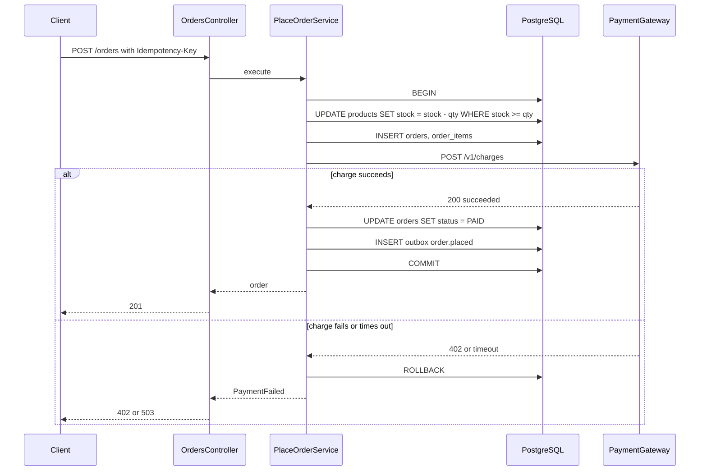
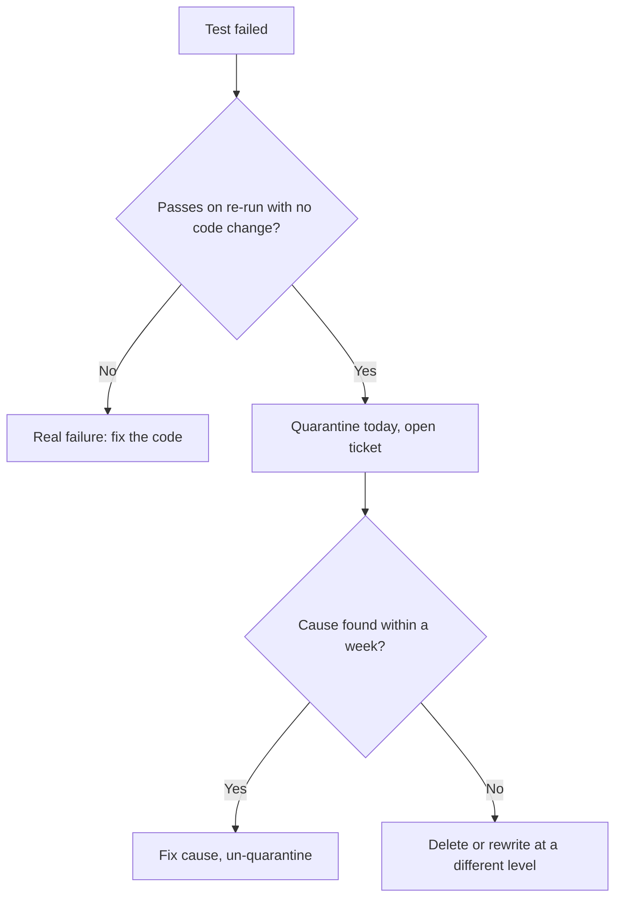
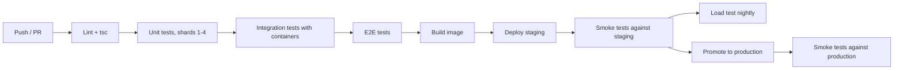

## 40.17 A complete example: testing PlaceOrder at all three levels

This section ties the part together with one feature tested the way a senior engineer would ship it. The feature: `POST /orders` reserves stock, charges the customer through an external gateway, persists the order and writes an `order.placed` outbox row, all such that a payment failure leaves *nothing* behind.



The transactional service under test (the design decision to call the gateway *inside* the transaction is deliberate and discussed in Part 20 — Database Transactions; it keeps the example simple and it is the pattern many teams run, with a short gateway timeout so the transaction is never held open long):

```ts
// src/orders/place-order.service.ts (transactional version)
import { Inject, Injectable } from '@nestjs/common';
import { DataSource, EntityManager } from 'typeorm';
import { Order, OrderLine } from './domain/order';
import { OutOfStockError, PaymentFailedError } from './errors';
import { PaymentGateway, PAYMENT_GATEWAY, IdGenerator, ID_GENERATOR } from './ports';

@Injectable()
export class PlaceOrderService {
  constructor(
    private readonly ds: DataSource,
    @Inject(PAYMENT_GATEWAY) private readonly payments: PaymentGateway,
    @Inject(ID_GENERATOR) private readonly ids: IdGenerator,
  ) {}

  async execute(customerId: string, lines: OrderLine[], idempotencyKey: string): Promise<Order> {
    return this.ds.transaction(async (m: EntityManager) => {
      const existing = await m.query(`SELECT id FROM orders WHERE idempotency_key = $1`, [idempotencyKey]);
      if (existing.length) return this.loadOrder(m, existing[0].id);

      const order = Order.place(this.ids.next(), customerId, lines);
      for (const l of lines) {
        const [, affected] = await m.query(
          `UPDATE products SET stock = stock - $1 WHERE sku = $2 AND stock >= $1`, [l.qty, l.sku]);
        if (affected === 0) throw new OutOfStockError(l.sku);
      }
      await m.query(
        `INSERT INTO orders (id, customer_id, status, total_cents, idempotency_key) VALUES ($1, $2, 'PENDING', $3, $4)`,
        [order.id, customerId, order.totalCents, idempotencyKey]);
      await m.query(
        `INSERT INTO order_items (order_id, sku, qty, unit_price_cents) SELECT $1, sku, qty, unit_price_cents FROM jsonb_to_recordset($2::jsonb) AS t(sku text, qty int, unit_price_cents int)`,
        [order.id, JSON.stringify(lines.map((l) => ({ sku: l.sku, qty: l.qty, unit_price_cents: l.unitPriceCents })))]);

      const charge = await this.payments.charge({ orderId: order.id, amountCents: order.totalCents }); // 2 s timeout inside
      if (charge.status !== 'succeeded') throw new PaymentFailedError(charge.status);

      order.markPaid();
      await m.query(`UPDATE orders SET status = 'PAID', payment_id = $2 WHERE id = $1`, [order.id, charge.paymentId]);
      await m.query(
        `INSERT INTO outbox (id, aggregate_id, event_type, payload) VALUES ($1, $2, 'order.placed', $3)`,
        [this.ids.next(), order.id, JSON.stringify({ orderId: order.id, customerId, totalCents: order.totalCents })]);
      return order;
    });
  }

  private async loadOrder(m: EntityManager, id: string): Promise<Order> { /* hydrate from rows */ return null as any; }
}
```

**Level 1, unit.** Section 40.3 already showed the aggregate tests (invariants, totals, state machine) and a service test with an in-memory repository and a `jest.fn()` gateway. With the transactional version, the service depends on `DataSource`, which is not something to fake. So at the unit level we test *only* the aggregate and pricing, and we move the orchestration tests to level 2. This is a real and common outcome: when the service is thin orchestration over SQL, it does not need unit tests. Do not write a unit test that mocks `ds.transaction`; it would prove nothing.

**Level 2, integration.** Real PostgreSQL, gateway stubbed at the interface, assertions on rows:

```ts
// src/orders/place-order.service.int-spec.ts
describe('PlaceOrderService (integration, real PostgreSQL)', () => {
  let ds: DataSource; let service: PlaceOrderService;
  const gateway = { charge: jest.fn() };
  const ids = { next: jest.fn() };

  beforeAll(async () => {
    ds = await createTestDataSource([]);
    service = new PlaceOrderService(ds, gateway, ids);
  });
  beforeEach(() => {
    let n = 0; ids.next.mockImplementation(() => `00000000-0000-0000-0000-${String(++n).padStart(12, '0')}`);
    gateway.charge.mockResolvedValue({ paymentId: 'pay_1', status: 'succeeded' });
  });
  afterEach(async () => { jest.clearAllMocks(); await truncateAll(ds); });
  afterAll(() => ds.destroy());

  it('writes order, items, stock decrement and outbox in one transaction', async () => {
    await seedProducts(ds, [aProduct({ sku: 'SKU-1', stock: 5 })]);
    const order = await service.execute('cust-1', [{ sku: 'SKU-1', qty: 2, unitPriceCents: 1000 }], 'k1');

    expect((await ds.query(`SELECT status FROM orders WHERE id = $1`, [order.id]))[0].status).toBe('PAID');
    expect((await ds.query(`SELECT count(*)::int AS n FROM order_items WHERE order_id = $1`, [order.id]))[0].n).toBe(1);
    expect((await ds.query(`SELECT stock FROM products WHERE sku = 'SKU-1'`))[0].stock).toBe(3);
    expect(await ds.query(`SELECT event_type FROM outbox WHERE aggregate_id = $1`, [order.id])).toEqual([{ event_type: 'order.placed' }]);
  });

  it('rolls back everything when the payment fails', async () => {
    await seedProducts(ds, [aProduct({ sku: 'SKU-1', stock: 5 })]);
    gateway.charge.mockResolvedValueOnce({ paymentId: 'pay_x', status: 'declined' });

    await expect(service.execute('cust-1', [{ sku: 'SKU-1', qty: 2, unitPriceCents: 1000 }], 'k2')).rejects.toBeInstanceOf(PaymentFailedError);

    expect(await ds.query(`SELECT 1 FROM orders`)).toHaveLength(0);
    expect(await ds.query(`SELECT 1 FROM outbox`)).toHaveLength(0);
    expect((await ds.query(`SELECT stock FROM products WHERE sku = 'SKU-1'`))[0].stock).toBe(5); // stock restored by rollback
  });

  it('rolls back when the gateway throws (timeout) and leaves no row behind', async () => {
    await seedProducts(ds, [aProduct({ sku: 'SKU-1', stock: 5 })]);
    gateway.charge.mockRejectedValueOnce(new Error('ETIMEDOUT'));
    await expect(service.execute('cust-1', [{ sku: 'SKU-1', qty: 1, unitPriceCents: 1000 }], 'k3')).rejects.toThrow('ETIMEDOUT');
    expect((await ds.query(`SELECT stock FROM products WHERE sku = 'SKU-1'`))[0].stock).toBe(5);
  });

  it('refuses to oversell and does not charge', async () => {
    await seedProducts(ds, [aProduct({ sku: 'SKU-1', stock: 1 })]);
    await expect(service.execute('cust-1', [{ sku: 'SKU-1', qty: 2, unitPriceCents: 1000 }], 'k4')).rejects.toBeInstanceOf(OutOfStockError);
    expect(gateway.charge).not.toHaveBeenCalled();
  });

  it('enforces the unique idempotency key at the database even if the pre-check is bypassed', async () => {
    await seedProducts(ds, [aProduct({ sku: 'SKU-1', stock: 5 })]);
    await service.execute('cust-1', [{ sku: 'SKU-1', qty: 1, unitPriceCents: 1000 }], 'k5');
    await expect(ds.query(
      `INSERT INTO orders (id, customer_id, status, total_cents, idempotency_key) VALUES (gen_random_uuid(), 'cust-1', 'PENDING', 1, 'k5')`,
    )).rejects.toMatchObject({ code: '23505' });
  });
});
```

The rollback tests are the most valuable tests in the file. They are the ones that would fail if a developer moved the stock `UPDATE` outside the transaction "for performance", or used `this.ds.query` instead of `m.query` for one statement.

**Level 3, e2e.** Section 40.13 showed `POST /orders` with `supertest`, a real JWT, `nock` on the gateway, and assertions on 201, body shape, hidden fields, stock, outbox, idempotent replay and the timeout path. Together the three levels give: rules (unit), SQL and transaction semantics (integration), HTTP pipeline and third-party boundary (e2e). Each catches something the others cannot.

## 40.18 Flaky tests

#### Concept

A **flaky test** passes and fails without a code change. It is worse than a failing test, because it trains the team to re-run and ignore. A suite with 2% flaky tests and 500 tests fails about one run in ten for no reason; people stop trusting red.

#### Causes, in order of frequency

| Cause | Symptom | Fix |
|---|---|---|
| Shared mutable state (module-level variables, shared DB rows, unreset mocks) | Passes alone, fails in the suite; depends on order | `beforeEach` reset; per-worker schema; `restoreAllMocks` |
| Real time (`Date.now`, `setTimeout` waits, sleeping for expiry) | Fails on slow CI, at midnight, at month-end | Inject a clock; poll with `waitFor`; database-decided TTLs |
| Ordering assumptions (`SELECT` without `ORDER BY`, `Promise.all` result order vs completion order) | Intermittent `toEqual` mismatch | Add `ORDER BY`; sort before comparing |
| Real network (DNS, third party) | Fails when Wi-Fi drops or a sandbox is down | `nock.disableNetConnect()` |
| Ports and singletons (fixed port 3000, one Redis DB index) | `EADDRINUSE`, cross-test interference | Ephemeral ports (`listen(0)`); per-worker resources |
| Insufficient timeouts | Fails only on a loaded runner | Set realistic `testTimeout`; measure |
| Async leaks (unawaited promise, open handle) | "did not exit", random failures in the next test | `--detectOpenHandles` locally; close everything in `afterAll` |
| Non-deterministic data (unseeded faker, random UUID collisions in assertions) | Rare unique violations | Seed faker; assert on shape |

#### Quarantine policy

1. When a test is identified as flaky (fails, then passes on re-run with no diff), it is moved to a quarantine group *the same day* with a ticket linked. The quarantine group runs but does not block merges.
2. The owner has a fixed window (one week is typical) to fix or delete it.
3. The count of quarantined tests is a visible metric on the team dashboard.
4. Automatic retries (`jest-retries` or `jest.retryTimes`) are **a smell, not a fix**. A retried pass hides the bug that the test is telling you about; many flaky tests are real race conditions in the code under test. Retries are acceptable only for a known-flaky external dependency in a smoke test, and even then with a log line that counts retries.



## 40.19 CI organisation for tests

#### Concept

Tests are organised in CI by cost and by what they gate. Cheap and fast tests run on every push; expensive tests run at the point where their confidence is needed.



#### How it works

- **Every push**: lint, `tsc --noEmit`, unit tests. Target under 3 minutes. Use `jest --shard=1/4` across four parallel jobs when the unit suite exceeds a minute; Jest 28+ supports `--shard` natively.
- **Pull request**: integration tests with Testcontainers (one PostgreSQL, one Redis, optionally Kafka). Target under 8 minutes. `--changedSince=origin/main` can restrict to affected files for a fast pre-check, but the full suite still runs before merge.
- **Before deploy**: e2e suite. Target under 15 minutes. Nightly full e2e including the slow paths (large exports, long sagas).
- **After deploy to staging**: smoke tests; then load test on a schedule (nightly) with thresholds that fail the pipeline.
- **Caching**: `npm ci` cache keyed on the lockfile; Docker layer cache for test images; Jest cache directory. Pre-pull container images in a base runner image so Testcontainers does not pay a registry download each run.
- **Artifacts**: on failure, upload Jest's JUnit report, the container logs (`container.logs()` piped to a file in global teardown on failure), and the SQL log if `SQL_LOG=1`.

```yaml
  # .github/workflows/ci.yml (excerpt)
jobs:
  unit:
    runs-on: ubuntu-latest
    strategy: { matrix: { shard: [1, 2, 3, 4] } }
    steps:
      - uses: actions/checkout@v4
      - uses: actions/setup-node@v4
        with: { node-version: 22, cache: npm }
      - run: npm ci
      - run: npx jest --config jest.unit.config.ts --shard=${{ matrix.shard }}/4 --ci
  integration:
    needs: unit
    runs-on: ubuntu-latest
    steps:
      - uses: actions/checkout@v4
      - uses: actions/setup-node@v4
        with: { node-version: 22, cache: npm }
      - run: npm ci
      - run: docker pull postgres:16-alpine && docker pull redis:7-alpine
      - run: npx jest --config jest.integration.config.ts --ci --maxWorkers=4
        env: { TZ: UTC, JEST_MAX_WORKERS: '4' }
  e2e:
    needs: integration
    runs-on: ubuntu-latest
    steps:
      - uses: actions/checkout@v4
      - uses: actions/setup-node@v4
        with: { node-version: 22, cache: npm }
      - run: npm ci
      - run: npx jest --config jest.e2e.config.ts --ci --maxWorkers=2
        env: { TZ: UTC }
```

Separate Jest configs per level (`jest.unit.config.ts`, `jest.integration.config.ts`, `jest.e2e.config.ts`) with different `testMatch` patterns (`*.spec.ts`, `*.int-spec.ts`, `*.e2e-spec.ts`) keep the levels runnable independently: `npm run test:unit` on a laptop must not start Docker.

## 40.20 Unit vs integration vs e2e: the tradeoffs

| Dimension | Unit | Integration | E2E |
|---|---|---|---|
| Speed per test | 1–20 ms | 20–300 ms (+ 2–3 s once per run for containers) | 200 ms – 3 s |
| Confidence about logic | High | High | Medium (harder to reach every branch) |
| Confidence about SQL, constraints, transactions | None | High | High |
| Confidence about HTTP pipeline, auth, serialization | None | Low | High |
| Confidence about third-party integration | None | Low (interface stub) | Medium (network-level mock verifies your client code) |
| What breaks them | Refactors that change internal structure | Schema changes, container/CI environment | Any change anywhere; shared data; timeouts |
| What they catch | Rule errors, boundary conditions, state machine bugs | Constraint violations, wrong transaction scope, N+1, missing index, migration drift, concurrency bugs | Missing guard, wrong status code, leaked field, broken DTO contract, env/config wiring |
| Debuggability of a failure | Excellent | Good (SQL log available) | Poor (which layer?) |
| Maintenance cost | Low if behaviour-focused | Medium | High |
| Where they run | Every save, every push | PR | Pre-deploy, nightly |

**Recommended ratio for a NestJS + PostgreSQL service** (by count, as a guide, not a rule): about 40% unit, 45% integration, 15% e2e plus a handful of contract and smoke tests. Shift toward integration when the domain is thin (CRUD-heavy). Shift toward unit when the domain is rich (pricing engines, rule evaluators). Keep e2e to one or two tests per endpoint: the happy path, the primary failure path, and auth.

## 40.21 Edge cases & failure modes across the testing practice

- **Green tests, broken prod, mocked DB.** A unique constraint on `(customer_id, idempotency_key)` is added by a migration; the repository mock never throws; production returns 500 on every client retry. Fix: integration test asserting SQLSTATE `23505`.
- **Parallel workers sharing one database.** Test A truncates while test B is asserting; failures appear only with `maxWorkers > 1`. Fix: schema per worker.
- **Container startup timeouts in CI.** Cold image cache plus a slow registry exceeds the 60 s default; the whole job fails before any test runs. Fix: pre-pull, smaller images, `withStartupTimeout(120_000)`.
- **Time zone differences between CI and prod.** CI runs UTC, prod runs UTC, developer laptops run IST; a `DATE(created_at)` assertion passes in two of the three. Fix: `TZ=UTC` everywhere in tests, timestamptz columns, never rely on the process zone.
- **Fake timers hanging awaits.** `jest.useFakeTimers()` in a file that also queries PostgreSQL; the query never resolves; the test times out with no useful message. Fix: never mix; trigger ticks directly.
- **Order-dependent tests.** A test relies on a row created by a previous test in the same file; `--randomize` or a rename breaks it. Fix: each test seeds what it needs; run with `--randomize` in CI (Jest 29.2+).
- **`synchronize: true` in tests.** The entity has `@Column({ length: 255 })`; the migration created `varchar(100)`; tests pass with 200-character names; production rejects them. Fix: migrations in global setup, `synchronize: false`, a test that diffs entity metadata against the migrated schema (`ds.driver.createSchemaBuilder().log()` returns pending changes; assert it is empty).
- **Ignored failing tests.** `it.skip` added "temporarily" eighteen months ago on the refund path. Fix: CI counts skipped tests and fails when the count increases; skips require a linked ticket in the test name.
- **Snapshot tests of huge JSON.** A 900-line snapshot of `GET /orders` updated with `-u` on every change; a field silently renamed from `totalCents` to `total`. Fix: snapshot only small stable shapes; assert important fields explicitly; validate against OpenAPI.
- **Coverage gaming.** A test file that imports every module and calls every exported function without assertions to push the number over the threshold. Fix: `expect-expect` lint rule, mutation testing on critical modules, review culture.
- **Pool exhaustion in tests.** Each test file opens a `DataSource` with `max: 10`; four workers and PostgreSQL's `max_connections = 100` leave nothing for the app; random `connection timeout` failures. Fix: `max: 5` in tests, one `DataSource` per file, `destroy()` in `afterAll`.
- **Test data that never expires.** A test asserts "the promotion is active" with `ends_at = '2026-12-31'`; on 1 January 2027 the suite goes red. Fix: relative dates from an injected clock.
- **E2E test depending on a third-party sandbox.** The sandbox has a rate limit; CI runs 40 jobs a day; afternoon runs fail. Fix: `nock` in e2e; the sandbox only in the smoke test, with a single request.

## Senior Checklist — Part 40

- [ ] I understand the concept
- [ ] I can explain it simply
- [ ] I can implement it
- [ ] I understand its failure modes
- [ ] I understand its scaling limitations
- [ ] I understand its security implications
- [ ] I understand its operational implications
- [ ] I can choose between alternatives
- [ ] I can explain the tradeoffs
- [ ] I can answer senior-level interview questions
- [ ] I can set up Testcontainers with schema-per-worker isolation and migrations in global setup
- [ ] I never mock the database or the ORM in a repository or service integration test
- [ ] I mock third-party HTTP at the network boundary with `nock` or `msw`, and assert every interceptor was consumed
- [ ] I can write a concurrency test with `Promise.allSettled` that proves oversell protection against a real PostgreSQL
- [ ] I can test a transaction rollback by asserting on rows after a stubbed payment failure
- [ ] I inject time and ids so tests are deterministic, and I know why fake timers hang real I/O
- [ ] I can test async flows with a polling helper instead of sleeps
- [ ] I can boot the real NestJS pipeline in an e2e test with a real JWT and the same global pipes and filters as production
- [ ] I can validate responses against an OpenAPI document and events against a JSON Schema
- [ ] I treat coverage as a floor, use branch coverage on domain code, and know what mutation testing adds
- [ ] I quarantine flaky tests the same day and treat retries as a smell
- [ ] I can lay out unit, integration, e2e, smoke and load stages in CI with realistic time budgets

## Part 40 — Key Takeaways

- A test proves something only if it runs something real; a suite that mocks the database, the ORM and the clock proves that the mocks agree with each other.
- Mock what you do not own (third-party HTTP, time, randomness) at the boundary; run what you own (PostgreSQL, Redis, your modules) for real in containers.
- Mocking `repository.find` tests that you called `find`; it cannot see the column rename, the missing index, the unique constraint or the query outside the transaction.
- The trophy shape fits backend services: most confidence per minute comes from integration tests against a real PostgreSQL.
- Push logic into aggregates and value objects with no dependencies, so unit tests need no doubles at all.
- Isolate integration tests with schema-per-worker plus truncate; transaction rollback is elegant but cannot host real transactions or concurrency tests.
- Concurrency bugs are testable: seed one row, fire N calls with `Promise.allSettled`, assert the exact count and the final state.
- Never enable fake timers in a test that touches a real database; expose a single-tick method and call it directly.
- E2E tests assert on the response *and* the database *and* the outbox; a 201 with nothing persisted is a bug.
- `synchronize: true` in tests means testing a schema production does not have; run migrations in global setup.
- Coverage is a floor, not a target; mutation testing tells you whether the tests would notice a wrong line.
- A flaky test is a bug report; quarantine it today, fix it this week, and never hide it behind retries.
