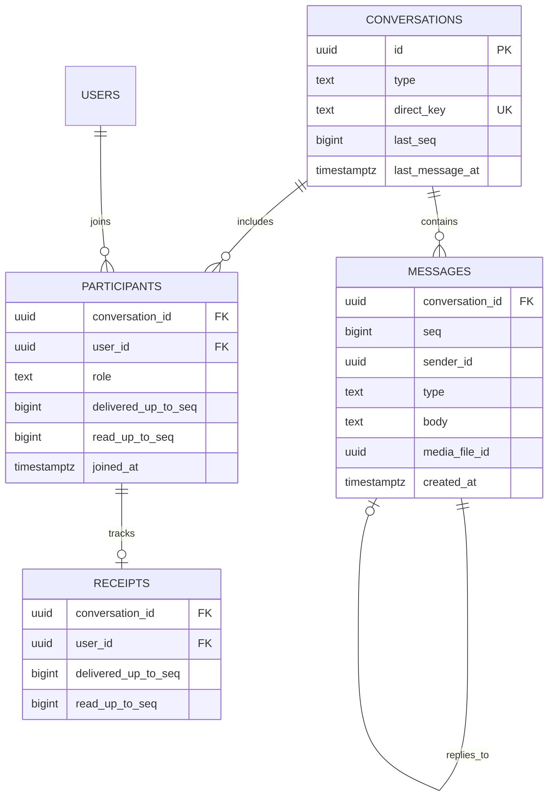
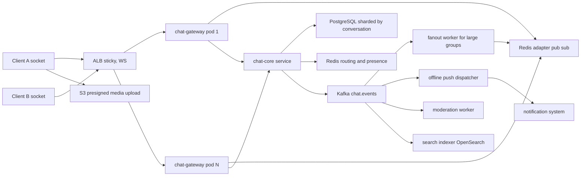
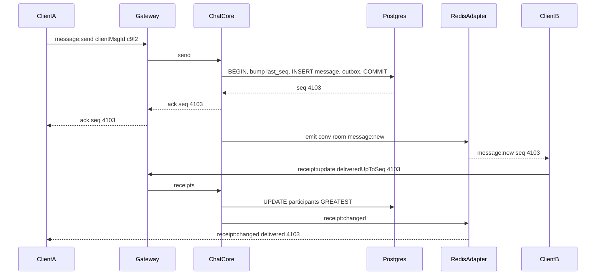
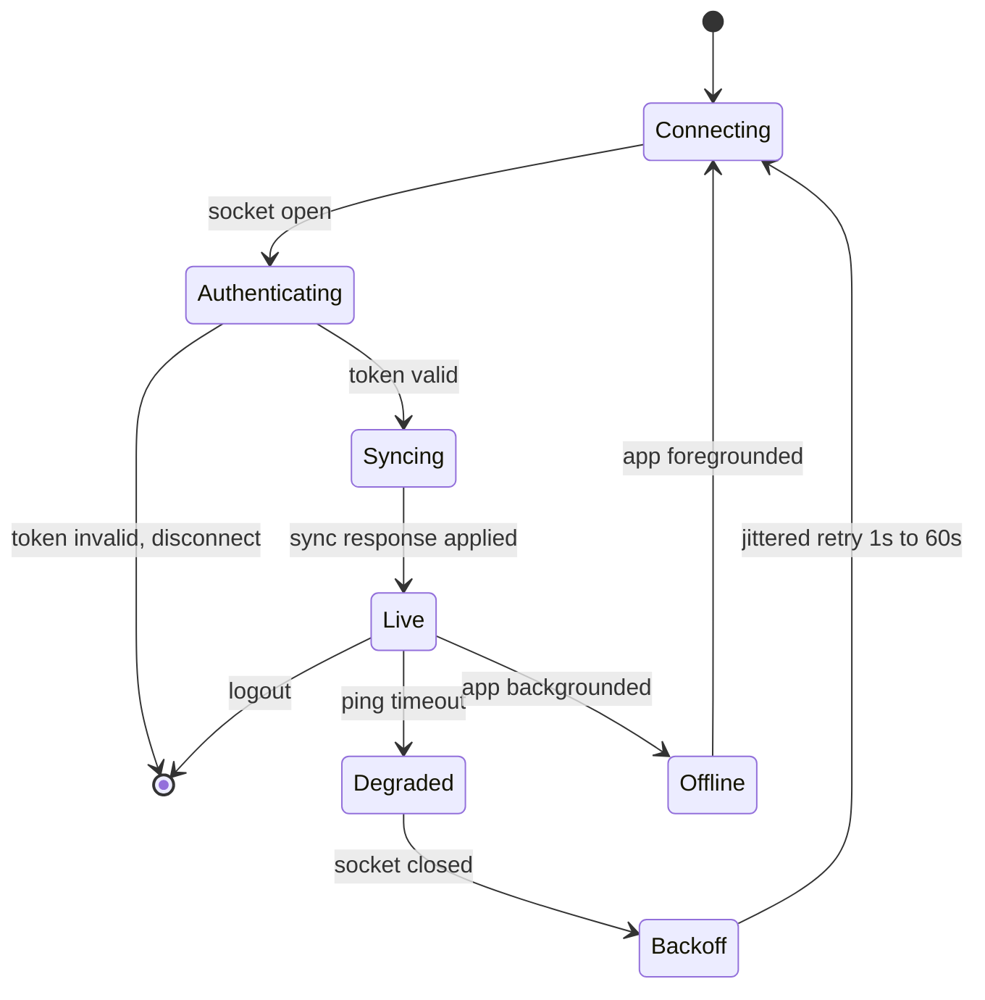
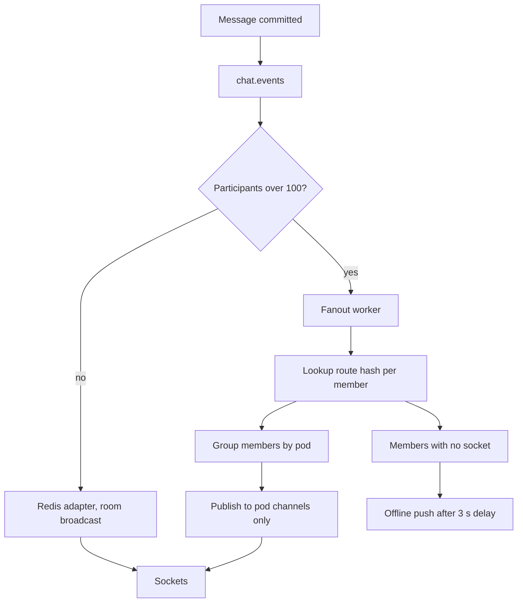

## 40.6 Chat System

### 40.6.1 Requirements

A chat system moves short messages between people in near real time and never loses one. That second half is what makes it hard. Anyone can push JSON over a WebSocket; the engineering is in what happens when the socket dies mid-send, when a phone goes into a tunnel for twenty minutes, when two participants send at the same millisecond and both clients must agree on the order, and when the same message must not appear twice after a reconnect.

The system here serves a marketplace: buyers talking to sellers about an order, support agents in a shared queue, and group conversations for a delivery team coordinating a route. So it needs one-to-one chat, group chat up to a few hundred members, media attachments, read receipts that people actually rely on ("she read it and did not reply"), and push notifications when the recipient is offline.

Imagine a post office that also has a telephone. When both people are on the phone, the message is spoken and heard immediately. When the other person is not there, the message goes into a numbered pigeonhole in order of arrival, and when they come back they collect everything from the last number they took. The numbers are the point: without them the recipient has no way to know whether they missed anything. That numbering is the per-conversation sequence number, and it is the backbone of the whole design. The WebSocket is the telephone - a fast optional path. The database is the pigeonhole, and it is the truth.

The single most important design statement follows from that analogy: **the WebSocket is an optimization, not the delivery mechanism.** Every message is written to PostgreSQL with a sequence number first, and only then pushed to whoever happens to be connected. Any client can reconstruct its entire state from the database using nothing but "give me everything after sequence N". A design that pushes first and persists later has a window where a message exists on one screen and nowhere else, and that window is where chat systems lose messages.

### 40.6.2 Functional requirements

1. One-to-one conversations, created implicitly from a pair of user ids so two people can never end up with two separate threads.
2. Group conversations up to 500 members, with join, leave, add and remove, and an admin role.
3. Send a text message and receive it in under 200 ms end to end when both parties are connected.
4. Total ordering of messages within a conversation, identical on every client.
5. Delivery states per recipient: `sent` (accepted by the server), `delivered` (reached the recipient's device), `read` (the recipient opened the conversation).
6. Presence (online, offline, last seen) with per-user privacy settings, and typing indicators.
7. Push notification to offline recipients, with the message preview subject to their notification preferences.
8. Media messages: images, video and files, uploaded directly to S3 and referenced by the message.
9. History pagination, both backwards (scroll up) and forwards (resync after being away).
10. Resynchronization after reconnect: the client sends its last acknowledged sequence per conversation and receives exactly the gap.
11. Edit and delete a message, with an edit history and a tombstone that propagates.
12. Search within a conversation, and a global unread count per user.
13. Moderation: reporting, keyword and image scanning, blocking a user, and an audit trail for law-enforcement requests.

### 40.6.3 Non-functional requirements

| Property | Target | Why |
|---|---|---|
| Send-to-receive latency | p95 under 200 ms, p99 under 500 ms, both connected | Below 200 ms feels instant; above 1 s people re-send |
| Message durability | Zero accepted-then-lost messages | A lost message is the one bug users never forgive |
| Ordering | Total order per conversation, monotonic sequence, no gaps | Clients render by sequence; a gap means a missing message |
| Duplicate rate | Zero visible duplicates | Enforced by a client-supplied idempotency key |
| Connection capacity | 20,000 concurrent sockets per pod | Sets the pod count and the memory budget |
| Reconnect storm tolerance | Full reconnect of 2M clients within 5 minutes without a cascade | An AZ failure does exactly this |
| Availability | 99.95 percent for send, 99.99 percent for read history | Reading old messages must survive a real-time outage |
| History retention | 24 months online, then archive | Legal and product requirement |

### 40.6.4 Constraints

- WebSockets are stateful and sticky. A pod holds its clients' sockets; a pod restart disconnects everyone on it. Kubernetes rolling deploys therefore cause reconnect storms unless drained slowly.
- ALB supports WebSockets with a configurable idle timeout (default 60 s), so the protocol needs application-level heartbeats every 25 to 30 seconds.
- Mobile operating systems kill background sockets aggressively. iOS gives an app a few seconds after backgrounding; from then on delivery must go through APNs.
- Node.js holds roughly 20,000 to 50,000 sockets per process depending on per-connection state; the binding constraint is memory, at about 30 to 60 KB per socket including TLS buffers.
- PostgreSQL sequence generation per conversation must not become a global bottleneck or a hot row.
- Existing platform: NestJS on EKS, Aurora PostgreSQL, ElastiCache Redis, MSK, S3, CloudFront, and the notification system from section 40.4 for push.

### 40.6.5 Capacity estimation

| Quantity | Assumption | Calculation | Result |
|---|---|---|---|
| Registered users | | given | 40,000,000 |
| Daily active chat users | 10 percent | 40M x 0.10 | 4,000,000 |
| Concurrent connections at peak | 50 percent of DAU online in the evening peak | 4M x 0.5 | 2,000,000 |
| Messages sent per active user per day | | 20 | 80,000,000 per day |
| Average send RPS | 80M / 86,400 | | 926 |
| Peak send RPS | 4x evening peak | 926 x 4 | 3,700 |
| Average recipients per message | 85 percent one-to-one (1 recipient), 15 percent groups averaging 12 | 0.85x1 + 0.15x12 | 2.65 |
| Fan-out events per second at peak | 3,700 x 2.65 | | 9,800 |
| Receipt events per second | 2 per delivered message (delivered plus read) on average | 9,800 x 1.6 | 15,700 |
| Typing events per second at peak | 0.4 per message, throttled client-side to 1 per 3 s | | 1,500 |
| Total WebSocket frames per second out | fan-out + receipts + typing + presence | | about 30,000 |
| Read/write ratio | History reads: 4M users x 12 conversation opens x 40 messages | 1.9B message-reads vs 80M writes | 24 to 1 |

Storage:

| Table | Bytes per row | Rows per year | Size per year |
|---|---|---|---|
| `messages` | 320 B (ids, seq, body, timestamps, no media bytes) | 80M x 365 = 29.2B | 9.3 TB |
| `receipts` | 90 B, one per recipient per state change, but stored as one row per participant with high-water marks | 4M active participants updated in place | 3 GB, effectively constant |
| `conversations` | 250 B | 200M lifetime | 50 GB |
| `participants` | 180 B, average 3 per conversation | 600M | 108 GB |
| Total year 1 | | | about 9.5 TB |

Nine terabytes a year in `messages` decides the storage plan. The table is range-partitioned by `created_at` monthly; partitions older than 24 months are detached, exported to S3 as Parquet, and dropped. Live footprint stays around 19 TB at steady state, which is beyond one PostgreSQL instance, so `messages` is sharded by `conversation_id` across 8 clusters from the start - a decision made at design time because re-sharding a live chat system is a six-month project.

Connections and memory:

| Quantity | Calculation | Result |
|---|---|---|
| Gateway pods for 2M sockets | 2M / 20,000 per pod | 100 pods, plus 30 percent headroom = 130 |
| Memory per gateway pod | 20,000 x 45 KB + heap | about 1.6 GB, so a 3 GB limit |
| Redis pub/sub fan-out | 30,000 frames/s across 130 pods | Each pod subscribes to its own channel; see the routing design |
| Redis presence memory | 2M online users x 120 B | 240 MB |
| Redis session routing table | 2M sockets x 90 B | 180 MB |
| PostgreSQL connections | 130 gateways x 4 + 40 API pods x 10 | 920, mandatory PgBouncer |
| Bandwidth out | 30,000 frames/s x 600 B | 18 MB per second, 47 TB per month |

### 40.6.6 API design

REST for everything that is not real time, WebSocket for the live path. Both exist for every operation, because a client that just reconnected needs REST to catch up and a client on a bad network must be able to send over HTTP.

| Method | Path | Request | Response | Status codes | Idempotency | Auth |
|---|---|---|---|---|---|---|
| POST | `/v1/conversations` | `{ type: "direct" \| "group", participantIds, title? }` | conversation | 201, 200 if direct already exists, 400, 403 | Yes, direct conversations are keyed by the sorted participant pair | Access token |
| GET | `/v1/conversations` | `?cursor=&limit=` | list ordered by `last_message_at DESC` with unread counts | 200 | Yes | Access token |
| GET | `/v1/conversations/{id}/messages` | `?beforeSeq=&afterSeq=&limit=` | `{ messages, hasMore }` | 200, 403, 404 | Yes | Participant |
| POST | `/v1/conversations/{id}/messages` | `{ clientMsgId, type, body?, mediaFileId?, replyToSeq? }` | `{ messageId, seq, createdAt }` | 201, 200 on duplicate `clientMsgId`, 403, 413, 429 | Yes, by `(conversation_id, sender_id, client_msg_id)` | Participant |
| PATCH | `/v1/conversations/{id}/messages/{seq}` | `{ body }` | message | 200, 403, 409 too old | Yes | Sender |
| DELETE | `/v1/conversations/{id}/messages/{seq}` | `?forEveryone=true` | | 204, 403 | Yes | Sender or admin |
| POST | `/v1/conversations/{id}/receipts` | `{ deliveredUpToSeq?, readUpToSeq? }` | `{ deliveredUpToSeq, readUpToSeq }` | 200, 403 | Yes, high-water marks only move forward | Participant |
| POST | `/v1/conversations/{id}/participants` | `{ userIds }` | | 200, 403, 409 | Yes | Admin |
| DELETE | `/v1/conversations/{id}/participants/{userId}` | | 204 | 204, 403 | Yes | Admin or self |
| POST | `/v1/conversations/{id}/sync` | `{ lastSeq }` | `{ messages, receipts, tombstones, currentSeq }` | 200, 403 | Yes | Participant |
| POST | `/v1/blocks` | `{ userId }` | | 201 | Yes | Access token |
| POST | `/v1/reports` | `{ conversationId, messageSeq, reason }` | | 201 | Yes | Participant |

WebSocket events, namespace `/chat`, authenticated with the access token in the connection handshake:

| Direction | Event | Payload | Notes |
|---|---|---|---|
| Client to server | `message:send` | `{ conversationId, clientMsgId, type, body, mediaFileId? }` | Acknowledged with `{ seq, messageId, createdAt }` |
| Client to server | `receipt:update` | `{ conversationId, deliveredUpToSeq, readUpToSeq }` | Throttled to 1 per second per conversation |
| Client to server | `typing:start` / `typing:stop` | `{ conversationId }` | Never persisted |
| Client to server | `sync:request` | `{ cursors: [{ conversationId, lastSeq }] }` | Sent immediately after connect |
| Server to client | `message:new` | full message with `seq` | |
| Server to client | `message:updated` / `message:deleted` | `{ conversationId, seq, ... }` | |
| Server to client | `receipt:changed` | `{ conversationId, userId, deliveredUpToSeq, readUpToSeq }` | |
| Server to client | `presence:changed` | `{ userId, status, lastSeenAt? }` | Only for users you share a conversation with |
| Server to client | `sync:response` | `{ conversationId, messages, currentSeq }` | May be paginated for long gaps |

The `clientMsgId` is a UUID the client generates before sending and keeps until acknowledged. It is what makes the send path idempotent: a client that times out and retries sends the same `clientMsgId`, and the server returns the original message instead of creating a second one. Without it, every flaky network produces duplicate messages, and users notice immediately.

### 40.6.7 Data model



```sql
CREATE TABLE conversations (
  id              uuid PRIMARY KEY DEFAULT gen_random_uuid(),
  type            text NOT NULL CHECK (type IN ('direct','group')),
  -- For direct chats: the two user ids sorted and joined. A unique index on this
  -- is what stops two people from ever creating two separate threads with each other.
  direct_key      text,
  title           text,
  created_by      uuid NOT NULL,
  last_seq        bigint NOT NULL DEFAULT 0,
  last_message_at timestamptz,
  created_at      timestamptz NOT NULL DEFAULT now()
);
CREATE UNIQUE INDEX conversations_direct_uidx ON conversations (direct_key) WHERE direct_key IS NOT NULL;

CREATE TABLE participants (
  conversation_id     uuid NOT NULL REFERENCES conversations(id) ON DELETE CASCADE,
  user_id             uuid NOT NULL,
  role                text NOT NULL DEFAULT 'member' CHECK (role IN ('member','admin')),
  joined_at_seq       bigint NOT NULL DEFAULT 0,     -- history before this is hidden from the member
  delivered_up_to_seq bigint NOT NULL DEFAULT 0,
  read_up_to_seq      bigint NOT NULL DEFAULT 0,
  muted_until         timestamptz,
  left_at             timestamptz,
  PRIMARY KEY (conversation_id, user_id)             -- serves the authorization check on every operation
);
-- Serves the conversation list: "all conversations for this user, newest first".
CREATE INDEX participants_user_idx ON participants (user_id) WHERE left_at IS NULL;

CREATE TABLE messages (
  conversation_id uuid   NOT NULL,
  seq             bigint NOT NULL,                   -- per-conversation, monotonic, gapless
  id              uuid   NOT NULL DEFAULT gen_random_uuid(),
  sender_id       uuid   NOT NULL,
  client_msg_id   uuid   NOT NULL,
  type            text   NOT NULL CHECK (type IN ('text','image','video','file','system')),
  body            text,
  media_file_id   uuid,
  reply_to_seq    bigint,
  edited_at       timestamptz,
  deleted_at      timestamptz,
  created_at      timestamptz NOT NULL DEFAULT now(),
  PRIMARY KEY (conversation_id, seq, created_at)
) PARTITION BY RANGE (created_at);

CREATE TABLE messages_2026_09 PARTITION OF messages
  FOR VALUES FROM ('2026-09-01') TO ('2026-10-01');

-- The idempotency contract for sends. A client retry cannot create a second message.
CREATE UNIQUE INDEX messages_client_uidx
  ON messages (conversation_id, sender_id, client_msg_id, created_at);
-- Serves keyset history pagination: WHERE conversation_id=$1 AND seq < $2 ORDER BY seq DESC.
CREATE INDEX messages_conv_seq_idx ON messages (conversation_id, seq DESC);
-- Serves moderation and law-enforcement lookups by sender.
CREATE INDEX messages_sender_idx ON messages (sender_id, created_at DESC);

CREATE TABLE message_edits (
  conversation_id uuid NOT NULL,
  seq             bigint NOT NULL,
  version         integer NOT NULL,
  body            text NOT NULL,
  edited_at       timestamptz NOT NULL DEFAULT now(),
  PRIMARY KEY (conversation_id, seq, version)
);
```

Two schema decisions carry most of the weight.

**The sequence number lives on the conversation row, not in a global sequence.** `conversations.last_seq` is incremented inside the same transaction that inserts the message, using `UPDATE conversations SET last_seq = last_seq + 1 ... RETURNING last_seq`. That row update takes an exclusive lock on one row, which serializes concurrent sends *to the same conversation* - exactly the serialization you want, since that is what produces a total order. Different conversations do not contend at all. A PostgreSQL `SEQUENCE` would be wrong here: sequences are not transactional, so a rolled-back transaction leaves a permanent gap, and a gap is indistinguishable from a lost message to a syncing client.

**Receipts are high-water marks, not rows per message.** Storing "user X read message Y" for every message and every participant would be 29 billion rows a year for the receipts alone. Instead each participant carries `delivered_up_to_seq` and `read_up_to_seq`, which only ever move forward. "Has Alice read message 4,102?" becomes `alice.read_up_to_seq >= 4102`. This is both far cheaper and semantically correct: reading a conversation means reading everything up to a point, not a random subset.

### 40.6.8 High-level architecture



The gateway is deliberately thin: it terminates WebSockets, authenticates, validates frames, and calls `chat-core`. It holds no business logic and no database connections beyond a health check. That separation means a gateway deploy - which disconnects everyone on the pod - happens only for socket-layer changes, while business logic ships through `chat-core` with a normal rolling deploy that nobody notices.

### 40.6.9 Component design

```text
src/
  gateway/
    chat.gateway.ts              -- @WebSocketGateway with the Redis adapter
    ws-auth.guard.ts
    ws-throttle.guard.ts
    connection-registry.service.ts
  core/
    conversations.controller.ts
    messages.controller.ts
    message-send.service.ts      -- the transaction that assigns seq
    sync.service.ts
    receipts.service.ts
    presence.service.ts
  workers/
    fanout.worker.ts
    offline-push.worker.ts
    moderation.worker.ts
    search-indexer.worker.ts
  chat.module.ts
```

The gateway uses the official Socket.IO Redis adapter so that a message published on one pod reaches sockets on every other pod. Without it, two users on different pods cannot see each other.

```ts
// main.ts
import { IoAdapter } from '@nestjs/platform-socket.io';
import { createAdapter } from '@socket.io/redis-adapter';
import { createClient } from 'redis';

export class RedisIoAdapter extends IoAdapter {
  private adapterConstructor: ReturnType<typeof createAdapter>;

  async connectToRedis(url: string): Promise<void> {
    const pub = createClient({ url });
    const sub = pub.duplicate();
    await Promise.all([pub.connect(), sub.connect()]);
    this.adapterConstructor = createAdapter(pub, sub);
  }

  createIOServer(port: number, options?: unknown): unknown {
    const server = super.createIOServer(port, {
      ...(options as object),
      pingInterval: 25000,        // below the ALB 60 s idle timeout
      pingTimeout: 20000,
      maxHttpBufferSize: 1e6,     // 1 MB frame cap; media never travels over the socket
      transports: ['websocket'],  // no long-polling fallback: it doubles pod count
    });
    server.adapter(this.adapterConstructor);
    return server;
  }
}
```

The gateway itself joins each socket to a room per conversation, which is how fan-out to a group becomes one publish.

```ts
// gateway/chat.gateway.ts (excerpt)
@WebSocketGateway({ namespace: '/chat' })
export class ChatGateway implements OnGatewayConnection, OnGatewayDisconnect {
  @WebSocketServer() server: Server;

  async handleConnection(socket: Socket) {
    const user = await this.wsAuth.verify(socket.handshake.auth?.token);
    if (!user) return socket.disconnect(true);
    socket.data.userId = user.id;

    socket.join(`user:${user.id}`);                       // direct addressing for receipts and presence
    const convIds = await this.conversations.idsForUser(user.id);   // cached in Redis, 5 min TTL
    for (const id of convIds) socket.join(`conv:${id}`);            // room per conversation

    await this.presence.online(user.id, socket.id);
    await this.registry.register(user.id, socket.id, process.env.POD_NAME);
    // The client will now send sync:request with its per-conversation cursors.
  }

  @SubscribeMessage('message:send')
  @UseGuards(WsThrottleGuard)                             // 20 messages per 10 s per socket
  async onSend(@ConnectedSocket() socket: Socket, @MessageBody() dto: SendMessageDto) {
    const result = await this.messageSend.send(socket.data.userId, dto);   // persists, then returns seq
    // Ack goes to the sender first so their optimiztic bubble resolves fast.
    return { ok: true, seq: result.seq, messageId: result.id, createdAt: result.createdAt };
  }

  async handleDisconnect(socket: Socket) {
    await this.registry.unregister(socket.data.userId, socket.id);
    await this.presence.maybeOffline(socket.data.userId);  // only if this was the last socket
  }
}
```

The send path is where the consistency question is settled. The order is: persist inside a transaction that assigns the sequence number, then publish. Never the reverse.

```ts
// core/message-send.service.ts
async send(senderId: string, dto: SendMessageDto): Promise<SentMessage> {
  await this.acl.assertParticipant(dto.conversationId, senderId);   // cached membership check

  const row = await this.ds.transaction(async (m) => {
    // Idempotent replay: the client retried after a timeout. Return the original.
    const [existing] = await m.query(
      `SELECT id, seq, created_at FROM messages
        WHERE conversation_id=$1 AND sender_id=$2 AND client_msg_id=$3
        ORDER BY created_at DESC LIMIT 1`,
      [dto.conversationId, senderId, dto.clientMsgId]);
    if (existing) return { ...existing, replayed: true };

    // One row lock per conversation. This is what creates the total order, and it is
    // also the only contention point: two sends to the SAME conversation serialize here.
    const [conv] = await m.query(
      `UPDATE conversations
          SET last_seq = last_seq + 1, last_message_at = now()
        WHERE id = $1
      RETURNING last_seq`, [dto.conversationId]);

    const [msg] = await m.query(
      `INSERT INTO messages (conversation_id, seq, sender_id, client_msg_id, type, body, media_file_id, reply_to_seq)
       VALUES ($1,$2,$3,$4,$5,$6,$7,$8)
       RETURNING id, seq, created_at`,
      [dto.conversationId, conv.last_seq, senderId, dto.clientMsgId, dto.type,
       dto.body ?? null, dto.mediaFileId ?? null, dto.replyToSeq ?? null]);

    // Sender has trivially read their own message.
    await m.query(
      `UPDATE participants SET read_up_to_seq = GREATEST(read_up_to_seq, $3), delivered_up_to_seq = GREATEST(delivered_up_to_seq, $3)
        WHERE conversation_id=$1 AND user_id=$2`, [dto.conversationId, senderId, msg.seq]);

    await m.query(
      `INSERT INTO outbox (aggregate_type, aggregate_id, topic, key, payload)
       VALUES ('message',$1,'chat.events',$2,$3)`,
      [msg.id, dto.conversationId, JSON.stringify({ kind: 'message.created', conversationId: dto.conversationId, seq: msg.seq })]);

    return { ...msg, replayed: false };
  });

  // COMMITTED. Only now does anyone else learn about it.
  if (!row.replayed) {
    this.server.to(`conv:${dto.conversationId}`).emit('message:new', await this.hydrate(row));
  }
  return row;
}
```

That commit boundary is the answer to the consistency gap. Publishing before commit creates a real failure: the recipient's phone shows the message, the transaction then rolls back on a serialization failure or a failover, and the message is gone from history forever. Publishing after commit creates a much smaller and recoverable failure: the commit succeeds but the emit fails (pod dies in between), so the message exists in the database and nobody was pushed. The recipient's next heartbeat-driven sync, or the offline-push worker consuming the outbox, delivers it seconds later. One failure mode loses data permanently; the other delays it. Always choose the delay.

Resync after reconnect is the mechanism that makes that safe, and it is refreshingly simple:

```ts
// core/sync.service.ts
async sync(userId: string, cursors: { conversationId: string; lastSeq: number }[]) {
  const out = [];
  for (const c of cursors) {
    const p = await this.repo.participant(c.conversationId, userId);
    if (!p) continue;                                     // removed from the group while away
    const from = Math.max(c.lastSeq, p.joinedAtSeq);      // never leak history from before they joined

    const messages = await this.repo.query(
      `SELECT * FROM messages
        WHERE conversation_id=$1 AND seq > $2
        ORDER BY seq ASC LIMIT 500`, [c.conversationId, from]);

    out.push({
      conversationId: c.conversationId,
      messages,
      currentSeq: p.conversationLastSeq,
      hasMore: messages.length === 500,                   // client pages again from the last seq it got
      receipts: await this.repo.receiptsFor(c.conversationId),
      tombstones: await this.repo.deletedSince(c.conversationId, from),
    });
  }
  return out;
}
```

The client keeps `lastSeq` per conversation in local storage and advances it only after persisting the messages locally. On reconnect it asks for everything after that number. Because sequences are gapless and monotonic, "what did I miss" has an exact answer, and duplicates are impossible because the client already has everything at or below `lastSeq`.



And the reconnect path, which is the one that actually matters in production:



Presence and typing are deliberately not persisted. Presence is a Redis key `presence:{userId}` with a 45-second TTL refreshed on every heartbeat; if the pod dies, the key expires and the user goes offline without any cleanup code running. Typing indicators are a pure pub/sub event with a 5-second client-side auto-expiry, published to the conversation room and never written anywhere. The rule is: if losing it costs nothing, do not pay for durability.

Fan-out has two modes. For conversations under 100 participants, one `server.to('conv:id').emit()` through the Redis adapter is enough - the adapter publishes once and every pod with a member in that room delivers locally. For larger groups, and for broadcast-style conversations (a 500-person announcement channel), the adapter's approach makes every pod wake up for every message. Above that threshold the fan-out worker consumes `chat.events`, looks up which pods hold which members from the routing registry, and publishes to only those pods' channels. This is the classic write fan-out versus read fan-out choice, and chat lands on write fan-out for small rooms and targeted delivery for large ones.

Media never travels over the WebSocket. The client presigns an upload with the file service from section 40.5, uploads to S3 directly, and sends a message referencing `mediaFileId`. The message is only rendered as an image once that file reaches `PROCESSED`; until then the client shows an upload placeholder driven by its own local state, and other participants see a "photo" placeholder that resolves when the `files.processed` event triggers a `message:updated`.

### 40.6.10 Database design

`messages` is partitioned monthly and sharded by `conversation_id` across 8 clusters. The shard key is right because every query in the system is scoped to a conversation - history, sync, search within a thread - so no query ever needs to cross shards. The conversation list is the exception, and it is served from a separate unsharded `participants` table plus a Redis-cached per-user list.

The history query is keyset, never offset:

```sql
SELECT seq, id, sender_id, type, body, media_file_id, reply_to_seq, edited_at, deleted_at, created_at
  FROM messages
 WHERE conversation_id = $1 AND seq < $2 AND seq > $3   -- $3 is participants.joined_at_seq
 ORDER BY seq DESC
 LIMIT 51;
```

```text
Limit  (cost=0.57..64.21 rows=51 width=186) (actual time=0.048..0.211 rows=51 loops=1)
  Buffers: shared hit=38 read=2
  ->  Index Scan Backward using messages_conv_seq_idx on messages_2026_09
        Index Cond: ((conversation_id = $1) AND (seq < $2) AND (seq > $3))
Planning Time: 0.243 ms
Execution Time: 0.256 ms
```

Scrolling a two-year-old conversation crosses partitions; PostgreSQL prunes to the partitions whose `created_at` range can contain the requested sequences only if the query also constrains `created_at`, so the client's cursor carries both `seq` and the `created_at` of the message it last saw, and the query adds `AND created_at <= $4`. Without that, a deep scroll scans every partition's index. This is the single most common partitioning mistake: partition by time, query by something else, and lose pruning.

The hot row is `conversations.last_seq`. Two people typing rapidly at each other produce maybe 2 updates per second to that row, which is nothing. A 500-person channel during an incident might produce 50 per second, which is still fine (a single-row update is around 0.2 ms, so the theoretical ceiling is a few thousand per second before lock waits dominate). Only a broadcast channel with thousands of writers would need a different approach, and there the answer is to move sequence assignment to a Redis `INCR` per conversation with periodic reconciliation - accepting gaps on crash, which is acceptable for a broadcast feed but not for a private conversation.

Receipts update with `GREATEST` so they are idempotent and order-independent:

```sql
UPDATE participants
   SET delivered_up_to_seq = GREATEST(delivered_up_to_seq, $3),
       read_up_to_seq      = GREATEST(read_up_to_seq, $4)
 WHERE conversation_id = $1 AND user_id = $2;
```

An out-of-order receipt from a client that reconnected cannot move the marker backwards, which means the "read" tick never un-reads. That property is worth more than it looks; users treat a receipt regressing as the app lying to them.

### 40.6.11 Caching

| What | Where | TTL | Invalidation | Why |
|---|---|---|---|---|
| Participant membership | Redis set `conv:{id}:members` | 10 min | Deleted on add/remove/leave | Authorization runs on every frame; a database read per frame would be 30,000 reads per second |
| User's conversation ids | Redis `user:{id}:convs` | 5 min | Deleted on join/leave | Needed on every connect to join rooms |
| Presence | Redis `presence:{userId}` | 45 s, refreshed by heartbeat | Expiry | Self-cleaning when a pod dies |
| Socket routing | Redis hash `route:{userId}` -> `{socketId: podName}` | 60 s | Removed on disconnect | Targeted fan-out for large groups |
| Recent messages | Redis list `conv:{id}:recent`, last 50 | 1 h | Trimmed on write | Opening a conversation is the most common read; serves it without touching PostgreSQL |
| Unread counts | Redis hash per user | 10 min | Incremented on fan-out, recomputed on read | The badge is polled constantly |
| Typing state | Redis, 5 s TTL | 5 s | Expiry | Never persisted |

The recent-messages cache is worth the complexity: 24 reads per write means the conversation-open path dominates database load, and the last 50 messages satisfy the vast majority of opens. It is written on the same code path as the message insert (after commit) and trimmed with `LTRIM`, and a cache miss falls through to PostgreSQL, so a Redis failure costs latency and not correctness.

### 40.6.12 Messaging

| Topic | Partitions | Key | Producer | Consumer group | Purpose |
|---|---|---|---|---|---|
| `chat.events` | 48 | `conversation_id` | Outbox relay | `fanout`, `offline-push`, `moderation`, `search-indexer` | One event stream, four independent reactions |
| `chat.receipts` | 24 | `conversation_id` | Chat core | `analytics` | Sampled; receipts are already applied synchronously |
| `chat.presence` | 12 | `user_id` | Gateway | `presence-broadcaster` | Batched presence changes to interested subscribers |
| `chat.moderation` | 6 | `message_id` | Moderation worker | `trust-and-safety` | Flags for human review |
| `chat.events.dlq` | 3 | original | Any consumer after 5 attempts | manual | |

Keying by `conversation_id` preserves per-conversation ordering through Kafka, which matters for the search indexer (an edit must not be indexed before the original) and for the push dispatcher (a delete must not be pushed after the message it deletes).

The offline-push worker is the bridge to section 40.4. For each recipient it checks the routing registry: if the user has a live socket, do nothing, because they already got the message. If not, and they are not muted, and the conversation is not in quiet hours, publish a notification request with `eventId = message_id + ':' + user_id`, which lets the notification system's `(user_id, event_id, channel)` constraint absorb the duplicate that happens when a rebalance replays the partition. There is a deliberate 3-second delay before sending push, because a user who is reconnecting will usually be back within that window, and a push notification for a message you are already reading is the most annoying thing chat apps do.

### 40.6.13 Scaling

**At 1x (2M concurrent sockets, 3,700 sends per second).** 130 gateway pods, 30 `chat-core` pods, 8 PostgreSQL clusters for `messages`, one for conversations and participants, a 6-shard Redis cluster, MSK with 6 brokers. The Redis adapter handles fan-out for every conversation because none are large enough to matter.

**At 10x (20M concurrent sockets, 37,000 sends per second).** Three things change.

The Redis pub/sub adapter becomes the bottleneck first, and it fails in a specific way: with the default adapter, every message is published on a channel that *every* pod subscribes to, so each pod processes 100 percent of all traffic and discards what it does not need. At 1,300 pods and 100,000 events per second, each pod is parsing 100,000 messages per second to deliver a handful. The fix is sharded pub/sub - either the Socket.IO sharded adapter using Redis 7's `SSUBSCRIBE`, or the targeted routing already described, where the fan-out worker looks up which pods hold members and publishes only to `pod:{name}` channels. This is the single most important scaling change in a chat system and it should be designed in from the start, not retrofitted at 3 a.m.

The second change is connection distribution. An ALB spreads new connections round-robin, but connections are long-lived, so after a rolling deploy the newest pods are empty and the oldest are full. Gateways therefore self-balance: a pod above 90 percent of its socket budget starts closing idle sockets with a `reconnect` hint, and the client reconnects to a less loaded pod.

The third is PostgreSQL write volume: 37,000 inserts per second across 8 shards is 4,600 per shard, which a well-tuned Aurora writer handles but with no headroom. Shards go to 32, and the shard map lives in a directory service so that adding shards moves conversations rather than rewriting application code.



**At 100x (200M concurrent sockets).** The system becomes regional. Users connect to their nearest region; a conversation is homed to one region (chosen at creation, usually by the creator's region) and cross-region participants connect through a relay that forwards their frames to the home region. Messages are written once in the home region and replicated read-only elsewhere for history. This is the design WhatsApp and Slack converge on, and it exists because the alternative - a globally consistent sequence number - would require cross-region consensus on every message, adding 150 ms to every send.

At this scale, storage also stops being PostgreSQL. `messages` moves to a wide-column store keyed by `(conversation_id, seq)` - Cassandra or ScyllaDB - which fits the access pattern exactly and scales horizontally without a directory service. The sequence number then needs a different home, typically a per-conversation counter in a consensus-backed store or a hybrid logical clock. The tradeoff you accept is losing transactional coupling between the sequence bump and the insert, which is why this migration is done late and reluctantly.

### 40.6.14 Security

- **Authenticate the socket, then keep checking.** The handshake verifies the access token, but a socket lives for hours and a token expires in 15 minutes. The gateway re-validates the token on a timer and disconnects when it expires, forcing a reconnect with a refreshed token. Otherwise a revoked session keeps receiving messages indefinitely.
- **Authorize every frame, not just the connection.** A client can emit `message:send` with any `conversationId`. Membership is checked on every send, receipt and sync, from the Redis membership cache with a PostgreSQL fallback. This is the most commonly missed check in WebSocket code, because the connection "feels" authenticated.
- **Room membership follows the participant table.** When a user is removed from a group, the server must call `socket.leave('conv:id')` on their live sockets, not just delete the database row. The removal handler publishes an event that every gateway acts on. Otherwise the removed member keeps receiving messages until they reconnect.
- **History boundaries.** `joined_at_seq` prevents a newly added member from reading everything said before they joined, which is a real privacy expectation in group chats.
- **Rate limiting per socket.** 20 messages per 10 seconds, 1 typing event per 3 seconds, 1 receipt update per second per conversation. Without this, a script floods a group and every recipient's client falls over.
- **Message content.** Bodies are stored and returned as plain text and escaped at render time by the client; the server never renders HTML. Link previews are fetched server-side by an isolated worker with an egress deny list, never by the recipient's client, so that a malicious link cannot harvest recipients' IP addresses.
- **Blocking.** A block is enforced on send: a blocked user's message to you is accepted (so they cannot detect the block by error code) and silently dropped from your fan-out and your history view. Detecting a block is itself a safety issue for the person who blocked.
- **Media.** Attachments go through the upload pipeline of section 40.5, including malware scanning, so a chat message can never be a delivery vector.
- **Transport.** WSS only, with HSTS on the origin. Payloads are encrypted in transit and at rest (KMS on the database and S3).

On **end-to-end encryption**: the design above is transport-encrypted, not end-to-end encrypted. The server can read every message, which is what makes server-side search, moderation, link previews and web clients with no local storage possible. True E2EE (the Signal protocol - X3DH for key agreement, Double Ratchet for forward secrecy) changes the architecture fundamentally rather than adding a layer. The server becomes a blind relay of ciphertext plus a key-distribution service; `messages.body` becomes an opaque blob; search must move entirely to the client; moderation can only act on reported messages that the reporter voluntarily decrypts; group messaging needs a sender-keys or MLS scheme because encrypting to 500 devices individually does not scale; and multi-device support becomes a genuinely hard problem, since a new device cannot decrypt history it has no keys for. The honest position for a marketplace chat is: transport encryption plus strict access controls and audited server access, because moderation and support are product requirements that E2EE forecloses. If regulation or product positioning demands E2EE, design it in from the first line of code; it cannot be added later.

### 40.6.15 Failure scenarios

| Failure | Detection | Impact | Mitigation | What the user sees |
|---|---|---|---|---|
| Gateway pod crashes with 20,000 sockets | Pod restart, connection-count drop | Those users disconnect | Client reconnects with jittered backoff to another pod, sends `sync:request` with `lastSeq`, receives the gap | A one-second reconnect spinner |
| Client sends, network drops before the ack | No ack at the client | Client does not know whether it was persisted | Client retries with the same `clientMsgId`; the unique index returns the original message and its `seq` | One message, correct order |
| Commit succeeds but the emit fails | Emit error counter, message present with no fan-out | Recipient not pushed | Recipient's next sync (heartbeat-driven, every 25 s) picks it up; the offline-push worker consuming the outbox also delivers | Message arrives up to 25 s late |
| Emit succeeds but the transaction rolls back | Would be a ghost message | Message on screen, absent from history | Prevented by construction: emit happens strictly after commit | Never happens |
| Two sends to one conversation at the same instant | Lock wait metric | Would be duplicate sequence numbers | The `UPDATE ... RETURNING last_seq` row lock serializes them; the second waits about 0.2 ms | Nothing |
| Redis adapter cluster fails | Adapter error rate, cross-pod delivery stops | Users on different pods stop seeing each other live | Fall back to poll-based sync every 5 s (a degraded mode flag); history and send still work because they are PostgreSQL paths | Messages feel slow, nothing is lost |
| Reconnect storm after an AZ loss | Connection rate spike, gateway CPU | 600,000 clients reconnect at once; sync queries stampede PostgreSQL | Jittered client backoff (1 to 60 s), a connection-rate limiter at the gateway that returns a `retry-after` hint, and sync results served largely from the recent-messages cache | Reconnect takes up to a minute |
| A user's `lastSeq` is ahead of the server's | Sync anomaly counter | Client has messages the server does not - usually after a shard restore | Server returns `currentSeq`; the client truncates local state above it and re-fetches | A brief flicker of history |
| Message shard failover, 40 s | Write errors on one shard | Sends to conversations on that shard fail | Client shows "sending" and retries with the same `clientMsgId`; other shards unaffected | Some conversations pause |
| Duplicate Kafka delivery of `message.created` | Duplicate-push counter | Would be a duplicate push notification | `eventId = messageId:userId` and the notification system's unique constraint | One push |
| Offline push races with reconnect | Push-after-read counter | User gets a notification for a message they are reading | 3-second delay before push, and the worker re-checks the routing registry immediately before sending | Usually nothing |
| Group with 500 members, one member spams | Per-socket throttle rejections | 500 x N frames | Throttle guard rejects at the socket; repeated violations mute the sender for 60 s and alert moderation | Spam stops |
| Clock skew between pods | Ordering complaints | `created_at` disagrees with `seq` order | Ordering is by `seq`, never by timestamp; timestamps come from PostgreSQL `now()` | Nothing |
| Media referenced by a message is deleted or infected | Rendition 404s, `INFECTED` status | Broken image in a thread | The message renders as "attachment unavailable"; infected media triggers a moderation event and the message is tombstoned | A placeholder |
| Search index lags behind messages | Indexer lag metric | Recent messages not searchable | Search falls back to a PostgreSQL `LIKE` scan over the last 500 messages of the conversation for recency | Search feels complete |

### 40.6.16 Observability

Metrics:

1. `chat_active_connections` per pod and total, plus `chat_connection_rate` - the reconnect-storm signal.
2. `chat_message_send_duration_seconds` broken into `acl`, `transaction`, `emit`. When p95 rises, this histogram says immediately whether it is the row lock or the adapter.
3. `chat_end_to_end_latency_seconds`, measured client-side and reported back: the time from the sender's tap to the recipient's render. This is the only latency number that describes the product.
4. `chat_seq_gap_detected_total` - clients report when a received `seq` is more than one ahead of their last. Any non-zero rate is a fan-out bug.
5. `chat_sync_requests_total` and `chat_sync_gap_messages` histogram. A rising gap size means clients are disconnecting more than you think.
6. `chat_adapter_publish_duration_seconds` and Redis pub/sub throughput per shard.
7. `chat_conversation_lock_wait_seconds` on the `last_seq` update - the early warning for hot conversations.
8. `chat_offline_push_sent_total` and `chat_push_after_read_total` (the annoyance metric).
9. `kafka_consumergroup_lag` for fan-out, push, moderation and indexer.
10. `chat_ws_frames_rejected_total` by reason (throttle, unauthorized, malformed).

Traces: a trace starts at `message:send`, spans the ACL check, the transaction, the outbox write and the emit, and is linked from the offline-push worker's span. Support engineers can paste a message id and see exactly where it went and why one recipient did not get it. Logs: one line per send with `conversation_id`, `seq`, `sender_id`, `latency_ms`, `recipients_online`, `recipients_pushed` - and never the message body, which is both a privacy requirement and a way to keep the log volume survivable at 3,700 sends per second.

### 40.6.17 Deployment

| Workload | Kind | Replicas | Notes |
|---|---|---|---|
| `chat-gateway` | Deployment | 130, HPA on connection count | `terminationGracePeriodSeconds: 300`, `maxUnavailable: 1`, PodDisruptionBudget minAvailable 120 |
| `chat-core` | Deployment + HPA | 30 to 80 | Stateless, normal rolling deploy |
| `fanout-worker` | Deployment + KEDA | 6 to 40 | Scales on `chat.events` lag |
| `offline-push` | Deployment | 8 | Calls the notification system |
| `moderation-worker` | Deployment | 4 | Text classifier plus image hash matching |
| `search-indexer` | Deployment | 6 | Writes to OpenSearch |
| `partition-maintenance` | CronJob nightly | 1 | Creates and archives message partitions per shard |

Gateway deploys need care that ordinary services do not. A pod that terminates immediately disconnects 20,000 users at once. Instead, on `SIGTERM` the pod stops accepting new connections, then closes existing sockets in batches of 200 per second with a `reconnect` hint, spreading the reconnection over 100 seconds and letting clients land on healthy pods. The `preStop` hook and the 300-second grace period exist for exactly this. Deploys are scheduled outside peak hours regardless, and the whole fleet rolls over about 40 minutes.

Testing: unit tests for sequence assignment under concurrency (200 parallel sends to one conversation must produce sequences 1 through 200 with no gaps and no duplicates - this is the property the whole design rests on); an integration test that kills the gateway mid-conversation and asserts sync returns exactly the missing messages; a soak test holding 100,000 sockets for 24 hours watching for memory growth; and a reconnect-storm test that drops all connections and measures recovery time and database load.

### 40.6.18 Cost considerations

| Item | Sizing | Monthly (USD, approximate) |
|---|---|---|
| EKS gateway pods | 130 pods x 1 vCPU / 3 GB, mostly memory-bound | 4,200 |
| EKS core and workers | About 60 pods | 2,000 |
| Aurora PostgreSQL | 8 message shards (db.r6g.2xlarge + reader) plus 1 metadata cluster | 21,000 |
| Aurora storage | 19 TB at 0.10 per GB-month | 1,950 |
| ElastiCache Redis | 6 shards cache.r6g.xlarge with replicas, Multi-AZ | 2,900 |
| MSK | 6 x kafka.m5.large, 4 TB | 1,700 |
| ALB | 2M long-lived connections, LCU-driven | 900 |
| Data transfer out | 47 TB per month | 3,800 |
| S3 plus CloudFront for media | Shared with the file system | 3,000 |
| OpenSearch for search | 6 data nodes | 2,400 |
| Total | | about 43,850 |

Database is half the bill, and the driver is 9 TB of messages a year that almost nobody reads after a week. The highest-leverage cost work is tiering: keep 90 days in PostgreSQL, move older messages to S3 in Parquet with a small index, and serve deep history from there with a 200 ms latency budget that nobody scrolling a two-year-old conversation will notice. That single change cuts the shard count roughly in half. The second-largest lever is the gateway memory footprint: dropping per-socket state from 45 KB to 30 KB (smaller TLS buffers, no per-socket subscription list once targeted routing exists) removes 40 pods.

### 40.6.19 Tradeoffs

- **Persist before emit.** Adds 3 to 8 ms to the send path and makes the sender wait for a database commit; buys the guarantee that nothing displayed to a user can vanish from history. Non-negotiable.
- **Per-conversation sequence in a row update rather than a database sequence.** Costs a row lock and serialization within a conversation; buys gapless, transactional ordering, which is what makes sync exact.
- **High-water-mark receipts rather than per-message rows.** Costs the ability to express "read message 5 but not 4"; saves 29 billion rows a year and matches how people actually read.
- **Socket.IO with the Redis adapter rather than raw WebSockets.** Costs a protocol overhead, a heavier client library and an adapter to operate; buys rooms, acknowledgements, reconnection and multi-pod fan-out that would otherwise be built by hand, badly.
- **No end-to-end encryption.** Gives up the strongest privacy story; buys server-side search, moderation, link previews, web clients and support tooling, all of which this product requires.
- **Targeted fan-out for large rooms.** Costs a routing registry that must be kept accurate; buys pods that no longer parse every message in the system.
- **8 shards from day one.** Costs operational complexity long before it is needed; buys never having to re-shard a live chat system, which is the migration nobody wants to run.

### 40.6.20 Alternative architectures

**Managed real-time infrastructure: Pusher, Ably, PubNub, or AWS AppSync subscriptions.** These handle connections, fan-out, presence and reconnection; you keep the database and business logic and publish events to their API. The saving is real and specific: connection management at scale is the hardest operational part of chat, and it disappears. For a team under ten engineers, or for a product where chat is a feature rather than the product, this is usually correct. It stops being correct on cost (per-connection and per-message pricing at 2M concurrent connections runs into six figures monthly, well above the 44,000 USD estimate above), on latency when the vendor's regions do not match yours, and on the parts that need to be transactional with your own database, since you now have two systems that can disagree about whether a message exists.

**A ready-made chat backend: Stream, Sendbird, or the Matrix protocol with Synapse or Dendrite.** These give you the entire feature set - conversations, receipts, typing, moderation tools, mobile SDKs, unread counts - in days rather than quarters. Matrix additionally gives federation and a genuinely open protocol with E2EE built in. Choose these when chat is a supporting feature (marketplace messaging, in-app support) and the differentiation is elsewhere. Avoid them when chat is the product, when the data model needs to be deeply joined with your domain (a message that is also an order event), or when the per-monthly-active-user pricing at 4M users exceeds what a small team costs to build and run.

**Erlang or Elixir with Phoenix Channels instead of Node.js.** This is the road WhatsApp and Discord took, for a reason that shows up exactly at the scale described here. The BEAM VM's process model gives a lightweight isolated process per connection with preemptive scheduling, so one slow handler cannot block others - unlike a Node.js event loop, where a single expensive synchronous operation stalls all 20,000 sockets on that pod. Phoenix routinely holds 200,000 to 2,000,000 connections per node, which would cut the gateway fleet from 130 pods to fewer than 20 and remove most of the reconnect-storm problem with it. The cost is a language and ecosystem your team probably does not have, and a second stack to hire for and operate. The pragmatic version, and the common one, is to keep NestJS for the REST and business layer and write only the connection gateway in Elixir - it is a small, well-bounded service whose job is sockets and fan-out, which is precisely what the BEAM is best at.
