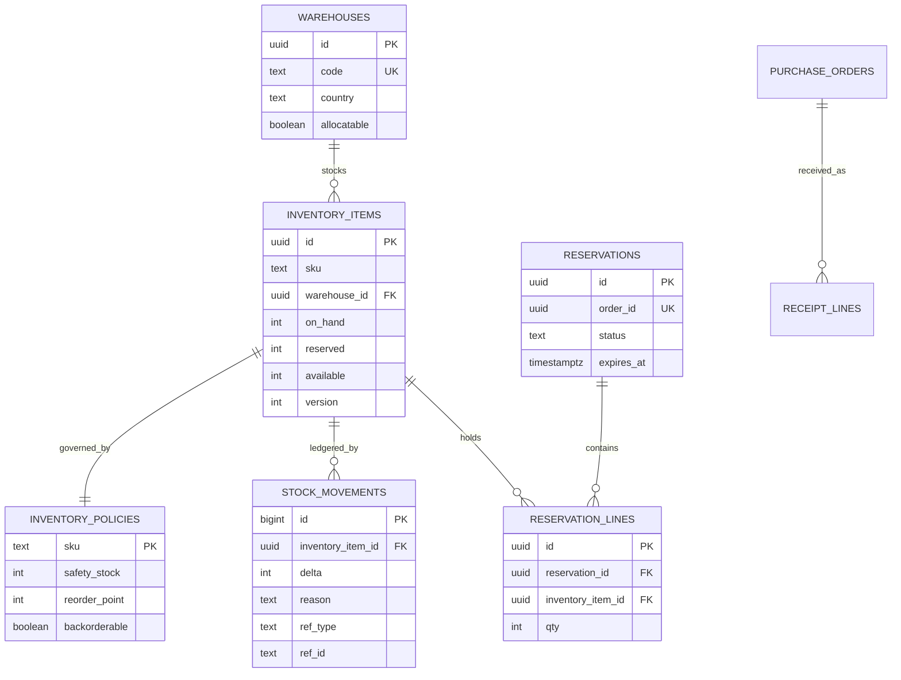
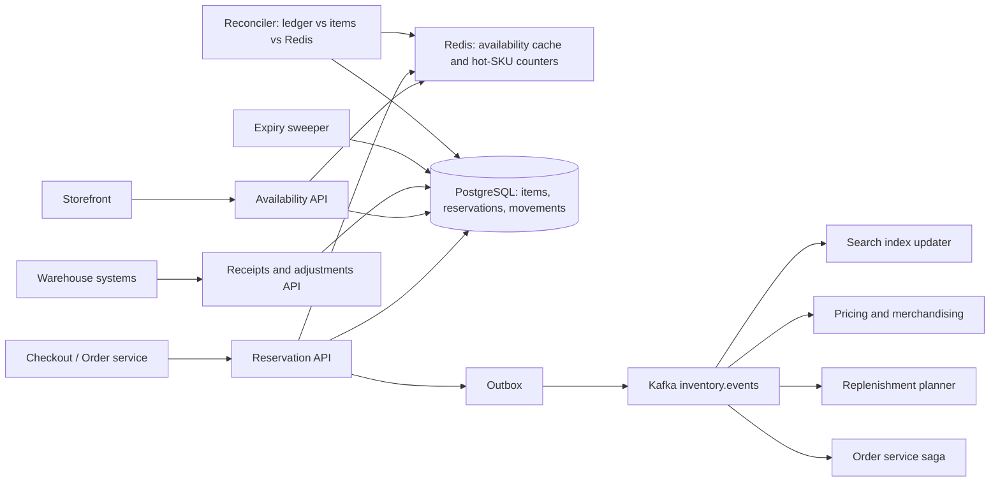
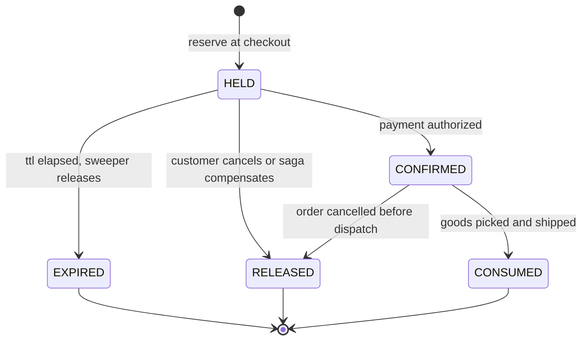
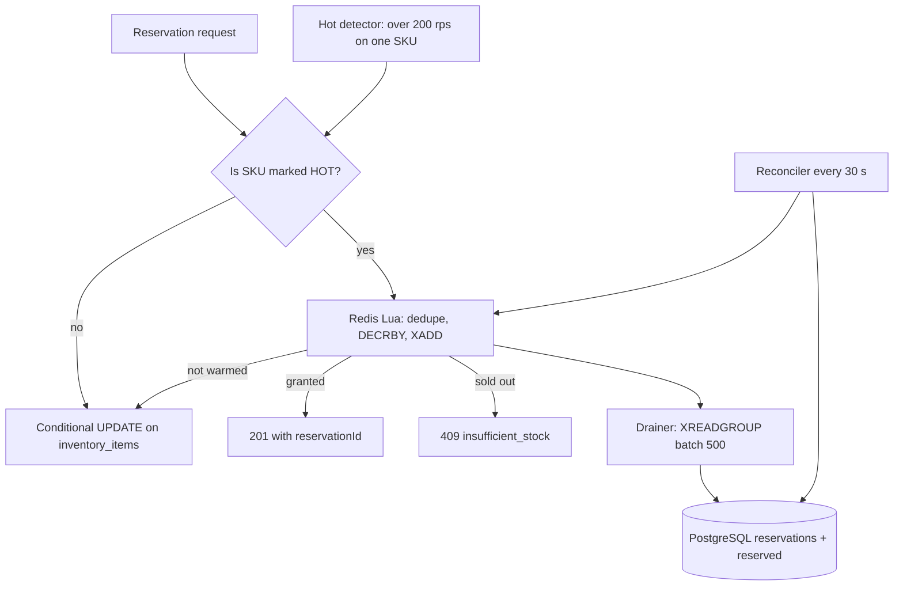
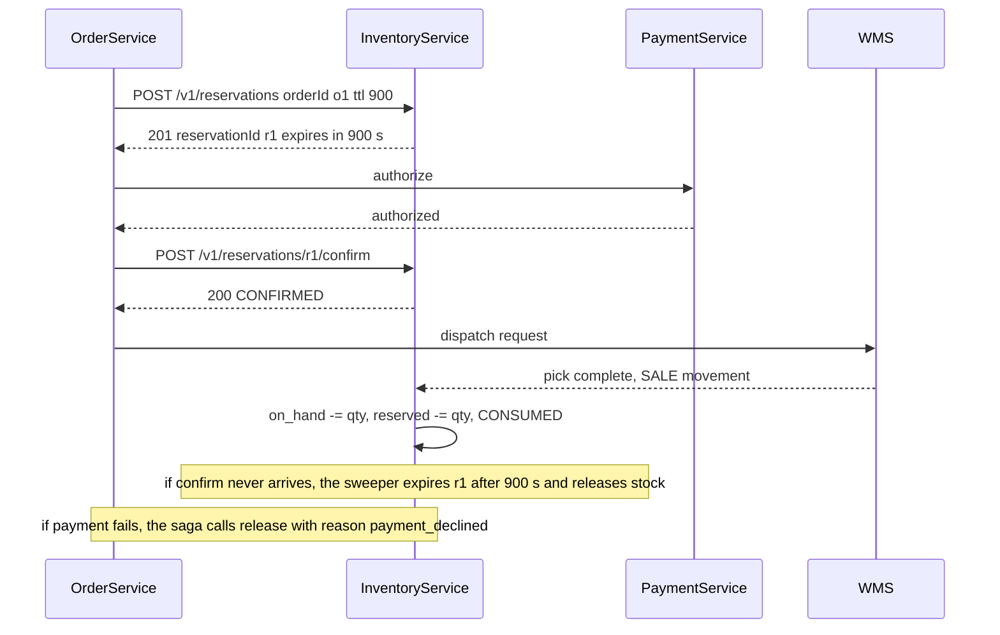
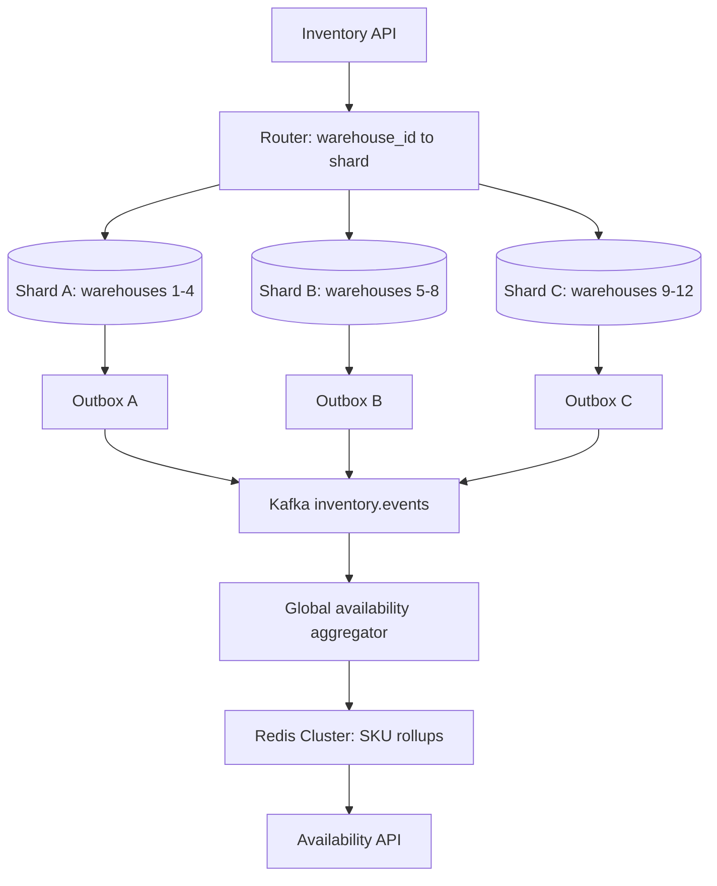

## 40.9 Inventory System

### 40.9.1 Requirements

An inventory system answers one question millions of times a day: *can I sell this thing right now, and from where?* Every other feature exists to keep that answer true. It is the most concurrency-sensitive service in an e-commerce platform, because the interesting moments are exactly the ones where thousands of people want the same last few units at the same instant.

The users are the storefront (which asks "is this available?" on every product page), checkout (which asks "hold these units for me"), the warehouse (which tells us what actually left the shelf), merchandising (which sets safety stock and reorder points), and finance (which values the stock on hand and will notice if the number drifts).

Imagine a cinema box office selling the last twelve seats for tonight. Two clerks at two windows both look at the same seat chart. If each clerk reads the chart, decides seat 7 is free, and writes a customer's name on it, you have sold one seat twice and one of those people will be standing in an aisle. The fix is not "look more carefully"; it is a rule that only one hand can touch the chart at a time, or a chart that physically cannot record two names in one box. That is the whole of inventory engineering: **making the decision and the decrement one indivisible step**, and making the database itself refuse the impossible state as a last line of defence.

There is a second half to the analogy. The cinema also has to handle a customer who reserves a seat but never pays. You cannot hold it forever, so a reservation has an expiry, and when the timer runs out the seat goes back on sale. Reservations with expiry are how a checkout that takes 90 seconds coexists with a flash sale that lasts 40.

### 40.9.2 Functional requirements

1. Track stock per SKU per warehouse with distinct quantities: on hand, reserved, available, damaged, in transit.
2. Reserve units at checkout with a time-to-live, confirm on payment, release on cancellation or timeout.
3. Never oversell: `available` must never go below zero under any concurrency.
4. Record every quantity change as an append-only movement with a reason code; on-hand for any SKU and warehouse is the sum of its movements.
5. Serve availability reads at product-page volume with a strict freshness budget.
6. Allocate a multi-line order across warehouses using a configurable strategy (fewest parcels, nearest, cheapest, stock-balancing).
7. Support backorders (sell beyond stock with a promised date) and preorders (sell before stock exists) per SKU, with explicit opt-in.
8. Support safety stock (a buffer never shown as sellable) and reorder points that raise purchase suggestions.
9. Receive supplier inbound: purchase orders, advance shipping notices, goods receipt with over/under-delivery handling.
10. Support cycle counts and manual adjustments with an approval trail, because physical stock and the database always drift.
11. Handle returns back into sellable stock only after inspection.
12. Publish inventory events (`StockReserved`, `StockConfirmed`, `StockReleased`, `StockAdjusted`, `LowStock`, `OutOfStock`) for search, pricing, merchandising and replenishment.

### 40.9.3 Non-functional requirements

| Property | Target | Why |
|---|---|---|
| Oversell rate | Zero for normal SKUs; under 0.1 percent for flash-sale SKUs, auto-detected and compensated | An oversell is a cancelled order, a refund and a lost customer |
| Reservation latency | p99 under 60 ms for a cold SKU, under 15 ms for a hot SKU | It sits on the checkout critical path |
| Availability read latency | p99 under 10 ms | Product pages call it on every render |
| Availability freshness | Under 2 s for the cached number; exact at reservation time | The badge can lag slightly; the reservation cannot |
| Ledger integrity | `sum(stock_movements) = inventory_items.on_hand` for every SKU and warehouse, verified continuously | Finance and audits |
| Availability of the service | 99.99 percent for reads, 99.95 percent for reservations | Product pages must render even when reservations degrade |
| Throughput on one hot SKU | 20,000 reservation attempts per second on a single SKU | Flash sales are the design point |

### 40.9.4 Constraints

- Twelve warehouses in three countries; a warehouse can go offline for a stock take and must stop being allocatable without breaking the site.
- The warehouse management systems are third-party and eventually consistent with us; their numbers arrive by webhook and by nightly file, and they are sometimes wrong.
- Physical reality is authoritative in the long run: if the shelf has 9 and we say 11, the shelf wins after a cycle count.
- PostgreSQL is the system of record. Redis may hold derived or accelerated state but must be rebuildable from PostgreSQL.
- The order service (Part 40.8) reserves through a synchronous API and confirms through a saga; inventory never writes to orders.

### 40.9.5 Capacity estimation

| Quantity | Assumption | Calculation | Result |
|---|---|---|---|
| Active SKUs | given | | 2,000,000 |
| Warehouses | | | 12 |
| SKU-warehouse rows | Average SKU stocked in 3 warehouses | 2M x 3 | 6,000,000 rows |
| Bytes per `inventory_items` row | 6 integers, 3 uuids, timestamps, version | | about 220 B |
| `inventory_items` size | 6M x 220 B x 1.4 (indexes and bloat) | | about 1.8 GB, fully cacheable |
| Availability reads per day | 4M DAU x 25 product views | | 100,000,000 |
| Availability reads per second, average | 100M / 50,400 active seconds | | about 1,980 per second |
| Availability reads per second, peak | 6x average | 1,980 x 6 | about 12,000 per second |
| Reservation requests per second, peak | 222 orders per second x 3.2 lines | | 710 per second |
| Reservation requests on one flash-sale SKU | 500,000 people, 40-second window, 1.6 attempts each | 500,000 x 1.6 / 40 | 20,000 per second |
| Reservations alive at any moment | 710 per second x 900 s TTL | | 639,000 rows |
| Bytes per `reservations` row | | | about 150 B |
| Live reservations size | 639,000 x 150 B x 1.6 | | about 150 MB |
| Movements per day | 400,000 sold lines x 2.5 + 200,000 inbound + 20,000 adjustments | | about 1,220,000 |
| Movements per year | 1.22M x 365 | | 445 million rows |
| Bytes per `stock_movements` row | | | about 190 B |
| Movement storage per year | 445M x 190 B x 1.45 (indexes) | | about 123 GB |
| Read/write ratio | 12,000 reads vs 710 reservation writes | | about 17 to 1 |
| Cache memory | 2M SKUs x 3 warehouses x 90 B in Redis hashes, plus 2M rolled-up SKU totals x 60 B | 540 MB + 120 MB | about 700 MB, provision 4 GB |
| Redis operations per second, peak | 12,000 reads (mostly hits) + 710 reservation scripts + 20,000 hot-SKU scripts during a sale | | about 33,000 per second |
| Bandwidth for availability reads | 12,000 x 400 B | | 4.8 MB per second |
| Connections | 30 inventory pods x 10 + 8 workers x 6 | 300 + 48 | 348, PgBouncer in transaction mode |

The shape of the problem is now visible. The whole hot dataset is under 2 GB, so this is not a storage problem. Reads outnumber writes 17 to 1 and are trivially cacheable. The only genuinely hard number in the table is 20,000 reservations per second **on one row**, and a single PostgreSQL row can sustain roughly 500 to 2,000 serialized updates per second before lock waits dominate. That single line justifies the entire hot-SKU machinery later in this design; everything else is ordinary CRUD with a strict correctness rule.

### 40.9.6 API design

| Method | Path | Request | Response | Status codes | Idempotency | Auth |
|---|---|---|---|---|---|---|
| GET | `/v1/availability` | `?skus=a,b,c&postalCode=` | `[{ sku, available, warehouses[], eta }]` | 200, 400 | Yes | Public (cached) |
| GET | `/v1/inventory/{sku}` | | per-warehouse breakdown | 200, 404 | Yes | Internal or admin |
| POST | `/v1/reservations` | `{ orderId, ttlSeconds, lines: [{ sku, qty, warehouseHint? }] }` | `{ reservationId, lines: [{ sku, qty, warehouseId }], expiresAt }` | 201, 200 on replay, 409 `insufficient_stock`, 422 | **Required**, key is `orderId` | Service token (order service) |
| POST | `/v1/reservations/{id}/confirm` | `{ paymentRef }` | reservation | 200, 409 if expired, 410 if released | Yes, natural | Service token |
| POST | `/v1/reservations/{id}/release` | `{ reason }` | | 204, 200 if already released | Yes | Service token |
| POST | `/v1/reservations/{id}/extend` | `{ ttlSeconds }` | reservation | 200, 409 if expired | Yes | Service token |
| POST | `/v1/allocations` | `{ orderId, lines[], destination }` | `{ plan: [{ warehouseId, lines[] }] }` | 200, 409 | Yes | Service token |
| POST | `/v1/movements` | `{ sku, warehouseId, delta, reason, refType, refId }` plus `Idempotency-Key` | movement | 201, 200 on replay, 409 | **Required** | Service token or admin |
| POST | `/v1/receipts` | `{ purchaseOrderId, lines: [{ sku, qty, lotCode?, expiry? }] }` | receipt | 201, 409 | Via `receiptId` | Warehouse service |
| POST | `/v1/adjustments` | `{ sku, warehouseId, countedQty, reason, note }` | adjustment | 201, 202 if approval needed | Via `Idempotency-Key` | Admin, scope `inventory:adjust` |
| GET | `/v1/inventory/{sku}/movements` | `?from=&to=&cursor=` | ledger page | 200 | Yes | Admin |
| PUT | `/v1/inventory/{sku}/policy` | `{ safetyStock, reorderPoint, reorderQty, backorderable, preorderUntil }` | policy | 200, 400 | Yes | Admin |
| GET | `/v1/replenishment/suggestions` | `?warehouseId=` | list | 200 | Yes | Admin |

Contract details that prevent bugs downstream:

- `POST /v1/reservations` is keyed by `orderId`. Retrying the same order returns the same reservation with the same lines; it never double-reserves. This is the single most important idempotency rule in the system.
- `409 insufficient_stock` carries per-line detail: `{ sku, requested, available }`. Checkout uses it to show "only 2 left" instead of a generic failure.
- Availability responses carry a `Cache-Control: max-age=2` and an `asOf` timestamp so callers know the number is a hint, not a promise. The only promise is a reservation.
- Reservations are all-or-nothing per request by default, with an `allowPartial` flag for the cart-repair flow.

### 40.9.7 Data model



```sql
CREATE TABLE warehouses (
  id           uuid PRIMARY KEY DEFAULT gen_random_uuid(),
  code         text NOT NULL UNIQUE,             -- 'BLR1', 'DEL2'
  country      char(2) NOT NULL,
  latitude     numeric(9,6) NOT NULL,
  longitude    numeric(9,6) NOT NULL,
  allocatable  boolean NOT NULL DEFAULT true,    -- flipped off during a stock take
  priority     smallint NOT NULL DEFAULT 100
);

CREATE TABLE inventory_items (
  id            uuid PRIMARY KEY DEFAULT gen_random_uuid(),
  sku           text    NOT NULL,
  warehouse_id  uuid    NOT NULL REFERENCES warehouses(id),
  on_hand       integer NOT NULL DEFAULT 0,      -- physically present, includes reserved
  reserved      integer NOT NULL DEFAULT 0,      -- held by live reservations
  available     integer GENERATED ALWAYS AS (on_hand - reserved) STORED,
  damaged       integer NOT NULL DEFAULT 0,
  in_transit    integer NOT NULL DEFAULT 0,      -- despatched by supplier, not yet received
  safety_stock  integer NOT NULL DEFAULT 0,
  version       integer NOT NULL DEFAULT 1,
  updated_at    timestamptz NOT NULL DEFAULT now(),
  CONSTRAINT inv_on_hand_ck   CHECK (on_hand >= 0),
  CONSTRAINT inv_reserved_ck  CHECK (reserved >= 0),
  -- the last line of defence: the database itself refuses an oversold row
  CONSTRAINT inv_available_ck CHECK (on_hand - reserved >= 0)
);
-- serves the reservation path and the per-warehouse breakdown; also the natural key
CREATE UNIQUE INDEX inventory_items_sku_wh_uidx ON inventory_items (sku, warehouse_id);
-- serves "which SKUs in this warehouse are below reorder point" for replenishment
CREATE INDEX inventory_items_low_idx ON inventory_items (warehouse_id, sku)
  WHERE on_hand - reserved <= safety_stock;

CREATE TABLE reservations (
  id          uuid PRIMARY KEY DEFAULT gen_random_uuid(),
  order_id    uuid NOT NULL,
  status      text NOT NULL DEFAULT 'HELD'
              CHECK (status IN ('HELD','CONFIRMED','RELEASED','EXPIRED')),
  expires_at  timestamptz NOT NULL,
  created_at  timestamptz NOT NULL DEFAULT now(),
  confirmed_at timestamptz,
  released_at  timestamptz,
  release_reason text
);
-- serves idempotency: one live reservation per order, enforced by the database
CREATE UNIQUE INDEX reservations_order_uidx ON reservations (order_id)
  WHERE status IN ('HELD','CONFIRMED');
-- serves the expiry sweeper: a tiny slice of a large table
CREATE INDEX reservations_expiry_idx ON reservations (expires_at) WHERE status = 'HELD';

CREATE TABLE reservation_lines (
  id                uuid PRIMARY KEY DEFAULT gen_random_uuid(),
  reservation_id    uuid NOT NULL REFERENCES reservations(id) ON DELETE CASCADE,
  inventory_item_id uuid NOT NULL REFERENCES inventory_items(id),
  sku               text NOT NULL,
  qty               integer NOT NULL CHECK (qty > 0)
);
-- serves "release everything this reservation holds"
CREATE INDEX reservation_lines_res_idx ON reservation_lines (reservation_id);
-- serves "who is holding stock of this SKU right now", used in incident triage
CREATE INDEX reservation_lines_item_idx ON reservation_lines (inventory_item_id);

CREATE TABLE stock_movements (
  id                bigint GENERATED ALWAYS AS IDENTITY,
  inventory_item_id uuid    NOT NULL,
  sku               text    NOT NULL,
  warehouse_id      uuid    NOT NULL,
  delta             integer NOT NULL CHECK (delta <> 0),   -- +receipt, -sale, +return, -damage
  reason            text    NOT NULL CHECK (reason IN (
                      'RECEIPT','SALE','RETURN','DAMAGE','CYCLE_COUNT','TRANSFER_IN',
                      'TRANSFER_OUT','WRITE_OFF','CORRECTION','PROMO_GIVEAWAY')),
  ref_type          text    NOT NULL,             -- 'order','purchase_order','rma','count_sheet'
  ref_id            text    NOT NULL,
  balance_after     integer NOT NULL,             -- on_hand after applying this movement
  actor_type        text    NOT NULL CHECK (actor_type IN ('system','admin','wms')),
  actor_id          text,
  note              text,
  occurred_at       timestamptz NOT NULL DEFAULT now(),
  PRIMARY KEY (id, occurred_at)
) PARTITION BY RANGE (occurred_at);

CREATE TABLE stock_movements_2026_09 PARTITION OF stock_movements
  FOR VALUES FROM ('2026-09-01') TO ('2026-10-01');

-- serves the per-SKU ledger view and the reconciliation sum
CREATE INDEX stock_movements_item_time_idx ON stock_movements (inventory_item_id, occurred_at DESC);
-- serves duplicate suppression for webhooks and retried writes
CREATE UNIQUE INDEX stock_movements_ref_uidx
  ON stock_movements (ref_type, ref_id, inventory_item_id, reason, occurred_at);

CREATE TABLE inventory_policies (
  sku            text PRIMARY KEY,
  safety_stock   integer NOT NULL DEFAULT 0 CHECK (safety_stock >= 0),
  reorder_point  integer NOT NULL DEFAULT 0,
  reorder_qty    integer NOT NULL DEFAULT 0,
  lead_time_days smallint NOT NULL DEFAULT 7,
  backorderable  boolean NOT NULL DEFAULT false,
  backorder_cap  integer NOT NULL DEFAULT 0,
  preorder_until timestamptz,
  updated_at     timestamptz NOT NULL DEFAULT now()
);
```

`available` is a generated stored column, not something the application computes and writes. That removes an entire class of bug where one code path forgets to update it. The `CHECK (on_hand - reserved >= 0)` constraint is the design's promise to itself: even if every piece of application logic above it is wrong, the database will refuse to record an oversold state and the transaction will fail loudly rather than silently selling air.

`balance_after` on each movement is redundant with the sum of prior deltas, and that redundancy is deliberate: it turns the reconciliation job from an expensive full aggregation into a cheap comparison of the latest movement's `balance_after` against `inventory_items.on_hand`, and it makes a corrupted ledger visible at the exact row where the chain breaks.

### 40.9.8 High-level architecture



Two things are worth arguing about in that picture. The availability API and the reservation API are the same service but separate deployments, because a product-page traffic spike must never consume the connection pool that checkout needs. And the reconciler is a first-class component, not a script somebody runs when things look wrong: any system that keeps a fast copy of a number in Redis and a true copy in PostgreSQL needs a continuous, automated argument between the two.

### 40.9.9 Component design

```text
src/
  inventory/
    inventory.module.ts
    api/
      availability.controller.ts
      reservations.controller.ts
      movements.controller.ts
      admin-adjustments.controller.ts
    application/
      availability.service.ts
      reservation.service.ts
      allocation.service.ts
      movement.service.ts
      receipt.service.ts
      cycle-count.service.ts
      replenishment.service.ts
    hot/
      hot-sku.detector.ts
      hot-sku.service.ts
      lua/reserve-hot.ts
    domain/
      inventory-item.entity.ts
      reservation.entity.ts
      allocation-strategy.ts
    workers/
      reservation-expiry.worker.ts
      hot-sku-reconciler.worker.ts
      ledger-reconciler.worker.ts
      outbox-publisher.worker.ts
```

#### The reservation lifecycle



`HELD` increments `reserved`. `CONFIRMED` keeps `reserved` where it is (the units are still physically on the shelf; they are just spoken for). `CONSUMED` at pick time decrements both `on_hand` and `reserved` and writes a `SALE` movement. Releasing decrements `reserved` only. Getting this bookkeeping wrong in either direction produces the two classic bugs: phantom stock (reserved never released, so the site says sold out while the shelf is full) and oversell (on_hand decremented twice).

#### The oversell problem, four solutions compared honestly

Every solution below is correct in the sense of "never sells the same unit twice". They differ in throughput on a contended row, in latency, and in how much machinery you now own.

| Approach | Mechanism | Correctness | Throughput on one hot SKU | Added latency | Complexity | Use when |
|---|---|---|---|---|---|---|
| Atomic conditional `UPDATE` | `UPDATE ... SET reserved = reserved + $q WHERE id = $1 AND on_hand - reserved >= $q` and check `rowCount` | Exact; the row lock is taken and released inside one statement | 500 to 2,000 per second per row before lock waits dominate | About 1 to 3 ms | Very low, one statement | **The default for 99.9 percent of SKUs** |
| `SELECT ... FOR UPDATE` then update | Explicit lock, read, decide in application code, write | Exact, and lets you make complex multi-row decisions atomically | 200 to 800 per second per row; each transaction holds the lock across a network round trip | 3 to 10 ms, worse under load | Low, but the lock is held longer | Multi-row invariants, allocation across warehouses in one transaction |
| Redis pre-check, PostgreSQL as truth | Redis `DECRBY` or a Lua script decides fast; PostgreSQL is updated behind it and is authoritative | Approximate at the edges; Redis and PostgreSQL can diverge on failure | 50,000+ per second per key | 0.3 to 1 ms | High: needs reconciliation, warm-up, drift alarms | Flash sales and hot SKUs only |
| Per-SKU serialisation via a queue | All reservation commands for one SKU go to one partition and one consumer | Exact; no locks needed because there is no concurrency | 5,000 to 20,000 per second per partition, bounded by one consumer | 5 to 50 ms (async, plus queue wait) | High: changes the API from synchronous to asynchronous | Ticketing-style drops where a short queue is acceptable and fairness matters |

The honest summary: **start with the conditional UPDATE**. It is one statement, it is exactly correct, it needs no extra infrastructure, and at 710 reservations per second spread over two million SKUs the contention on any single row is essentially zero. Everything else in this section exists to handle the rare row that gets 20,000 requests per second.

```ts
// inventory/application/reservation.service.ts (the default path)
import { ConflictException, Injectable } from '@nestjs/common';
import { DataSource } from 'typeorm';

interface Line { sku: string; qty: number; warehouseId: string; }

@Injectable()
export class ReservationService {
  constructor(private readonly ds: DataSource) {}

  async reserve(orderId: string, lines: Line[], ttlSeconds: number) {
    return this.ds.transaction('READ COMMITTED', async (m) => {
      // Idempotency by the database: a second call for the same order hits the partial unique index.
      const existing = await m.query(
        `SELECT id, expires_at FROM reservations WHERE order_id = $1 AND status IN ('HELD','CONFIRMED')`,
        [orderId]);
      if (existing.length) return this.load(m, existing[0].id);

      const res = await m.query(
        `INSERT INTO reservations (order_id, expires_at)
         VALUES ($1, now() + make_interval(secs => $2)) RETURNING id, expires_at`,
        [orderId, ttlSeconds]);

      // Sort lines by sku so two concurrent multi-line reservations always take row locks
      // in the same order. Without this, two orders for (A,B) and (B,A) can deadlock.
      const sorted = [...lines].sort((a, b) => (a.sku + a.warehouseId).localeCompare(b.sku + b.warehouseId));

      for (const line of sorted) {
        const upd = await m.query(
          `UPDATE inventory_items
              SET reserved = reserved + $3, version = version + 1, updated_at = now()
            WHERE sku = $1 AND warehouse_id = $2
              AND on_hand - reserved - safety_stock >= $3
          RETURNING id, on_hand - reserved AS available`,
          [line.sku, line.warehouseId, line.qty]);

        if (upd.length === 0) {                       // zero rows updated means not enough stock
          const cur = await m.query(
            `SELECT on_hand - reserved - safety_stock AS available FROM inventory_items
              WHERE sku = $1 AND warehouse_id = $2`, [line.sku, line.warehouseId]);
          throw new ConflictException({
            error: 'insufficient_stock', sku: line.sku,
            requested: line.qty, available: cur[0]?.available ?? 0,
          });                                          // the transaction rolls back all earlier lines
        }

        await m.query(
          `INSERT INTO reservation_lines (reservation_id, inventory_item_id, sku, qty)
           VALUES ($1, $2, $3, $4)`, [res[0].id, upd[0].id, line.sku, line.qty]);
      }

      await m.query(
        `INSERT INTO inventory_outbox (topic, event_key, payload)
         VALUES ('inventory.events', $1, $2)`,
        [orderId, JSON.stringify({ type: 'StockReserved', orderId, lines: sorted })]);

      return this.load(m, res[0].id);
    });
  }
}
```

Three details in that code are the difference between a system that works and one that pages you at 3 a.m. The `WHERE ... on_hand - reserved - safety_stock >= $3` clause makes the check and the write a single atomic statement, so no read-then-write race exists. The `rowCount === 0` branch distinguishes "not enough stock" from "SKU does not exist" only after the fact, on a path that is already failing, so the happy path costs one statement. And the deterministic sort of lines by key is the standard cure for deadlocks between multi-line orders; without it, `ERROR: deadlock detected` appears in production exactly when traffic is highest.

#### Hot SKUs during a flash sale

A single row cannot take 20,000 updates per second. Three techniques exist, and a mature system uses the first plus periodic reconciliation, keeps the second for fairness-critical drops, and uses the third when the SKU quantity is large.

**1. Redis Lua decrement with periodic reconciliation.** Before the sale, a warm-up job moves an allotment (say all 50,000 units) into a Redis counter and marks the SKU `HOT` in PostgreSQL, with `reserved` bumped by the allotment so the two views agree. Reservations then run entirely in Redis at 50,000 per second, and a writer-behind worker drains a Redis stream of granted reservations into PostgreSQL in batches of 500.

```ts
// inventory/hot/lua/reserve-hot.ts
export const RESERVE_HOT_LUA = `
-- KEYS[1] counter key  KEYS[2] stream key
-- ARGV[1] qty  ARGV[2] orderId  ARGV[3] sku  ARGV[4] warehouseId  ARGV[5] dedupe key
if redis.call('SISMEMBER', KEYS[1] .. ':seen', ARGV[5]) == 1 then
  return {2, -1}                                    -- duplicate request: already granted
end
local remaining = tonumber(redis.call('GET', KEYS[1]))
if remaining == nil then return {-1, -1} end        -- not warmed: caller falls back to PostgreSQL
local qty = tonumber(ARGV[1])
if remaining < qty then return {0, remaining} end   -- sold out for this attempt
local left = redis.call('DECRBY', KEYS[1], qty)
redis.call('SADD', KEYS[1] .. ':seen', ARGV[5])
redis.call('EXPIRE', KEYS[1] .. ':seen', 3600)
redis.call('XADD', KEYS[2], '*', 'orderId', ARGV[2], 'sku', ARGV[3],
           'warehouseId', ARGV[4], 'qty', ARGV[1])  -- durable intent for the drainer
return {1, left}
`;
```

The properties that make this acceptable: the decrement and the dedupe are atomic in one script, the grant is written to a Redis stream (which is persisted and replicated) before the API returns, and the drainer is idempotent because the stream entry carries `orderId`. The risk is a Redis failover losing the last few milliseconds of the stream; the mitigation is that the reconciler compares the counter, the stream position and the PostgreSQL rows every 30 seconds, and any drift shows up as a small number of orders to cancel rather than a corrupted ledger. During a sale, `WAIT 1 100` after the script (waiting for one replica to acknowledge) trades about 1 ms of latency for durability, and that is a trade worth making when the alternative is refunding customers.

**2. Queue-based serialisation.** Reservation requests for the hot SKU are produced to a Kafka topic keyed by SKU, and a single consumer per SKU partition applies them in order against PostgreSQL. The API returns `202 Accepted` with a ticket and the client polls or listens on a WebSocket. This gives perfect fairness (first in, first served), perfect correctness, and a natural queue page ("you are number 4,213 in line") that customers understand better than a spinner. It costs you a synchronous API turned asynchronous, which is a product decision, not just a technical one. For concert tickets and sneaker drops it is the right answer; for a 20-percent-off toaster it is overkill.

**3. Sharded counters.** Split 50,000 units into 32 buckets of 1,562 and hash each request to a bucket. Contention drops 32-fold on any single key or row. The failure mode is the ending: one bucket empties while others still have stock, so late requests fail even though units remain. Cures are stealing from a neighbouring bucket when your bucket is empty (adds a second round trip) and rebalancing when total remaining drops below a threshold. Sharded counters are best when the quantity is large relative to demand (a 500,000-unit promotion) and worst when the tail matters (the last 50 units of a 50,000-unit drop).



#### The ledger, and what on-hand really means

`inventory_items.on_hand` is a materialised sum. The truth is `stock_movements`. Every quantity change writes a movement in the same transaction as the item update, so the two can never diverge unless somebody writes to `inventory_items` directly (which is why only `MovementService` is allowed to, and a database trigger raises an exception on any other path in non-production environments to catch it during development).

```sql
-- The continuous reconciliation query, run per warehouse every 15 minutes
SELECT i.sku, i.warehouse_id, i.on_hand,
       coalesce(sum(m.delta), 0) AS ledger_sum,
       i.on_hand - coalesce(sum(m.delta), 0) AS drift
FROM inventory_items i
LEFT JOIN stock_movements m ON m.inventory_item_id = i.id
WHERE i.warehouse_id = $1
GROUP BY i.sku, i.warehouse_id, i.on_hand
HAVING i.on_hand <> coalesce(sum(m.delta), 0);
```

At 445 million movements a year that full aggregation is too expensive to run often, so production uses the cheap version: compare `inventory_items.on_hand` to the `balance_after` of the newest movement for each item, and only fall back to the full sum for the items that disagree. Any non-empty result is a P2 incident, because it means an update path bypassed the ledger.

#### Backorders, preorders, safety stock and reorder points

- **Safety stock** is subtracted in the reservation predicate, so it is invisible to customers and reserved for wholesale channels, returns processing and forecast error. It is set per SKU by merchandising and is typically the demand over the supplier lead time plus a service-level buffer.
- **Backorders** let `reserved` exceed `on_hand` for SKUs where `backorderable = true`, up to `backorder_cap`. The predicate becomes `on_hand + backorder_cap - reserved >= qty`, the reservation is marked `backordered`, and the order carries a promised date derived from `lead_time_days` plus the open purchase order's expected arrival. Backorders without a cap are how a business accidentally sells 4,000 units of something with a 12-week lead time.
- **Preorders** are backorders where `on_hand` is zero by design and a `preorder_until` date exists. The important difference is commercial, not technical: payment is often only authorized, not captured, until stock arrives.
- **Reorder points** drive replenishment. A nightly job computes, per SKU and warehouse, `reorder_point = average_daily_demand x lead_time_days + safety_stock`, compares it to `available + in_transit`, and raises a suggestion. The suggestions are advisory: a human or a planning system converts them to purchase orders.

#### Multi-warehouse allocation

Reservation and allocation are separate steps on purpose. At checkout you want speed, so you reserve from the best-guess warehouse. At fulfilment you want optimality, so you allocate with full knowledge.

```ts
// inventory/domain/allocation-strategy.ts
export interface AllocationCandidate { warehouseId: string; distanceKm: number; available: number; priority: number; }

export function scoreWarehouse(c: AllocationCandidate, linesCovered: number, totalLines: number): number {
  const coverage = linesCovered / totalLines;      // one parcel is far cheaper than three
  return coverage * 1000                            // dominant: minimise split shipments
       - c.distanceKm * 0.5                         // then: minimise freight and delivery time
       + c.priority * 0.1                           // then: operator preference and capacity
       + Math.min(c.available, 50) * 0.2;           // mild bias toward stock-balancing
}
```

The allocator is a greedy set-cover: pick the warehouse that covers the most lines, allocate them, repeat for the remainder, and cap the plan at three shipments (beyond that, the freight cost exceeds the margin and ops prefers a short delay). It runs after payment, moves each line's reservation to the chosen warehouse if it started elsewhere (release plus re-reserve inside one transaction), and stamps `order_items.warehouse_id`.

#### Supplier inbound, cycle counts and adjustments

A goods receipt is a `RECEIPT` movement referencing a purchase order line, with over-delivery tolerance (accept up to 5 percent extra, quarantine the rest) and under-delivery leaving the purchase order line open. Advance shipping notices increment `in_transit` so the replenishment planner does not double-order.

A cycle count is the reconciliation with physical reality. A counter scans a bin, the system compares the count to `on_hand`, and any difference becomes a `CYCLE_COUNT` movement with the count sheet as `ref_id`. Counts that move value above a threshold need a supervisor's approval and go to `202 Accepted` until approved. The metric that matters is inventory record accuracy (the percentage of counted bins with zero variance); below about 97 percent, promises to customers stop being credible and the allocation engine starts producing shipments that cannot be picked.

#### Consistency with the order and payment sagas



The expiry sweeper is the safety net that makes the whole flow robust to any lost message: it runs every 10 seconds, selects up to 1,000 `HELD` reservations past `expires_at` with `FOR UPDATE SKIP LOCKED`, decrements `reserved` for their lines, marks them `EXPIRED` and publishes `StockReleased`. Because it is time-driven, no crash anywhere else in the platform can leave stock held forever.

### 40.9.10 Database design

`inventory_items` is small (6 million rows, under 2 GB with indexes) and extremely hot, so it lives entirely in shared buffers. It is never partitioned; partitioning a table that fits in RAM adds planning cost for nothing.

`stock_movements` is the opposite: 445 million rows a year, append-only, queried mostly by item and recency. It is partitioned monthly, with partitions older than 24 months exported to S3 as Parquet and dropped. Because it is append-only, `fillfactor` stays at 100 and autovacuum only has to freeze, never to reclaim.

`reservations` and `reservation_lines` are high-churn: 400,000 rows a day inserted, updated once or twice, then dead. That churn is a vacuum problem, not a size problem. Two settings fix it: `fillfactor = 85` on `reservations` so updates stay on the same page (HOT updates, no index writes), and an aggressive `autovacuum_vacuum_scale_factor = 0.02` on both tables so dead tuples are reclaimed before they bloat the indexes. Terminal reservations older than 30 days are moved to an archive table nightly.

The predicate that runs 710 times a second deserves an explanation of its plan:

```sql
EXPLAIN (ANALYZE, BUFFERS)
UPDATE inventory_items
   SET reserved = reserved + 2, version = version + 1, updated_at = now()
 WHERE sku = 'SKU-88213' AND warehouse_id = 'a1f0...'::uuid
   AND on_hand - reserved - safety_stock >= 2
RETURNING id;
```

```text
Update on inventory_items  (cost=0.43..8.46 rows=1 width=118) (actual time=0.121..0.124 rows=1 loops=1)
  ->  Index Scan using inventory_items_sku_wh_uidx on inventory_items
        (cost=0.43..8.46 rows=1 width=118) (actual time=0.051..0.053 rows=1 loops=1)
        Index Cond: ((sku = 'SKU-88213'::text) AND (warehouse_id = 'a1f0...'::uuid))
        Filter: ((on_hand - reserved - safety_stock) >= 2)
        Buffers: shared hit=4
Planning Time: 0.182 ms
Execution Time: 0.198 ms
```

Four buffer hits, 0.2 ms, no sequential scan, and the row lock exists only for the duration of the statement. That is what "the default path is boring" looks like, and it is why the exotic machinery is reserved for the SKUs that actually need it.

One more database decision: isolation level. All of this runs at `READ COMMITTED`, deliberately. The conditional `UPDATE` re-evaluates its predicate against the newest committed row version after waiting for a conflicting lock, which is exactly the behaviour we want. `REPEATABLE READ` would instead throw a serialization failure and force the application to retry, adding complexity and latency for no additional safety in this specific pattern.

### 40.9.11 Caching

| What | Where | TTL | Invalidation | Notes |
|---|---|---|---|---|
| SKU availability rollup (sum across warehouses) | Redis hash `inv:sku:{sku}` | 60 s | Written through on every movement and reservation event | Serves 12,000 reads per second at a 97 percent hit rate |
| Per-warehouse availability | Redis hash field within the same key | 60 s | Same | Hash tag keeps one SKU on one slot |
| "In stock" boolean for listing pages | In-process LRU, 200,000 entries | 10 s | Time only | Listing pages tolerate 10 s staleness; this removes 60 percent of Redis traffic |
| Hot-SKU counter | Redis string `hot:{sku}:{wh}` | Life of the sale | Warm-up and drain | This is not a cache; it is authoritative during the sale and reconciled after |
| Inventory policy (safety stock, backorder flags) | In-process map, refreshed every 60 s | 60 s | Pub/sub on change | Read on every reservation, changed a few times a day |
| Reservation by order id | Redis, 15 min | TTL | Deleted on confirm or release | Makes the idempotent replay path avoid PostgreSQL entirely |

The availability cache is written through rather than invalidated, because invalidation on a 12,000 reads-per-second key produces a stampede: 12,000 requests arrive in the millisecond after the delete, all miss, and all hit PostgreSQL. Write-through keeps the key always populated. When a cold miss does happen, a per-key lock in Redis (`SET inv:lock:{sku} 1 NX PX 200`) lets exactly one request rebuild while the others wait 50 ms and re-read.

The important honesty about this cache: it is allowed to be wrong. Product pages show a number that may be two seconds stale, and that is fine, because the badge is marketing and the reservation is the contract. Systems that try to make the displayed number perfectly accurate spend enormous effort to eliminate a discrepancy that customers never notice, while the discrepancy that matters (selling something you do not have) is solved at reservation time.

### 40.9.12 Messaging

| Topic | Key | Partitions | Events | Consumers |
|---|---|---|---|---|
| `inventory.events` | `sku` | 48 | `StockReserved`, `StockConfirmed`, `StockReleased`, `StockAdjusted`, `StockReceived`, `LowStock`, `OutOfStock`, `BackInStock` | Search indexer, pricing, merchandising, replenishment, order saga, analytics |
| `inventory.commands` | `orderId` | 24 | `ReserveStock`, `ReleaseStock`, `ConfirmStock` | Inventory (async path, used at 10x) |
| `wms.stock` | `warehouseId` | 12 | `PickCompleted`, `GoodsReceived`, `CycleCountPosted`, `Damaged` | Inventory |
| `inventory.hotdrain` (Redis Stream, not Kafka) | | | Granted hot reservations awaiting a PostgreSQL write | Hot drainer |
| `inventory.events.dlq` | `sku` | 6 | Poison messages | On-call, replay tool |

Keying by SKU gives per-SKU ordering, which is what consumers need: the search indexer must not apply `OutOfStock` after `BackInStock` for the same SKU. Publication uses the same transactional outbox pattern as the order service, so an event never exists without its ledger row and vice versa.

`BackInStock` is worth calling out because it is the one event with a demand spike attached: publishing it triggers notification emails to everyone on the waitlist, who all arrive within seconds and try to buy the twelve units that just landed. The notification service therefore drip-feeds the waitlist (send to `available x 3` customers, wait 60 seconds, repeat) instead of sending 40,000 emails for 12 units, which is both kinder and cheaper than the stampede.

### 40.9.13 Scaling

**At 1x (710 reservations per second, 12,000 availability reads per second).** One PostgreSQL primary (db.r6g.2xlarge) plus two replicas, 30 API pods split into availability and reservation deployments, Redis with 4 GB, one hot-SKU path used a few times a month. `inventory_items` fits in RAM; the reservation statement takes 0.2 ms. There is no scaling problem here, only a correctness problem.

**At 10x (7,100 reservations per second, 120,000 availability reads per second).** Reads move entirely to Redis with an in-process layer above it, because 120,000 requests per second against Redis needs a cluster and a lot of network. Writes are still fine in aggregate (7,100 per second of single-row updates is comfortable for a well-tuned primary) but three things change:

- Hot SKUs stop being rare. The hot detector runs continuously and promotes any SKU over 200 reservations per second, so the Redis path is a normal operating mode rather than an event-day special.
- The expiry sweeper becomes a real workload (4 million reservations a day to expire), so it is sharded by `hashtext(order_id) % N` across four workers with `SKIP LOCKED`.
- `stock_movements` inserts reach 12 million a day, and the outbox alongside them becomes the busiest table. Both get their own tablespace and hourly partitions.

**At 100x (71,000 reservations per second).** The single primary is finished, and the natural shard key is the warehouse, because a reservation almost always touches one warehouse and a movement always does.



Sharding by warehouse keeps every reservation transaction inside one shard. The cost is that the "total available across all warehouses" number is no longer a single query; it becomes an aggregate maintained by a consumer of `inventory.events` and stored in Redis. A multi-warehouse reservation (rare, and only for split orders) becomes a two-phase operation with its own saga, which is exactly the kind of complexity you accept only when the alternative is a database that cannot keep up. At this scale most large retailers also separate "sellable inventory" (a fast, approximate, globally-replicated view used to decide whether to show a buy button) from "allocatable inventory" (the precise per-warehouse ledger), and accept a small oversell rate managed by an automated cancellation and apology flow, because the revenue lost to over-conservative availability exceeds the cost of the occasional cancellation.

### 40.9.14 Security

- **Only services may reserve.** The reservation API is not public; the storefront can read availability but only the order service holds the service token that can reserve. A public reservation endpoint is a denial-of-inventory attack surface: an attacker reserves everything, nobody can buy, and the stock is only released after the TTL.
- **Reservation TTL as a defence.** Even for authorised callers, TTLs bound the damage of a bug or an attack. A cart-abandonment bot cannot lock out a product for more than 15 minutes.
- **Per-customer reservation caps.** A rule limits concurrent held units per customer per SKU (typically the same as the purchase limit), enforced inside the reservation transaction against a count of live reservations for that customer.
- **Adjustments are the fraud surface.** A dishonest employee with `inventory:adjust` can write off 50 units and walk out with them. Mitigations: adjustments above a value threshold require a second approver, every adjustment is a ledger row with an actor id, and a nightly report ranks adjusters by value written off.
- **Movement immutability.** `stock_movements` has no `UPDATE` or `DELETE` grant for the application role; corrections are new `CORRECTION` rows. Revoking those grants at the database level is what turns a policy into a control.
- **Availability as an information leak.** Exact stock counts tell competitors your sales rate. Public responses bucket the number (`in_stock`, `low_stock` under 10, `out_of_stock`) and only internal callers see exact figures.
- **Webhook authenticity.** WMS webhooks are HMAC-signed with a timestamp window; an unsigned goods receipt would let anyone inflate stock.
- **Rate limiting on availability.** The endpoint accepts up to 50 SKUs per call and is rate limited per client, because a scraper enumerating two million SKUs is both a load problem and a data-leak problem.

### 40.9.15 Failure scenarios

Apply the mantra: can it time out, fail, slow down, duplicate, return something wrong, or partially succeed?

| Failure | Detection | Impact | Mitigation | What the user sees |
|---|---|---|---|---|
| Order service retries `POST /reservations` after a timeout | Duplicate `orderId`, replay counter | Would double-reserve and hide stock | Partial unique index on `(order_id)` for live statuses; the replay returns the original reservation | Nothing |
| Payment never completes, reservation orphaned | Gauge of `HELD` reservations past expiry | Stock held forever, false out-of-stock | Expiry sweeper every 10 s, plus a TTL that is enforced by time, not by any message | Item becomes buyable again within seconds of expiry |
| Two customers race for the last unit | Normal operation | One must lose | Atomic conditional `UPDATE`; the loser gets 409 with `available: 0` | "Sorry, this just sold out" with alternatives |
| Deadlock between two multi-line orders | `deadlock detected` in logs, error counter | One transaction aborts | Lines sorted deterministically before locking; the aborted call retries once automatically | Nothing, or a rare short delay |
| Redis hot counter lost in a failover | Counter missing or lower than the drained total; reconciler alarm | Some grants may not reach PostgreSQL, or the counter resets and oversells | `WAIT 1 100` on the script during sales; the stream is the durable record; reconciler compares within 30 s; the `CHECK` constraint refuses to record an oversold row | A handful of orders may be cancelled with an apology and a voucher |
| Redis unavailable entirely | Connection errors | Availability reads have no cache; hot path unavailable | Availability degrades to PostgreSQL reads with a small in-process cache and a stricter rate limit; hot SKUs fall back to the conditional `UPDATE` and simply run slower | Slower product pages; a queue-like slowness on the hot SKU |
| WMS reports a pick for units we never reserved | Ledger drift alarm, negative `available` attempt | Ledger and physical stock disagree | The `CHECK` constraint rejects the write; the event goes to the DLQ; ops investigates with the count sheet | Nothing immediately; possibly a later cancellation |
| Duplicate goods receipt webhook | Unique index on `(ref_type, ref_id, item, reason)` | Would inflate stock and cause oversell later | Natural-key uniqueness; the second insert is swallowed and counted | Nothing |
| Physical stock lower than recorded (theft, damage, mis-pick) | Cycle count variance, pick failures | Orders allocated to units that do not exist | Cycle counts create `CYCLE_COUNT` movements; a pick failure triggers automatic re-allocation to another warehouse before it becomes a cancellation | Possibly a slightly later delivery date |
| Flash sale oversells by a few units | Reconciler reports negative reconciled availability | A few customers bought something that does not exist | Automated compensation: cancel the newest N orders, refund immediately, send a voucher, notify support proactively | An apology email with a refund and a discount code |
| Reservation service slow (p99 over 500 ms) | Latency histogram, pool saturation | Checkout stalls, conversion drops | Separate connection pools for availability and reservations; a 250 ms statement timeout; circuit breaker that fails checkout fast instead of hanging | "Please try again" rather than a 30-second spinner |
| Kafka lag on `inventory.events` | Consumer lag alarm | Search shows sold-out items as available | Availability API reads the cache written by the write path, not by Kafka, so buy buttons stay correct; search catches up | Search results slightly stale |
| Missing monthly partition on `stock_movements` | Insert error | All stock changes fail | Partitions created 60 days ahead by a cron job with an alert below 30 days of headroom | Checkout errors if all guards fail |
| Backorder cap misconfigured (set to 100,000 by a typo) | Backordered-quantity gauge versus open purchase orders | Massive oversell with long promised dates | Cap changes above a threshold require approval; an alert fires when backordered units exceed 3x the open purchase order quantity | Long delivery promises, then cancellations |
| Clock skew between pods affects TTLs | Reservations expiring early or late | Stock released while payment is in flight | Expiry is computed by the database (`now() + interval`) and evaluated by the database, never by pod clocks | Nothing |

### 40.9.16 Observability

1. `inventory_reservations_total` by outcome (`granted`, `insufficient`, `error`) and by path (`pg`, `redis_hot`). The `insufficient` ratio is a business metric as much as a technical one.
2. `inventory_reservation_duration_seconds` histogram by path. Alert on p99 above 100 ms for the PostgreSQL path.
3. `inventory_oversell_detected_total`. Pages immediately at any non-zero value.
4. `inventory_ledger_drift_items` gauge from the reconciler, and `inventory_hot_counter_drift` for Redis versus PostgreSQL during sales.
5. `inventory_reservations_held` gauge and `inventory_reservations_expired_total`. A rising held count with a flat confirm count means checkout is broken upstream.
6. `inventory_expiry_sweeper_lag_seconds` (oldest unexpired past-due reservation). Alert above 60 s.
7. `inventory_availability_cache_hit_ratio`. Below 0.9 means the cache is thrashing and PostgreSQL is about to feel it.
8. `inventory_skus_below_safety_stock` and `inventory_skus_out_of_stock` by warehouse, which merchandising watches daily.
9. `inventory_record_accuracy` from cycle counts, per warehouse, trended weekly.
10. Database: lock waits on `inventory_items`, dead tuples on `reservations`, partition sizes, replica lag.

Logs: every reservation failure logs `sku`, `warehouseId`, `requested`, `available` and `orderId` at `info`, sampled to 200 per second. Every adjustment and every write-off logs at `warn` with the actor. Traces: the reservation span carries `sku`, `path` (`pg` or `hot`) and `outcome`, so a slow checkout trace shows immediately whether inventory was the cause.

Dashboards: an operations board (held reservations, expiry lag, drift, error rates), a merchandising board (out-of-stock rate, low-stock SKUs, backorder depth), and a flash-sale board that is opened before every sale showing the counter, the drain lag, the grant rate and the reconciler drift on one screen.

### 40.9.17 Deployment

| Workload | Kind | Replicas | Notes |
|---|---|---|---|
| `inventory-availability` | Deployment | 10 to 40 (HPA on RPS) | Read-only; its own connection pool of 5 per pod; can be starved without breaking checkout |
| `inventory-reservations` | Deployment | 8 to 24 | Write path; pool of 10 per pod; `PodDisruptionBudget` minAvailable 80 percent |
| `expiry-sweeper` | Deployment | 2 (4 at 10x) | `SKIP LOCKED`, no leader election |
| `hot-drainer` | Deployment | 2 | Redis Stream consumer group; scaled up manually before a sale |
| `ledger-reconciler` | CronJob | every 15 min | Compares `balance_after` chains and item totals |
| `replenishment-planner` | CronJob | nightly | Computes reorder suggestions |
| `outbox-publisher` | Deployment | 3 | Shared pattern with the order service |
| `partition-maker` | CronJob | daily | 60 days of `stock_movements` partitions ahead |

Flash-sale readiness is a deployment concern, not just an application one. The runbook before a sale: warm the hot counters 15 minutes ahead (`hot-sku-warmup` Job), scale reservation pods and the drainer to their sale capacity, raise Redis `maxmemory` headroom, verify the reconciler is green, and open the flash-sale dashboard. After the sale: drain the counters back into PostgreSQL, run a full reconciliation for the affected SKUs, and demote them from `HOT`.

Migrations follow the expand-migrate-contract pattern, with one inventory-specific rule: **never add or change a `CHECK` constraint on `inventory_items` without `NOT VALID` first**. `ALTER TABLE ... ADD CONSTRAINT ... CHECK (...) NOT VALID` takes a brief lock and does not scan; `VALIDATE CONSTRAINT` afterwards scans without blocking writes. Doing it in one step takes an `ACCESS EXCLUSIVE` lock on the hottest table in the platform and stops all sales for the duration of a full scan.

### 40.9.18 Cost considerations

| Item | Sizing | Monthly (USD, approximate) |
|---|---|---|
| PostgreSQL primary + 2 replicas | db.r6g.2xlarge Multi-AZ + 2 readers | 2,100 |
| Storage and backups | 400 GB gp3, 35 days PITR | 190 |
| Redis (ElastiCache) | 2 x cache.r6g.large with replicas, Multi-AZ | 340 |
| Kafka share | 48 partitions, about 3,000 messages per second | 400 |
| EKS compute | about 35 vCPU average, bursting to 80 during sales | 900 |
| S3 archive of movements | 250 GB Parquet growing | 15 |
| Total | | about 3,950 |

The interesting cost in an inventory system is not on this table. It is **the cost of being wrong in either direction**. Being too conservative (deep safety stock, hiding units, refusing backorders) turns into lost sales: one percent of unnecessary out-of-stock on a business doing 500 million a year is 5 million in revenue. Being too aggressive turns into oversells: each one costs a refund, a support contact of perhaps 8 dollars, and a measurable drop in that customer's future purchases. This is why the safety-stock number is set by merchandising with a service-level target rather than by engineers with a gut feeling, and why the oversell metric is reported to the business, not just to the on-call channel.

### 40.9.19 Tradeoffs

- **Conditional `UPDATE` as the default.** Exactly correct and trivially simple, at the cost of a hard ceiling of a couple of thousand writes per second on any single row. Accepted because that ceiling is only reached by a handful of SKUs, which get their own path.
- **Redis as authoritative during a flash sale.** 50x the throughput and 5x lower latency, at the cost of a window where PostgreSQL is behind and a failover can cost a few units of accuracy. Bounded by reconciliation and an automated compensation flow.
- **Reservations with TTL instead of decrementing at checkout.** Stock is briefly invisible to other shoppers, and abandoned carts hide inventory for up to 15 minutes. The alternative, decrementing only at payment, oversells whenever payment takes longer than the gap between two buyers.
- **Ledger plus materialised totals.** Double the writes and a reconciliation job to own, in exchange for an auditable history, the ability to answer "why is this number 7?", and a cheap total on the hot path.
- **Availability cache allowed to be stale.** The badge can be wrong for two seconds. The alternative (strong consistency on a 12,000 reads-per-second path) would multiply cost and latency to fix something customers never see.
- **Safety stock hidden from customers.** Fewer units sellable and some genuine sales lost, in exchange for far fewer broken promises and a buffer for the inevitable count variance.
- **Sharding by warehouse at 100x.** Every reservation stays in one shard, at the cost of the global availability number becoming an eventually-consistent aggregate.

### 40.9.20 Alternative architectures

**Event-sourced inventory with no materialised totals.** Store only `stock_movements` and compute availability by folding the ledger, with a cached fold per SKU. This is the purest model: there is exactly one source of truth, corrections are natural (append a compensating movement), and any historical question ("what was on hand on 3 March at 14:00?") is answerable directly. It wins in regulated inventory (pharmaceuticals, aviation parts, anything with lot and expiry tracking) where the audit trail *is* the product. It loses on the hot path: reserving requires either a fold or a cache that then needs the same reconciliation machinery this design already has, so you pay the complexity without escaping it. Choose it when lot-level traceability and audit are first-class requirements, not when you simply like the pattern.

**Inventory as a strongly-consistent distributed key-value store.** Put stock counters in a system with distributed transactions and linearizable reads (Spanner, CockroachDB, DynamoDB with conditional writes and transactions). Each SKU-warehouse is a key; reservation is a conditional write; there is no read-modify-write race by construction, and horizontal scaling is the store's problem rather than yours. It wins at genuinely global scale (many regions, one truth, tens of thousands of writes per second) and removes the sharding project entirely. It loses on cost (multiples of a PostgreSQL cluster at this size), on the loss of rich relational queries for merchandising and replenishment, and on the fact that per-key throughput limits still exist, so the flash-sale problem does not disappear; DynamoDB's per-partition-key limit of about 1,000 writes per second is a harder ceiling than a well-tuned PostgreSQL row.

**Delegating inventory to the warehouse management system.** Let the WMS own stock and query it synchronously, keeping only a cached view. This wins when there is one warehouse, when the WMS is fast and reliable, and when the team is small: it eliminates an entire service and an entire class of drift. It loses as soon as you have several warehouses or several sales channels, because the WMS has no concept of a checkout reservation, its API is usually built for batch operations at tens of requests per second rather than thousands, and its idea of "available" includes stock committed to other channels. The usual failure mode is discovering this during the first big sale, when the WMS API starts returning 30-second timeouts and the storefront's buy button becomes a coin flip.
