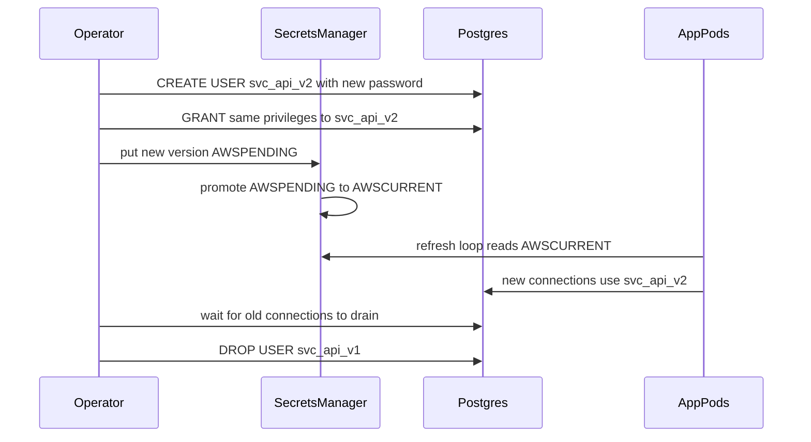

## 40.31 Logging and data protection

#### Concept

Logs are the one place where every piece of data in your system eventually shows up. They are also the least protected place: they are copied to a log aggregator, indexed for search, retained for a year, readable by every engineer, exported to a third-party SaaS, and included in support tickets. A secret in a log is a secret in ten systems.

Data protection in logging is two rules. **Never write the things on the never-log list.** And for everything else that identifies a person, decide deliberately: mask it, hash it, or accept the retention and access consequences of keeping it.

#### Why does it exist?

Because logging is written by a developer at 4 pm on a Thursday who wants to see what happened, and `logger.log(req.body)` is the fastest way to find out. It works, it ships, and eight months later an auditor asks why your log index contains 400,000 plaintext passwords, or GitHub's secret scanner emails you because a token appeared in a public error report.

#### Mental model

Imagine a CCTV system that records everything at the reception desk, including the moment a visitor reads their password off a note. The recording is legitimate and useful. But it is stored for a year, and thirty people have access to it. You would not keep that tape. Logs are the tape.

#### How it works

**The never-log list.** These never appear in logs, at any level, in any environment:

| Never log | Why | What to log instead |
|---|---|---|
| Passwords (plain, and "old"/"new" on change) | Trivially reusable across sites | `event: password.changed`, `userId` |
| Access tokens, refresh tokens, API keys, session ids | Instant account takeover for the log's retention period | Token id (`jti`), key id (`ak_live_7f3...` prefix only) |
| Full card numbers, CVV, expiry with PAN | PCI DSS forbids CVV storage entirely, even encrypted | `last4`, `brand`, `payment_intent_id` |
| OTP codes, MFA secrets, recovery codes | Bypasses the second factor | `event: mfa.verified`, `method: totp` |
| Full request bodies on `/auth/*`, `/payments/*` | Contains all of the above | Field names present, and their validity, not values |
| `Authorization`, `Cookie`, `Set-Cookie` headers | Same as tokens | Presence and scheme (`Bearer`) only |
| Government ids, full DOB, health data | Regulated; disproportionate | A boolean (`kyc_verified: true`) |
| Full addresses in high-volume request logs | Volume turns it into a database | `city`, `country` if you need geography |

**A `pino` redaction config that actually works.** Redaction is a safety net for things that slip through, not a substitute for not logging them. Pino's `redact` takes *paths* relative to the logged object, evaluated at serialisation time, so the paths must match your actual log shape.

```ts
// logger.config.ts (nestjs-pino)
LoggerModule.forRoot({
  pinoHttp: {
    level: process.env.LOG_LEVEL ?? 'info',
    redact: {
      paths: [
        'req.headers.authorization',
        'req.headers.cookie',
        'req.headers["x-api-key"]',        // bracket form for headers with dashes
        'res.headers["set-cookie"]',
        'req.body.password',
        'req.body.newPassword',
        'req.body.currentPassword',
        'req.body.token',
        'req.body.otp',
        'req.body.card',                    // the whole object, not just the number
        '*.password',                       // one level of wildcard, any parent key
        '*.passwordHash',
        '*.refreshToken',
        'user.email',                       // masked below instead, if you prefer
        'err.config.headers.Authorization',  // axios errors carry the outbound request
      ],
      censor: '[REDACTED]',
    },
    serializers: {
      // The strongest control: never let the full request object into the log at all.
      req(req) {
        return { id: req.id, method: req.method, url: req.url.split('?')[0], ip: req.remoteAddress };
      },
      res(res) { return { statusCode: res.statusCode }; },
    },
    autoLogging: { ignore: (req) => req.url === '/healthz' },
  },
});
```

Three things engineers get wrong about pino redaction. Wildcards go one level deep per `*`, so `*.password` catches `body.password` but not `body.user.credentials.password`; use an explicit path or a custom serializer for nested shapes. Redaction applies to the *object you log*, so `logger.info(\`body=${JSON.stringify(req.body)}\`)` produces a string and bypasses redaction entirely. And an `Error` thrown by `axios` carries `err.config.headers` with the outbound `Authorization` header, which is the single most common accidental token leak in Node services.

**PII masking helpers.** Where you need the value to be recognisable but not usable:

```ts
export const mask = {
  email: (e: string) => {
    const [u, d] = e.split('@');
    return d ? `${u.slice(0, 2)}${'*'.repeat(Math.max(u.length - 2, 1))}@${d}` : '[invalid]';
  },
  phone: (p: string) => p.replace(/.(?=.{4})/g, '*'),          // ******1234
  pan:   (p: string) => `**** **** **** ${p.slice(-4)}`,
  // For correlation without storing the value: a keyed hash, so it cannot be brute-forced offline.
  pseudonym: (v: string) => createHmac('sha256', PII_PEPPER).update(v.toLowerCase()).digest('base64url').slice(0, 16),
};
```

`pseudonym` is the useful one: it lets you count "how many distinct emails hit this endpoint" and join across services without any log containing an email. The pepper lives in the secrets manager, not the config file, because a plain SHA-256 of an email is reversible in seconds against a wordlist.

**The right to erasure versus append-only history.** GDPR Article 17 gives a person the right to have their personal data deleted. Your architecture says the opposite in three places: the `audit_events` table is append-only for tamper evidence, the Kafka topic has a 30-day retention and consumers have already materialised it, and last night's backup is immutable in object storage for 35 days.

You cannot `DELETE` your way out of this, and you should not weaken the audit table to try. The answer is **crypto-shredding**:

1. Every user gets a data encryption key (DEK), generated at signup, wrapped by a KMS master key (envelope encryption, 40.16).
2. Every piece of personal data written anywhere — the `users` row's PII columns, the event payloads, the audit event details — is encrypted with that user's DEK.
3. Erasure deletes the DEK. The ciphertext stays where it is, in the audit table, in Kafka, in the backups, and becomes permanently unreadable.

```sql
CREATE TABLE user_data_keys (
  user_id     uuid PRIMARY KEY REFERENCES users(id) ON DELETE RESTRICT,
  wrapped_dek bytea NOT NULL,          -- DEK encrypted by the KMS master key
  kms_key_id  text  NOT NULL,
  created_at  timestamptz NOT NULL DEFAULT now(),
  destroyed_at timestamptz             -- set on erasure; wrapped_dek is set to NULL in the same statement
);

-- Erasure: one statement makes every ciphertext for this user unreadable, everywhere.
UPDATE user_data_keys SET wrapped_dek = NULL, destroyed_at = now()
WHERE user_id = $1 AND destroyed_at IS NULL;
```

What remains after shredding is the *shape* of the history: user `a1b2` placed an order at 14:03 for 4,200 cents. That is usually lawful to retain (financial record-keeping obligations typically require 7 to 10 years), and it is what your audit chain needs to stay intact. What is gone is who `a1b2` was.

Two operational details. Restoring a backup resurrects a shredded user's DEK unless the restore procedure re-applies the erasure log — so keep a small `erasure_requests` table outside the backup rotation and replay it after every restore, as a documented step in the runbook. And invoices are usually a legal exception to erasure; document which fields are exempt rather than arguing about it during a request.

**Retention.** Every data class gets a number and a mechanism, written down:

| Data | Retention | Mechanism |
|---|---|---|
| Application logs (with pseudonyms) | 30 days hot, 90 days cold | Log platform lifecycle policy |
| Access logs at the edge | 90 days | S3 lifecycle rule |
| `audit_events` | 7 years | Monthly partitions, `DETACH` and archive to S3 |
| Order and invoice records | 10 years (tax) | Never deleted; PII crypto-shredded on request |
| Session and refresh token rows | 30 days after expiry | Nightly `DELETE` job, batched |
| Backups | 35 days | Object lock, then automatic expiry |
| Deleted user's PII | Immediate (DEK destroyed) | Crypto-shredding |

**Encryption at rest for PII columns.** Disk-level encryption (RDS storage encryption) protects against someone walking off with a disk, which is not your threat model. It does nothing against a SQL injection, a leaked read replica credential, or a `pg_dump` in a support engineer's downloads folder. For the columns that matter — national id, date of birth, phone, address — encrypt in the application with the user's DEK, and store `bytea`.

The immediate objection is: how do I search? You do not search ciphertext. You add a **blind index**: a keyed HMAC of the normalised value, stored in its own column and indexed. Exact-match lookups work; range and prefix queries do not, which is usually acceptable for the fields that need this treatment.

```sql
ALTER TABLE users
  ADD COLUMN phone_enc bytea,                      -- AES-256-GCM under the user's DEK
  ADD COLUMN phone_bidx bytea;                     -- HMAC-SHA256(pepper, normalised phone)
CREATE INDEX users_phone_bidx_idx ON users (phone_bidx);
-- Lookup: SELECT id FROM users WHERE phone_bidx = $1;  -- $1 computed in the app
```

Note that the blind index leaks equality: two users with the same phone number have the same index value. That is a deliberate, documented tradeoff.

**Backups.** Backups contain everything the database contains, which means every control you applied at the application layer must also hold for the backup: encrypted at rest with a key you control, access limited to a role that humans do not hold day to day, restore tested quarterly (an untested backup is a hope), and a restore procedure that includes replaying the erasure log and rotating any credentials embedded in restored rows.

#### NestJS example

An interceptor that guarantees auth and payment routes never log a body, regardless of what a future developer adds:

```ts
@Injectable()
export class SensitiveRouteInterceptor implements NestInterceptor {
  private static readonly SENSITIVE = [/^\/auth\//, /^\/payments\//, /^\/users\/[^/]+\/mfa/];

  intercept(ctx: ExecutionContext, next: CallHandler) {
    const req = ctx.switchToHttp().getRequest<Request & { log?: pino.Logger; body?: unknown }>();
    if (SensitiveRouteInterceptor.SENSITIVE.some((r) => r.test(req.path))) {
      // Replace the body on the request object used by the HTTP logger with a shape summary.
      const keys = req.body && typeof req.body === 'object' ? Object.keys(req.body) : [];
      (req as any).logBody = { fields: keys, count: keys.length };
      (req as any).body = undefined;   // only for the logger's serializer; the DTO is already bound
    }
    return next.handle();
  }
}
```

#### Production scenario

A fintech logs 90 GB a day. Emails and phone numbers never appear; `pseudonym()` values do, so support can still answer "did this customer's request reach us" by pasting the customer's email into an internal tool that computes the pseudonym. A CI check greps the diff for `logger.*req.body` and `JSON.stringify(req` and fails the build. Erasure requests run about 15 a month, each completing in under a second because it is one `UPDATE` against `user_data_keys`, and the compliance report is a query against `erasure_requests`.

#### Failure scenario

A payments integration logged the full upstream request on error "temporarily, to debug a signature mismatch". The upstream request body contained the card PAN. It ran for nine days before someone noticed the log index size. Every log line in that window went to a third-party SaaS, a Slack alert channel, and two engineers' laptops via a CLI export. The incident became a PCI notification, a forced re-scoping of the log platform, and a three-week project. The technical fix was ten lines of redaction config; the expensive part was proving where the data had gone.

#### Edge cases & failure modes

- Errors from HTTP clients carrying `config.headers.Authorization`.
- Query strings with tokens (`?reset_token=...`) landing in access logs at the load balancer, which your app-level redaction cannot touch.
- Debug logging left at `query` level in TypeORM, printing every bound parameter including password hashes on `INSERT`.
- Stack traces embedding argument values on some runtimes.
- A crash dump or heap snapshot containing everything in memory.
- APM tools capturing request bodies by default; check the agent config.
- Slack or PagerDuty alerts that include the failing payload.
- Log-based metrics that accidentally use email as a label, creating unbounded cardinality *and* PII in the metrics store.

#### How a Senior Backend Engineer thinks about this

They design what the log *should* say before writing it: an event name, ids, and outcomes, never raw objects. They treat redaction as a backstop and structured events as the control. They decide the retention and the erasure story at design time, because retrofitting crypto-shredding onto a system with PII in forty tables and six Kafka topics is a quarter of work. And they ask the uncomfortable question early: if this log index leaked tomorrow, what would we have to tell customers?

#### Common mistakes

- Logging the whole request or the whole user entity.
- Redacting in the aggregator instead of at the source (the data still travelled).
- Assuming disk encryption is data protection.
- `DELETE FROM users` as the erasure implementation, which breaks foreign keys and leaves PII in every other table.
- No plan for backups and event streams in the erasure design.

#### Interview questions

1. *List eight things that must never appear in logs, and what you log instead.*
2. *How do you honour a deletion request when your audit table is append-only?* Expected: crypto-shredding, per-user DEK, retain the shape, document legal exemptions.
3. *Your logs need to correlate users without storing emails. How?* Expected: keyed HMAC pseudonym with a peppered secret.
4. *You must search an encrypted column by exact value. What do you build and what does it leak?* Expected: blind index; equality leakage.
5. *Why is pino `redact` not enough on its own?* Expected: string interpolation bypasses it, nested paths, edge/proxy logs, third-party agents.

#### Practical exercise

Add pino redaction and request serializers to a service, plus a `pseudonym()` helper. Then write a test that posts to `/auth/login`, `/auth/reset`, and `/payments/charge` with realistic bodies and asserts the captured log stream contains none of the sensitive values.

Acceptance criteria: no password, token, OTP or PAN appears in any log line; an `axios` error from a mocked upstream logs no `Authorization` header; erasure of a test user makes their `phone_enc` undecryptable while the corresponding `audit_events` rows still verify.

## 40.32 Secrets management

#### Concept

A secret is any value that grants access: database passwords, JWT signing keys, API keys for Stripe and SendGrid, encryption keys, webhook signing secrets, SSH keys. Secrets management is the discipline of getting those values to the process that needs them without them ending up in git, a log, a Slack message, a Dockerfile, or a laptop.

#### Why does it exist?

Because the default path is a `.env` file that gets committed on day three. GitHub's secret scanning finds tens of thousands of live cloud credentials a year, and the median time from a public commit to an automated abuse attempt is measured in minutes.

#### Mental model

Imagine the difference between writing the safe combination on a whiteboard in the office (environment variables), keeping it in a locked cabinet that logs who opened it and when (a secrets manager), and having the safe issue you a one-time code valid for an hour (short-lived, dynamically generated credentials). Each is better than the last, and each is more work.

#### How it works

**What each option actually protects against:**

| Mechanism | Protects against | Does NOT protect against | Rotation |
|---|---|---|---|
| `.env` file in git | Nothing | Anyone with repo access, forever, including forks and CI caches | Manual, everywhere |
| Env vars injected at deploy | Committing secrets | Anything that reads `process.env`: a crash dump, an error report, `/proc/self/environ`, a malicious dependency | Redeploy |
| Kubernetes `Secret` | Being in the image; RBAC-scoped access | Base64 is not encryption; anyone with `get secret` or exec into the pod; etcd at rest unless encryption is configured | Redeploy or restart |
| Secrets manager (AWS Secrets Manager, Vault) with SDK fetch | Secrets on disk and in the image; gives audit trail, versioning, per-secret IAM | A compromised process still holds the plaintext in memory | Fetch at startup + refresh loop, no redeploy |
| Dynamic credentials (Vault database engine, IAM auth for RDS) | Long-lived credentials existing at all | A live process being abused during the lease | Automatic, minutes to hours |

The realistic target for most teams: secrets manager as the source of truth, injected as env vars at pod start by an operator (External Secrets Operator or the AWS Secrets Store CSI driver), plus IAM database authentication for Postgres where the platform supports it. Env vars are fine as the *transport*; git is never fine as the *store*.

**Rotation without downtime.** Every rotation is the same shape: a window where both the old and the new secret are valid.



For each secret type:

- **Database password**: two users (`svc_api_v1`, `svc_api_v2`) alternating, or AWS Secrets Manager's built-in alternating-user rotation. Never rotate the password of the user your pods are currently connected as without a drain window.
- **JWT signing key**: publish both keys in the JWKS with distinct `kid` values, sign with the new one, keep verifying with the old one for at least the maximum access token lifetime plus clock skew, then remove it. See 40.39 for what happens when you skip the overlap.
- **Webhook signing secret**: most providers support two active secrets; verify against both during the window.
- **API keys you issue**: your `api_keys` table already supports multiple live keys per client, so rotation is "create new, client switches, revoke old after a deadline", with a `last_used_at` column so you can prove the old one is idle.

**A database user per service, with scoped grants.** The single most under-used control in backend security is that PostgreSQL has an authorization system and most teams use exactly one superuser-ish role for everything.

```sql
-- One login role per service; no superuser, no CREATEDB, no CREATEROLE, and a connection cap.
CREATE ROLE svc_orders LOGIN PASSWORD :'pw' CONNECTION LIMIT 40;
CREATE ROLE svc_reporting LOGIN PASSWORD :'pw2' CONNECTION LIMIT 10;

-- Nothing by default.
REVOKE ALL ON SCHEMA public FROM PUBLIC;
GRANT USAGE ON SCHEMA public TO svc_orders, svc_reporting;

-- The orders service owns orders and order_items, and may only read products.
GRANT SELECT, INSERT, UPDATE ON orders, order_items TO svc_orders;
GRANT SELECT ON products, users TO svc_orders;
GRANT USAGE ON ALL SEQUENCES IN SCHEMA public TO svc_orders;
-- No DELETE anywhere: cancellations are a status change, so a bug cannot erase history.

-- Reporting is read-only, cannot see PII columns, and cannot run for more than 30 seconds.
GRANT SELECT (id, status, total_cents, created_at) ON orders TO svc_reporting;
GRANT SELECT ON order_items TO svc_reporting;
ALTER ROLE svc_reporting SET statement_timeout = '30s';
ALTER ROLE svc_reporting SET default_transaction_read_only = on;

-- Migrations run as a separate owner role used only by the deploy job.
GRANT ALL ON ALL TABLES IN SCHEMA public TO svc_migrator;
```

Now a SQL injection in the reporting service cannot write anything, cannot read `users.email`, and cannot hold a connection for more than 30 seconds. That is worth more than another WAF rule.

**IAM least privilege.** The same idea in the cloud: one role per service, policies scoped to specific resources, no wildcards.

```json
{
  "Version": "2012-10-17",
  "Statement": [
    { "Effect": "Allow", "Action": ["s3:PutObject"], "Resource": "arn:aws:s3:::media-quarantine/uploads/*" },
    { "Effect": "Allow", "Action": ["s3:GetObject"], "Resource": "arn:aws:s3:::media-clean/*" },
    { "Effect": "Allow", "Action": ["kms:Decrypt"], "Resource": "arn:aws:kms:eu-west-1:111:key/abc",
      "Condition": { "StringEquals": { "kms:EncryptionContext:tenant": "${aws:PrincipalTag/tenant}" } } },
    { "Effect": "Allow", "Action": ["secretsmanager:GetSecretValue"],
      "Resource": "arn:aws:secretsmanager:eu-west-1:111:secret:prod/orders/*" }
  ]
}
```

No `s3:*`, no `Resource: "*"`, no `iam:PassRole` unless a specific workflow needs it. In CI, use OIDC federation so the pipeline assumes a role for the duration of a job instead of holding a long-lived access key.

**The leaked-key runbook.** When a key leaks, the order matters, and you follow it before you finish the investigation.

1. **Rotate first.** Create the replacement, deploy it, confirm traffic is on the new credential. Minutes, not hours. Do not wait for the root cause.
2. **Revoke the old one.** Actually delete or disable it. A rotated-but-not-revoked key is not rotated.
3. **Audit the blast radius.** What could that credential do, and what did it do? CloudTrail for AWS keys, `pg_stat_activity` plus connection logs for database users, the provider's dashboard for Stripe or SendGrid. Look for use from unexpected IPs, regions and times, and for the specific actions the key permitted.
4. **Contain the consequences.** If the key could read customer data, you are in incident-response territory: preserve logs, involve legal, assess notification obligations.
5. **Rewrite history if it is in git** — `git filter-repo`, force-push, and ask GitHub to expire cached views — but treat the key as burned regardless. Anyone could have cloned it; rewriting history is hygiene, not remediation.
6. **Close the path.** Add the secret scanner (`gitleaks` in pre-commit and in CI), add the missing `.gitignore` entry, and write the postmortem.

#### NestJS example

Fetch from the secrets manager at startup, validate the config, and refresh on an interval so rotation does not need a redeploy:

```ts
@Injectable()
export class SecretsService implements OnModuleInit {
  private cache = new Map<string, { value: Record<string, string>; fetchedAt: number }>();
  private readonly client = new SecretsManagerClient({});
  private readonly logger = new Logger(SecretsService.name);

  async onModuleInit() { await this.refresh(); }

  @Interval(5 * 60_000)                     // @nestjs/schedule; picks up a rotated version within 5 minutes
  async refresh() {
    for (const name of ['prod/orders/db', 'prod/orders/jwt']) {
      try {
        const res = await this.client.send(new GetSecretValueCommand({ SecretId: name }));
        this.cache.set(name, { value: JSON.parse(res.SecretString!), fetchedAt: Date.now() });
      } catch (err) {
        // Never crash on refresh failure: the cached value is still valid. Alert instead.
        this.logger.error({ event: 'secrets.refresh_failed', name }, 'secret refresh failed');
      }
    }
  }

  get(name: string, key: string): string {
    const entry = this.cache.get(name);
    if (!entry) throw new Error(`secret ${name} not loaded`);
    return entry.value[key];
  }
}
```

Pair it with a boot-time config schema that refuses to start if a secret is missing, is the development default, or looks like a placeholder:

```ts
const schema = z.object({
  DATABASE_URL: z.string().url(),
  JWT_PRIVATE_KEY: z.string().min(200),
  STRIPE_SECRET_KEY: z.string().regex(/^sk_(live|test)_/),
}).superRefine((cfg, ctx) => {
  if (process.env.NODE_ENV === 'production' && cfg.STRIPE_SECRET_KEY.startsWith('sk_test_')) {
    ctx.addIssue({ code: 'custom', message: 'test Stripe key in production' });
  }
});
```

#### Production scenario

A platform with 30 services stores every secret in AWS Secrets Manager, one secret per service per environment, synced into Kubernetes by the External Secrets Operator with a 5-minute refresh. Database credentials rotate every 30 days through the alternating-user Lambda; nobody is paged for it. `gitleaks` runs pre-commit and in CI. IAM policies are generated from a Terraform module that refuses wildcards in `Resource`. Two secrets have leaked in three years, both into CI logs; both were rotated within 20 minutes because the runbook is a single page and the on-call has run the drill.

#### Failure scenario

An engineer rotated the production database password in the console at 15:00 on a Tuesday, updated the Kubernetes Secret, and restarted the deployment. The rollout was fine. At 15:04 every background worker started failing: the workers were a separate deployment reading the same Secret, and they had not been restarted, so their pooled connections survived but every new connection failed with `password authentication failed`. Order confirmation emails stopped for 40 minutes. The fix was the alternating-user pattern plus a refresh loop, so that rotation never requires a coordinated restart of everything that shares a credential.

#### Edge cases & failure modes

- Secrets in the Docker image (`ENV` or a copied `.env`), visible to anyone who can pull the image.
- Secrets in Kubernetes ConfigMaps by mistake.
- `process.env` dumped by a crash reporter or an unhandled rejection handler.
- CI logs echoing a secret because a shell command was traced with `set -x`.
- Rotation that forgets a consumer: a cron job, a Lambda, a partner integration.
- Secrets manager throttling or an outage during a mass pod restart; cache and back off.
- Long-lived personal cloud credentials on laptops with no MFA.
- A key rotated but the old value still in the `.env.example` file, which someone copies.

#### How a Senior Backend Engineer thinks about this

They optimise for two properties: **short life** and **narrow scope**. A credential that expires in an hour and can only read one bucket is barely worth stealing. They assume every secret will eventually leak and design so that the leak is survivable: per-service database roles, per-tenant encryption context on KMS keys, scoped API keys with `last_used_at`, and a rotation procedure that has actually been run rather than documented.

#### Common mistakes

- One database user for everything, with `SUPERUSER` "because migrations".
- Rotating without an overlap window.
- Treating Kubernetes Secrets as encrypted (they are base64-encoded by default).
- Long-lived AWS keys in CI instead of OIDC.
- Revoking without rotating, or rotating without revoking.

#### Interview questions

1. *Env var, Kubernetes Secret, or secrets manager: what does each actually buy you?* Expected: the table above; the secrets manager buys audit, versioning, per-secret IAM and rotation without redeploy.
2. *Rotate a JWT signing key with zero downtime.* Expected: two keys in the JWKS with distinct `kid`, sign with new, verify both for the token lifetime, then retire.
3. *Design PostgreSQL roles for a service that reads users and writes orders.* Expected: per-service login role, table and column grants, no DELETE, statement timeout, connection limit.
4. *A Stripe live key was pushed to a public repo 20 minutes ago. Your first four actions?* Expected: rotate, revoke, audit provider logs for use, contain and notify; history rewrite last.

#### Practical exercise

Move one service's secrets out of `.env` into a secrets manager with a startup fetch and a refresh interval. Create per-service PostgreSQL roles with scoped grants. Then rehearse a rotation.

Acceptance criteria: the app boots with no secret values in the repo or the image; `gitleaks` fails CI on a planted fake key; the reporting role cannot `UPDATE` or read `users.email`; a database password rotation completes with zero failed requests measured by the load test running through it.

## 40.33 Security headers

#### Concept

Security headers are instructions to the browser about what it is allowed to do with your response. They cost nothing at runtime and they turn several whole vulnerability classes from "exploitable" into "blocked by the browser". They are also the highest-ratio security work available: `app.use(helmet())` is one line.

#### Why does it exist?

The web's defaults are from 1995 and are permissive: any page may frame yours, any resource may load from anywhere, content types are guessed, referrers leak URLs cross-origin. Headers are the retrofit.

#### Mental model

Imagine sending a document to someone with a cover sheet that says: do not photocopy this, do not put it in a folder with other documents, do not guess what type of file it is, and only accept instructions that came in this envelope. The browser actually obeys.

#### How it works

**What `helmet()` sets by default, one by one:**

| Header | Default value | What it stops |
|---|---|---|
| `Content-Security-Policy` | `default-src 'self';base-uri 'self';font-src 'self' https: data:;form-action 'self';frame-ancestors 'self';img-src 'self' data:;object-src 'none';script-src 'self';script-src-attr 'none';style-src 'self' https: 'unsafe-inline';upgrade-insecure-requests` | Injected scripts executing; data exfiltration to attacker domains; clickjacking via `frame-ancestors` |
| `Strict-Transport-Security` | `max-age=31536000; includeSubDomains` | Downgrade to HTTP; cookie theft on a hostile network |
| `X-Content-Type-Options` | `nosniff` | The browser guessing `text/html` for a file you served as something else |
| `X-Frame-Options` | `SAMEORIGIN` | Clickjacking on old browsers; superseded by `frame-ancestors` |
| `Referrer-Policy` | `no-referrer` | Password reset tokens and internal URLs leaking to third parties |
| `Cross-Origin-Opener-Policy` | `same-origin` | Cross-window scripting; enables cross-origin isolation |
| `Cross-Origin-Resource-Policy` | `same-origin` | Other sites embedding your responses (Spectre-class leaks) |
| `Origin-Agent-Cluster` | `?1` | Shared process with other origins |
| `X-DNS-Prefetch-Control` | `off` | Leaking visited links via DNS |
| `X-Download-Options` | `noopen` | Legacy IE executing downloads in your origin's context |
| `X-Permitted-Cross-Domain-Policies` | `none` | Flash/PDF cross-domain policy abuse |
| `X-XSS-Protection` | `0` | The legacy browser XSS auditor, which itself created vulnerabilities |
| `X-Powered-By` | removed | Free version disclosure |

**HSTS and preload.** `Strict-Transport-Security: max-age=31536000; includeSubDomains; preload` tells browsers to refuse plain HTTP to your domain for a year. Preload submits the domain to a list compiled into the browsers themselves, so even the first-ever request is HTTPS.

The warnings are real: `includeSubDomains` covers *every* subdomain, including that internal tool on `legacy.example.com` that has no certificate; and preload removal takes months to propagate. Roll it out in stages: `max-age=300` for a week, then `86400`, then a year, then `includeSubDomains`, and only then preload — and only when you are certain no subdomain will ever need HTTP.

**A realistic CSP for a JSON API.** An API returns no HTML and loads nothing, so its policy is the strictest possible:

```ts
app.use(helmet({
  contentSecurityPolicy: {
    useDefaults: false,
    directives: {
      'default-src': ["'none'"],
      'frame-ancestors': ["'none'"],
      'base-uri': ["'none'"],
      'form-action': ["'none'"],
      'sandbox': [],
    },
  },
  hsts: { maxAge: 31_536_000, includeSubDomains: true, preload: true },
  crossOriginResourcePolicy: { policy: 'same-site' },
}));
```

If any injected content is ever reflected as HTML from this API, nothing in it can load, execute, submit or frame anything.

**A realistic CSP for a server-rendered page** needs nonces, because `'unsafe-inline'` makes the whole policy decorative:

```ts
app.use((req: Request, res: Response, next: NextFunction) => {
  res.locals.nonce = randomBytes(16).toString('base64');   // fresh per response, never reused
  next();
});
app.use(helmet.contentSecurityPolicy({
  useDefaults: false,
  directives: {
    'default-src': ["'self'"],
    'script-src': ["'self'", (_req, res) => `'nonce-${(res as any).locals.nonce}'`, "'strict-dynamic'"],
    'style-src': ["'self'", "'unsafe-inline'"],            // pragmatic: inline styles are low risk
    'img-src': ["'self'", 'data:', 'https://cdn.example.com'],
    'connect-src': ["'self'", 'https://api.example.com'],
    'frame-ancestors': ["'none'"],
    'object-src': ["'none'"],
    'base-uri': ["'self'"],
    'form-action': ["'self'"],
    'report-uri': ['/csp-report'],
  },
}));
```

Ship it as `Content-Security-Policy-Report-Only` first, collect violations for two weeks, fix the real ones, then enforce. `'strict-dynamic'` lets a nonced bootstrap script load its own chunks without you enumerating every hash.

**CORS revisited: why `origin: true` with credentials is a data leak.** `origin: true` means "reflect whatever `Origin` the request carried into `Access-Control-Allow-Origin`". Combined with `credentials: true`, the browser will send the victim's cookies to your API from *any* site and hand the response to that site's JavaScript. Every authenticated `GET` becomes readable by any page the victim visits.

```ts
// WRONG: reflection. Every origin is allowed, including evil.example.
app.enableCors({ origin: true, credentials: true });

// ALSO WRONG: substring matching. 'https://evil-example.com' ends with 'example.com'.
app.enableCors({ origin: (o, cb) => cb(null, !!o?.endsWith('example.com')), credentials: true });

// RIGHT: exact allow-list, and handle the no-Origin case explicitly.
const ALLOWED = new Set(['https://app.example.com', 'https://admin.example.com']);
app.enableCors({
  origin: (origin, cb) => {
    if (!origin) return cb(null, false);                 // server-to-server: no CORS headers needed
    return ALLOWED.has(origin) ? cb(null, origin) : cb(null, false);
  },
  credentials: true,
  methods: ['GET', 'POST', 'PATCH', 'DELETE'],
  allowedHeaders: ['Content-Type', 'Authorization', 'Idempotency-Key'],
  maxAge: 600,
});
```

Note also that `Access-Control-Allow-Origin: null` must never be allowed: sandboxed iframes and some redirects send `Origin: null`, and allowing it is equivalent to allowing everyone.

#### Production scenario

A team runs a weekly scan of every public hostname checking for the twelve headers above, plus CORS reflection with a forged `Origin`, and opens a ticket automatically on drift. CSP started as report-only and generated 4,000 violations a day, of which 3,900 were a browser extension; the remaining 100 were two legitimate third-party scripts that got explicit entries. Enforcement shipped six weeks later with no incidents.

#### Failure scenario

An engineer added `origin: true` to unblock a partner integration on a Friday. Three weeks later a bug bounty report demonstrated a page on an unrelated domain reading `GET /api/me` and `GET /api/orders` for any logged-in visitor, including full addresses. Impact was limited only because the report came before anyone malicious found it. The lasting fix was a unit test that boots the app and asserts the CORS callback rejects `https://evil.example` and accepts exactly the two known origins.

#### Edge cases & failure modes

- CSP breaking third-party widgets (analytics, chat) that inject inline scripts.
- Nonces reused across responses or cached by a CDN, which defeats them entirely.
- `frame-ancestors` ignored by very old browsers; keep `X-Frame-Options` as well.
- HSTS on an apex domain breaking a subdomain that still serves HTTP.
- Headers set by the app but stripped or overwritten by a proxy or CDN.
- CORS preflight cached for 24 hours, so a fix takes a day to take effect for existing users.
- Error responses (404, 500) rendered by the framework before middleware runs, missing headers.

#### How a Senior Backend Engineer thinks about this

They put helmet in the service template so every new service is correct on day one, they treat CSP as a project with a report-only phase rather than a one-line change, and they never let CORS be configured by copy-paste. They know these headers are defense in depth: a good CSP turns an XSS from account takeover into a report-only violation, but it is not a reason to skip output encoding.

#### Common mistakes

- `helmet()` added after the routes, so it never runs for them.
- CSP with `'unsafe-inline'` and `'unsafe-eval'`, which is no policy at all.
- `origin: '*'` with credentials (browsers reject the literal combination, so people "fix" it with reflection, which is worse).
- HSTS preload submitted before subdomains are ready.

#### Interview questions

1. *Walk me through helmet's defaults and what each one prevents.*
2. *Write a CSP for a JSON API and for a server-rendered page, and explain the difference.* Expected: `default-src 'none'` versus nonces plus `strict-dynamic`.
3. *Why is `origin: true` with `credentials: true` critical?* Expected: reflection makes every authenticated response readable cross-origin.
4. *What are the risks of HSTS preload?* Expected: covers all subdomains, slow to undo.

#### Practical exercise

Add helmet with an explicit configuration, ship a report-only CSP with a `/csp-report` collector, and replace any CORS reflection with an exact allow-list.

Acceptance criteria: an automated test asserts all twelve headers on a sample route and on a 404; a request with `Origin: https://evil.example` receives no `Access-Control-Allow-Origin`; the CSP report endpoint records violations; `curl -I` over plain HTTP shows a redirect and the HSTS header on the HTTPS response.

## 40.34 Audit logging

#### Concept

An audit log answers, months later: **who did what, to what, when, and from where** — with enough integrity that it can be used in a dispute. It is not the application log. Application logs are for debugging, are sampled, and are deleted in 30 days. Audit events are a business record: complete, immutable, retained for years, and queryable by non-engineers.

#### Why does it exist?

Because three questions eventually get asked and only an audit log answers them: "who refunded this order?", "how did this user become an admin?", and "what did the attacker touch between 02:00 and 04:00?". Compliance regimes (SOC 2, PCI, ISO 27001) require it, but the real reason is that without it, every incident investigation is guesswork.

#### Mental model

Imagine a ship's log: bound, sequentially numbered pages, written in ink, signed. You cannot tear out a page without it being obvious, because the page numbers and the running position calculations would not line up. A hash chain is that ledger, in a database.

#### How it works

**The table, append-only with a hash chain:**

```sql
CREATE TABLE audit_events (
  seq          bigserial PRIMARY KEY,             -- monotonic ordering within the chain
  id           uuid NOT NULL DEFAULT gen_random_uuid(),
  occurred_at  timestamptz NOT NULL DEFAULT now(),
  actor_type   text NOT NULL CHECK (actor_type IN ('user','service','system','support')),
  actor_id     uuid,                              -- NULL for 'system'
  on_behalf_of uuid,                              -- set when support impersonates a customer
  action       text NOT NULL,                     -- 'order.refunded', 'role.granted', 'data.exported'
  target_type  text NOT NULL,
  target_id    text NOT NULL,
  tenant_id    uuid,
  ip           inet,
  user_agent   text,
  request_id   text,
  details      jsonb NOT NULL DEFAULT '{}'::jsonb, -- before/after for changes; NEVER raw PII
  prev_hash    bytea NOT NULL,
  hash         bytea NOT NULL
);

CREATE INDEX audit_actor_idx  ON audit_events (actor_id, occurred_at DESC);
CREATE INDEX audit_target_idx ON audit_events (target_type, target_id, occurred_at DESC);
CREATE INDEX audit_action_idx ON audit_events (action, occurred_at DESC);
CREATE INDEX audit_details_idx ON audit_events USING gin (details jsonb_path_ops);

-- Append-only, enforced by the database, not by convention.
REVOKE UPDATE, DELETE, TRUNCATE ON audit_events FROM svc_api, svc_admin;
GRANT INSERT, SELECT ON audit_events TO svc_api, svc_admin;

CREATE OR REPLACE FUNCTION audit_immutable() RETURNS trigger LANGUAGE plpgsql AS $$
BEGIN RAISE EXCEPTION 'audit_events is append-only'; END $$;
CREATE TRIGGER audit_no_change BEFORE UPDATE OR DELETE ON audit_events
  FOR EACH ROW EXECUTE FUNCTION audit_immutable();
```

**The hash chain.** Each row's hash covers its own content plus the previous row's hash:

```text
hash(n) = SHA256( prev_hash(n) || canonical_json(event fields of row n) )
```

Anyone who edits row 500 must recompute rows 500 to the end, which means they must have write access to a table nobody has write access to, and the recomputation is detectable if you have exported checkpoint hashes anywhere else. Publish the latest hash daily to a system with different credentials — an S3 object with Object Lock, or an email to the compliance mailbox — and tampering becomes provable rather than merely unlikely.

```ts
@Injectable()
export class AuditService {
  constructor(private readonly ds: DataSource) {}

  async record(e: AuditEvent) {
    // Serialise the chain with an advisory lock so concurrent writers cannot interleave hashes.
    await this.ds.transaction(async (tx) => {
      await tx.query('SELECT pg_advisory_xact_lock(hashtext($1))', ['audit_chain']);
      const [{ hash: prev }] = await tx.query(
        `SELECT coalesce((SELECT hash FROM audit_events ORDER BY seq DESC LIMIT 1), '\\x00'::bytea) AS hash`);
      const payload = canonicalJson({
        occurredAt: e.occurredAt.toISOString(), actorType: e.actorType, actorId: e.actorId,
        action: e.action, targetType: e.targetType, targetId: e.targetId, details: e.details,
      });
      const hash = createHash('sha256').update(prev).update(payload).digest();
      await tx.query(
        `INSERT INTO audit_events (occurred_at, actor_type, actor_id, action, target_type, target_id,
                                   tenant_id, ip, user_agent, request_id, details, prev_hash, hash)
         VALUES ($1,$2,$3,$4,$5,$6,$7,$8,$9,$10,$11,$12,$13)`,
        [e.occurredAt, e.actorType, e.actorId, e.action, e.targetType, e.targetId,
         e.tenantId, e.ip, e.userAgent, e.requestId, e.details, prev, hash]);
    });
  }
}
```

The advisory lock serialises audit writes, which caps throughput at a few thousand per second on typical hardware. That is fine for admin and money events. If you need to audit every read at high volume, drop the chain for those and keep it for the sensitive subset, or chain per tenant.

**What to record.** Not everything — a log nobody can search is a log nobody reads. The rule: record anything that changes power, changes money, or moves data.

| Category | Events |
|---|---|
| Authentication | `login.success`, `login.failed`, `logout`, `mfa.enrolled`, `mfa.disabled`, `password.changed`, `session.revoked` |
| Authorization | `role.granted`, `role.revoked`, `permission.changed`, `api_key.created`, `api_key.revoked`, `support.impersonation.started` and `.ended` |
| Money | `order.refunded`, `payout.created`, `price.overridden`, `discount.applied_manually`, `invoice.voided` |
| Data | `data.exported` (with row count and filter), `report.downloaded`, `customer.pii_viewed`, `erasure.requested`, `erasure.completed` |
| Configuration | `feature_flag.changed`, `webhook_endpoint.changed`, `integration.credentials_rotated` |
| Admin | Every write from an admin console, with `before` and `after` in `details` |

Two nuances. `details` holds *field names and ids*, or masked values — never a raw PAN or address, or your audit table becomes the thing you have to crypto-shred. And `on_behalf_of` matters: a support agent acting as a customer must be visibly distinct from the customer acting for themselves, or your log will exonerate the wrong person.

**Retention and queryability.** Seven years of admin events is a lot of rows, so partition monthly and archive:

```sql
CREATE TABLE audit_events (...) PARTITION BY RANGE (occurred_at);
CREATE TABLE audit_events_2026_09 PARTITION OF audit_events
  FOR VALUES FROM ('2026-09-01') TO ('2026-10-01');
-- After 13 months: detach, COPY to S3 with Object Lock, drop the partition. The chain hash
-- of the last row in the detached partition is recorded in the archive manifest.
```

Queryable means a real UI: filter by actor, target, action and time range; every order page shows its own audit trail; a "who touched this customer" search that support can run without SQL. If the only way to query the audit log is a Slack message to a backend engineer, it will not be used until an auditor forces it.

#### Production scenario

A marketplace writes about 90,000 audit events a day, dominated by admin console writes and refunds. p99 insert latency is 4 ms including the advisory lock. A nightly job verifies the entire chain for the last 30 days (about 2.7 million rows, 90 seconds) and publishes the head hash to a locked S3 object. The support UI shows an impersonation banner and writes `support.impersonation.started`, which has twice explained a customer complaint in one query.

#### Failure scenario

A refund dispute: a customer claimed they never requested a 1,200 euro refund to a different card. The application log had been rotated out at 30 days. The audit log existed but recorded only `action: 'refund'` and `actor_id`, with no `ip`, no `details`, and no record that the refund destination differed from the original payment method. The company could not prove what happened and absorbed the loss. The redesign added `details` with before/after, `ip`, `request_id` to join back to application logs, and a specific `refund.destination_changed` event that also triggers an alert.

#### Edge cases & failure modes

- Audit write inside the business transaction: if the business transaction rolls back, the audit event vanishes; if it is outside and the business write fails, you have a phantom event. Choose deliberately — usually inside, with the event describing intent and outcome.
- The advisory lock becoming a bottleneck under a bulk admin operation; batch the operation into one event with a count.
- Clock skew across pods making `occurred_at` non-monotonic; the `seq` column is the ordering of record.
- Audit rows containing PII that then needs erasure; store ids and masked values only.
- A replica used for audit queries lagging during an incident.
- Nobody verifying the chain, so tampering would go unnoticed anyway; automate the verification and alert on failure.

#### How a Senior Backend Engineer thinks about this

They separate audit from logging at design time, because retrofitting a business record onto debug logs never works. They pick the event list from the questions they expect to be asked, not from what is easy to instrument. They make the table append-only at the database level, because "we agreed not to update it" is not a control. And they make it queryable by the people who need it, since an audit log that only engineers can read is a compliance artifact, not a tool.

#### Common mistakes

- Auditing reads and writes at the same volume, drowning the signal.
- Storing raw PII in `details`.
- Allowing the app role to `UPDATE` or `DELETE` audit rows.
- No `ip`, no `user_agent`, no `request_id`, so the event cannot be correlated with anything.
- Never testing the verification job.

#### Interview questions

1. *Audit log versus application log: name four differences.* Expected: purpose, completeness, immutability, retention, audience.
2. *How do you make an audit table tamper-evident?* Expected: hash chain, append-only grants and trigger, external checkpoint publication.
3. *What do you record for a refund?* Expected: actor, on-behalf-of, order, amount, destination, before/after, ip, request id.
4. *Where does the audit write belong relative to the business transaction, and why?*

#### Practical exercise

Implement `audit_events` with the hash chain, the immutability trigger and the grants. Record admin actions and refunds. Write a verification command that walks the chain.

Acceptance criteria: an attempt to `UPDATE` an audit row fails; the verifier detects a row modified by a superuser; concurrent writes from 20 parallel requests produce an unbroken chain; the order detail page shows its audit trail, including the acting support agent when impersonation was used.

## 40.35 Rate limiting and abuse prevention

#### Concept

Rate limiting is how you keep a shared resource usable when some callers are hostile, buggy or simply enthusiastic. It is a security control (it slows brute force and enumeration), a cost control (each request costs CPU, database time and money), and an availability control (one client must not consume the capacity of all).

#### Why does it exist?

Because without it, the cheapest attack on any API is repetition. Ten thousand login attempts, a million password reset emails sent to your customers from your domain, an OTP brute-forced in 40 minutes, or a search endpoint that runs a 200 ms query called 500 times a second by one script.

#### Mental model

Imagine a busy bakery. One rule ("three loaves per customer") stops one person clearing the shelves. But the person who cares only about denying everyone else brings twenty friends. So you also count loaves per household, per street, and you notice when the whole town's demand triples in a minute. That is layered limiting: per identity, per source, per resource, and globally.

#### How it works

**The dimensions, and what each catches:**

| Key | Typical limit | Catches | Misses |
|---|---|---|---|
| Per IP | 100/min general, 10/min on `/auth/*` | Scripts, scrapers, single-source floods | Botnets, residential proxies, NAT punishes real users |
| Per authenticated user | 600/min | A compromised or abusive account | Attacks before login |
| Per API key | Plan-based: 60/min free, 6,000/min enterprise | Partner integrations in a retry loop | Nothing, if the key is the right unit |
| Per account (by email, on auth routes) | 5 failures / 15 min | Credential stuffing spread across IPs | Attacks that try one password per account |
| Per endpoint cost | Token bucket with weights | Expensive endpoints being called cheaply | Nothing, but needs cost estimates |
| Global | Alert at 3x baseline failure rate | Coordinated campaigns | Slow-and-low attacks |

**Endpoint cost weighting.** Not all requests are equal. `GET /products/:id` is a 1 ms cached read; `POST /reports/export` runs a 4-second aggregate and writes a file. Charge accordingly from one bucket:

```ts
export const ENDPOINT_COST: Record<string, number> = {
  'GET /products': 1,
  'GET /orders': 2,
  'POST /orders': 5,
  'POST /reports/export': 50,
  'POST /auth/login': 10,
};

@Injectable()
export class CostLimitGuard implements CanActivate {
  constructor(private readonly redis: RedisService) {}

  async canActivate(ctx: ExecutionContext): Promise<boolean> {
    const req = ctx.switchToHttp().getRequest<Request & { user?: JwtUser }>();
    const key = `rl:cost:${req.user?.sub ?? req.ip}`;
    const cost = ENDPOINT_COST[`${req.method} ${req.route?.path}`] ?? 1;
    // Sliding-window token bucket in one round trip; 600 units per minute.
    const used = await this.redis.client.eval(BUCKET_LUA, 1, key, String(cost), '600', '60');
    if (used === -1) throw new HttpException({ code: 'RATE_LIMITED', retryAfter: 60 }, 429);
    return true;
  }
}
```

Always return `429` with `Retry-After` and `RateLimit-Limit` / `RateLimit-Remaining` / `RateLimit-Reset` headers. A well-behaved client that knows its budget stops hammering you; a client that gets an opaque 500 retries harder.

**Auth endpoints specifically.** These need the tightest and most layered limits, because they are the ones under permanent attack:

```ts
@Public()
@Throttle({ default: { limit: 10, ttl: 60_000 } })     // per IP
@Post('login')
async login(@Body() dto: LoginDto, @Req() req: Request) {
  // Plus a per-account counter in Redis (5 failures / 15 min -> progressive delay, then captcha),
  // plus a global failure-rate alert. See 22.25 for the full pattern.
  return this.auth.login(dto, { ip: req.ip!, ua: req.headers['user-agent'] });
}
```

**OTP throttling.** A 6-digit code has one million possibilities. Without limits, an attacker guesses it in minutes. The rules:

- Maximum 5 verification attempts per code; after that the code is dead and must be re-requested.
- Maximum 3 code requests per account per hour, and 10 per day, with exponential backoff between them (30 s, 60 s, 300 s).
- Codes expire in 5 minutes and are single-use, consumed atomically (`UPDATE ... WHERE used_at IS NULL RETURNING`).
- Rate limit by *destination* too, not just account: 20 SMS per phone number per day, because SMS costs real money and "SMS pumping" fraud exists — attackers cycle premium-rate numbers to earn a share of the carrier fee.
- Alert on a spike in requests to unusual country codes; that is the SMS-pumping signature.

```ts
const attempts = await this.redis.client.incr(`otp:attempts:${challengeId}`);
await this.redis.client.expire(`otp:attempts:${challengeId}`, 300);
if (attempts > 5) {
  await this.otp.invalidate(challengeId);
  throw new HttpException({ code: 'OTP_LOCKED' }, 429);
}
```

**Captcha at signup.** Use it where the cost of a false positive is low and the value to an attacker is high: registration, password reset, and login after N failures. Prefer an invisible or risk-based challenge (Turnstile, reCAPTCHA v3, hCaptcha) so real users see nothing. Verify the token **server-side** with the provider's siteverify endpoint, check the returned hostname and action, and treat a verification-service outage as a decision you have made in advance — usually "allow, but flag the account for review", because failing closed on signup means your product is down.

**Enumeration-resistant responses.** Rate limits do not help if the response tells the attacker whether they guessed right. Across every public endpoint, the same identity question must get the same answer:

| Endpoint | Leaky | Resistant |
|---|---|---|
| `POST /auth/login` | "No account with that email" vs "Wrong password" | `401 Invalid email or password` for both, same timing |
| `POST /auth/register` | `409 Email already registered` | `202 Check your email` always; send a "someone tried to register" mail to the existing address |
| `POST /auth/forgot` | 200 for real, 404 for unknown | `202 If that email exists, we sent a link`, always, and always do the same work |
| `GET /orders/:id` | `403` for someone else's order, `404` for missing | `404` for both |
| `POST /coupons/apply` | "Coupon expired" vs "No such coupon" | One message for both |

Timing counts as a response. If the unknown-email path skips the password hash, it returns 60 ms faster and the attacker measures it; always run a dummy hash. And rate limiting itself can leak: if the limiter only engages for existing accounts, the 429 is the oracle.

#### Production scenario

An API at 2,000 requests per second uses `@nestjs/throttler` with Redis storage (shared across 30 pods), an IP limit of 100/min, a per-user cost bucket of 600 units/min, per-key plan limits for partners, and a 5-failures-per-15-minutes account counter on auth. About 0.4 percent of requests get a 429, almost all from three partner integrations with aggressive retry loops; a Grafana panel shows 429s by key so the account manager can call them. During a credential-stuffing campaign the account counters plus a captcha switch cut the attack's success rate to zero within 12 minutes.

#### Failure scenario

A team ran per-pod in-memory rate limiting. Under a Black Friday scale-out from 8 to 60 pods, the effective limit became 7.5 times higher, and a scraper that had been contained for months suddenly pulled the entire product catalogue, including unlisted items, in 40 minutes. The in-memory limiter had never been wrong; it had just never been correct either. The fix was Redis-backed storage and an alert on the ratio of 429s to total requests dropping to zero, which is what "the limiter stopped working" looks like on a dashboard.

#### Edge cases & failure modes

- Redis unavailable: decide fail-open (availability) or fail-closed (security) per endpoint. Auth routes fail closed; product listing fails open.
- `req.ip` behind a load balancer returning the proxy IP; set `trust proxy` correctly and only trust your own hops of `X-Forwarded-For`.
- IPv6 attackers rotating through a /64; key on the /64 prefix, not the full address.
- Corporate NAT putting 5,000 real users behind one IP.
- Limits applied after expensive work (authentication, a database lookup) instead of before.
- Retry storms after a 429 without `Retry-After` or jitter.
- WebSocket and GraphQL entry points bypassing HTTP-based limiters; limit per message and per query cost.
- The limiter itself becoming the bottleneck: use one Lua round trip, not read-then-write.

#### How a Senior Backend Engineer thinks about this

They limit on the unit that matters: the account for auth, the API key for partners, the user for cost, the IP only as a coarse net. They put the limiter before expensive work and share state in Redis. They tune with data, starting in log-only mode to see what a real limit would have blocked. And they pair every limit with a dashboard and an alert, because a rate limiter you cannot observe is a rate limiter you will misconfigure and never notice.

#### Common mistakes

- In-memory limits with multiple replicas.
- One global limit for cheap and expensive endpoints alike.
- 429 without `Retry-After`.
- Hard account lockout, which lets an attacker deny service to every user.
- Captcha verified only in the browser.
- Rate limiting that differs between existing and non-existing accounts, becoming an enumeration oracle.

#### Interview questions

1. *Which key do you rate limit on, and why does it depend on the endpoint?* Expected: account for auth, key for partners, user for cost, IP as a coarse net.
2. *Redis is down. What does your limiter do?* Expected: per-endpoint decision; auth fails closed, reads fail open; alert either way.
3. *How do you stop OTP brute force?* Expected: attempts per code, requests per account, expiry, single use, destination limits, backoff.
4. *Give three ways an API leaks whether an account exists, including one that is not a message.* Expected: status codes, timing, rate-limit behaviour, response size.
5. *How do you weight endpoints by cost?* Expected: token bucket with per-route weights from measured p95 cost.

#### Practical exercise

Implement layered limiting: `@nestjs/throttler` with Redis storage for per-IP, a cost-weighted per-user bucket in Lua, a per-account auth failure counter, and OTP attempt limits. Make all identity-revealing responses uniform.

Acceptance criteria: limits hold across three concurrently running app instances; `POST /reports/export` exhausts the budget in 12 calls while `GET /products` allows 600; a 429 carries `Retry-After` and `RateLimit-*` headers; login timing for an unknown email is within 10 percent of a wrong password over 50 samples; six wrong OTP attempts invalidate the code.
