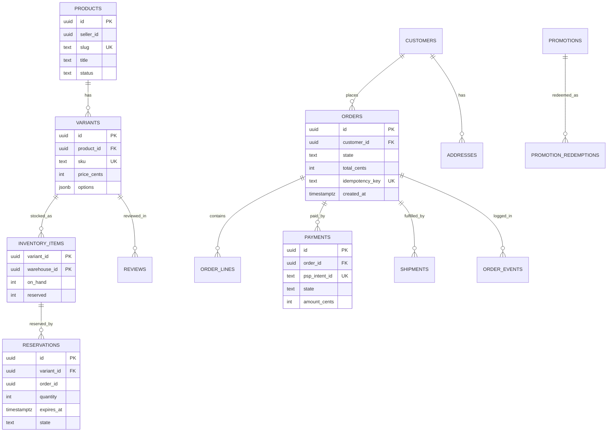
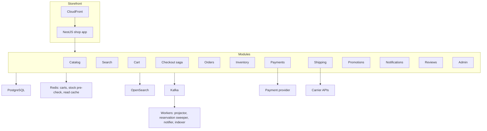
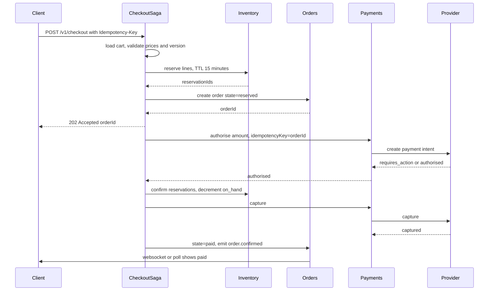
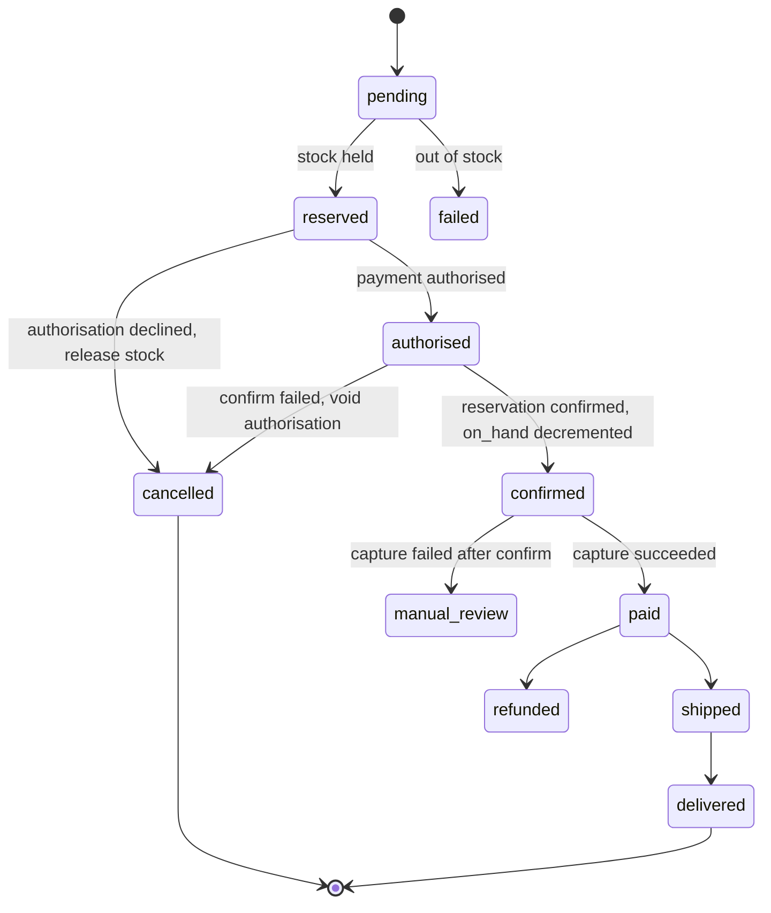
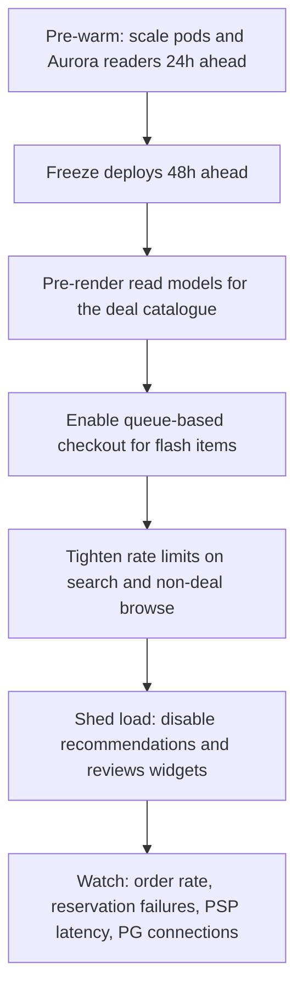
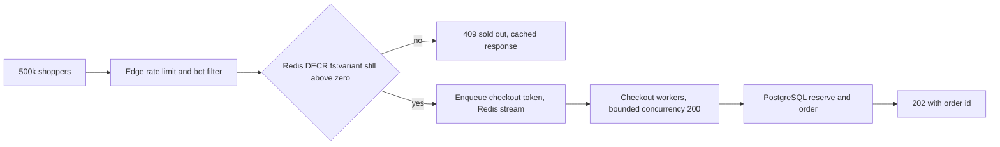

## 40.14 E-commerce Platform (end to end)

### 40.14.1 Requirements

This is the synthesis design. Almost every pattern in this book appears here at once: transactions and isolation levels, idempotency, the outbox, sagas, caching and invalidation, search indexing, queues, read models, rate limiting, distributed locks, partitioning, and a money path where being wrong costs real money and a support ticket.

An e-commerce platform lets a shopper find a product, put it in a cart, pay for it, and receive it, while a merchant manages the catalogue, stock, prices and promotions, and the business does not lose money to overselling, double charging or a search index that says "in stock" when it is not. The users are shoppers (mostly anonymous, browsing), buyers (authenticated, checking out), customer service agents (looking up orders), merchandisers (running promotions) and warehouse operators (fulfilling).

Imagine a large physical shop. The shelves are the catalogue. A shopper puts items in a trolley (the cart). At the till, the cashier does several things that must all succeed together: sets the items aside so nobody else takes them (reserve stock), writes the receipt (create order), asks the card machine for approval (authorise payment), and only when the card says yes does the money actually move (capture) and the goods leave the shop (ship). If the card machine times out after the money left the buyer's account but before the cashier printed the receipt, you have the single hardest problem in this design, and no amount of database transactions solves it, because the card network is not in your database.

### 40.14.2 Functional requirements

1. Browse a catalogue of products with variants (size, colour), categories, images, prices and availability.
2. Search and filter products, with facets, sorting and typo tolerance.
3. Add to cart, update quantity, remove, and merge an anonymous cart into an account cart on login.
4. Check out: address, shipping method, payment method, promotion code, place order.
5. Take payment through a payment service provider with 3-D Secure, and support authorise-then-capture.
6. Track inventory per stock-keeping unit per warehouse, with reservations that expire.
7. Manage orders through their lifecycle, including cancellation, partial shipment, return and refund.
8. Send notifications: order confirmation, shipping, delivery, refund.
9. Accept product reviews with ratings, moderated.
10. Run promotions: percentage and fixed discounts, free shipping, single-use codes, per-customer limits.
11. Provide an admin surface for catalogue, orders, refunds and promotions with an audit trail.
12. Survive a flash sale: 100,000 units of one product, half a million shoppers, one minute.

### 40.14.3 Non-functional requirements

| Property | Target | Why |
|---|---|---|
| Product page latency | p95 under 150 ms server-side | Conversion drops measurably with latency |
| Search latency | p95 under 250 ms | Search is where buying intent is highest |
| Checkout availability | 99.99 percent | Every minute down is money not taken |
| Browse availability | 99.95 percent, degrading to a cached catalogue | Browsing can survive a database blip |
| Order correctness | Exactly one order per successful payment, always | Non-negotiable |
| Oversell rate | Zero for reserved stock; tolerated only where explicitly configured as backorder | Cancelling a paid order is the worst customer experience the platform can produce |
| Inventory freshness on the product page | Under 30 s stale | "Only 2 left" must be roughly true |
| Search index freshness | Under 60 s for price and stock, under 5 min for text | A stale price is a legal problem in some markets |
| Peak capacity | 50x baseline peak for 4 hours | Black Friday |

### 40.14.4 Constraints

- One team of thirty engineers. This is the decisive constraint and it is why the design starts as a **modular monolith**, not as fifteen microservices.
- Stack: NestJS, PostgreSQL (Aurora), Redis, Kafka, S3, CloudFront, on EKS.
- Payments go through a PSP (Stripe or Adyen). Card data never touches our servers; we are SAQ-A scope through hosted fields.
- Tax and shipping rate calculation are third-party APIs with 200 to 800 ms latency and their own outages.
- The company plans to open the platform to third-party sellers within two years, so the data model must anticipate a seller dimension without paying for it now.

### 40.14.5 Capacity estimation

| Quantity | Assumption | Calculation | Result |
|---|---|---|---|
| Registered customers | | given | 8 million |
| Daily active shoppers | | given | 3 million |
| Product page views per shopper per day | | 12 | |
| Product page views per day | 3M x 12 | | 36 million |
| Product page views per second, average | 36M / 86,400 | | 417 |
| Product page views per second, baseline peak | 4x evening | | 1,670 |
| Searches per day | 40 percent of sessions search | | 8 million |
| Searches per second, baseline peak | 8M / 86,400 x 4 | | 370 |
| Orders per day | 3 percent conversion on 6M sessions | | 180,000 |
| Orders per second, average | 180,000 / 86,400 | | 2.1 |
| Orders per second, baseline peak | 4x | | 8.3 |
| Checkout API calls per order | address, shipping, promo, place, poll | 6 | |
| Checkout calls per second, baseline peak | 8.3 x 6 | | 50 |
| Cart writes per second, baseline peak | 3 per session, 200 sessions per second | | 600 |

Now Black Friday, where the whole design is actually tested.

| Quantity | Multiplier | Calculation | Result |
|---|---|---|---|
| Product page views per second, BF peak | 50x baseline peak | 1,670 x 50 | 83,500 |
| Searches per second, BF peak | 30x (people browse deals more than they search) | 370 x 30 | 11,100 |
| Orders per second, BF peak | 50x | 8.3 x 50 | 415 |
| Checkout calls per second, BF peak | 415 x 6 | | 2,490 |
| Cart writes per second, BF peak | 50x | | 30,000 |
| Payment authorisations per second | 415 plus 8 percent retries | | 450 |
| Inventory decrements per second | 415 orders x 2.4 lines | | 1,000 |
| Order rows per day at BF volume | 415 x 3,600 x 8 peak-equivalent hours | | about 4 million |

| Flash sale (one product, 100,000 units) | Assumption | Calculation | Result |
|---|---|---|---|
| Shoppers waiting at the drop | | given | 500,000 |
| Requests in the first 5 seconds | Each client retries twice | 500,000 x 3 / 5 | 300,000 per second |
| Requests that can possibly succeed | Units available | | 100,000 total |
| Ratio of doomed to useful requests | 1.5M / 100,000 | | 15 to 1 |

That last ratio is the argument for a queue-based checkout with a Redis stock pre-check. Ninety-three percent of the traffic in a flash sale is requests that cannot succeed, and if they reach PostgreSQL they will take the database down for the seven percent that could.

| Storage | Calculation | Result |
|---|---|---|
| Products and variants | 500,000 products x 4 variants x 1.5 KB | 3 GB |
| Orders per year | 65M rows x 800 B plus 160M line items x 300 B | 100 GB |
| Inventory ledger per year | 200M movements x 200 B | 40 GB |
| Carts in Redis | 2M active carts x 3 KB | 6 GB |
| Search index | 2M variant documents x 4 KB | 8 GB |

The database is small. That is worth saying out loud, because engineers routinely reach for exotic storage on an e-commerce platform whose entire order history fits on a laptop. The difficulty here is concurrency and correctness, not volume.

### 40.14.6 API design

| Method | Path | Request | Response | Status codes | Idempotent | Auth |
|---|---|---|---|---|---|---|
| GET | `/v1/products/{slug}` | | product read model | 200, 404 | Yes | Optional |
| GET | `/v1/search` | `?q=&filters=&sort=&cursor=` | results with facets | 200, 400 | Yes | Optional |
| GET | `/v1/cart` | | cart with totals | 200 | Yes | Session or user |
| PUT | `/v1/cart/items/{variantId}` | `{ quantity }` | cart | 200, 400, 409 | Yes | Session or user |
| DELETE | `/v1/cart/items/{variantId}` | | cart | 200 | Yes | Session or user |
| POST | `/v1/cart/promotion` | `{ code }` | cart with discount | 200, 404, 409, 422 | Yes | Session or user |
| POST | `/v1/checkout/quote` | `{ addressId, shippingMethodId }` | totals with tax and shipping | 200, 422 | Yes | User |
| POST | `/v1/checkout` | `{ cartVersion, addressId, shippingMethodId, paymentMethodId }` plus `Idempotency-Key` | `{ orderId, state, nextAction? }` | 202, 409, 422 | Yes, via key | User |
| GET | `/v1/orders/{id}` | | order read model | 200, 403, 404 | Yes | Owner or agent |
| GET | `/v1/orders` | `?cursor=` | order history | 200 | Yes | User |
| POST | `/v1/orders/{id}/cancel` | `{ reason }` plus `Idempotency-Key` | order | 200, 409 | Yes, via key | Owner or agent |
| POST | `/v1/orders/{id}/returns` | `{ lines[] }` | return | 201, 409 | Yes | Owner |
| POST | `/v1/webhooks/psp` | PSP event, signed | | 200, 400 | Yes, by event id | Signature |
| POST | `/v1/admin/products` | product | product | 201, 409 | Yes | Admin |
| PUT | `/v1/admin/inventory/{sku}` | `{ warehouseId, onHand }` | | 200 | Yes | Admin |

Three deliberate choices. `POST /v1/checkout` returns **202 Accepted**, not 201, because placing an order is a saga that may take seconds and may require a 3-D Secure redirect; the client polls `GET /v1/orders/{id}` or listens on a websocket. `cartVersion` is sent by the client and checked against the server's version, so a cart modified in another tab produces a 409 rather than an order for the wrong items. And the PSP webhook is idempotent by event id, because payment providers deliver webhooks more than once by design, and treating that as an anomaly rather than the norm is how platforms end up refunding twice.

### 40.14.7 Data model



```sql
CREATE TABLE variants (
  id          uuid PRIMARY KEY DEFAULT gen_random_uuid(),
  product_id  uuid NOT NULL REFERENCES products(id) ON DELETE CASCADE,
  sku         text NOT NULL,
  price_cents integer NOT NULL CHECK (price_cents >= 0),   -- money is integer cents, never float
  currency    char(3) NOT NULL DEFAULT 'EUR',
  options     jsonb NOT NULL DEFAULT '{}'::jsonb,
  active      boolean NOT NULL DEFAULT true
);
CREATE UNIQUE INDEX variants_sku_uidx ON variants (sku);              -- serves warehouse and feed lookups
CREATE INDEX variants_product_idx ON variants (product_id) WHERE active;  -- serves the product page

CREATE TABLE inventory_items (
  variant_id   uuid NOT NULL REFERENCES variants(id),
  warehouse_id uuid NOT NULL REFERENCES warehouses(id),
  on_hand      integer NOT NULL CHECK (on_hand >= 0),
  reserved     integer NOT NULL DEFAULT 0 CHECK (reserved >= 0),
  version      integer NOT NULL DEFAULT 0,
  PRIMARY KEY (variant_id, warehouse_id),
  CONSTRAINT no_oversell CHECK (reserved <= on_hand)      -- the database refuses to oversell, not the code
);

CREATE TABLE reservations (
  id         uuid PRIMARY KEY DEFAULT gen_random_uuid(),
  variant_id uuid NOT NULL,
  warehouse_id uuid NOT NULL,
  order_id   uuid,
  cart_id    text,
  quantity   integer NOT NULL CHECK (quantity > 0),
  state      text NOT NULL DEFAULT 'held' CHECK (state IN ('held','confirmed','released','expired')),
  expires_at timestamptz NOT NULL,
  FOREIGN KEY (variant_id, warehouse_id) REFERENCES inventory_items (variant_id, warehouse_id)
);
CREATE INDEX reservations_expiry_idx ON reservations (expires_at) WHERE state = 'held';
  -- serves the sweeper that releases abandoned reservations

CREATE TABLE orders (
  id              uuid PRIMARY KEY DEFAULT gen_random_uuid(),
  customer_id     uuid NOT NULL REFERENCES customers(id),
  state           text NOT NULL DEFAULT 'pending'
                    CHECK (state IN ('pending','reserved','authorised','confirmed','paid',
                                     'shipped','delivered','cancelled','refunded','failed')),
  total_cents     integer NOT NULL,
  currency        char(3) NOT NULL,
  idempotency_key text NOT NULL,
  created_at      timestamptz NOT NULL DEFAULT now()
) PARTITION BY RANGE (created_at);
CREATE UNIQUE INDEX orders_idem_uidx ON orders (idempotency_key);      -- one order per checkout attempt, enforced
CREATE INDEX orders_customer_idx ON orders (customer_id, created_at DESC);  -- serves order history keyset pages

CREATE TABLE order_events (
  id         bigserial,
  order_id   uuid NOT NULL,
  seq        integer NOT NULL,
  type       text NOT NULL,      -- 'stock.reserved','payment.authorised','payment.captured', ...
  payload    jsonb NOT NULL,
  created_at timestamptz NOT NULL DEFAULT now(),
  PRIMARY KEY (order_id, seq)    -- append-only history; seq makes replay deterministic
) PARTITION BY HASH (order_id);

CREATE TABLE promotion_redemptions (
  promotion_id uuid NOT NULL REFERENCES promotions(id),
  customer_id  uuid NOT NULL,
  order_id     uuid NOT NULL,
  PRIMARY KEY (promotion_id, customer_id)   -- one redemption per customer, enforced by the database
);
```

The two constraints that carry the most weight are `CHECK (reserved <= on_hand)` and `UNIQUE (promotion_id, customer_id)`. Both encode a business rule that application code would try to enforce with a read-then-write and would get wrong under concurrency. When the database refuses the write, the worst case is an error the code must handle; when the application "checks first", the worst case is an oversold product or a discount code used ten thousand times.

### 40.14.8 High-level architecture

The platform ships as one deployable NestJS application with strictly separated modules, plus a small number of workers. This is a modular monolith, and it is the right answer for a thirty-person team.



The module map is not decoration; it is the seam plan. Every module owns its tables and exposes a TypeScript interface. No module reads another module's tables directly, and cross-module calls go through the interface or through a domain event. That single rule is what makes the eventual extraction of a service a two-week job rather than a two-year one.

| Module | Owns tables | Publishes | Consumes | Extraction priority |
|---|---|---|---|---|
| Catalog | `products`, `variants`, `categories`, `media` | `product.changed` | | Low, chatty with everything |
| Search | none (index only) | | `product.changed`, `inventory.changed`, `price.changed` | **First**: different scaling profile, no shared transactions |
| Cart | Redis plus `carts` backup | `cart.changed` | `price.changed` | Second: enormous write volume, no joins to orders |
| Inventory | `inventory_items`, `reservations`, `stock_movements` | `inventory.changed`, `stock.reserved` | | Third: needs its own scaling and correctness boundary |
| Checkout | `checkout_sessions` | saga commands | all saga replies | Never: it is the orchestrator |
| Orders | `orders`, `order_lines`, `order_events` | `order.*` | payment and shipment events | Late |
| Payments | `payments`, `refunds`, `psp_events` | `payment.*` | PSP webhooks | Fourth: PCI boundary is a natural seam |
| Shipping | `shipments`, `shipment_lines` | `shipment.*` | `order.confirmed` | Fifth |
| Promotions | `promotions`, `promotion_redemptions` | | `order.confirmed` | Low |
| Notifications | `notification_log` | | `order.*`, `shipment.*` | Second: pure consumer, trivially separable |
| Reviews | `reviews` | `review.published` | `order.delivered` | Low |

Search, Notifications and Cart come out first because they are pure consumers or pure caches with no shared transaction requirement. Inventory and Payments come out next because their correctness boundaries and scaling profiles genuinely differ. Catalog and Orders stay in the core the longest because everything joins to them, and splitting them buys distributed joins and nothing else.

### 40.14.9 Component design

```text
src/
  catalog/            products.service.ts, variants.service.ts, catalog.public-api.ts
  search/             indexer.worker.ts, search.service.ts, query-builder.ts
  cart/               cart.controller.ts, cart.store.ts (Redis), cart-backup.worker.ts
  checkout/
    checkout.controller.ts
    checkout.saga.ts             -- the orchestrator
    steps/                       -- one file per step, each with execute and compensate
    checkout-session.entity.ts
  inventory/          inventory.service.ts, reservation.service.ts, sweeper.worker.ts
  orders/             orders.service.ts, order-state.machine.ts, order-read-model.worker.ts
  payments/           payments.service.ts, psp.adapter.ts, webhook.controller.ts
  shipping/           shipping.service.ts, carrier.adapter.ts
  promotions/         promotions.service.ts, redemption.service.ts
  notifications/      notification.worker.ts
  shared/             outbox/, idempotency/, money/, events/
```

The checkout saga is the centrepiece. It is an **orchestrated** saga: one component owns the sequence and the compensations, because a choreographed version of a seven-step money flow becomes impossible to reason about the first time a step fails in an unusual place.





Notice the order of `authorise` before `confirm reservation` and `capture` after. That ordering is the whole design. Authorisation is reversible (a void costs nothing and the customer sees a pending charge disappear). Capture is not reversible without a refund, which costs money and takes days. So every irreversible step happens last, when everything else has already succeeded.

```ts
// checkout/checkout.saga.ts (core loop, abbreviated)
@Injectable()
export class CheckoutSaga {
  private readonly steps: SagaStep[];   // reserve, createOrder, authorise, confirmStock, capture

  async run(sessionId: string): Promise<void> {
    const session = await this.sessions.loadForUpdate(sessionId);
    for (let i = session.completedSteps; i < this.steps.length; i++) {
      const step = this.steps[i];
      try {
        // Every step is idempotent on (sessionId, step.name); re-running after a crash is safe.
        await step.execute(session);
        await this.sessions.markCompleted(sessionId, i + 1, step.name);
      } catch (err) {
        if (err instanceof RetryableError && session.attempt < 5) {
          await this.scheduleRetry(sessionId, backoff(session.attempt));
          return;
        }
        await this.compensate(session, i);   // unwind completed steps in reverse
        await this.sessions.fail(sessionId, String(err));
        return;
      }
    }
    await this.sessions.complete(sessionId);
  }

  private async compensate(session: CheckoutSession, failedIndex: number): Promise<void> {
    for (let i = failedIndex - 1; i >= 0; i--) {
      try {
        await this.steps[i].compensate(session);
      } catch (err) {
        // A failed compensation is an operations problem, not a customer problem: park it.
        await this.alerts.raise('saga.compensation.failed', { sessionId: session.id, step: this.steps[i].name });
        await this.sessions.park(session.id);
        return;
      }
    }
  }
}
```

Reserving stock is the step where concurrency lives, and it is a single statement, not a read-then-write.

```ts
// inventory/reservation.service.ts
async reserve(variantId: string, warehouseId: string, qty: number, orderId: string): Promise<string> {
  return this.dataSource.transaction(async (m) => {
    // Conditional update: the WHERE clause is the concurrency control. No SELECT, no race window.
    const res = await m.query(
      `UPDATE inventory_items
          SET reserved = reserved + $3, version = version + 1
        WHERE variant_id = $1 AND warehouse_id = $2
          AND on_hand - reserved >= $3
       RETURNING on_hand - reserved AS remaining`,
      [variantId, warehouseId, qty]);
    if (res.length === 0) throw new OutOfStockError(variantId, qty);

    const [row] = await m.query(
      `INSERT INTO reservations (variant_id, warehouse_id, order_id, quantity, expires_at, state)
       VALUES ($1,$2,$3,$4, now() + interval '15 minutes', 'held')
       ON CONFLICT (order_id, variant_id) DO UPDATE SET quantity = EXCLUDED.quantity
       RETURNING id`,
      [variantId, warehouseId, orderId, qty]);
    return row.id;
  });
}
```

The `WHERE on_hand - reserved >= $3` clause is the oversell prevention. Two concurrent transactions both run this statement; PostgreSQL serialises the row-level updates, the second one re-evaluates the condition against the first one's committed value, and one of them gets zero rows. No application-level lock, no `SELECT FOR UPDATE` round trip, no race.

Reservations expire. A sweeper runs every 30 seconds:

```sql
WITH expired AS (
  UPDATE reservations SET state = 'expired'
   WHERE state = 'held' AND expires_at < now()
   RETURNING variant_id, warehouse_id, quantity
)
UPDATE inventory_items i
   SET reserved = i.reserved - e.quantity
  FROM expired e
 WHERE i.variant_id = e.variant_id AND i.warehouse_id = e.warehouse_id;
```

### 40.14.10 Database design

Everything transactional lives in one PostgreSQL cluster, which means the reserve-plus-create-order path is a real ACID transaction rather than a distributed one. That is a genuine architectural advantage of the modular monolith and it should be enjoyed while it lasts.

Isolation levels are chosen per operation. Checkout runs at `READ COMMITTED` with conditional updates carrying the concurrency control, because `SERIALIZABLE` on a hot inventory row produces serialisation failures and retries at exactly the moment you can least afford them. The nightly financial reconciliation runs at `REPEATABLE READ` so its report is a consistent snapshot.

Partitioning: `orders` and `order_lines` by month (retention, index size, and a fast `DETACH` for archival); `order_events` by hash of `order_id` (no time-based access pattern, high write volume). Cart backups have a 30-day TTL and are simply deleted.

Read replicas serve the product read model, search fallback, order history and admin reporting. The rule from 40.12 applies unchanged: any read whose result decides whether a write is allowed goes to the primary. In practice that means the entire checkout saga reads from the primary and every browse path reads from a replica.

Connection management is a real constraint at 50x. Eighty API pods times 20 connections is 1,600 connections, and Aurora PostgreSQL will not thank you. PgBouncer in transaction pooling mode sits between them, exposing 1,600 client connections over 120 server connections. This forces a discipline: no session-level state, no `SET LOCAL` outside a transaction, no advisory locks held across statements.

Backups: continuous WAL archiving with point-in-time recovery, tested quarterly by actually restoring into a scratch cluster and running a checksum over `orders` and `payments`. A backup nobody has restored is a hypothesis.

### 40.14.11 Caching

| What | Where | TTL | Invalidation | Notes |
|---|---|---|---|---|
| Product page read model | Redis `pdp:{variantId}:v{n}` | 10 min | Version bump on `product.changed` | Serves 83,500 requests per second at BF peak |
| Category and listing pages | CloudFront plus Redis | 60 s at the edge | Surrogate key purge | Anonymous traffic never reaches the app |
| Availability badge | Redis `stock:{variantId}` | 30 s | `inventory.changed` writes through | "Only 3 left" is allowed to be 30 s stale |
| Cart | Redis `cart:{cartId}` hash | 30 days | Written on every change | Backed up to PostgreSQL asynchronously |
| Flash-sale stock counter | Redis `fs:{variantId}` integer | Sale duration | Seeded at sale start | The pre-check that protects PostgreSQL |
| Promotion definition | In-process LRU plus Redis | 5 min | Admin change publishes invalidation | Redemption counting is never cached |
| Shipping rates | Redis `ship:{postcode}:{weightBand}` | 1 h | Carrier price update | Absorbs a carrier API outage |
| Tax rates | In-process, refreshed daily | 24 h | Scheduled reload | Tax service outage must not stop checkout |
| Session and auth | Redis | 30 min sliding | Logout | |

The product read model is the most important cache in the system and it is a *denormalised document*, not a query cache. A worker consumes `product.changed`, `price.changed` and `inventory.changed`, assembles the full product page payload (title, media, variant matrix, price, availability band, rating summary, badges) and writes it as one JSON blob. The product page endpoint then does exactly one Redis `GET`. This is why the page can hold 83,500 requests per second on 80 pods: there is no join, no N+1 and no database on the hot path.

Stampede protection uses a version in the key rather than deletion. When a product changes, the worker writes `pdp:{id}:v8` and then updates a pointer; readers that still hold `v7` keep serving it for a few seconds. Nothing is ever "missing", so no thundering herd forms.

### 40.14.12 Messaging

| Topic | Key | Events | Consumers |
|---|---|---|---|
| `catalog.product.changed` | `productId` | created, updated, price changed, media changed | Read-model projector, search indexer, feed exporter |
| `inventory.changed` | `variantId` | on-hand or reserved changed | Read-model projector, search indexer, low-stock alerting |
| `order.lifecycle` | `orderId` | created, confirmed, paid, shipped, delivered, cancelled, refunded | Notifications, analytics, promotions, loyalty, warehouse |
| `payment.events` | `orderId` | authorised, captured, failed, refunded, chargeback | Saga, finance ledger, fraud |
| `checkout.commands` | `sessionId` | saga step commands and replies | Saga workers |
| `notification.outbound` | `customerId` | email, SMS, push | Delivery workers per channel |
| `*.dlq` | | poison messages | On-call |

Every producer writes through the **transactional outbox**. The order state change and the event that announces it are inserted in the same transaction; a relay publishes to Kafka and marks the row sent. Without it, a crash after `COMMIT` but before `send` produces an order that is paid in the database and unpaid in the warehouse, which is exactly the class of bug that takes three days to find.

Consumers are idempotent with a `processed_events (consumer, event_id)` table written in the same transaction as their side effect. Keying `order.lifecycle` by `orderId` guarantees that `paid` cannot be processed before `confirmed` for the same order, which matters enormously to the notification worker: sending "your order has shipped" before "your order is confirmed" is a support ticket.

### 40.14.13 Scaling

**At 1x (1,670 product views per second, 8 orders per second).** One NestJS deployment at 20 pods, one Aurora writer with two readers, a three-shard Redis, a three-node OpenSearch cluster, six Kafka partitions per topic. Everything fits comfortably. The monolith is not the bottleneck; nothing is.

**At 10x.** The application splits horizontally by *traffic shape* before it splits by service: separate deployments of the same codebase for storefront reads (60 pods, aggressive caching, replica-only database access), for checkout and admin writes (20 pods, primary access, strict connection limits), and for webhooks (8 pods, isolated so a PSP retry storm cannot consume checkout capacity). This gives most of the isolation benefit of microservices for a day of work. Search moves to its own cluster; the cart moves to a dedicated Redis; PgBouncer appears.

**At 50x (Black Friday).** This is a planned event, so the design is a runbook rather than an autoscaler.



Concretely: storefront pods go from 60 to 300 with a pre-warmed node pool (a cold autoscaler cannot add 240 pods in the 90 seconds a drop takes); CDN cache TTLs on category pages rise from 60 s to 300 s; the product read model is pre-rendered for every deal SKU the night before; non-essential features (recommendation carousels, review summaries, recently-viewed) are behind flags and turned off at 90 percent of capacity by an automatic load shedder; and search falls back to a cached top-deals list if OpenSearch latency exceeds 500 ms.

**Flash-sale readiness** is a separate mechanism, not just more capacity.



The Redis `DECR` is the gate. It is a single atomic operation on one key, it costs 0.2 ms, and it rejects 1.4 million of the 1.5 million requests before they touch anything expensive. The counter is seeded with slightly more than the real stock (say 105,000 for 100,000 units) because some winners abandon checkout; the authoritative constraint remains `CHECK (reserved <= on_hand)` in PostgreSQL, so the small over-issue turns into a handful of honest "sold out at checkout" messages rather than an oversell. Winners get a token and enter a queue drained by a bounded pool of 200 concurrent workers, which converts a 300,000-per-second spike into a steady 200 concurrent database transactions.

### 40.14.14 Security

- **Payments.** Card details go directly from the browser to the PSP through hosted fields; our servers see only a token. This keeps PCI scope at SAQ-A, which is the difference between a questionnaire and an audit.
- **Webhook authenticity.** PSP webhooks are verified by signature with a constant-time comparison, deduplicated by event id, and processed asynchronously. An unsigned or replayed webhook must never move money.
- **Idempotency keys as a security control.** A stolen key cannot create a second charge, but a *guessable* key could let an attacker collide with someone else's checkout, so keys are scoped per customer and validated as UUIDv4.
- **Authorisation.** Order access is checked by ownership on every read, never by obscurity of the id. Admin actions are role-based, and every refund, price change and promotion edit writes an audit row with actor, before and after values.
- **Price and promotion tampering.** The client never sends prices. The checkout recomputes every total server-side from the catalogue and the promotion engine, and compares it with the amount the client displayed; a mismatch returns 409 and the client re-quotes.
- **Promotion abuse.** Codes are rate limited per customer and per IP, single-use codes are enforced by the unique redemption constraint, and stacking rules are evaluated server-side.
- **Inventory scraping and sniping.** Availability endpoints are rate limited and coarse ("in stock", "low stock") rather than exact, so competitors cannot infer sales volume by polling.
- **Bots at a drop.** A challenge (CAPTCHA or a proof-of-work token) is required to enter the flash-sale queue, and account age plus payment-method history gate eligibility.
- **PII.** Addresses and emails are encrypted at rest with a KMS key; access from the admin panel is logged; deletion requests anonymise orders while keeping the financial record, which is what tax law requires.

### 40.14.15 Failure scenarios

| Failure | Detection | Impact | Mitigation | What the user sees |
|---|---|---|---|---|
| **Payment captured but order creation failed** | Reconciliation job compares PSP captures with `payments` rows; `saga.parked` metric | Customer charged with no order: the worst possible outcome | The saga never captures before the order exists (`create order` precedes `authorise`, capture is last); if capture succeeds and the final state write fails, the saga retries the write from durable session state; a reconciler sweeps PSP captures with no matching paid order every 5 minutes and either completes the order or refunds automatically | Order appears within seconds, or an automatic refund with an email |
| **Oversell** | `no_oversell` constraint violations, negative availability alarm | Paid orders that cannot be fulfilled | The `WHERE on_hand - reserved >= qty` conditional update plus the `CHECK` constraint make it structurally impossible in the reserve path; the only remaining source is a warehouse count correction, handled as a business process with a cancellation and an apology credit | "Sold out" before payment, not after |
| **Stale search index** | Indexer lag metric, a canary document updated every minute | Search shows wrong price or out-of-stock items | The search result page shows price and stock from the read model, not from the index; the index is used only for matching and ranking, so staleness affects ordering, not correctness | Occasionally a sold-out item in results, marked sold out on the page |
| **Cart lost to a Redis failover** | Redis failover event, `cart_miss_total` spike | Shoppers lose their trolleys mid-session | Every cart mutation also enqueues an async backup to PostgreSQL (`carts` table, at most 5 s behind); on a Redis miss the cart is restored from PostgreSQL; the client also keeps a local copy and can re-post it | A brief spinner, cart intact |
| **Promotion-code race** | Redemption count exceeding the cap | A single-use code used many times concurrently | `UNIQUE (promotion_id, customer_id)` for per-customer limits and a conditional `UPDATE promotions SET used = used + 1 WHERE used < max_uses` for global caps; both are database-enforced, so the second concurrent attempt fails cleanly | "This code is no longer available" |
| PSP timeout on authorise | Latency and error metrics on the adapter | Unknown payment state | Authorisation uses the PSP's idempotency key set to the order id, so a retry returns the original intent rather than creating a second one; if still unknown after retries the saga polls the PSP for intent status before deciding | "Confirming payment", resolves within seconds |
| PSP webhook arrives before the saga records the authorisation | Out-of-order event counter | Saga sees an unexpected event | Webhook handler is state-machine driven and stores unmatched events in `psp_events` for later correlation; the saga checks that table when it reaches the step | Nothing |
| Tax or shipping provider down | Circuit breaker open | Checkout cannot quote | Cached rate tables serve as a fallback with a conservative estimate; if the estimate cannot be produced, checkout proceeds with a flat rate and a flag for finance to reconcile | Slightly different shipping cost, no blocked checkout |
| Aurora writer failover during peak | Connection errors, RDS event | Checkout fails for 20 to 40 s | Storefront reads continue from replicas; checkout returns 503 with `Retry-After`; the queue-based checkout absorbs the gap without losing tokens | "We are busy, retrying" then success |
| Kafka unavailable | Producer errors, outbox backlog | Notifications, search indexing and analytics stall | Orders still complete because the outbox is in PostgreSQL; the relay drains when Kafka returns | Emails arrive late |
| Reservation sweeper stops running | Held reservations older than an hour | Stock silently locked away | Alert on `reservations_held_over_30m`; the sweeper is a leader-elected job with a liveness metric | "Out of stock" on items that exist |
| Read-model projector falls behind | Projection lag metric | Product pages show old prices | Price is additionally verified at checkout against the source of truth, so a stale page cannot produce a wrong charge | A price change at checkout with an explicit confirmation |
| Bot flood at a flash sale | Request rate, challenge failure rate | Real customers cannot get through | Edge rate limiting, challenge before the queue, per-account eligibility, and the Redis pre-check that makes each rejected request cost 0.2 ms | A queue position, then success or "sold out" |

### 40.14.16 Observability

Business metrics come first on the main dashboard, because they detect incidents that technical metrics miss: orders per minute compared with the same time last week, conversion rate by funnel step, payment authorisation success rate by method and issuer, average order value, and add-to-cart rate. A deploy that breaks the "place order" button shows up in orders per minute in 60 seconds and in error rates never, because the broken button sends no request.

Technical metrics: `checkout_saga_duration_seconds` by outcome, `saga_step_failures_total` by step, `saga_parked_total` (should always be zero), `reservation_conflicts_total`, `inventory_oversell_attempts_total`, `psp_latency_seconds` by operation, `outbox_lag_seconds`, `projection_lag_seconds` per read model, PgBouncer pool saturation, Redis memory and evictions.

Alerts that page: orders per minute down more than 30 percent versus baseline for 5 minutes; `saga_parked_total` above zero; payment authorisation rate down 10 points; `outbox_lag_seconds` above 60; PgBouncer waiting clients above zero for 2 minutes.

Every order carries a trace id from the first cart action to the shipping notification, and `order_events` gives a complete, replayable, human-readable history that customer service can read without an engineer. That table has resolved more incidents than any dashboard, because the first question in every payment dispute is "what actually happened, in order".

### 40.14.17 Deployment

| Workload | Kind | Replicas (1x to BF) | Notes |
|---|---|---|---|
| `shop-storefront` | Deployment | 20 to 300 | Read-only paths, replica database access |
| `shop-checkout` | Deployment | 10 to 60 | Primary access, strict connection cap |
| `shop-webhooks` | Deployment | 4 to 20 | Isolated from checkout capacity |
| `shop-admin` | Deployment | 4 | Separate ingress, IP allow-listed |
| `worker-projector` | Deployment | 4 to 20 | Read models |
| `worker-indexer` | Deployment | 3 to 12 | OpenSearch |
| `worker-notifier` | Deployment | 4 to 16 | Email, SMS, push |
| `worker-saga` | Deployment | 6 to 40 | Drives parked and retried sagas |
| `job-reservation-sweeper` | CronJob every 30 s | 1 | Leader-elected |
| `job-psp-reconciler` | CronJob every 5 min | 1 | Compares PSP with our ledger |

All of these are the same container image with a different `APP_ROLE` environment variable, which is one of the quiet advantages of the modular monolith: one build, one test suite, one migration path, many runtime shapes.

Migrations are expand-and-contract and always backwards compatible for one release, because a rolling deploy runs old and new code against the same schema. Destructive changes are never in the same release as the code that stops using the column. Before Black Friday there is a deploy freeze from Wednesday, a load test at 60x on a production-sized environment two weeks ahead, and a game day where the team deliberately fails the PSP, the writer and Redis to rehearse the runbook.

### 40.14.18 Cost considerations

| Item | Sizing | Monthly baseline | Black Friday month |
|---|---|---|---|
| EKS compute | 40 pods baseline, 400 at peak | 4,500 | 9,000 |
| Aurora PostgreSQL | writer r6g.4xlarge plus 3 readers | 5,500 | 8,500 |
| ElastiCache Redis | 3 shards plus a dedicated cart cluster | 1,800 | 3,000 |
| OpenSearch | 3 data nodes, 6 at peak | 1,500 | 2,600 |
| MSK Kafka | 3 brokers | 1,200 | 1,600 |
| CloudFront and S3 for media | 60 TB per month | 3,000 | 9,000 |
| PSP fees | 1.4 percent plus 0.25 EUR per transaction on 180,000 orders | not infrastructure, about 250,000 | about 900,000 |
| Third-party tax and shipping APIs | | 2,000 | 5,000 |
| Observability | | 2,500 | 3,500 |
| Infrastructure total | | about 22,000 | about 42,000 |

Payment processing fees dwarf infrastructure by an order of magnitude, which reframes several engineering decisions. Reducing failed authorisations by one percentage point recovers more revenue than the entire hosting bill. Retry logic that accidentally creates duplicate authorisations costs real money in interchange. And a checkout that loses 2 percent of customers to a timeout is a six-figure annual problem, which is why the checkout deployment is isolated, over-provisioned and never shares capacity with anything else.

### 40.14.19 Tradeoffs

- **Modular monolith rather than microservices.** One deployable, one database, real transactions across catalogue, inventory and orders, and a thirty-person team that can actually ship. The price is that scaling is coarse (you scale everything or you split by traffic shape), a bad deploy affects everything, and the module boundaries survive only if code review enforces them.
- **Orchestrated saga rather than choreography.** The sequence and every compensation live in one readable file. The price is a central component that must itself be highly available and whose state must be durable.
- **Authorise then capture, capture last.** Minimises the window where money has moved but the order has not. The price is a two-step payment integration and pending charges visible on the customer's statement.
- **Redis cart with asynchronous PostgreSQL backup.** 30,000 writes per second at peak for a few milliseconds each, with a small chance of losing up to 5 seconds of cart edits on a failover. Making the cart fully transactional would triple checkout database load for a resource that is, in the end, a shopping list.
- **Read models everywhere.** Product pages and order history are pre-computed documents. Enormous read scalability, at the cost of eventual consistency and a projector that must be monitored, replayable and idempotent.
- **Search as a matcher, not a source of truth.** Prices and stock are re-read from the read model at render time, so a stale index degrades ranking rather than correctness.
- **Redis pre-check for flash sales.** Ninety-three percent of doomed traffic rejected in 0.2 ms, at the cost of a second stock counter that must be seeded, monitored and reconciled with the real one.
- **Anticipating multi-tenancy without building it.** A nullable `seller_id` on `products` and a `warehouse_id` on inventory cost nothing today and save a year-long migration later; actually implementing seller payouts, per-seller inventory rules and split shipments is deferred until it is a requirement.

### 40.14.20 Alternative architectures

**Microservices from day one.** Split catalogue, cart, inventory, orders, payments, shipping and search into separate services with separate databases. This wins with a large organisation of many teams where the bottleneck is human coordination rather than machine capacity, and where independent deployability is worth a distributed transaction problem. It loses badly for a thirty-person team: the reserve-then-order flow becomes a distributed saga with two-phase compensation instead of one `BEGIN ... COMMIT`, every product page needs a composition layer, local development needs seven services running, and debugging a failed checkout means correlating logs across five deployments. The honest sequencing is the one in the module table: extract Search, Notifications and Cart first, then Inventory and Payments, and only when a specific pain justifies it.

**Commerce platform (Shopify, commercetools, Medusa) with custom extensions.** Buy the catalogue, cart, checkout, payments and order lifecycle; build only the differentiators. This wins overwhelmingly for most businesses: it removes the entire failure table above from your responsibility, it is live in weeks, and the vendor handles PCI scope, tax, fraud and carrier integrations. It loses when the business model does not fit the platform's opinions (unusual pricing, complex B2B contracts, marketplace payouts, a bespoke checkout), when per-order fees at scale exceed the cost of an engineering team, or when checkout latency and availability are strategic and you cannot influence them.

**Event-sourced core with CQRS.** Store `order_events` as the only truth and derive every order state by replaying events; the read models become first-class projections. This design already has an append-only `order_events` table, so the step is smaller than it looks. It wins on auditability (every dispute is answerable by replay), on temporal queries ("what did this order look like on Tuesday"), and on adding new read models without touching the write path. It loses on cognitive load for new engineers, on the discipline required for event schema evolution, and on the fact that simple queries ("all pending orders over 500 EUR") become projection work rather than a `WHERE` clause. The pragmatic middle, which this design takes, is a state column for querying plus an append-only event log for truth and audit.
