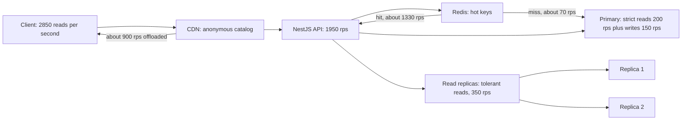

## 41.4 Reads and writes

Total RPS is not a workload. A thousand reads per second and a thousand writes per second are completely different machines. Split the number early.

### 41.4.1 Read/write ratios by system type

| System | Read:write | Consequence |
|---|---|---|
| Product catalog / content site | 100:1 to 1000:1 | Cache and read replicas solve almost everything |
| Social feed | 50:1 to 200:1 | Read-heavy, but fan-out on write inverts the cost |
| E-commerce (browse + buy) | 20:1 to 100:1 | Reads cache well; writes are the transactional core |
| Order management / back office | 5:1 to 20:1 | Cache helps less; writes need real transaction throughput |
| Chat / messaging | 1:1 to 3:1 | Writes dominate; caching barely helps |
| Financial ledger | 5:1 to 15:1 | Writes must be durable and serialized; no cheating |
| IoT / telemetry ingestion | 1:50 to 1:1000 | Write-dominated. A relational primary is the wrong tool |
| Analytics event pipeline | 1:1000 | Append-only; columnar store or object storage |

Establish the ratio from your own logs or from `pg_stat_statements` (`calls` grouped by statement kind), not from the table. The table is for the case where the system does not exist yet.

For the running e-commerce example at 3,000 RPS peak with a 95:5 split:

| Class | Share | Peak RPS |
|---|---|---|
| Reads | 95% | 2,850 |
| Writes | 5% | 150 |

### 41.4.2 Where each read goes

Not every read is equal. Route them by **staleness tolerance**, which is a product decision, not a technical one. Ask the product owner: "if this number is 30 seconds old, does anything bad happen?"

| Read type | Staleness tolerance | Destination | Peak RPS (example) |
|---|---|---|---|
| Product detail, category listing | minutes | Redis, then CDN for anonymous traffic | 1,400 |
| Search results | seconds to minutes | Search index (OpenSearch), cached | 400 |
| User profile, addresses | seconds | Redis with 5 min TTL | 300 |
| Order history list | seconds | Read replica | 350 |
| Cart contents | none (user just changed it) | Primary, or Redis as system of record | 250 |
| Stock availability at checkout | none | **Primary only** | 100 |
| Payment status | none | Primary only | 50 |

The rule: **a read must hit the primary only if a user action in the last few seconds must be visible in it.** Everything else is a cache or a replica question. In practice 70–90 percent of reads in a typical product tolerate seconds of staleness, and that is what makes read-heavy systems cheap to scale.



### 41.4.3 The arithmetic of a cache hit ratio

This is the highest-leverage calculation in capacity estimation, and it is one line:

```text
database_read_rps = cacheable_read_rps * (1 - hit_ratio) + uncacheable_read_rps
```

Take 1,400 RPS of cacheable catalog reads and vary the hit ratio:

| Hit ratio | Misses reaching PostgreSQL | Change vs 95% | Effect |
|---|---|---|---|
| 0% (no cache) | 1,400 rps | 20x worse | Needs several replicas just for the catalog |
| 50% | 700 rps | 10x worse | Cache is not earning its operational cost |
| 80% | 280 rps | 4x worse | One replica, comfortable |
| 90% | 140 rps | 2x worse | Comfortable |
| **95%** | **70 rps** | baseline | Catalog reads are effectively free |
| 99% | 14 rps | 5x better | Diminishing returns on capacity, big win on p99 latency |

Two conclusions that every senior engineer carries around:

**A cache is a multiplier, and multipliers are fragile.** Going from 95 to 90 percent doubles database load. Going from 95 to 50 percent puts 10x the load on the database instantly. That is exactly what happens when a deploy changes a cache key format, when Redis restarts with an empty keyspace, when `maxmemory` is reached and eviction starts, or when a bot walks the long tail of your catalog and pollutes the working set. **Your database must be able to survive a cold cache**, or your cache is a single point of failure wearing a performance costume. The honest way to size this is to write down two numbers: steady-state database load (70 rps) and cold-cache database load (1,400 rps), then decide explicitly which one you provision for and what protects you in between (request coalescing, stale-while-revalidate, a staged warm-up, load shedding).

**Above 95 percent, extra hit ratio buys latency, not capacity.** Going from 95 to 99 percent saves 56 rps of database load, which is nothing, but it removes a 5 ms tail from 4 percent of requests, which shows up directly in p99. Know which of the two you are optimizing.

Writes have their own multiplier that estimates routinely forget: **each write usually costs more than one database operation.** One order creation is an `INSERT` into `orders`, three into `order_items`, an `UPDATE` on `products.available`, an `INSERT` into the outbox table, plus index maintenance on all of them. So:

| Write | Logical rate | Database operations each | Actual database write rate |
|---|---|---|---|
| Order created | 4 rps peak | 6 | 24 |
| Cart updated | 90 rps | 2 | 180 |
| Session touched | 40 rps | 1 (send it to Redis instead) | 0 |
| Analytics event | 400 rps | 1 (send it to Kafka instead) | 0 |
| Everything else | 16 rps | 2 | 32 |
| **Total to PostgreSQL** | | | **~240 write ops/s** |

240 write operations per second against a primary that does 3,000–10,000 is comfortable, and the two rows that were moved out (sessions to Redis, analytics to Kafka) are exactly the decisions the arithmetic is supposed to produce. That is the point of this whole exercise: the table is not the deliverable, the two moves are.

## 41.5 Storage

Storage estimates are where the missing-multiplier failure does the most damage, because the answer is not "the service is slow", it is "the volume is full at 03:40 on a Sunday and PostgreSQL has stopped accepting writes". Work bottom-up: bytes per row, rows per day, then every multiplier.

### 41.5.1 Estimating a row from its column types

PostgreSQL stores each row (a *tuple*) with a 23-byte header, padded to 24 bytes, plus a null bitmap when the table has nullable columns, plus 4 bytes for the line pointer in the page. Then the columns themselves, each aligned to its natural boundary.

| PostgreSQL type | Bytes on disk | Notes |
|---|---|---|
| `boolean` | 1 | |
| `smallint` | 2 | |
| `integer` | 4 | |
| `bigint`, `double precision`, `timestamptz`, `timestamp`, `time` | 8 | `timestamptz` is 8 bytes, not more; it stores UTC |
| `date` | 4 | |
| `uuid` | 16 | Fixed. Not 36. The 36 characters are only the text rendering |
| `numeric(12,2)` | 8–12 | Variable length: ~8 bytes overhead + 2 bytes per group of 4 digits |
| `real` | 4 | |
| `char(3)` | 4 | 1-byte length header + 3 characters |
| `varchar(n)` / `text` | 1 + length (short) or 4 + length (over 126 bytes) | Store the *average* length, not `n` |
| `jsonb` | 4 + encoded size, usually 1.1–1.3x the JSON text | Keys are stored per row, so short keys matter |
| `bytea` | 4 + length | |
| Enum type | 4 | Much cheaper than `varchar` for status columns |
| Array | 20 + elements | |
| Tuple header + alignment | **24** | Once per row |
| Line pointer in page | **4** | Once per row |

Worked example, an `orders` table:

| Column | Type | Bytes | Reasoning |
|---|---|---|---|
| `id` | `uuid` | 16 | |
| `user_id` | `uuid` | 16 | |
| `status` | `order_status` enum | 4 | Was `varchar(20)`; the enum saves 8 bytes per row |
| `total_amount` | `numeric(12,2)` | 10 | Values around 4–7 digits |
| `currency` | `char(3)` | 4 | |
| `payment_intent_id` | `varchar(64)` | 32 | Average length 31 + 1 header |
| `shipping_address` | `jsonb` | 210 | Measured with `pg_column_size` on 1,000 real rows |
| `placed_at` | `timestamptz` | 8 | |
| `updated_at` | `timestamptz` | 8 | |
| `created_at` | `timestamptz` | 8 | |
| Column subtotal | | **316** | |
| Alignment padding | | 4 | Columns are 8-byte aligned where required |
| Tuple header | | 24 | |
| Line pointer | | 4 | |
| **Total per row** | | **~348** | Round to **350 bytes** |

Verify it rather than trusting the arithmetic, because `jsonb` and `text` averages are the terms most likely to be wrong:

```sql
-- Average on-disk size of one row, measured on real data
SELECT pg_size_pretty(avg(pg_column_size(o.*))::numeric) AS avg_row,
       pg_size_pretty(avg(pg_column_size(o.shipping_address))::numeric) AS avg_address
FROM orders o TABLESAMPLE SYSTEM (1);

-- Actual bytes per row including page overhead and bloat
SELECT pg_total_relation_size('orders') AS total_bytes,
       (SELECT reltuples::bigint FROM pg_class WHERE relname = 'orders') AS approx_rows,
       pg_total_relation_size('orders') / NULLIF((SELECT reltuples FROM pg_class WHERE relname='orders'),0) AS bytes_per_row;
```

Page overhead: a page is 8,192 bytes with a 24-byte page header and a 16-byte special area reservation, so about 8,150 usable. At 350 bytes plus a 4-byte line pointer, a page holds `8150 / 354 = 23` rows, giving an effective **354 bytes per row** including page overhead. With the default `fillfactor` of 100 for a table that is mostly appended, that is realistic. For a heavily-updated table set `fillfactor` to 80–90 so HOT updates can stay on the page, and multiply your storage estimate by 1.1–1.25 accordingly.

### 41.5.2 Index size

A B-tree index entry is roughly `key_bytes + 8 bytes of index tuple header + 4 bytes of line pointer`, aligned to 8, plus internal pages (about 1 percent) and the default `fillfactor` of 90 which leaves 10 percent free. A workable rule:

```text
index_bytes ≈ rows * (key_bytes + 12) * 1.3
```

| Index | Key columns | Key bytes | Formula | Size at 22M rows |
|---|---|---|---|---|
| `orders_pkey` | `uuid` | 16 | 22M * 28 * 1.3 | **800 MB** |
| `idx_orders_user_placed` | `uuid, timestamptz` | 24 | 22M * 36 * 1.3 | **1.0 GB** |
| `idx_orders_status_placed` | enum, `timestamptz` | 12 | 22M * 24 * 1.3 | **690 MB** |
| `idx_orders_payment_intent` | `varchar(64)` | 32 | 22M * 44 * 1.3 | **1.3 GB** |
| Table itself | | | 22M * 354 | **7.8 GB** |
| **Indexes as a fraction of the table** | | | 3.8 GB / 7.8 GB | **~0.5x** |

Two lessons. **Indexes are not free storage-wise, and they are not free write-wise either**: every `INSERT` writes to the table plus all four indexes, and that write amplification is the reason your WAL volume is bigger than you expect. And **a `uuid` primary key is expensive**: random v4 UUIDs also cause index page splits and poor locality. If you are still choosing, `bigint` identity keys or UUIDv7 (time-ordered) cut both the size and the write amplification. A partial index (`WHERE status = 'pending'` on a table where 0.5 percent of rows are pending) can be 200x smaller than the full index and is often the right answer for status columns.

Typical whole-database rule of thumb: **indexes total 0.5x to 2x the table data**. If a table's indexes exceed 2x its data, someone has been adding indexes without deleting any; check `pg_stat_user_indexes.idx_scan = 0` for indexes nobody uses.

### 41.5.3 TOAST

When a row would exceed about 2 KB, PostgreSQL compresses the largest variable-length columns and, if still too big, moves them **out of line** into a side table called the TOAST table, in roughly 2,000-byte chunks with their own index.

This changes estimates in three ways:

1. **The main table stays small.** A `product_description text` column averaging 12 KB does not make your `products` table 12 KB per row; the main table holds an 18-byte pointer and the bytes live in `pg_toast.pg_toast_<oid>`. `pg_relation_size('products')` will look reassuringly small and be misleading; always use `pg_total_relation_size`, which includes TOAST and indexes.
2. **Compression is real.** TOAST applies LZ compression by default (`pglz`, or `lz4` if the column's `STORAGE`/`compression` says so). Text and JSON commonly compress 3–5x, so a 12 KB description may occupy 3 KB. Estimate the compressed size for TOASTed columns and the raw size for inline ones.
3. **Reads get more expensive.** `SELECT *` on a TOASTed row costs extra index lookups and page reads per row. This is a latency estimate, not a storage estimate, but it is the same decision: do not select large columns in list endpoints.

```sql
-- How much of a table is actually TOAST?
SELECT pg_size_pretty(pg_relation_size('products')) AS main,
       pg_size_pretty(pg_total_relation_size('products') - pg_relation_size('products')
                      - pg_indexes_size('products')) AS toast,
       pg_size_pretty(pg_indexes_size('products')) AS indexes,
       pg_size_pretty(pg_total_relation_size('products')) AS total;
```

### 41.5.4 Growth per year and retention

Growth is rows per day times bytes per row times 365, and then a retention policy decides whether that number keeps compounding.

| Table | Rows/day | Bytes/row (incl. page) | GB/year (table) | Indexes | GB/year (total) |
|---|---|---|---|---|---|
| `orders` | 60,000 | 354 | 7.8 | 0.5x | **11.7** |
| `order_items` | 180,000 | 120 | 7.9 | 0.6x | **12.6** |
| `order_status_history` | 300,000 | 90 | 9.9 | 0.4x | **13.9** |
| `payment_events` (raw webhooks, `jsonb`) | 130,000 | 1,400 | 66.4 | 0.2x | **79.7** |
| `audit_log` | 900,000 | 300 | 98.5 | 0.5x | **147.8** |
| **Total** | | | | | **~266 GB/year** |

Now apply retention, which is a product and legal decision you must go and get:

| Table | Retention | Steady-state size | Mechanism |
|---|---|---|---|
| `orders`, `order_items` | 7 years (tax law) | 82 GB, 88 GB | Monthly partitions; partitions older than 24 months moved to cheaper storage or archived to S3 as Parquet |
| `order_status_history` | 18 months | 21 GB | Monthly partitions, `DROP PARTITION` |
| `payment_events` | 90 days hot, archive after | 20 GB | Daily partitions, dropped after 90 days |
| `audit_log` | 13 months | 160 GB | Monthly partitions, dropped |
| **Hot total** | | **~370 GB** | Instead of unbounded growth of 266 GB every year |

`DROP TABLE` on a partition is instantaneous and returns the space. `DELETE FROM ... WHERE created_at < ...` is hours of work, generates as much WAL as the data it deletes, leaves the indexes bloated, and returns nothing to the operating system without a `VACUUM FULL` that takes an exclusive lock. **If a table has a retention policy, it should be partitioned from day one.** That decision is made at estimation time, not when the volume is 90 percent full.

### 41.5.5 The multipliers everyone forgets

| Multiplier | Factor | What it is |
|---|---|---|
| Indexes | 1.5x | Already counted above, but frequently forgotten entirely |
| Bloat and free space map | 1.1–1.3x | Dead tuples between vacuums; `fillfactor` below 100 |
| **Replicas** | **x(1 + N)** | 2 read replicas means you pay for 3 full copies of everything |
| **Backups** | 0.3x per retained full backup, compressed | 7 daily + 4 weekly + 12 monthly = 23 copies at ~0.3x = **7x the data size** if they are full backups. Incremental or `pgBackRest` differential backups cut this to 1–2x |
| **WAL** | write volume x 2–4 per day, retained until archived | Full-page writes after each checkpoint inflate WAL far above the logical write volume |
| Temp files (sorts, hashes, index builds) | +10–20% peak headroom | A `CREATE INDEX` on a 100 GB table needs temp space |
| **Free headroom** | never above **75%** utilization | Autovacuum, `VACUUM FULL`, `REINDEX CONCURRENTLY` and pg_upgrade all need room |

Worked total for the 370 GB hot dataset:

| Item | Formula | Size |
|---|---|---|
| Tables + indexes | given | 370 GB |
| Bloat allowance | 370 * 1.2 | 444 GB |
| Temp / maintenance headroom | +15% | 511 GB |
| Provisioned volume at 70% utilization | 511 / 0.70 | **730 GB, round to 800 GB** |
| Primary + 2 replicas | 800 * 3 | **2.4 TB of provisioned block storage** |
| WAL per day | ~40 GB/day of writes * 2.5 | 100 GB/day, retained 3 days locally | 
| WAL archive to object storage | 100 GB/day * 35 days retention | 3.5 TB in S3 |
| Backups (`pgBackRest`, weekly full + daily incremental, 35 days) | ~2x logical | 900 GB in S3 |

The headline changes from "we need 370 GB" to "we need 2.4 TB of block storage and about 4.4 TB of object storage". That is a factor of 12, and it is entirely made of multipliers that a careless estimate sets to 1. When someone tells you a database is "about 400 GB", ask which of those twelve numbers they meant.

## 41.6 Bandwidth and memory

### 41.6.1 Bandwidth in and out

```text
bytes_per_second = rps * average_payload_bytes
```

Do it separately for ingress and egress, because they are wildly asymmetric and only one of them has a price tag.

| Direction | RPS (peak) | Average payload | Throughput | Per day (at average RPS 580) |
|---|---|---|---|---|
| Requests in | 3,000 | 1.5 KB (headers + small JSON body) | 4.5 MB/s | 75 GB/day |
| Responses out | 3,000 | 15 KB (JSON, gzip already applied) | 45 MB/s = 360 Mbps | 750 GB/day |
| Product images (before CDN) | 8,000 | 90 KB | 720 MB/s | 12 TB/day |

Egress is billed; ingress usually is not. At a typical cloud rate of USD 0.09 per GB for internet egress:

| Path | Monthly volume | Monthly egress cost |
|---|---|---|
| API JSON straight from origin | 22 TB | ~USD 2,000 |
| Images straight from origin | 360 TB | ~USD 32,000 |
| Images via CDN at 92% offload, CDN rate ~USD 0.02–0.085/GB | 29 TB origin + 331 TB CDN | ~USD 2,600 origin-to-CDN + ~USD 8,000 CDN = **~USD 10,600** |
| Cross-AZ chatter (often forgotten) | depends | USD 0.01–0.02 per GB **each way** |

Three decisions fall out immediately. **Put a CDN in front of anything static or anonymous-cacheable**; the arithmetic above pays for the CDN twenty times over. **Compress JSON responses** (gzip or brotli at the edge): 15 KB of JSON compresses to 2–4 KB, cutting egress 4–5x, though it costs CPU on the compressing machine, which is why the edge is the right place to do it. **Count cross-AZ traffic**: a chatty microservice mesh that sends 200 MB/s across zones costs more per month than the instances running it, and nobody notices because it does not appear on a single service's dashboard.

### 41.6.2 Cache working set

The question is not "how much data do we have" but "how much of it is hot enough to be worth keeping in RAM".

```text
redis_bytes ≈ hot_keys * (key_string_bytes + value_bytes + per_key_overhead)
```

Redis overhead per key is roughly **60–100 bytes** for a simple string key: the `dictEntry`, the `robj` header, the SDS header on both key and value, the expiry entry in the expires dict, and allocator rounding. For hashes, sets and sorted sets it is higher and depends on whether the small-object encodings (`listpack`) apply.

| Cache | Hot keys | Key string | Value | Overhead | Bytes each | Total |
|---|---|---|---|---|---|---|
| Product detail JSON | 500,000 | 24 B (`product:v3:<uuid>`) | 3,000 B | 90 B | 3,114 B | **1.56 GB** |
| Category listing pages | 20,000 | 40 B | 18,000 B | 90 B | 18,130 B | **0.36 GB** |
| User sessions | 2,000,000 | 40 B | 350 B | 90 B | 480 B | **0.96 GB** |
| Carts | 250,000 | 32 B | 1,800 B | 90 B | 1,922 B | **0.48 GB** |
| Rate limiter counters | 400,000 | 48 B | 30 B | 90 B | 168 B | **0.07 GB** |
| **Logical subtotal** | | | | | | **3.4 GB** |
| Allocator fragmentation (`mem_fragmentation_ratio` 1.2–1.5) | x1.3 | | | | | 4.4 GB |
| Replication backlog + client output buffers + COW headroom during `BGSAVE` | +30% | | | | | **5.8 GB** |
| `maxmemory` set to 70% of instance RAM | 5.8 / 0.7 | | | | | **8.3 GB** |
| **Instance choice** | | | | | | **`cache.r6g.large` (13.07 GB) primary + replica** |

Two traps. First, **`BGSAVE` and replica sync can double memory transiently** through copy-on-write, which is why `maxmemory` must sit well below the instance size; a Redis that is at 95 percent of instance RAM will be killed the first time it forks. Second, **check the working set assumption**. If 500,000 products are hot but your catalog has 8 million and a crawler walks all of them, your eviction rate goes to the moon and your hit ratio collapses. Measure it: `INFO keyspace` for key counts, `INFO stats` for `keyspace_hits` / `keyspace_misses` / `evicted_keys`, and `redis-cli --bigkeys` for the one key that is 400 MB and nobody knew about.

### 41.6.3 PostgreSQL memory

PostgreSQL uses a process per connection, and each has costs your estimate must include.

| Item | Size | Notes |
|---|---|---|
| Backend process baseline | 3–10 MB RSS | Catalog caches grow with the number of tables and partitions touched |
| `work_mem` | **per sort/hash node, per parallel worker** | The dangerous one. `work_mem = 64MB` with a query using 3 hash nodes and 4 parallel workers can allocate 768 MB for one query |
| `maintenance_work_mem` | per autovacuum worker and per `CREATE INDEX` | 3 autovacuum workers at 1 GB = 3 GB |
| `shared_buffers` | 25% of RAM, typically | Shared, not per connection |
| OS page cache | the rest | PostgreSQL relies on it heavily |

Worked sizing for a `db.r6g.2xlarge` (8 vCPU, 64 GB):

| Item | Formula | Value |
|---|---|---|
| `shared_buffers` | 25% of 64 GB | 16 GB |
| `maintenance_work_mem` * `autovacuum_max_workers` | 512 MB * 3 | 1.5 GB |
| Connection baseline | 300 connections * 7 MB | 2.1 GB |
| `work_mem` exposure | 300 * 4 MB * 2 nodes avg | 2.4 GB (worst case far higher) |
| Reserved for OS and page cache | remainder | ~42 GB |

The trap is setting `work_mem` globally high "because sorts spill to disk". Set it low globally (4–16 MB) and raise it per session or per role for the reporting queries that need it: `SET LOCAL work_mem = '256MB';` inside the transaction that runs the big aggregate.

### 41.6.4 Node heap per pod

Node's default old-space limit is derived from available memory, and in a container it may read the *host's* memory rather than the cgroup limit, depending on version and runtime. Do not rely on the default. Set it.

| Container memory limit | `--max-old-space-size` | Reasoning |
|---|---|---|
| 512 MiB | 350 | Heap plus RSS overhead must fit |
| 1 GiB | 700 | ~70% of the limit |
| 2 GiB | 1400 | |
| 4 GiB | 2800 | Above this, GC pauses grow; prefer more pods |

RSS is always larger than the JS heap: add the Node binary and code (~40 MB), native buffers (`Buffer` allocations live outside the heap), the ICU data, thread pool stacks, and the pg/Redis driver buffers. A rough rule: **RSS ≈ old-space limit + 150–250 MB**. Setting `--max-old-space-size` equal to or above the container limit is the classic OOMKill: V8 believes it has room, delays a major GC, and the kernel kills the process before V8 ever tries to collect (Part 42 walks through exactly this incident).

For a memory-per-pod estimate, count what your code actually retains: in-flight request contexts (concurrency * bytes per request), any in-memory cache (bounded, please), and the largest single response you build in memory.

| Item | Formula | Value |
|---|---|---|
| In-flight requests | 150 concurrent * 400 KB (parsed body + entities + response) | 60 MB |
| Bounded LRU of pricing rules | 5,000 * 8 KB | 40 MB |
| Baseline heap after warm-up | measured | 180 MB |
| GC headroom (heap should peak below ~75% of limit) | (60+40+180) / 0.75 | 373 MB heap |
| `--max-old-space-size` | round up | 512 |
| Container limit | 512 / 0.7 | **768 MiB, round to 1 GiB** |

