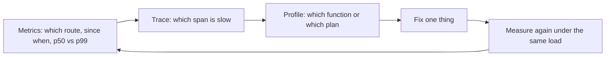
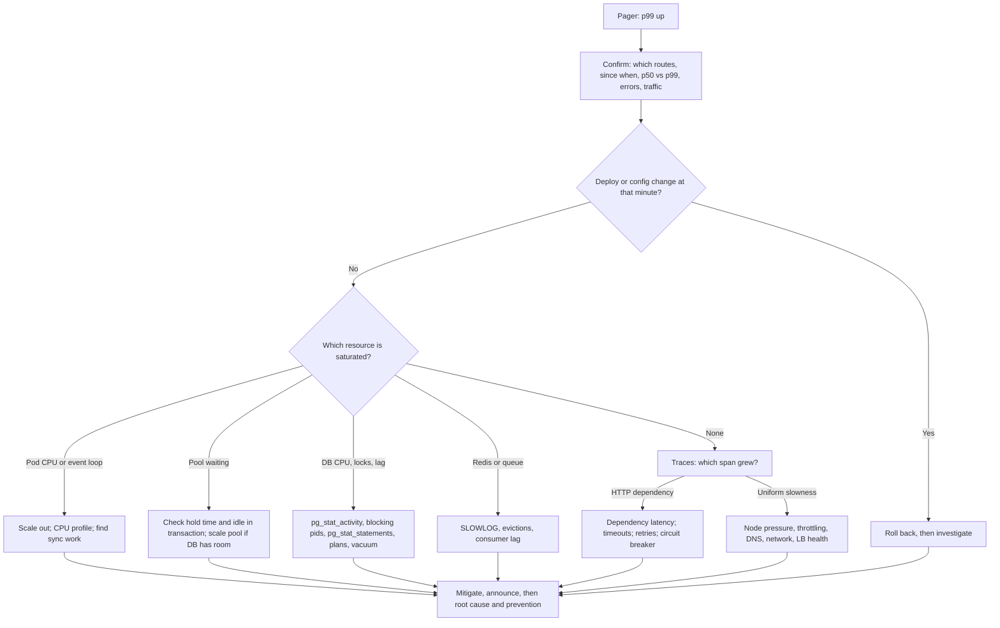

## 41.11 Capacity and load testing, performance budgets and regression tests

#### Concept

A **load test** sends controlled traffic at a system and records latency, throughput and errors as the traffic changes. Its purpose is to find the **knee**: the throughput at which latency starts climbing the hockey-stick curve from section 41.1. A **soak test** holds moderate load for hours to expose leaks and slow degradation. A **performance budget** is a number a change must not exceed (p95 under 300 ms at 500 RPS, response under 50 KB) and a **regression test** is a load test in CI that fails when the budget is broken.

#### Why does it exist?

Nobody knows the capacity of a system by reading its code. Capacity depends on the slowest resource under contention, and contention only appears under load. Teams that do not load test discover the knee on the day of the marketing campaign.

#### Mental model

Imagine testing a bridge by driving progressively heavier trucks across and measuring how much it bends. You stop well before it breaks; the point is to know the safe limit and to notice if this year's repairs made it weaker.

#### How it works — profiles

| Profile | Shape | Answers |
|---|---|---|
| Smoke | 1–5 virtual users for 1 minute | Does the script and environment work at all? |
| Ramp / stress | Increase load in steps (100, 200, 400, 800 RPS), each held 3–5 minutes | Where is the knee? Which resource saturates first? |
| Steady state | Target load held 10–30 minutes | Does p99 stay within budget at expected peak? |
| Spike | Jump from 100 to 1,000 RPS instantly, hold 2 minutes, drop | Does autoscaling and queueing absorb a burst? Do retries storm? |
| Soak | 60–70% of peak for 4–12 hours | Memory leaks, pool leaks, log volume, disk growth, GC drift |
| Breakpoint | Increase until errors exceed a threshold | Absolute ceiling and failure mode (graceful 503 vs crash) |

#### Practical example — k6 script for `POST /orders`

```ts
// perf/place-order.k6.js
import http from 'k6/http';
import { check, sleep } from 'k6';
import { uuidv4 } from 'https://jslib.k6.io/k6-utils/1.4.0/index.js';

export const options = {
  scenarios: {
    ramp: {
      executor: 'ramping-arrival-rate',   // controls RPS directly, not virtual users
      startRate: 50, timeUnit: '1s',
      preAllocatedVUs: 200, maxVUs: 1000,
      stages: [
        { target: 100, duration: '3m' },
        { target: 200, duration: '3m' },
        { target: 400, duration: '3m' },
        { target: 800, duration: '3m' },
        { target: 0, duration: '1m' },
      ],
    },
  },
  thresholds: {
    http_req_failed: ['rate<0.01'],
    'http_req_duration{endpoint:place_order}': ['p(95)<300', 'p(99)<800'],
    checks: ['rate>0.99'],
  },
};

const skus = JSON.parse(open('./fixtures/skus.json')); // 5,000 real SKUs seeded in staging with high stock

export default function () {
  const sku = skus[Math.floor(Math.random() * skus.length)];
  const res = http.post(`${__ENV.BASE_URL}/orders`, JSON.stringify({ lines: [{ sku, qty: 1 }] }), {
    headers: {
      'Content-Type': 'application/json',
      Authorization: `Bearer ${__ENV.TOKEN}`,
      'Idempotency-Key': uuidv4(),      // unique per request, or the idempotency path hides the real cost
    },
    tags: { endpoint: 'place_order' },
    timeout: '5s',
  });
  check(res, { 'created': (r) => r.status === 201 });
  sleep(0.1);
}
```

Run: `k6 run --out json=perf/results.json -e BASE_URL=https://staging.example.com -e TOKEN=$TOKEN perf/place-order.k6.js`. The `ramping-arrival-rate` executor is the right one for finding the knee: it holds the *request rate* constant per stage even as latency rises, which is how real traffic behaves. A virtual-user executor slows down automatically when latency rises and hides the knee.

#### Reading the results

Plot p50, p95, p99 and error rate against the stage's target RPS, next to the server-side saturation metrics: event loop lag, pod CPU, `pg_pool_waiting`, DB CPU, DB connections, Redis latency. The knee is where p99 turns upward. The resource whose graph turns at the same moment is the bottleneck. Typical findings for a NestJS + PostgreSQL service:

- p99 climbs at 350 RPS, `pg_pool_waiting` starts rising at 340 RPS: pool-bound; check hold time (a query got slow, or a connection is held across an await).
- p99 climbs at 500 RPS, event loop lag rises: CPU-bound in Node; profile (section 41.12); usually serialization, validation or logging.
- p99 climbs at 200 RPS, DB CPU at 90%: query-bound; `pg_stat_statements` (section 41.6).
- Errors appear at 800 RPS as 503s with p99 stable: the rate limiter or load shedder is doing its job, which is the *desired* failure mode.

Record the knee in the runbook: "orders-api: 6 pods, knee at about 650 RPS, bottleneck pool; safe peak 400 RPS". Re-measure after every significant change and monthly.

#### Soak tests for leaks

Run at 60% of peak for eight hours with `nodejs_heap_size_used_bytes`, `pg_pool_total`, open file descriptors and pod memory on a dashboard. A healthy service shows a sawtooth heap (grows, GC drops it) with a flat baseline. A rising baseline is a leak: unbounded in-memory cache, event listeners added per request, `Map` keyed by request id never cleared, `setInterval` created per request. A pool total that climbs to `max` and stays there while traffic is flat means connections are not released on an error path. Part 9 — Operating Systems and Node.js Internals covers heap snapshot diffing to find the retained objects.

#### Never load test production without a plan

Production load tests are legitimate (they are the only way to test real infrastructure, real data sizes and real third-party sandboxes) and dangerous. The plan: a named owner and an abort switch; a time window announced to on-call and dependent teams; a tenant or synthetic account whose data is excluded from analytics and billing; third parties in sandbox or mocked at the edge; rate limits and autoscaling max verified; a rollback for any config changed for the test; and the test tagged in traces (`x-load-test: 1`) so its traffic is separable in every dashboard. Without those, a load test is an outage with a scheduled start.

#### Performance budgets and regression tests in CI

Budgets are written where they are checked. Three levels that work:

1. **Micro-benchmarks for pure code** (pricing engine, serializer): `tinybench` or `benchmark.js` run in CI, failing when a function gets 30% slower than the committed baseline. Cheap, deterministic, catches algorithmic regressions.
2. **Integration-level query budgets**: the integration tests from Part 40 — Testing assert `EXPLAIN` uses the expected index and that a hot endpoint issues at most N queries (count via a query logger). This catches N+1 and dropped indexes at PR time.
3. **Nightly k6 against staging** with thresholds; the pipeline fails and posts the comparison with last night's run. Staging must be sized as a known fraction of production (for example 1/4 pods, same instance class for the database) so numbers translate.

```yaml
  # .github/workflows/perf-nightly.yml (excerpt)
jobs:
  k6:
    runs-on: ubuntu-latest
    steps:
      - uses: actions/checkout@v4
      - uses: grafana/setup-k6-action@v1
      - run: k6 run --out json=results.json -e BASE_URL=${{ vars.STAGING_URL }} -e TOKEN=${{ secrets.PERF_TOKEN }} perf/place-order.k6.js
      - uses: actions/upload-artifact@v4
        if: always()
        with: { name: k6-results, path: results.json }
```

**SLOs** give budgets their meaning: if the SLO is "p99 < 300 ms over 30 days" then the CI threshold is stricter (p99 < 250 ms on staging at target load) so production has margin. **"Measure, don't guess"** is the rule for every change made in the name of performance: a PR that claims to be faster carries a before/after number from a repeatable measurement, or it is not a performance PR. **Premature optimisation** is optimising something no measurement identified; **necessary optimisation** is fixing the thing the profile points at before it becomes an incident. The difference is not the technique; it is whether a number came first.

#### Interview questions

1. *How do you find the capacity of a service?* Expected: ramping arrival-rate load test, plot p99 and saturation metrics against RPS, identify the knee and the resource that turns with it.
2. *Why use an arrival-rate executor rather than virtual users?* Expected: VUs slow down as latency rises and hide the knee; arrival rate models real traffic that does not wait.
3. *What does a soak test catch that a stress test does not?* Expected: leaks and slow degradation (heap, pool, descriptors, disk, log volume).
4. *What must be in place before a production load test?* Expected: owner, abort switch, window, synthetic tenant, sandboxed third parties, tagged traffic, rollback.

## 41.12 The profiling toolkit

#### Concept

Profiling answers "where does the time go?" for one process or one query. Tracing answers it across services. Together with metrics they form the loop that every performance investigation follows.



#### The tools and when to reach for each

| Tool | Layer | What it shows | When |
|---|---|---|---|
| `node --cpu-prof` | Node CPU | `.cpuprofile` sampled stack traces; open in Chrome DevTools Performance tab or `speedscope` | Event loop lag is high; find the hot function |
| `node --heap-prof` / `v8.writeHeapSnapshot()` | Node memory | Allocation sites; retained object graph | Heap grows; find the leak |
| Chrome DevTools (`node --inspect`) | Node | Live CPU profile, heap snapshot diff, async stack traces | Local reproduction of a slow path |
| `clinic doctor` | Node | Diagnoses event loop delay, CPU, memory, active handles and recommends the next tool | First look at "something is slow and I do not know what" |
| `clinic flame` / `0x` | Node CPU | Flame graph: width is time; look for wide frames in your code, `JSON.stringify`, `zlib`, `class-transformer` | Confirmed CPU-bound |
| `clinic bubbleprof` | Node async | Where time is spent *waiting* between async operations | Latency high but CPU low |
| OpenTelemetry traces (Jaeger/Tempo/Datadog) | Cross-service | Span waterfall per request: DB spans, HTTP spans, queue spans; which one is slow and whether they are serial | Any p99 investigation starts here |
| `pg_stat_statements` | PostgreSQL | Top queries by total/mean time, calls, buffer hits | DB CPU or I/O high; find the query |
| `auto_explain` | PostgreSQL | Actual plans of slow statements with real parameters | A query is slow in prod but fast in `psql` |
| `EXPLAIN (ANALYZE, BUFFERS)` | PostgreSQL | One query's plan, actual rows, buffers read vs hit | Fixing a specific query |
| `pg_stat_activity` | PostgreSQL | Live sessions, `wait_event_type`, `state`, query age | Locks, idle in transaction, long-running statements |
| Redis `SLOWLOG GET 25` and `redis-cli --latency` | Redis | Commands over `slowlog-log-slower-than` (default 10 ms); round-trip latency | Redis latency spikes; big keys, `KEYS`, Lua |
| `kubectl top pod` / `kubectl top node` | Infra | CPU and memory per pod and node | Saturation and noisy neighbours |
| `perf_hooks.monitorEventLoopDelay` | Node | Event loop lag histogram exported as a metric | Always-on saturation signal |

#### Practical example — a CPU profile in production

You cannot attach DevTools to a production pod, but you can take a short profile on demand:

```ts
// src/ops/profile.controller.ts  (internal port, admin-only, rate limited)
import { Controller, Post, UseGuards } from '@nestjs/common';
import { Session } from 'node:inspector/promises';
import { writeFile } from 'node:fs/promises';

@Controller('internal/profile')
@UseGuards(InternalAdminGuard)
export class ProfileController {
  @Post('cpu')
  async cpu(): Promise<{ file: string }> {
    const session = new Session();
    session.connect();
    await session.post('Profiler.enable');
    await session.post('Profiler.start');
    await new Promise((r) => setTimeout(r, 15_000)); // 15 s of samples under real traffic
    const { profile } = await session.post('Profiler.stop');
    session.disconnect();
    const file = `/tmp/cpu-${process.pid}-${Date.now()}.cpuprofile`;
    await writeFile(file, JSON.stringify(profile));
    return { file }; // copy out with kubectl cp, open in DevTools or speedscope
  }
}
```

The profiler adds a few percent of overhead for 15 seconds; taken from one pod out of six, it is safe. For memory, `v8.writeHeapSnapshot()` pauses the process for seconds on a large heap and doubles memory briefly; take it from a pod removed from the load balancer.

#### Interview questions

1. *Latency is high, CPU is low. What do you reach for?* Expected: traces to find the waiting span; `clinic bubbleprof` for async waits; `pg_stat_activity` for locks; pool wait metrics.
2. *How do you get a CPU profile from a production pod safely?* Expected: on-demand short profile through the inspector API on one pod, admin-only, copied out; or continuous profiling agents.

## 41.13 Runbook: "The API suddenly became slow"

This is the page you open at 02:14 when the pager says p99 tripled. Work top to bottom; do not skip to the step you *suspect*, because the first three steps are what stop you from spending an hour on the wrong theory.

#### Step 1: Confirm and scope with metrics (5 minutes)

- **Which endpoints?** All routes (infrastructure, database, GC) or one route (a query, a dependency)?
- **Since when?** Exact minute from the latency graph. Write it down.
- **p50 vs p99?** p50 up too means everything is slower (saturation, DB, network). p99 only means a subset is slow (locks, GC, one dependency, one tenant).
- **Error rate?** Latency up with errors flat is queueing (pool, event loop, upstream). Latency up with 5xx rising is failing dependencies or timeouts.
- **Traffic?** RPS up (organic, campaign, bot, retry storm) or flat?

#### Step 2: Correlate with change (5 minutes)

Deploys (app *and* every dependency), config changes, feature flags, migrations, cron jobs that started at that minute, autoscaling events, certificate rotations, a partner's release, a new tenant onboarded, time of day (end-of-month batch). Most sudden slowdowns are caused by something that changed. If a deploy matches the minute: **roll back first, investigate second.**

#### Step 3: Check saturation, in this order

| Signal | Where | Healthy | Suspect |
|---|---|---|---|
| Pod CPU | `kubectl top pod`, container metrics | under 65% | above 80% sustained |
| Event loop lag p99 | app metric | under 20 ms | above 100 ms |
| Heap used, GC pause | app metrics | sawtooth, flat baseline | rising baseline, GC pauses over 100 ms |
| Pool waiting, pool wait time | app metric | 0 | sustained above 0 |
| DB CPU | RDS/Cloud SQL metrics | under 60% | above 80% |
| DB connections | `pg_stat_activity` | well under `max_connections` | near the limit, many `idle in transaction` |
| Replica lag | `pg_stat_replication`, cloud metric | under 1 s | seconds to minutes (reads stale, or reads fail over to primary) |
| Redis latency, memory, evictions | `redis-cli --latency`, `INFO` | under 1 ms, no evictions | spikes, `evicted_keys` rising (hit ratio collapse) |
| Queue depth, consumer lag | broker metrics | stable | growing (consumers slow or dead; producers blocking) |
| Disk I/O, IOPS credits | cloud volume metrics | headroom | burst credits exhausted |

The first row that is red is where you look next.

#### Step 4: Traces for the slow span

Open the tracing UI, filter the slow route since the minute in step 1, sort by duration, open five. Which span grew? A DB span (go to step 5), an HTTP span to a dependency (step 7), a gap between spans with no child (event loop blocked or pool wait; step 3), or the whole thing uniformly slower (infrastructure; step 6).

#### Step 5: Database

```sql
-- What is waiting right now?
SELECT pid, now() - query_start AS age, state, wait_event_type, wait_event, left(query, 80)
FROM pg_stat_activity
WHERE state <> 'idle' AND backend_type = 'client backend'
ORDER BY age DESC LIMIT 20;

-- Who blocks whom?
SELECT blocked.pid AS blocked_pid, blocking.pid AS blocking_pid, left(blocking.query, 60) AS blocking_query
FROM pg_stat_activity blocked
JOIN pg_stat_activity blocking ON blocking.pid = ANY(pg_blocking_pids(blocked.pid));

-- New top query since the incident? (reset stats after a known-good baseline so deltas are visible)
SELECT round(total_exec_time::numeric) AS total_ms, calls, round(mean_exec_time::numeric, 1) AS mean_ms, left(query, 90)
FROM pg_stat_statements ORDER BY total_exec_time DESC LIMIT 10;

-- Autovacuum and bloat
SELECT relname, n_dead_tup, n_live_tup, last_autovacuum, last_autoanalyze
FROM pg_stat_user_tables ORDER BY n_dead_tup DESC LIMIT 10;
```

Things to look for: a lock chain (one long transaction, often a migration or a batch job, blocking hot rows); a query whose plan flipped after the table crossed a size threshold or stats went stale (`EXPLAIN` it now, compare to yesterday's `auto_explain` log); a missing index revealed by data growth (a query that was fine at 2 million rows seq-scans at 20 million); autovacuum falling behind after a mass delete or update (dead tuples in the millions, index bloat); a replica that fell behind so reads went to the primary; `max_connections` reached.

#### Step 6: Infrastructure

Noisy neighbour on the node (`kubectl top node`, other pods' CPU on the same node), memory pressure and throttling (`container_cpu_cfs_throttled_seconds_total` climbing means CPU limits are throttling the pod even though "usage" looks fine), DNS resolution slow or failing (`dig` from inside a pod, CoreDNS metrics), network partition or packet loss between zones, load balancer health checks failing some pods and concentrating traffic on the rest, disk credits exhausted on the database volume.

#### Step 7: External dependencies

Latency of each outbound HTTP span, the dependency's status page, your own timeout and retry configuration (are you retrying a slow dependency and tripling the load on it?), circuit breaker state, the third party's rate limits (429s in your logs).

#### Step 8: Mitigate first, then root cause

Mitigation options in rough order of speed and safety: **roll back** the correlated change; **scale out** pods (if CPU or event loop bound) or the pool (if pool bound and the database has room); **shed load** (rate limit the noisy tenant or bot, disable a non-critical feature flag, return cached or degraded responses); **kill the blocker** (`pg_terminate_backend` on the long transaction or the batch job); **fail over** reads away from a lagging replica; **add the index** `CONCURRENTLY` if the missing index is certain. Every mitigation is announced in the incident channel with the time.

Then root cause: reproduce with the load test or the query, write the fix, add the missing alert (the one that would have paged you at the right layer) and the missing test, and put the timeline in the post-mortem. Prevention items that come up repeatedly: alerts on saturation (pool waiting, event loop lag, replica lag, `cl_waiting`) rather than only on errors; `statement_timeout` and `lock_timeout` on every connection; short `connectionTimeoutMillis`; retry budgets; a per-tenant rate limit; nightly load tests; `auto_explain` on.



#### Incident story

At 02:14 the on-call was paged: `POST /orders` p99 1.9 s, p50 unchanged, error rate flat, RPS flat. Step 1 said "a subset of requests is slow, nothing is failing". Step 2 found no deploy; a nightly `refund_reconciliation` job had started at 02:00. Step 3 showed pool waiting at 0, DB CPU normal, but `pg_stat_activity` had 14 sessions in `wait_event_type = Lock`. Step 5's blocking query showed the reconciliation job holding row locks on `orders` inside a transaction that had been open for 14 minutes because it looped over 200k orders with one `UPDATE` each in a single `BEGIN`. Mitigation at 02:31: `pg_terminate_backend` on the job; p99 fell to 140 ms within a minute. Root cause: a refactor had moved the loop inside one transaction "for consistency". Fix: commit per 1,000 rows, `lock_timeout = '2s'` in the job, an alert on "any transaction older than 60 s on the primary", and a job schedule that avoids the order peak in the Americas region.

## 41.14 Edge cases & failure modes

- **p99 dominated by GC.** A 1.8 GB heap with major GCs every 20 s pausing 150 ms; every route's p99 shows the pause, no query is slow, traces show a gap with no child span. Fix: reduce retained memory (bounded caches, no per-request closures on long-lived objects), smaller pods with more replicas, tune `--max-semi-space-size` for allocation-heavy workloads.
- **Pool exhaustion showing as latency, not errors.** `connectionTimeoutMillis` at 30 s means every request waits up to 30 s and *succeeds*; dashboards on error rate stay green. Fix: short acquire timeout, alert on `waiting`, load shed with a 503.
- **Cache hit ratio drop after a deploy.** A key format change (`product:v2:{id}`) or a serializer change invalidates every entry at once; the database takes the full read load; latency doubles for the TTL duration. Fix: warm the new keys before switching reads, or deploy the key change behind a flag with dual reads; alert on hit ratio.
- **Index bloat after a mass delete.** Deleting 40 million archived rows leaves the index the same size; scans read empty pages; vacuum takes hours. Fix: `REINDEX CONCURRENTLY`, partition so old data is dropped by partition instead of deleted by row.
- **Plan flip at a data threshold.** At 9.8 million rows the planner used an index; at 10.1 million, after autoanalyze, it chose a hash join with a seq scan, and the query went from 8 ms to 2.4 s. Fix: better statistics (`ALTER TABLE ... ALTER COLUMN ... SET STATISTICS 1000`), a covering or partial index that makes the index path clearly cheaper, `auto_explain` to catch the flip, and in extreme cases `pg_hint_plan`.
- **One tenant hogging.** A B2B customer's integration polls `GET /orders?limit=100` every second from 40 servers; their 4,000 RPS starve everyone; per-route metrics look uniform. Fix: per-tenant rate limits and quotas, per-tenant latency labels, a dedicated pool or priority for interactive traffic.
- **Retry storms.** A dependency slows to 2 s; your client times out at 1 s and retries 3 times; the dependency now receives 4× the load and gets slower; your pools fill with waiting requests. Fix: retry budgets (at most 10% extra load), exponential backoff with jitter, circuit breakers, retry only idempotent calls.
- **Compression CPU spike.** A new endpoint returns 3 MB catalog dumps; gzip level 6 costs 40 ms of event loop per response; at 50 RPS the loop is fully busy compressing. Fix: compress at the edge, cache the compressed body, reduce the payload, lower the level.
- **Log volume slowing the app (sync stdout).** Debug logging enabled in production writes 20 MB/s to stdout; the container runtime's pipe backs up; `process.stdout.write` becomes blocking; event loop lag hits 500 ms. Fix: async logger transport (`pino` with `pino.transport` or a separate worker), log sampling, never log bodies at info, alert on log rate.
- **DNS resolution timeouts.** A resolver that drops 1% of queries turns into 5 s hangs (the default retry timeout) on 1% of new connections; without keep-alive that is 1% of requests. Fix: keep-alive so connections are reused, `cacheable-lookup`, resolver health monitoring, shorter `dns` timeouts via `resolver.setServers` plus a custom lookup.
- **Keep-alive mismatch 502s.** The LB's idle timeout is longer than the Node server's `keepAliveTimeout` (5 s default); the LB reuses a connection Node just closed; clients get intermittent 502s that no application log explains. Fix: `server.keepAliveTimeout` a few seconds above the LB idle timeout, `headersTimeout` above that.
- **Load balancer health check load.** Health checks every 2 s from 3 LB nodes to 40 pods, each running two database queries: 60 QPS of pointless load and a `/health` p50 dragging every dashboard. Fix: cheap liveness (`200 OK` with no I/O), readiness that checks dependencies with a cached result refreshed every 10 s, exclude health routes from metrics.
- **Event loop lag from a giant JSON payload.** A client sends a 25 MB JSON body; `JSON.parse` blocks for 200 ms; `class-validator` walks 300k nested objects for another 800 ms; every other request on the pod waits. Fix: body size limits (`bodyParser` `limit: '1mb'`), `@MaxLength`/`@ArrayMaxSize` on DTOs, streaming parsers for legitimately large uploads.
- **Hot row contention.** Every order updates one `daily_stats` row; at 500 orders/s the row lock serialises all of them and p99 climbs with throughput. Fix: shard the counter (N rows, random pick, sum on read), append events and aggregate asynchronously, or use Redis `INCR` with periodic flush.
- **`SELECT FOR UPDATE` on a popular product.** A flash sale on one SKU means every checkout waits for the same row lock; throughput on that SKU is bounded by lock hold time. Fix: shorten the hold (no external calls inside the lock), reservation tokens issued from Redis, or a queue that admits buyers at the rate stock allows.

## Senior Checklist — Part 41

- [ ] I understand the concept
- [ ] I can explain it simply
- [ ] I can implement it
- [ ] I understand its failure modes
- [ ] I understand its scaling limitations
- [ ] I understand its security implications
- [ ] I understand its operational implications
- [ ] I can choose between alternatives
- [ ] I can explain the tradeoffs
- [ ] I can answer senior-level interview questions
- [ ] I can apply Little's law to size a connection pool, an HTTP agent and a pod count from measured rate and latency
- [ ] I can explain why 80% utilization is dangerous using the queueing curve
- [ ] I report p99 from aggregated histogram buckets and can explain tail latency amplification across fan-out calls
- [ ] I can detect N+1 from `pg_stat_statements` and traces, and fix it with joins, `IN` batching or a request-scoped DataLoader
- [ ] I export `pool.waitingCount` and event loop lag as metrics and alert on saturation, not only on errors
- [ ] I can run the EXPLAIN workflow and recognise `SELECT *`, `COUNT(*)`, `OFFSET`, functions on indexed columns and plan flips
- [ ] I can stream a large export with a server-side cursor and backpressure instead of building an array
- [ ] I know where to compress, what serialization costs and when a hand-written mapper beats `class-transformer`
- [ ] I configure keep-alive, connection limits and the three timeouts on every HTTP client, and I know the keep-alive mismatch rule
- [ ] I move non-essential work to queues and keep request-scoped providers and sync crypto off hot paths
- [ ] I can write a k6 arrival-rate test, find the knee, read the results against saturation metrics and run a soak test for leaks
- [ ] I can execute the "API suddenly became slow" runbook top to bottom: confirm, correlate, saturation, traces, database, infra, dependencies, mitigate, root cause

## Part 41 — Key Takeaways

- Measure, then reason, then fix, then measure again; a performance change without a before-and-after number is a guess.
- Little's law (`concurrency = throughput × latency`) sizes pools, agents and pods; queueing theory says the knee is around 80% utilization, so run at 50–65%.
- Averages hide the tail; SLOs live on p99 computed from aggregated histograms; with 20 fan-out calls, a backend p99 becomes the page's p82.
- Find which resource is saturated (event loop, heap and GC, pool, DB CPU, replica lag, Redis, queue) before touching code.
- N+1 is the most common ORM performance bug; it is invisible with small N and shows in `pg_stat_statements` as a cheap query with an enormous call count.
- Pool exhaustion fails as latency, not errors; alert on waiting count and use short acquire timeouts so it becomes visible.
- Sort `pg_stat_statements` by total time; avoid `SELECT *`, exact `COUNT(*)` on big tables, `OFFSET`, and functions on indexed columns.
- Batch writes with multi-row inserts, `COPY` and `UNNEST`; batch external calls with bounded concurrency; batch Kafka publishes per send.
- Stream large exports with a server-side cursor and `pipeline`; never build a giant array in memory.
- Compress at the edge, serialize with explicit mappers on hot paths, and keep request-scoped providers, sync crypto and body logging off the request path.
- Every HTTP client needs keep-alive, a connection limit from Little's law and connect, headers and body timeouts; the server's keep-alive timeout must exceed the load balancer's.
- Find the knee with an arrival-rate load test on a sized staging environment; soak for leaks; never load test production without an owner, a window, tagged traffic and an abort switch.
- When the API suddenly gets slow: confirm scope, correlate with change, roll back if it matches, then check saturation, traces, database locks and plans, infra and dependencies; mitigate first, root cause second, add the missing alert third.
