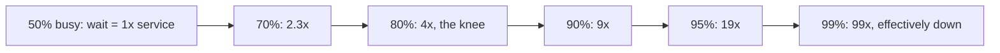
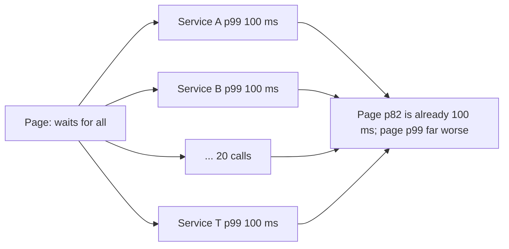
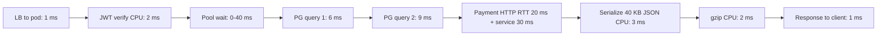

# Part 42 — Performance Engineering

Performance work has a bad reputation because most of it is done wrong: someone reads a blog post, swaps Express for Fastify, adds a cache "because caching is fast", and the p99 does not move because the real problem was a missing index on a 40-million-row table. Performance engineering is the discipline of *measuring* where time goes, *reasoning* about queues and resources with a few simple laws, and *fixing* the thing the measurement points at. The order matters: measure, then reason, then fix, then measure again.

This part gives you the laws (Little's law, the utilization curve, percentiles), the resources (CPU, memory, I/O, network) and then the catalogue of backend performance topics with detection, fix and code for each: N+1 queries, pools, query plans, caching, batching, pagination, streaming, compression, serialization, offloading, HTTP clients, Node and NestJS specifics. It ends with load testing, the profiling toolkit, a step-by-step runbook for "the API suddenly became slow", and the failure modes that catch teams out.

Keep the mantra close: *Can it become slow?* is the question this part answers in detail.

## 42.1 Latency, throughput and Little's law

#### Concept

**Latency** is how long one request takes, measured from the client's first byte out to the last byte back. **Throughput** is how many requests complete per unit of time (requests per second, RPS). **Concurrency** is how many requests are in flight at once. **Utilization** is the fraction of time a resource (a CPU, a connection, a worker) is busy.

These four are tied together by **Little's law**: for any stable system,

```text
L = λ × W
concurrency = throughput × latency
```

where `L` is the average number of requests in the system, `λ` (lambda) is the average arrival rate, and `W` is the average time each request spends in the system. It holds for any system in steady state, regardless of what is inside it: a NestJS pod, a connection pool, a Kafka consumer group, a coffee shop.

#### Why does it exist?

Without Little's law you size pools and pods by guessing. With it you can answer: "if my API handles 500 RPS at 40 ms average, how many requests are in flight?" (20). "If each request holds a database connection for 8 ms and I do 300 queries per second, how many connections are busy on average?" (9.4). "How many pods do I need if one pod's event loop can carry 25 concurrent requests?" (at least one, with headroom: two or three). It turns capacity from folklore into arithmetic.

#### Mental model

Imagine a coffee shop. Customers arrive at 2 per minute (throughput). Each spends 5 minutes inside, from door to door (latency). On average, there are 2 × 5 = 10 customers in the shop at any moment (concurrency). If the shop has 8 seats, two people are always standing. That is a queue. If a new barista cuts service time to 3 minutes, the shop holds 6 people and everyone sits. Nothing about the arrival rate changed; latency changed, and concurrency followed.

#### How it works — worked example

An orders API receives 600 RPS at peak. A trace shows the average request takes 50 ms: 3 ms in the guard (JWT verify), 30 ms in two PostgreSQL queries, 12 ms waiting on the payment gateway, 5 ms of CPU for validation and serialization.

1. **In-flight requests**: `600 × 0.050 = 30` concurrent requests across the fleet.
2. **Database connections**: each request holds a connection for the 30 ms of query time (not the full 50 ms if the code releases between queries; assume it holds for 30 ms). Connection concurrency: `600 × 0.030 = 18` connections busy on average. A pool of 20 across the fleet is at 90% utilization, which section 42.2 will show is dangerous. Size for 2× the average: about 36–40 total, so with 4 pods, 10 per pod.
3. **Pods**: each pod is a single Node.js event loop. The CPU work is 5 ms per request, so one core can do at most `1000 / 5 = 200` RPS of pure CPU work before saturation. At 600 RPS you need a minimum of 3 pods for CPU alone; target 50–60% utilization, so 6 pods.
4. **Payment gateway**: 600 RPS × 12 ms = 7.2 concurrent outbound calls. An HTTP agent with `maxSockets: 50` per pod is plenty; `maxSockets: 5` would queue.

Notice how one law sized the pool, the pod count and the outbound connection limit.

#### The hockey-stick queueing curve

Little's law describes averages. Queueing theory describes what happens as utilization rises. For a single server with random arrivals (the M/M/1 model, a decent approximation of one event loop or one connection), the average time spent *waiting* in the queue is:

```text
wait = service_time × ρ / (1 - ρ)        where ρ = utilization (0..1)
```

| Utilization ρ | Wait as multiple of service time | With 10 ms service time, total latency |
|---|---|---|
| 50% | 1× | 20 ms |
| 70% | 2.3× | 33 ms |
| 80% | 4× | 50 ms |
| 90% | 9× | 100 ms |
| 95% | 19× | 200 ms |
| 99% | 99× | 1,000 ms |



```text
latency
  ^                                             *
  |                                            *
  |                                           *
  |                                         *
  |                                      *
  |                                 *
  |                        *
  |            *
  |   *
  +-----------------------------------------------> utilization
  0%        50%        70%   80%   90%   95%  100%
```

This is why **80% utilization is the danger zone**. Above it, small increases in traffic cause large increases in latency, and the system flips from "fine" to "on fire" with no warning in between. Autoscaling on CPU at 80% is too late; by the time the new pod is ready (30–90 s), the queue has grown. Senior engineers target 50–65% steady-state utilization on the event loop, on database CPU and on connection pools, and they treat sustained 80% as an incident in waiting.

#### Practical example — pool sizing from the law

```ts
// src/config/pool.ts
// Derived from Little's law: busy_connections = queries_per_second × avg_hold_seconds
// Measured: 320 qps per pod at peak, avg hold 9 ms (p95 hold 25 ms)
// average busy = 320 × 0.009 = 2.9; p95 busy ≈ 320 × 0.025 = 8
// Size for p95 plus headroom, cap so 6 pods stay under PgBouncer's 100 server connections
export const PG_POOL_MAX = Number(process.env.PG_POOL_MAX ?? 12);
```

#### NestJS example — exposing the numbers so you can check the law

```ts
// src/metrics/pool-metrics.service.ts
import { Injectable, OnModuleInit } from '@nestjs/common';
import { DataSource } from 'typeorm';
import { Gauge } from 'prom-client';
import type { Pool } from 'pg';

@Injectable()
export class PoolMetricsService implements OnModuleInit {
  private readonly total = new Gauge({ name: 'pg_pool_total', help: 'connections in pool' });
  private readonly idle = new Gauge({ name: 'pg_pool_idle', help: 'idle connections' });
  private readonly waiting = new Gauge({ name: 'pg_pool_waiting', help: 'requests waiting for a connection' });

  constructor(private readonly ds: DataSource) {}

  onModuleInit() {
    // TypeORM's postgres driver exposes the underlying pg Pool as driver.master
    const pool = (this.ds.driver as any).master as Pool;
    setInterval(() => {
      this.total.set(pool.totalCount);
      this.idle.set(pool.idleCount);
      this.waiting.set(pool.waitingCount); // > 0 for sustained periods means the pool is the bottleneck
    }, 5_000).unref();
  }
}
```

`pg_pool_waiting` is the single most useful pool metric: it is the queue length in front of the resource. Combine it with the request rate and Little's law and you know the average wait time without measuring it directly.

#### Production scenario

A food-delivery orders service ran 4 pods with `PG_POOL_MAX = 10` each (40 total) against a PostgreSQL with `max_connections = 200`. Dinner peak: 900 RPS, avg 2.1 queries per request, avg 14 ms hold. Busy connections: `900 × 2.1 × 0.014 = 26.5`, so 66% utilization of 40. Fine. A new feature added a third query at 20 ms. Busy: `900 × (2.1 × 14 + 20) / 1000 = 44.5`, above 40. `pg_pool_waiting` climbed to 30, p99 went from 120 ms to 1.8 s, and error rate stayed at zero because nothing failed, everything just waited. Nobody was paged for two hours because the alerts were on error rate. Section 42.14 lists this as "pool exhaustion showing as latency, not errors".

#### Edge cases & failure modes

- Little's law is about *averages*; a burst of 3× traffic for 10 seconds needs the queue capacity to absorb it, not the average.
- Utilization measured over 1 minute hides 5-second spikes to 100%; use 10–15 s windows for saturation alerts.
- Latency in the law is *time in the system*, including queueing; if you measure only service time you will undersize.
- A resource at 100% utilization is not "efficient"; it is a queue with unbounded latency.

#### How a Senior Backend Engineer thinks about this

They ask for three numbers before touching a config: arrival rate, service time, and current utilization of each resource. They size for p95, not average, and they leave 35–50% headroom because the curve is non-linear. They explain to a product manager that "the server is only at 80% CPU" is not reassuring; it means the next 10% of traffic doubles latency.

#### Interview questions

1. *A service does 400 RPS with 25 ms average latency. How many requests are in flight?* Expected: 10. Follow-up: each holds a DB connection for 10 ms; how many connections are busy on average? (4.) What pool size do you set and why? (Around 10–12: p95 plus headroom.)
2. *Why is 80% utilization dangerous?* Expected: queueing wait grows as ρ/(1-ρ); at 80% waiting is 4× service time and every further percent adds more; the system flips from fine to failing without a linear warning.
3. *Why do pools fail as latency rather than errors?* Expected: the pool queues callers until `connectionTimeoutMillis`; below that, every request just waits.

#### Practical exercise

Instrument your service with `pg_pool_waiting`, request rate and average DB hold time. Run a load test at 30%, 60%, 80% and 90% of the pool's capacity (computed with Little's law) and plot p99 latency against utilization. Acceptance: your plot shows the knee, and you can state the pool size and pod count for your peak with 40% headroom.

## 42.2 Percentiles and tail latency

#### Concept

A **percentile** is the value below which a given fraction of observations fall. p50 (median): half the requests are faster. p99: 99% are faster, 1% are slower. **Tail latency** is what happens at p99 and beyond.

Averages lie about latency. A service with p50 = 20 ms and p99 = 2,000 ms has an average of maybe 45 ms, which sounds fine and hides that one request in a hundred takes two seconds. Users notice the tail; a page that loads 100 assets meets the tail on every load.

#### Why does it exist?

Latency distributions are not bell curves. They have a long right tail: GC pauses, lock waits, cache misses, a slow replica, a retry. The mean is pulled by the tail but does not describe it. SLOs are written on percentiles because "99% of requests under 300 ms" is a promise users can feel; "average 80 ms" is not.

#### Mental model

Imagine a queue at airport security. The average wait is 8 minutes. That number is useless to the one traveller in a hundred who gets pulled aside for 40 minutes and misses the flight. The airline's promise should be "99% of travellers clear security within 15 minutes", and the airport's job is to shrink the 40-minute case, not the 8-minute one.

#### How it works — tail latency amplification

When one page (or one API call) fans out to N backend calls and waits for all of them, the page's latency is the *maximum* of the N latencies. If each call has a 1% chance of being slow (p99), the chance that at least one of N calls is slow is `1 - 0.99^N`:

| Calls per page N | Chance the page hits at least one p99-slow call |
|---|---|
| 1 | 1% |
| 5 | 4.9% |
| 10 | 9.6% |
| 20 | 18.2% |
| 50 | 39.5% |
| 100 | 63.4% |



With 20 calls, 18% of page loads experience at least one backend p99. The backend's p99 has become the page's p82. This is why a microservice architecture with chatty pages needs *every* service to have a tight p99.9, not just a good p99, and why the senior move is often to reduce N (batch endpoints, BFF aggregation) rather than to shave milliseconds off each service.

#### How percentiles are computed from histograms

You cannot store every latency. Prometheus-style histograms count observations into buckets (`le="0.05"`, `le="0.1"`, `le="0.25"`, ...). The p99 is estimated by finding the bucket where the cumulative count crosses 99% and interpolating within it. Two consequences:

- Bucket boundaries define precision. If your buckets are `100 ms, 250 ms, 500 ms`, a true p99 of 180 ms is reported somewhere between 100 and 250 with linear interpolation. Choose buckets around your SLO: for a 300 ms SLO use `..., 200, 250, 300, 350, 400, 500, ...`.
- You cannot average percentiles across pods. Aggregate the *bucket counts* first, then compute: `histogram_quantile(0.99, sum by (le) (rate(http_server_duration_seconds_bucket{route="/orders"}[5m])))`.

Prometheus native histograms and OpenTelemetry exponential histograms fix the bucket-choice problem with automatic bucket growth; use them if your stack supports them.

```ts
// src/metrics/http-latency.interceptor.ts
import { CallHandler, ExecutionContext, Injectable, NestInterceptor } from '@nestjs/common';
import { Observable, tap } from 'rxjs';
import { Histogram } from 'prom-client';

const httpDuration = new Histogram({
  name: 'http_server_duration_seconds',
  help: 'request duration',
  labelNames: ['route', 'method', 'status'],
  // buckets clustered around the 300 ms SLO
  buckets: [0.01, 0.025, 0.05, 0.1, 0.15, 0.2, 0.25, 0.3, 0.4, 0.5, 0.75, 1, 2, 5],
});

@Injectable()
export class HttpLatencyInterceptor implements NestInterceptor {
  intercept(ctx: ExecutionContext, next: CallHandler): Observable<unknown> {
    const start = process.hrtime.bigint();
    const req = ctx.switchToHttp().getRequest();
    const route = req.route?.path ?? 'unknown'; // route template, never the raw URL with ids
    return next.handle().pipe(tap({
      finalize: () => {
        const res = ctx.switchToHttp().getResponse();
        const seconds = Number(process.hrtime.bigint() - start) / 1e9;
        httpDuration.labels(route, req.method, String(res.statusCode)).observe(seconds);
      },
    }));
  }
}
```

Label by route *template* (`/orders/:id`), never by the actual path; otherwise every order id becomes a time series and the metrics backend falls over.

#### SLOs on p99

An SLO of "p99 < 300 ms over 30 days" means that in a rolling 30-day window, 99% of requests completed under 300 ms. The **error budget** is the 1% you may spend. A deploy that pushes p99 to 350 ms for two hours burns budget; alerting on *burn rate* (how fast the budget is being consumed) pages on real degradation and stays quiet on one slow minute. See Part 49 — Site Reliability Engineering for the alerting math.

#### Production scenario

A product listing page called 14 services. Each had p99 = 120 ms and everyone was proud. The page's p99 was 900 ms and nobody understood why. Tracing showed the max-of-14 effect plus two serial hops. The fix was a BFF endpoint that batched 9 of the calls into one and cached the two slowest (category tree, promotions). Page p99 fell to 260 ms without changing any of the 14 services' own p99.

#### Edge cases & failure modes

- p99 computed over 10 requests is noise; require a minimum sample size before alerting.
- Averaging p99 across pods produces a number that means nothing; aggregate buckets.
- Timeouts cap the observed latency; a p99 exactly equal to your timeout means the true tail is longer.
- Health-check traffic in the same histogram drags p50 down and hides a regression; exclude it.

#### Interview questions

1. *Why report p99 instead of average?* Expected: distributions are skewed; the average hides the tail users feel; SLOs need a promise about the tail.
2. *A page makes 20 calls, each with p99 = 100 ms. What fraction of page loads see at least 100 ms from one call?* Expected: about 18%. Follow-up: what architectural change helps most? (Reduce fan-out.)
3. *How do you compute p99 across 12 pods?* Expected: sum histogram buckets, then `histogram_quantile`; never average per-pod percentiles.

## 42.3 Resources: CPU, memory, I/O and network

#### Concept

Every millisecond of latency is spent on one of four things: CPU (computing), memory (allocating, garbage collecting, swapping), I/O (disk on the database, files) or network (round trips, bandwidth). Performance work is finding out which one and why.



```text
POST /orders   total 95 ms (p50)                    | total 640 ms (p99)
  lb -> pod            1 ms  |                       |   1 ms
  auth (jwt verify)    2 ms  ||                      |   2 ms
  pool wait            0 ms  |                       | 220 ms  <- queue
  query 1 (select)     6 ms  ||||                    |  35 ms  <- lock wait
  query 2 (update)     9 ms  ||||||                  | 120 ms  <- lock wait
  payment gateway     50 ms  |||||||||||||||||||||   | 210 ms  <- their tail
  serialize          3 ms    ||                      |  12 ms  <- GC pause
  compress           2 ms    |                       |   2 ms
  network out        1 ms    |                       |  38 ms  <- mobile client
```

The p99 column is where the money is. It is almost never the same components as the p50 column.

#### CPU: the event loop is one core

Node.js runs your JavaScript on a single thread per process. Every `await` returns control to the event loop; every synchronous block (a big `JSON.parse`, a `for` loop over 100k items, `bcrypt.hashSync`, a regex on a large string) holds it. **Event loop lag** is how late a timer fires compared to when it should have; it is the direct measure of CPU saturation of a Node process.

```ts
// src/metrics/event-loop.service.ts
import { Injectable, OnModuleInit } from '@nestjs/common';
import { monitorEventLoopDelay } from 'node:perf_hooks';
import { Gauge } from 'prom-client';

@Injectable()
export class EventLoopMetrics implements OnModuleInit {
  private readonly lagP99 = new Gauge({ name: 'nodejs_eventloop_lag_p99_seconds', help: 'event loop delay p99' });
  onModuleInit() {
    const h = monitorEventLoopDelay({ resolution: 20 });
    h.enable();
    setInterval(() => { this.lagP99.set(h.percentile(99) / 1e9); h.reset(); }, 10_000).unref();
  }
}
```

A healthy service shows lag p99 under 10–20 ms. Sustained 100 ms means requests are queueing behind synchronous work. Profile with `node --cpu-prof` (writes a `.cpuprofile` you open in Chrome DevTools) or `clinic flame` for a flame graph (section 42.12).

Common CPU sinks in NestJS services: `class-transformer` on large payloads, `JSON.stringify` of big responses, synchronous crypto, `Array.prototype.sort` on 100k rows fetched from the DB (sort in SQL instead), regex-based validation on long strings, and logging objects with `JSON.stringify` at debug level in production.

#### Memory: heap limits, GC pauses and leaks

V8 has a default old-space limit that depends on the machine (typically around 2–4 GB on 64-bit; check `node -e "console.log(v8.getHeapStatistics().heap_size_limit/1e6)"`). In a container with a 512 MB limit and no `--max-old-space-size`, V8 may try to grow beyond the container and get OOMKilled. Set `--max-old-space-size` to roughly 75% of the container memory limit so V8 collects before the kernel kills.

Garbage collection pauses the event loop. Minor (scavenge) GCs are sub-millisecond; major (mark-sweep-compact) GCs on a 1.5 GB heap can pause for 50–300 ms and show up as p99 spikes with no corresponding slow query. Watch `nodejs_gc_duration_seconds` (prom-client default metrics) and correlate with latency spikes. Leaks (caches without bounds, listeners added per request, closures holding request bodies) show as a heap that grows across hours and a GC that gets slower and slower. Part 10 — Operating Systems and the Node.js Runtime covers heap snapshots and leak hunting in depth.

#### I/O: the database's disk

Your Node process rarely touches disk. PostgreSQL does. The metrics that matter: cache hit ratio (`pg_stat_database.blks_hit / (blks_hit + blks_read)`; below 99% on an OLTP workload means the working set does not fit in `shared_buffers` plus OS cache), `EXPLAIN (ANALYZE, BUFFERS)` showing `read=` blocks instead of `hit=`, checkpoint spikes (`checkpoint_write_time`), and WAL volume during bulk writes. A query that reads 20,000 buffers from disk on a cloud volume with 3,000 IOPS takes seconds no matter how good your Node code is.

#### Network: round trips are the cost, not bytes

A round trip within one availability zone is about 0.3–1 ms; cross-zone 1–2 ms; cross-region 60–150 ms; mobile last mile 30–300 ms. Bandwidth is rarely the constraint for JSON APIs; *count of round trips* is. Ten sequential 1 ms queries cost 10 ms; the same data in one query costs 1 ms. A TLS handshake without keep-alive costs 2–3 round trips before the first byte. A DNS lookup with no cache costs another. Section 42.9 covers HTTP client keep-alive; Part 11 — Networking covers the handshake costs.

#### How a Senior Backend Engineer thinks about this

They ask "which resource is saturated?" before "what should I optimise?". They keep four dashboards side by side: event loop lag and CPU, heap and GC, DB CPU and buffer hits, outbound RTT and pool waits. When p99 spikes they look for which of the four moved at the same time. They refuse to optimise code that a profile has not identified.

#### Interview questions

1. *What is event loop lag and what does a sustained 200 ms mean?* Expected: delay between when a timer should fire and when it does; sustained high lag means synchronous CPU work is blocking the single thread and all requests are queueing.
2. *Why set `--max-old-space-size` in a container?* Expected: V8's default limit may exceed the container limit; the kernel OOM-kills before V8 collects.
3. *What is the difference between p99 caused by GC and p99 caused by lock waits, and how would you tell them apart?* Expected: GC spikes correlate with `gc_duration` metrics and affect all routes; lock waits appear in `pg_stat_activity` `wait_event_type = Lock` and affect specific queries.
