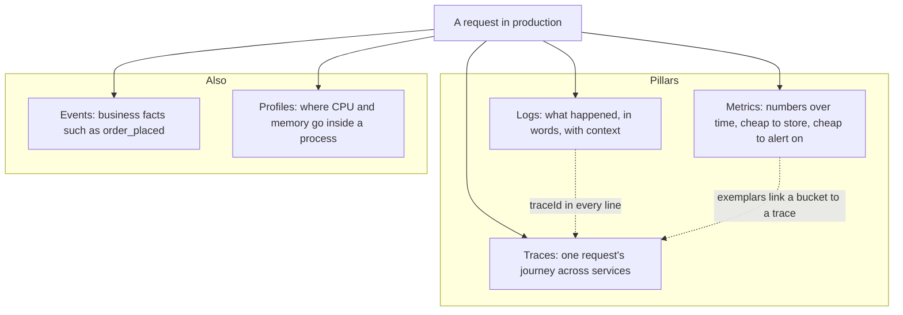

# Part 42 — Observability: Logs, Metrics and Traces

## 42.1 Monitoring versus observability

Every backend engineer has lived this moment: a customer says "checkout is broken", you open the dashboard, CPU is fine, memory is fine, the health check is green, and you still have no idea what happened to that one customer. The system is *monitored*. It is not *observable*.

This part teaches the difference and then builds, step by step, the three tools that close the gap: structured logs, metrics and distributed traces. All of it is shown in a NestJS service talking to PostgreSQL, Redis and Kafka, because that is where you will meet it.

### 42.1.1 Known unknowns and unknown unknowns

#### Concept

**Monitoring** answers questions you thought of in advance. You decide "alert me if error rate is above 1 percent" or "graph the database CPU". These are *known unknowns*: you know the question, you just do not know today's answer.

**Observability** is the property of a system that lets you answer questions you did *not* think of in advance, using only the data the system emits. "Why did order 8812 take 9 seconds at 14:02 when everything else was fast?" is an *unknown unknown*. Nobody wrote a dashboard for it. An observable system lets you find the trace for that order, see that 8.7 of the 9 seconds were spent waiting on a Redis `GET`, and see from the logs that the Redis pod was being evicted at that moment.

Observability is not a product you buy. It is a habit of emitting rich, correlated, structured data from every layer, and having tools that can slice it any way you want.

#### Why does it exist?

Modern backends are distributed. One request touches a load balancer, an API pod, a Redis cluster, a PostgreSQL primary, a Kafka topic and a worker. Each of those has its own logs and its own metrics. Without correlation, an incident is a treasure hunt across six consoles. Observability exists because "look at the logs" stopped being a sentence with a single meaning the day you had more than one process.

#### Mental model

Imagine a hospital. Monitoring is the row of monitors at the nurses' station: heart rate, blood pressure, oxygen. They beep when a threshold is crossed. That tells you *that* something is wrong. Observability is the patient's full chart, the lab results and the ability to order any test you need: it tells you *why*. You need both. A hospital with only the beeping monitors cannot diagnose anything; a hospital with only lab tests will not notice a patient collapsing.

#### How it works

The classic model has three pillars. Two more are worth naming because you will meet them in production.



1. **Logs** are discrete events with a timestamp and fields. They are the most detailed and the most expensive signal. One request can produce 5 to 50 lines.
2. **Metrics** are aggregated numbers sampled over time: a counter of requests, a histogram of latencies. They are cheap to store because a million requests collapse into a handful of numbers per scrape interval.
3. **Traces** record the path of a single request as a tree of timed spans. They are the only signal that natively answers "where did the time go across services".
4. **Events** are business-level facts emitted deliberately (`order_placed`, `payment_failed`). Often they are just logs with a strict schema, or Kafka messages that analytics consumes.
5. **Profiles** show which functions burn CPU or allocate memory. Continuous profiling (Pyroscope, Parca) samples a running process at low overhead. You reach for it after metrics tell you CPU is high and traces tell you which endpoint, and you still need to know *which function*.

The three pillars are not three separate products. Their value comes from **correlation**: a `traceId` in every log line, a trace exemplar attached to a latency bucket, a request id carried through Kafka. When they are linked, you move from a red dashboard to the exact line of code in under two minutes.

#### The cost of observability

Observability is not free, and a senior engineer budgets it like any other resource.

| Signal | Typical volume for a 500 RPS NestJS service | Rough monthly cost driver |
|---|---|---|
| Logs at INFO with request logging | 500 lines/s at 400 bytes = 17 GB/day | Ingestion and retention; the most expensive signal by far |
| Metrics with 300 series per pod, 10 pods, 15 s scrape | 3,000 series, 200 samples/s | Series count (cardinality), not request volume |
| Traces at 10 percent sampling, 8 spans per request | 400 spans/s | Span count and retention; tail sampling reduces it further |

Rule of thumb: logs cost 5 to 20 times more than metrics for the same service. Every time you add a log line to a hot path you are signing a monthly bill. We return to cost control in 42.9.

#### How a Senior Backend Engineer thinks about this

They ask two questions before adding any signal: "What question does this let me answer at 3 a.m.?" and "What does it cost per month?" If the answer to the first is "none", the signal goes. They refuse dashboards nobody looks at and alerts nobody acts on. They explain it to a product manager as: "Monitoring tells us we are losing money; observability tells us which line of code is losing it."

#### Interview questions

1. *What is the difference between monitoring and observability?* Expected: monitoring answers predefined questions with thresholds; observability lets you answer new questions from emitted data. Follow-up: give an example of a question only observability can answer.
2. *Why are logs more expensive than metrics?* Expected: logs are per-event and unbounded; metrics aggregate into a fixed number of series per scrape. Follow-up: what makes metrics expensive? (Cardinality.)
3. *What links the three pillars together?* Expected: trace id in logs, exemplars in metrics, consistent resource attributes (service, env, version).

## 42.2 Logs

### 42.2.1 Structured logging

#### Concept

A structured log is a log line that is a machine-readable record, almost always one JSON object per line, with named fields. `{"level":"info","msg":"order created","orderId":"8812","durationMs":42}` is structured. `Order 8812 created in 42ms` is not; a human can read it, but a query engine cannot filter on `durationMs > 1000` without a fragile regular expression.

#### Why does it exist?

Unstructured logs work for one process on one machine that you `tail -f`. They fail the moment you have twenty pods, because the only way to find anything is text search, and text search cannot answer "show me all requests over 2 seconds for user 41 in the last hour". Structured logs turn a log store into a database you can query.

#### Mental model

Imagine a warehouse receiving deliveries. Unstructured logging is a delivery driver shouting "big brown box from Mumbai, fragile!" as they drop it. Structured logging is a barcode label with `origin`, `weight`, `fragile`, `orderId`. The second one lets you find every fragile box from Mumbai in a second, and the first one lets you find nothing once the driver has left.

#### How it works

Every line carries a fixed core of fields. Agree on them across every service in the company, because cross-service queries only work when the field names match.

| Field | Example | Why |
|---|---|---|
| `time` | `2026-09-06T14:02:11.483Z` | ISO 8601 in UTC, millisecond precision. Never local time. |
| `level` | `info` | Filter and alert by severity. |
| `msg` | `order created` | Short, constant, lower-case. Variable data goes in fields, not in the message. |
| `service` | `orders-api` | Which deployable. |
| `env` | `prod` | Never mix environments in one query by accident. |
| `version` | `2.14.3+a1b2c3d` | Which build. Essential when a deploy causes the incident. |
| `requestId` | `req_7f3c...` | Correlation id for one inbound request. |
| `traceId` | `4bf92f3577b34da6a3ce929d0e0e4736` | Links to the distributed trace. |
| `userId` | `u_41` | Who. Internal id only, never email. |
| `orderId` | `8812` | The business key you will search by at 3 a.m. |
| `durationMs` | `42` | Numeric so you can filter and aggregate. |
| `err` | `{ type, message, stack }` | Structured error, including stack. |

What must **never** appear: passwords, tokens, session cookies, full card numbers, bank details, government ids, emails and phone numbers (these are personal data under GDPR and similar laws), full request bodies by default, and Authorization headers. Logs are copied to more places than your database ever will be, and they are read by more people. Treat them as public within the company.

Keep `msg` constant and put variables in fields. `msg: "order created"` with `orderId: 8812` groups into one pattern in your log tool; `msg: "order 8812 created"` produces a million distinct messages and defeats pattern-based analysis.

#### NestJS example

`pino` is the fastest mainstream Node.js logger because it serializes to JSON with minimal work and writes to a stream without formatting. `nestjs-pino` wires it into the Nest `Logger` abstraction and adds request logging.

```ts
// app.module.ts
import { Module } from '@nestjs/common';
import { LoggerModule } from 'nestjs-pino';
import { randomUUID } from 'node:crypto';

@Module({
  imports: [
    LoggerModule.forRoot({
      pinoHttp: {
        level: process.env.LOG_LEVEL ?? 'info',
        // Fixed fields on every line from this process.
        base: {
          service: 'orders-api',
          env: process.env.NODE_ENV,
          version: process.env.APP_VERSION,
        },
        timestamp: () => `,"time":"${new Date().toISOString()}"`,
        // Reuse the incoming id so the gateway, this service and the worker agree.
        genReqId: (req) => (req.headers['x-request-id'] as string) ?? randomUUID(),
        // Redact secrets before they are serialized. Paths use pino's redact syntax.
        redact: {
          paths: ['req.headers.authorization', 'req.headers.cookie', '*.password', '*.cardNumber'],
          censor: '[REDACTED]',
        },
        // Keep request logs small: no bodies, no full header dumps.
        serializers: {
          req: (req) => ({ id: req.id, method: req.method, url: req.url }),
          res: (res) => ({ statusCode: res.statusCode }),
        },
        customProps: (req) => ({ requestId: req.id }),
        // Health checks are noise; do not log them.
        autoLogging: { ignore: (req) => req.url === '/health' || req.url === '/metrics' },
      },
    }),
  ],
})
export class AppModule {}
```

```ts
// main.ts
import { NestFactory } from '@nestjs/core';
import { Logger } from 'nestjs-pino';
import { AppModule } from './app.module';

async function bootstrap() {
  // bufferLogs holds early lines until the pino logger is attached.
  const app = await NestFactory.create(AppModule, { bufferLogs: true });
  app.useLogger(app.get(Logger));
  await app.listen(3000);
}
bootstrap();
```

In services, inject `PinoLogger` and log objects, not sentences.

```ts
// orders/orders.service.ts
import { Injectable } from '@nestjs/common';
import { PinoLogger, InjectPinoLogger } from 'nestjs-pino';

@Injectable()
export class OrdersService {
  constructor(@InjectPinoLogger(OrdersService.name) private readonly log: PinoLogger) {}

  async create(userId: string, dto: CreateOrderDto) {
    const started = process.hrtime.bigint();
    try {
      const order = await this.repo.createOrder(userId, dto);
      this.log.info(
        { orderId: order.id, userId, itemCount: dto.items.length, durationMs: elapsedMs(started) },
        'order created',
      );
      return order;
    } catch (err) {
      // Pass the Error under the `err` key: pino serializes type, message and stack.
      this.log.error({ err, userId, itemCount: dto.items.length }, 'order creation failed');
      throw err;
    }
  }
}

function elapsedMs(start: bigint): number {
  return Number((process.hrtime.bigint() - start) / 1_000_000n);
}
```

The `err` key matters. `this.log.error('failed: ' + err.message)` throws away the stack, the error class and any `cause`. Logging the `Error` object under `err` keeps all of it, and pino's default serializer formats it as `{ type, message, stack }`.

#### TypeORM example

Route the ORM's own logging through the same pino instance so slow queries land in the same stream with the same `requestId`. TypeORM accepts a custom `Logger` implementation and a `maxQueryExecutionTime` threshold.

```ts
// database/typeorm-pino.logger.ts
import { Logger as TypeOrmLogger, QueryRunner } from 'typeorm';
import { PinoLogger } from 'nestjs-pino';

export class TypeOrmPinoLogger implements TypeOrmLogger {
  constructor(private readonly log: PinoLogger) {}

  logQuery() {} // Do not log every query in prod; that is a 3x log volume increase.

  logQueryError(error: string | Error, query: string, parameters?: unknown[]) {
    this.log.error({ err: error, query, paramCount: parameters?.length ?? 0 }, 'query failed');
  }

  logQuerySlow(time: number, query: string) {
    // Fires when a query exceeds maxQueryExecutionTime.
    this.log.warn({ durationMs: time, query: query.slice(0, 500) }, 'slow query');
  }

  logSchemaBuild(message: string) { this.log.info({ message }, 'schema build'); }
  logMigration(message: string) { this.log.info({ message }, 'migration'); }
  log(level: 'log' | 'info' | 'warn', message: unknown) { this.log.info({ message }, 'typeorm'); }
}

// In TypeOrmModule.forRootAsync(...) useFactory:
//   logger: new TypeOrmPinoLogger(pinoLogger),
//   maxQueryExecutionTime: 500,   // ms; anything slower triggers logQuerySlow
```

Never log query parameters in production. They contain the customer's data.

#### Sequelize example

Sequelize takes a `logging` function and, with `benchmark: true`, passes the elapsed time as the second argument.

```ts
// database/sequelize.config.ts
new Sequelize(process.env.DATABASE_URL!, {
  benchmark: true,
  logging: (sql: string, timingMs?: number) => {
    if (timingMs !== undefined && timingMs > 500) {
      pinoLogger.warn({ durationMs: timingMs, query: sql.slice(0, 500) }, 'slow query');
    }
  },
});
```

#### Production scenario

An orders API at 500 RPS logging one request line plus one business line per request emits about 1,000 lines per second, roughly 400 bytes each: 34 GB per day. At typical hosted log pricing ($0.50 to $2.50 per GB ingested plus retention) that is $500 to $2,500 a month for one service. The same service with DEBUG accidentally enabled in production emits 8 lines per request and the bill quadruples overnight. This is why `LOG_LEVEL` comes from the environment, and why someone reviews log volume per service every month.

#### Failure scenario

At 02:14 the on-call is paged: checkout error rate is 4 percent. The error log says `"msg":"payment failed"` and nothing else, 600 times. Which provider? Which users? Which error code? The engineer has to enable DEBUG, redeploy, wait for the next failure, and read a stack trace, adding 40 minutes to the incident. The fix the next day was one line: `this.log.error({ err, orderId, provider, providerCode: err.code, amount }, 'payment failed')`. The following incident took four minutes because the log said `providerCode: "insufficient_funds"` on every line and the alert was rewritten to exclude customer-side declines.

#### Edge cases & failure modes

- Logging the whole request body "for debugging" captures passwords on `/login` and card numbers on `/payments`. Redact by path or log nothing by default.
- A `msg` built with string interpolation creates unbounded unique messages and breaks pattern grouping.
- Circular objects passed to the logger throw or produce `[Circular]`; log ids, not ORM entities.
- Very large log lines (over 16 KB) are truncated or dropped by many shippers; do not log a 2 MB response.
- Logging `err.message` instead of `err` loses the stack and the `cause` chain.

#### How a Senior Backend Engineer thinks about this

They treat log fields as a public API of the service and version them like one. They keep a short company-wide field dictionary and reject PRs that invent `order_id` when the standard is `orderId`. They ask of every line: "Would I search by this at 3 a.m.? If not, why is it here?"

#### Common mistakes

- Using `console.log` in services: no levels, no fields, synchronous write to stdout, and no way to turn it off.
- Different services using different field names for the same thing.
- Logging at INFO inside loops that run per item; 10,000 items becomes 10,000 lines.
- Emitting secrets through error objects (some HTTP client errors include the request headers).

### 42.2.2 Log levels and what belongs at each

#### Concept

A level is a severity tag that decides whether a line is written and how it is triaged. The mistake most teams make is not having a shared meaning for each level, so `error` becomes noise and nobody reads it.

#### How it works

| Level | Meaning | Production default | Examples |
|---|---|---|---|
| `fatal` | Process cannot continue and will exit | On | Cannot bind port, cannot decrypt config, database unreachable at startup |
| `error` | An operation failed and a human may need to act | On | Unhandled exception in a handler, payment provider 500, Kafka producer failure after retries |
| `warn` | Something unexpected but handled; watch the trend | On | Retry succeeded on attempt 3, slow query over 500 ms, cache miss storm, deprecated endpoint used |
| `info` | Business and lifecycle events you would want in an audit | On | Request completed, order created, worker started, config loaded |
| `debug` | Developer detail for diagnosing a specific flow | Off | Cache key computed, branch taken, payload sizes |
| `trace` | Everything, including per-item loops | Off | Raw SQL, per-message consumer processing |

Two rules keep levels meaningful. First, **an `error` must be actionable**. A customer typing a wrong password is not an error; it is `info` with `reason: "bad_credentials"`. A 4xx returned to a client is `info` or `warn`, never `error`, because the client caused it. Second, **`warn` is for trends**. One `warn` is fine; a thousand per minute is an alert, and you build that alert on the count rather than on any individual line.

#### Common mistakes

- Logging expected validation failures as `error`, which drowns real errors and trains the team to ignore the level.
- Leaving `debug` on in production because "it might be useful". It is useful in exactly the way a flooded basement is wet.

