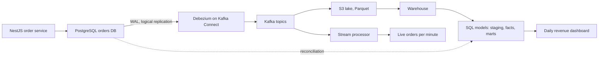
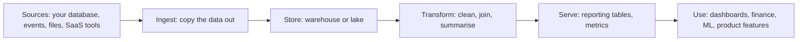
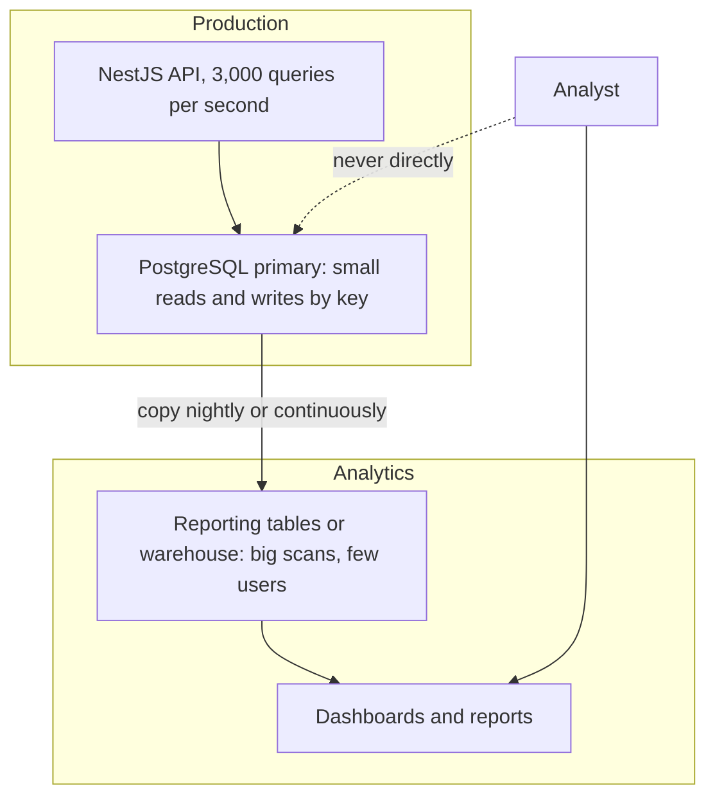
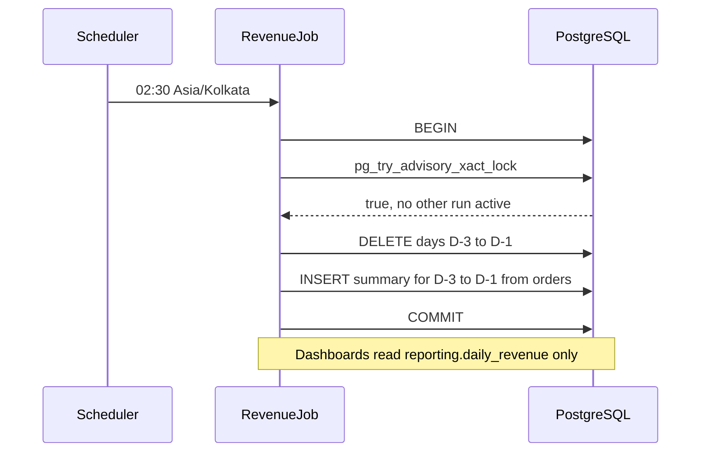
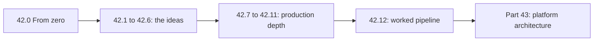

# Part 42 — Data Engineering for Backend Engineers

A backend engineer does not need to become a data engineer, but at any company past a certain size the two worlds meet constantly, and the backend engineer who understands the data side is far more effective. The production database you own is the source of the analytics the business runs on; the events you emit are the raw material of the data warehouse; the schema you change can break a dashboard; the GDPR deletion you implement must reach the warehouse too. This Part teaches the data-engineering concepts a backend engineer needs to work well across that boundary: why analytics and transactional workloads must be separated, how data flows from your database into analytics systems, and how to build analytics features into your own product.

The topics: OLTP versus OLAP (why analytics queries hurt your production database), **change data capture** (streaming database changes to other systems), **ETL versus ELT** and batch pipelines, **data warehouses and lakes** (columnar storage, Parquet), **stream processing** (windows, watermarks, late events), **data contracts** between backend and data teams, **data quality**, **privacy in pipelines** (PII masking, deletion propagation), and **building analytics features in the product** (pre-aggregated tables, materialized views, read models). The running example is deriving daily revenue dashboards from the orders database.

This Part builds on the transactional outbox (see Part 33 — Distributed Transactions, 33.10), keeping a search index in sync (see Part 37 — Search, 37.10), Kafka (see Part 31 — Messaging, 31.3), partitioning (see Part 26 — Database Scaling, 26.7) and caching (see Part 30 — Caching and Redis), going wider into the data pipeline those feed. Sections 42.1 to 42.6 introduce each idea; sections 42.7 to 42.11 take the same ideas into production depth (logical replication slots, Debezium configuration, warehouse DDL, Flink SQL windows, contract enforcement); and 42.12 builds the whole pipeline end to end: CDC from the orders database into a warehouse that feeds the daily revenue dashboard.



## 42.0 Data engineering from zero

This section is the on-ramp: the words the rest of this Part uses, analytics SQL you can run on your laptop, and a first small pipeline you could ship next week. If you already know ELT, lakehouses and late events, skip to 42.1.

### 42.0.1 What data engineering is, and why a backend engineer meets it

#### Concept

**Data engineering** is the work of moving data from the systems that create it (your production database, your event streams, third-party tools) into a shape and a place where people can ask questions of it, reliably, every day. A data engineer builds and runs **pipelines**: programs that copy data, clean it, combine it and summarise it on a schedule or continuously. The people asking are analysts, finance, product managers, ML engineers and, more and more, the product itself.

#### Why does it exist?

Your production database is built to serve the application, not to answer "revenue per country per day for two years"; ask it that during the day and customers feel it (42.1 shows why). The data also lives in many places: orders in PostgreSQL, clicks in an analytics tool, payouts at the payment provider. Nobody can answer a question that spans them unless someone brings the data together and keeps it fresh and correct. That is data engineering.

#### Mental model

Imagine a city's water system. The wells are your sources, the pipes are pipelines, the treatment plant cleans the water (removes duplicates, fixes types), the reservoir is the warehouse and the taps are dashboards. A backend engineer runs one of the wells. If the well pumps something new into the pipe (a renamed column, a new status value), every tap downstream can turn brown, and the people at the taps cannot see the well.

#### How it works

You will meet data engineering in five ordinary moments of backend work:

1. **Someone asks for a report.** The quick answer, a query against production, is the wrong one past a small size.
2. **Your schema change breaks a dashboard.** You rename `total` to `total_cents` and the nightly job that reads it fails. Your table was someone else's input.
3. **You emit events.** The `order.paid` events you publish are also the raw material of analytics.
4. **A deletion request arrives.** Deleting the row in your database is not enough if copies live in the warehouse (42.5).
5. **The product needs numbers.** A seller dashboard is an analytics feature inside your product (42.6).



### 42.0.2 Two kinds of work on the same data: OLTP and analytics

#### Concept

The same orders table serves two very different kinds of work. **OLTP** (online transaction processing) is the application's work: thousands of tiny, fast operations per second, each touching a few rows by key. **Analytics** (often called OLAP, online analytical processing) is the business's work: a few big questions per minute, each reading millions of rows to produce a short answer. Section 42.1 goes into the storage-level reasons; here is the plain-words picture.

#### Mental model

Imagine a supermarket. OLTP is the cashier scanning one basket at a time. Analytics is the manager asking "how many bananas did we sell each day this year?" Reading every receipt at the tills while customers wait makes the queues grow; the sensible way is to copy the receipts to the back office every night and count there.



#### How it works

| Question | OLTP (the app) | Analytics (the business) |
|---|---|---|
| Typical query | "Get order 1001" | "Revenue per country per day, last 90 days" |
| Rows read per query | 1 to 100 | Thousands to billions |
| Rows returned | 1 to 100 | Usually under 1,000 |
| Queries per second | Hundreds to tens of thousands | A handful |
| Acceptable latency | 1 to 50 ms | Seconds, sometimes minutes |
| How fresh must data be | Exactly now | Minutes to a day old is usually fine |
| What it needs | Indexes on keys, short transactions | Scanning whole columns, summary tables |

The rule: **many rows in, few rows out** is the signature of an analytics query, and it should not run on the primary that serves customers. At small scale the answer is a summary table refreshed nightly (42.0.5); later a read replica, then a warehouse fed by a pipeline (42.2 and 42.3).

### 42.0.3 The core vocabulary

Data teams use a small set of words constantly. Learn these and the rest of the Part reads easily.

#### Concept

| Term | Plain meaning | Where you meet it |
|---|---|---|
| Batch | Process a chunk of data at a time, on a schedule ("every night, load yesterday") | Nightly reports, finance closes |
| Stream | Process each event as it arrives, continuously | Live order counters, fraud checks |
| ETL | Extract, Transform, Load: clean the data before it lands in the warehouse | Older pipelines, privacy filtering |
| ELT | Extract, Load, Transform: land the raw data first, transform it inside the warehouse with SQL | Most modern pipelines |
| Warehouse | A database built for analytics: columnar storage, SQL, structured tables | BigQuery, Snowflake, Redshift |
| Lake | Cheap object storage holding files of any shape (Parquet, JSON, CSV) | S3, Google Cloud Storage, Azure Blob |
| Lakehouse | A lake plus a table format that gives files warehouse features (transactions, schema, time travel) | Apache Iceberg, Delta Lake, Apache Hudi |
| Schema-on-write | The shape is checked when data is written; bad rows are rejected | PostgreSQL tables, warehouse tables |
| Schema-on-read | Data is stored as it came; the shape is applied when someone reads it | Raw JSON files in a lake |
| Partitioning | Splitting a big table into pieces by a column (usually date) so queries skip pieces they do not need | Monthly order partitions, daily folders |
| Idempotent load | A load you can run twice and get the same result as running it once | Every reliable pipeline |
| Late data | An event that arrives after the period it belongs to has already been processed | A payment confirmed at 00:05 for 23:58 |

#### How it works

**Batch versus stream.** Batch is simpler to build, test and rerun: if the job fails, you run it again for that day. Stream gives answers within seconds but you now operate a long-running process with state, offsets and failure recovery (42.3.2). Most companies start with batch and add streaming only for the few numbers that genuinely need to be live. A useful question to ask the person requesting a report: "what decision changes if this number is one hour old instead of one second old?" Usually none.

**ETL versus ELT.** In ETL, a program (often Python or Spark) cleans the data on the way in, so only the cleaned shape reaches the warehouse. In ELT, you copy the raw data into the warehouse first and write the transformations as SQL there. ELT won because warehouse compute became cheap, analysts already know SQL, and keeping the raw data lets you fix a transformation bug and rebuild history. ETL still matters when you must remove something before it lands, such as personal data that must never reach the analytics account (42.5).

**Warehouse, lake, lakehouse.** A warehouse is the managed, SQL-first choice; a lake is the cheap store for huge or messy data; a lakehouse puts a table format over lake files so several engines can share them with transactions. Section 42.3 compares them; Part 43 — Data Platform Architecture, 43.3, is about choosing between them for a whole company.

**Schema-on-write versus schema-on-read.** Your PostgreSQL table is schema-on-write: an insert with a text in an integer column fails immediately, which protects every reader. A folder of JSON files in S3 is schema-on-read: anything can be written, and every reader must cope with missing fields and surprises. Raw landing zones are usually schema-on-read (so ingestion never fails because a field was added); the cleaned tables people use are schema-on-write.

**Partitioning.** Splitting by date means "revenue for March" reads only March's piece. In PostgreSQL this is declarative partitioning (see Part 26 — Database Scaling, 26.7); in a lake it is a folder per day such as `orders/dt=2026-03-14/`. Partitioning is also what makes idempotent loads easy: to reload one day, you replace one partition.

**Idempotent loads.** Jobs fail halfway and get retried. Schedulers sometimes start the same job twice. A person reruns last Tuesday after fixing a bug. If the load is a plain `INSERT`, each rerun adds the rows again and Tuesday's revenue doubles. An idempotent load owns a slice of the target (a day, a partition, a set of keys) and **replaces** it: delete-then-insert in one transaction, or upsert by a unique key. Run it once or five times, the table looks the same.

**Late data.** Events do not arrive in order. A mobile app offline in a tunnel sends its events an hour later; a payment provider's webhook for a 23:58 payment arrives at 00:07; a refund lands three days after the order. If your job loads "yesterday" once at 00:30 and never looks back, late events are lost from the numbers forever. The simple batch answer is to **recompute a trailing window** (yesterday plus the two days before) every night. The streaming answer is watermarks (42.3.2).

### 42.0.4 SQL for analytics you can run on PostgreSQL today

You do not need a warehouse to learn analytics SQL. PostgreSQL has everything: `GROUP BY`, `FILTER`, window functions, `generate_series`. Create a test table with two million orders on your laptop and practise.

#### PostgreSQL example: test data

```sql
-- A small orders table that looks like production, with fake data only.
CREATE TABLE orders (
  id           bigserial PRIMARY KEY,
  customer_id  bigint      NOT NULL,
  country      text        NOT NULL,
  status       text        NOT NULL CHECK (status IN ('pending','paid','refunded','cancelled')),
  total_cents  bigint      NOT NULL CHECK (total_cents >= 0),
  created_at   timestamptz NOT NULL,
  paid_at      timestamptz,
  refunded_at  timestamptz
);

INSERT INTO orders (customer_id, country, status, total_cents, created_at, paid_at, refunded_at)
SELECT c.customer_id, c.country, c.status, c.total_cents, c.created_at,
       CASE WHEN c.status IN ('paid','refunded') THEN c.created_at + interval '2 minutes' END,
       CASE WHEN c.status = 'refunded' THEN least(c.created_at + interval '3 days', now()) END
FROM (
  SELECT 1 + floor(random() * 50000)::bigint                          AS customer_id,
         (ARRAY['IN','DE','US'])[1 + floor(random() * 3)::int]          AS country,
         (ARRAY['paid','paid','paid','paid','paid','paid','paid',
                'refunded','pending','cancelled'])[1 + floor(random() * 10)::int] AS status,
         (19900 + floor(random() * 500000))::bigint                    AS total_cents,
         now() - random() * interval '365 days'                        AS created_at
  FROM generate_series(1, 2000000)
) c;

CREATE INDEX orders_paid_at_idx ON orders (paid_at);
CREATE INDEX orders_refunded_at_idx ON orders (refunded_at) WHERE refunded_at IS NOT NULL;
ANALYZE orders;
```

#### PostgreSQL example: GROUP BY and FILTER

Daily revenue is a `GROUP BY` on the day. Two details matter more than the syntax: **which time zone defines a day** (the business's, not the server's) and **money in integer cents** (never floating point).

```sql
-- Daily revenue for the last 30 days, in the business's time zone.
SELECT (paid_at AT TIME ZONE 'Asia/Kolkata')::date              AS day,
       count(*)                                                AS paid_orders,
       sum(total_cents)                                        AS gross_cents,
       count(*) FILTER (WHERE country = 'IN')                  AS orders_in,
       round(avg(total_cents))                                 AS avg_order_cents
  FROM orders
 WHERE paid_at >= now() - interval '30 days'
 GROUP BY 1
 ORDER BY 1;
```

`FILTER (WHERE ...)` is conditional aggregation: several counts in one pass over the data (see Part 21 — SQL Mastery, 21.3 and 21.10).

#### PostgreSQL example: window functions

A **window function** computes a value for each row using other rows around it, without collapsing them into one row the way `GROUP BY` does. Analytics uses three patterns all the time: running totals, moving averages and ranking (see Part 21 — SQL Mastery, 21.9, for the full treatment).

```sql
WITH daily AS (
  SELECT (paid_at AT TIME ZONE 'Asia/Kolkata')::date AS day,
         sum(total_cents) AS gross_cents
    FROM orders
   WHERE paid_at >= now() - interval '90 days'
   GROUP BY 1
)
SELECT day,
       gross_cents,
       -- running total within each month
       sum(gross_cents) OVER (PARTITION BY date_trunc('month', day) ORDER BY day) AS month_to_date_cents,
       -- 7-day moving average smooths out weekday/weekend swings
       round(avg(gross_cents) OVER (ORDER BY day ROWS BETWEEN 6 PRECEDING AND CURRENT ROW)) AS avg_7d_cents
  FROM daily
 ORDER BY day;
```

Window functions run **after** `GROUP BY`, so they can work on aggregated values. Note one trap in the moving average: `ROWS BETWEEN 6 PRECEDING` counts rows, not days. If a day has no orders it has no row, and the "7-day" average quietly covers eight days. For gappy data, generate the full calendar with `generate_series` and `LEFT JOIN` the daily totals onto it (see Part 21 — SQL Mastery, 21.14).

#### PostgreSQL example: EXPLAIN on an aggregate

Now look at what the database actually does for a 90-day revenue query.

```sql
EXPLAIN (ANALYZE, BUFFERS)
SELECT (paid_at AT TIME ZONE 'Asia/Kolkata')::date AS day, sum(total_cents)
  FROM orders
 WHERE status IN ('paid','refunded')
   AND paid_at >= now() - interval '90 days'
 GROUP BY 1;
```

```text
Finalize GroupAggregate  (actual time=388.2..401.6 rows=91 loops=1)
  Group Key: ((timezone('Asia/Kolkata'::text, paid_at))::date)
  Buffers: shared hit=2112 read=18690
  ->  Gather Merge  (actual time=388.0..401.1 rows=273 loops=1)
        Workers Planned: 2
        Workers Launched: 2
        ->  Sort  (actual time=371.4..371.5 rows=91 loops=3)
              Sort Key: ((timezone('Asia/Kolkata'::text, paid_at))::date)
              Sort Method: quicksort  Memory: 28kB
              ->  Partial HashAggregate  (actual time=371.0..371.2 rows=91 loops=3)
                    Group Key: (timezone('Asia/Kolkata'::text, paid_at))::date
                    Batches: 1  Memory Usage: 37kB
                    ->  Parallel Seq Scan on orders  (actual time=0.02..318.7 rows=131402 loops=3)
                          Filter: ((status = ANY ('{paid,refunded}'::text[])) AND (paid_at >= (now() - '90 days'::interval)))
                          Rows Removed by Filter: 535265
                          Buffers: shared hit=2112 read=18690
Planning Time: 0.24 ms
Execution Time: 401.9 ms
```

Read it bottom up (see Part 23 — Database Indexing, 23.3.1, for the method):

1. **Parallel Seq Scan.** Three processes read the whole table: 20,802 pages of 8 KB, about 160 MB, even though only about 20% of rows qualify. The planner skipped `orders_paid_at_idx` because fetching 400,000 scattered rows through an index costs more than reading everything in order.
2. **Partial HashAggregate.** Each process groups its share into 91 day buckets in 37 kB of memory. Grouping is cheap; reading was the cost.
3. **Gather Merge, Finalize GroupAggregate.** The three partial results are combined into the final 91 rows.

So: 400 ms and 160 MB of reads to return 91 rows. On two million rows that is fine. On 200 million rows it becomes 40 seconds and 16 GB, and every page it pulls through `shared_buffers` pushes out a page the API needed. This is the moment to stop computing the answer from raw orders on every dashboard refresh and start **storing the answer** once a night. That is your first pipeline.

### 42.0.5 Your first tiny pipeline: a nightly, idempotent export into a reporting table

> **Try it first** · Level: Beginner · About 30 minutes
>
> **Build:** a nightly job that fills a `reporting.daily_revenue` table (one row per day and country) from `orders`, so dashboards stop scanning the orders table.
>
> **Requirements:**
> - Gross revenue counts on the day an order was paid; refunds count on the day they happened.
> - Days are business days in Asia/Kolkata, not UTC.
> - Payment confirmations can arrive up to two days late with an earlier `paid_at`.
> - Running the job twice, or for an old date range after a bug fix, must give the same table as running it once.
> - Two copies of the job must never write at the same time.
>
> **Scale and constraints:** about 15,000 orders per day today, 2 million rows in `orders`; one PostgreSQL primary shared with the API; the job must finish in under a minute and touch only the days it reloads.
>
> **Your task:** write the target table, the load SQL and the job; explain what happens on a rerun and on a failure halfway.
>
> Spend the time on paper before you read on. The model design follows.

#### How it works



The design rests on four decisions:

1. **The job owns a slice and replaces it.** Each run owns a date range (by default, the last three complete days). It deletes those days from the reporting table and inserts fresh totals, inside one transaction. A rerun replaces the same rows with the same values: idempotent.
2. **The trailing window absorbs late data.** Recomputing the last three days every night means a payment confirmed two days late is counted on the next run. Older days are final unless someone runs a backfill.
3. **One transaction, one lock.** Readers see either the old totals or the new ones, never a half-deleted day. A transaction-level advisory lock (see Part 24 — Database Transactions and Concurrency Control, 24.4.5) makes a second concurrent run skip instead of interleaving.
4. **The job reads only what it reloads.** Three days is roughly 45,000 rows through the `paid_at` and `refunded_at` indexes: tens of milliseconds, harmless to the API.

#### PostgreSQL example: the target table and the load

```sql
CREATE SCHEMA IF NOT EXISTS reporting;

CREATE TABLE reporting.daily_revenue (
  day             date        NOT NULL,
  country         text        NOT NULL,
  paid_orders     integer     NOT NULL,
  gross_cents     bigint      NOT NULL,
  refunded_cents  bigint      NOT NULL,
  net_cents       bigint      GENERATED ALWAYS AS (gross_cents - refunded_cents) STORED,
  loaded_at       timestamptz NOT NULL DEFAULT now(),
  PRIMARY KEY (day, country)          -- one row per day and country; a duplicate is an error
);

-- The load for one date range [$1, $2), run inside a transaction.
DELETE FROM reporting.daily_revenue WHERE day >= $1::date AND day < $2::date;

INSERT INTO reporting.daily_revenue (day, country, paid_orders, gross_cents, refunded_cents)
SELECT e.day, e.country,
       count(*)              FILTER (WHERE e.kind = 'paid'),
       coalesce(sum(e.cents) FILTER (WHERE e.kind = 'paid'), 0),
       coalesce(sum(e.cents) FILTER (WHERE e.kind = 'refund'), 0)
FROM (
  SELECT (paid_at AT TIME ZONE 'Asia/Kolkata')::date AS day, country, 'paid' AS kind, total_cents AS cents
    FROM orders
   WHERE paid_at >= ($1::date::timestamp AT TIME ZONE 'Asia/Kolkata')
     AND paid_at <  ($2::date::timestamp AT TIME ZONE 'Asia/Kolkata')
  UNION ALL
  SELECT (refunded_at AT TIME ZONE 'Asia/Kolkata')::date, country, 'refund', total_cents
    FROM orders
   WHERE refunded_at >= ($1::date::timestamp AT TIME ZONE 'Asia/Kolkata')
     AND refunded_at <  ($2::date::timestamp AT TIME ZONE 'Asia/Kolkata')
) e
GROUP BY e.day, e.country
RETURNING day;
```

`$1::date::timestamp AT TIME ZONE 'Asia/Kolkata'` turns "2026-03-14, midnight in India" into the exact instant, so the range filter can use the index on `paid_at` (a `timestamptz`). Filtering on `(paid_at AT TIME ZONE ...)::date` instead would wrap the column in a function and force a full scan.

The dashboard now reads `reporting.daily_revenue` instead: 273 rows for 90 days and three countries, an index scan on the primary key that touches four pages and takes well under a millisecond, against 400 ms and 20,802 pages before. The work moved from every dashboard refresh to one nightly run.

#### NestJS example

The job uses `@nestjs/schedule` for the trigger and a TypeORM `DataSource` transaction for the load. `loadDays` is public so a CLI command or an admin endpoint can call it for a backfill.

```ts
// daily-revenue.job.ts
import { Injectable, Logger } from '@nestjs/common';
import { Cron } from '@nestjs/schedule';
import { DataSource } from 'typeorm';
import { LOAD_DAILY_REVENUE_SQL, DELETE_DAILY_REVENUE_SQL } from './daily-revenue.sql';

const LOCK_KEY = 420_001;          // any constant bigint unique to this job
const TRAILING_DAYS = 3;           // late payments arrive up to 2 days late

function addDays(day: string, n: number): string {
  const d = new Date(`${day}T00:00:00Z`);
  d.setUTCDate(d.getUTCDate() + n);
  return d.toISOString().slice(0, 10);
}

@Injectable()
export class DailyRevenueJob {
  private readonly logger = new Logger(DailyRevenueJob.name);
  constructor(private readonly dataSource: DataSource) {}

  @Cron('30 2 * * *', { name: 'daily-revenue', timeZone: 'Asia/Kolkata' })
  async nightly(): Promise<void> {
    const today = new Intl.DateTimeFormat('en-CA', { timeZone: 'Asia/Kolkata' }).format(new Date());
    await this.loadDays(addDays(today, -TRAILING_DAYS), today); // [D-3, D) = the last 3 full days
  }

  /** Replaces every row for days in [fromDay, toDay). Safe to run any number of times. */
  async loadDays(fromDay: string, toDay: string): Promise<number> {
    const started = Date.now();
    const rows = await this.dataSource.transaction(async (manager) => {
      const [{ locked }] = await manager.query('SELECT pg_try_advisory_xact_lock($1) AS locked', [LOCK_KEY]);
      if (!locked) {
        this.logger.warn(`daily-revenue already running; skipped ${fromDay}..${toDay}`);
        return null;
      }
      await manager.query(`SET LOCAL statement_timeout = '60s'`); // never hold the primary for long
      await manager.query(DELETE_DAILY_REVENUE_SQL, [fromDay, toDay]);
      const inserted: unknown[] = await manager.query(LOAD_DAILY_REVENUE_SQL, [fromDay, toDay]);
      return inserted.length;
    });
    if (rows !== null) {
      this.logger.log(`daily-revenue loaded ${rows} rows for ${fromDay}..${toDay} in ${Date.now() - started} ms`);
    }
    return rows ?? 0;
  }
}
```

If the process dies between the `DELETE` and the `INSERT`, the transaction rolls back and the old rows remain. If the scheduler fires on two pods at once (the API runs three replicas and the cron lives in the API; see Part 39 — Background Jobs and Schedulers, 39.7), the second run gets `locked = false` and skips. If the job did not run at all for a week, one call to `loadDays('2026-03-01', '2026-03-08')` fills the gap.

#### Failure scenario

At 09:40 the finance lead posts a screenshot: yesterday's revenue on the dashboard is exactly double. The job was a plain `INSERT ... SELECT`. At 02:30 it timed out; the scheduler's retry at 02:45 succeeded; then an engineer, seeing the 02:30 alert, ran it by hand at 08:50. Two successful runs, no primary key, two copies of the day. The fix took ten minutes: a primary key on `(day, country)`, delete-then-insert by range, and a rerun of the last week to heal the history. The lesson is the one in 42.0.3: every load will run twice one day, so design it to be harmless when it does.

#### Edge cases & failure modes

- **Days with no orders** have no row. Dashboards should join onto a `generate_series` calendar so a zero day shows as zero, not as a missing point.
- **A refund for an order paid three months ago** lands on the refund day, which is inside the trailing window, so it is counted. If you instead attributed refunds to the payment day, you would have to reload that old day too; decide the business rule with finance and write it down.
- **A status value appears that the job does not know** (`partially_refunded`). The query silently ignores it. Section 42.4 covers the contract and tests that turn this into a loud failure.

#### How a Senior Backend Engineer thinks about this

A senior is happy to ship exactly this job: a summary table in a separate schema, one transaction, one lock, a trailing window, a primary key that makes duplicates impossible. It costs an afternoon and buys a year or more. They also write down its limits on day one: it covers one source, it has no history of corrections, and when the second and third reporting table appear the team should stop adding cron jobs and adopt the patterns in 42.2 and 42.8.

#### Practical exercise

Extend the pipeline with a `reporting.pipeline_runs` table that records each run (job name, date range, rows written, duration, status, error text) and a freshness check that alerts when `max(loaded_at)` in `reporting.daily_revenue` is older than 26 hours. Then run the job twice for the same range and prove the table is identical, and kill the process halfway through a run and prove nothing is lost. Acceptance criteria: a rerun changes no totals; a killed run leaves the previous totals intact; a failed run still leaves a `failed` row in `pipeline_runs`; the freshness query returns a row only when the data is stale.

#### Worked answer to the exercise

```sql
CREATE TABLE reporting.pipeline_runs (
  id          bigserial   PRIMARY KEY,
  job         text        NOT NULL,
  from_day    date        NOT NULL,
  to_day      date        NOT NULL,
  status      text        NOT NULL CHECK (status IN ('succeeded','failed','skipped')),
  rows        integer,
  duration_ms integer     NOT NULL,
  error       text,
  finished_at timestamptz NOT NULL DEFAULT now()
);

-- Freshness check, run every 15 minutes by the monitoring job; any row returned is an alert.
-- coalesce makes an empty table count as stale (max() of no rows is NULL).
SELECT 'daily_revenue' AS dataset, max(loaded_at) AS last_load
  FROM reporting.daily_revenue
HAVING coalesce(max(loaded_at), '-infinity') < now() - interval '26 hours';

-- Idempotency proof: fingerprint the range before and after a rerun.
SELECT md5(string_agg(day || country || gross_cents || refunded_cents, ',' ORDER BY day, country))
  FROM reporting.daily_revenue WHERE day >= '2026-03-01' AND day < '2026-03-08';
```

The run log must be written **outside** the load transaction, in a `finally` block or a separate `dataSource.query` call, because a failed load rolls back everything inside its transaction, including any log row written there. In `loadDays`, wrap the transaction in `try`/`catch`, record `succeeded`, `skipped` or `failed` with the error, then rethrow so alerting still sees the failure. For the kill test, run the job with a deliberate `SELECT pg_sleep(30)` between the delete and the insert, kill the Node process during the sleep, and run the fingerprint query: it matches the value from before the run, because the uncommitted delete was rolled back when the connection dropped. Run `loadDays` twice for the same range and the fingerprint matches again.

### 42.0.6 Where to go next

You now have the words, the SQL and one working pipeline. The rest of the book takes each idea further:

| You want to... | Read |
|---|---|
| Understand why row stores struggle with analytics, in numbers | 42.1 OLTP versus OLAP |
| Copy changes out of PostgreSQL continuously instead of nightly | 42.2.1 Change data capture, then 42.7 |
| Choose and use a warehouse or a lake, and learn Parquet | 42.3.1 and 42.9 |
| Compute live numbers with windows and late events | 42.3.2 and 42.10 |
| Stop schema changes from breaking other teams | 42.4 and 42.11 |
| Make deletions reach every copy of personal data | 42.5 and 42.11 |
| See the whole pipeline built end to end | 42.12 |
| Design a data platform for a whole company | Part 43 — Data Platform Architecture, starting with 43.2 |
| Decide between warehouse, lakehouse or both | Part 43 — Data Platform Architecture, 43.3 and 43.4 |
| Run data quality and governance as an engineering system | Part 43 — Data Platform Architecture, 43.9 and 43.10 |



## 42.1 OLTP versus OLAP

### 42.1.1 Why analytics queries hurt the production database

#### Concept

**OLTP** (Online Transaction Processing) is what your production database does: many small, fast reads and writes serving the application — fetch an order, insert a payment, update inventory. **OLAP** (Online Analytical Processing) is analytics: a few large queries that scan huge amounts of data to compute aggregates — total revenue by month, top products by region, cohort retention. These two workloads are so different that running OLAP queries on your OLTP database degrades or crashes the application, which is why analytics belongs in a separate system.

#### Why does it exist?

A transactional database is tuned for OLTP: row-oriented storage, indexes for point lookups, serving thousands of small operations per second with low latency. An analytics query is the opposite: it reads millions of rows, scans whole columns, and runs for seconds or minutes. Run that on the production database and it saturates CPU and I/O, competes with and slows the application's queries, holds locks, blows the cache, and can bring the application down. The separation exists because the two workloads need opposite optimizations and must not fight over the same resources. The distinction drives the entire data pipeline: get analytics off the production database and into a system built for it.

#### Mental model

Your production database is a busy restaurant kitchen during service — a stream of quick orders, each served fast, everyone moving. An OLAP query is someone walking into that kitchen mid-service to do a full monthly inventory count, blocking the stoves and counters for twenty minutes while service grinds to a halt. You do not do inventory in the kitchen during service; you do it in a back room with a copy of the stock records (the warehouse). OLTP is service; OLAP is inventory; they belong in different rooms.

#### How it works — the differences

| | OLTP (production database) | OLAP (analytics system) |
|---|---|---|
| Workload | Many small, fast reads/writes | Few large, scanning queries |
| Query shape | Point lookups, small ranges, by key | Aggregations over millions of rows |
| Storage | Row-oriented (whole rows together) | Column-oriented (whole columns together) |
| Optimized for | Low-latency transactions | High-throughput scans and aggregates |
| Latency | Milliseconds | Seconds to minutes (acceptable) |
| Example | "Get order 1001" | "Total revenue by month for 2 years" |
| Freshness need | Real-time | Minutes to hours old is usually fine |

The heart of it is **row-oriented versus column-oriented storage**. OLTP databases store each row's fields together, so fetching one order reads one place — great for point lookups, bad for "sum one column across ten million rows" (which must read every row to get one field). Analytics systems store each column together, so summing a column reads only that column's contiguous data — great for aggregates, and highly compressible (a column of similar values compresses well). That storage difference is why a dedicated analytics system answers "revenue by month" in a fraction of the time and resources, and why forcing it on the row-oriented OLTP database is so costly.

Put numbers on it. An `orders` row in PostgreSQL is about 200 bytes with headers, so 120 million orders is roughly 24 GB of heap. A query that needs two columns (`created_at`, `total_cents`, 16 bytes together) still reads all 24 GB from a row store, because those 16 bytes are scattered inside every 8 KB page. A column store reads only those two columns, which after compression (dates and integers compress 5–10x) is around 200–400 MB. That is a 60–120x difference in bytes read before any other optimization, and bytes read is what costs time and money in analytics.

#### Practical example

The finance team asks for "revenue by month for the last two years, split by country". The orders service already has `orders(id, customer_id, country, status, total_cents, created_at)` with 120 million rows and a B-tree index on `customer_id` and on `created_at`. The application issues about 3,000 queries per second against this database, each touching a handful of rows through those indexes. The finance query touches 60 million rows (two years) and returns 48 rows (24 months times 2 countries). That ratio, millions in and dozens out, is the signature of OLAP. Whenever you see it, the query belongs somewhere other than the primary.

#### PostgreSQL example

```sql
EXPLAIN (ANALYZE, BUFFERS)
SELECT date_trunc('month', created_at) AS month, country, sum(total_cents) AS revenue_cents
  FROM orders
 WHERE created_at >= now() - interval '2 years' AND status = 'paid'
 GROUP BY 1, 2
 ORDER BY 1, 2;
```

```text
Finalize GroupAggregate  (cost=4120334.10..4120402.61 rows=48 width=48) (actual time=41873.2..41890.6 rows=48 loops=1)
  Group Key: (date_trunc('month'::text, created_at)), country
  Buffers: shared hit=212344 read=2861902, temp read=40211 written=40388
  ->  Gather Merge  (cost=4120334.10..4120399.73 rows=144 width=48) (actual time=41870.9..41890.1 rows=144 loops=1)
        Workers Planned: 2
        Workers Launched: 2
        ->  Partial HashAggregate  (actual time=41801.4..41801.6 rows=48 loops=3)
              ->  Parallel Seq Scan on orders  (actual time=0.41..36120.7 rows=19870112 loops=3)
                    Filter: ((status = 'paid'::text) AND (created_at >= (now() - '2 years'::interval)))
                    Rows Removed by Filter: 20129880
                    Buffers: shared hit=212344 read=2861902
Planning Time: 0.31 ms
Execution Time: 41893.0 ms
```

Read it like an incident report. `read=2861902` buffers is about 22 GB pulled from disk, which evicts the hot pages the application relies on from `shared_buffers` (see Part 22 — PostgreSQL Internals, 22.4). Three processes (the leader plus two parallel workers) burn CPU for 42 seconds. The index on `created_at` is not used, correctly, because the planner knows half the table qualifies and a sequential scan is cheaper than 60 million random index lookups. That is the core reason "just add an index" fails for OLAP: an index helps when you want a few rows, and analytics wants most of them.

#### Production scenario

An analyst needed a monthly revenue breakdown and ran a large aggregating query directly against the production orders database during business hours. The query scanned two years of orders, saturated the database's I/O for several minutes, and the application's normal queries slowed from 3 ms to 800 ms — checkout latency spiked and customers noticed. The fix was to stop running analytics on the production database and instead replicate the data to an analytics system where such queries run without touching production. The lesson, learned the hard way at many companies, is that OLAP on the OLTP database is a production incident waiting to happen.

#### Failure scenario

A reporting dashboard was wired directly to the production database, running dozens of aggregating queries every few minutes to refresh its tiles. Under normal load it was tolerable; during a traffic peak, the combination of application load and the dashboard's heavy queries pushed the database past its limits and it fell over, taking the application down with it. The root cause was OLAP and OLTP sharing one database. The fix: move the dashboard's queries to a read replica at minimum (see Part 26 — Database Scaling, 26.3), and properly to an analytics warehouse fed by the pipeline in the rest of this Part. The lesson: never let analytics queries run against the production transactional database.

#### Edge cases & failure modes

- **The read replica is not free either.** A 40-second aggregate on a hot standby conflicts with WAL replay. With `hot_standby_feedback = off` the replica cancels the query (`canceling statement due to conflict with recovery`); with it `on`, the primary keeps dead rows for the replica and bloats. Either way, analytics on a replica is a stopgap (see Part 26 — Database Scaling, 26.5).
- **`statement_timeout` as a seat belt.** Give the reporting role `ALTER ROLE reporting SET statement_timeout = '30s'` so a runaway report dies before it hurts anyone.
- **Long transactions block vacuum.** An analyst's open `BEGIN` in a SQL client holds back the xmin horizon and causes table bloat for hours (see Part 22 — PostgreSQL Internals, 22.8). Set `idle_in_transaction_session_timeout` for human roles.
- **Connection exhaustion.** BI tools open many connections; one dashboard with 30 tiles can take 30 connections from the pool the API needs.
- **"Small" tables grow.** A report that was fine at 2 million rows becomes an incident at 200 million; OLAP-shaped queries have no natural upper bound.

#### How a Senior Backend Engineer thinks about this

A senior treats the production transactional database as sacred for OLTP and keeps analytics off it entirely. They recognize an OLAP query — a large scan or aggregation — as something that belongs in a separate analytics system, never on the production primary, and at minimum on a read replica for lighter needs. They understand the row-versus-column storage reason, which is why they do not just "add an index" to make an analytics query fast on the OLTP database (an index helps point lookups, not full-column aggregates). They design the data pipeline (the rest of this Part) to move data from the OLTP source into an OLAP system, so analysts and dashboards get their answers without ever threatening the application. When someone proposes running a report against production, the senior's answer is "not against production — here is the analytics system".

#### Common mistakes

- Running analytics queries against the production transactional database, degrading or crashing the application.
- Wiring a dashboard directly to the production database.
- Trying to make an analytics query fast with indexes on the OLTP database (wrong tool for full-column aggregates).
- Not separating OLTP and OLAP until an incident forces it.

#### Interview questions

1. **What is the difference between OLTP and OLAP?** OLTP is many small fast transactional reads/writes on the production database; OLAP is few large scanning/aggregating analytics queries; they need opposite optimizations and must not share resources.
2. **Why do analytics queries hurt the production database?** They scan millions of rows, saturating CPU and I/O, competing with and slowing the application's transactional queries, and can crash the database.
3. **Why does column-oriented storage help analytics?** Analytics aggregates read whole columns; storing columns contiguously (and compressing them) makes those scans far faster and cheaper than the row-oriented OLTP layout.
4. **Why not just add an index to make an analytics query fast on the OLTP database?** Indexes speed point lookups and small ranges, not full-column aggregates over millions of rows; the fix is a separate analytics system, not an index.

#### Practical exercise

Take an analytics query (monthly revenue over two years) and run `EXPLAIN (ANALYZE, BUFFERS)` against an orders table to see it scan the whole table, noting the cost. Then describe how the same query would run against a column-oriented analytics system and why it would be dramatically cheaper. Acceptance criteria: you can quantify why the OLTP database struggles with the aggregate and explain the column-store advantage.

## 42.2 Change data capture and pipelines

### 42.2.1 Change data capture

#### Concept

**Change Data Capture (CDC)** is streaming every change (insert, update, delete) from your production database to other systems in near real time, by reading the database's internal change log rather than querying tables. It is how data flows reliably from your OLTP database into analytics systems, search indexes, caches and other services, keeping them in sync without burdening the production database with repeated queries.

#### Why does it exist?

Other systems need to know about changes in your database: the analytics warehouse needs new orders, the search index needs updated products (Part 37), a downstream service needs new events. Polling the database ("give me everything changed since last time") is inefficient and can miss changes or burden the database. CDC reads the database's **write-ahead log** (the log the database already keeps for durability and replication; see Part 22 — PostgreSQL Internals, 22.5, and Part 24 — Database Transactions, 24.9) and turns each committed change into an event stream, so downstream systems get every change in order, reliably, with minimal load on the source. It exists to propagate changes out of the database the right way.

#### Mental model

Imagine the production database keeps a perfect running journal of everything that happens — every insert, update and delete, in order (it does; this is the write-ahead log). CDC is a reader who tails that journal and broadcasts each entry to everyone who needs to know. The warehouse, the search index and the downstream services all subscribe to the broadcast and apply the changes, staying in step with the database without ever having to interrogate it. The journal is the WAL; the reader-broadcaster is CDC (a tool like Debezium feeding Kafka).

#### How it works

```text
PostgreSQL ---(logical replication / WAL)---> Debezium ---> Kafka topic (order changes)
                                                               |
                          +------------------+-----------------+-----------------+
                          v                  v                 v                 v
                   Analytics warehouse   Search index      Cache invalidation   Other service
                   (42.3)                (Part 37.10)       (Part 30)            (Part 15)
```

The common stack: PostgreSQL's **logical replication** exposes committed changes from the WAL; **Debezium** (often via **Kafka Connect**) reads them and publishes a stream of change events to **Kafka** (Part 31); downstream consumers apply the changes to their systems. Each change event describes what changed (the table, the operation, the before/after values), in commit order. Because it reads the log the database already maintains, CDC adds little load to the source and does not miss changes.

**Handling schema changes** is a key CDC concern: when you change the source table's schema (add a column, Part 27), the change stream's shape changes, and downstream consumers must cope. This is a data-contract problem (42.4): schema changes in the source ripple through the pipeline, so they must be made compatibly (additive where possible, Part 28) and coordinated with the data team. Section 42.7 shows the concrete mechanics: publications, replication slots, the Debezium connector configuration and what each schema change does to the stream.

A single change event, as Debezium emits it for an update to an order, looks like this (trimmed):

```json
{
  "before": { "id": "7f3c9a20-1d1e-4c55-9a8e-0b6f2f1a9c11", "status": "pending", "total_cents": 45900 },
  "after":  { "id": "7f3c9a20-1d1e-4c55-9a8e-0b6f2f1a9c11", "status": "paid",    "total_cents": 45900 },
  "source": { "connector": "postgresql", "db": "orders", "schema": "public", "table": "orders",
              "lsn": 2398541736, "txId": 918273, "ts_ms": 1767225600123 },
  "op": "u",
  "ts_ms": 1767225600456
}
```

`op` is `c` (create), `u` (update), `d` (delete) or `r` (read, a row from the initial snapshot). `source.lsn` is the position in the WAL, which gives you a total order per database and a natural idempotency key. The gap between `source.ts_ms` (commit time in PostgreSQL) and `ts_ms` (when Debezium processed it) is your capture lag. The populated `before` block appears only when the table has `REPLICA IDENTITY FULL`; with the default setting, `before` is `null` on updates.

#### Practical example

The orders service has three downstream readers of order changes: the warehouse (daily revenue), the search index (order lookup for support agents) and a loyalty service that awards points when an order becomes `paid`. Before CDC, each had a nightly or every-five-minutes polling job running `SELECT * FROM orders WHERE updated_at > $last_seen`. Polling missed hard deletes entirely, missed updates where a bug forgot to touch `updated_at`, and ran three overlapping index scans on the primary every five minutes. Moving to one Debezium connector replaced three polling jobs with one WAL reader, captured deletes, and dropped end-to-end latency from five minutes to about two seconds.

#### CDC versus the outbox pattern

Part 33 (33.10) taught the **outbox pattern**: write an event to an outbox table in the same transaction as the data change, and a worker publishes it. CDC and the outbox solve related problems and are often combined:

- **Outbox**: you explicitly write a business event ("order placed") in the same transaction; a relay (often CDC reading the outbox table) publishes it. Precise, semantic events you control.
- **CDC on the tables directly**: captures every row change automatically, no code to emit events, but the events are row changes, not business events.

A common robust pattern is CDC reading the outbox table: you get the transaction-safe semantic events of the outbox, delivered by the reliable log-reading mechanism of CDC. Delivery is still at least once, so consumers stay idempotent. The two are complementary, not competing.

| Need | Raw-table CDC | Outbox read by CDC | Polling `updated_at` |
|---|---|---|---|
| Analytics copy of every column | Best fit | Only what you put in the payload | Misses deletes |
| Business events for other services | Leaks table structure | Best fit | Poor |
| Captures hard deletes | Yes | Only if you write a delete event | No |
| Code changes in the service | None | Insert into outbox in every write path | Query per consumer |
| Coupling to schema | High (table is the contract) | Low (payload is the contract) | High |

#### Production scenario

A marketplace with 400,000 orders per day (peaks of 60 writes per second to `orders`, about 250 per second across `orders`, `order_items` and `payments`) runs one Debezium PostgreSQL connector on a three-worker Kafka Connect cluster. Capture lag (commit to Kafka) is 300–800 ms at p99. The connector holds one logical replication slot; normal retained WAL behind the slot is under 200 MB. Monitoring alerts when retained WAL exceeds 5 GB, when the connector task state is not `RUNNING`, or when the last event is older than 2 minutes during business hours. Load on the primary from WAL decoding is about 3–5% of one vCPU.

#### Failure scenario

At 03:40 the database disk alarm fired at 85% full on a 500 GB volume that normally sat at 40%. The cause was not data growth. A Kafka Connect deploy the previous evening had failed to start the Debezium task (a missing secret), so nothing was reading the replication slot, and PostgreSQL was keeping every WAL segment since then for a consumer that might come back. The slot had retained 210 GB of WAL in nine hours during a promotion. The on-call engineer fixed the secret, the connector caught up in 40 minutes, and the WAL was recycled. The postmortem added three things: an alert on `pg_replication_slots` retained WAL (42.7 has the query), `max_slot_wal_keep_size` as a hard cap so a dead consumer can never fill the disk again, and a runbook step for dropping an abandoned slot. The lesson: a replication slot is a promise PostgreSQL keeps even when it hurts, so someone must watch every slot.

#### Edge cases & failure modes

- **Inactive slot fills the disk** (the story above). Cap with `max_slot_wal_keep_size`, alert on retained WAL.
- **Duplicate events after a connector restart.** Debezium resumes from the last committed offset, so events since then are replayed; consumers dedupe on `(source.lsn, table, primary key)` or upsert by key.
- **Updates without a before image.** With the default `REPLICA IDENTITY DEFAULT`, `before` is `null` for updates and holds only the primary key for deletes; set `REPLICA IDENTITY FULL` on tables where consumers need old values (at a WAL-size cost, and see 42.7 for how it interacts with publication column lists).
- **Large transactions.** A backfill updating 30 million rows in one transaction arrives as 30 million events in a burst, after the commit; consumers and Kafka must absorb it.
- **Failover loses the slot.** Before PostgreSQL 17, logical slots lived only on the primary; after a failover the new primary has no slot and Debezium must re-snapshot. PostgreSQL 17 can synchronize failover slots to a physical standby; managed services vary, so test failover with CDC attached.
- **TOAST columns.** An update that does not touch a large toasted column sends it as an "unchanged" placeholder rather than the value; consumers must not overwrite the stored value with the placeholder.

#### How a Senior Backend Engineer thinks about this

A senior uses CDC (often with the outbox pattern, Part 33 — 33.10) as the reliable way to get changes out of the database into the rest of the system — warehouse, search, cache, other services — because it reads the WAL the database already keeps, adding minimal load and missing nothing, unlike polling. They treat the change stream as a product with a contract (42.4): downstream systems depend on its shape, so schema changes in the source are made compatibly and coordinated, not sprung on consumers. They design for the stream's realities: it is ordered per source but delivered at least once (so consumers are idempotent; see Part 31 — Messaging, 31.9), and it lags slightly (eventual consistency downstream). They reach for CDC rather than ad-hoc polling or dual writes, because dual writes (write to the database and also to Kafka separately) can diverge if one fails, whereas CDC derives everything from the one committed log.

#### Common mistakes

- Polling tables for changes instead of CDC, burdening the database and risking missed changes.
- Dual writes (to the database and a stream separately) that diverge when one fails; CDC from the single committed log avoids this.
- Making a source schema change that breaks downstream consumers, with no coordination (42.4).
- Non-idempotent consumers of the at-least-once change stream, double-applying changes.

#### Interview questions

1. **What is CDC and why use it over polling?** Streaming database changes by reading the write-ahead log (via Debezium/Kafka); it captures every change in order with minimal load on the source, unlike polling which burdens the database and can miss changes.
2. **How do CDC and the outbox pattern relate?** The outbox writes semantic events in the same transaction as the change; CDC reliably delivers them (often by reading the outbox table via the WAL); combined, you get transaction-safe semantic events delivered reliably.
3. **Why is CDC better than dual writes?** Dual writes (database plus a separate stream) can diverge if one write fails; CDC derives the stream from the single committed log, so it cannot diverge from what was committed.
4. **What must downstream CDC consumers handle?** At-least-once delivery (be idempotent, Part 31.9 and Part 33.12), eventual consistency (slight lag), and source schema changes (coordinated, compatible — the data contract).

#### Practical exercise

Describe (or set up) a CDC pipeline from a PostgreSQL orders table through Debezium and Kafka to a downstream consumer, and make the consumer idempotent so re-delivered change events do not double-apply. Then reason about what happens to the consumer when a new column is added to the orders table and how you would make that change compatibly. Acceptance criteria: the consumer handles at-least-once delivery without double-applying, and you can describe a compatible schema-change process for the source.
