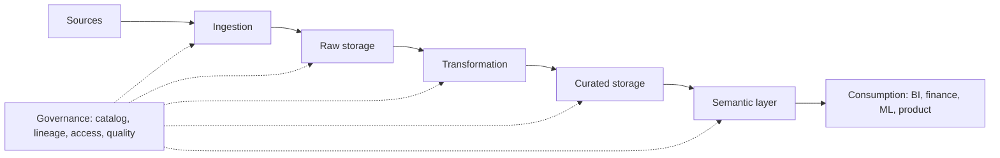
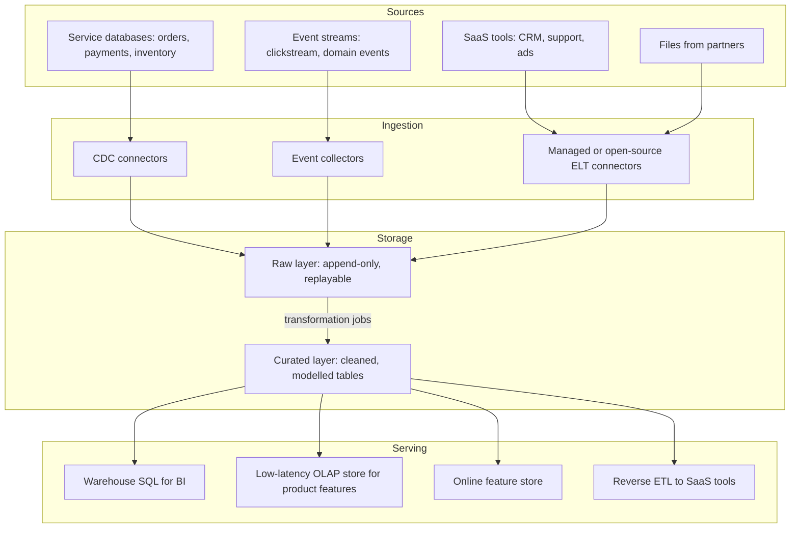
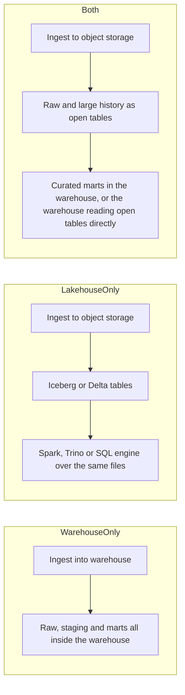
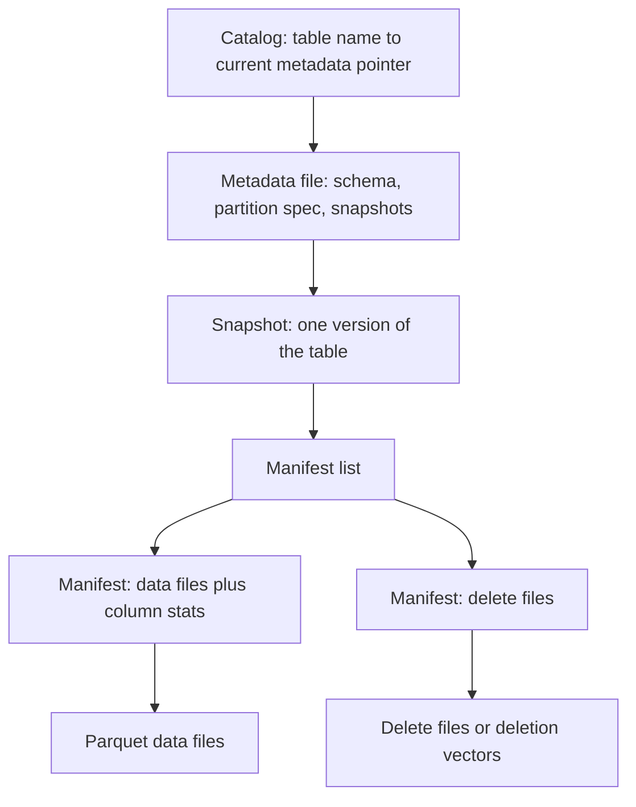

# Part 43 — Data Platform Architecture

Part 42 — Data Engineering for Backend Engineers taught the parts: why analytics leaves the production database, how change data capture works, how to write an idempotent batch load, what Parquet and a table format are, how a stream processor handles late events, how a data contract protects consumers, and how an erasure request reaches the warehouse. This Part is about the whole. It is written for the engineer who is asked, "design our data platform", or, more often, "our data platform is a mess, fix it": the staff engineer, the architect, the head of a data platform team.

At that level the hard questions are not "how does Debezium read the WAL?" They are: which layers do we need and which can we skip; warehouse, lakehouse or both; who owns a table when twelve teams write to it; how do we know a number on the board deck is right; why did the bill triple; what do we build and what do we buy; and how do we get from forty cron jobs to something governed without stopping the business. Every section gives you a way to decide, the numbers that inform the decision, and the failure that follows when the decision is made badly.

The running example is a mid-size e-commerce company: about 150 engineers in 14 product teams, 70,000 orders a day, a clickstream of roughly 200 million events a day, 40 source systems, and a data team of eight that has outgrown its cron server. Section 43.16 designs its platform end to end.



## 43.1 What an architect owns in a data platform

#### Concept

A **data platform** is the shared set of systems, standards and people that lets an organisation turn operational data into trustworthy answers: the ingestion connectors, the storage, the transformation framework, the orchestration, the catalog, the quality checks, the access model and the serving layers, run as one product. The **data platform architect** owns the shape of that whole: which components exist, how data moves between them, who owns what, what "correct" and "fresh" mean, and what it all costs.

#### Why does it exist?

Without an owned platform, every team solves the data problem alone. Marketing buys a connector tool and builds dashboards on it; finance has an analyst with a Python script on a laptop; product runs SQL against a replica; the ML team copies production tables to S3 by hand. Each works locally. Together they produce four definitions of "revenue", personal data in eleven unmanaged places, a bill nobody can explain, and a board meeting where two vice presidents bring different numbers. The platform exists so that the organisation pays for the hard parts once and gets one version of each important fact.

#### Mental model

Imagine a city's water utility, not a single well. Part 42 taught you how to dig a well, pump water and filter it. The utility architect decides where the reservoirs go, which neighbourhoods get which pipes, who is allowed to open which valve, how water quality is tested and reported, what happens when a pipe bursts, and how the bill is shared. Nobody drinks the architecture; they drink the water. But bad architecture is why the water is brown on Tuesdays.

#### How it works

The architect's responsibilities fall into six areas. A useful test of any platform design document is whether it answers each one.

| Area | The question it answers | Where in this Part |
|---|---|---|
| Shape | Which layers and components, and how data flows | 43.2 to 43.7 |
| Ownership | Who owns each dataset and each part of the platform | 43.8 |
| Trust | How we know data is correct, fresh and allowed to be used | 43.9, 43.10 |
| Cost | What it costs, who pays, how we keep it bounded | 43.11 |
| Reach | ML, multiple regions, residency rules | 43.12, 43.13 |
| Evolution | What to build or buy, and how to migrate | 43.14, 43.15 |

#### How a Senior Backend Engineer thinks about this

A senior architect starts from the decisions the business makes with data, not from the tools. "Finance closes the month on day three and needs revenue reconciled to the payment provider to the cent" is a requirement. "We need a lakehouse" is not. They write down the five or six most important datasets and their consumers before drawing any boxes, and they keep asking what happens when each box fails, is slow, duplicates data or returns a wrong answer: the senior mantra applies to data exactly as it does to services.

#### Common mistakes

- Choosing tools first and inventing requirements to justify them.
- Treating the platform as a project with an end date instead of a product with customers.
- Designing storage and transformation in detail while leaving ownership and access as "later".

## 43.2 The reference architecture: sources to consumption

#### Concept

A **reference architecture** is a template of layers that almost every data platform has, whatever tools fill them: sources, ingestion, storage layers, transformation, serving and consumption, with governance and orchestration running across all of them. It is a checklist and a shared vocabulary, not a mandate to build every box.

#### Why does it exist?

Teams that skip the reference picture build platforms with a missing layer they discover in production: no raw layer, so a transformation bug cannot be fixed by replaying history; no serving layer, so the product reads analytical tables directly and suffers multi-second latency; no catalog, so nobody can find anything. Having the template on the wall lets you decide deliberately to skip a layer, and write down why.

#### How it works



Walk through each layer and the decision it carries:

1. **Sources.** Service databases (via CDC or the outbox, Part 42.2), event streams, SaaS APIs and partner files. The decision: which sources are in scope, and who owns the contract for each (42.4).
2. **Ingestion.** Moving data from sources into the platform with as little transformation as possible. CDC for databases (Debezium, or a cloud's managed CDC), collectors for events (Snowplow, a Kafka producer behind an HTTP endpoint, a vendor SDK), and connectors for SaaS (Fivetran, Airbyte, Stitch). The decision: build connectors or buy them (43.14).
3. **Raw storage.** An append-only, immutable copy of what arrived, kept long enough to rebuild everything downstream. Usually object storage with a table format. The decision: how long to keep it, and how personal data in it is handled (43.9).
4. **Transformation.** SQL or code that turns raw data into cleaned, conformed, modelled tables: staging, facts, dimensions, aggregates. dbt is the common tool for SQL; Spark or Flink for code and streams. The decision: one transformation framework or several, and who may write models.
5. **Curated storage.** The modelled tables people use. In a warehouse, a lakehouse, or both (43.3).
6. **Serving.** Different consumers need different access paths: analysts need SQL in a warehouse; a product dashboard needs sub-second queries from an OLAP store (ClickHouse, Apache Druid, Apache Pinot) or a pre-aggregated table in PostgreSQL (42.6); ML models need an online feature store (43.12); sales tools need data pushed back into the CRM (**reverse ETL**). The decision: which serving paths you need now, and which are speculative.
7. **Consumption.** BI tools, notebooks, finance reports, ML training, product features, data shared with customers. The decision: which consumers are tier 1 (an outage is an incident) and which are best effort.

Across all layers run **orchestration** (Airflow, Dagster, Prefect, or the warehouse's own scheduler), **governance** (catalog, lineage, access control, classification; 43.9) and **observability** (freshness, volume, schema and quality monitors; 43.10).

#### Practical example

For the e-commerce company, a first sketch fills each layer with the smallest credible component:

| Layer | Choice in the first sketch | Why |
|---|---|---|
| Ingestion | Debezium on Kafka Connect for 6 PostgreSQL databases; a managed connector tool for 30 SaaS sources; existing Kafka for clickstream | CDC is already run for search; SaaS connectors are not worth building |
| Raw | S3 with Apache Iceberg tables | Cheap, replayable, readable by several engines |
| Transformation | dbt on the warehouse; one Flink job for live order metrics | SQL skills exist; only one genuinely real-time need |
| Curated | A cloud warehouse | Analysts and finance need fast, governed SQL |
| Serving | Warehouse for BI; ClickHouse for seller dashboards in the product; reverse ETL to the CRM | Seller dashboards need p95 under 300 ms at 200 queries per second |
| Governance | A catalog with lineage; tag-based access; dbt tests and freshness monitors | Required for the PII and finance obligations |

#### Edge cases & failure modes

- **No raw layer.** Transforming on ingestion (classic ETL) without keeping the input means a bug in the transform corrupts history permanently.
- **Raw layer kept forever with personal data.** Replayability fights the right to erasure; 43.9 shows how to reconcile them.
- **Serving analytics to the product from the warehouse.** Warehouses are built for throughput, not for hundreds of concurrent sub-second queries; a seller dashboard on a warehouse is slow and expensive.
- **Orchestration as an afterthought.** Forty cron entries with implicit ordering ("job B runs at 03:00 because job A usually finishes by 02:50") fail silently when job A is late.

#### How a Senior Backend Engineer thinks about this

The reference architecture is a menu. A senior circles what the current consumers need, crosses out the rest, and writes one line per crossed-out box explaining when it would be added. For a company with one analyst, "PostgreSQL summary tables plus a read replica" fills every layer. The platform grows a layer when a named consumer needs it.

## 43.3 Warehouse, lakehouse, or both

> **Try it first** · Level: Advanced · About 30 minutes
>
> **Build:** a storage decision for the e-commerce company's curated and raw data.
>
> **Requirements:**
> - Analysts and finance run ad hoc SQL; finance needs reconciled monthly numbers.
> - Data scientists train models on two years of clickstream with Spark and Python.
> - Raw CDC and events must be replayable for at least 13 months.
> - The platform team is eight people and does not want to run clusters.
>
> **Scale and constraints:** about 200 million events a day (roughly 25 GB a day as compressed Parquet), 6 TB of curated tables, about 120 analysts and engineers querying; budget scrutiny from finance.
>
> **Your task:** choose warehouse only, lakehouse only, or both; say what lives where and why, and what would make you change your mind.
>
> Spend the time on paper before you read on. The model design follows.

#### Concept

A **warehouse** (Snowflake, BigQuery, Amazon Redshift, Azure Synapse, and others) stores data in its own managed format and gives you excellent SQL, concurrency, security and near-zero operations. A **lakehouse** stores data as open files (Parquet) in object storage, managed by an open table format (43.4), and lets several engines read and write it: Spark, Trino, Flink, DuckDB and, increasingly, the warehouses themselves. Part 42.3 explained what each is; this section is about choosing for a whole organisation.

#### Why does it exist?

The choice exists because the two models optimise for different things. Warehouses optimise for the SQL user: fast, simple, governed, priced by compute or bytes scanned. Lakehouses optimise for openness and scale: cheap storage, no vendor lock-in on the data itself, and the ability to point Python, Spark and SQL engines at the same tables. Most mid-size companies end up with a mix, and the architect's job is to make that mix deliberate.

#### How it works



| Question | Warehouse only | Lakehouse only | Both |
|---|---|---|---|
| Who are most users? | SQL analysts | Engineers, data scientists | Mixed |
| Operations burden | Lowest | Highest (engines, compaction, catalog) | Medium |
| Storage cost for 100 TB of history | Warehouse storage, often near object-storage prices but compute to scan it adds up | Object storage, roughly $2,300 a month at about $0.023 per GB-month (approximate, S3 Standard list price) | Cheap for history, warehouse for hot data |
| Lock-in | Data in a proprietary format; export costs time | Open formats; engines replaceable | Raw data open; marts closer to the warehouse |
| ML on raw data | Export or use the warehouse's ML features | Native | Native on the lake side |
| Concurrency for BI | Excellent | Depends on engine and tuning | Excellent on the warehouse side |
| Fine-grained access control | Mature, built in | Catalog-dependent, maturing | Two models to keep consistent |
| Good fit | Under about 20 TB, SQL-centric, small platform team | Very large data, strong engineering team, multi-engine need | Mid-size and up with both BI and ML needs |

The line between the columns is blurring. Snowflake, BigQuery and Redshift can now read (and in several cases write) Apache Iceberg tables, and Databricks offers a SQL warehouse on Delta Lake. So "both" increasingly means one copy of the data in an open format with two kinds of engines over it, rather than two copies.

#### Practical example

The e-commerce company chooses **both**, with a clear rule:

- **Raw and high-volume history** (CDC change streams, clickstream, logs for ML) lands in S3 as Iceberg tables. Thirteen months of clickstream at about 25 GB a day is roughly 10 TB, around $230 a month in object storage at list price; keeping that inside a warehouse would cost more and add nothing for the data scientists who read it with Spark.
- **Curated, governed tables** (orders, payments, customers, products, and the finance and product marts) live in the warehouse, built by dbt, because 120 SQL users, row-level access rules and finance's month-end close all benefit from the warehouse's concurrency and security.
- **The bridge** is the warehouse reading the raw Iceberg tables directly as its staging input, so there is one copy of raw data, not two.

What would change the decision: if the data science team disappeared, warehouse only; if the warehouse bill for scanning raw history exceeded the cost of a small Trino cluster plus an engineer, more of the curated layer would move to the lakehouse.

#### Failure scenario

A company moved everything to a self-managed lakehouse to "avoid lock-in". Eighteen months later, their two platform engineers spent most of their time on compaction jobs, catalog upgrades, a Trino cluster that ran out of memory on Monday mornings, and a home-grown permission layer. Analysts went back to exporting CSVs to spreadsheets because dashboards timed out. The lock-in they avoided was real but small; the operational burden they took on was large and permanent. They moved curated marts back to a managed warehouse and kept the lake for raw history. The lesson: openness is worth paying for when you will use it; it is not free.

#### How a Senior Backend Engineer thinks about this

A senior asks three questions: who queries this data and with what tools; how much of it is there and how fast does it grow; and how many people will run the platform. Then they pick the option with the least operations that serves those users, and they keep the raw layer in an open format whenever it is cheap to do so, because it keeps the future options open at little cost.

## 43.4 Open table formats: Iceberg, Delta Lake and Hudi

#### Concept

An **open table format** is a specification for storing a table as a set of data files (usually Parquet) plus metadata files that say exactly which data files make up each version of the table. The three widely used formats are **Apache Iceberg** (started at Netflix), **Delta Lake** (started at Databricks, now a Linux Foundation project) and **Apache Hudi** (started at Uber). Part 42.9 showed what a table format adds to plain Parquet; this section is about why an architect cares and how to choose.

#### Why does it exist?

A folder of Parquet files is not a table. Two writers can corrupt it; a reader can see half a write; there is no atomic `DELETE`, so erasure means rewriting files by hand; and every engine has its own idea of the schema. Table formats turn a folder into a table with atomic commits, snapshots, schema evolution and row-level changes, defined in an open specification so that any engine can implement it. For an architect, that openness is the point: it separates the choice of **storage** from the choice of **compute**.

#### Mental model

Imagine a library where books (data files) are never edited, only added or retired. The catalogue card for the table (the metadata) lists exactly which books make up the current edition. To change the table, you add new books, write a new card, and swap the card in one motion. A reader holding the old card still sees a consistent old edition. Time travel is reading an older card. Erasure is writing a card without the book, then physically removing the book once no card points to it.

#### How it works



The diagram follows Iceberg's terms; Delta Lake keeps an ordered log of JSON commit files with periodic Parquet checkpoints in a `_delta_log` folder, and Hudi keeps a **timeline** of actions. All three implement the same ideas:

1. **Atomic commit through a pointer swap.** A writer writes new data files, then new metadata, then atomically updates the pointer (in the catalog, or by creating the next log file). If two writers race, one loses and retries: **optimistic concurrency**.
2. **Snapshots and time travel.** Every commit is a snapshot; you can query the table as of a time or snapshot ID until old snapshots are expired.
3. **Row-level changes.** Updates and deletes are handled either by rewriting affected files (**copy-on-write**: fast reads, slower writes) or by writing small delete files that readers merge at query time (**merge-on-read**: fast writes, slower reads until compaction). CDC upserts and erasure both depend on this.
4. **Schema and partition evolution.** Add, rename or drop columns safely; Iceberg can change the partition scheme without rewriting old data.
5. **Column statistics in metadata.** Engines skip whole files using min and max values before opening them.

| Concern | Apache Iceberg | Delta Lake | Apache Hudi |
|---|---|---|---|
| Strength often cited | Broadest multi-engine support; hidden partitioning; partition evolution | Deep integration with Spark and Databricks; mature streaming writes | Strong upsert and incremental-pull design for CDC-heavy tables |
| Catalog | Pluggable: REST catalog, AWS Glue, Hive Metastore, Nessie, others | Log in the table folder; Unity Catalog or Hive Metastore for names | Timeline in the table folder; Hive Metastore or Glue for names |
| Typical home | Multi-engine lakehouses, warehouse interop | Databricks-centred platforms | CDC-heavy pipelines with frequent upserts |

The formats are converging, and interoperability layers exist (Delta Lake's UniForm can expose Iceberg metadata; Apache XTable translates metadata between formats). Treat specific feature gaps as things to check against current documentation at decision time, not as permanent truths.

#### Practical example: the architecture decision record

```text
ADR-014: Table format for the raw and history layers
Status: accepted
Context: raw CDC and clickstream land in S3; Spark (data science), the warehouse
  (analysts) and Flink (live metrics) must all read them; erasure must reach raw data.
Decision: Apache Iceberg, with a REST-compatible catalog managed by the platform team.
Why: the warehouse and Spark can both read Iceberg; row-level deletes support erasure;
  hidden partitioning stops partition-filter mistakes by casual users.
Consequences: we own compaction and snapshot expiry jobs (scheduled, monitored);
  catalog availability becomes tier 1; we will re-evaluate if our compute converges
  on one vendor whose native format is different.
```

Write decisions like this down (see Part 62 — The Senior Engineering Mindset, 62.8.1, and Part 88 — Writing as an Architect). The format choice outlives the people who made it.

#### Edge cases & failure modes

- **The catalog is a single point of failure.** If the catalog is down, no engine can resolve the current snapshot. Run it as a tier 1 service with backups.
- **Small files.** Streaming writers commit every minute and create thousands of tiny files; query planning and reads slow down. Schedule compaction (rewrite to target sizes of a few hundred MB) and monitor file counts per partition (43.11).
- **Snapshot and orphan buildup.** Without expiry, metadata grows and deleted rows remain physically present, which breaks erasure promises.
- **Concurrent writers on the same partitions.** Optimistic concurrency means frequent retries or failures when two jobs rewrite the same files; schedule compaction away from heavy writes.
- **Engine version skew.** A new table feature written by one engine may be unreadable by an older engine. Upgrade readers before enabling new format versions.

#### How a Senior Backend Engineer thinks about this

A senior picks the table format that their most important engines read and write well today, writes the choice down with an exit path, and budgets for the operations it brings: compaction, snapshot expiry, catalog uptime. They do not debate the formats on feature lists for months; the differences matter less than having one standard and running it well.

#### Interview questions

1. **Why does a lakehouse need a table format and not just Parquet?** Plain files lack atomic commits, consistent snapshots, row-level deletes and shared schema; the format adds them through metadata and an atomic pointer swap.
2. **Copy-on-write or merge-on-read for a CDC table with frequent updates?** Merge-on-read for write throughput, with regular compaction to keep reads fast; copy-on-write if reads dominate and updates are rare.
3. **What new tier 1 dependency does an Iceberg lakehouse introduce?** The catalog: without it engines cannot find the current table version.
4. **How do snapshots interact with GDPR erasure?** A delete creates a new snapshot, but old snapshots still reference the row until they are expired and unreferenced files removed; erasure is complete only after both.
