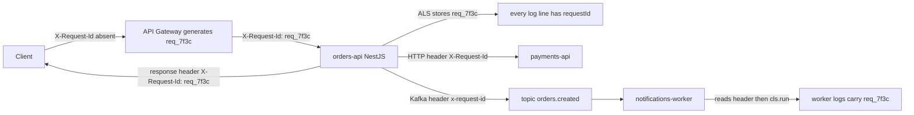
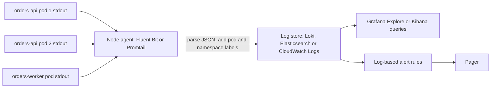

### 43.2.3 Request logging and correlation ids in NestJS

#### Concept

A **correlation id** (also called a request id) is a unique string attached to an inbound request and carried through everything that request causes: every log line, every downstream HTTP call, every Kafka message, every job. It is how you find "everything about this one request" across ten services.

#### Why does it exist?

Without it, an incident investigation is "find the log line at 14:02:11 in the API, then look in the worker's logs around 14:02:12 and hope only one order was being processed". With it, you type one id and see the whole story in order.

#### Mental model

Imagine a parcel's tracking number. Every depot, truck and courier scans the same number. You never ask "where is the brown box"; you ask "where is 1Z999AA1". A correlation id is the tracking number for one request.

#### How it works

1. The API gateway or load balancer generates a request id if the client did not send one and sets `X-Request-Id`.
2. The NestJS middleware reads `X-Request-Id`, or generates a UUID if it is missing, and stores it in **AsyncLocalStorage** (ALS), a Node.js mechanism that keeps a value attached to the current chain of async calls without passing it as a parameter.
3. The logger reads the id from ALS on every call and adds it as a field.
4. Outbound HTTP clients read it from ALS and set the header on every downstream call.
5. Kafka producers add it as a message header. Consumers read the header, enter a new ALS context with that id, and every log line in the consumer carries it too.
6. The response echoes `X-Request-Id` so a customer or support agent can quote it.



#### NestJS example

`nestjs-cls` wraps ALS as a NestJS module with middleware that opens a context per request.

```ts
// app.module.ts (correlation setup)
import { ClsModule } from 'nestjs-cls';
import { randomUUID } from 'node:crypto';
import type { Request } from 'express';

ClsModule.forRoot({
  global: true,
  middleware: {
    mount: true,        // registers the middleware for all routes
    generateId: true,
    idGenerator: (req: Request) => (req.headers['x-request-id'] as string) ?? randomUUID(),
    setup: (cls, req: Request) => {
      cls.set('userId', (req as any).user?.id);   // filled later by the auth guard if present
    },
  },
}),
```

Feed the id into every pino line with a `mixin`, which pino calls on each log to merge extra fields.

```ts
// logging/logging.module.ts
import { ClsService } from 'nestjs-cls';
import { LoggerModule } from 'nestjs-pino';
import { trace } from '@opentelemetry/api';

LoggerModule.forRootAsync({
  inject: [ClsService],
  useFactory: (cls: ClsService) => ({
    pinoHttp: {
      mixin() {
        // Runs for every log call: attach correlation and trace ids from the current context.
        const span = trace.getActiveSpan()?.spanContext();
        return {
          requestId: cls.getId(),
          userId: cls.get('userId'),
          traceId: span?.traceId,
          spanId: span?.spanId,
        };
      },
    },
  }),
}),
```

Forward it on outbound HTTP calls with an Axios interceptor, and echo it on the response.

```ts
// http/outbound-http.service.ts
import { Injectable } from '@nestjs/common';
import { HttpService } from '@nestjs/axios';
import { ClsService } from 'nestjs-cls';

@Injectable()
export class OutboundHttpService {
  constructor(private readonly http: HttpService, private readonly cls: ClsService) {
    this.http.axiosRef.interceptors.request.use((config) => {
      config.headers['X-Request-Id'] = this.cls.getId();   // propagate downstream
      config.timeout = config.timeout ?? 3_000;             // never call without a timeout
      return config;
    });
  }
}

// request-id.interceptor.ts
@Injectable()
export class RequestIdInterceptor implements NestInterceptor {
  constructor(private readonly cls: ClsService) {}
  intercept(ctx: ExecutionContext, next: CallHandler) {
    ctx.switchToHttp().getResponse().setHeader('X-Request-Id', this.cls.getId());
    return next.handle();
  }
}
```

Now Kafka. The producer adds the header; the consumer enters a new context per message.

```ts
// events/orders.producer.ts
await this.producer.send({
  topic: 'orders.created',
  messages: [{
    key: order.id,
    value: JSON.stringify({ orderId: order.id, userId: order.userId }),
    headers: { 'x-request-id': this.cls.getId() },   // carry the correlation id across the broker
  }],
});

// workers/notifications.consumer.ts
await consumer.run({
  eachMessage: async ({ message }) => {
    const requestId = message.headers?.['x-request-id']?.toString() ?? randomUUID();
    // cls.run opens a fresh ALS context for this message; everything inside inherits it.
    await this.cls.run(async () => {
      this.cls.set(CLS_ID, requestId);
      await this.handler.handle(JSON.parse(message.value!.toString()));
    });
  },
});
```

`CLS_ID` is the constant exported by `nestjs-cls` for the id key. Inside `handle`, every `log.info` automatically carries `requestId: req_7f3c`, the same id the API used 200 ms earlier, even though this is a different process on a different node.

#### Production scenario

A support agent gets a complaint: "I was charged but my order shows cancelled". The agent asks for the request id from the app's error screen (`req_7f3c...`). One query in Loki, `{env="prod"} | json | requestId="req_7f3c"`, returns 14 lines across `orders-api`, `payments-api` and `orders-worker`, in time order. Line 11 says the worker's `warn: inventory reservation failed, cancelling order` fired 300 ms after line 9's `payment captured`. Root cause found in three minutes, and the refund is issued before the agent hangs up.

#### Edge cases & failure modes

- **ALS loss.** Context is lost across boundaries that break the async chain: callbacks from some native libraries, `EventEmitter` listeners registered outside the request, `setTimeout` scheduled during bootstrap, and message consumers, which have no inbound HTTP request at all. Use `cls.run` explicitly at those boundaries. Test it: log inside the consumer and assert `requestId` is present.
- **Trusting the client's id blindly.** A client can send `X-Request-Id: <script>` or a 10 KB string. Validate the format (for example a UUID or a bounded alphanumeric string); otherwise generate your own and log the client's as `clientRequestId`.
- **Reusing one id for a batch.** A worker that processes 500 messages under one id makes the id useless. One context per message.
- **Id collisions** when two gateways generate short ids. Use UUIDs or 128-bit random values.

#### How a Senior Backend Engineer thinks about this

They consider correlation ids non-negotiable in any system with more than one process, and they test propagation in CI: an integration test sends `X-Request-Id: test-123`, consumes the resulting Kafka message, and asserts the worker's log line contains `test-123`. They know the difference between the correlation id (a business-friendly id for one inbound request) and the trace id (the tracing system's id, which may have a different lifetime); both live in every log line.

### 43.2.4 Sampling, rate limiting and the cost of volume

#### Concept

Log sampling means deliberately writing only a fraction of lines that match a rule. Rate limiting logs means capping how many identical lines can be written per second. Both exist because log volume is the single largest observability cost and because a flood of identical lines hides the one line you need.

#### How it works

- **Sample successes, keep failures.** Log 100 percent of requests with status 5xx or duration over 1 second, and 1 to 10 percent of fast 2xx requests. Failures are rare and valuable; successes are common and mostly identical.
- **Rate limit repeated errors.** When Redis is down, every request fails at the same line. Ten thousand identical `ECONNREFUSED` lines per minute are worse than one line per second plus a counter. Implement a small token bucket keyed by message, or rely on the log shipper's dedup feature.
- **Keep the audit trail off the sampled path.** Business events that must exist (order placed, refund issued) are not logs to be sampled; they are records, and belong in a table or a Kafka topic.

```ts
// logging/sampled-request.interceptor.ts
@Injectable()
export class SampledRequestLoggerInterceptor implements NestInterceptor {
  constructor(private readonly log: PinoLogger) {}
  intercept(ctx: ExecutionContext, next: CallHandler) {
    const started = process.hrtime.bigint();
    const req = ctx.switchToHttp().getRequest();
    return next.handle().pipe(
      tap({
        next: () => this.maybeLog(req, ctx.switchToHttp().getResponse().statusCode, started),
        error: (err) => this.maybeLog(req, err.status ?? 500, started, err),
      }),
    );
  }
  private maybeLog(req: any, status: number, started: bigint, err?: Error) {
    const durationMs = Number((process.hrtime.bigint() - started) / 1_000_000n);
    const interesting = status >= 500 || durationMs > 1000 || !!err;
    if (!interesting && Math.random() > 0.05) return;   // keep 5 percent of boring requests
    this.log.info({ method: req.method, route: req.route?.path, status, durationMs, err, sampled: !interesting }, 'request');
  }
}
```

Metrics still count every request; sampling only affects the detailed record. That division of labour, metrics for counting and logs for detail, is the whole reason both exist.

### 43.2.5 Sync versus async logging and the event loop

#### Concept

Writing a log line means writing bytes to a file descriptor. If that write is synchronous, the event loop stops until the kernel accepts the bytes. If the destination is slow (a network socket, a full pipe, a disk under pressure), every request waits.

#### How it works

pino writes to stdout, and in a container stdout is a pipe read by the container runtime. Pipes have a buffer (64 KB on Linux by default). When the reader is slow, a synchronous write blocks the whole process. pino offers `pino.destination({ sync: false })`, which uses `sonic-boom` to buffer in memory and flush asynchronously, so a slow reader costs memory rather than latency. The tradeoff: on a hard crash, the last few kilobytes of buffered lines are lost. Flush on shutdown to keep them.

```ts
// logging/destination.ts
import pino from 'pino';

export const logDestination = pino.destination({
  sync: false,          // do not block the event loop on stdout backpressure
  minLength: 4096,      // buffer before writing; flushes automatically every so often
});

process.on('SIGTERM', () => {
  logDestination.flushSync();   // push buffered lines before the container stops
});
```

Never ship logs directly from the application to a remote log service over the network in the request path. Write to stdout, let a node-level agent (Fluent Bit, Promtail, the CloudWatch agent) ship them. The agent has its own buffer and retry, and the application stays fast when the log backend is slow.

#### Production scenario

A team enabled a network transport inside the app to send logs straight to a hosted provider. During a provider outage the transport's queue grew, then the write blocked, and p99 latency went from 80 ms to 6 seconds while every dashboard showed the database perfectly healthy. The fix was to go back to stdout plus a node agent. The lesson: your logging library should never be able to make your API slow.

### 43.2.6 Aggregation, querying and log-based alerts

#### Concept

Log aggregation collects lines from every pod into one searchable store. The main choices are Loki (labels plus grep-like search, cheap), the Elastic stack (full-text indexes, expensive, powerful) and cloud-native stores (CloudWatch Logs, Google Cloud Logging).



#### How it works

Loki indexes only labels (`service`, `env`, `pod`, `level`) and stores the line as a compressed blob; it greps within the selected streams at query time. That makes ingestion 10 times cheaper than Elasticsearch, and queries on labels fast, but a query like "all lines containing orderId 8812 across all services for a week" scans a lot of data. Elasticsearch indexes every field so any query is fast, at the cost of 3 to 5 times more storage and CPU. CloudWatch Logs Insights sits between the two.

Typical LogQL queries you will actually run:

```text
{service="orders-api", env="prod"} | json | level="error" | line_format "{{.msg}} {{.orderId}}"
{env="prod"} | json | requestId="req_7f3c"
sum by (msg) (count_over_time({service="orders-api"} | json | level="error" [5m]))
{service="orders-api"} | json | durationMs > 2000
```

Log-based alerts fire on counts, never on single lines: `count_over_time({service="payments-api"} | json | msg="provider timeout" [5m]) > 50`. A single line is a story; fifty in five minutes is a symptom.

#### The "grep at 3 a.m." story

At 03:10 an SRE at a food-delivery company is paged: order placement latency p99 is 12 seconds. The metrics dashboard shows the API is slow, the database is idle and Redis is idle. Nothing is obviously broken. In the pre-observability days this meant SSH-ing into three API nodes, running `grep "slow" /var/log/app.log | tail`, and finding text lines like `slow: 11842ms` with nothing else. Which endpoint? Which dependency? Unknown. The engineer restarted the pods, latency recovered, and the post-mortem said "cause unknown".

With structured logs and a correlation id, the same engineer runs `{service="orders-api"} | json | durationMs > 5000 | line_format "{{.route}} {{.dependency}} {{.dependencyMs}}"` and sees every slow line says `dependency="restaurant-service" dependencyMs=11500`. The restaurant service's own logs, filtered by the same request ids, show `warn: circuit open, falling back to slow path`. Root cause in eight minutes, no restart, a real fix the next morning. The difference was not smarter people; it was fields.

#### Edge cases & failure modes

- The agent cannot keep up under load and drops lines silently. Watch the agent's own `dropped_records` metric.
- Disk fills because a pod logs 200 MB a minute and log rotation is not configured. Kubernetes rotates container logs at 10 MB by default (five files), so the most verbose pod loses history first.
- A log line contains invalid JSON (a stray `console.log`) and the whole line is stored unparsed; queries on fields miss it.
- Time zones: an app that logs local time and a store that assumes UTC puts your lines five and a half hours off from the metrics.

#### How a Senior Backend Engineer thinks about this

They choose Loki for most teams because the cost difference funds the retention difference, and structured logs plus labels cover 95 percent of queries. They move to Elasticsearch only when full-text search across unstructured bodies is a product requirement. They put the log-store's own health (ingest lag, dropped records) on the same dashboard as the service, because a dead log pipeline during an incident is a second incident.

#### Interview questions

1. *How do you propagate a request id across a Kafka boundary in Node.js?* Expected: message header on produce; on consume, read the header and open a new AsyncLocalStorage context per message. Follow-up: what breaks if you forget the new context? (Logs in the consumer carry the previous message's id or none.)
2. *Why should the application write logs to stdout and not to a remote service directly?* Expected: backpressure from a slow remote blocks the event loop or grows memory; a node agent buffers and retries outside the request path.
3. *What is wrong with logging a 4xx as `error`?* Expected: not actionable, drowns real errors, breaks alerting on error counts.
4. *How would you find every log line for one customer's order across five services?* Expected: shared correlation id and a shared field name, plus a query on that field in the aggregator.
5. *How do you keep log costs under control at 5,000 RPS?* Expected: sample successful requests, keep all failures, rate limit repeated errors, cap retention, move audit facts out of logs.

#### Practical exercise

Build request logging and correlation for a NestJS `orders` service:

1. Add `nestjs-pino` and `nestjs-cls`. Every log line must carry `service`, `env`, `version`, `requestId`, `traceId` (may be empty), `userId` when authenticated.
2. Incoming `X-Request-Id` is reused if it matches `^[A-Za-z0-9_-]{8,64}$`, otherwise generated.
3. Outbound Axios calls and Kafka messages carry the id; a consumer opens a new context per message.
4. Log only 5 percent of successful requests under 1 second; log 100 percent of failures and slow requests.
5. Acceptance: an integration test sends `X-Request-Id: test-abc`, triggers a Kafka message, and asserts the consumer's captured log output contains `"requestId":"test-abc"`. A test also asserts that `Authorization` and `password` never appear in any log output.
