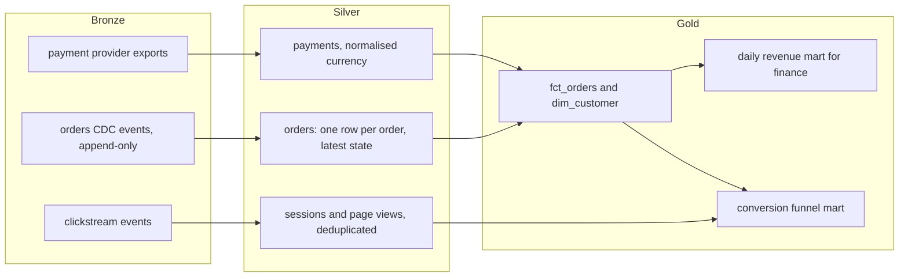
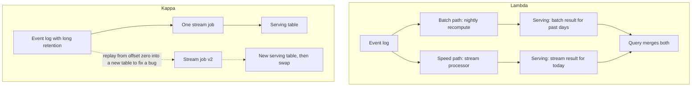
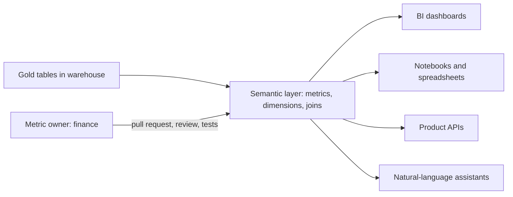
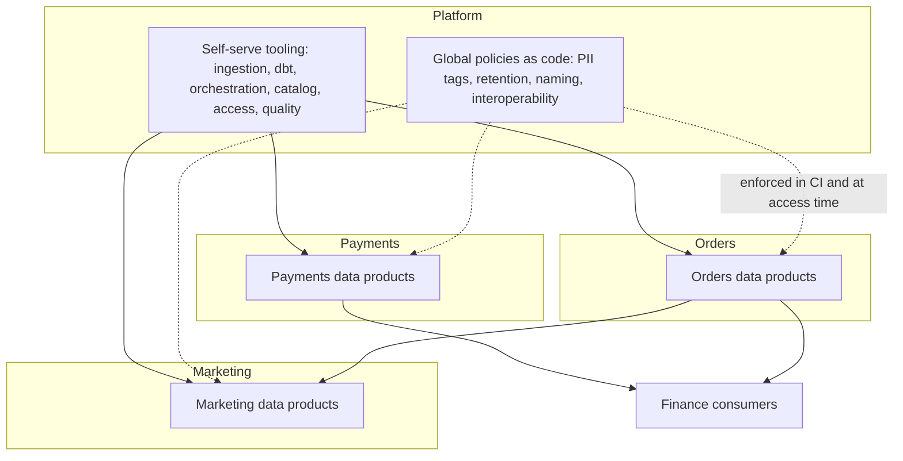

## 43.5 The medallion pattern and its critics

#### Concept

The **medallion architecture** organises data into three layers of increasing quality: **bronze** (raw data as it arrived), **silver** (cleaned, deduplicated, conformed data at the grain of the source entities) and **gold** (business-level tables built for specific uses: facts, dimensions, aggregates, marts). The names were popularised by Databricks; the idea of layered refinement is much older, and dbt's convention of **staging, intermediate and marts** describes nearly the same thing.

#### Why does it exist?

Without layers, every analyst cleans the raw data their own way inside their own query, so "orders" means something slightly different in every dashboard, and a fix has to be repeated everywhere. Layers give each kind of work one home: arrival problems are handled once in bronze-to-silver, business rules once in silver-to-gold. They also make lineage readable: a gold table depends on named silver tables, which depend on named bronze sources.

#### Mental model

Imagine a restaurant kitchen. Bronze is the delivery dock: crates exactly as the supplier sent them, labelled with the date. Silver is the prep station: vegetables washed, trimmed and portioned in standard containers, with anything rotten thrown out. Gold is the plated dish for a specific table. You can always re-prep from the dock if the prep was wrong, and every dish uses the same prepped ingredients.

#### How it works



| Layer | Contains | Rules | Who may read |
|---|---|---|---|
| Bronze | Exactly what arrived, plus ingestion metadata (load time, source offset) | Append-only; never edited except for erasure; schema-on-read tolerated | Platform and data engineers |
| Silver | Typed, deduplicated, conformed entities; CDC applied to current state; PII tagged | One row per business key; tests on keys and accepted values | Data engineers, analytics engineers, data scientists |
| Gold | Facts, dimensions, aggregates for named consumers | Documented owner and consumers; data SLOs (43.10) | Everyone with access to the domain |

#### The critics, and what they get right

The pattern is useful, and it is criticised for good reasons. An architect should know the criticisms so the platform takes the idea without the problems.

1. **It is a naming scheme, not an architecture.** Three colours say nothing about ownership, contracts, quality or access. Teams adopt the names and believe the design work is done.
2. **"Silver" is ambiguous.** Is it cleaned source data, or conformed enterprise entities joined across sources? Teams split it into "silver one" and "silver two", or argue for months. dbt's staging (one-to-one with sources, light cleaning) and intermediate (reusable joins) is more precise.
3. **Copies cost money and time.** Every layer is a full or partial copy, written by a job that can fail. Three hops add latency and three places to break. Not every source needs every layer: a clean reference table can go straight to gold.
4. **Gold sprawl.** Without ownership, every dashboard gets its own gold table, and you end up with 900 marts, half unused, many computing revenue differently. That is the problem the layers were meant to solve, recreated one layer up.
5. **It centralises by default.** A single bronze-silver-gold pipeline owned by one team becomes the bottleneck that data mesh (43.8) reacts against.

#### How a Senior Backend Engineer thinks about this

A senior uses layers as a contract about **what is safe to depend on**, not as colours. Bronze is safe for nobody but the platform; silver is safe for engineers who understand the source; gold is the published interface with an owner, documentation and an SLO. They let simple sources skip layers, put a usage review on gold tables every quarter (drop marts nobody queried in 90 days), and name layers in whatever words the organisation already uses.

#### Common mistakes

- Letting dashboards read bronze or silver directly because the gold table "is not ready yet"; those dashboards then break on every source change.
- Applying business rules in silver, so they cannot be found or reused.
- Keeping personal data in every layer because "bronze must be complete"; see 43.9 for the alternatives.

## 43.6 Batch, streaming, or both: lambda and kappa in plain terms

#### Concept

Part 42.3.2 and 42.10 taught how stream processing works: windows, watermarks, late events, Flink and Kafka Streams. The architect's question is different: **for the platform as a whole, which data is processed in batch, which in streams, and how do the two agree?** Two named answers frame the discussion. The **lambda architecture** runs a batch path and a streaming path side by side and merges their results. The **kappa architecture** runs everything as streams and recomputes history by replaying the log.

#### Why does it exist?

Batch is simple, cheap and easy to correct: rerun yesterday. Streams are fresh but harder to operate and to correct. Early stream processors could not guarantee correct results with late or duplicated events, so lambda used streams for a fast approximate answer and batch for the correct one. As stream processors gained exactly-once state and event-time windows, kappa argued that one streaming path could do both, avoiding two implementations of the same logic.

#### Mental model

Imagine a shop that wants to know daily sales. Lambda is a cashier who keeps a tally on a notepad all day (fast, sometimes wrong) and an accountant who counts the receipts properly overnight and overwrites the notepad figure. Kappa is a single, very careful cashier whose tally is trusted; if a mistake is found, they re-read the whole receipt roll from the start of the month and recount.

#### How it works



| Question | Batch only | Lambda | Kappa |
|---|---|---|---|
| Freshness | Hours | Seconds for recent, hours for corrected | Seconds |
| Logic implemented | Once | Twice (batch and stream), must agree | Once |
| Correcting history | Rerun the batch | Rerun the batch | Replay the log into a new output |
| Needs log retention | No | Short | As long as you may need to replay (or a table-format history) |
| Operational cost | Low | Highest | Medium to high |
| Typical use | Finance, most reporting | Legacy, or where streams are approximate | Event-native platforms with strong stream skills |

In practice most platforms in the mid-2020s are **batch-first with targeted streaming**: batch (often micro-batch every 15 minutes to an hour) for nearly everything, and a small number of streaming jobs for the few uses that need seconds: fraud signals, live operations dashboards, inventory availability. The streaming output is treated as operational; the batch output is the record that finance signs. That is lambda in spirit, but without implementing the same metric twice: the stream computes "orders in the last five minutes" for operations, and the batch computes "revenue" for finance, and nobody expects them to match to the cent.

Lakehouse table formats blur the line further: a streaming job can write to an Iceberg or Delta table every minute, and batch jobs can read the same table incrementally, so "stream versus batch" becomes a question of how often a job runs, not of separate storage.

#### Practical example

The e-commerce company's decision:

| Use | Freshness needed | Path |
|---|---|---|
| Finance revenue, payouts, tax | Daily, reconciled | Batch, dbt, nightly plus a trailing three-day recompute |
| Product and marketing dashboards | Within an hour | Micro-batch every 30 minutes |
| Seller live sales widget in the product | Under a minute | Flink job writing per-minute aggregates to ClickHouse |
| Fraud features for checkout | Seconds | Stream features into the online feature store (43.12) |
| Clickstream history for ML | Daily | Batch compaction of the raw stream |

The live seller widget and the finance revenue table are allowed to differ by refunds and late payments; the widget carries a label "live, unaudited" and links to the daily figures.

#### Failure scenario

A team built a lambda pipeline where a Flink job and a dbt model both computed "gross merchandise value". The definitions drifted: the stream counted orders at placement, the batch counted them at payment. For months the "today" number on the executive dashboard dropped by 6% each night when the batch value replaced the stream value, and executives learned to distrust the dashboard. The fix was not technical: they stopped computing the same named metric on two paths, renamed the live figure "orders placed, live", and kept "GMV" batch-only, defined in the semantic layer (43.7).

#### How a Senior Backend Engineer thinks about this

A senior asks for each use, "what decision changes if this number is an hour old?" and builds streaming only where the answer is real. They refuse to implement one business metric twice, they label operational numbers as such, and they treat replayability (long log retention or table-format history) as a requirement of any streaming job whose output matters.

## 43.7 The semantic and metrics layer

#### Concept

A **semantic layer** (or **metrics layer**) is a single place where business metrics and their dimensions are defined once, in code, and then served to every consumer: BI tools, notebooks, spreadsheets, the product, and increasingly AI assistants that answer questions in natural language. "Net revenue" is defined once, including which orders count, which currency conversion applies, how refunds are treated and what time zone defines a day, and every tool asks the semantic layer for "net revenue by country by week" instead of writing its own SQL. Examples: the dbt Semantic Layer (built on MetricFlow), Cube, LookML in Looker, and the semantic models in Power BI.

#### Why does it exist?

Gold tables solve part of the "four definitions of revenue" problem, but not all of it: two analysts can still aggregate the same table differently (sum of `total` or sum of `total - refunds`? local time or UTC?). The semantic layer moves the definition of the aggregation itself into governed code with an owner, tests and version control. It also lets you change the underlying tables without breaking every dashboard, because consumers depend on the metric, not on the table.

#### Mental model

Imagine a company dictionary. Everyone may write any sentence they like, but the word "revenue" has one entry, written by finance, and every document links to it. If finance changes the definition, it changes in every document at once, and the change history shows who changed it and why.

#### How it works



A metric definition in the dbt Semantic Layer style looks like this (YAML, abbreviated):

```yaml
semantic_models:
  - name: orders
    model: ref('fct_orders')
    defaults:
      agg_time_dimension: business_date
    entities:
      - name: order_id
        type: primary
      - name: customer_id
        type: foreign
    dimensions:
      - name: business_date
        type: time
        type_params:
          time_granularity: day
      - name: country
        type: categorical
    measures:
      - name: gross_cents
        agg: sum
      - name: refunded_cents
        agg: sum

metrics:
  - name: net_revenue_cents
    label: Net revenue (cents)
    description: Paid order value minus refunds, by business date in the seller's time zone. Owner, finance data.
    type: derived
    type_params:
      expr: gross - refunds
      metrics:
        - name: gross_cents_total
          alias: gross
        - name: refunded_cents_total
          alias: refunds
  - name: gross_cents_total
    type: simple
    type_params:
      measure: gross_cents
  - name: refunded_cents_total
    type: simple
    type_params:
      measure: refunded_cents
```

This is the long-standing (now called legacy) spec, with `semantic_models` and `measures`. Recent dbt releases (dbt Core 1.12, the dbt platform's Latest track and the Fusion engine) introduce a newer YAML spec in which measures are replaced by simple metrics and the semantic model is declared next to the model's own properties; dbt provides `dbt-autofix` to migrate. The concepts below are the same in both; check which spec your dbt version expects before copying the syntax.

The layer compiles a request ("net_revenue_cents by country by week, last 12 weeks") into SQL against the warehouse, applies the joins it knows are valid, and returns the result. Some semantic layers also cache common results.

#### Edge cases & failure modes

- **Partial adoption.** If half the dashboards use the layer and half use hand-written SQL, you now have a fifth definition of revenue. Plan the migration of tier 1 dashboards explicitly.
- **Latency.** Compiling and running a query through the layer adds overhead; a product feature needing 50 ms responses should read a pre-computed serving table populated from the metric, not query the layer live.
- **Fan-out joins.** Joining orders to order items and summing order totals double counts; the layer's entity model must declare grains correctly, and tests should catch a metric that changes when an unrelated dimension is added.
- **Tool lock-in.** A semantic layer embedded in one BI tool serves only that tool; a standalone layer serves many but is another service to run.

#### How a Senior Backend Engineer thinks about this

A senior introduces a semantic layer when there are several consumers of the same tier 1 metrics and visible disagreement between them, not before. They give each metric an owner in the business (finance owns revenue), keep definitions in version control with review, and treat a change to a tier 1 metric like an API change: announced, versioned when it changes meaning, and tested against last month's numbers.

## 43.8 Data mesh versus a central platform

#### Concept

**Data mesh**, described by Zhamak Dehghani, is an organisational approach with four principles: **domain ownership** (the teams that own a business domain also own its analytical data), **data as a product** (each domain publishes datasets with owners, documentation, quality guarantees and consumers in mind), a **self-serve data platform** (a platform team provides the tools so domains can do this without being data-infrastructure experts) and **federated computational governance** (global rules such as privacy and interoperability are agreed centrally and enforced automatically in the platform). The alternative is a **central data team** that ingests, models and serves data for the whole company.

#### Why does it exist?

A central data team works well until it does not. At some size, every new dataset, every source change and every new question queues behind one team that understands neither the source systems (the domains do) nor the business questions (the consumers do). The central team becomes the bottleneck Conway's Law predicts (see Part 92 — Org Design, Conway's Law and Platform Engineering, 92.1). Data mesh applies the same remedy that microservices and platform teams applied to software: push ownership to the domains, and give them a platform that makes ownership cheap.

#### Mental model

Imagine a newspaper. In the central model, one desk writes every article for every section; it is consistent but slow, and the sports articles are written by people who do not follow sport. In the mesh model, each section (sport, business, politics) writes its own articles, while a central editorial standards team owns the style guide, the printing press and the fact-checking rules, and the press refuses to print articles that break the rules.

#### How it works



Mapping to team types (see Part 92 — Org Design, Conway's Law and Platform Engineering, 92.2): domain teams are stream-aligned and own their data products; the data platform team is a platform team offering X-as-a-service; a small enabling team helps domains learn to model and test data; governance is a federated group with representatives from domains, security and legal.

| Factor | Favours a central team | Favours data mesh |
|---|---|---|
| Company size | Under about 100 engineers, a handful of domains | Many domains with distinct data and many consumers |
| Domain teams' data skill | Low, and no budget to build it | Domains already have or will hire analytics engineers |
| Platform maturity | No self-serve tooling yet | Self-serve ingestion, modelling, testing and access exist |
| Cross-domain questions | Most questions span all domains | Most questions are within a domain |
| Consistency needs | One regulator-facing truth (finance, risk) dominates | Domain autonomy matters more than uniformity |
| Central team status | Not a bottleneck yet | Queue of months for new datasets |

Most organisations land on a **hybrid**: a central platform team runs the tools and the cross-domain core (customers, orders, finance marts), while domains with mature teams own and publish their own data products on the platform. Mesh is a direction you move towards as the platform and the domains mature, not a reorganisation you announce.

#### Practical example: what a data product must have

A dataset counts as a data product on the e-commerce platform only if its catalog entry shows all of these, checked automatically before it can be marked "published":

```yaml
data_product: orders.fct_orders
owner_team: orders
on_call: orders-data rotation
description: One row per paid order, current state, business date in the seller's time zone.
consumers: [finance.revenue_mart, marketing.attribution, ml.churn_features]
contract: contracts/orders/fct_orders.v3.yaml
classification: contains_pii=false, contains_financial=true
slo:
  freshness: "loaded by 06:00 Asia/Kolkata on 99% of days"
  completeness: "row count within 0.5% of source paid orders"
retention: 7 years
access: role orders_readers, finance_readers
```

#### Failure scenario

A retailer declared a data mesh by reassigning its central data engineers to product teams, without first building a self-serve platform. Each domain picked its own ingestion tool and modelling conventions; six months later there were four orchestrators, no shared catalog, and cross-domain reports took longer than before because every join needed a meeting. The domains did not want to own data infrastructure; they wanted to own their data. They rebuilt a platform team, standardised the tooling, and moved ownership back to domains one at a time, starting with the two that had analytics engineers. The lesson: in data mesh, the platform comes first; ownership without a platform is just fragmentation.

#### How a Senior Backend Engineer thinks about this

A senior does not argue "mesh or not" in the abstract. They measure the central team's queue, survey which domains have the skills to own data, and check whether the platform makes ownership cheap. Then they move ownership of specific datasets to specific domains when those three conditions hold, and keep the regulator-facing core central until a domain can meet its SLOs. Governance rules are enforced in code (CI checks, access policies), never in a wiki page.

#### Interview questions

1. **What are data mesh's four principles, and which one fails first in practice?** Domain ownership, data as a product, self-serve platform, federated computational governance; the self-serve platform is usually missing, which turns ownership into fragmentation.
2. **When would you keep a central data team?** When the company is small, domains lack data skills, the platform is immature, or a single regulated truth dominates.
3. **What makes a dataset a product rather than a table?** A named owner and on-call, documentation, a contract, classification, SLOs, known consumers, and discoverability in the catalog.
4. **How do you enforce federated governance without a central gatekeeper?** Policies as code: CI checks on contracts and tags, access policies driven by classification tags, automated publication gates.
