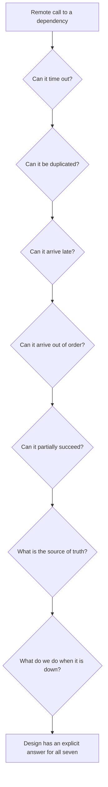

## 43.4 Distributed systems questions

The moment your system has two processes that talk over a network — and a NestJS app plus PostgreSQL is already two processes — you own a distributed system. You do not get to opt out. You only get to decide whether you thought about it.

These seven questions are the interrogation I run on every remote call. I ask them in this order, out loud, in design reviews.



### 43.4.1 Can this request time out?

Yes. Always yes. The interesting question is what happens next.

#### Why the question matters

A call without a timeout is a call that can hang forever, and in Node.js a hung call holds a connection from a pool, a request slot and memory. Fifty hung calls to a slow third party will take down an endpoint that has nothing to do with that third party, because they share the event loop and the pool. This is how one dependency's bad afternoon becomes your outage.

#### How to actually answer it

Every network call gets an explicit timeout, and the timeouts must form a **budget** that decreases as you go deeper. If the client gives up at 5 s, the gateway must give up before that, your handler before that, and the database query before that. Otherwise you do work nobody is waiting for.

```ts
// A timeout budget expressed in config, not scattered magic numbers.
// Client 5000ms > handler 3000ms > payment call 2000ms > db 800ms.
const res = await firstValueFrom(
  this.http.post('https://api.psp.example/charges', body, {
    timeout: 2000,                       // socket + response timeout
    headers: { 'Idempotency-Key': key }, // because a timeout means "unknown"
  }).pipe(timeout({ each: 2500 })),      // hard ceiling including retries
);
```

#### Worked example

At 14:20 our checkout p99 went from 240 ms to 9 s. The payment provider was healthy at 99.4 percent, but 0.6 percent of calls were hanging past 30 seconds. We had no timeout. Each hung request held one of 10 pool connections per pod. With 6 pods and a steady trickle of hangs, we exhausted the pools in eleven minutes and started failing *product page* requests, which never touch payments at all.

The fix was two lines: a 2-second timeout and a bulkhead limiting concurrent payment calls to 4 per pod. Blast radius went from "the whole site" to "some checkouts are slower".

#### The mistake people make

Believing that a timeout is a failure. **A timeout is not a failure. A timeout is unknown.** The payment may have succeeded. This is the single most important sentence in distributed systems, and it leads directly to the next question.

### 43.4.2 Can this be duplicated?

#### Why the question matters

Because timeouts mean unknown, every sane client retries. Every retry can duplicate. Kafka gives you at-least-once delivery. HTTP clients retry on 502. Users double-click. Mobile apps retry on network change. If your handler is not idempotent, duplication means double charges, double emails, double stock decrements.

#### How to actually answer it

Assume every operation will be executed twice, and make the second execution a no-op with the same response. The tools:

- **A natural unique constraint.** `UNIQUE (order_id)` on payments makes a duplicate insert fail loudly and cheaply.
- **An idempotency key** supplied by the client, stored with the response, and returned on replay.
- **A state machine** with guarded transitions: `UPDATE orders SET status='paid' WHERE id=$1 AND status='pending'` returns zero affected rows on the second attempt.

```sql
-- The idempotency table: the key, the request fingerprint, and the stored response.
CREATE TABLE idempotency_keys (
  key            text PRIMARY KEY,
  request_hash   text NOT NULL,
  response_code  int,
  response_body  jsonb,
  created_at     timestamptz NOT NULL DEFAULT now(),
  completed_at   timestamptz
);
-- Insert first, do the work, then fill in the response. A concurrent duplicate
-- hits the primary key and waits or is told the request is in flight.
```

#### Worked example

A retail client double-charged 213 customers in one morning. Root cause: their mobile app retried on a 504 from the CDN, and the charge endpoint had no idempotency key. The provider had actually processed both charges — correctly, from its point of view, because it received two distinct requests. The refunds took three days and a public apology.

The fix was 40 lines: the client generates a UUID per checkout attempt and sends it as `Idempotency-Key`; the server stores it before calling the provider and passes it through to the provider, which is itself idempotent on that key. Two systems, one key, zero double charges since.

#### The mistake people make

Adding idempotency only at the outermost layer while the internals are not idempotent, so a retry after a partial failure re-sends the email but skips the charge. Idempotency has to be reasoned about per side effect. Part 19 — Distributed Transactions: Sagas, Outbox, Inbox and Idempotency is the full treatment.

### 43.4.3 Can it arrive late? Can it arrive out of order?

#### Why the question matters

Networks delay messages, brokers redeliver, consumers rebalance, and retries with backoff mean a message written first can be processed last. If your logic assumes ordering, it is wrong under exactly the conditions where being wrong matters.

#### How to actually answer it

Two defences. First, **partition for the ordering you need**: Kafka guarantees order only within a partition, so key by the entity whose order matters, usually `order_id` or `user_id`. Second, **make handlers order-insensitive** with a version or timestamp check, so a late message cannot overwrite newer state.

```ts
// Ignore stale updates. The event carries the version of the entity it describes.
const result = await this.repo
  .createQueryBuilder()
  .update(OrderProjection)
  .set({ status: event.status, version: event.version })
  .where('order_id = :id AND version < :v', { id: event.orderId, v: event.version })
  .execute();

if (result.affected === 0) {
  this.logger.debug({ orderId: event.orderId, v: event.version }, 'stale event ignored');
}
```

#### Worked example

An order status projection showed orders flipping back from `shipped` to `paid` for a few seconds. Cause: the `paid` event failed once, went to a retry queue with 30 seconds of backoff, and was reprocessed after the `shipped` event had already been applied. The consumer wrote whatever it was handed. Adding the `version <` guard above made the problem structurally impossible, and it is four words of SQL.

#### The mistake people make

Assuming a timestamp on the message is safe to compare across producers. Clocks on different machines disagree, sometimes by seconds. Use a monotonic per-entity version from the writer, or the broker's per-partition offset, not `Date.now()` from three services.

### 43.4.4 Can it partially succeed?

#### Why the question matters

The most dangerous outcome is not failure. It is half-success: the order row is committed, the payment is captured, but the inventory service call failed. The system is now internally inconsistent and no exception describes it.

#### How to actually answer it

Enumerate the steps, then mark the boundary of the local transaction. Everything inside the boundary is atomic. Everything outside it must be either idempotent-retryable or compensatable. If your handler writes to the database and calls two other services, you have three failure points and you need a plan for each.

The two workhorses: the **transactional outbox** (write your state and your intent-to-notify in one local transaction, publish asynchronously) and the **saga** (a sequence of local transactions with explicit compensating actions).

```ts
// One local transaction: state and outbox row commit together or not at all.
await this.dataSource.transaction(async (manager) => {
  const order = await manager.save(Order, { customerId, totalCents, status: 'pending' });
  await manager.insert(OutboxMessage, {
    aggregateId: order.id,
    type: 'OrderPlaced',
    payload: { orderId: order.id, customerId, totalCents },
  });
});
// A separate relay publishes outbox rows to Kafka and marks them sent.
// If the relay crashes mid-publish, the message is re-sent: consumers are idempotent.
```

#### Worked example

A food delivery platform captured payment, then called the restaurant's POS integration to place the order. When the POS timed out, they rolled back nothing: the customer was charged, no food was cooked, and the order sat in `pending` forever. About 60 cases a week were caught by support, one at a time.

The redesign made `payment_captured` and `order_dispatched` separate states with a saga: if dispatch fails after N attempts, a compensating `refund` transaction runs automatically and the customer gets a notification. Support tickets went to near zero, and the cases that remained were visible on a dashboard within 90 seconds instead of a day.

#### The mistake people make

Wrapping HTTP calls inside a database transaction to "make it atomic". It does the opposite: it holds row locks for the duration of a network call, and it still cannot roll back the remote side effect. Never hold a transaction open across a network call you do not control.

### 43.4.5 What is the source of truth?

#### Why the question matters

When two systems disagree, somebody has to be right. If nobody has decided which one, every reconciliation bug becomes an argument, and the fix is guesswork.

#### How to actually answer it

For every important fact, name exactly one owner: "the payment provider is the source of truth for whether money moved; our `payments` table is a local record that must be reconciled against it." Then design the reconciliation: a nightly job, a webhook, or both. Caches, search indexes, read models and analytics copies are never sources of truth. They are derived and must be rebuildable from the source.

The test: **if this store is wiped, can I rebuild it?** If yes, it is a derivative. If no, it needs backups, and it is truth.

#### Worked example

Our search index and PostgreSQL disagreed about product prices during a promotion. Two engineers spent an hour arguing about which to fix. The answer, once we wrote it down, was trivially: PostgreSQL owns price, the index is derived, so the bug is in the indexing pipeline, and the immediate mitigation is a reindex of the affected category. Ninety minutes of the incident had been spent on a question that a one-line ownership statement in the design doc would have answered instantly.

#### The mistake people make

Letting a cache become truth by accident, usually because writes go to Redis and are flushed to PostgreSQL later. The first Redis restart takes your data with it.

### 43.4.6 What do we do when this dependency is down?

#### Why the question matters

The default behaviour — propagate the error to the user — is sometimes right and frequently terrible. Choosing deliberately per dependency is one of the clearest markers of senior design.

#### How to actually answer it

For each dependency, pick one strategy and write it down:

| Strategy | When to use | Example |
|---|---|---|
| Fail fast | The dependency is essential to correctness | Payment provider during checkout |
| Fall back to a degraded answer | The feature has a sensible default | Recommendations return best sellers |
| Serve stale | Data changes slowly and staleness is acceptable | Cached catalogue with extended TTL |
| Queue and process later | The user does not need the result now | Email, webhooks, analytics events |
| Shed load | Protecting the core matters more than this feature | Disable CSV export during an incident |

Then implement it with a circuit breaker so you stop hammering a dying dependency, and make sure the fallback path is exercised regularly, because an untested fallback is a second outage waiting.

#### Worked example

During a 40-minute Redis outage, our catalogue survived because reads fell through to PostgreSQL with a concurrency limiter. Our session store did not, because sessions lived only in Redis, so every user was logged out. The post-incident change was not "make Redis more reliable" — it was to move sessions to signed cookies with a short expiry plus a Redis-backed revocation list, so a Redis outage degrades revocation checks rather than logging out every customer.

#### Interview questions

1. **"Your service calls a third-party API that starts responding in 30 seconds instead of 200 ms. Walk me through what happens to your system and what you would have built to prevent it."** Expected: pool and event-loop exhaustion, timeouts, bulkheads, circuit breaker, blast-radius reasoning.
2. **"What does an HTTP 504 from your payment provider mean?"** Expected: unknown, not failure. Follow-up: how do you find out the truth, and what do you tell the customer meanwhile?
3. **"How do you make a Kafka consumer idempotent?"** Expected: unique key on a processed-messages table or a guarded state transition, plus the observation that offset commits and database writes are not atomic together.
4. **"Two services disagree about an order's status. How do you decide who is right?"** Expected: named source of truth, derived stores, reconciliation job.

#### Practical exercise

Draw the request path of your most important write endpoint, marking every network call. For each call, write the seven answers: timeout value, duplication defence, late/out-of-order handling, partial-failure plan, source of truth, and the behaviour when it is down. Acceptance criteria: no call has "no timeout" and no side effect lacks a duplication defence. Anything you cannot answer becomes a ticket.
## 43.5 Production questions

There is a moment in every engineer's career when they stop thinking of "done" as "merged" and start thinking of it as "running safely in production, observable, deployable, reversible, and operable by someone else". That shift is most of what separates mid from senior.

These six questions are the ones I ask before approving any design that will run in production. If a design cannot answer them, it is not finished, no matter how good the code is.

### 43.5.1 How do we know it is broken before a customer tells us?

#### Why the question matters

The worst way to learn about an outage is a customer email at 09:00 about something that broke at 22:40. It means you were blind for ten hours, you have no data about what happened, and the trust cost is far higher than the outage cost.

#### How to actually answer it

Name the **signal** and the **threshold** before you ship. A signal is a metric you already emit or will emit; a threshold is the number that means "a human should look now".

The default set for any HTTP service:

- Error rate: 5xx as a fraction of requests, per route.
- Latency: p95 and p99 per route, not the average.
- Saturation: pool usage, event loop lag, memory versus limit, CPU throttling.
- Traffic: requests per second, so you can tell "broken" from "nobody is using it".

Then the business-level signals, which are the ones that actually catch the subtle failures: orders per minute, payment success ratio, queue depth, consumer lag, jobs completed per minute. A deploy that breaks checkout for one payment method will not move your 5xx rate at all. It will drop `payments_succeeded_total{method="upi"}` to zero, and that is the alert that saves you.

Then decide which of them **pages a human** and which merely appears on a dashboard. My rule: page only for things that are both urgent and actionable. Everything else is a ticket.

#### Worked example

We shipped a change to the coupon service. Error rates stayed at 0.02 percent, latency was unchanged, CPU was flat. Every technical dashboard was green. What had broken was a validation rule that silently rejected every percentage-based coupon, returning a clean HTTP 200 with `applied: false`.

We found out 90 minutes later from a marketing manager. The alert we added afterwards was one line of PromQL on a business metric:

```text
sum(rate(coupons_applied_total[10m])) < 0.5 * sum(rate(coupons_applied_total[10m] offset 1d))
```

"Coupons applied is less than half of the same time yesterday." It has fired three times since, twice for real problems, and both times we knew within four minutes.

#### The mistake people make

Alerting on causes instead of symptoms. "CPU above 80 percent" pages you at 03:00 for a batch job that is supposed to use CPU. "p99 latency above 1 s for 5 minutes on `/checkout`" pages you when customers are actually suffering. Alert on what the user feels; use the cause metrics for debugging once you are awake. See Part 25 — Observability and Part 37 — Site Reliability Engineering.

### 43.5.2 How do we deploy it?

#### Why the question matters

Deployment is where correct code meets reality: two versions running at once, connections draining, migrations half-applied, caches warm for one version and cold for another. Most "mystery" production bugs are deployment-window bugs.

#### How to actually answer it

Answer three sub-questions explicitly.

**Can version N and version N+1 run at the same time?** During a rolling deploy they will, for minutes. That means every change must be backwards compatible with the immediately previous version: no removing a response field the old client still reads, no renaming a queue, no schema change the old code cannot tolerate. This is the expand-contract discipline from Part 32 — Backward Compatibility.

**What is the rollout shape?** Rolling for most services, canary for risky ones, feature flag for anything user-visible where you want to decouple deploy from release. The flag is the cheapest safety mechanism ever invented: it turns a rollback from a 10-minute redeploy into a 5-second config change.

**What happens to in-flight work?** Graceful shutdown: stop accepting new requests, mark readiness false, finish in-flight ones with a deadline, close the pool, exit. If you skip this, every deploy drops a handful of requests and you will spend an afternoon chasing "random" 502s that only happen at release time.

#### Worked example

A team deployed a change that renamed a BullMQ job from `send-email` to `notifications.send-email`. Producers and consumers were in the same repository, so it looked atomic. During the 4-minute rolling deploy, old producers pushed `send-email` jobs that new consumers ignored, and new producers pushed `notifications.send-email` that old consumers ignored. About 1,900 emails vanished into a queue nobody was reading. They were only discovered because a customer asked where their password reset went.

The correct sequence is three deploys: consumers listen to both names; producers switch to the new name; consumers drop the old name once the old queue is empty. Boring, and nothing is lost.

#### The mistake people make

Coupling the database migration to the application deploy in one step. If the migration runs first and the old code cannot handle the new schema, you have broken production before the new code lands. If the new code lands first and the migration has not run, the same. Always make migrations independently deployable and backwards compatible.

### 43.5.3 How do we roll it back?

#### Why the question matters

Rollback is the fastest mitigation available, and teams routinely discover in the middle of an incident that they cannot use it. Every minute spent debugging a bad release while customers are affected is a minute you could have bought back with a rollback that takes 90 seconds.

#### How to actually answer it

Write the rollback procedure down before the deploy, and mark whether it is **safe**. A release is rollback-safe if the previous version can run against the current state of the world: the current schema, the current cache format, the current message formats.

Things that break rollback safety:

- A migration that drops or renames a column the old code reads.
- Writing a new field into Redis with a format the old code cannot parse.
- Emitting an event version the old consumer rejects rather than ignores.
- Any data written by the new version that the old version will misinterpret.

If a release is not rollback-safe, say so in the pull request, and put a "forward fix only" note in the runbook so nobody wastes ten minutes trying.

#### Worked example

At 01:12 an on-call engineer rolled back a release after error rates spiked. The rollback made things worse: the new version had started writing session data as MessagePack instead of JSON, and the old version threw on every session read. Every logged-in user got a 500. Total outage went from 6 minutes to 34.

The fix afterwards was a rule we still use: **new format writes are gated behind a flag that stays off for one full release cycle**. Ship the reader first, then enable the writer. Every format change becomes reversible.

#### The mistake people make

Testing the deploy but never testing the rollback. Practise it: roll back a real release in staging every month. The first time you try it during an incident should not be the first time.

### 43.5.4 How do we migrate the data?

#### Why the question matters

Application rollbacks are cheap. Data migrations are not: they take time proportional to the data, they hold locks, they generate WAL, they lag replicas, and half-finished ones leave you in a state neither version expects.

#### How to actually answer it

Every migration gets four answers: how long it runs, what it locks, whether it can be resumed, and how to undo it.

The safe pattern for anything on a big table:

```sql
-- Never let a migration wait forever on a lock. Fail fast and retry.
SET lock_timeout = '3s';
SET statement_timeout = '30s';

-- Additive and instant: no table rewrite, no long lock.
ALTER TABLE orders ADD COLUMN total_cents integer;
```

```sql
-- Backfill in bounded batches with a pause, so replication and autovacuum keep up.
-- Run from a script, not from a migration that must finish in one transaction.
UPDATE orders
SET total_cents = round(total * 100)
WHERE total_cents IS NULL
  AND id IN (
    SELECT id FROM orders WHERE total_cents IS NULL ORDER BY id LIMIT 5000
  );
```

Then validate the constraint separately, which takes a weak lock:

```sql
ALTER TABLE orders ADD CONSTRAINT total_cents_not_null CHECK (total_cents IS NOT NULL) NOT VALID;
ALTER TABLE orders VALIDATE CONSTRAINT total_cents_not_null;
```

#### Worked example

A backfill on 90 million rows was written as a single `UPDATE`. It ran for 26 minutes, generated 38 GB of WAL, pushed the read replica 11 minutes behind, and caused a customer-visible incident on the reporting dashboards that read from that replica. Rewritten as 18,000 batches of 5,000 rows with a 150 ms pause, it took 70 minutes of wall clock, generated the same WAL spread over time, and nobody noticed. Longer is often safer.

#### The mistake people make

Running the backfill inside the schema migration, so a deployment blocks for half an hour and the deployment tool times out halfway through with no idea what has been applied. Schema changes are fast and transactional; backfills are slow, resumable and run separately.

### 43.5.5 How does someone debug this at three in the morning?

#### Why the question matters

The person paged will not be you. They will have been asleep 90 seconds ago, they will not know this service, and they will be looking at a dashboard on a phone. Design for that person.

#### How to actually answer it

Three deliverables per service:

1. **Structured logs with a correlation id** that flows from the gateway through the service, into the queue message, and into the worker. Being able to type one id and see the whole story is worth more than any other observability investment.
2. **A runbook** that is not prose. It is: what this alert means, the three most likely causes in order, the exact query or command for each, and the mitigation for each including the "just restart it" option and when that is safe.
3. **A dashboard** with the golden signals for this service on one screen, plus its dependencies. Not forty panels. Eight.

```ts
// A log line built for 03:00: identifiers first, no string interpolation,
// and the fields you will actually filter on.
this.logger.warn(
  {
    correlationId: ctx.correlationId,
    orderId: order.id,
    customerId: order.customerId,
    provider: 'psp-primary',
    attempt,
    latencyMs: Date.now() - startedAt,
    outcome: 'timeout',
  },
  'payment capture timed out',
);
```

#### Worked example

Two services, same incident type. Service A logged `Error: request failed` with a stack trace and no identifiers. The on-call engineer spent 40 minutes correlating timestamps across three systems to work out which customer and which provider. Service B logged the structure above. The on-call engineer filtered by `outcome=timeout`, saw all of them were `provider=psp-primary`, flipped the provider failover flag, and went back to bed in 6 minutes. The code quality of the two services was similar. The operability was not.

#### The mistake people make

Logging for the developer writing the code instead of the engineer reading it under stress. `console.log('here 3')` in production, log messages with no ids, errors swallowed and re-thrown with less context than they had, and the classic `catch (e) { this.logger.error(e.message) }` that discards the stack and the cause chain.

### 43.5.6 Who is on call for it?

#### Why the question matters

A system nobody is responsible for at 03:00 is a system that will be broken for hours. And the answer shapes the design: if you are on call for it, you will build it differently.

#### How to actually answer it

Before launch: name the on-call rotation, confirm the alert routes to it, confirm the team knows the service exists, and hand over the runbook in a real conversation rather than a link. If the answer is "we don't have a rotation for that yet", the launch is not ready.

There is a deeper principle here: **you build it, you run it**. Teams that are paged by their own systems build systems that page less. It is the tightest feedback loop in software engineering, and it converts abstract quality arguments into personal sleep.

#### The mistake people make

Launching a service on a Friday, with alerts routed to an email address nobody reads, owned by a team that was not consulted. Two months later it fails, and the archaeology begins.

#### Practical exercise

Take a service you own and write its runbook page for its most likely alert. It must fit on one screen and contain: what the alert means in one sentence, the three most likely causes with the exact command or query for each, the mitigation for each, the escalation contact, and when a restart is safe. Acceptance criteria: an engineer from another team can follow it without asking you anything.

