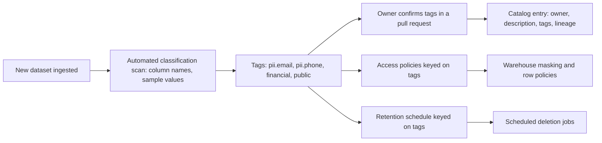
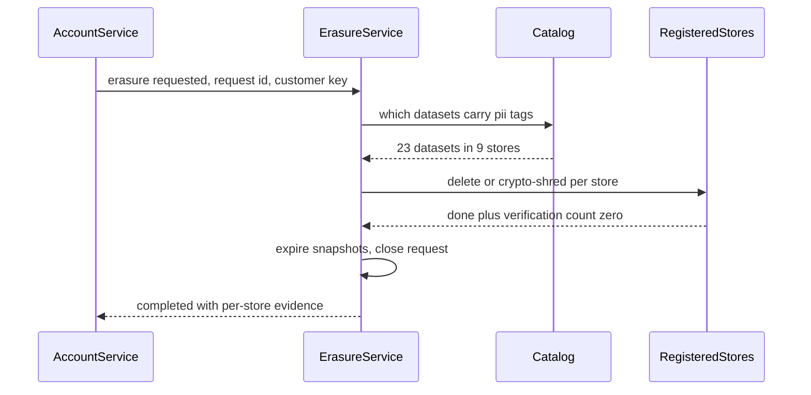
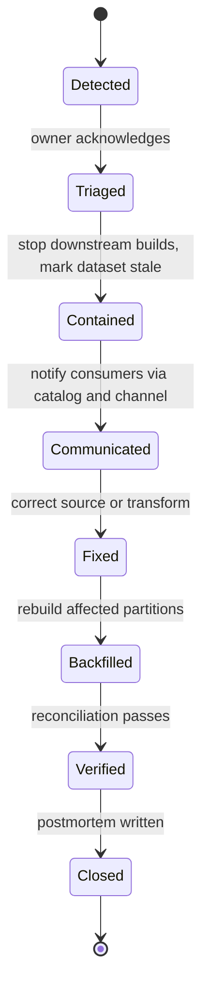
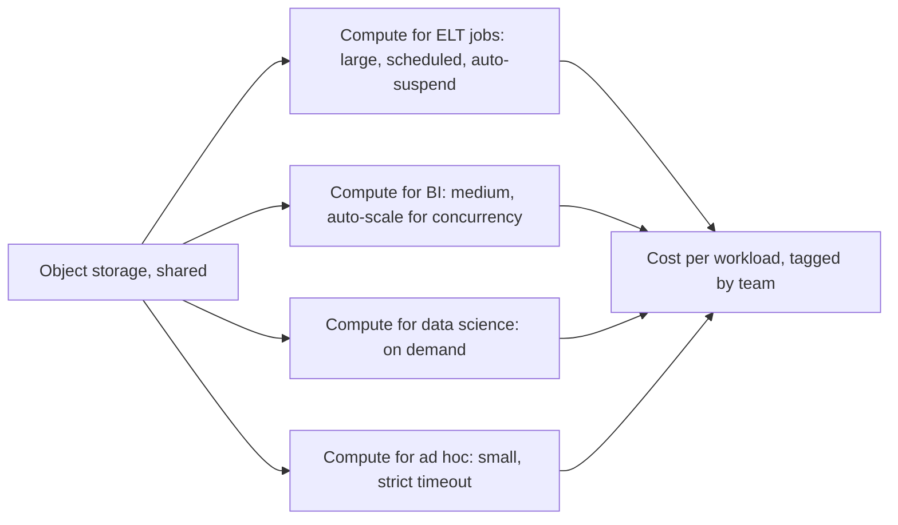

## 43.9 Governance: catalog, lineage, ownership, access, classification, retention and erasure

#### Concept

**Data governance** is the set of rules and mechanisms that decide what data exists, who owns it, who may use it for what, how long it is kept, and how you prove all of that to an auditor. On a modern platform it is mostly software: a **catalog** that lists every dataset with its owner and meaning, **lineage** that shows how each dataset was derived, a **classification** of every column (personal, sensitive, financial, public), **access policies** driven by that classification, **retention** rules that delete data on schedule, and an **erasure** service that removes a person from every copy. Part 42.5 and 42.11 taught the mechanics of masking and erasure in a pipeline; this section is about running governance across a whole platform.

#### Why does it exist?

Three forces make governance unavoidable past a small size. **Discovery:** with 3,000 tables, nobody can find the right one, so people build a 3,001st. **Risk:** personal and financial data copied into an analytics platform is in scope for privacy law (GDPR, India's Digital Personal Data Protection Act, and others), for payment-card rules if card data leaks in, and for audits; an unclassified column of emails in a marketing sandbox is a breach waiting to be reported. **Trust:** when a number is questioned, lineage is how you answer "where did this come from?" in minutes instead of days.

#### Mental model

Imagine a national library. The catalogue tells you every book, its subject and its shelf (catalog). Each book's bibliography shows its sources (lineage). Some rooms are restricted and your library card's level decides which doors open (access by classification). Old newspapers are pulped after their retention period (retention). And if a court orders a passage removed, the library knows every edition and copy that contains it (erasure).

#### How it works



**Catalog and lineage.** Open-source catalogs such as DataHub and OpenMetadata, and managed ones such as Unity Catalog, AWS Glue Data Catalog with Lake Formation, and Google Dataplex, store datasets, owners, descriptions, tags and usage. Lineage is collected automatically wherever possible: dbt publishes model dependencies; orchestrators and engines can emit **OpenLineage** events (an open standard for lineage metadata); warehouses expose query history from which column-level lineage can be parsed. Hand-maintained lineage is always out of date, so the rule is: if a tool cannot emit lineage, it needs a strong reason to be on the platform.

**Ownership.** Every dataset in the curated layer has an owning team, recorded in the catalog and in code (the dbt model's `meta.owner`, the contract file), and an on-call route. Datasets without an owner are flagged weekly; after a grace period they are deprecated. Ownership is how a quality alert reaches a human (43.10).

**Classification.** A small, fixed taxonomy beats a clever one. For example:

| Tag | Examples | Default handling |
|---|---|---|
| `pii.direct` | Email, phone, full name, street address | Masked for everyone except named roles; never in bronze longer than the raw retention window |
| `pii.indirect` | Customer ID, device ID, IP address | Pseudonymised (keyed hash or surrogate) in silver and gold |
| `sensitive` | Health data, precise location, data about children | Not ingested unless a documented purpose exists |
| `financial` | Order totals, payouts, margins | Readable by domain and finance roles; audited |
| `card_data` | Card numbers | Must never enter the platform; ingestion rejects it |
| `public` | Product catalogue, prices | Open to all employees |

Automated scanners (pattern matching on names and sampled values) propose tags; the owner confirms them in review. New columns arrive untagged and are treated as `pii.direct` until classified, which is the fail-closed default (the same principle as Part 96 — Security Architecture applies to access in general).

**Access control.** Grant access to roles by domain and purpose, and let tags drive masking. Most warehouses support **column masking policies** and **row access policies** (Snowflake, BigQuery and Databricks all have them, with different syntax); on a lake, the catalog or a service such as AWS Lake Formation enforces them for supported engines. Two rules keep it manageable: policies are attached to **tags**, not to individual columns, so a newly tagged column is protected automatically; and policies are code, reviewed and versioned like application code (see Part 44 — Security, 44.8 and 44.9, for RBAC and ABAC).

```sql
-- Snowflake syntax as an example: one masking policy, attached to a tag, protects every tagged column.
CREATE MASKING POLICY governance.mask_pii_direct AS (val STRING) RETURNS STRING ->
  CASE
    WHEN IS_ROLE_IN_SESSION('PII_READER') THEN val          -- named, audited role
    ELSE '***MASKED***'
  END;

ALTER TAG governance.pii_direct SET MASKING POLICY governance.mask_pii_direct;

-- Classifying a column is now enough to protect it:
ALTER TABLE silver.customers MODIFY COLUMN email SET TAG governance.pii_direct = 'email';
```

**Retention.** Retention is set per tag and per layer, enforced by jobs, and verified. A typical schedule: raw CDC with personal data 30 to 35 days (long enough to replay a month of bugs); clickstream raw 13 months but with IP addresses truncated after 30 days; financial facts seven years (or whatever your tax rules require; confirm with finance and legal); sandbox schemas 30 days. Table formats and warehouses keep old versions for time travel, so retention must also cover snapshot expiry and time-travel windows.

**Erasure as a platform service.** In Part 42.11 erasure was a workflow per pipeline. At platform scale, make it a service: one erasure request ID, fanned out to every registered store (each dataset with `pii.*` tags registers a deletion handler or is covered by crypto-shredding), with per-store completion, verification queries, and a deadline well inside the legal limit. The catalog's tags tell the service which stores to include, so a new dataset with personal data cannot silently escape erasure.



#### Production scenario

The e-commerce platform has about 2,800 tables. The catalog shows 340 in gold with owners; a weekly report lists 61 tables without an owner and 9 columns that the scanner suspects are personal data but are untagged. Access requests go through a form that maps "purpose" to a role; grants expire after 90 days unless renewed. The erasure service processes about 400 requests a month with a median completion of two days and a 14-day internal deadline.

#### Failure scenario

An analyst joined a support-ticket export (free text) into a customer table in a shared sandbox to study complaint themes. The free text contained phone numbers and, in some tickets, card numbers that customers had typed in. The sandbox had no classification scan and broad read access. It was found four months later during a card-data scope review. Remediation meant deleting the sandbox, a scan across all schemas, an ingestion rule that rejects free-text fields from support tools unless they pass a redaction step, and sandbox retention of 30 days. The lesson: governance that covers only curated layers leaves the sandboxes, which is where people put the most dangerous joins.

#### How a Senior Backend Engineer thinks about this

A senior makes the governed path the easy path: tagging happens in the same pull request as the model, access is self-service by purpose, and policies follow tags automatically. They treat unclassified data as sensitive by default, give every dataset an owner or a deprecation date, and design erasure and retention into the platform rather than into each pipeline. They avoid governance by committee meeting; they prefer governance by CI check.

#### Common mistakes

- Classification in a spreadsheet that drifts from the schema within a month.
- Masking policies attached to individual columns, so every new column is unprotected until someone remembers.
- Retention that deletes current rows but forgets time travel, snapshots and backups.
- Lineage drawn by hand for a review and never updated.

## 43.10 Data quality as an engineering system

#### Concept

Part 42.4 introduced data quality: contracts, validation and reconciliation. At platform scale, data quality is run like reliability engineering for services: **tests** in the pipeline that stop bad data, **service level objectives for data** (freshness, completeness, accuracy), **monitors** that detect what tests did not anticipate, **ownership and on-call** so alerts reach someone, and **incident response** with communication to consumers and postmortems (see Part 53 — Site Reliability Engineering, 53.3 and 53.7, for the service versions of these practices).

#### Why does it exist?

Bad data fails silently. A broken API returns a 500 and someone notices within minutes; a broken pipeline returns a plausible number, and someone notices at the board meeting, or never. The cost of a wrong number grows with every decision made on it. An engineering system for quality shortens the time between "the data went wrong" and "the owner knows", and limits how far wrong data travels before it is stopped.

#### Mental model

Imagine a water utility again. Tests are the filters at the treatment plant that refuse to pass dirty water. SLOs are the published promise: "safe to drink 99.9% of days, pressure restored within four hours". Monitors are the sensors along the pipes. Incident response is the "boil water" notice to residents and the repair crew. Without the notice, people keep drinking.

#### How it works

**1. Tests at build time.** Every model has tests that run when it is built, and a failing test on a tier 1 model stops downstream models from building (so wrong data does not propagate). Typical tests: primary key unique and not null; foreign keys exist; accepted values for enums; row counts within an expected range of the source; no future dates; money non-negative. dbt tests, Great Expectations and Soda are common tools.

```yaml
# dbt: tests and a freshness SLO on a tier 1 model and its source
sources:
  - name: orders_raw
    loaded_at_field: _ingested_at
    freshness:
      warn_after: {count: 2, period: hour}
      error_after: {count: 6, period: hour}
    tables:
      - name: orders_cdc
models:
  - name: fct_orders
    config:
      meta: {owner: orders, tier: 1}
    columns:
      - name: order_id
        tests: [unique, not_null]
      - name: status
        tests:
          - accepted_values:
              values: ['paid', 'refunded', 'partially_refunded', 'chargeback']
      - name: total_cents
        tests:
          - dbt_utils.accepted_range:
              min_value: 0
```

**2. SLOs for data.** For each tier 1 dataset, publish a small number of indicators and targets:

| Indicator | Definition | Example target for `fct_orders` |
|---|---|---|
| Freshness | Time from source commit to availability in the dataset | Yesterday's data complete by 06:00 on 99% of days |
| Completeness | Rows in dataset compared with rows in source | Within 0.1% of source paid orders for each day |
| Accuracy | Reconciliation against an independent source of truth | Daily net revenue within 0.05% of the payment provider's settlement report |
| Schema conformity | Contract tests pass | 100% of builds |

An **error budget** for data works like one for services: if freshness misses three days in a month, the owning team prioritises reliability work over new datasets.

**3. Monitors for the unexpected.** Tests catch what you thought of; monitors catch what you did not: volume anomalies (today's row count is 40% below the same weekday's median), distribution shifts (share of orders in one currency doubled), null-rate jumps, schema changes. Data observability products (Monte Carlo, Bigeye, and others) and open-source tools (Elementary for dbt, and similar) do this; a few SQL checks on the top 20 tables catch most problems.

**4. Ownership and routing.** Alerts route to the dataset owner's on-call from the catalog, not to a shared data-team channel where they scroll away.

**5. Incident response for data.**



Severity for data incidents is about impact on decisions: a wrong number in a regulator report or a customer-facing statement is the highest severity even if no system is down; a stale internal dashboard is low. **Containment** matters more than speed of fix: mark the dataset as stale or wrong in the catalog and on dashboards (many BI tools can show a banner), and stop downstream jobs, so the wrong number stops spreading.

#### Practical example: freshness monitoring in SQL

```sql
-- Run every 15 minutes; any row returned pages the owner of that dataset.
WITH expectations(dataset, owner, max_lag) AS (
  VALUES ('gold.fct_orders',        'orders',    interval '6 hours'),
         ('gold.daily_revenue',     'finance',   interval '26 hours'),
         ('gold.seller_sales_live', 'marketplace', interval '10 minutes')
)
SELECT e.dataset, e.owner, now() - m.last_loaded_at AS lag
  FROM expectations e
  JOIN platform.dataset_loads m ON m.dataset = e.dataset
 WHERE now() - m.last_loaded_at > e.max_lag;
```

#### Production scenario: an incident story

At 07:12 on the first Monday of the month, the finance data on-call was paged: accuracy check failed, net revenue for Saturday was 3.8% above the payment provider's settlement figure. The tests had all passed. The owner marked `gold.daily_revenue` as "under investigation" in the catalog, which put a banner on the finance dashboards, and paused the downstream month-end mart. By 08:05 they found the cause through lineage: the payments team had launched partial refunds on Friday, the source emitted a new status `partially_refunded`, and the silver model mapped unknown statuses to `paid`, so partially refunded orders counted at full value. The accepted-values test had not caught it because, months earlier, someone had loosened it to warn instead of error after a noisy week. The fix: map the new status, restore the test to error, add the status to the contract with the payments team (42.4), and rebuild Friday to Sunday. The month-end close started at 11:00 instead of 09:00. The postmortem's main action was not technical: any change to a tier 1 test's severity now needs the dataset owner's approval in review.

#### How a Senior Backend Engineer thinks about this

A senior defines quality per consumer, not in the abstract: the finance mart's accuracy target is not the marketing dashboard's. They put tests where the data enters and where it is published, page on tier 1 only, and invest in reconciliation against independent sources because it catches what every other test misses. When data is wrong, their first move is to stop it spreading and tell consumers; the fix comes second.

#### Common mistakes

- Thousands of tests, all warnings, all ignored.
- Freshness alerts on every table, so the meaningful ones drown.
- No containment: a known-wrong table keeps feeding dashboards for a day while someone fixes it.
- Treating data incidents as "the data team's problem" with no postmortem and no owner on the producing side.

## 43.11 Cost engineering for data platforms

#### Concept

A data platform's bill is driven by three things: **storage** (how much data, in which tier, for how long), **compute** (how many bytes are scanned and how long engines run) and **movement** (ingestion connectors priced by rows, egress between regions or clouds). Cost engineering makes those drivers visible, assigns them to owners, and designs the platform so that the expensive paths are hard to take by accident (see Part 55 — Cost-Aware Engineering for the general practice).

#### Why does it exist?

Analytics compute is elastic and query-driven, so the bill is a function of people's behaviour, not of traffic. One dashboard that refreshes every five minutes and scans 2 TB per refresh can cost more than the rest of the platform combined. Without cost engineering, the bill grows faster than the data, finance asks why, and the platform team cuts things at random.

#### How it works

**Separation of storage and compute.** Modern warehouses and lakehouses store data in cheap object storage and spin compute up and down independently. That is what makes the cost model controllable: storage is cheap and predictable; compute is where money goes, and it can be sized per workload, suspended when idle and capped.



Approximate list prices to reason with (check current pricing; discounts and regions change them):

| Item | Approximate figure | What it means for design |
|---|---|---|
| Object storage, standard tier | About $0.02 to $0.025 per GB-month | 100 TB costs a few thousand dollars a month; storage is rarely the problem |
| Infrequent-access or archive tiers | Several times cheaper, with retrieval fees | Move cold raw data after a few months |
| BigQuery on-demand | About $6.25 per TiB scanned | A careless `SELECT *` over 50 TB (about 45 TiB) costs roughly $285 |
| Snowflake | Credits per second of warehouse runtime; an X-Small uses 1 credit per hour, each size up doubles it; a credit costs a few dollars depending on edition and region | Idle warehouses and oversized warehouses are the main waste |
| Managed SaaS connectors | Often priced by monthly active rows | A chatty source table that updates every row daily can dominate the bill |

**Partition and file-size tuning.** Most of the bytes scanned are wasted bytes. Partition large fact tables by the column most queries filter on (usually a date), cluster or sort by the next most common filter (seller, country), and enforce partition filters where the engine supports it (BigQuery's `require_partition_filter`). In a lakehouse, keep data files in the range of roughly 128 MB to 1 GB (Iceberg's default target is 512 MB); thousands of tiny files from streaming writes slow planning and reading, so schedule compaction. Avoid over-partitioning: a table partitioned by day and by seller with 50,000 sellers makes millions of tiny partitions.

**Query cost control.**

- Caps on individual queries: BigQuery's maximum bytes billed per query; statement timeouts per warehouse in Snowflake; Snowflake **resource monitors** that suspend a warehouse when it reaches a credit quota.
- Separate compute per workload, so an analyst's experiment cannot slow or bill the finance close.
- Materialise what is read often: a dashboard that aggregates 2 TB every refresh should read a 2 GB aggregate table built once a day.
- Short auto-suspend on interactive compute (one to five minutes), and a look at what is waking it.

**Showback and chargeback.** Tag every compute cluster, warehouse and job with a team, and publish cost per team and per dataset monthly. **Showback** (show teams what they cost) changes behaviour on its own in most organisations; **chargeback** (bill them) is for when it does not.

#### Practical example: one month of the e-commerce bill

| Item | Approximate monthly cost | Note |
|---|---|---|
| Object storage, about 60 TB across raw and history | $1,400 | Clickstream dominates |
| Warehouse compute, ELT | $9,000 | dbt builds, nightly and every 30 minutes |
| Warehouse compute, BI and ad hoc | $14,000 | Before tuning |
| SaaS connectors | $4,500 | Two sources account for 70% of rows |
| ClickHouse serving cluster | $3,200 | Seller dashboards |
| Kafka and Flink | $5,000 | Shared with the backend platform; data share |
| Total | about $37,000 | |

A tuning pass found that 11 dashboards caused 60% of BI compute: they refreshed every 15 minutes, scanned unpartitioned clickstream and were viewed a few times a day. Pointing them at daily aggregates, setting refresh to hourly and adding partition filters cut BI compute by about half. One connector was syncing a table whose `updated_at` changed for every row nightly because of a backend job touching all rows; fixing the backend job cut its row count by 90%. These numbers are illustrative, but the pattern is typical: a few queries and a few sources make most of the bill.

#### Failure scenario

A data scientist ran a notebook in a loop to tune a model, each iteration joining two years of clickstream with orders on an on-demand engine. Over a weekend it scanned about 900 TB. At list price that is several thousand dollars, and it went unnoticed until the monthly invoice because no per-user cap and no daily budget alert existed. The fixes were standard: per-user daily caps on bytes billed, a sampled 1% clickstream table for experimentation, and a budget alert at 50% and 80% of the daily expected spend.

#### How a Senior Backend Engineer thinks about this

A senior treats cost as a design input and a monitored metric, not an end-of-month surprise. They know the platform's top ten queries by cost and top five sources by ingestion rows, design partitions and aggregates around the dominant query shapes, cap the expensive paths by default, and make cost visible per team. They also know when to stop: an engineer-week spent saving $200 a month is not a saving.

#### Interview questions

1. **Why does separating storage and compute matter for cost?** You pay for compute only when queries run, can size it per workload, suspend it when idle and cap it, while storage stays cheap and shared.
2. **A dashboard costs $4,000 a month. Where do you look first?** Refresh frequency, bytes scanned per refresh, partition pruning, and whether it should read a pre-aggregated table.
3. **What is the small-files problem and how do you fix it?** Many tiny files from frequent writes slow planning and reads; compact into files of a few hundred MB on a schedule.
4. **Showback or chargeback?** Showback first, because visibility changes most behaviour; chargeback when teams ignore it or budgets must be enforced.
