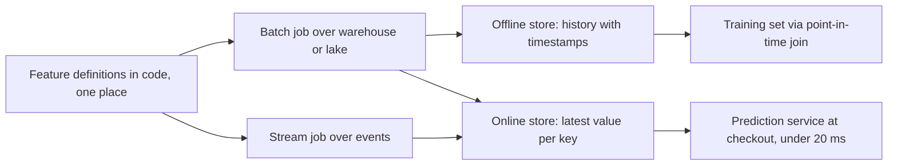
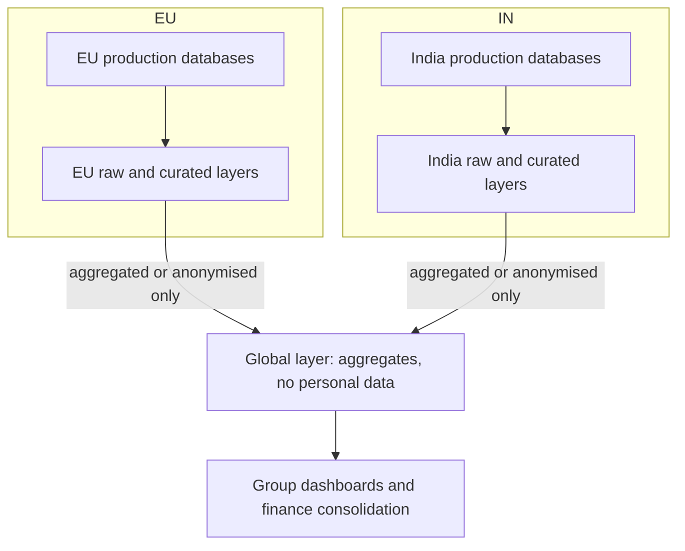
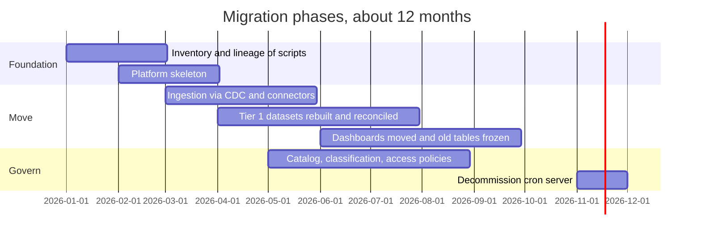

## 43.12 Operational ML and feature stores

#### Concept

When a company moves machine learning from notebooks into the product (fraud scores at checkout, product recommendations, delivery-time estimates), the data platform has to serve models as well as people. A **feature** is an input value a model uses, such as "number of orders this customer placed in the last 30 days" or "share of this card's transactions declined in the last hour". A **feature store** is the system that defines features once and serves them in two ways: an **offline store** (historical feature values in the warehouse or lake, for training) and an **online store** (the latest values in a low-latency key-value store such as Redis or DynamoDB, for live predictions). Examples: Feast (open source), Tecton, and the feature stores built into Databricks, Amazon SageMaker and Google Vertex AI.

#### Why does it exist?

Two problems appear as soon as a model goes live. **Training-serving skew:** the data scientist computed "orders in the last 30 days" in SQL over the warehouse for training, and the backend engineer reimplemented it in TypeScript for serving; the two versions differ in time zone, in whether cancelled orders count, and in freshness, so the live model sees inputs it never saw in training and performs worse than in testing. **Point-in-time correctness:** when building a training set for events in the past, each example must use only the feature values that were known at that moment; joining today's values onto last year's events leaks the future into training and produces a model that looks brilliant offline and fails in production.

#### Mental model

Imagine a sports team's statistics department. The historical archive (offline store) holds every player's statistics as they stood on every match day, so coaches can study what was known before each game. The live board on the touchline (online store) shows each player's current figures, updated during the match. Both are computed by the same statisticians with the same formulas, so a coach's study of past games matches what the board shows today.

#### How it works



1. Features are defined once, with an entity key (customer, card, product), a computation and a freshness requirement.
2. Batch features (30-day order counts) are computed in the warehouse and written to both stores; streaming features (declines in the last 10 minutes) are computed by a stream job and written to the online store, with history logged to the offline store.
3. Training uses a **point-in-time join**: for each labelled event with timestamp `t`, take the latest feature value with timestamp at or before `t`.
4. Serving reads the online store by key, typically in single-digit milliseconds from Redis.

```sql
-- Point-in-time join in plain SQL: features as known at each order's checkout time.
SELECT o.order_id, o.is_fraud AS label,
       f.orders_30d, f.decline_rate_1h
  FROM training_orders o
  LEFT JOIN LATERAL (
    SELECT orders_30d, decline_rate_1h
      FROM feature_history fh
     WHERE fh.customer_id = o.customer_id
       AND fh.computed_at <= o.checkout_at       -- never use values from the future
     ORDER BY fh.computed_at DESC
     LIMIT 1
  ) f ON true;
```

#### How a Senior Backend Engineer thinks about this

A senior does not buy a feature store for the first model. One or two models can live with a shared SQL definition, a batch job that writes features to Redis, and a point-in-time join for training. The feature store earns its place when several models share features, when streaming features appear, or when skew has already caused an incident. From the backend side, the senior cares about the online path: the prediction call at checkout has a strict timeout and a fallback (a rule-based score or "allow and review") when the feature store or model is slow or down, because a fraud model must never take checkout down with it.

#### Edge cases & failure modes

- **Stale online features.** The batch job failed last night; the online store serves two-day-old values without complaint. Store a `computed_at` with each value and treat stale values as missing.
- **Missing keys.** A new customer has no features; the model must handle missing values the same way in training and serving.
- **Backfills that leak.** Recomputing historical features with today's logic and today's corrected data produces training values that never existed at the time.
- **Personal data.** Feature stores hold per-person values and fall under erasure and retention (43.9).

## 43.13 Multi-region platforms and data residency

#### Concept

**Data residency** is a requirement that certain data be stored, and sometimes processed, inside a particular country or region. It comes from law (data protection rules in many jurisdictions), from sector regulators, and very often from enterprise customer contracts. A **multi-region data platform** is one whose storage and compute span more than one region, either for residency, for latency to regional users, or for disaster recovery. Part 95 — Enterprise and Multi-Tenant SaaS Architecture, 95.6, covered residency for the operational SaaS application; this section covers what it means for the analytics platform that copies that data.

#### Why does it exist?

The analytics platform is the place where data from every region is most likely to be mixed, because mixing is what analytics does. A company that carefully keeps EU customers' orders in an EU production database and then replicates them nightly into a single US warehouse has undone its residency promise. Multi-region designs also exist for resilience: if the warehouse's region has an outage on the day of the month-end close, finance cannot work.

#### How it works

There are three common patterns:



| Pattern | How it works | Good for | Costs |
|---|---|---|---|
| Single region, global data | One platform; all regions replicate into it | No residency obligations; simplest | Residency violations if obligations appear later |
| Regional platforms plus a global aggregate layer | Personal data stays in its region; only aggregates or properly anonymised data crosses | Most companies with residency obligations | Two or more platforms to run; cross-region analysis needs aggregates |
| Regional storage, federated query | Data stays put; a query engine reaches into each region and moves only results | Ad hoc cross-region analysis on non-personal fields | Results can still contain personal data; latency; egress |

Points an architect must check:

1. **What exactly must stay?** Often personal data must stay but aggregates may travel. Get the rule in writing from legal and customer contracts, per data class.
2. **Processing, not just storage.** Some obligations cover where data is processed; a global query engine that pulls rows into another region for a join may break them.
3. **Backups, logs and support tools.** Warehouse backups, query logs containing literal values, and the BI tool's cache are also copies.
4. **Anonymisation is hard.** Pseudonymised data (hashed IDs) is still personal data under GDPR; only data that cannot reasonably be linked back to a person is outside scope. Aggregates over very small groups can identify people, so set a minimum group size.
5. **Egress cost.** Moving data between regions or clouds is billed; replication of large raw tables across regions can cost more than the storage itself.

For disaster recovery of the platform itself (see Part 50 — Cloud Architecture, 50.14, and Part 54 — Backup, Restore and Disaster Recovery), most analytics platforms accept a recovery time of hours and rely on rebuilding curated layers from the raw layer and sources; tier 1 outputs such as the finance mart may justify cross-region replication of the curated tables within the same legal zone.

#### Failure scenario

An enterprise customer's security questionnaire asked where their users' data was processed. The SaaS company answered "EU only", true for the application. A year later the customer's audit found their user IDs and email domains in the US-hosted product analytics tool, sent by a front-end SDK and by a nightly export to the warehouse. The contract had a residency clause; the company had to delete the data, move product analytics to an EU instance, and rebuild trust over a year of reviews. The lesson: residency is a property of every data flow, including SDKs and exports; the data catalog's lineage is how you prove it.

#### How a Senior Backend Engineer thinks about this

A senior asks for residency requirements before choosing regions, because moving a platform later is expensive. They default to "personal data stays in its region, aggregates may travel", enforce it with separate accounts or projects per region and network-level controls on replication, and keep lineage good enough to answer a customer questionnaire with evidence rather than belief.

## 43.14 Build versus buy

#### Concept

Every layer of the reference architecture can be built from open-source components and run by your team, or bought as a managed service or SaaS product. Part 68 — Architecture Decision Framework, 68.19, gives the general build-versus-buy reasoning. For data platforms the decision repeats for every layer, and the right answer is rarely all one or the other.

#### Why does it exist?

Data infrastructure is a crowded market, and every layer has credible open-source and commercial options. Building gives control and avoids per-row or per-seat pricing; buying gives speed and moves operations to someone else. A platform team of eight cannot run twelve open-source systems well; it can run three, and integrate the rest.

#### How it works

Score each layer on four questions: is it a **differentiator** for the business; how much **operational load** does running it bring; how **mature** are the managed options; and how much **lock-in** does buying create, measured as the cost to leave.

| Layer | Typical build options | Typical buy options | Usual answer for a mid-size company |
|---|---|---|---|
| Database CDC | Debezium on Kafka Connect | Cloud-managed CDC, connector SaaS | Build if Kafka already runs; otherwise buy |
| SaaS source connectors | Airbyte self-hosted, custom scripts | Fivetran, Airbyte Cloud, Stitch | Buy; connectors are maintenance-heavy and undifferentiated |
| Event collection | Snowplow open source, own collector | Segment, RudderStack Cloud, Snowplow managed | Either; build when volume makes per-event pricing painful |
| Storage and table format | S3 plus Iceberg | Warehouse-managed storage | Open format for raw; warehouse for curated (43.3) |
| Warehouse engine | Trino, Spark, ClickHouse self-hosted | Snowflake, BigQuery, Redshift, Databricks | Buy for curated SQL |
| Transformation | dbt Core | dbt Cloud, warehouse-native tools | dbt Core plus your orchestrator, or dbt Cloud to save effort |
| Orchestration | Airflow, Dagster, Prefect self-hosted | Managed Airflow (Amazon MWAA, Google Cloud Composer, Astronomer), Dagster+, Prefect Cloud | Buy managed unless the platform team already runs Kubernetes well |
| Catalog and lineage | DataHub, OpenMetadata | Atlan, Collibra, Alation, cloud-native catalogs | Open source if a team can own it; buy for heavy compliance needs |
| Quality and observability | dbt tests, Great Expectations, Elementary | Monte Carlo, Bigeye, Soda Cloud | Build tests; buy observability when tables pass a few thousand |
| BI | Metabase, Apache Superset | Looker, Tableau, Power BI, Sigma | Depends on users and existing licences |
| Feature store | Feast | Tecton, cloud ML platforms | Start without one (43.12) |

#### How a Senior Backend Engineer thinks about this

A senior counts people, not licences. A self-hosted orchestrator that saves $40,000 a year but needs half an engineer to run is not a saving. They buy undifferentiated, maintenance-heavy layers (SaaS connectors, managed orchestration), build or self-host where volume pricing would be punitive or where control is a real requirement, and keep data in open formats so that buying compute does not mean surrendering the data. They write the exit cost into each decision record.

#### Common mistakes

- Comparing licence cost against zero for the build option, ignoring on-call, upgrades and security patching.
- Buying a tool per problem until the platform is fifteen products with no integration.
- Self-hosting everything for "no lock-in" and locking the company into its own unmaintained glue code.

## 43.15 A migration story: from cron and SQL scripts to a governed platform

#### Concept

Most data platforms are not designed; they are migrated to. This section follows one realistic migration, the e-commerce company's, from a single cron server running SQL scripts against a read replica to the governed platform designed in 43.16. Part 91 — Large-Scale Migrations and Legacy Modernization covers migrations as programmes in general, and 91.5 covers data migrations with dual runs and reconciliation; here the focus is what is specific to analytics.

#### Why does it exist?

The starting point is common and works for a while: a cron server, 140 SQL and Python scripts written over six years by people who have mostly left, writing about 300 tables into a reporting schema on a PostgreSQL read replica, feeding a BI tool. Then the replica starts to lag during the nightly run, scripts fail silently, finance and marketing disagree on revenue, and an auditor asks where personal data goes. A big-bang rewrite would stop all reporting for months, so the migration has to run while the old system keeps working.

#### How it works



**Phase 0: inventory.** Parse every script for the tables it reads and writes, and join that with the BI tool's usage logs. The e-commerce team found 300 tables, of which 110 were read in the last 90 days and 35 fed something anyone would miss. That list, not the 300, is the migration scope; the rest are frozen and then deleted after an announcement.

**Phase 1: platform skeleton.** Stand up the smallest version of the target: object storage with Iceberg, the warehouse, dbt, the orchestrator, a catalog, CI for models. Ship one dataset end to end, including tests, owner and documentation, before building anything else.

**Phase 2: ingestion.** Replace "scripts query the replica" with CDC from the production databases (reusing the Debezium setup from Part 42.12) and connectors for SaaS sources, landing in raw. The replica load drops immediately, which is the first visible win.

**Phase 3: rebuild tier 1, with parallel runs.** For each of the 35 important datasets, rebuild it as dbt models, run old and new side by side for at least one full month-end cycle, and reconcile daily. Differences are classified: a bug in the new model (fix it), a bug in the old script (document it, tell consumers the number will change, get the owner's sign-off), or a definition question (decide it once, in the semantic layer).

```sql
-- Daily reconciliation between the old reporting table and the new mart during the parallel run.
SELECT coalesce(o.day, n.day) AS day,
       coalesce(o.country, n.country) AS country,
       o.net_cents AS old_net, n.net_cents AS new_net,
       round(100.0 * (n.net_cents - o.net_cents) / nullif(o.net_cents, 0), 3) AS diff_pct
  FROM legacy_reporting.daily_revenue o
  FULL JOIN gold.daily_revenue n ON n.day = o.day AND n.country = o.country
 WHERE coalesce(o.day, n.day) >= current_date - 35
   AND (o.net_cents IS DISTINCT FROM n.net_cents)
 ORDER BY day, country;
```

**Phase 4: move consumers.** Repoint dashboards one domain at a time, starting with a friendly team. Freeze old tables (revoke writes, add a deprecation note), then remove read access after a notice period, then delete.

**Phase 5: govern and decommission.** Classification and access policies are applied as datasets move, not saved for the end. The cron server is switched off only when its job list is empty and a week of "scream test" (old tables made unreadable) passes without a missed consumer.

#### Failure scenario

Midway, the team switched the marketing attribution dashboard to the new mart before the parallel run covered a month-end. On the first of the month, the new mart's late-data window (three days) missed refunds the old script had picked up with a full-month recompute, and marketing's reported return on ad spend jumped. Nobody had known the old script recomputed the whole month; it was a side effect of a `DELETE ... WHERE month = current_month`. The fix was a month-end recompute job in the new platform and a rule: no consumer moves until the parallel run has covered a month-end and a quarter-end where relevant. The lesson: legacy scripts encode business rules by accident, and only a long enough parallel run reveals them.

#### How a Senior Backend Engineer thinks about this

A senior scopes by usage, not by inventory; delivers a visible win early (the replica load drop); runs old and new in parallel across the business calendar's hardest days; treats every reconciliation difference as a decision with an owner; and plans decommissioning from day one, because a migration that leaves both systems running forever has doubled the cost and halved the trust.

#### Practical exercise

You inherit 90 cron scripts and 200 reporting tables. The BI tool shows 40 tables used in the last 90 days. Finance's month-end close depends on 6 of them. Write the first eight weeks of the migration plan: what you inventory, what you build first, which dataset goes first and why, how you prove the new numbers are right, and how you will know when a legacy table can be deleted.

#### Worked answer to the exercise

Weeks 1 and 2: parse scripts into a read-write graph (tables in, tables out), join it with BI usage logs and the scheduler's timetable, and confirm the 40 used tables and their consumers with the people named in the logs; mark the other 160 as candidates for freezing and send the list out with a deletion date. Weeks 2 to 4: build the platform skeleton and move one **non-finance** but visible dataset end to end (for example, daily orders by channel for the operations team) to prove ingestion, dbt, tests, catalog entry, owner, freshness monitor and a dashboard; finance goes later because its tolerance for difference is zero and its calendar is fixed. Weeks 4 to 8: switch ingestion for the sources those 40 tables need to CDC and connectors; start rebuilding the 6 finance tables with a daily reconciliation query like the one above and a written sign-off rule (difference under 0.05% or explained and accepted by the finance owner), and plan the parallel run to cover the next month-end and quarter-end. A legacy table can be deleted when its replacement has been reconciled through a month-end, every consumer in the usage log has moved, it has been read-revoked for two weeks with no complaint, and a final snapshot has been archived for audit.
