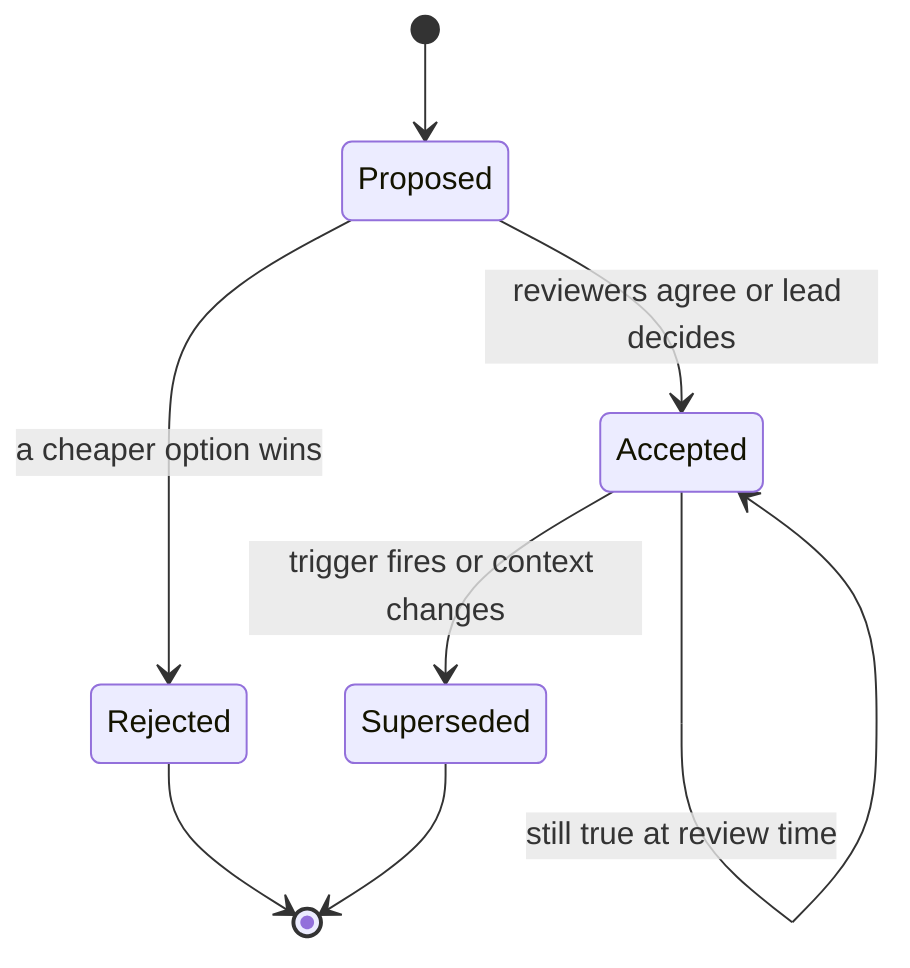

## 43.8 How seniors make decisions

Junior engineers make decisions in their heads. Senior engineers make decisions on paper, because a decision that exists only in someone's head cannot be reviewed, cannot be revisited, and evaporates the moment that person changes team.

The mechanism is not bureaucracy. It is a small set of lightweight artefacts, each with a specific job.

### 43.8.1 The Architecture Decision Record

#### Concept

An Architecture Decision Record (ADR) is a short document — one page, ten minutes to write — that captures one decision: the context, the options, the choice, and the consequences. It is written *at the time of the decision*, stored in the repository next to the code, and never edited afterwards except to mark it superseded.

The value is almost entirely in the future. Eighteen months from now, someone will look at a strange design choice and think "this is stupid, let me fix it". The ADR tells them whether it was stupid or whether it was the least bad option given three constraints that no longer show in the code. Both answers are useful; the second one prevents a disaster.

#### Mental model

Imagine buying a house. The photographs show the house as it is. The ADR is the note explaining why you chose the smaller garden: the school catchment area, the commute, the budget on that specific week. Five years later the photos still make no sense without the note.

#### Template

```markdown
# ADR-0017: <decision in a short sentence>

- **Status**: Proposed | Accepted | Superseded by ADR-00XX | Rejected
- **Date**: 2026-03-04
- **Deciders**: <names>
- **Reversibility**: two-way door | one-way door

## Context
What forces us to decide? Constraints, requirements, current numbers, deadlines.
Facts only. No solutions here.

## Options considered
1. Option A - one paragraph
2. Option B - one paragraph
3. Option C - one paragraph

## Trade-offs
| Criterion | Option A | Option B | Option C |
|---|---|---|---|

## Decision
We choose X, because ...

## Consequences
- Positive: ...
- Negative / what we accept: ...
- What we will monitor: ...
- What would make us revisit this: <a concrete trigger, with a number>
```

The two fields people skip are the two that matter most: **reversibility** (it tells the reader how much this decision was allowed to cost) and **the trigger to revisit** (it turns a permanent-feeling choice into one with an expiry condition).

#### ADR lifecycle



### 43.8.2 Worked ADR 1 — modular monolith instead of microservices

```markdown
# ADR-0004: Build v1 as a modular monolith, not microservices

- **Status**: Accepted
- **Date**: 2025-06-11
- **Deciders**: Backend team (4 engineers), Head of Product
- **Reversibility**: two-way door for the first 12 months; becomes harder once
  a module owns data another module writes to.

## Context
We are building an e-commerce backend for launch in 5 months. Expected launch
traffic: 40 RPS average, 200 RPS peak on campaign days, 3,000 orders/day.
Team: 4 backend engineers, none with production Kubernetes experience.
We have one on-call rotation, no dedicated platform engineer, no distributed
tracing yet. The product scope is still moving: two of the six domains
(promotions, returns) have unstable requirements.

## Options considered
1. **Microservices from day one.** Six services: catalogue, orders, payments,
   inventory, notifications, promotions. Separate databases, Kafka between them,
   six pipelines, six deployments.
2. **Modular monolith.** One NestJS deployable, one PostgreSQL database, one
   pipeline. Strict module boundaries: each module owns its tables, other modules
   call it only through its service interface, no cross-module joins in SQL.
   Domain events published through an in-process event bus with the same payload
   shape we would use on Kafka.
3. **Two services.** A single application plus a separate worker deployable for
   background jobs and consumers, sharing the database.

## Trade-offs
| Criterion | Microservices | Modular monolith | Two services |
|---|---|---|---|
| Time to launch | +8 to 10 weeks | Baseline | +1 week |
| Operational surface | 6 deployments, 6 DBs, broker | 1 deployment, 1 DB | 2 deployments, 1 DB |
| Debugging a request | Needs tracing we do not have | Single stack trace | Mostly single stack trace |
| Independent deploys | Yes | No | Partially |
| Boundary mistakes | Expensive to fix (network + data) | Cheap to fix (move a folder) | Cheap |
| Failure blast radius | Smaller, if done well | Whole app | Web survives worker crash |
| Cost at launch | ~$1,400/month | ~$380/month | ~$430/month |
| Team capability fit | Poor today | Good | Good |

## Decision
We build option 3: a modular monolith deployed as two processes (API and worker)
against one PostgreSQL database. Modules: catalogue, orders, payments, inventory,
notifications, promotions. Rules we enforce in review and with an import-boundary
lint rule:
- A module may only import another module's public `*.service.ts` interface.
- No SQL join across module table boundaries; cross-module reads go through the
  owning service.
- Every cross-module side effect is published as a domain event with the same
  payload we would publish to Kafka, so extraction later is a transport change.

## Consequences
- Positive: we launch on time with a team that can operate what it built. One
  stack trace per request. One database to back up, tune and migrate. Refactoring
  a wrong boundary is a folder move, not a data migration.
- Negative / accepted: all modules deploy together, so one bad release affects
  everything; we mitigate with feature flags and canary deploys. Nothing stops a
  determined engineer from writing a cross-module join except review and lint.
  Scaling is coarse: we scale the whole API even if only catalogue is hot.
- Monitor: p99 per module route group, deploy frequency, and the number of times
  a release is blocked because two teams need different release timing.
- Revisit when any of these is true: (a) more than 8 backend engineers across
  more than 2 teams working in this repository, (b) one module needs a resource
  profile the others do not, for example a memory-heavy search module, or
  (c) release coordination blocks a team more than twice a month.
```

That ADR is 500 words, took twenty minutes, and did three things: it stopped the recurring "should we do microservices" conversation, it gave the reviewers concrete rules to enforce, and it set the numeric trigger that would eventually justify a split. Fourteen months later, trigger (a) fired. The team split off two services, and the extraction took three weeks instead of three months because the module boundaries had been enforced the whole time.

### 43.8.3 Worked ADR 2 — keyset pagination for order history

```markdown
# ADR-0021: Use keyset pagination for customer order history

- **Status**: Accepted
- **Date**: 2026-01-22
- **Deciders**: Backend team, Mobile lead
- **Reversibility**: one-way door for the public API shape once the mobile app
  ships; two-way door internally.

## Context
`GET /customers/{id}/orders` uses `OFFSET`/`LIMIT`. The `orders` table has
1.4 billion rows overall; the top 1 percent of B2B customers have between
80,000 and 400,000 orders each. Measured p99 for page 1 is 12 ms; for page 500 it
is 310 ms, and support reports timeouts for two customers who script exports by
walking pages. Traffic is 60 RPS on this endpoint, rising. The mobile app ships
in 6 weeks and will use this endpoint for an infinite-scroll list.

We also have a correctness bug: with `ORDER BY created_at DESC OFFSET n`, new
orders inserted while a customer pages cause rows to shift, so items are
duplicated or skipped between pages.

## Options considered
1. **Keep OFFSET, cap max page.** Cap at page 100 and tell heavy users to use the
   export API. Zero engineering cost, breaks two existing customers.
2. **Keyset (cursor) pagination.** `WHERE (created_at, id) < ($1, $2) ORDER BY
   created_at DESC, id DESC LIMIT n`, opaque base64 cursor in the response.
   Requires a composite index and a client change.
3. **Materialised page cache in Redis.** Precompute page boundaries per customer.
   Adds a cache invalidation problem for every new order.

## Trade-offs
| Criterion | Capped OFFSET | Keyset | Redis page cache |
|---|---|---|---|
| p99 on deep pages | 310 ms and rising | ~1 ms, constant | ~1 ms, if warm |
| Stable under concurrent inserts | No | Yes | No |
| Random page access ("jump to page 400") | Yes | No | Yes |
| Total row count available | Yes, at a cost | Not cheaply | Yes |
| Client change required | No | Yes | No |
| New infrastructure | None | None | Redis keys, invalidation |
| Engineering cost | 1 day | 4 days including clients | 8 days plus ongoing bugs |

## Decision
Option 2, keyset pagination, with an explicit contract:
- Response envelope: `{ data: [...], nextCursor: string | null }`.
- Cursor is opaque base64 of `{ createdAt, id }`; clients must not parse it.
- Index: `CREATE INDEX CONCURRENTLY idx_orders_customer_created_id
  ON orders (customer_id, created_at DESC, id DESC);`
- The UI drops "jump to page N" for order history and uses infinite scroll plus
  date filters, which analytics show covers 98.6 percent of observed usage.
- Total counts are not returned; where a count is genuinely needed we return an
  approximate count from statistics, clearly labelled.
- The old `page`/`offset` parameters keep working for 2 releases, marked
  deprecated in the response headers, then are removed.

## Consequences
- Positive: deep pages become constant time; the duplicate/skip bug disappears;
  the index also serves the customer dashboard's "recent orders" query.
- Negative / accepted: no arbitrary page jumps; no exact total; the cursor is a
  contract we must keep stable, so changing the sort order later is a breaking
  change requiring a new cursor version field. We add `v` inside the cursor now
  so that future change is possible.
- Monitor: p99 of the endpoint by page depth, and the count of requests still
  using the deprecated `offset` parameter, which gates the removal.
- Revisit if product requires exact totals or arbitrary page access, or if the
  sort key must change.
```

Notice what the second ADR does that a code comment could not: it records that "jump to page 400" was consciously traded away with a usage number behind it, and it puts a version field inside the cursor because the author thought one step ahead about the next one-way door.

### 43.8.4 Design docs and RFCs

An ADR captures *one decision*. A design doc describes *one system* before it is built. Use a design doc when the work is bigger than a sprint, crosses teams, or touches money, auth or customer data.

A structure that works, in the order that gets read:

1. **Problem** — what is broken or missing, with numbers. If you cannot state the problem without naming a solution, you are not ready.
2. **Goals and non-goals** — the non-goals section prevents 80 percent of review scope creep.
3. **Constraints** — deadline, team size, existing systems, compliance.
4. **Proposed design** — diagrams, data model, API contract, failure behaviour.
5. **Alternatives considered** — with the reason each was rejected.
6. **Migration and rollout** — how we get from here to there, including rollback.
7. **Operational impact** — new alerts, dashboards, runbooks, on-call load, cost.
8. **Risks and open questions** — the honest list.

Two habits make design docs work. First, share the doc when it is 70 percent done, not when it is polished, because feedback on a finished document is expensive to act on and people can feel that. Second, timebox review: "comments by Thursday, I will decide Friday". Documents without a decision date collect comments forever.

An RFC is the same artefact with a wider audience and a formal comment period. Use it when the decision affects other teams: a shared library, an event schema everyone consumes, a change to the deployment platform.

### 43.8.5 Trade-off tables

The single most effective communication tool in engineering, and it takes five minutes. A trade-off table forces you to name the criteria before you compare, which is where honesty lives. If you invent the criteria after you have picked the winner, everyone can tell.

Rules that keep them honest:

- **Criteria first, options second.** Write the rows before you fill the columns.
- **Include the criteria that make your preferred option look bad.** Reviewers trust a table with a visible weakness far more than one where your favourite wins every row.
- **Use numbers where numbers exist**: milliseconds, dollars per month, person-weeks, RPS. "Good/bad" ratings are opinions in a grid.
- **No more than four options and eight criteria.** Beyond that, nobody reads it.

### 43.8.6 Spikes

A spike is a timeboxed experiment that answers one question. It is what you do instead of arguing, and instead of committing.

The discipline is in the framing: write the question and the timebox before you start. "Can PostgreSQL full-text search handle our catalogue query at acceptable latency, or do we need OpenSearch? Two days. Success means p95 under 80 ms on a copy of production data with our top 500 real queries."

Two rules. Spike code is throwaway; if you find yourself making it production quality, you are no longer spiking. And a spike must produce a written answer, even if the answer is "we could not determine this in two days, here is what we learned and what it would take". A spike that ends in a shrug in someone's head was two days spent for nothing.

### 43.8.7 Deciding under uncertainty

You will never have enough information. Here is the ladder I use, cheapest first:

1. **Can we not decide yet?** Deferring is free if the cost of delay is low and the decision is not blocking anything. Deliberate deferral is a decision, and you should say so out loud rather than letting it drift.
2. **Can we make it a two-way door?** Sometimes an interface, a feature flag or a strangler pattern converts a scary permanent decision into a reversible one. This is the highest-leverage move in the list.
3. **Can we buy information cheaply?** A spike, a load test, a query against production data, a conversation with the team that already did this.
4. **Can we hedge?** Ship the simple version behind an abstraction thin enough that swapping it later is a week, not a quarter. Be careful: abstractions built for imagined futures usually fit the actual future badly. Hedge only where the uncertainty is real and the abstraction is small.
5. **Decide and set a trigger.** Choose the option that is best under the most likely scenario, write down the number that would prove you wrong, and put a review date in the calendar.

What you must not do is stall. An unmade decision blocks people, and the cost is invisible so nobody bills you for it. In my experience, on genuinely close calls, the cost of choosing the slightly worse option is almost always smaller than the cost of three more weeks of deliberation.

### 43.8.8 Disagree and commit

Sometimes the team, or the person with the decision rights, chooses the option you argued against. What happens next is a defining senior behaviour.

Do this: state your disagreement once, clearly, in writing, with your reasoning and what you predict will go wrong. Ask that it be recorded in the ADR under "options considered". Then commit fully. Build the chosen option as well as you would have built your own. Do not litigate it in Slack for the next month, do not quietly build a shadow version, and do not say "I told you so" when a predicted problem appears; instead, point at the recorded prediction calmly and propose the fix.

The reason this matters is that teams move at the speed of their unresolved arguments. A team where every decision can be reopened by anyone at any time cannot ship. And the recorded prediction is what makes it safe: your position is preserved, so committing does not mean pretending you agreed.

I have been overruled on plenty of decisions and been proved right on some of them. The times it improved anything were the times the disagreement was written down calmly in advance, so that when the trigger fired we could change course in a day without anybody having to lose face.

## 43.9 How seniors review code

A senior code review is not a search for style violations. It is a risk audit. The reviewer is asking one question in seven different ways: *what will this do at 03:00 on the worst day of the quarter?*

### 43.9.1 What they actually look for

**Correctness under concurrency.** Any read-then-write, any counter, any uniqueness check in application code, any "check if exists then insert". I mentally run two copies of the code at once. This is the number one source of real bugs that pass review.

```ts
// Review comment: "Two concurrent requests can both pass this check.
// Use ON CONFLICT with the unique index on (user_id, product_id) instead."
const existing = await this.repo.findOne({ where: { userId, productId } });
if (existing) throw new ConflictException('already in wishlist');
await this.repo.insert({ userId, productId });
```

**Failure handling.** Every `await` on a network call is a place the code can stop. Does it have a timeout? What does the caller see when it throws? Is the error swallowed? Is a retry safe here, or will it duplicate a side effect? Is there a transaction open across this call?

**Data and migrations.** Does the migration lock a big table? Is it rollback-safe? Is the new query covered by an index? Does this add an unbounded query with no `LIMIT`? Does the entity now serialise a field it should not?

**Observability.** If this code path misbehaves in production, what would I see? Is there a log line with identifiers at the failure branch, a metric for the outcome, and a span if it is a remote call? Silent catch blocks are a blocking comment every time.

**Security.** Is the query scoped to the tenant or user? Is input validated at the boundary? Is anything interpolated into SQL or a shell command? Does the response include fields the caller should not see? Is the new endpoint covered by a guard, and did the author think about who may call it?

**Tests that would fail if the code were wrong.** This is subtler than coverage. A test that mocks the repository and asserts the mock was called proves the code calls the mock. Does any test assert the actual invariant: that stock never goes negative, that a duplicate request produces one charge, that a 500 from the provider leaves the order in a recoverable state? I look for at least one test per pull request that would genuinely catch a real regression.

### 43.9.2 How to give feedback that lands

Review comments are read by a person who has just spent two days on this code, often at the end of their day. Tone is not politeness theatre; it determines whether the fix happens well or resentfully.

What works:

- **Ask instead of assert when you might be wrong.** "What happens if two requests hit this at once?" invites thought. "This is a race condition" invites defensiveness, and is embarrassing when there is a unique constraint you did not see.
- **Explain the consequence, not just the rule.** "No timeout here means a slow provider will exhaust the connection pool and take down the product pages too" teaches. "Add a timeout" does not.
- **Give the fix when it is short.** A two-line suggestion saves a round trip.
- **Praise specifically and rarely.** "The idempotency key handling here is exactly right, including the in-flight case" is worth a hundred "LGTM"s.
- **Take the big stuff off the pull request.** If a comment would require redesigning the approach, that is a five-minute call, not a thread of eleven comments. Then summarise the outcome back on the PR so the record exists.
- **Review promptly.** A perfect review two days late is worse for the team than a good review in two hours.

What does not work: sarcasm, a wall of thirty comments with no priority, relitigating a decision that already has an ADR, and reviewing the person rather than the code.

### 43.9.3 Blocking versus preference

The most common failure in code review is ambiguity about how serious a comment is. Fix it with explicit labels, which cost nothing and change everything:

| Label | Meaning | Examples |
|---|---|---|
| **blocking** | I will not approve until this changes | Race condition, missing authorisation check, unbounded query, migration that locks a hot table, secret in code, swallowed error on a money path |
| **question** | I do not understand; the answer may resolve it | "Why is the transaction opened before the HTTP call?" |
| **suggestion** | I think this is better; author decides | Extract this into a method, use `Promise.all` here |
| **nit** | Cosmetic; never blocks | Naming, ordering, a comment typo |
| **praise** | This is good, and I want it repeated | Anything you want to see more of |

Rules of thumb: if you have more than three blocking comments, the design was wrong and you should have a conversation instead. If you have zero blocking comments and eleven nits, you probably should have approved with comments. And never block on something you cannot explain the consequence of.

### 43.9.4 A review checklist

- [ ] Do I understand what problem this solves? If not, ask before reviewing lines.
- [ ] Concurrency: is any read-then-write, uniqueness check or counter safe with 50 parallel callers?
- [ ] Transactions: are boundaries explicit, short, and free of network calls?
- [ ] Failure: does every remote call have a timeout, and is the error path sensible?
- [ ] Retries: is every side effect idempotent, or explicitly documented as not retryable?
- [ ] Queries: is each new query served by an index, bounded by a `LIMIT`, and free of `OFFSET` on large tables?
- [ ] Migrations: additive, rollback-safe, no long locks, backfill separated?
- [ ] Authorisation: is the query scoped to the actor? Would a different tenant's id return data?
- [ ] Input: validated at the boundary, sizes capped, nothing interpolated into SQL?
- [ ] Output: DTO not entity, no sensitive fields, errors do not leak internals?
- [ ] Observability: identifiers in logs, a metric for the outcome, no silent catch?
- [ ] Tests: is there at least one test that fails if the core behaviour breaks?
- [ ] Config: no hardcoded URLs, timeouts or secrets; new settings documented?
- [ ] Deletion: did this leave dead code, an unused index or a stale flag behind?
- [ ] Blast radius: if this throws in production, what breaks and how loudly?

#### Practical exercise

Take your last five approved pull requests from your team's repository and re-review them against the checklist above. Count how many issues you find that were missed. Then pick the single most common category and make it a shared checklist item for the team. Acceptance criteria: a written list of findings, and one process change agreed with the team.
