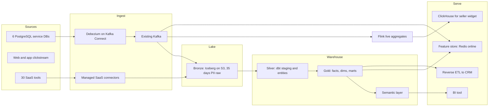
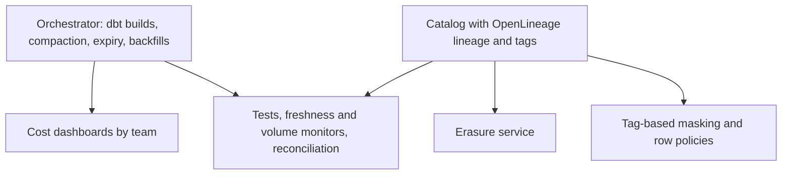
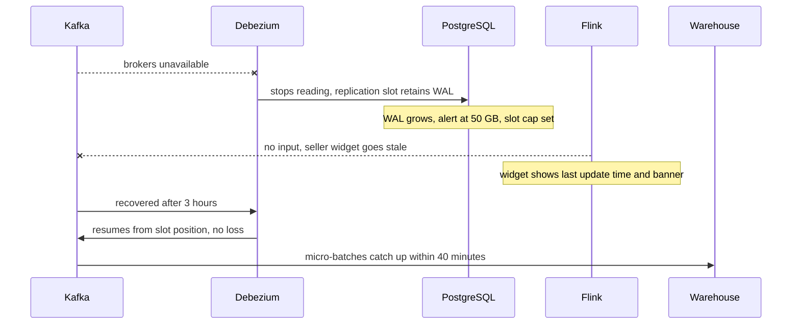

## 43.16 Worked architecture: the data platform for a mid-size e-commerce company

> **Try it first** · Level: Advanced · About 60 minutes
>
> **Build:** the target data platform for the e-commerce company used throughout this Part.
>
> **Requirements:**
> - Finance closes the month on working day three with revenue reconciled to the payment provider.
> - Product and marketing dashboards fresh within an hour; a live seller sales widget in the product, under a minute old, p95 under 300 ms.
> - Fraud model at checkout with features under 20 ms; recommendations retrained weekly.
> - Customers in India and the EU; EU personal data must stay in the EU.
> - Erasure completed within 14 days across every copy; access to personal data audited.
>
> **Scale and constraints:** 6 PostgreSQL service databases, 30 SaaS sources, about 200 million clickstream events a day, 70,000 orders a day, about 120 data users, a platform team of eight, an existing Kafka cluster, AWS as the main cloud, and a finance-imposed budget of about $40,000 a month.
>
> **Your task:** draw the architecture layer by layer, name the main choices and their reasons, give the data SLOs for the tier 1 datasets, and name the three biggest risks.
>
> Spend the time on paper before you read on. The model design follows.

### 43.16.1 The architecture

The control plane runs across it all:

### 43.16.2 The main decisions

| Decision | Choice | Reason | Revisit when |
|---|---|---|---|
| Storage model | Both (43.3): Iceberg for bronze and clickstream history; warehouse for silver and gold | ML on raw history, SQL users on curated; warehouse reads Iceberg directly so raw is one copy | Data science shrinks, or warehouse scan costs on raw exceed a small engine cluster |
| CDC | Debezium on the existing Kafka | Already run for search; reuse | Kafka team cannot support it |
| SaaS ingestion | Bought connectors | Undifferentiated, maintenance-heavy (43.14) | Row-based pricing passes the cost of a self-hosted alternative plus an engineer |
| Transformation | dbt, one project per domain sharing packages | SQL skills; lineage and tests built in | Never for SQL; Spark only for ML feature backfills |
| Batch versus stream | Batch and 30-minute micro-batch; one Flink job for the seller widget; streaming fraud features | Streaming only where minutes matter (43.6) | A new use with a real seconds requirement |
| Product serving | ClickHouse fed by Flink for the widget | Warehouse is not built for 200 concurrent sub-second queries | Widget traffic drops or merges with BI |
| Metrics | Semantic layer for tier 1 metrics, owned by finance and product analytics | One definition of revenue, GMV, conversion | Not optional for tier 1 |
| Ownership | Hybrid (43.8): platform team owns tools and core marts; orders and marketing own their data products | Two domains already have analytics engineers | Other domains build skills |
| Residency | EU account for EU personal data with its own bronze and silver; only aggregates and pseudonymised facts approved by legal flow to the global gold layer | EU obligation (43.13) | Legal advice changes |
| Erasure | Erasure service using catalog tags; crypto-shredding for bronze PII columns | 14-day promise across every copy | Never relaxed |

### 43.16.3 Data SLOs for tier 1 datasets

| Dataset | Owner | Freshness | Accuracy or completeness | Consumers |
|---|---|---|---|---|
| `gold.fct_orders` | Orders | Yesterday complete by 06:00 IST, 99% of days; intraday within 45 minutes | Daily paid count within 0.1% of source | Finance, marketing, ML |
| `gold.daily_revenue` | Finance data | By 07:00 IST, 99.5% of days | Net revenue within 0.05% of settlement report | Finance close, executive dashboard |
| `serve.seller_sales_live` | Marketplace | Under 60 seconds behind, 99% of minutes | Reconciled to daily figures next morning; labelled unaudited | Sellers in the product |
| `features.checkout_fraud` | Risk | Stream features under 30 seconds; batch features daily | Training-serving skew check weekly | Fraud model |

### 43.16.4 Cost and team

The budget in 43.11's example (about $37,000 a month before tuning) fits the $40,000 ceiling with little room, so cost controls are part of the design from day one: per-workload compute with auto-suspend, per-user byte caps for ad hoc queries, partition filters required on clickstream, quarterly gold-table usage review, and cost per team published monthly. The eight-person team splits into ingestion and storage (two), transformation framework and semantic layer (two), governance and quality (two) and serving and ML platform (two), with a shared on-call rotation for the platform and domain on-call for data products.

### 43.16.5 The three biggest risks

1. **Personal data in bronze.** Raw CDC copies every column. Mitigation: column-level selection in the Debezium publication (only needed columns), crypto-shredding of `pii.direct` columns at ingestion, 35-day raw retention with snapshot expiry, and the erasure service.
2. **Metric divergence during migration.** Old and new revenue figures disagree for months. Mitigation: parallel run through a quarter-end (43.15), semantic layer definitions signed by finance, and a single "official" label on dashboards.
3. **Catalog and orchestrator as single points of failure.** Mitigation: both run as tier 1 services with backups, health checks and runbooks; the warehouse's own scheduler can run the finance build if the orchestrator is down.

### 43.16.6 Failure drill: the Kafka cluster is down for three hours

What the design gets right: the replication slot holds changes so nothing is lost (with a WAL size cap so the primary is protected, as in Part 42.7); the seller widget degrades visibly instead of showing zero; the finance build for the next morning is unaffected because it runs at 04:00 on data that has caught up; freshness monitors page the platform on-call, and the catalog marks the intraday datasets stale.

## 43.17 Exercises with worked answers

#### Practical exercise

**Exercise 1.** A 40-engineer startup with one analyst asks you to "set up a modern data stack": a warehouse, Fivetran, dbt, Airflow, a catalog and a semantic layer. They have one PostgreSQL database with 30 GB of data and five dashboards. What do you recommend?

**Exercise 2.** Your warehouse bill doubled in two months. Storage is flat. List the investigation in order and the three most likely causes.

**Exercise 3.** Marketing and finance report GMV that differs by 4%. Both are built from `gold.fct_orders`. How do you find the cause and stop it recurring?

**Exercise 4.** An enterprise customer requires that their users' data be deletable within 7 days, including analytics. Your raw layer is immutable Parquet kept for two years. Propose a design.

#### Worked answer to the exercise

**Exercise 1.** Recommend the smallest platform that serves the five dashboards and one analyst: a read replica or a small separate PostgreSQL for reporting, summary tables built by scheduled SQL (as in Part 42.0.5) or by dbt Core run from CI on a schedule, and the BI tool pointed at the reporting database. No orchestrator beyond the scheduler, no catalog beyond dbt docs, no semantic layer yet. Write down the triggers for the next step: analytics data passing about 100 GB, a second analyst or second team building on the data, SaaS sources that matter, or replica lag during reports. Then the warehouse plus bought connectors is the next step, and dbt models move over unchanged.

**Exercise 2.** First, break the bill down by compute workload (warehouse, cluster or job tag) and by user or service; find which grew. Second, list the top 20 queries by cost this month versus two months ago. Third, check ingestion: connector row counts by source. The usual causes: a new dashboard or notebook scanning large unpartitioned tables on a frequent refresh; an idle-suspend setting removed or a warehouse upsized during an incident and never reverted; a source whose rows are all touched daily (an `updated_at` bump) multiplying connector rows. Fix the cause, then add the guard: caps, resource monitors, partition filters, cost per team.

**Exercise 3.** Compare the two definitions, not the outputs: the SQL behind each dashboard. Typical differences are the event that counts (placed versus paid), refunds and cancellations, currency conversion date, time zone of the business day, test or internal orders, and fan-out joins that double count order totals. Decide the official definition with the metric owner, put it in the semantic layer, migrate both dashboards to it, and add a test that compares the semantic-layer figure with an independent reconciliation. If marketing needs a different measure, give it a different name ("orders placed value").

**Exercise 4.** Stop keeping raw personal data for two years. Either: keep raw with personal data for a short window (say 30 days) and keep long-term history only in a pseudonymised form whose mapping table can be deleted; or encrypt personal columns at ingestion with a per-customer key and erase by deleting the key (crypto-shredding), which makes every old Parquet file and snapshot unreadable for that person without rewriting it. Move raw to a table format that supports row-level deletes for the short window, expire snapshots after deletion, and track each request in the erasure service with per-store evidence. Seven days is then achievable because no step depends on rewriting two years of files.

## 43.18 Interview questions

1. **Design a data platform for a company of 150 engineers. Where do you start?** Expected answer: from the consumers and decisions (finance close, product dashboards, ML), the tier 1 datasets and their SLOs, the constraints (team size, residency, budget), then layers, and only then tools. Why it matters: tool-first designs are the most common failure. Follow-ups: which layer would you skip and why; what would you buy.
2. **Warehouse, lakehouse or both?** Expected answer: depends on users, volume and team; both with an open-format raw layer is common at mid-size; the warehouse-reading-open-tables trend reduces the copy cost. Follow-up: what would change your answer.
3. **What problem does an open table format solve, and what does it cost you?** Atomic commits, snapshots, row-level changes, schema evolution, engine independence; costs are compaction, snapshot expiry and a tier 1 catalog.
4. **Critique the medallion architecture.** It names layers but not ownership, contracts or quality; silver is ambiguous; layers cost copies and latency; gold sprawls without ownership; it centralises by default.
5. **When do you introduce a semantic layer?** When tier 1 metrics have several consumers and visible disagreement; give metrics business owners and treat changes like API changes.
6. **Data mesh: would you adopt it?** Depends on size, domain skills and platform maturity; usually a hybrid, moving ownership domain by domain once the self-serve platform exists. Follow-up: how is governance enforced without a central gate.
7. **How do you run data quality like reliability engineering?** Tests at build and publish, data SLOs, monitors for anomalies, ownership and routing, incident response with containment and consumer communication, postmortems.
8. **How do you reconcile an immutable raw layer with the right to erasure?** Short raw retention for personal data, pseudonymised long-term history, crypto-shredding, row-level deletes plus snapshot expiry, an erasure service driven by catalog tags.
9. **The bill doubled. Walk me through it.** Workload breakdown, top queries, ingestion rows, idle compute; then guards: caps, monitors, partitioning, showback.
10. **How would you migrate from 140 cron scripts?** Inventory by usage, skeleton first, CDC to relieve the replica, tier 1 rebuilt with parallel runs through month-end, consumers moved domain by domain, scream test before deletion.

## Senior Checklist — Part 43

- [ ] I understand the concept
- [ ] I can explain it simply
- [ ] I can implement it
- [ ] I understand its failure modes
- [ ] I understand its scaling limitations
- [ ] I understand its security implications
- [ ] I understand its operational implications
- [ ] I can choose between alternatives
- [ ] I can explain the tradeoffs
- [ ] I can answer senior-level interview questions
- [ ] I can draw the reference architecture and justify every layer I keep or skip
- [ ] I can choose warehouse, lakehouse or both from users, volume and team size
- [ ] I can explain what an open table format adds and the operations it brings
- [ ] I use layers as a contract about what is safe to depend on, not as colours
- [ ] I build streaming only where freshness changes a decision, and never compute one metric twice
- [ ] I know when a semantic layer and when data mesh are worth their cost
- [ ] I can design governance as code: catalog, lineage, tags, policies, retention, erasure
- [ ] I can define data SLOs and run a data incident with containment first
- [ ] I can find and cap the main cost drivers of an analytics platform
- [ ] I can plan a migration from cron scripts with parallel runs through month-end

## Part 43 — Key Takeaways

- Start a data platform from consumers, decisions and tier 1 datasets; tools come last.
- The reference architecture is a menu: keep the layers a named consumer needs and write down why the others wait.
- Keep raw data in an open table format when it is cheap to do so; it separates storage choices from compute choices.
- Table formats bring atomic commits and erasure support, and also compaction, snapshot expiry and a tier 1 catalog.
- Medallion layers are useful only with owners, contracts and SLOs attached; colours alone fix nothing.
- Batch first, stream where minutes matter, and never implement one business metric on two paths.
- A semantic layer gives each tier 1 metric one definition and one owner.
- Data mesh needs a self-serve platform first; ownership without a platform is fragmentation.
- Governance that works is code: tag-driven access, automated lineage, enforced retention and an erasure service.
- Treat data quality like reliability: SLOs, monitors, on-call, containment, postmortems.
- In analytics the bill follows behaviour; make cost visible per team and cap the expensive paths by default.
- Migrate by usage with parallel runs through the hardest days of the business calendar, and plan decommissioning from day one.
