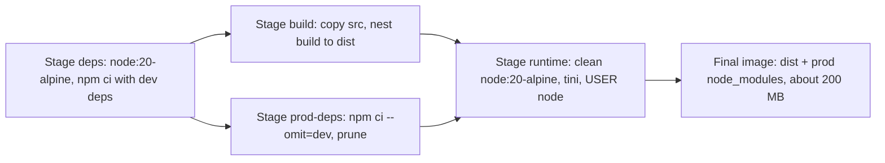

## 44.4 The container as a process: PID 1, signals, exit codes and restart policies

#### Concept

A running container is one process tree with a special first process. That first process is PID 1 inside the PID namespace, and Linux treats PID 1 differently from every other process: the kernel does not install default signal handlers for it, and it is responsible for adopting and reaping orphaned child processes. If your Node process is PID 1 and does not explicitly handle `SIGTERM`, the signal is silently ignored. The orchestrator waits its grace period, gives up, and sends `SIGKILL`. Your in-flight requests die with it.

Exit codes are the other half of the contract. When the process ends, the runtime records the code: `0` for success, `1` for an uncaught exception in Node, `137` for killed by `SIGKILL` (128 + 9), `143` for terminated by `SIGTERM` (128 + 15). Restart policies decide what the runtime does next.

#### Why does it exist?

Orchestrators need a reliable, universal way to tell a container "stop soon, cleanly" and to learn whether it stopped cleanly. Signals are that mechanism; they predate containers by decades and every runtime uses the same two: `SIGTERM` to request shutdown, `SIGKILL` to force it. A service that honours `SIGTERM` can finish the current requests, close database connections and let the load balancer drain it. A service that ignores it loses work on every deploy, every scale-down, every node drain.

#### Mental model

Imagine a restaurant kitchen. The head chef (PID 1) is told "we close in 10 minutes". A good head chef stops taking new orders, finishes the dishes in progress, and tells the staff to clean up. A chef who does not hear the announcement keeps cooking until the manager cuts the power (SIGKILL): half-cooked dishes, dirty pans, angry customers. And someone must sign off the staff as they leave (reaping child processes); otherwise the staff list fills with people who have already gone home (zombies).

#### How it works

1. `docker stop orders-api` (or a Kubernetes pod deletion) sends `SIGTERM` to PID 1 of the container. Only PID 1. Child processes get nothing unless PID 1 forwards it.
2. The runtime waits a grace period: Docker's default is 10 seconds (`docker stop -t 30` to change); Kubernetes uses `terminationGracePeriodSeconds`, default 30.
3. If PID 1 has exited, the container is stopped with PID 1's exit code. If not, the runtime sends `SIGKILL`, which cannot be caught, and records exit code 137.
4. Zombie reaping: when a child of PID 1 exits, it stays as a zombie entry until PID 1 calls `wait()`. Node does not reap children it did not spawn. In a long-running container that spawns processes (for example `child_process.exec` for image conversion, or Puppeteer), zombies accumulate until the PID cgroup limit or the kernel's PID table is exhausted.

The three ways your Node process ends up not receiving `SIGTERM`:

- **Shell form `CMD`.** `CMD node dist/main.js` is executed as `/bin/sh -c "node dist/main.js"`. The shell is PID 1; `node` is its child. Most shells (`dash` on Debian, `ash`/busybox on Alpine) do not forward signals to children, so `SIGTERM` reaches the shell and stops there.
- **`npm start`.** `CMD ["npm", "start"]` makes npm PID 1. npm spawns a shell, which spawns node. Signal forwarding through this chain is unreliable across npm versions, and npm adds 30 to 80 MB of memory and a slower start. Never use a package manager as your entrypoint in production.
- **Node as PID 1 without handlers.** Even with the exec form `CMD ["node", "dist/main.js"]`, node is PID 1 and gets no default handler. Without `process.on('SIGTERM', ...)` (which NestJS installs when you call `app.enableShutdownHooks()`), the signal is ignored.

The fix that senior teams standardise on is a tiny init process plus the exec form:

```dockerfile
# Alpine: tini is a 25 KB init that becomes PID 1, forwards signals to its
# child, and reaps zombies.
RUN apk add --no-cache tini
ENTRYPOINT ["/sbin/tini", "--"]
CMD ["node", "dist/main.js"]
```

Or at run time with `docker run --init`, which injects Docker's bundled `tini`. In Kubernetes there is no `--init` flag; bake `tini` into the image or make sure your process is a correct PID 1. With `tini`, node is PID 2, gets normal kernel signal defaults, and `SIGTERM` terminates it even if you forgot a handler; with a handler, NestJS runs its shutdown hooks.

Restart policies decide what happens after exit:

| Policy | Restarts on exit 0? | Restarts on non-zero? | Survives daemon restart? | Use for |
|---|---|---|---|---|
| `no` (default) | No | No | No | One-shot jobs, migrations |
| `on-failure[:N]` | No | Yes, up to N times | No | Batch workers that should retry crashes |
| `always` | Yes | Yes | Yes | Long-running services on a single host |
| `unless-stopped` | Yes | Yes | Yes, unless you stopped it manually | Local dev dependencies (PostgreSQL, Redis) |

Docker applies exponential backoff between restarts (100 ms doubling to a cap). In Kubernetes the equivalent is `restartPolicy` at pod level plus the `CrashLoopBackOff` state (see Part 45).

#### Practical example

The orders API handles `POST /orders` in about 120 ms: insert the order, publish an `order.created` event, return `201`. During a rolling deploy, each old container receives `SIGTERM`. With correct handling, NestJS stops accepting new connections, waits up to a few seconds for the 15 to 30 requests in flight, closes the PostgreSQL pool and the Kafka producer, and exits `0`. The load balancer had already stopped sending new traffic. Zero failed requests. Without handling, the container is killed after 10 seconds with 20 requests mid-transaction: PostgreSQL rolls those transactions back, the clients receive connection resets, and some retry, creating duplicate orders if the API is not idempotent.

#### NestJS example

NestJS gives you lifecycle hooks that run on `SIGTERM` when shutdown hooks are enabled. The important detail is *order*: stop taking new work, finish current work, then close resources.

```ts
// src/shutdown/graceful-shutdown.service.ts
import {
  Injectable,
  Logger,
  OnApplicationShutdown,
  BeforeApplicationShutdown,
} from '@nestjs/common';
import { DataSource } from 'typeorm';
import { Queue } from 'bullmq';

@Injectable()
export class GracefulShutdownService
  implements BeforeApplicationShutdown, OnApplicationShutdown
{
  private readonly logger = new Logger(GracefulShutdownService.name);

  constructor(
    private readonly dataSource: DataSource,
    private readonly notificationsQueue: Queue,
  ) {}

  // Runs after the HTTP server stops accepting connections but before
  // providers are destroyed. In-flight handlers are still completing.
  async beforeApplicationShutdown(signal?: string): Promise<void> {
    this.logger.log(`Received ${signal}; draining in-flight work`);
    // Give the load balancer time to notice we are unready (see Part 45
    // for the preStop and readiness interplay).
    await new Promise((resolve) => setTimeout(resolve, 2_000));
  }

  // Runs last. Close outbound resources so no query or job is left hanging.
  async onApplicationShutdown(signal?: string): Promise<void> {
    await this.notificationsQueue.close();
    if (this.dataSource.isInitialized) {
      await this.dataSource.destroy(); // returns pooled connections cleanly
    }
    this.logger.log(`Shutdown complete after ${signal}`);
  }
}
```

The `app.enableShutdownHooks()` call in `main.ts` (shown in 44.1) is what registers the signal listeners. Without it, none of these hooks run on `SIGTERM`.

#### PostgreSQL example

What PostgreSQL sees when your container is killed matters. A `SIGKILL`ed Node process leaves TCP connections that PostgreSQL only notices when the kernel closes the sockets (immediate for a killed process on the same host; up to `tcp_keepalives_idle` seconds across a network if the container's network namespace vanished first). Each open transaction is rolled back, but until the backend notices, it holds locks and a connection slot:

```sql
-- Sessions that belong to a dead client but have not been cleaned up yet
SELECT pid, state, xact_start, now() - state_change AS idle_for, query
FROM pg_stat_activity
WHERE state = 'idle in transaction'
  AND now() - state_change > interval '30 seconds';

-- Safety net: kill transactions idle longer than 60 s, per application role
ALTER ROLE orders_api SET idle_in_transaction_session_timeout = '60s';
```

A graceful shutdown that calls `dataSource.destroy()` sends a clean `Terminate` message on each pooled connection, so PostgreSQL frees the slots immediately instead of waiting for TCP keepalives.

#### TypeORM example

TypeORM's `DataSource.destroy()` waits for the pool to release connections. If a query is still running, the pool waits for it; combine with a `statement_timeout` on the role so that a runaway query cannot block shutdown past the grace period:

```ts
// src/database/data-source.ts
import { DataSource } from 'typeorm';

export const AppDataSource = new DataSource({
  type: 'postgres',
  url: process.env.DATABASE_URL,
  entities: [__dirname + '/../**/*.entity.js'],
  migrations: [__dirname + '/../migrations/*.js'],
  extra: {
    max: Number(process.env.DB_POOL_MAX ?? 10),
    // Fail fast instead of hanging shutdown on a dead database
    connectionTimeoutMillis: 5_000,
    statement_timeout: 10_000,
  },
});
```

#### Sequelize example

Sequelize exposes `sequelize.close()`, which drains the pool. Register it in the same `OnApplicationShutdown` hook:

```ts
// In a provider with access to the Sequelize instance
import { InjectConnection } from '@nestjs/sequelize';
import { Sequelize } from 'sequelize-typescript';

constructor(@InjectConnection() private readonly sequelize: Sequelize) {}

async onApplicationShutdown(): Promise<void> {
  await this.sequelize.close(); // waits for checked-out connections to return
}
```

#### Production scenario

A ride-booking API deploys 30 times a day across 12 replicas. Each deploy stops 12 containers. At 800 RPS, roughly 100 requests are in flight at any instant per replica set. With correct `SIGTERM` handling and a 2-second drain, the deploy's error contribution is zero. Before the fix, each deploy produced 400 to 900 `502`/`ECONNRESET` errors, which showed up as a daily saw-tooth in the error-rate dashboard that everyone had learned to ignore.

#### Failure scenario

At 11:40 a scale-down event removes 6 of 18 `payments-worker` containers. The Dockerfile used `CMD npm run start:prod`. npm was PID 1, ignored `SIGTERM`, and after 10 seconds all 6 were `SIGKILL`ed. Each worker was mid-way through a batch of 50 payment captures against a PSP. The captures had been sent but the acknowledgements were never processed; the jobs were retried by BullMQ and 214 customers were charged twice. The post-mortem fix was three lines: `tini`, exec-form `CMD ["node", "dist/worker.js"]`, and idempotency keys on the capture call (see Part 31 — Reliability Engineering).

#### Edge cases & failure modes

- **`SIGTERM` arrives before the app is ready.** A rollback during startup can send `SIGTERM` while NestJS is still initialising modules; make sure hooks tolerate uninitialised resources (`if (dataSource.isInitialized)`).
- **Grace period shorter than drain.** If shutdown takes 15 s and the grace period is 10 s, you are killed anyway. Align `terminationGracePeriodSeconds` with your real drain time plus margin.
- **Child processes.** `child_process.spawn` for ImageMagick or headless Chrome creates children that need signal forwarding and reaping; `tini -g` forwards to the whole process group.
- **`SIGINT` in local dev, `SIGTERM` in production.** Handle both; `enableShutdownHooks()` covers both by default.
- **Uncaught exceptions during shutdown.** A throw inside a shutdown hook aborts the rest; wrap each resource close in its own try/catch and log.
- **Restart loops on config errors.** With `restart: always`, a container that exits immediately because `DATABASE_URL` is missing restarts forever; alert on restart count, not just on "is it running".

#### How a Senior Backend Engineer thinks about this

They insist that every service passes a "kill test" before it is allowed in production: send `SIGTERM` under load, count failed requests, verify the exit code is `0` and that `pg_stat_activity` shows no leftover sessions. They standardise `tini` plus exec-form `CMD` in the base image so that no team can get it wrong. And they know the mantra: *can it timeout? can it fail? can it partially succeed?* A shutdown is a partial failure by design; the code must make it clean.

#### Common mistakes

- `CMD npm start` or `CMD npm run start:prod`.
- Shell-form `CMD node dist/main.js`.
- Forgetting `app.enableShutdownHooks()`.
- Closing the database pool *before* the HTTP server has stopped accepting requests, so the last requests fail with "pool is closed".
- Treating exit code 137 as "the app crashed" and looking for a bug in the code instead of an OOM or a missed `SIGTERM`.

#### Interview questions

1. *Why does a Node process running as PID 1 ignore `SIGTERM`, and what are two fixes?* Expected: kernel installs no default handlers for PID 1; fix with `tini`/`--init` or explicit handlers; use exec-form `CMD`.
2. *What is the difference between `CMD node main.js` and `CMD ["node","main.js"]`?* Expected: shell form wraps in `sh -c`, shell becomes PID 1 and does not forward signals; exec form runs node directly.
3. *Describe a correct shutdown sequence for a NestJS API with PostgreSQL and a Kafka producer.* Expected: stop accepting, drain in-flight with a bound, flush producer, close pool, exit 0, all within the grace period.
4. *What do exit codes 0, 1, 137 and 143 tell you?* Expected: clean, uncaught error, SIGKILL (OOM or forced), SIGTERM without handler.
5. *When would you use `restart: on-failure` versus `always`?* Expected: batch/worker retries versus long-running service; note the infinite loop risk on config errors.

#### Practical exercise

Build the orders API with `CMD ["npm", "start"]` and run it with `docker run`. Fire 200 requests per second with `autocannon` for 30 seconds, and at second 10 run `docker stop`. Count non-2xx responses and note the exit code and the time until the container stopped. Repeat with `tini`, exec-form `CMD`, and `enableShutdownHooks()`. Acceptance criteria: the fixed version stops in under 5 seconds with exit code 0, zero failed requests during the drain, and `pg_stat_activity` shows no sessions from the stopped container within 2 seconds.

## 44.5 Dockerfile best practices

#### Concept

A Dockerfile is a build script that produces an image. Best practices are the set of rules that keep the resulting image small, cacheable, reproducible, secure and operable. Most of them are one line each; all of them exist because someone lost a night to their absence.

#### Why does it exist?

A Dockerfile that "works" is easy. A Dockerfile that builds in 40 seconds, produces a 200 MB image, runs as a non-root user, restarts cleanly, does not leak secrets and does not break when Docker Hub republishes a tag takes deliberate choices. The practices below encode those choices so that every service in the organisation starts from the same safe baseline.

#### Mental model

Imagine a packing list for a shipping container going to a remote site: bring only what is needed, label everything, do not pack the keys to the warehouse inside, put fragile things where they will not be crushed, and write on the outside how to open it. A Dockerfile is that packing list; the practices are the rules experienced shippers follow.

#### How it works

Each practice, what it does and why:

| Practice | Instruction | Why |
|---|---|---|
| Pin the base image | `FROM node:20.18.1-alpine3.20@sha256:...` | Reproducible builds; no surprise musl or OpenSSL changes |
| Set the working directory | `WORKDIR /app` | Absolute paths in later instructions; created if missing |
| Production mode | `ENV NODE_ENV=production` | Express/NestJS disable dev behaviours; `npm ci` skips dev deps when set |
| Non-root user | `USER node` | The `node` images ship uid 1000 `node`; a compromise does not get root |
| Copy with ownership | `COPY --chown=node:node dist ./dist` | Files owned by the runtime user; no `RUN chown -R` layer doubling size |
| Exec-form entrypoint | `ENTRYPOINT ["/sbin/tini","--"]` and `CMD ["node","dist/main.js"]` | Signals reach node; see 44.4 |
| Labels | `LABEL org.opencontainers.image.revision=$GIT_SHA` | Traceability from a running container back to a commit |
| Health check | `HEALTHCHECK CMD node healthcheck.js` | Compose can wait for readiness; note the Kubernetes caveat below |
| Expose (documentation) | `EXPOSE 3000` | Documents the port; does not publish it |
| One process per container | Single `CMD` | Restart, scale and monitor one thing |

The `HEALTHCHECK` caveat: Kubernetes ignores Dockerfile `HEALTHCHECK` entirely. The kubelet uses its own liveness, readiness and startup probes defined in the pod spec. A `HEALTHCHECK` in the image is useful for Docker Compose (`depends_on: condition: service_healthy`) and for standalone Docker, but it also runs every 30 seconds by default even where nobody reads it, so keep it cheap. On Kubernetes, some teams remove it from the image to avoid the wasted work.

Labels follow the OCI annotation spec so that tooling recognises them:

```dockerfile
ARG GIT_SHA=unknown
ARG VERSION=0.0.0
LABEL org.opencontainers.image.title="orders-api" \
      org.opencontainers.image.version="${VERSION}" \
      org.opencontainers.image.revision="${GIT_SHA}" \
      org.opencontainers.image.source="https://github.com/acme/orders-api"
```

Put the `ARG` and `LABEL` lines at the *end* of the Dockerfile. A `GIT_SHA` that changes on every commit would otherwise invalidate every layer after it.

#### Practical example

A production-quality single-stage Dockerfile (the multi-stage version in 44.6 is what you should actually ship; this one shows the practices in isolation):

```dockerfile
FROM node:20.18.1-alpine3.20@sha256:2d07db07a2df6830718ae2a47db6fedce6745f5bcd174c398f2acdda90a11c03

# tini for PID 1, tzdata so TZ works, no cache to keep the layer small
RUN apk add --no-cache tini tzdata

ENV NODE_ENV=production \
    TZ=UTC \
    PORT=3000

WORKDIR /app

COPY --chown=node:node package.json package-lock.json ./
RUN npm ci --omit=dev && npm cache clean --force

COPY --chown=node:node dist ./dist

USER node
EXPOSE 3000

HEALTHCHECK --interval=30s --timeout=3s --start-period=20s --retries=3 \
  CMD node -e "fetch('http://127.0.0.1:3000/health/live').then(r=>process.exit(r.ok?0:1)).catch(()=>process.exit(1))"

ENTRYPOINT ["/sbin/tini", "--"]
CMD ["node", "dist/main.js"]
```

#### NestJS example

The health endpoint that the `HEALTHCHECK` (and later the Kubernetes probes) call should be cheap and must not depend on the database for liveness. `@nestjs/terminus` gives you the pieces:

```ts
// src/health/health.controller.ts
import { Controller, Get } from '@nestjs/common';
import {
  HealthCheck,
  HealthCheckService,
  TypeOrmHealthIndicator,
  MemoryHealthIndicator,
} from '@nestjs/terminus';

@Controller('health')
export class HealthController {
  constructor(
    private readonly health: HealthCheckService,
    private readonly db: TypeOrmHealthIndicator,
    private readonly memory: MemoryHealthIndicator,
  ) {}

  // Liveness: is the process alive and not wedged? No external calls.
  @Get('live')
  @HealthCheck()
  live() {
    return this.health.check([
      () => this.memory.checkHeap('heap', 400 * 1024 * 1024), // 400 MB
    ]);
  }

  // Readiness: can we serve traffic? Check the database with a short timeout.
  @Get('ready')
  @HealthCheck()
  ready() {
    return this.health.check([
      () => this.db.pingCheck('postgres', { timeout: 300 }),
    ]);
  }
}
```

#### Production scenario

A platform team publishes a Dockerfile template and a linter (`hadolint`) in CI that fails on `FROM` without a tag, `USER` missing, `apt-get install` without `--no-install-recommends`, or shell-form `CMD`. Across 60 services this removed an entire class of incidents: no more root containers, no more missed `SIGTERM`, no more 1 GB images. The template is versioned; when `tini` had a CVE fix, one PR to the template and 60 rebuilds later, done.

#### Failure scenario

An engineer adds `RUN chown -R node:node /app` after copying 300 MB of `node_modules` as root. OverlayFS cannot change ownership in place; it copies every file into a new layer. The image doubles to 700 MB, pulls slow down, and node disk fills faster. The fix is `COPY --chown`, which sets ownership at copy time with no extra layer.

#### Edge cases & failure modes

- **`USER node` before `npm ci`.** The `node` user cannot write to `/app` unless `WORKDIR` was created with the right owner; run installs as root, then switch, or `chown` the directory first.
- **`ENV NODE_ENV=production` before `npm ci` in a build stage.** Dev dependencies (TypeScript, Nest CLI) are skipped and the build fails. Set it only in the runtime stage.
- **Alpine `tzdata`.** Without it, `TZ=Asia/Kolkata` is silently ignored and dates render in UTC. Install `tzdata` or use UTC everywhere and convert at the edge (the better choice).
- **`HEALTHCHECK` on distroless.** No shell, no `curl`; only a `node -e` or a compiled binary works.
- **`EXPOSE` does not publish.** Teams sometimes think `EXPOSE 3000` makes the port reachable; it is documentation.

#### How a Senior Backend Engineer thinks about this

They write Dockerfiles for the reader on call at 3 a.m.: obvious, linted, boring. They keep the runtime image free of anything not needed to run `node dist/main.js`. They put `USER node` as late as possible and `ARG`s as late as possible. And they refuse a Dockerfile in review that lacks a pinned base, a non-root user or an exec-form command, regardless of how urgent the feature is.

#### Common mistakes

- Unpinned `FROM`.
- Running as root because a file permission error appeared once.
- `RUN apt-get update` in one layer and `apt-get install` in another (stale package lists cached).
- Putting `ARG GIT_SHA` at the top.
- Believing the Kubernetes probes come from `HEALTHCHECK`.

#### Interview questions

1. *List five Dockerfile practices that matter in production and the incident each prevents.* Expected: pinned base (drift), non-root (privilege escalation), exec-form `CMD` (lost `SIGTERM`), `.dockerignore` and layer order (slow builds, leaked `.env`), `--chown` (image bloat).
2. *Does Kubernetes use the image's `HEALTHCHECK`?* Expected: no; kubelet probes only.
3. *What does `ENV NODE_ENV=production` change?* Expected: framework behaviours, `npm ci` omitting dev deps, some libraries caching; must not be set before a build that needs dev deps.
4. *Why are `ARG` values part of the cache key?* Expected: a `RUN` that references an `ARG` changes when the value changes; volatile args go last.

#### Practical exercise

Run `hadolint` on three Dockerfiles from your company and fix every warning. For each fix, write one sentence naming the production failure it prevents. Acceptance criteria: zero `hadolint` errors, a non-root `USER`, exec-form `ENTRYPOINT`/`CMD`, pinned base digest, and a passing `docker run --rm image node -e "console.log(process.getuid())"` printing `1000`.

## 44.6 Multi-stage builds

#### Concept

A multi-stage build uses several `FROM` sections in one Dockerfile. Early stages install dependencies and compile TypeScript; the final stage starts from a clean base image and copies in only the artefacts needed at run time: `dist` and production `node_modules`. Compilers, dev dependencies, source files and build caches never reach the shipped image.

#### Why does it exist?

A NestJS project needs TypeScript, the Nest CLI, Jest, ESLint and type definitions to *build*, and none of them to *run*. Installing everything in one stage produces images of 800 MB to 1.3 GB, most of which is dev tooling that also expands the attack surface (a vulnerable `webpack` transitive dependency is a CVE in your production image even though it never runs). Multi-stage builds separate the build environment from the runtime environment, cutting image size by 70 to 85% and CVE counts by a similar proportion.

#### Mental model

Imagine a furniture workshop and a showroom. In the workshop you have saws, glue, sandpaper, sawdust everywhere. The showroom receives only the finished chair. Nobody ships the workshop to the customer. Each `FROM` starts a new clean room; `COPY --from=` carries the chair across.

#### How it works



1. **deps stage.** Copy `package.json` and `package-lock.json`, run `npm ci`. Full install including dev dependencies. Cached until the lockfile changes.
2. **build stage.** Start from deps, copy source and config, run `nest build` (or `tsc -p tsconfig.build.json`). Output is `dist/`.
3. **prod-deps stage.** Copy the manifests again and run `npm ci --omit=dev` to get only runtime packages. Optionally prune further (`npm prune --omit=dev`, remove `*.md`, `*.ts`, `*.map` inside `node_modules` with tools like `node-prune` or `clean-modules`).
4. **runtime stage.** Fresh base image, `tini`, `USER node`, `COPY --from=build /app/dist ./dist`, `COPY --from=prod-deps /app/node_modules ./node_modules`, `CMD ["node", "dist/main.js"]`.

BuildKit builds the deps, build and prod-deps stages in parallel where the graph allows (deps and prod-deps both depend only on the manifests) and skips any stage not referenced by the final one. `docker build --target build` lets CI build only up to the build stage for running tests.

#### Practical example

```dockerfile
# ---------- 1. deps: full install for building and testing ----------
FROM node:20.18.1-alpine3.20 AS deps
WORKDIR /app
COPY package.json package-lock.json ./
RUN npm ci

# ---------- 2. build: compile TypeScript to dist ----------
FROM deps AS build
COPY tsconfig.json tsconfig.build.json nest-cli.json ./
COPY src ./src
RUN npm run build

# ---------- 3. prod-deps: runtime dependencies only ----------
FROM node:20.18.1-alpine3.20 AS prod-deps
WORKDIR /app
COPY package.json package-lock.json ./
# --omit=dev skips devDependencies; cache clean drops the 50-100 MB npm cache
RUN npm ci --omit=dev && npm cache clean --force

# ---------- 4. runtime: minimal, non-root, signal-safe ----------
FROM node:20.18.1-alpine3.20 AS runtime
RUN apk add --no-cache tini tzdata
ENV NODE_ENV=production TZ=UTC PORT=3000
WORKDIR /app
COPY --chown=node:node --from=prod-deps /app/node_modules ./node_modules
COPY --chown=node:node --from=build /app/dist ./dist
COPY --chown=node:node package.json ./
USER node
EXPOSE 3000
ENTRYPOINT ["/sbin/tini", "--"]
CMD ["node", "dist/main.js"]
```

Typical size numbers for a mid-sized NestJS API (TypeORM, `pg`, `ioredis`, `bullmq`, `class-validator`, `@nestjs/swagger`):

| Build approach | Image size | Layers | High/critical CVEs (Trivy, typical) |
|---|---|---|---|
| Single stage, `node:20`, `npm install` | 1.35 GB | 12 | 40 to 90 |
| Single stage, `node:20-alpine`, all deps | 610 MB | 10 | 5 to 15 |
| Multi-stage, `node:20-slim`, prod deps | 290 MB | 8 | 3 to 10 |
| Multi-stage, `node:20-alpine`, prod deps | 215 MB | 8 | 0 to 5 |
| Multi-stage, distroless `nodejs20-debian12` | 205 MB | 6 | 0 to 3 |

The `dist` folder for such an API is 2 to 8 MB; production `node_modules` is 60 to 120 MB; the rest is the base image. Once you are at 200 MB, the remaining cost is the Node runtime itself, and further shaving is rarely worth the operational loss of a shell.

#### NestJS example

Native modules that must compile on Alpine belong in the deps and prod-deps stages only. The runtime stage never sees the compilers:

```dockerfile
FROM node:20.18.1-alpine3.20 AS prod-deps
WORKDIR /app
# Build tools exist only in this stage; the runtime stage copies the
# compiled node_modules and never installs python3/make/g++.
RUN apk add --no-cache python3 make g++
COPY package.json package-lock.json ./
RUN npm ci --omit=dev && npm cache clean --force
```

If the compiled binary links against a library not present in the runtime image (for example `libstdc++` for some modules), add that runtime library to the runtime stage with `apk add --no-cache libstdc++`; do not add the compilers.

#### Production scenario

A company migrates 40 services from single-stage `node:16` images (average 1.1 GB) to multi-stage `node:20-alpine` (average 210 MB). Effects measured over a month: node image pulls during autoscaling drop from 45 s to 6 s, which lets the HPA react a full minute faster during traffic spikes; registry storage falls from 9 TB to 1.4 TB; Trivy findings drop from 2,300 to 90; and the average build stays at 70 s because the cache order was preserved.

#### Failure scenario

During an incident a team needs to add a temporary debug endpoint. The build fails: `Cannot find module '@nestjs/cli'`. Someone had set `ENV NODE_ENV=production` at the top of the Dockerfile, above the deps stage, so `npm ci` skipped dev dependencies including the Nest CLI. The build had been "passing" only because a stale CI cache still had the layer from before the change. `--no-cache` in CI reproduced the break in 2 minutes. Moving `ENV NODE_ENV` to the runtime stage fixed it; adding a weekly `--no-cache` build to CI made sure the cache could not hide it again.

#### Edge cases & failure modes

- **Two `npm ci` runs double the dependency download** (deps and prod-deps). A BuildKit cache mount (`RUN --mount=type=cache,target=/root/.npm npm ci`) keeps the npm cache across builds so the second install is mostly local.
- **`COPY --from` with an absolute path** must match the stage's `WORKDIR`; a mismatch copies an empty directory silently.
- **Lockfile mismatch between stages** cannot happen (same file) but `package.json` `scripts.postinstall` may behave differently with `--omit=dev` (for example Husky's `prepare` script failing); guard with `npm ci --omit=dev --ignore-scripts` when appropriate, and be aware that `--ignore-scripts` also skips native module builds.
- **Source maps.** `dist/**/*.map` help stack traces but add 30 to 50% to `dist`; keep them, they are small compared to `node_modules`, and set `NODE_OPTIONS=--enable-source-maps`.
- **Copying `package.json` into runtime** is needed if code reads its own version; do not copy the lockfile.

#### How a Senior Backend Engineer thinks about this

They see the final stage as the only artefact that matters and audit it like a production server: what user, what files, what binaries, what listening ports. They keep the build and test stages rich (compilers, test runners) and the runtime stage austere. They use `--target` so that CI runs tests in the exact dependency set that produced the shipped `dist`.

#### Common mistakes

- Copying the whole `/app` from the build stage (including dev `node_modules` and `src`) into runtime.
- Setting `NODE_ENV=production` before the build stage's `npm ci`.
- Installing build tools in the runtime stage to make a native module work.
- Forgetting `npm cache clean --force`, leaving 80 MB of tarballs in a layer.

#### Interview questions

1. *Explain a multi-stage Dockerfile for a NestJS API and what each stage produces.* Expected: deps (all packages), build (`dist`), prod-deps (runtime packages), runtime (base plus copies, non-root, tini).
2. *Why is the final image still around 200 MB after removing dev dependencies?* Expected: the Node runtime and base OS dominate; `dist` is a few MB.
3. *How do you handle a native module on Alpine without shipping compilers?* Expected: compile in an intermediate stage, copy `node_modules`, add only runtime shared libraries.
4. *How would you run unit tests against exactly the image you ship?* Expected: `--target build` for tests, same lockfile, same base digest.

#### Practical exercise

Convert a single-stage NestJS Dockerfile into the four-stage version above. Add a BuildKit cache mount for npm. Measure image size, number of layers, and `trivy image` high/critical counts before and after. Acceptance criteria: the runtime image is under 260 MB on Alpine (under 330 MB on slim), contains no `typescript`, `jest` or `@nestjs/cli` directory under `node_modules`, runs as uid 1000, and stops within 3 seconds on `docker stop`.
