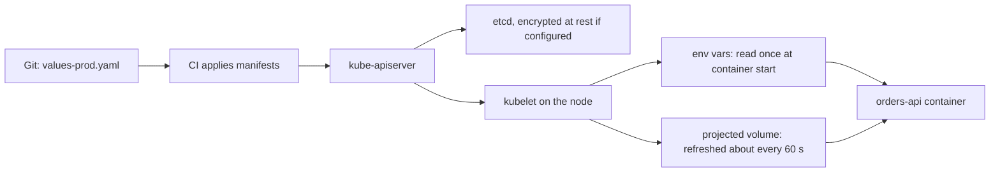
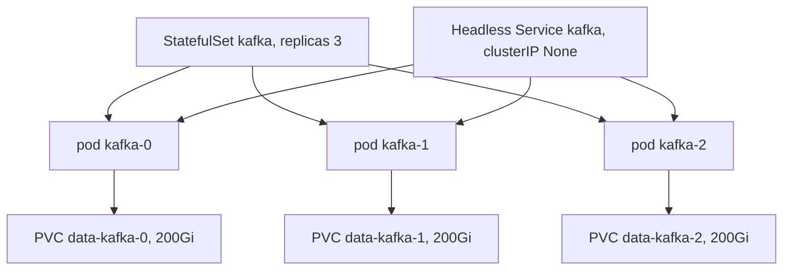

## 44.7 ConfigMap and Secret

#### Concept

A ConfigMap is a named bag of key/value pairs stored in the cluster. A Secret is the same thing with two differences: the values are base64-encoded in the API, and Kubernetes treats the object as sensitive (it can be encrypted at rest in etcd, kept out of `kubectl describe` output, and restricted by RBAC). Both are injected into a pod in one of two ways: as environment variables, or as files in a mounted volume.

That is the whole object model. Everything interesting about ConfigMaps and Secrets is in the *consequences* of that model: what happens when a value changes, who can read it, what happens when the value is wrong, and whether "Secret" means anything at all from a security point of view.

#### Why does it exist?

Configuration must vary per environment while the image stays identical. Part 43 established the rule: one image, promoted from staging to production unchanged. If the database host is baked into the image, you need a different image per environment, and the thing you tested is not the thing you shipped.

ConfigMaps and Secrets are the mechanism that keeps the image constant. They also give you three properties you would otherwise build yourself: the values live in the cluster's API (so they are auditable and RBAC-controlled), they can be mounted as files (so a 40 KB TLS certificate or a `pino` transport config does not have to become an environment variable), and they can be updated without rebuilding anything.

#### Mental model

Imagine a hotel room (the pod) that is identical in every branch of the chain. What differs is the little card in the room: the local emergency number, the Wi-Fi name, the manager's name. Housekeeping (the kubelet) puts the right card in the room when the room is prepared. The safe combination (the Secret) is delivered on a separate card, handled by staff with higher clearance, but it is still a card in the room: anyone who gets into the room can read it. "Secret" describes *who is allowed to hand it out*, not *how hard it is to read once delivered*.

#### How it works



1. You create a ConfigMap or Secret. The API server stores it in etcd. Secrets are stored base64-encoded; if the cluster has encryption at rest configured, the value is encrypted with a KMS key before it reaches disk.
2. A pod references it. The kubelet fetches the object before starting the container.
3. **Environment variables** are set once, at process start. The container's environment is fixed for the life of the container. If you change the ConfigMap, running pods keep the old value forever. There is no reload.
4. **Volume mounts** are different: the kubelet writes the keys as files into a `tmpfs` (memory-backed) directory and *keeps them updated*. When the ConfigMap changes, the files change, typically within 60 to 90 seconds (the kubelet sync period plus cache TTL). The mount uses a symlink swap so a reader never sees a half-written file.
5. The `subPath` exception: mounting a single key with `subPath` gives you a plain file that is **never** updated. This surprises people constantly.

Env vars versus files, decided properly:

| Use environment variables when | Use a mounted file when |
|---|---|
| The value is small and scalar (`DB_HOST`, `LOG_LEVEL`, `PORT`) | The value is a document: certificate, private key, JSON config, `known_hosts` |
| The value must be present at process start and never change | The value should be re-readable at runtime without a restart |
| You want it visible in `kubectl describe pod` for debugging | You explicitly do *not* want it in the pod spec or process environment |
| The library expects `process.env` (most Node config) | The value is larger than a few KB, or contains newlines |
| You are fine with a restart to change it | Rotation must not require a restart (and your code re-reads the file) |

Two dangers with environment variables specifically. First, they leak: `/proc/<pid>/environ` is readable by anything in the container, child processes inherit them, and a crash reporter that dumps the environment will ship your database password to a third party. Second, `envFrom` with a whole ConfigMap makes it impossible to see which keys a pod actually uses; prefer explicit `valueFrom` entries for anything important.

**Secrets are base64, not encryption.** `echo cG9zdGdyZXM=  | base64 -d` prints `postgres`. Anyone with `get secrets` RBAC in the namespace, or `exec` into a pod that mounts it, or read access to an etcd backup, has the value in plaintext. The three things that actually protect a Secret:

1. **Encryption at rest.** Configure an `EncryptionConfiguration` on the API server with a KMS provider (on EKS, enable envelope encryption with a KMS key at cluster creation). Without it, Secrets are plaintext in etcd backups and snapshots.
2. **RBAC.** Nobody should have cluster-wide `get`/`list` on `secrets`. Note that `list secrets` in a namespace returns *values*, not just names.
3. **Not storing them in Git.** Which leads to the two production patterns.

**External Secrets Operator (ESO)** keeps the real value in AWS Secrets Manager (or Vault, or GCP Secret Manager) and syncs it into a Kubernetes Secret on a schedule. Your Git repo holds only a reference:

```yaml
apiVersion: external-secrets.io/v1beta1
kind: ExternalSecret
metadata:
  name: orders-api-secrets
  namespace: shop
spec:
  refreshInterval: 1h                    # re-reads AWS and updates the Secret
  secretStoreRef:
    name: aws-secrets-manager            # a SecretStore using IRSA, no static keys
    kind: SecretStore
  target:
    name: orders-api-secrets             # the Kubernetes Secret it creates
    creationPolicy: Owner
  data:
    - secretKey: DB_PASSWORD
      remoteRef:
        key: prod/orders-api             # the AWS secret
        property: db_password            # a field inside its JSON
    - secretKey: JWT_SIGNING_KEY
      remoteRef:
        key: prod/orders-api
        property: jwt_signing_key
```

**Secrets Store CSI Driver** goes further: it mounts values from AWS Secrets Manager directly into the pod as files, optionally without creating a Kubernetes Secret at all. That removes the "anyone with namespace RBAC can read it" problem, at the cost of a driver to operate and a pod that must handle a mount failure at startup.

| Approach | Value lives in | Rotation | Blast radius of namespace RBAC | Complexity |
|---|---|---|---|---|
| Secret committed to Git | Git (bad) | Manual, and the old value is in history forever | Full | None |
| Sealed Secrets | Git, encrypted | Re-seal and commit | Full once decrypted | Low |
| External Secrets Operator | AWS Secrets Manager | Automatic sync, pods still need a restart | Full (a real Secret exists) | Medium |
| Secrets Store CSI Driver | AWS Secrets Manager | Mounted file rotates | None (no Secret object) | Medium to high |

**Rolling pods when config changes.** Because environment variables are frozen at container start, changing a ConfigMap does nothing to running pods. The fix is to make the pod template change whenever the config changes, by putting a hash of the config into a pod annotation. Helm does this in one line:

```yaml
spec:
  template:
    metadata:
      annotations:
        checksum/config: {{ include (print $.Template.BasePath "/configmap.yaml") . | sha256sum }}
        checksum/secret: {{ include (print $.Template.BasePath "/secret.yaml") . | sha256sum }}
```

Rendered, that becomes a plain annotation:

```yaml
      annotations:
        checksum/config: "9c1f7a3e5b2d48c0a7e6f1b3d9c8e2a4f6b0d5c7e9a1b3d5f7c9e1a3b5d7f9c1"
```

Any change to the ConfigMap changes the hash, which changes `spec.template`, which changes the pod-template hash, which triggers a normal rolling update (44.4). Without Helm, achieve the same with `kubectl rollout restart deployment/orders-api` after applying config, or by naming ConfigMaps immutably (`orders-api-config-v7`) and bumping the reference. Immutable, versioned ConfigMaps are the most reviewable option: the change is visible in the diff, and rollback of the Deployment rolls back the config too.

Add `immutable: true` to ConfigMaps and Secrets you version this way. It stops accidental edits and removes the kubelet's watch on the object, which measurably reduces API server load in large clusters.

#### Practical example

`orders-api` needs: `NODE_ENV`, `PORT`, `LOG_LEVEL`, `DB_HOST`, `DB_PORT`, `DB_NAME`, `REDIS_URL`, `KAFKA_BROKERS`, `PAYMENTS_BASE_URL`, `ORDER_MAX_ITEMS` (non-secret) plus `DB_PASSWORD`, `JWT_SIGNING_KEY`, `STRIPE_SECRET_KEY` (secret). Non-secrets go in a ConfigMap; secrets come from AWS Secrets Manager through ESO. The pod gets everything as environment variables except the Stripe webhook signing certificate bundle, which is a file.

```yaml
apiVersion: v1
kind: ConfigMap
metadata:
  name: orders-api-config
  namespace: shop
data:
  NODE_ENV: "production"
  PORT: "3000"
  LOG_LEVEL: "info"
  DB_HOST: "orders-prod.cluster-abc123.eu-west-1.rds.amazonaws.com"
  DB_PORT: "5432"
  DB_NAME: "orders"
  DB_POOL_MAX: "10"
  REDIS_URL: "redis://orders-redis.shop.svc.cluster.local:6379"
  KAFKA_BROKERS: "kafka-0.kafka.shop:9092,kafka-1.kafka.shop:9092"
  PAYMENTS_BASE_URL: "http://payments-api.shop"
  ORDER_MAX_ITEMS: "50"
  HTTP_TIMEOUT_MS: "2000"
---
apiVersion: v1
kind: Secret
metadata:
  name: orders-api-secrets
  namespace: shop
type: Opaque
stringData:                              # stringData is written as-is; the API base64-encodes it
  DB_PASSWORD: "REPLACED_BY_EXTERNAL_SECRETS_OPERATOR"
  JWT_SIGNING_KEY: "REPLACED_BY_EXTERNAL_SECRETS_OPERATOR"
```

And the consumption side in the pod template:

```yaml
    spec:
      containers:
        - name: api
          image: 123456789012.dkr.ecr.eu-west-1.amazonaws.com/orders-api:sha-3f9a1c2
          envFrom:
            - configMapRef: { name: orders-api-config }
          env:
            - name: DB_PASSWORD
              valueFrom:
                secretKeyRef: { name: orders-api-secrets, key: DB_PASSWORD }
            - name: JWT_SIGNING_KEY
              valueFrom:
                secretKeyRef: { name: orders-api-secrets, key: JWT_SIGNING_KEY }
            - name: POD_NAME
              valueFrom:
                fieldRef: { fieldPath: metadata.name }     # downward API, useful in logs
            - name: NODE_OPTIONS
              value: "--max-old-space-size=384"            # see 27.12
          volumeMounts:
            - name: stripe-ca
              mountPath: /etc/orders/stripe
              readOnly: true
      volumes:
        - name: stripe-ca
          secret:
            secretName: stripe-ca-bundle
            defaultMode: 0400
```

#### NestJS example

The most valuable thing you can do with configuration is refuse to start when it is wrong. A missing `DB_PASSWORD` should be a container that exits in 200 milliseconds with a clear message during a rollout, not a pod that serves traffic and throws `password authentication failed` on the first order at 3 a.m. `@nestjs/config` with a Joi schema does exactly that.

```ts
// src/config/configuration.ts
import * as Joi from 'joi';

export const envValidationSchema = Joi.object({
  NODE_ENV: Joi.string().valid('development', 'test', 'staging', 'production').required(),
  PORT: Joi.number().port().default(3000),
  LOG_LEVEL: Joi.string().valid('debug', 'info', 'warn', 'error').default('info'),

  DB_HOST: Joi.string().hostname().required(),
  DB_PORT: Joi.number().port().default(5432),
  DB_NAME: Joi.string().required(),
  DB_USER: Joi.string().required(),
  DB_PASSWORD: Joi.string().min(12).required(),          // rejects an empty Secret value
  DB_POOL_MAX: Joi.number().integer().min(1).max(50).default(10),

  REDIS_URL: Joi.string().uri({ scheme: ['redis', 'rediss'] }).required(),
  KAFKA_BROKERS: Joi.string().required(),
  PAYMENTS_BASE_URL: Joi.string().uri().required(),
  HTTP_TIMEOUT_MS: Joi.number().integer().min(100).max(30000).default(2000),
  ORDER_MAX_ITEMS: Joi.number().integer().min(1).max(200).default(50),

  JWT_SIGNING_KEY: Joi.string().min(32).required(),
})
  // In production, refuse defaults that only make sense locally.
  .when(Joi.object({ NODE_ENV: Joi.valid('production') }).unknown(), {
    then: Joi.object({ LOG_LEVEL: Joi.string().valid('info', 'warn', 'error') }),
  });
```

```ts
// src/app.module.ts (excerpt)
import { Module } from '@nestjs/common';
import { ConfigModule, ConfigService } from '@nestjs/config';
import { envValidationSchema } from './config/configuration';

@Module({
  imports: [
    ConfigModule.forRoot({
      isGlobal: true,
      validationSchema: envValidationSchema,
      validationOptions: {
        abortEarly: false,      // report every bad variable at once, not one per restart
        allowUnknown: true,     // the pod has dozens of unrelated vars from Kubernetes
      },
      cache: true,
    }),
  ],
})
export class AppModule {}
```

A typo now produces this, on the first pod of the rollout, before any traffic:

```text
Error: Config validation error: "DB_PASSWORD" is not allowed to be empty.
"HTTP_TIMEOUT_MS" must be a number
```

The container exits non-zero, the pod goes to `CrashLoopBackOff`, readiness never passes, `maxUnavailable: 0` means old pods keep serving, and `kubectl rollout status` fails in CI. That is a config bug that costs you a red pipeline instead of an incident. Never write `process.env.X` scattered through services; inject `ConfigService` and read typed values, so the schema is the single source of truth.

For file-based config that must be re-readable after rotation, read the file in a provider rather than at import time:

```ts
// src/payments/stripe-ca.provider.ts
import { readFile } from 'node:fs/promises';
import { Injectable } from '@nestjs/common';

@Injectable()
export class StripeCaProvider {
  private cache?: { value: Buffer; readAt: number };

  async get(): Promise<Buffer> {
    // The kubelet refreshes the mounted Secret in place; re-read every 5 minutes.
    if (!this.cache || Date.now() - this.cache.readAt > 300_000) {
      this.cache = { value: await readFile('/etc/orders/stripe/ca.pem'), readAt: Date.now() };
    }
    return this.cache.value;
  }
}
```

#### PostgreSQL example

Database credentials are the canonical Secret. Two production details matter.

First, rotation. RDS with Secrets Manager rotation creates a *second* password and switches; ESO syncs the new value into the Kubernetes Secret within `refreshInterval`, but pods holding environment variables keep the old one until they restart. A pool that reconnects (after an idle timeout, or after a failover) will then fail authentication on a *new* connection while existing connections still work, which produces the confusing symptom of partial failures. The safe sequence is: rotate with a dual-password window, sync, then `kubectl rollout restart` the Deployment, then retire the old password. Tools like Reloader can watch a Secret and restart Deployments automatically; that is the same checksum idea implemented by a controller.

Second, least privilege. The application user should not own the schema:

```sql
-- Migration user: owns the schema, used only by the migration Job (27.10).
CREATE ROLE orders_migrator LOGIN PASSWORD 'set-by-secrets-manager';
GRANT CREATE, USAGE ON SCHEMA public TO orders_migrator;

-- Runtime user: reads and writes rows, cannot change the schema.
CREATE ROLE orders_app LOGIN PASSWORD 'set-by-secrets-manager';
GRANT USAGE ON SCHEMA public TO orders_app;
GRANT SELECT, INSERT, UPDATE, DELETE ON ALL TABLES IN SCHEMA public TO orders_app;
ALTER DEFAULT PRIVILEGES FOR ROLE orders_migrator IN SCHEMA public
  GRANT SELECT, INSERT, UPDATE, DELETE ON TABLES TO orders_app;
```

Two Secrets, two roles. A compromised application pod cannot drop a table.

#### Production scenario

A platform with 40 services stores every non-secret value in a per-service ConfigMap rendered by Helm from `values-<env>.yaml`, and every secret in AWS Secrets Manager synced by ESO with a 1-hour refresh. Config changes go through the same pull request review as code. The Deployment carries `checksum/config` and `checksum/secret` annotations, so a values change produces a normal rolling update with the same safety as a code deploy: readiness-gated, `maxUnavailable: 0`, automatically rolled back on failure. Median time from merging a config change to it being live across 3 replicas is 95 seconds.

#### Failure scenario

At 09:40 a developer fixes a typo in `orders-api-config` with `kubectl edit configmap` in production, because it is "just a timeout value". Nothing happens: no pods restart, no rollout, no error. At 15:00 an unrelated deploy rolls the pods, and the six-hour-old edit takes effect at the same moment as the new image. The `HTTP_TIMEOUT_MS` typo (`20000` instead of `2000`) means calls to the payments API now hang for 20 seconds instead of 2; the connection pool saturates; p99 goes from 180 ms to 12 s; the on-call engineer spends 25 minutes looking at the new image's diff, which is innocent. The lesson is not "never edit a ConfigMap": it is that config must deploy the way code deploys, atomically and traceably, or you have decoupled cause from effect.

#### Edge cases & failure modes

- **`kubectl edit configmap` on a live cluster** creates state that exists nowhere in Git and detonates on the next unrelated restart.
- **`subPath` mounts never update.** If you mount a single key with `subPath` expecting rotation, the file is frozen for the life of the pod.
- **Env var size limits.** The whole environment must fit in roughly 1 to 2 MB; a large certificate as an env var can fail exec.
- **Numbers are strings.** `PORT: 3000` in a ConfigMap is a YAML integer and the API rejects it; it must be `"3000"`. Everything arrives in Node as a string, so `parseInt` or a validation schema is mandatory. `MAX_RETRIES: "0"` is truthy in JavaScript.
- **`envFrom` name collisions.** Two ConfigMaps with the same key: the last one wins, silently. Invalid identifiers (a key with a dash) are skipped, silently.
- **Missing key.** `secretKeyRef` to a key that does not exist leaves the pod in `CreateContainerConfigError` forever, not `CrashLoopBackOff`; `kubectl describe pod` names the missing key.
- **1 MB object limit.** A ConfigMap holding a large seed dataset hits etcd's per-object limit.
- **Secrets in logs.** A startup log line that dumps `process.env`, or an error message including a connection string with the password, sends the credential to your log store and to whoever can search it.
- **Base64 confusion.** Writing an already-base64 value into `data` double-encodes it; use `stringData` for plain values.
- **ESO refresh lag.** A rotated secret takes up to `refreshInterval` to appear, plus a restart to be used.
- **Namespace scope.** ConfigMaps and Secrets are namespaced; a pod cannot reference one from another namespace. Copying them around is a common and unpleasant workaround.

#### How a Senior Backend Engineer thinks about this

They treat configuration as part of the deployment artifact, not as cluster state you poke. Config changes are pull requests, rendered by Helm, hashed into the pod template, rolled out with the same gates as code. They validate at boot with a schema and let the process die on bad input, because a fast, loud failure during a rollout is free and a slow, quiet one at 3 a.m. is not.

They assume a Kubernetes Secret is readable by anyone with namespace access and design accordingly: real secrets live in Secrets Manager or Vault, the cluster gets a synced copy scoped to one namespace, encryption at rest is on, and `list secrets` is not granted to humans. They ask "what happens when this value is rotated?" before they ask "where do I put it?". And they keep environment variables for scalars, files for documents, and never put a secret in an image, a command line argument, or a log line.

#### Common mistakes

- Believing a Secret is encrypted because it looks like gibberish.
- Editing ConfigMaps in place and expecting running pods to notice.
- Using `envFrom` for everything, so nobody can tell which variables a service actually needs.
- No validation at boot, so a bad value becomes a runtime exception hours later.
- Committing `.env` files or Secret manifests with real values to Git.
- One giant Secret shared by twelve services, so every service can read every credential.
- Using the same database user for migrations and runtime.

#### Interview questions

1. *Is a Kubernetes Secret encrypted?* Expected: base64-encoded only; encryption at rest is a separate API server configuration with a KMS provider; RBAC and etcd backup access are the real controls. Follow-up: who can read a Secret in practice?
2. *You changed a ConfigMap and nothing happened. Why, and how do you fix it?* Expected: env vars are read at container start; use a checksum annotation, versioned ConfigMap names, `rollout restart`, or a mounted volume plus code that re-reads.
3. *When would you mount config as a file instead of an env var?* Expected: certificates and large documents, rotation without restart, keeping values out of `/proc/<pid>/environ`.
4. *How do you get an AWS Secrets Manager value into a pod without static credentials?* Expected: IRSA on the ServiceAccount plus External Secrets Operator or the Secrets Store CSI driver.
5. *Where should configuration be validated?* Expected: at process boot with a schema, failing fast; readiness never passes so the rollout stops and old pods keep serving.
6. *What are the risks of `envFrom` a whole ConfigMap?* Expected: hidden dependencies, silent key collisions, skipped invalid keys, accidental exposure.

#### Practical exercise

Take `orders-api` and split its configuration: a ConfigMap for the ten non-secret values, a Secret for three credentials. Add the Joi schema and confirm that deleting `DB_PASSWORD` from the Secret produces a pod stuck in `CreateContainerConfigError`, while setting it to an empty string produces a clean validation failure and `CrashLoopBackOff` with a readable message. Then add a `checksum/config` annotation, change `LOG_LEVEL` in the ConfigMap, and confirm a rolling update happens. Finally mount a certificate as a file, change it, and time how long until the file inside a running pod changes. Acceptance criteria: the timing measured (expect 60 to 90 seconds), a `subPath` mount demonstrated *not* updating, and a load generator recording zero failed requests across the config-triggered rollout.

## 44.8 Namespace

#### Concept

A Namespace is a name scope inside a cluster. Object names are unique per namespace, not per cluster, so `shop/orders-api` and `analytics/orders-api` are different Services. Namespaces are also the unit that most policies attach to: RBAC role bindings, ResourceQuota, LimitRange, NetworkPolicy, and Pod Security Standards are all applied per namespace.

What a namespace is *not*: a security boundary between untrusted tenants. Pods in different namespaces share nodes, the kernel, the network (unless NetworkPolicy says otherwise) and the same API server. It is an organisational and policy boundary, and a good one; it is not a virtual cluster.

#### Why does it exist?

Without namespaces, one cluster is one flat name space: two teams cannot both have a Service called `api`, one team's `kubectl delete -f .` can remove another team's objects, and there is no place to attach "this team may use at most 40 CPUs" or "nobody in this namespace may talk to the payments database". Namespaces give you a handle to hang all of that on.

#### Mental model

Imagine an office building with floors. Each floor has its own room numbering (room 12 exists on every floor), its own key cards (RBAC), its own electricity budget (ResourceQuota), and its own rule about the minimum and maximum desk size (LimitRange). But everyone breathes the same air and shares the same lifts (nodes and kernel). A locked floor keeps honest people out; it does not stop someone who has already tampered with the building's wiring.

#### How it works

1. Every namespaced object belongs to exactly one namespace. Cluster-scoped objects (Node, PersistentVolume, ClusterRole, StorageClass, CustomResourceDefinition) belong to none.
2. DNS reflects it: `orders-api` from inside `shop` resolves through the search path; from another namespace you must write `orders-api.shop` (or the full `orders-api.shop.svc.cluster.local`).
3. RBAC binds a Role (namespaced permissions) to a subject with a RoleBinding inside a namespace, or a ClusterRole cluster-wide with a ClusterRoleBinding.
4. A ResourceQuota caps the *sum* of requests and limits in the namespace, and the count of objects.
5. A LimitRange sets defaults and bounds for individual containers.
6. Deleting a namespace deletes everything inside it. This is both the best cleanup mechanism and the most dangerous command in the book.

RBAC for a team that deploys and debugs but cannot read Secrets or delete the namespace:

```yaml
apiVersion: rbac.authorization.k8s.io/v1
kind: Role
metadata:
  name: shop-developer
  namespace: shop
rules:
  - apiGroups: ["apps"]
    resources: ["deployments", "replicasets", "statefulsets"]
    verbs: ["get", "list", "watch", "patch", "update"]
  - apiGroups: [""]
    resources: ["pods", "services", "configmaps", "events"]
    verbs: ["get", "list", "watch"]
  - apiGroups: [""]
    resources: ["pods/log"]
    verbs: ["get", "list"]                  # read logs
  - apiGroups: [""]
    resources: ["pods/portforward"]
    verbs: ["create"]                       # port-forward for debugging
  # Deliberately absent: secrets, pods/exec, delete on anything.
---
apiVersion: rbac.authorization.k8s.io/v1
kind: RoleBinding
metadata:
  name: shop-developers
  namespace: shop
subjects:
  - kind: Group
    name: "eks:orders-team"                 # mapped from IAM via aws-auth or access entries
    apiGroup: rbac.authorization.k8s.io
roleRef:
  kind: Role
  name: shop-developer
  apiGroup: rbac.authorization.k8s.io
```

Note `pods/exec` is excluded: a shell in a pod reads every mounted Secret and every environment variable, so granting `exec` is equivalent to granting `get secrets`. Grant it as a separate, audited, break-glass role.

ResourceQuota and LimitRange, which work together:

```yaml
apiVersion: v1
kind: ResourceQuota
metadata:
  name: shop-quota
  namespace: shop
spec:
  hard:
    requests.cpu: "40"                 # sum of all container CPU requests
    requests.memory: 80Gi
    limits.cpu: "80"
    limits.memory: 160Gi
    pods: "200"
    services.loadbalancers: "1"        # stops a team creating 12 cloud load balancers
    persistentvolumeclaims: "10"
    count/jobs.batch: "50"
---
apiVersion: v1
kind: LimitRange
metadata:
  name: shop-limits
  namespace: shop
spec:
  limits:
    - type: Container
      default:                          # applied when a container sets no limit
        cpu: "500m"
        memory: 512Mi
      defaultRequest:                   # applied when a container sets no request
        cpu: "100m"
        memory: 128Mi
      min:
        cpu: "10m"
        memory: 32Mi
      max:                              # a single container may not exceed this
        cpu: "4"
        memory: 8Gi
```

The interaction that catches teams out: **once a ResourceQuota exists for CPU or memory, every pod in the namespace must specify requests and limits**, or creation is rejected. The LimitRange is what saves you, by filling in defaults. Without it, adding a quota breaks every manifest that omitted resources, and the failure appears not on the Deployment (which is accepted) but on the ReplicaSet, as a `FailedCreate` event with `failed quota` in the message, with zero pods and no obvious error at the top level.

Layout: per-environment or per-team?

| Layout | Example | Good for | Costs |
|---|---|---|---|
| One namespace per environment, one cluster per environment | `shop`, `payments` in cluster `prod` | Most companies; strong prod/non-prod isolation | More clusters to upgrade |
| Namespace per environment in one cluster | `shop-dev`, `shop-staging`, `shop-prod` | Small teams, cost sensitivity | A prod incident and a dev experiment share nodes and API server; a mistyped `-n` deletes prod |
| Namespace per team | `orders-team`, `catalog-team` | Quota and RBAC per team; clear ownership | Cross-team service dependencies span namespaces; noisy DNS names |
| Namespace per service | `orders`, `inventory`, `payments` | Fine-grained NetworkPolicy and quota; clean deletion | Many namespaces to manage; shared config duplicated |
| Namespace per customer (hard multi-tenancy) | `tenant-4711` | Only with vCluster, strict policy and node isolation | Namespaces are not a security boundary; this is the hardest option |

The common production answer: separate clusters for production and non-production, and inside each cluster one namespace per service or per small team, with quotas sized generously enough to be a guardrail rather than a daily obstacle.

#### Practical example

A 60-developer company runs two EKS clusters, `prod` and `nonprod`. In `prod` there are 14 namespaces, one per bounded context (`shop`, `payments`, `catalog`, `notifications`, ...), plus platform namespaces (`ingress-nginx`, `monitoring`, `cert-manager`, `argocd`, `kube-system`). Each product namespace has a quota at roughly 150% of its normal peak, a LimitRange, a default-deny NetworkPolicy (44.16), and a RoleBinding to the owning team's IAM group. ArgoCD deploys into them; humans have read plus port-forward, and `exec` requires a break-glass role that emits an audit alert.

#### NestJS example

The application should know where it is running, because logs and metrics without that context are much harder to use during an incident. The downward API provides it without hardcoding:

```yaml
          env:
            - name: K8S_NAMESPACE
              valueFrom: { fieldRef: { fieldPath: metadata.namespace } }
            - name: POD_NAME
              valueFrom: { fieldRef: { fieldPath: metadata.name } }
            - name: NODE_NAME
              valueFrom: { fieldRef: { fieldPath: spec.nodeName } }
```

```ts
// src/logging/logger.config.ts
import pino from 'pino';

export const logger = pino({
  level: process.env.LOG_LEVEL ?? 'info',
  base: {
    service: 'orders-api',
    namespace: process.env.K8S_NAMESPACE,   // shop
    pod: process.env.POD_NAME,              // orders-api-b41c9d2-x7k2p
    node: process.env.NODE_NAME,            // ip-10-0-3-14.eu-west-1.compute.internal
    version: process.env.GIT_SHA,
  },
});
```

Now "only pods on node `ip-10-0-3-14` are slow" is a log query rather than a guess, which is exactly the question you ask when one node has a failing disk or a noisy neighbour.

#### Production scenario

A namespace quota of `requests.cpu: 40` is set for `shop`. During a Black Friday scale-up the HPA wants 30 pods of `orders-api` at 500m each plus 20 worker pods at 250m; total requests would be 20 CPU, comfortably inside quota. In a neighbouring namespace with a quota set too tight, the same HPA scale-up fails: the ReplicaSet cannot create pods, `kubectl describe rs` shows `exceeded quota: requests.cpu`, and the service stays at its current size under growing load. Quota exhaustion looks exactly like an autoscaler that stopped working, and there is no alert for it unless you create one on `kube_resourcequota` metrics at 80% usage.

#### Failure scenario

At 11:20 an engineer runs `kubectl delete namespace shop` intending to clean up a test namespace called `shop-test`; the shell history had the wrong entry. Everything in `shop` is deleted: Deployments, Services, Ingresses, Secrets, PVCs. Because the platform is GitOps-managed with ArgoCD, the namespace and its objects are recreated within 4 minutes, and the API is serving again in 6. The two things that saved them were declarative deployment and the fact that the database was outside the cluster. The follow-ups: a validating admission policy that blocks deletion of namespaces labelled `environment=production`, and removing namespace `delete` permission from humans entirely.

#### Edge cases & failure modes

- **A quota exists but no LimitRange**, so every pod without explicit resources is rejected, and the error is on the ReplicaSet, not the Deployment.
- **Quota counts requests, not usage.** A namespace can be at 100% quota with nodes at 20% CPU.
- **Terminating namespaces.** A namespace stuck in `Terminating` almost always has a resource with a finalizer whose controller is gone; you have to patch the finalizer out.
- **Cross-namespace DNS** requires `service.namespace`; a copied manifest that assumed same-namespace DNS fails with `ENOTFOUND`.
- **Namespaces are not a security boundary.** A container escape or a hostPath mount crosses them.
- **`kubectl` default namespace.** Running a destructive command in the wrong context is the single most common human failure; use `kubectl config set-context --current --namespace=shop`, a shell prompt that shows cluster and namespace, and separate kubeconfigs for prod.
- **Quota changes do not evict.** Lowering a quota below current usage does not remove pods; it only blocks new ones.
- **Default ServiceAccount.** Every namespace has one, and by default its token is mounted into every pod; set `automountServiceAccountToken: false` (44.16).

#### How a Senior Backend Engineer thinks about this

They use namespaces as the unit of ownership: one namespace, one owning team, one RoleBinding, one quota, one default-deny NetworkPolicy, one set of alerts. They keep production in its own cluster because a namespace is not a security boundary and because cluster upgrades then have a rehearsal environment. They size quotas as guardrails against runaway loops, not as budget enforcement, and they alert at 80% so quota exhaustion never masquerades as a broken autoscaler. They remove `delete namespace` and `pods/exec` from everyday roles and make them auditable break-glass.

#### Common mistakes

- Adding a ResourceQuota without a LimitRange and breaking every deployment in the namespace.
- Treating namespaces as tenant isolation for untrusted workloads.
- Running dev and prod in the same cluster to save money, then losing an afternoon to a mistyped `-n`.
- Granting `cluster-admin` because a Role was fiddly.
- Granting `exec` broadly, which is equivalent to granting Secret access.
- Forgetting the `.namespace` suffix in cross-namespace URLs.

#### Interview questions

1. *Is a namespace a security boundary?* Expected: no; it is a name scope and a policy attachment point; isolation needs NetworkPolicy, RBAC, Pod Security Standards, and separate node pools or clusters for real isolation.
2. *What happens when you add a ResourceQuota to a namespace with existing workloads?* Expected: existing pods keep running; new pods without requests and limits are rejected unless a LimitRange supplies defaults; the error surfaces on the ReplicaSet.
3. *How do you give a team the ability to debug without reading Secrets?* Expected: Role with get/list on pods, logs, port-forward; exclude secrets and `pods/exec`; break-glass role with auditing.
4. *Why is `exec` equivalent to Secret access?* Expected: the shell can read the environment and mounted Secret volumes.
5. *Per-environment or per-team namespaces?* Expected: separate clusters for prod versus non-prod; namespaces per service or team inside; reasoning about blast radius and upgrade rehearsal.

#### Practical exercise

Create the `shop` namespace with the quota and LimitRange above. Deploy a Deployment whose containers set no resources and confirm the LimitRange fills them in (`kubectl get pod -o jsonpath` the resources). Delete the LimitRange, scale to a count that exceeds `requests.cpu`, and find the exact error, from `kubectl describe rs` and from `kubectl get events --sort-by=.lastTimestamp`. Then create the developer Role and, using `kubectl auth can-i --as`, verify the team can read logs and port-forward but cannot read Secrets or exec. Acceptance criteria: the quota rejection reproduced and located from events alone, and a table of six `auth can-i` results.

## 44.9 StatefulSet

#### Concept

A StatefulSet runs pods that are not interchangeable. Each pod gets a stable ordinal identity (`kafka-0`, `kafka-1`, `kafka-2`), a stable DNS name that survives restarts, and its own PersistentVolumeClaim created from a template and never reassigned to another ordinal. Pods are created and deleted in order, and by default updated in reverse order, one at a time, waiting for each to be ready.

A Deployment says "three of these, I do not care which is which". A StatefulSet says "these three specific members, each with its own disk and name, brought up and down in a known order".

#### Why does it exist?

Clustered data systems care about identity. A PostgreSQL replica must reconnect to *its* data directory, not any data directory. A Kafka broker's ID maps to the partitions it leads, and its log segments live on a specific disk. A Redis Sentinel setup needs stable addresses to gossip about. Replacing such a pod with "an equivalent pod somewhere else with a fresh empty disk" destroys data or breaks the cluster.

#### Mental model

Imagine a rowing eight. A Deployment is a pool of casual workers: any eight bodies will do, and they can be swapped mid-race. A StatefulSet is a real crew: seat 1 is seat 1, seat 8 is the stroke, each has their own fitted oar (the PVC), you board in order and disembark in reverse, and if seat 5 is replaced, the new rower sits in seat 5 and uses seat 5's oar.

#### How it works



1. **Stable names.** Pods are `<name>-<ordinal>`, starting at 0. A headless Service (`clusterIP: None`) named in `serviceName` gives each pod a DNS record: `kafka-0.kafka.shop.svc.cluster.local` resolves to that pod's IP, and it keeps resolving to the replacement pod after a restart or reschedule.
2. **Stable storage.** `volumeClaimTemplates` creates one PVC per ordinal, named `<template>-<statefulset>-<ordinal>`. That PVC is bound to that ordinal forever. Deleting the pod does not delete the PVC. Deleting the StatefulSet does not delete the PVCs either (by default), which is a feature: it makes accidental deletion recoverable, and it means you must clean up manually.
3. **Ordered creation.** Pod 0 must be Running and Ready before pod 1 is created. Set `podManagementPolicy: Parallel` when members do not need each other in order (it makes scaling a 12-node cluster much faster).
4. **Ordered updates.** `updateStrategy: RollingUpdate` replaces pods from the highest ordinal down, one at a time, waiting for readiness. `partition: N` updates only ordinals `>= N`, which is how you canary a stateful upgrade: set `partition: 2` on a 3-replica set, verify `kafka-2` on the new version, then lower the partition.
5. **Scale down** removes the highest ordinal first, and leaves its PVC.

A realistic StatefulSet: a small Redis used by `orders-api` for idempotency keys and BullMQ.

```yaml
apiVersion: v1
kind: Service
metadata:
  name: orders-redis
  namespace: shop
spec:
  clusterIP: None                      # headless: DNS returns pod IPs
  selector:
    app.kubernetes.io/name: orders-redis
  ports:
    - { name: redis, port: 6379, targetPort: redis }
---
apiVersion: apps/v1
kind: StatefulSet
metadata:
  name: orders-redis
  namespace: shop
spec:
  serviceName: orders-redis            # must match the headless Service name
  replicas: 1
  selector:
    matchLabels:
      app.kubernetes.io/name: orders-redis
  updateStrategy:
    type: RollingUpdate
  template:
    metadata:
      labels:
        app.kubernetes.io/name: orders-redis
    spec:
      terminationGracePeriodSeconds: 60
      securityContext:
        fsGroup: 999                   # so the mounted volume is writable by the redis user
      containers:
        - name: redis
          image: redis:7.2-alpine
          args:
            - "--appendonly"
            - "yes"
            - "--maxmemory"
            - "1500mb"
            - "--maxmemory-policy"
            - "noeviction"             # BullMQ data must not be evicted silently
          ports:
            - { name: redis, containerPort: 6379 }
          readinessProbe:
            exec: { command: ["redis-cli", "ping"] }
            periodSeconds: 5
          livenessProbe:
            tcpSocket: { port: redis }
            periodSeconds: 10
            failureThreshold: 6
          resources:
            requests: { cpu: 200m, memory: 2Gi }
            limits: { memory: 2Gi }
          volumeMounts:
            - { name: data, mountPath: /data }
  volumeClaimTemplates:
    - metadata:
        name: data
      spec:
        accessModes: ["ReadWriteOnce"]
        storageClassName: gp3
        resources:
          requests:
            storage: 20Gi
```

#### Practical example

`orders-api` needs Redis for idempotency keys (Part 31) and BullMQ queues (Part 41). The team runs a single-replica Redis StatefulSet in the cluster for the *queue* (losing a few queued jobs is recoverable, and the cost of ElastiCache for a low-volume queue was not justified), and uses ElastiCache for the *cache and idempotency store* used by the API hot path, because that one must survive a node failure without a human. That split is a good example of the real decision: it is not "Redis in Kubernetes: yes or no", it is per workload, based on what losing it costs.

#### PostgreSQL example

The honest answer on running PostgreSQL in Kubernetes.

You *can*. Operators like CloudNativePG, Zalando's Postgres Operator and Crunchy PGO are mature. They implement, as controllers, the things a DBA would otherwise do by hand: provision a primary and replicas as a StatefulSet with per-pod volumes, configure streaming replication, run continuous WAL archiving to S3, take base backups, promote a replica when the primary fails, do rolling minor-version upgrades, and expose read-write and read-only Services that follow the current primary.

What an operator gives you:

- Automated failover in roughly 15 to 45 seconds, with the read-write Service repointed at the new primary.
- Backups and point-in-time recovery to object storage, declared in YAML and verifiable.
- The same GitOps workflow as your applications, in the same cluster, with no cloud lock-in.
- Cheaper than managed at scale: raw EC2 plus EBS versus RDS pricing can be 40 to 60% less for large instances.
- Read replicas, connection pooling (PgBouncer) and monitoring wired in.

What it costs you:

- **You now own the database.** Storage classes, IOPS limits, volume expansion, disk-full incidents, filesystem choice, and the fact that an EBS volume is zonal, so a pod can only be rescheduled within its availability zone.
- **The failure surface grows.** A node drain, a bad kernel upgrade, a CNI bug or a full ephemeral disk now affects your database. Kubernetes will happily reschedule things; databases hate being rescheduled.
- **Someone must know PostgreSQL deeply.** When replication lag grows or a failover leaves a diverged timeline, the operator does not save you; PostgreSQL knowledge does.
- **Backups must be tested.** A restore you have not performed is a hypothesis.
- **Upgrades multiply.** Cluster upgrades, operator upgrades and PostgreSQL upgrades, each with their own risk window.

| | Managed (RDS/Aurora/ElastiCache/MSK) | In-cluster with an operator |
|---|---|---|
| Failover | Automatic, 30 to 120 s, vendor-owned | Automatic, 15 to 45 s, you own it |
| Backups and PITR | Built in, tested by the vendor | Configured by you; must be exercised |
| Cost at 8 vCPU, 64 GB | Higher; you pay for the service | Roughly 40 to 60% less on raw compute |
| Who gets paged at 3 a.m. | You, but with vendor support | You, alone |
| Version upgrades | One click, scheduled window | Operator-driven, you validate |
| Lock-in | Meaningful | None |
| Right for | Almost every team below ~50 engineers | Teams with a platform team plus real DBA skills, cost pressure at scale, or on-premises requirements |

The default recommendation for a backend team: **PostgreSQL on RDS, Redis on ElastiCache, Kafka on MSK or Confluent Cloud; run stateless workloads in Kubernetes.** Move a data system into the cluster only when you can name the person who will handle its failover at 3 a.m., and when you have restored a backup from scratch at least once. Good candidates for in-cluster state anyway: development and test databases (fast, cheap, disposable), per-branch preview environments, and secondary systems whose loss is an inconvenience rather than an incident.

If you do run PostgreSQL in-cluster, the non-negotiables are: one replica per availability zone with anti-affinity, `gp3` or `io2` volumes with provisioned IOPS, a PodDisruptionBudget with `maxUnavailable: 1`, WAL archiving to S3 with a tested restore, a dedicated node pool with taints so application pods never share a node, `noeviction`-style resource guarantees (Guaranteed QoS, requests equal to limits), and alerting on replication lag, WAL accumulation and disk usage.

#### Production scenario

A team runs a 3-broker Kafka StatefulSet with 500 GB gp3 volumes per broker, `podManagementPolicy: Parallel`, one broker per availability zone via topology spread, and a PDB with `maxUnavailable: 1`. A rolling restart to change a broker setting takes 12 minutes: each broker is stopped, its partitions' leadership moves to other brokers within seconds, the new pod starts, catches up on replication in 2 to 3 minutes, and only then does the operator proceed. During the restart, producer p99 rises from 8 ms to 40 ms and no messages are lost, because `min.insync.replicas=2` and `acks=all` mean the cluster tolerates one broker being away. Getting to that state took two engineers about six weeks.

#### Failure scenario

At 02:14 a node hosting `postgres-1` (a read replica) is terminated by a spot interruption. The pod is rescheduled, but the new pod stays `Pending` for 40 minutes with `volume node affinity conflict`. The reason: the EBS volume lives in `eu-west-1b`, and the only node with spare capacity is in `eu-west-1c`. An EBS volume cannot cross an availability zone. The cluster autoscaler eventually adds a node in `1b` and the pod starts, but read traffic was degraded for 40 minutes. The fixes: node groups sized per zone, `WaitForFirstConsumer` volume binding so the scheduler picks the zone before the volume is created, and not running database replicas on spot instances.

#### Edge cases & failure modes

- **PVCs outlive the StatefulSet.** Deleting and recreating leaves the old data attached, which is sometimes a rescue and sometimes a very confusing "why is the old data back?".
- **Scaling down loses nothing, and that is the problem.** `kubectl scale sts kafka --replicas=2` removes `kafka-2` but leaves `data-kafka-2` costing money forever.
- **Zonal volumes pin pods to a zone.** Always use `volumeBindingMode: WaitForFirstConsumer` on the StorageClass.
- **`ReadWriteOnce`** means one node at a time. Two pods cannot share the volume; a stuck detach (an unresponsive node) blocks the replacement pod for six minutes or more.
- **Ordered start deadlock.** With the default ordered policy, if `kafka-0` never becomes ready, `kafka-1` is never created, and a cluster that could have formed a quorum stays at one pod.
- **Volume expansion is one-way.** You can grow a PVC (if the StorageClass allows it) but never shrink it, and you must edit the PVC, not the StatefulSet template, which the template will then disagree with.
- **A headless Service is required.** Without `serviceName` pointing at a real headless Service, per-pod DNS does not exist.
- **`fsGroup` and permissions.** A database image running as a non-root user cannot write to a freshly attached volume without `fsGroup`, giving `permission denied` on startup.
- **Backups are not snapshots of a running database.** A volume snapshot of a live PostgreSQL data directory may be crash-consistent but is not a substitute for `pg_basebackup` plus WAL.

#### How a Senior Backend Engineer thinks about this

They start from "what does losing this cost?" A queue of retryable jobs and a system-of-record database are not the same risk. They prefer managed data services for anything customer-facing and keep the cluster for stateless work, because the platform team's time is better spent on deployment safety than on writing a failover runbook they will use twice a year. When they do run state in-cluster, they use an operator (never a hand-rolled StatefulSet for a database), dedicate node pools, pin replicas across zones, and treat a tested restore as the definition of "we have backups".

They also know StatefulSets are useful beyond databases: any workload that needs a stable identity, such as a Kafka consumer group with static partition assignment, a legacy service licensed to a hostname, or a singleton scheduler with a leader-election lock.

#### Common mistakes

- Running production PostgreSQL as a hand-written StatefulSet with no operator, no WAL archiving and no tested restore.
- Using a Deployment with a PVC for a database (two pods, one `ReadWriteOnce` volume, permanent `Pending`).
- Forgetting that scaling down leaves PVCs behind, then paying for orphaned volumes for a year.
- No `WaitForFirstConsumer`, producing cross-zone scheduling failures.
- Assuming a `hostPath` or `emptyDir` volume is durable.
- No PodDisruptionBudget, so a node drain takes two brokers at once.

#### Interview questions

1. *What does a StatefulSet give you that a Deployment does not?* Expected: stable ordinal identity and DNS, per-ordinal PVCs from `volumeClaimTemplates`, ordered creation, deletion and updates.
2. *Would you run PostgreSQL in Kubernetes?* Expected: a real tradeoff answer: operator capabilities, cost saving, versus owning failover, storage and upgrades; managed by default; conditions under which in-cluster is right.
3. *A StatefulSet pod is `Pending` with `volume node affinity conflict`. What happened?* Expected: zonal volume, no node with capacity in that zone; `WaitForFirstConsumer`; per-zone node groups.
4. *How do you canary a StatefulSet upgrade?* Expected: `updateStrategy.rollingUpdate.partition`, verify the highest ordinal, then lower the partition.
5. *What happens to PVCs when you scale down or delete a StatefulSet?* Expected: they remain; cleanup is manual (or via `persistentVolumeClaimRetentionPolicy` in newer versions).
6. *Why is a headless Service needed?* Expected: per-pod stable DNS records for peer discovery.

#### Practical exercise

Deploy the Redis StatefulSet above. Write 1,000 keys, delete the pod, and confirm the data survives (that proves the PVC binding). Scale to 3, observe the ordered creation and the three PVCs, then scale back to 1 and show the two orphaned PVCs still exist and cost money. Add `partition: 2` to the update strategy, change the image tag, and confirm only `orders-redis-2` updates. Finally, write down the answers, for your own system, to: where are the backups, when did we last restore one, who is paged when the primary fails, and how long is the failover. Acceptance criteria: data survival demonstrated, orphaned PVCs listed with their sizes, a partitioned update shown with two versions running, and the four operational questions answered in writing.

## 44.10 Job and CronJob

#### Concept

A Job runs pods until a specified number of them complete successfully, then stops. A CronJob creates Jobs on a schedule. Where a Deployment's contract is "keep N running forever", a Job's contract is "run this to completion, retry on failure up to a limit, then stop and record the result".

#### Why does it exist?

Plenty of backend work is finite: apply database migrations, backfill a column for 4 million rows, generate yesterday's settlement report, expire abandoned carts, rebuild a search index, send a weekly digest. Running these inside your API process means they compete with request traffic for CPU and memory, they run N times when you have N replicas unless you build locking, and a long backfill blocks a deploy. A Job gives each of these its own pod, its own resources, its own retry policy and its own record of success or failure.

#### Mental model

A Deployment is a shop that opens every morning and stays open. A Job is a contractor: they arrive, do one task, and leave. If they fail, you call them back up to `backoffLimit` times. A CronJob is a standing arrangement with the contractor: every night at 02:00, come and do this task, and here is what to do if the previous visit is still going on.

#### How it works

Job mechanics:

1. The Job controller creates a pod from the template. `restartPolicy` must be `Never` or `OnFailure` (not `Always`).
2. If the pod's container exits 0, the Job counts one success. When successes reach `completions` (default 1), the Job is `Complete`.
3. If the container exits non-zero, the Job creates a *new pod* (with `restartPolicy: Never`) and increments the failure count. After `backoffLimit` failures (default 6) the Job is `Failed`. Retries back off exponentially: 10 s, 20 s, 40 s, up to 6 minutes.
4. `activeDeadlineSeconds` kills the Job (whatever its state) after that wall-clock time. This is your protection against a migration that hangs on a lock.
5. `ttlSecondsAfterFinished` deletes the Job and its pods that long after completion. Without it, finished Jobs accumulate forever, and after a few thousand they make `kubectl get pods` slow and clutter the API server.
6. `parallelism` and `completions` together give you a work queue: `completions: 100, parallelism: 10` runs 100 successful pods, 10 at a time.

Database migrations as a Job:

```yaml
apiVersion: batch/v1
kind: Job
metadata:
  name: orders-api-migrate-sha-3f9a1c2      # unique per release; Jobs are immutable
  namespace: shop
spec:
  backoffLimit: 2                            # migrations are not usually fixed by retrying
  activeDeadlineSeconds: 900                 # 15 minutes, then give up and alert
  ttlSecondsAfterFinished: 86400             # keep for a day for debugging, then clean up
  template:
    metadata:
      labels:
        app.kubernetes.io/name: orders-api
        app.kubernetes.io/component: migration
    spec:
      restartPolicy: Never
      serviceAccountName: orders-api-migrator
      containers:
        - name: migrate
          image: 123456789012.dkr.ecr.eu-west-1.amazonaws.com/orders-api:sha-3f9a1c2
          command: ["node", "dist/scripts/migrate.js"]     # same image, different entrypoint
          envFrom:
            - configMapRef: { name: orders-api-config }
          env:
            - name: DB_USER
              value: orders_migrator                        # schema-owning role, not the app role
            - name: DB_PASSWORD
              valueFrom:
                secretKeyRef: { name: orders-api-migrator-secret, key: DB_PASSWORD }
            - name: PGOPTIONS
              value: "-c lock_timeout=5s -c statement_timeout=600s"
          resources:
            requests: { cpu: 200m, memory: 256Mi }
            limits: { memory: 512Mi }
```

Three details worth defending in review. The **same image** is used, with a different command, so the migration code is exactly the code that was tested. `PGOPTIONS` sets `lock_timeout=5s`, so a migration that needs an `ACCESS EXCLUSIVE` lock fails fast instead of queueing behind a long transaction and blocking every query behind it (the classic self-inflicted outage; see Part 23). And `backoffLimit: 2` reflects reality: a failing migration usually needs a human, not a retry.

As a **Helm pre-upgrade hook**, so migrations run before the new pods start:

```yaml
apiVersion: batch/v1
kind: Job
metadata:
  name: {{ include "orders-api.fullname" . }}-migrate
  annotations:
    "helm.sh/hook": pre-install,pre-upgrade
    "helm.sh/hook-weight": "-5"                       # runs before other hooks
    "helm.sh/hook-delete-policy": before-hook-creation,hook-succeeded
spec:
  backoffLimit: 2
  activeDeadlineSeconds: 900
```

`helm upgrade --wait` then blocks until the Job succeeds; if it fails, the release fails and the new Deployment is never applied, so old pods keep serving old code against the unchanged schema. Note the ordering consequence: with a pre-upgrade hook, the *new* schema is live while the *old* code is still running, so migrations must be backward compatible with the currently deployed version. That is the expand-and-contract rule from 44.4, and it is not optional.

CronJob mechanics and the fields that matter:

```yaml
apiVersion: batch/v1
kind: CronJob
metadata:
  name: expire-abandoned-carts
  namespace: shop
spec:
  schedule: "*/15 * * * *"                 # every 15 minutes
  timeZone: "Europe/Berlin"                # Kubernetes 1.27+; otherwise the controller uses UTC
  concurrencyPolicy: Forbid                # never two at once
  startingDeadlineSeconds: 300             # if the controller was down, skip runs older than 5 min
  successfulJobsHistoryLimit: 3
  failedJobsHistoryLimit: 5
  suspend: false                           # set true to pause without deleting
  jobTemplate:
    spec:
      backoffLimit: 3
      activeDeadlineSeconds: 600           # must be shorter than the schedule interval
      ttlSecondsAfterFinished: 3600
      template:
        spec:
          restartPolicy: Never
          containers:
            - name: job
              image: 123456789012.dkr.ecr.eu-west-1.amazonaws.com/orders-api:sha-3f9a1c2
              command: ["node", "dist/scripts/expire-carts.js"]
              envFrom:
                - configMapRef: { name: orders-api-config }
              env:
                - name: DB_PASSWORD
                  valueFrom:
                    secretKeyRef: { name: orders-api-secrets, key: DB_PASSWORD }
              resources:
                requests: { cpu: 100m, memory: 128Mi }
                limits: { memory: 256Mi }
```

- `concurrencyPolicy: Forbid` skips a run if the previous one is still going. `Allow` (the default) will happily run five copies of your report generator at once when it starts taking longer than its interval, which is how a cron job becomes a database outage. `Replace` kills the running one.
- `startingDeadlineSeconds` bounds catch-up. If the controller manager was unavailable for two hours with `Allow` and no deadline, you get a thundering herd of missed runs at once. With 300, anything older than 5 minutes is simply skipped and counted as missed. Do not set it below 10 seconds; the controller checks every 10 seconds and would mark runs missed spuriously.
- History limits keep the Job list readable. Combined with `ttlSecondsAfterFinished`, they stop the slow accumulation that ends with 12,000 completed pods in a namespace.
- `timeZone` exists from Kubernetes 1.27. Before that, schedules run in the *controller manager's* timezone, which is UTC on every managed cloud. "02:00 daily" in a `Europe/Berlin` business means 03:00 or 04:00 local depending on daylight saving, and the two annual DST transitions cause either a skipped run or a doubled run. If your cluster predates `timeZone`, express schedules in UTC explicitly and document the local meaning.

**A CronJob guarantees at-least-once, not exactly-once.** A missed schedule, a controller restart, or a retried pod can produce a second execution. Every job body must be idempotent or must take a lock. In practice: a `SELECT ... FOR UPDATE SKIP LOCKED` batch loop, an advisory lock, or an idempotency table keyed by run date.

#### NestJS example

The same logic can live in the app via `@nestjs/schedule`, or in a CronJob. It is a real decision, not a style preference.

In-app with `@nestjs/schedule` (note the required locking, because every replica runs the decorator):

```ts
// src/carts/cart-expiry.task.ts
import { Injectable, Logger } from '@nestjs/common';
import { Cron, CronExpression } from '@nestjs/schedule';
import { DataSource } from 'typeorm';

@Injectable()
export class CartExpiryTask {
  private readonly log = new Logger(CartExpiryTask.name);
  constructor(private readonly ds: DataSource) {}

  @Cron(CronExpression.EVERY_15_MINUTES, { name: 'expire-carts', timeZone: 'Europe/Berlin' })
  async expire(): Promise<void> {
    // Every replica fires this. A Postgres advisory lock makes exactly one do the work.
    await this.ds.transaction(async (m) => {
      const [{ locked }] = await m.query('SELECT pg_try_advisory_xact_lock(4711) AS locked');
      if (!locked) return;                       // another replica holds it; do nothing
      const res = await m.query(
        `UPDATE carts SET status = 'expired', updated_at = now()
           WHERE status = 'active' AND updated_at < now() - interval '24 hours'
           AND id IN (SELECT id FROM carts WHERE status = 'active'
                      AND updated_at < now() - interval '24 hours' LIMIT 5000 FOR UPDATE SKIP LOCKED)`,
      );
      this.log.log(`expired ${res[1] ?? 0} carts`);
    });
  }
}
```

The same work as a script, which the CronJob above executes:

```ts
// src/scripts/expire-carts.ts
import { NestFactory } from '@nestjs/core';
import { AppModule } from '../app.module';
import { CartExpiryTask } from '../carts/cart-expiry.task';

async function main(): Promise<void> {
  // Standalone context: DI and config, no HTTP server, no schedulers started.
  const app = await NestFactory.createApplicationContext(AppModule, { logger: ['log', 'error'] });
  try {
    await app.get(CartExpiryTask).expire();
    await app.close();
    process.exit(0);                 // exit 0 tells the Job it succeeded
  } catch (err) {
    console.error(err);
    await app.close();
    process.exit(1);                 // non-zero triggers the Job's retry policy
  }
}
void main();
```

When a Kubernetes CronJob beats in-app scheduling:

| Situation | Choose |
|---|---|
| The task is heavy (a 20-minute backfill, a large report) | CronJob: its own pod, its own resources, cannot starve request handling |
| The task must run exactly once per schedule across N replicas | CronJob (still make it idempotent), or in-app with a distributed lock |
| The task needs different resources or a different image | CronJob |
| You need retries, history, timeouts and alerting from the platform | CronJob |
| The task is tiny and frequent (every 10 seconds, refresh a cache) | In-app: pod startup cost (2 to 5 s) dominates |
| The task needs warm in-process state (an open Kafka producer, a cache) | In-app |
| You are not on Kubernetes, or the API pods are the only compute you have | In-app |
| Sub-minute schedules | In-app: cron granularity is one minute |

The nuance most people miss: a CronJob pod pays full application boot cost every run. A NestJS app with TypeORM and 30 modules takes 2 to 6 seconds to build the DI container and connect to the database. For a job that runs every 15 minutes and takes 40 seconds, that is irrelevant. For one that runs every minute and takes 300 ms, it is 90% waste, and in-app scheduling with a lock is the better engineering. Part 35 covers scheduling, distributed locks and job orchestration in depth; this section is only about the Kubernetes side of the choice.

#### TypeORM example

The migration script the Job runs, with the guard rails that matter in production:

```ts
// src/scripts/migrate.ts
import { DataSource } from 'typeorm';
import { dataSourceOptions } from '../database/data-source';

async function main(): Promise<void> {
  const ds = new DataSource({
    ...dataSourceOptions,
    migrationsRun: false,          // never auto-run on app boot; the Job owns migrations
    synchronize: false,            // synchronize in production destroys data
    logging: ['query', 'error', 'migration'],
  });
  await ds.initialize();
  try {
    const applied = await ds.runMigrations({ transaction: 'each' });
    console.log(`applied ${applied.length} migrations: ${applied.map((m) => m.name).join(', ')}`);
  } finally {
    await ds.destroy();
  }
}

main().catch((err) => {
  console.error('migration failed', err);
  process.exit(1);                 // Job sees a failure, Helm upgrade aborts
});
```

`transaction: 'each'` wraps each migration in its own transaction, so a failure halfway through a batch leaves earlier migrations committed and the failing one rolled back. Combined with `lock_timeout`, a migration blocked by a long-running query fails in 5 seconds with a clear error rather than blocking the whole table for minutes.

#### Sequelize example

The same shape with Umzug, which is what `sequelize-cli` uses underneath:

```ts
// src/scripts/migrate-sequelize.ts
import { Sequelize } from 'sequelize';
import { Umzug, SequelizeStorage } from 'umzug';

const sequelize = new Sequelize(process.env.DATABASE_URL!, {
  logging: (sql) => console.log(sql),
  dialectOptions: { statement_timeout: 600_000, lock_timeout: 5_000 },
});

const umzug = new Umzug({
  migrations: { glob: 'dist/migrations/*.js' },
  context: sequelize.getQueryInterface(),
  storage: new SequelizeStorage({ sequelize }),   // SequelizeMeta table records applied migrations
  logger: console,
});

umzug
  .up()
  .then(async (migrations) => {
    console.log(`applied ${migrations.length}`);
    await sequelize.close();
    process.exit(0);
  })
  .catch(async (err) => {
    console.error(err);
    await sequelize.close();
    process.exit(1);
  });
```

#### Production scenario

A platform runs 22 CronJobs: settlement reports at 02:15 UTC, cart expiry every 15 minutes, index rebuilds hourly, a nightly S3 export, and per-tenant digest emails. Every one has `concurrencyPolicy: Forbid`, `activeDeadlineSeconds` under its interval, `ttlSecondsAfterFinished: 3600`, and a Prometheus alert on `kube_job_status_failed > 0` and on "no successful run in 2x the interval" (the important one: a *suspended* or never-scheduled CronJob fails silently otherwise). Migration Jobs run as Helm pre-upgrade hooks; the median migration takes 1.8 seconds, and the one that took 14 minutes (a backfill someone put in a migration) is why `activeDeadlineSeconds` exists and why backfills now run as their own Job, decoupled from deploys.

#### Failure scenario

At 02:00 on the last Sunday of October, a nightly report CronJob runs twice. The cluster's cron schedule was expressed in local time via a container-level `TZ` variable while the controller scheduled in UTC, and the DST transition produced two 02:00s in local reckoning. The report job was not idempotent: it inserted settlement rows keyed only by an auto-increment id, so finance received two files and a duplicated payout batch worth 46,000 EUR. It was caught in reconciliation the next day. The fixes, in order of value: a unique constraint on `(settlement_date)` so a second run fails loudly, an idempotency check at the start of the job, `concurrencyPolicy: Forbid`, and schedules expressed in UTC with the local meaning documented. The order matters: the database constraint is the only fix that would have prevented the loss.

#### Edge cases & failure modes

- **`concurrencyPolicy: Allow`** with a job that slowly gets slower: overlapping runs, database contention, and a self-reinforcing pile-up.
- **No `ttlSecondsAfterFinished`**: thousands of completed pods; `kubectl get pods` takes 20 seconds; etcd grows.
- **`restartPolicy: Always`** in a Job template is rejected by the API server.
- **`backoffLimit` too high** on a job with an external side effect: six retries means six emails sent.
- **Pod evicted mid-run.** The Job creates a replacement pod; a non-idempotent job then double-processes. Set `priorityClassName` for critical jobs and make the body idempotent.
- **Job pod cannot be scheduled** (quota, no capacity): the Job sits at 0 active with a `FailedCreate` event and no alert unless you built one.
- **`activeDeadlineSeconds` longer than the schedule interval** with `Forbid`: runs are permanently skipped and nobody notices.
- **A migration Job that never completes** blocks `helm upgrade --wait` until its timeout, holding the release lock.
- **Suspended CronJob left suspended** after an incident: silent, indefinite non-execution. Alert on last-success age, not just on failures.
- **Cron granularity is one minute**; there is no "every 30 seconds".
- **The image tag in a CronJob drifts.** If the CronJob is not updated with each release, it silently runs code from three months ago.

#### How a Senior Backend Engineer thinks about this

They ask "what happens if this runs twice?" before they write the schedule, and they make the answer "nothing bad" with a database constraint or an idempotency key, because at-least-once is what the platform actually offers. They separate migrations from backfills: migrations are fast, transactional, backward compatible and run as a pre-upgrade hook; backfills are chunked, resumable, rate-limited Jobs run deliberately, never inside a deploy.

They alert on *absence* of success, not only on failure, because the worst cron failure is the one that stops running. They keep the job image identical to the application image so behaviour matches. And they push back on putting a 20-minute report generator inside the API process, because the pod that serves customer traffic should not be the pod doing batch work.

#### Common mistakes

- Running migrations automatically at application boot (`migrationsRun: true`), so N replicas race and a rollback is unclear.
- `synchronize: true` in production.
- Non-idempotent jobs with retries and side effects.
- No `activeDeadlineSeconds`, so a hung job holds a lock for hours.
- No `ttlSecondsAfterFinished`, so old Jobs accumulate.
- Assuming CronJob times are local when the cluster schedules in UTC.
- Alerting only on failures, never on missing runs.

#### Interview questions

1. *How do you run database migrations in Kubernetes?* Expected: a Job (often a Helm pre-upgrade hook) using the same image with a different command, a schema-owning role, `lock_timeout`, `backoffLimit` low, `activeDeadlineSeconds`, and backward-compatible migrations because old pods are still serving.
2. *Explain `concurrencyPolicy` and when you would use each value.* Expected: `Forbid` for anything touching shared state, `Replace` for idempotent freshness jobs, `Allow` rarely and only for independent, short work.
3. *What does `startingDeadlineSeconds` protect against?* Expected: a burst of catch-up runs after the controller was unavailable; runs older than the deadline are skipped.
4. *CronJob or `@nestjs/schedule`?* Expected: resource isolation, replica count, task weight, sub-minute needs, platform retries and observability; in-app requires a distributed lock.
5. *Your nightly job ran twice. How do you make that harmless?* Expected: idempotency key or unique constraint, advisory lock, `Forbid`; at-least-once semantics are inherent.
6. *Why do finished Jobs pile up and why does it matter?* Expected: no TTL; API server and etcd load, unreadable `get pods`, slower listing.

#### Practical exercise

Convert the cart expiry task into a CronJob running every 5 minutes with `Forbid` and a 240-second `activeDeadlineSeconds`. Make the script sleep 400 seconds on purpose and observe the deadline kill and the skipped subsequent run. Then create a migration Job as a Helm pre-upgrade hook, deliberately write a migration that fails, and confirm `helm upgrade --wait` fails and the old Deployment keeps serving. Finally, remove the advisory lock from the in-app version, scale to 3 replicas, and count how many times the work executes per schedule. Acceptance criteria: the skipped run visible in `kubectl get jobs`, the failed Helm upgrade leaving the old ReplicaSet at full replicas, and a measured count showing 3 executions without the lock and 1 with it.
