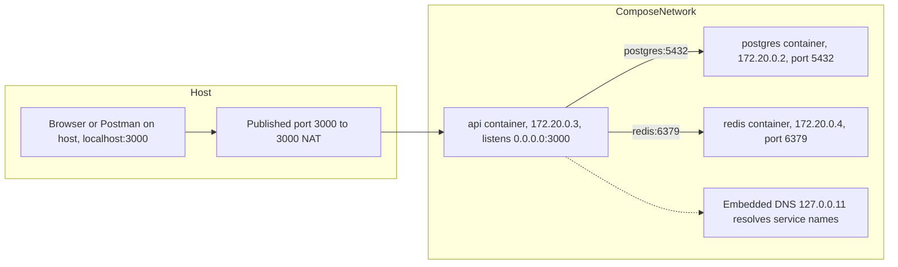

## 44.7 Container networking

#### Concept

Each container gets its own network namespace: a private loopback interface (`lo`), a private `eth0`, its own IP address, its own routing table and its own port space. Docker connects that `eth0` to a virtual switch (a bridge) on the host. Containers on the same user-defined bridge can reach each other by IP and, more usefully, by name through Docker's embedded DNS server. The host reaches a container only through ports you explicitly publish.

#### Why does it exist?

Without network isolation, two containers could not both listen on port 3000, and a container could sniff or spoof traffic of another. With it, every service listens on whatever port it likes inside its own namespace, and the platform decides what is reachable from where. Name-based discovery means your NestJS config says `DB_HOST=postgres`, not an IP that changes on every restart.

#### Mental model

Imagine an apartment building with an internal phone system. Every apartment (container) has its own phone with extension numbers (ports); you can call another apartment by its name through the building's directory (Docker DNS). The outside world cannot ring an apartment directly; the building's reception (the host) forwards only the numbers listed at the front desk (published ports). Inside your apartment, dialling "myself" (`localhost`) rings your own phone, never the neighbour's. That last point is the single most common confusion in Docker networking.

#### How it works

Network drivers you will meet:

| Driver | What it does | Name resolution | Use it for |
|---|---|---|---|
| Default `bridge` (`docker0`) | Legacy shared bridge; containers get IPs from `172.17.0.0/16` | None (no DNS by name) | Nothing; avoid |
| User-defined `bridge` | Private bridge per network; embedded DNS at `127.0.0.11` | Yes, by container or service name | Compose, local dev, single-host deployments |
| `host` | Container shares the host's network namespace; no isolation, no NAT | Host's resolver | Performance-sensitive or port-heavy tools on Linux; not available on Docker Desktop in the same way |
| `none` | Only loopback | None | Sandboxed batch jobs |
| `overlay` | Multi-host network (Swarm) | Yes | Rarely; Kubernetes replaces this |

Step by step for a Compose project with `api` and `postgres` services:

1. Compose creates a user-defined bridge network named `<project>_default`, for example `orders_default`, with a subnet such as `172.20.0.0/16`.
2. Each service's container gets a `veth` pair: one end inside the container as `eth0` with an IP like `172.20.0.3`, the other end attached to the bridge.
3. Docker's embedded DNS server listens on `127.0.0.11` *inside* each container's namespace and answers queries for service names (`postgres`), container names and network aliases with the container's IP. `/etc/resolv.conf` in the container points to it; unknown names are forwarded to the host's resolver.
4. `api` connects to `postgres:5432`. The name resolves to `172.20.0.2`, the packet goes over the bridge, no NAT involved. Latency is 30 to 80 microseconds, the same as loopback for practical purposes.
5. `ports: - "3000:3000"` on `api` installs a NAT rule on the host: host `0.0.0.0:3000` forwards to `172.20.0.3:3000`. Your browser talks to `localhost:3000` on the host; the host forwards it in. PostgreSQL does not need a published port for `api` to reach it; publish `5432` only so that a GUI on your laptop can connect.



The `localhost` confusion, spelled out:

- Inside the `api` container, `localhost:5432` is the `api` container's own loopback. Nothing listens there. `ECONNREFUSED 127.0.0.1:5432` is the symptom.
- The database is at `postgres:5432` (service name) on the shared network.
- To reach something running on your laptop from inside a container (a local mock server, a debugger), use `host.docker.internal` on Docker Desktop. On Linux, add `extra_hosts: ["host.docker.internal:host-gateway"]` to the service.
- Inside the container, your NestJS server must bind to `0.0.0.0`, not `127.0.0.1`, or the published port will connect to the container and be refused.

#### Practical example

The orders API connects to PostgreSQL through a URL built from environment variables. Locally, Compose sets `DB_HOST=postgres`; in Kubernetes, the same variable becomes the Service name (`orders-postgres.shop.svc.cluster.local`) or an RDS hostname. The code never changes.

```yaml
# docker-compose.yml (excerpt)
services:
  api:
    build: .
    ports:
      - "3000:3000"          # host:container; only the API is exposed to the laptop
    environment:
      DB_HOST: postgres        # service name, resolved by Docker DNS
      DB_PORT: "5432"
      REDIS_URL: redis://redis:6379
    depends_on:
      postgres:
        condition: service_healthy
  postgres:
    image: postgres:16.4-alpine
    # No "ports" needed for api -> postgres; add "5432:5432" only for a local GUI
  redis:
    image: redis:7.4-alpine
```

#### NestJS example

Config that produces the same connection whether the host is a Compose service name, a Kubernetes Service or RDS:

```ts
// src/config/database.config.ts
import { registerAs } from '@nestjs/config';

export default registerAs('database', () => ({
  host: process.env.DB_HOST ?? 'localhost',   // 'postgres' in Compose
  port: Number(process.env.DB_PORT ?? 5432),
  username: process.env.DB_USER ?? 'orders',
  password: process.env.DB_PASSWORD ?? '',
  database: process.env.DB_NAME ?? 'orders',
  // Only RDS/production have TLS; Compose PostgreSQL does not
  ssl: process.env.DB_SSL === 'true' ? { rejectUnauthorized: true } : false,
  poolMax: Number(process.env.DB_POOL_MAX ?? 10),
}));
```

#### PostgreSQL example

PostgreSQL inside a container listens on `0.0.0.0` by default in the official image (`listen_addresses = '*'`) and `pg_hba.conf` allows password auth from any address. From another container:

```bash
docker compose exec api sh -c 'nc -zv postgres 5432'      # TCP reachability
docker compose exec postgres psql -U orders -c "SELECT inet_server_addr(), inet_client_addr();"
```

The second command shows the server's address on the bridge (`172.20.0.2`) and the client's (`172.20.0.2` for a local `psql`, or `172.20.0.3` if run from `api`), which is a quick way to confirm which network path is in use.

#### Production scenario

On a single-host staging server, 8 containers on one user-defined bridge talk to each other by name at bridge speed. In production on Kubernetes the same names become Services; the pattern of "connect by name, bind to `0.0.0.0`, publish nothing you do not need" carries over unchanged. A team that learned networking through Compose finds Kubernetes Services familiar: a stable name in front of a changing IP.

#### Failure scenario

At 09:05 a new developer reports "the API cannot reach the database". Their `.env` has `DB_HOST=localhost`, copied from a colleague who runs PostgreSQL natively. Inside the container, `localhost` is the container. The error log says `connect ECONNREFUSED 127.0.0.1:5432`. Fifteen minutes lost; the fix is `DB_HOST=postgres`. The team adds a comment in `.env.example` and a startup log line printing the resolved DB host, which turns the next occurrence into a 30-second fix.

#### Edge cases & failure modes

- **Default bridge has no DNS.** `docker run` without `--network` puts the container on `docker0`, where names do not resolve. Always create or use a user-defined network.
- **Port already allocated.** Two Compose projects publishing `5432:5432` collide on the host; use different host ports or none.
- **IPv6 and `localhost`.** Node 17+ resolves `localhost` to `::1` first; a server bound to `0.0.0.0` (IPv4 only) refuses it. Bind to `::` to accept both, or use `127.0.0.1` explicitly in clients.
- **Alpine DNS behaviour.** musl's resolver historically lacked TCP fallback for large responses and handles `search` domains differently; long service names or many search domains in Kubernetes can produce intermittent `ENOTFOUND`. glibc images are more forgiving.
- **Connection limits from many containers.** Every container's pool counts toward `max_connections` in PostgreSQL; 20 containers with `max: 20` is 400 connections. See Part 19 — PostgreSQL Internals.
- **Bridge MTU.** VPNs on the host can shrink MTU; large responses stall inside containers. Rare but memorable.

#### How a Senior Backend Engineer thinks about this

They never hardcode hosts; everything is a name from configuration. They publish the minimum set of ports and treat a published database port as a security finding outside local dev. They know that "connect by service name" is the same idea on Compose, ECS and Kubernetes, and they explain to juniors, once, that `localhost` inside a container is the container.

#### Common mistakes

- `DB_HOST=localhost` inside a container.
- Binding NestJS to `127.0.0.1`.
- Publishing every port "just in case".
- Using the default bridge and then linking containers with deprecated `--link`.
- Assuming the container can reach the host's services by `localhost`.

#### Interview questions

1. *A container logs `ECONNREFUSED 127.0.0.1:5432`. What is wrong?* Expected: `localhost` is the container's own loopback; use the service name.
2. *How does Docker resolve service names between containers?* Expected: embedded DNS at `127.0.0.11` on user-defined networks; not on the default bridge.
3. *What does `-p 3000:3000` actually do?* Expected: host NAT rule to container IP; container must bind to all interfaces.
4. *When would you use `--network host` and what do you lose?* Expected: raw performance or many ports on Linux; lose isolation and port namespacing.

#### Practical exercise

Create a Compose project with `api`, `postgres` and `redis`. From inside `api`, run `getent hosts postgres`, `cat /etc/resolv.conf`, `nc -zv postgres 5432` and `nc -zv localhost 5432`, and explain each result. Then bind the API to `127.0.0.1` and show the published port failing, then fix it. Acceptance criteria: a short write-up explaining the resolver address, why `localhost:5432` fails, and a passing `curl localhost:3000/health/live` from the host.

## 44.8 Volumes and state

#### Concept

A container's writable layer is disposable: it is deleted when the container is removed, it is slow (copy-on-write through OverlayFS), and it is invisible to other containers. Anything that must outlive the container, be shared, or be fast for heavy writes goes in a volume. Docker has two main kinds: **bind mounts**, which map a host directory into the container, and **named volumes**, which Docker manages in its own storage area.

#### Why does it exist?

A PostgreSQL container that stores its data in the writable layer loses the whole database on `docker compose down`. A developer who wants hot reload needs the container to see the source files being edited on the host. A worker that writes uploaded files to `/tmp` and expects another container to read them needs a shared location. Volumes solve all three and, more importantly, they make the boundary explicit: *this container is stateless; the only state is here.*

#### Mental model

Imagine hotel rooms. The room (container) is cleaned and reset between guests; anything left inside is thrown away. The hotel safe deposit box (named volume) keeps your valuables between stays. A window into your own house (bind mount) lets you work on files at home while sitting in the hotel, but the hotel staff (container user) may not have the keys to your drawers (permissions).

#### How it works

| Kind | Syntax (Compose) | Where the data lives | Performance | Use for |
|---|---|---|---|---|
| Writable layer | (default) | OverlayFS upper dir; deleted with container | Slow for heavy writes | Nothing important |
| Named volume | `pgdata:/var/lib/postgresql/data` | `/var/lib/docker/volumes/<name>/_data` on the Docker host (inside the VM on Desktop) | Native filesystem speed | Databases, Redis persistence, broker logs |
| Bind mount | `./src:/app/src` | Your host directory | Native on Linux; slow across the Desktop VM boundary on macOS/Windows | Source code for hot reload, config files |
| tmpfs | `tmpfs: - /tmp` | RAM | Fastest; lost on stop | Scratch space, especially with a read-only root filesystem |

Step by step for a PostgreSQL named volume:

1. `docker compose up` sees `volumes: pgdata:` and creates it if missing.
2. The volume is mounted at `/var/lib/postgresql/data` in the `postgres` container, *over* whatever the image had there. Because the volume is empty on first run, Docker copies the image's existing directory contents into it (this copy only happens for named volumes, not bind mounts).
3. PostgreSQL's entrypoint sees an empty `PGDATA`, runs `initdb`, creates the user and database from `POSTGRES_USER`, `POSTGRES_PASSWORD`, `POSTGRES_DB`, and runs any `*.sql` in `/docker-entrypoint-initdb.d/`.
4. On subsequent starts, `PGDATA` is populated, so init scripts are skipped. This surprises everyone once: changing `POSTGRES_PASSWORD` in Compose does nothing to an existing volume.
5. `docker compose down` removes containers but keeps volumes; `docker compose down -v` deletes them.

Permissions: the official PostgreSQL image runs as uid 999 (`postgres`). `initdb` requires `PGDATA` to be owned by that user with mode `0700` or `0750`. With a named volume Docker handles it. With a bind mount on Linux, the directory takes your host uid and PostgreSQL fails with `data directory has wrong ownership` or `permission denied`. Your NestJS container runs as uid 1000 (`node`); a bind-mounted `./uploads` directory owned by a host user with uid 501 (macOS default) works on Docker Desktop (it remaps) but fails on a Linux CI runner. The rule: named volumes for data the container owns; bind mounts for files the developer owns.

#### Practical example

```yaml
services:
  postgres:
    image: postgres:16.4-alpine
    environment:
      POSTGRES_USER: orders
      POSTGRES_PASSWORD: orders
      POSTGRES_DB: orders
    volumes:
      - pgdata:/var/lib/postgresql/data                 # durable data
      - ./db/init:/docker-entrypoint-initdb.d:ro         # first-run SQL, read-only bind mount
    healthcheck:
      test: ["CMD-SHELL", "pg_isready -U orders -d orders"]
      interval: 5s
      timeout: 3s
      retries: 10

  api:
    build:
      context: .
      target: deps                 # dev image with the full toolchain
    command: ["npx", "nest", "start", "--watch"]
    volumes:
      - ./src:/app/src             # hot reload: edits on the host are seen in the container
      - /app/node_modules          # anonymous volume: keep the container's Linux node_modules
    environment:
      CHOKIDAR_USEPOLLING: "true"  # file watching across the Desktop VM boundary

volumes:
  pgdata:
```

The `/app/node_modules` anonymous volume is the trick that prevents your host `node_modules` (built for macOS or Windows) from shadowing the container's Linux one when you bind-mount the project directory.

#### NestJS example

Stateless means the API writes nothing local that matters. File uploads are the usual violation. Stream them to object storage and keep only metadata in PostgreSQL:

```ts
// src/uploads/uploads.service.ts
import { Injectable } from '@nestjs/common';
import { S3Client, PutObjectCommand } from '@aws-sdk/client-s3';
import { InjectRepository } from '@nestjs/typeorm';
import { Repository } from 'typeorm';
import { Upload } from './upload.entity';

@Injectable()
export class UploadsService {
  private readonly s3 = new S3Client({ region: process.env.AWS_REGION });

  constructor(@InjectRepository(Upload) private readonly uploads: Repository<Upload>) {}

  async store(userId: string, file: Express.Multer.File): Promise<Upload> {
    const key = `users/${userId}/${crypto.randomUUID()}-${file.originalname}`;
    // Bytes go to S3 (or MinIO locally); nothing is written to the container disk
    await this.s3.send(new PutObjectCommand({
      Bucket: process.env.UPLOADS_BUCKET,
      Key: key,
      Body: file.buffer,
      ContentType: file.mimetype,
    }));
    return this.uploads.save(this.uploads.create({ userId, key, size: file.size }));
  }
}
```

Locally, MinIO runs as another Compose service with its own named volume, and `AWS_ENDPOINT_URL` points at it. The API code is identical in both places.

#### PostgreSQL example

Verifying where data lives and that it survives a restart:

```bash
docker compose exec postgres psql -U orders -c "SHOW data_directory;"   # /var/lib/postgresql/data
docker volume inspect orders_pgdata --format '{{.Mountpoint}}'
docker compose down && docker compose up -d
docker compose exec postgres psql -U orders -c "SELECT count(*) FROM orders;"  # still there
```

And the one-time initialisation script pattern for local dev, mounted read-only:

```sql
-- db/init/01-extensions.sql : runs only when PGDATA is empty
CREATE EXTENSION IF NOT EXISTS "pgcrypto";
CREATE EXTENSION IF NOT EXISTS "pg_stat_statements";
```

#### Production scenario

In production you rarely use Docker volumes directly: Kubernetes PersistentVolumes back StatefulSets, and most teams use RDS or Aurora for PostgreSQL anyway (see Part 45 for the honest discussion). The habit that carries over is stateless application containers: no local writes, logs to stdout, uploads to object storage, sessions in Redis. A stateless API can be scaled to 40 replicas or killed at any time with no data loss.

#### Failure scenario

A team runs PostgreSQL in Docker on a staging server with the data in the writable layer (no volume). A routine `docker compose up --force-recreate` after an image bump recreates the container; the database is empty. Three weeks of QA test data is gone. Staging is rebuilt from a production snapshot, which takes a day. The lesson is written into the Compose file as a named volume and into the team's checklist: *any container with data has a volume, and the volume is backed up or reproducible.*

#### Edge cases & failure modes

- **Init scripts run once.** Changing `POSTGRES_PASSWORD` or adding a script does nothing to an existing volume; `docker compose down -v` (destroying data) is the reset.
- **Bind-mount performance on Desktop.** A `node_modules` bind mount on macOS can make `nest start` 5 to 10 times slower; keep `node_modules` in a volume or in the container.
- **Ownership on Linux hosts.** Files created by the container as uid 1000 appear owned by uid 1000 on the host; if your user is 1001, you cannot delete them without `sudo`. Match uids or use named volumes.
- **Volume mounted over image content.** A bind mount to `/app` hides the image's `/app` entirely, including `dist`; mount only `src`.
- **Read-only root filesystem plus volumes.** With `read_only: true`, every writable path (`/tmp`, `/app/.cache`) needs an explicit tmpfs or volume.
- **Disk full.** Named volumes live on the Docker host's disk; a PostgreSQL volume growing unbounded on a small root partition fills the disk and stops every container on the host.

#### How a Senior Backend Engineer thinks about this

They ask "where does state live?" for every container, and the only acceptable answers are "nowhere" (stateless) or "in a named, backed-up volume or an external store". They keep bind mounts strictly for development. They know the `initdb` runs-once rule and the uid rules well enough to fix a permission error in one minute rather than by running everything as root.

#### Common mistakes

- No volume for PostgreSQL or Redis in Compose.
- Bind-mounting the whole project directory including `node_modules`.
- Storing uploads on the container disk.
- Fixing a bind-mount permission error with `USER root`.
- Expecting environment changes to reconfigure an already-initialised database volume.

#### Interview questions

1. *What is the difference between a bind mount and a named volume, and when do you use each?* Expected: host path versus Docker-managed; dev source versus database data; performance and permissions differences.
2. *Why does changing `POSTGRES_PASSWORD` in Compose not change the password?* Expected: init runs only on empty `PGDATA`.
3. *Why must application containers be stateless?* Expected: restart, scale, replace freely; state goes to PostgreSQL, Redis, object storage.
4. *Your container runs as uid 1000 and cannot write to a bind-mounted directory. What are your options?* Expected: match ownership on host, `--chown`/entrypoint chown for named volumes, use a named volume, avoid root.

#### Practical exercise

Set up Compose with PostgreSQL on a named volume and the API with a bind-mounted `src`. Insert 1,000 orders, run `docker compose down`, then `up`, and verify the rows exist. Then run `down -v` and show they are gone. Add a `read_only: true` API container with a tmpfs `/tmp` and make the app work. Acceptance criteria: data persists across `down`/`up`, hot reload works when editing a controller, and the read-only API passes its health check.

## 44.9 Environment variables and configuration

#### Concept

Configuration is everything that varies between deployments of the same image: database host, credentials, feature flags, log level, external API endpoints. The twelve-factor rule is that configuration lives in the environment, not in the image, so that one image serves every environment. Build-time settings (`ARG`) are baked into the image and cannot change later; run-time settings (`ENV`, `-e`, Compose `environment`, Kubernetes ConfigMaps and Secrets) are read when the process starts.

#### Why does it exist?

If configuration is inside the image, you need a different image per environment, which means the image you tested is not the image you ship. If secrets are inside the image, anyone who can pull the image (every developer, every CI runner, every node) has production credentials, forever, in a layer. If configuration is unvalidated, a typo in a variable name is discovered by a customer at 2 a.m. Externalised, validated configuration solves all three.

#### Mental model

Imagine a delivery van (the image). The van is identical for every city. The route sheet (configuration) is handed to the driver at the depot each morning. You would never paint the route on the van, and you would never leave the depot's master key taped under the dashboard.

#### How it works

1. **Build time.** `ARG` values exist only during `docker build`; they are visible in `docker history` (so never pass secrets as `ARG`) and are gone from the running container unless copied into an `ENV`.
2. **Image defaults.** `ENV NODE_ENV=production PORT=3000` sets defaults recorded in the image config. They are visible to anyone with the image. Safe for non-secrets that rarely change.
3. **Run time.** `docker run -e DB_PASSWORD=...`, Compose `environment:` and `env_file:`, or Kubernetes `env`/`envFrom`. Overrides image defaults. This is where per-environment values and secrets go.
4. **Secrets as files.** Docker Compose `secrets:` and Kubernetes Secret volumes mount secrets as files (`/run/secrets/db_password`) rather than environment variables, which keeps them out of `docker inspect`, crash dumps and child processes. Many libraries support `DB_PASSWORD_FILE`-style variables for this reason.
5. **Validation at startup.** The application reads the environment once, validates the shape and types, and refuses to start on invalid config. Failing fast at boot with a clear message is far cheaper than failing at first use.

`.env` files: convenient for local development, never for production. Compose reads `.env` from the project directory for variable substitution and `env_file:` for container environment. Keep `.env` in `.gitignore` and `.dockerignore`, commit a `.env.example` with placeholder values.

`ARG` versus `ENV`:

| | `ARG` | `ENV` |
|---|---|---|
| Available during build | Yes | Yes (after the line) |
| Available at run time | No | Yes |
| Visible in `docker history` | Yes (value in the layer metadata) | Yes |
| Overridable at run | No | Yes (`-e`) |
| Safe for secrets | No | No |
| Typical use | Base image version, build target, Git SHA for a label | `NODE_ENV`, `PORT`, `TZ`, non-secret defaults |

#### Practical example

The orders API has around 25 configuration values. Locally they come from `.env` via Compose; in Kubernetes from a ConfigMap and a Secret; in CI from the workflow. In every case the app validates them the same way, and a missing `DATABASE_URL` produces `Config validation error: "DATABASE_URL" is required` and exit code 1 before any request is served.

#### NestJS example

`@nestjs/config` with a Joi schema. Validation runs when `ConfigModule` initialises, so the app never starts with bad config:

```ts
// src/app.module.ts (excerpt)
import { Module } from '@nestjs/common';
import { ConfigModule } from '@nestjs/config';
import * as Joi from 'joi';
import databaseConfig from './config/database.config';

@Module({
  imports: [
    ConfigModule.forRoot({
      isGlobal: true,
      load: [databaseConfig],
      // Do not read .env in production: the environment is the source of truth
      ignoreEnvFile: process.env.NODE_ENV === 'production',
      validationSchema: Joi.object({
        NODE_ENV: Joi.string().valid('development', 'test', 'production').required(),
        PORT: Joi.number().port().default(3000),
        DB_HOST: Joi.string().hostname().required(),
        DB_PORT: Joi.number().port().default(5432),
        DB_USER: Joi.string().required(),
        DB_PASSWORD: Joi.string().min(8).required(),
        DB_NAME: Joi.string().required(),
        DB_POOL_MAX: Joi.number().integer().min(1).max(50).default(10),
        REDIS_URL: Joi.string().uri({ scheme: ['redis', 'rediss'] }).required(),
        KAFKA_BROKERS: Joi.string().required(),           // comma-separated host:port
        JWT_SECRET: Joi.string().min(32).required(),
        LOG_LEVEL: Joi.string().valid('debug', 'info', 'warn', 'error').default('info'),
      }),
      validationOptions: { abortEarly: false }, // report every problem at once
    }),
  ],
})
export class AppModule {}
```

The same with `zod`, using the `validate` option, which gives you a typed config object:

```ts
// src/config/env.schema.ts
import { z } from 'zod';

export const envSchema = z.object({
  NODE_ENV: z.enum(['development', 'test', 'production']),
  PORT: z.coerce.number().int().positive().default(3000),
  DATABASE_URL: z.string().url().startsWith('postgres'),
  REDIS_URL: z.string().url(),
  JWT_SECRET: z.string().min(32),
  DB_POOL_MAX: z.coerce.number().int().min(1).max(50).default(10),
});
export type Env = z.infer<typeof envSchema>;

// Used as ConfigModule.forRoot({ validate })
export function validate(raw: Record<string, unknown>): Env {
  const result = envSchema.safeParse(raw);
  if (!result.success) {
    // One line per problem; the container exits 1 and the orchestrator shows the log
    const issues = result.error.issues.map((i) => `${i.path.join('.')}: ${i.message}`);
    throw new Error(`Config validation error:\n${issues.join('\n')}`);
  }
  return result.data;
}
```

#### TypeORM example

The `DataSource` reads the same validated config, and the migration CLI uses the same file, so migrations and the app can never disagree about which database they target:

```ts
// src/database/data-source.ts  (used by both TypeOrmModule and the CLI)
import 'reflect-metadata';
import { DataSource, DataSourceOptions } from 'typeorm';

export const dataSourceOptions: DataSourceOptions = {
  type: 'postgres',
  host: process.env.DB_HOST,
  port: Number(process.env.DB_PORT ?? 5432),
  username: process.env.DB_USER,
  password: process.env.DB_PASSWORD,
  database: process.env.DB_NAME,
  entities: [__dirname + '/../**/*.entity.js'],
  migrations: [__dirname + '/../migrations/*.js'],
  migrationsTableName: 'typeorm_migrations',
  synchronize: false,                     // never in a containerised deploy
  logging: process.env.LOG_LEVEL === 'debug',
  extra: { max: Number(process.env.DB_POOL_MAX ?? 10) },
};

export const AppDataSource = new DataSource(dataSourceOptions);
```

The migration runner in Compose (44.12) executes `node node_modules/typeorm/cli.js migration:run -d dist/database/data-source.js` with the same environment as the API.

#### Sequelize example

```ts
// src/app.module.ts (excerpt)
import { SequelizeModule } from '@nestjs/sequelize';
import { ConfigService } from '@nestjs/config';

SequelizeModule.forRootAsync({
  inject: [ConfigService],
  useFactory: (config: ConfigService) => ({
    dialect: 'postgres',
    host: config.getOrThrow<string>('DB_HOST'),
    port: config.get<number>('DB_PORT', 5432),
    username: config.getOrThrow<string>('DB_USER'),
    password: config.getOrThrow<string>('DB_PASSWORD'),
    database: config.getOrThrow<string>('DB_NAME'),
    autoLoadModels: true,
    synchronize: false,
    pool: { max: config.get<number>('DB_POOL_MAX', 10), acquire: 5_000 },
    logging: false,
  }),
});
```

`getOrThrow` turns a missing variable into a startup failure with the variable's name in the message.

#### Production scenario

A company with 60 services standardises on: image defaults for `NODE_ENV`, `PORT`, `TZ`; a ConfigMap per service for non-secret settings; secrets from AWS Secrets Manager synced into Kubernetes Secrets and mounted as files; Joi validation in every service. A dashboard counts "config validation failures at startup" per deploy. In a year, 31 bad deploys were caught by validation before serving a single request, each within 5 seconds of the pod starting.

#### Failure scenario

At 16:20 a deploy of `notifications-api` goes out with `SMTP_HOST` misspelled as `SMPT_HOST` in the ConfigMap. There was no validation. The pods started, passed liveness, and served traffic. Every email for 40 minutes failed with `getaddrinfo ENOTFOUND undefined` until a customer asked support why they had not received an order confirmation. With required-field validation the pods would have crashed at boot, the rollout would have stalled at 1 of 6 replicas, and the old pods would have kept serving. The team added the schema that afternoon and, after that, `kubectl rollout status` did the catching.

#### Edge cases & failure modes

- **Secrets in environment variables leak** into `docker inspect`, `/proc/<pid>/environ`, crash reports, child processes and often logs. Prefer file-mounted secrets for the most sensitive values.
- **`.env` copied into the image** because `.dockerignore` was missing. Now every developer has production credentials.
- **Booleans as strings.** `FEATURE_X=false` is a non-empty string and truthy in JavaScript; coerce with a schema.
- **Numbers as strings.** `PORT="3000"` works because `listen` coerces; `DB_POOL_MAX="10"` handed to a library expecting a number may silently become `NaN`. Coerce with a schema.
- **Build-time `ARG` used for a secret** (an npm token) remains in `docker history`. Use BuildKit secret mounts: `RUN --mount=type=secret,id=npmrc,target=/root/.npmrc npm ci`.
- **Config that changes after start.** Environment variables are read once at process start; rotating a secret means restarting the pod (see Part 45 on checksum annotations).
- **Defaults that hide problems.** A default `DB_HOST=localhost` masks a missing variable in Compose; use required for anything that differs per environment.

#### How a Senior Backend Engineer thinks about this

They separate *identity* (the image, immutable) from *behaviour* (the config, injected). They validate config at boot and treat validation failures as the cheapest possible incident. They keep secrets out of images, out of Git and, where feasible, out of environment variables. They give every variable a name that says its unit (`HTTP_TIMEOUT_MS`, not `TIMEOUT`) and a documented example in `.env.example`.

#### Common mistakes

- Copying `.env` into the image or baking secrets with `ENV`.
- No validation, so typos become runtime errors hours later.
- Different config loading code for the app and the migration CLI, so they connect to different databases.
- Reading `process.env` all over the codebase instead of through `ConfigService`, making the set of variables impossible to audit.
- Setting `synchronize: true` in a containerised deploy.

#### Interview questions

1. *Explain the difference between `ARG` and `ENV` and why neither is safe for secrets.* Expected: build versus run scope; both visible in image metadata or history; use BuildKit secret mounts and run-time secret injection.
2. *How do you make a NestJS service refuse to start with bad configuration?* Expected: `ConfigModule.forRoot` with `validationSchema` (Joi) or `validate` (zod); exit non-zero; orchestrator halts rollout.
3. *Why are file-mounted secrets sometimes better than environment variables?* Expected: environment leaks through inspect, `/proc`, children, crash dumps; files can be permissioned and rotated.
4. *One image for all environments: what has to be true?* Expected: no environment-specific code paths at build, all config injected, validated, and secrets external.

#### Practical exercise

Add Joi or zod validation to an existing NestJS service. Remove a required variable and confirm the container exits with code 1 and a readable message within 3 seconds. Move the database password to a Compose `secrets:` file mount and read it from `DB_PASSWORD_FILE`. Acceptance criteria: `docker inspect` of the running container shows no password in `Config.Env`, the app starts and connects, and a misspelled variable name fails startup with the exact variable name in the log.
