## 44.14 Debugging containers

#### Concept

Debugging a container means answering four questions in order: is the process running and why did it stop (`docker inspect`, exit code), what did it say (`docker logs`), what is it doing now (`docker exec`, `docker stats`, `node --inspect`), and what is the environment it sees (`docker inspect` config, `docker exec env`). The same four questions apply on Kubernetes with `kubectl` (Part 45); the mechanics below are the foundation.

#### Why does it exist?

A process inside a container is one step removed from you: you cannot attach a debugger to it by default, its filesystem is not your filesystem, its logs are not in a file you can open, and its death is often decided by the kernel rather than by your code. Without a repeatable method, engineers guess, restart, and hope. With one, most container problems are diagnosed in minutes.

#### Mental model

Imagine a black-box flight recorder. After an incident you do not start by interviewing the pilot's colleagues; you read the recorder: what was the last state, what were the instruments showing, what was said in the cockpit. `docker inspect` is the state, `docker stats` is the instruments, `docker logs` is the cockpit voice recorder, `docker exec` is climbing into the cockpit while it is still flying.

#### How it works

The commands, what they show, and what to look for:

```bash
# 1. State and cause of death
docker inspect orders-api --format '{{.State.Status}} exit={{.State.ExitCode}} oom={{.State.OOMKilled}} started={{.State.StartedAt}} finished={{.State.FinishedAt}}'
# running exit=0 oom=false ...     -> alive
# exited exit=137 oom=true ...     -> killed by the memory cgroup
# exited exit=137 oom=false ...    -> SIGKILL after stop grace period (or docker kill)
# exited exit=1 ...                -> the app threw; read the logs
# restarting ...                   -> restart policy loop; check RestartCount

docker inspect orders-api --format '{{.RestartCount}} {{.HostConfig.Memory}} {{.HostConfig.NanoCpus}}'

# 2. Logs, with time filters so you are not scrolling through a day of JSON
docker logs --since 15m --timestamps orders-api 2>&1 | tail -200
docker logs -f orders-api                  # follow
docker logs orders-api 2>&1 | grep -E '"level":"(error|fatal)"' | tail -50

# 3. Live resource usage: CPU %, memory used / limit, network, block I/O, PIDs
docker stats --no-stream orders-api
# If MEM USAGE is within 10% of LIMIT, an OOM kill is coming

# 4. Inside the container
docker exec -it orders-api sh                      # Alpine; bash on Debian; nothing on distroless
docker exec orders-api env | sort                  # what config does the process actually see
docker exec orders-api cat /sys/fs/cgroup/memory.max /sys/fs/cgroup/cpu.max
docker exec orders-api cat /sys/fs/cgroup/cpu.stat | grep throttled   # CPU throttling counters
docker exec orders-api ls -la /app/dist
docker exec orders-api node -e "console.log(process.memoryUsage())"

# 5. Networking from inside
docker exec orders-api getent hosts postgres
docker exec orders-api nc -zv postgres 5432
docker exec orders-api cat /etc/resolv.conf

# 6. Host-side evidence of OOM kills (Linux hosts)
dmesg -T | grep -i -E 'killed process|out of memory' | tail -5
docker events --since 30m --filter event=oom --filter event=die
```

Distroless images have no shell. The options are `docker debug` (Docker Desktop feature), running a second container that shares the namespaces (`docker run --rm -it --pid=container:orders-api --network=container:orders-api nicolaka/netshoot`), or, in Kubernetes, `kubectl debug` with an ephemeral container. Plan for this before choosing distroless.

Attaching the Node inspector to a running container:

1. Start the container with the inspector listening on all interfaces and the port published: `docker run -p 9229:9229 ... node --inspect=0.0.0.0:9229 dist/main.js`. In Compose this is the `start:debug` script from 44.12.
2. For an *already running* process, send `SIGUSR1`: `docker kill --signal=SIGUSR1 orders-api`. Node opens the inspector on `127.0.0.1:9229`, which is reachable only from inside the container; forward it with `docker exec orders-api socat TCP-LISTEN:9230,fork TCP:127.0.0.1:9229` if `socat` is available, or plan ahead with a published port in development only.
3. Attach from VS Code or `chrome://inspect`. Take a heap snapshot or a CPU profile. Do this in staging with production-like data before you need it in production; never leave the inspector port published in production.

Reading an OOM kill: the tell-tale triad is exit code 137, `OOMKilled: true`, and no shutdown log lines from the app (it never had a chance). If `OOMKilled` is false but the code is 137, the runtime killed it after the grace period, which means `SIGTERM` was ignored or shutdown took too long. If the last log line is `FATAL ERROR: Reached heap limit`, V8 hit `--max-old-space-size` and aborted with 134, which is a different, more informative failure.

#### Practical example

`docker stats` on the orders API shows `MEM USAGE / LIMIT 470MiB / 512MiB` and climbing 2 MB per minute. `docker exec orders-api node -e "console.log(process.memoryUsage())"` shows `heapUsed` at 150 MB but `external` at 280 MB: a Buffer leak, not a heap leak. A heap snapshot would not show it; the culprit is a Kafka consumer accumulating unacknowledged message payloads. The metric that would have caught it earlier is `process.memoryUsage().external` exported to Prometheus.

#### NestJS example

Make the process debuggable from the outside without a shell: a diagnostics endpoint on a separate, unpublished port that reports memory, event loop lag, pool usage and config (redacted). Bind it to the pod network only, never behind the public ingress.

```ts
// src/diagnostics/diagnostics.controller.ts
import { Controller, Get } from '@nestjs/common';
import { DataSource } from 'typeorm';
import { monitorEventLoopDelay } from 'node:perf_hooks';

const loopDelay = monitorEventLoopDelay({ resolution: 20 });
loopDelay.enable();

@Controller('internal/diagnostics')
export class DiagnosticsController {
  constructor(private readonly dataSource: DataSource) {}

  @Get()
  snapshot() {
    const mem = process.memoryUsage();
    const pool = (this.dataSource.driver as any).master; // pg Pool instance
    return {
      pid: process.pid,
      uptimeSec: Math.round(process.uptime()),
      memoryMb: {
        rss: Math.round(mem.rss / 1_048_576),
        heapUsed: Math.round(mem.heapUsed / 1_048_576),
        external: Math.round(mem.external / 1_048_576),
      },
      eventLoopLagMs: { p50: loopDelay.percentile(50) / 1e6, p99: loopDelay.percentile(99) / 1e6 },
      pgPool: { total: pool?.totalCount, idle: pool?.idleCount, waiting: pool?.waitingCount },
      config: { nodeEnv: process.env.NODE_ENV, dbHost: process.env.DB_HOST, poolMax: process.env.DB_POOL_MAX },
    };
  }
}
```

`curl` this from `docker exec` (or `kubectl port-forward`) to see what the process believes about itself.

#### Production scenario

An SRE team documents a five-minute triage for any restarting container: inspect for exit code and OOM, logs for the last 200 lines, stats for headroom, exec for config, then decide between "fix config and redeploy", "raise limit and investigate leak", or "rollback". Median time from page to diagnosis fell from 25 minutes to 6 after the runbook was written and rehearsed.

#### Failure scenario

At 02:14 `checkout-api` is restarting. The engineer reads application logs for 20 minutes and finds nothing unusual: the last line is a normal request log. Only then do they run `docker inspect` and see `OOMKilled: true`. The application logs were never going to explain it. The runbook order (inspect first) exists so that this 20 minutes is never lost again.

#### Edge cases & failure modes

- **Logs lost on `docker rm`.** Removing a container deletes its json-file logs; ship logs off the host before cleanup scripts run.
- **`docker logs` on a container with millions of lines** is slow; always use `--since` or `--tail`.
- **`docker exec` as root** when the container runs as `node` can create root-owned files that break the app later; use `docker exec -u node`.
- **Inspector left enabled** is remote code execution for anyone who can reach the port.
- **`docker stats` memory** includes page cache and can look higher than RSS; compare with `process.memoryUsage()`.
- **Clock differences** between `docker logs --timestamps` (host clock) and application timestamps (container's view of the same clock, but possibly a different `TZ`) confuse timelines; log in UTC.

#### How a Senior Backend Engineer thinks about this

They debug in a fixed order: state, logs, stats, exec. They build observability into the service so that most questions are answered by a metric or a diagnostics endpoint rather than a shell. They rehearse the inspector attach in staging so that under pressure it is muscle memory. And they never trust "the logs show nothing" until they have read the exit code.

#### Common mistakes

- Reading application logs before checking the exit code and `OOMKilled`.
- Choosing distroless without a plan for shell-less debugging.
- Leaving `--inspect` on in production images.
- `docker logs` without `--since` on a busy service.

#### Interview questions

1. *A container restarts every minute. Walk me through your first five commands.* Expected: inspect (exit code, OOM, restart count), logs `--since`, stats, exec env, then hypothesis.
2. *How do you attach a debugger to a Node process in a container?* Expected: `--inspect=0.0.0.0:9229` with a published port in dev; `SIGUSR1` for a running process; never in production.
3. *Exit code 137, `OOMKilled: false`. What happened?* Expected: killed after the stop grace period; `SIGTERM` ignored or slow shutdown.
4. *How would you debug a container built from a distroless image?* Expected: sidecar sharing namespaces, `kubectl debug` ephemeral container, diagnostics endpoint, metrics.

#### Practical exercise

Deliberately break the orders API three ways: a memory leak (accumulate Buffers per request), a missing environment variable, and a `SIGTERM` handler that never resolves. For each, use only `docker inspect`, `docker logs`, `docker stats` and `docker exec` to diagnose, and write down the exact evidence that identified the cause. Acceptance criteria: each diagnosis under 5 minutes, the evidence for each names the distinguishing signal (OOM flag, config error line, exit 137 with OOM false), and a heap snapshot taken through the inspector shows the leaked Buffers.

## 44.15 Building in CI

#### Concept

CI builds the image, tests it, scans it, signs it and pushes it. Two things distinguish a good CI build from a laptop build: it starts from an empty cache on every run unless you bring the cache with you, and it must produce the same image for every platform your nodes run on (x86 and ARM). BuildKit's registry cache and `buildx` multi-platform builds solve both.

#### Why does it exist?

Ephemeral CI runners have no layer cache. Without a remote cache, every build reinstalls dependencies (2 to 6 minutes) even when only a controller changed. Without multi-arch, moving to Graviton nodes (30 to 40% cheaper for the same throughput) means a second pipeline. Without reproducibility, the image built for a hotfix differs from the one tested. And without signing in CI, "built by CI" is a claim nobody can verify.

#### Mental model

Imagine a bakery that opens a new kitchen every morning with empty shelves. Bringing yesterday's prepared dough (the cache) from cold storage means the first loaf is ready in minutes. Baking the same recipe in two oven types (amd64 and arm64) at the same time means every customer gets bread that fits their toaster.

#### How it works



```mermaid
flowchart LR
  A["Push to main"] --> B["Checkout, set up buildx"]
  B --> C["Build target=build, run unit tests"]
  C --> D["Build runtime, multi-arch, cache from registry"]
  D --> E["Trivy scan, fail on high or critical"]
  E --> F["Push sha and semver tags to ECR"]
  F --> G["Generate SBOM, cosign sign digest"]
  G --> H["Update image reference in deploy repo"]
  H --> I["Rollout on Kubernetes"]
```

1. **Remote cache.** `--cache-from type=registry,ref=REPO:buildcache` imports layer metadata and pulls only the layers that hit. `--cache-to type=registry,ref=REPO:buildcache,mode=max` exports all intermediate stages (not just the final one), so the `deps` and `prod-deps` layers are reusable. On GitHub Actions, `type=gha` uses the Actions cache instead (10 GB limit per repo; fine for a few services).
2. **Multi-arch.** `docker buildx build --platform linux/amd64,linux/arm64` builds both, either with QEMU emulation (slow: 3 to 8 times) or with native runners per architecture and a manifest merge. Native ARM runners are worth it once you have more than a handful of services.
3. **Reproducibility.** Same base digest, same lockfile, `npm ci`, no network access during the build except to the npm registry (`--network=none` for later stages if possible), `SOURCE_DATE_EPOCH` set to the commit time so layer timestamps are stable. The result: two builds of the same commit produce identical layer digests, which makes "did anything change" a comparison rather than an investigation.
4. **Tests against the image.** Run unit tests in the `build` target (same dependencies as the artefact) and integration tests against the runtime image with Compose services.
5. **Gate, then push, then sign.** Scan before push so a vulnerable image never lands in the registry. Sign the digest, not the tag.

A GitHub Actions workflow that does all of it:

```yaml
# .github/workflows/build.yml
name: build-and-push
on:
  push:
    branches: [main]
    tags: ["v*"]

permissions:
  contents: read
  id-token: write        # OIDC for AWS and for keyless cosign
  packages: write

env:
  REGISTRY: 123456789012.dkr.ecr.eu-west-1.amazonaws.com
  IMAGE: orders-api

jobs:
  build:
    runs-on: ubuntu-24.04
    steps:
      - uses: actions/checkout@v4

      - uses: docker/setup-qemu-action@v3
      - uses: docker/setup-buildx-action@v3

      - uses: aws-actions/configure-aws-credentials@v4
        with:
          role-to-assume: arn:aws:iam::123456789012:role/gha-ecr-push
          aws-region: eu-west-1
      - uses: aws-actions/amazon-ecr-login@v2

      - name: Compute tags
        id: meta
        uses: docker/metadata-action@v5
        with:
          images: ${{ env.REGISTRY }}/${{ env.IMAGE }}
          tags: |
            type=sha,prefix=sha-,format=short
            type=semver,pattern={{version}}
            type=semver,pattern={{major}}.{{minor}}

      - name: Unit tests in the build stage
        uses: docker/build-push-action@v6
        with:
          context: .
          target: build
          load: true
          tags: ${{ env.IMAGE }}:test
          cache-from: type=registry,ref=${{ env.REGISTRY }}/${{ env.IMAGE }}:buildcache
      - run: docker run --rm ${{ env.IMAGE }}:test npm test -- --ci

      - name: Build runtime image (multi-arch) without pushing
        uses: docker/build-push-action@v6
        with:
          context: .
          platforms: linux/amd64,linux/arm64
          push: false
          load: false
          tags: ${{ steps.meta.outputs.tags }}
          build-args: |
            GIT_SHA=${{ github.sha }}
            VERSION=${{ steps.meta.outputs.version }}
          cache-from: type=registry,ref=${{ env.REGISTRY }}/${{ env.IMAGE }}:buildcache
          cache-to: type=registry,ref=${{ env.REGISTRY }}/${{ env.IMAGE }}:buildcache,mode=max
          outputs: type=oci,dest=/tmp/image.tar

      - name: Scan
        uses: aquasecurity/trivy-action@0.28.0
        with:
          input: /tmp/image.tar
          severity: HIGH,CRITICAL
          ignore-unfixed: true
          exit-code: "1"

      - name: Push
        id: push
        uses: docker/build-push-action@v6
        with:
          context: .
          platforms: linux/amd64,linux/arm64
          push: true
          tags: ${{ steps.meta.outputs.tags }}
          build-args: |
            GIT_SHA=${{ github.sha }}
            VERSION=${{ steps.meta.outputs.version }}
          cache-from: type=registry,ref=${{ env.REGISTRY }}/${{ env.IMAGE }}:buildcache
          sbom: true
          provenance: mode=max

      - name: Sign the digest (keyless, tied to this workflow identity)
        run: cosign sign --yes ${{ env.REGISTRY }}/${{ env.IMAGE }}@${{ steps.push.outputs.digest }}
```

The second build step is a cache hit for everything the first one already produced, so "build, scan, push" costs one build in practice. `steps.push.outputs.digest` is the value the deploy step writes into the Kubernetes manifest or Helm values.

#### Practical example

A team moves the orders API from x86 `m6i` nodes to Graviton `m7g` nodes. Because CI already produced a multi-arch manifest, the change is a node pool swap; the kubelet on an ARM node pulls the `arm64` manifest automatically. Throughput per dollar improves 35%. The one surprise: a native module (`sharp`) had a prebuilt for `linux-arm64-musl` but an older transitive dependency did not; the build stage compiled it under QEMU, taking 9 minutes until they added a native ARM runner.

#### Production scenario

Across 60 services, registry-backed caching brought the median CI build from 5 min 10 s to 1 min 25 s. Multi-arch builds with QEMU added 2 minutes each until native ARM runners were introduced. Signing and SBOMs added 15 seconds. The registry's `buildcache` tags are cleaned by a lifecycle rule after 14 days.

#### Failure scenario

A hotfix is built on an engineer's laptop with `docker build` and pushed as `sha-abc1234` because CI was "too slow". The laptop is an M2 Mac; the image is `arm64` only. Production nodes are `amd64`. Every pod goes to `CrashLoopBackOff` with `exec /sbin/tini: exec format error`. The rollback takes 4 minutes; the post-mortem takes an hour and ends with an admission policy that rejects unsigned images, which removes the laptop path entirely.

#### Edge cases & failure modes

- **Cache poisoning across branches.** A shared `buildcache` tag means a feature branch can export layers that main imports; acceptable for dependency layers, but keep secrets out of build args.
- **`mode=max` cache size** grows with every stage; set a registry lifecycle rule.
- **QEMU and native modules.** Emulated compiles are slow and occasionally miscompile; use native runners for ARM.
- **`load: true` with multi-platform** is not supported; test on the runner's platform and build the multi-arch image separately.
- **Docker Hub rate limits** on base image pulls from CI IP ranges; mirror bases into your registry.
- **Provenance attestations** change the manifest type to an index even for single-arch images; older tooling that expects a plain manifest may choke.
- **Clock and `SOURCE_DATE_EPOCH`.** Without it, `RUN` layers get build-time timestamps and digests differ per build.

#### How a Senior Backend Engineer thinks about this

They make CI the only path to the registry and the registry the only path to the cluster. They spend an afternoon on caching because it pays back every day. They build multi-arch from day one so that a cheaper node type is a configuration change. And they sign what they build, because a supply-chain incident is the kind that ends careers.

#### Common mistakes

- No remote cache, so every CI build is a cold build.
- Building on laptops and pushing.
- Single-arch images discovered when switching node types.
- Scanning after pushing.
- Tag-based deploys instead of digest-based.

#### Interview questions

1. *How do you make CI builds fast when runners are ephemeral?* Expected: BuildKit registry or GHA cache with `mode=max`, correct layer order, cache mounts for npm.
2. *Explain multi-arch images and how you would build them.* Expected: manifest index per platform, `buildx --platform`, QEMU versus native runners, `exec format error` symptom.
3. *What makes a container build reproducible?* Expected: digest-pinned base, lockfile plus `npm ci`, `SOURCE_DATE_EPOCH`, no network variance, same build args.
4. *Where do scanning and signing sit in the pipeline and why?* Expected: scan before push, sign the digest after push, verify at admission.

#### Practical exercise

Add the workflow above to a NestJS repository (adapt the registry). Measure a cold build, then a build after a source-only change. Switch a Kubernetes node pool or a local `docker run --platform linux/arm64` to prove the ARM image works. Acceptance criteria: the warm build finishes in under 2 minutes, both architectures run and pass `/health/ready`, Trivy blocks a deliberately added vulnerable dependency, and `cosign verify` succeeds for the pushed digest.

## 44.16 Edge cases and failure modes

Every item below is a real incident pattern. For each: what happens, why, how you notice it, and the fix.

- **`SIGTERM` ignored, `SIGKILL` after 10 seconds, in-flight requests lost.** `npm start`, shell-form `CMD`, or no shutdown hooks. Notice: exit code 137 with `OOMKilled: false`, a burst of `502`/`ECONNRESET` on every deploy. Fix: `tini`, exec-form `CMD`, `enableShutdownHooks()`, a grace period longer than the drain (44.4).
- **OOM because Node does not respect the container memory limit.** Heap grows past the cgroup line; kernel kills it silently. Notice: exit 137, `OOMKilled: true`, no shutdown logs. Fix: `--max-old-space-size` at ~75% of the limit, RSS metrics and alerts, streaming instead of loading whole payloads (44.10).
- **`npm install` instead of `npm ci`, dependencies drift.** Different transitive versions in different builds; a bug that reproduces only in one environment. Notice: lockfile modified in CI, `package-lock.json` diff in the image. Fix: `npm ci`, committed lockfile, CI fails if the lockfile changes (44.3).
- **Secrets baked into a layer.** `.env` copied, `ARG NPM_TOKEN`, a private key `COPY`ed then deleted. Notice: `docker history`, `trivy --scanners secret`, or a breach. Fix: `.dockerignore`, BuildKit secret mounts, run-time injection, rotate everything that was exposed (44.9, 44.11).
- **Running as root.** A compromise becomes a host compromise. Notice: `docker exec id -u` prints 0; admission policy flags it. Fix: `USER node`, `runAsNonRoot`, fix permissions with `--chown` rather than privilege (44.11).
- **`latest` tag rollouts.** Two nodes pull `latest` an hour apart and run different code; rollback is impossible because the previous image has no name. Notice: replicas behaving differently, `RepoDigests` differ between pods. Fix: immutable `sha-*` tags or digests; never push `latest` from CI (44.2, 44.13).
- **Time zone or locale missing on Alpine.** `TZ` ignored because `tzdata` is absent; dates rendered in UTC for a report that promised local time. Notice: `date` in the container prints UTC despite `TZ`. Fix: `apk add --no-cache tzdata`, or better, keep servers in UTC and convert at the edge (44.5).
- **Native module build failures on Alpine.** `bcrypt`, `sharp`, `argon2` fail with `gyp ERR!` or crash with `Error loading shared library`. Notice: build logs, or a runtime `ELF` error. Fix: `-slim` base, prebuilt-compatible module versions, build tools in the build stage only, runtime shared libs (`libstdc++`) in the runtime stage (44.2, 44.6).
- **DNS resolution differences.** Intermittent `ENOTFOUND` on Alpine under Kubernetes `ndots:5` with many search domains; `localhost` resolving to `::1`. Notice: resolver errors that never reproduce on Debian; `EAI_AGAIN` under load. Fix: glibc base, FQDNs with a trailing dot for external hosts, `dnsConfig` with lower `ndots`, bind to `::` or connect to `127.0.0.1` explicitly (44.7).
- **Huge images slowing deploys and autoscaling.** A 1.3 GB image takes 45 seconds to pull; the HPA adds replicas that are not ready for a minute; the spike is over before they help. Notice: `ContainerCreating` durations, `image pull` events. Fix: multi-stage, prod deps only, `.dockerignore`, base image mirrored close to the nodes (44.6, 44.13).
- **Log output blocking when stdout is not drained.** Node writes to a pipe synchronously on Linux; a blocked logging driver blocks the event loop. Notice: latency spikes correlated with log volume, `docker stats` showing low CPU while requests hang. Fix: `--log-opt mode=non-blocking`, a log agent with buffering, sane log volume (44.10).
- **File permission errors on bind mounts.** Container uid 1000 versus host uid 501 or 1001; `EACCES` on `./uploads` or PostgreSQL refusing its data directory. Notice: `EACCES`/`EPERM` in logs on Linux hosts only. Fix: named volumes for data the container owns, matching uids for shared directories, never `USER root` (44.8).
- **Container clock skew.** The container has no clock of its own; a host with broken NTP (or a Docker Desktop VM that slept) is minutes off. JWTs are rejected as "not yet valid", TLS handshakes fail, distributed locks expire early. Notice: `date` inside the container versus a trusted source; auth errors that appear on one node only. Fix: NTP/chrony on hosts, restart the Desktop VM, never trust wall-clock differences across machines for ordering (see Part 11 and Part 31).
- **`HEALTHCHECK` assumed to drive Kubernetes.** The pod has no probes; a wedged process keeps receiving traffic. Notice: `kubectl describe pod` shows no probes. Fix: define liveness/readiness probes in the pod spec (Part 45).
- **Restart loop hiding a config error.** `restart: always` masks a service that exits in 200 ms because `DATABASE_URL` is missing. Notice: `RestartCount` in the hundreds; CPU spent on booting. Fix: config validation with a clear error, alert on restart count, `CrashLoopBackOff` visibility in Kubernetes.
- **Pool multiplied by replicas exhausts PostgreSQL.** 30 containers with `max: 20` want 600 connections; `max_connections` is 200. Notice: `FATAL: sorry, too many clients already` during a scale-out. Fix: size pools per replica count, PgBouncer, or a lower `max` (see Part 19 — PostgreSQL Internals).
- **Zombie processes from spawned children.** Puppeteer or ImageMagick children never reaped because node is PID 1 without `tini`. Notice: `ps` inside the container shows `<defunct>` entries; `pids.max` reached. Fix: `tini` (with `-g` for process groups) (44.4).
- **Build context includes `.git`.** Slow builds, and the whole repository history in a layer if `COPY . .` runs. Notice: "Sending build context" measured in hundreds of MB. Fix: `.dockerignore` (44.3).

## Senior Checklist — Part 44

- [ ] I understand the concept
- [ ] I can explain it simply
- [ ] I can implement it
- [ ] I understand its failure modes
- [ ] I understand its scaling limitations
- [ ] I understand its security implications
- [ ] I understand its operational implications
- [ ] I can choose between alternatives
- [ ] I can explain the tradeoffs
- [ ] I can answer senior-level interview questions
- [ ] I can explain namespaces, cgroups and OverlayFS in plain language and say what each one does for a NestJS process
- [ ] I can order a Dockerfile so that a source-only change rebuilds in under 90 seconds
- [ ] I can write a four-stage multi-stage build that produces a non-root image under 260 MB
- [ ] I can prove a container stops cleanly under load with exit code 0 and no failed requests
- [ ] I can size `--max-old-space-size` against a container memory limit and explain exit codes 134, 137 and 143
- [ ] I can connect a container to PostgreSQL by service name and explain why `localhost` fails
- [ ] I can write a Compose stack with health checks, a one-shot migration runner and hot reload
- [ ] I can validate configuration at startup with Joi or zod and keep secrets out of images
- [ ] I can run a container read-only, non-root, with all capabilities dropped, and fix what breaks
- [ ] I can diagnose a restarting container with `inspect`, `logs`, `stats` and `exec` in under five minutes
- [ ] I can set up a CI build with a registry cache, multi-arch output, a scan gate and a signature

## Part 44 — Key Takeaways

- A container is a normal process the kernel isolates with namespaces, limits with cgroups and roots in a layered filesystem; it shares the host kernel and has no clock, disk or memory of its own.
- The image is a content-addressed snapshot; deploy by digest or immutable `sha-` tag, never by `latest`, and pin the base image by digest.
- Layer order decides build time: manifests, then `npm ci`, then source; `.dockerignore` is part of the build, not an afterthought.
- PID 1 does not get default signal handling: use `tini` plus exec-form `CMD ["node", "dist/main.js"]` and `enableShutdownHooks()`, and never `npm start`.
- Multi-stage builds ship only `dist` and production `node_modules`; a NestJS API lands at about 200 MB on Alpine or slim, and that size is mostly Node itself.
- Inside a container, `localhost` is the container; talk to dependencies by service name and bind your server to `0.0.0.0`.
- Application containers are stateless: data lives in named volumes locally and in managed services in production; bind mounts are for source code in development only.
- Configuration comes from the environment and is validated at boot; secrets are injected at run time, preferably as files, and never appear in a layer.
- Set the memory limit and `--max-old-space-size` together; exit 137 with `OOMKilled: true` means the kernel killed you and the logs will not explain it.
- Non-root, read-only filesystem, dropped capabilities, minimal base, scanning, SBOM and signing turn a compromise into a contained event instead of a cluster-wide one.
- Compose is executable documentation: health checks, `service_healthy`, a one-shot migration runner and the same image and commands you use in production.
- Debug in order: `inspect` for the exit code, `logs` with `--since`, `stats` for headroom, `exec` for the environment; the kernel's verdict comes before the application's story.
- CI is the only path to the registry: remote layer cache, multi-arch, scan before push, sign the digest, and verify at admission.
