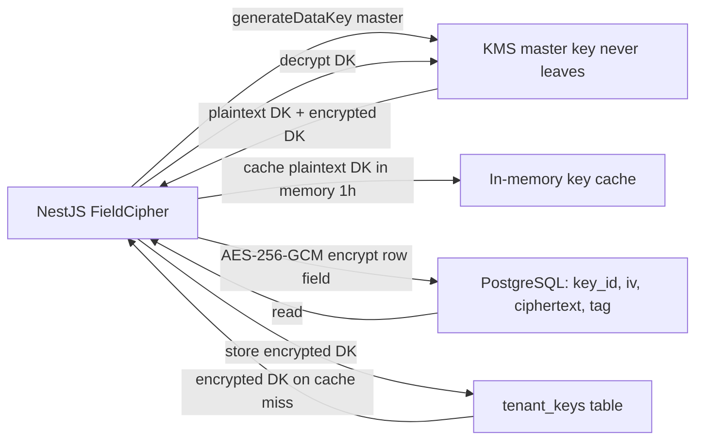
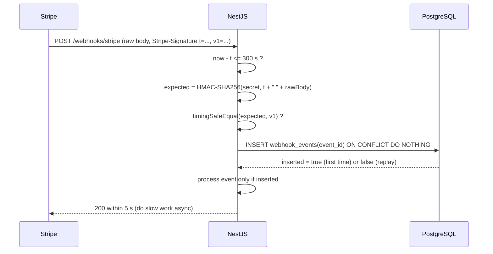

## 44.16 Symmetric Encryption and Envelope Encryption

#### Concept

Symmetric encryption turns readable data (plaintext) into unreadable bytes (ciphertext) with a key, and turns it back with the same key. **AES-256-GCM** is the algorithm you should use unless you have a written reason not to: it is fast (hardware-accelerated on every modern CPU), it hides the data, and it produces an **authentication tag** that detects any tampering with the ciphertext. That last property is why you use GCM rather than older modes like CBC: encryption without integrity lets an attacker flip bits in the ciphertext to change the decrypted result without knowing the key.

**Envelope encryption** is the way you use symmetric encryption at scale: each piece of data (or each table, or each tenant) is encrypted with its own **data key**; the data key is itself encrypted with a **master key** that lives in a key management service (AWS KMS, GCP KMS, Vault) and never leaves it. You store the encrypted data key next to the data. To decrypt, you ask KMS to unwrap the data key, then decrypt locally.

#### Why does it exist?

Databases and backups leak. Encryption at rest on the disk (RDS storage encryption) protects against someone stealing the drive, but not against anyone with database access: a SQL injection, a leaked read replica credential, an analyst with too many grants. Column-level encryption in the application protects data from the database itself. Envelope encryption exists because calling KMS for every row would cost 1 to 5 ms and money per call, while keeping one master key in application memory means one memory dump exposes everything. Data keys give you local speed with a small blast radius; the master key in KMS gives you rotation, audit, and access control.

#### Mental model

Imagine a bank with thousands of safety deposit boxes. Each box has its own key (data key). Every box key is kept in a sealed envelope, and the envelopes can be sealed and opened only by one machine in the vault (KMS with the master key). To open your box, you take your sealed envelope to the machine, it opens the envelope and hands you the box key, you open the box. Nobody carries the master key around, a stolen box key opens one box, and the machine logs every envelope it opens.

#### How it works

1. **AES-256-GCM primitives**: a 32-byte key, a 12-byte **IV** (initialisation vector, also called a nonce) that must be **unique per encryption with the same key**, and an optional **additional authenticated data** (AAD) input that is not encrypted but is covered by the tag, for example the row id, so ciphertext cannot be moved from one row to another.
2. **Encrypt**: `iv = randomBytes(12)`; `cipher = createCipheriv('aes-256-gcm', key, iv)`; `cipher.setAAD(rowId)`; `ct = cipher.update(plain) + cipher.final()`; `tag = cipher.getAuthTag()`. Store `keyId || iv || ct || tag`.
3. **Decrypt**: split the stored bytes, `decipher.setAuthTag(tag)`, `decipher.setAAD(rowId)`, `decipher.update(ct) + decipher.final()`. If the tag does not match, `final()` throws; treat that as tampering, not as a bug to work around.
4. **IV reuse is catastrophic**: with GCM, two messages under the same key and IV leak their XOR and let an attacker forge tags. With a random 96-bit IV the birthday bound recommends rotating the data key after about 2^32 encryptions; for per-tenant or per-table keys with millions of rows that is fine, but count it.
5. **Envelope**: on startup or per tenant, call `kms.generateDataKey(masterKeyId)` which returns `{ plaintextKey, encryptedKey }`. Use the plaintext key in memory; store `encryptedKey` alongside the data (or in a `tenant_keys` table). Cache unwrapped keys in memory for minutes to hours, bounded, so KMS is called rarely. KMS unwrap costs about 1 to 3 ms and is audited in CloudTrail.
6. **Rotation**: a new master key version wraps new data keys; old data keys remain decryptable because KMS keeps old versions. Re-encrypting existing data is a background job that rewraps data keys (cheap) or re-encrypts rows (expensive) depending on the policy. The `keyId` prefix in each ciphertext tells the decryptor which data key to fetch.



#### Practical example

A healthcare booking app stores patient phone numbers and national id numbers. Each tenant (clinic) gets its own data key wrapped by one KMS master key. The `patients.phone_enc` column holds `keyId || iv || ciphertext || tag`. Searches by phone use a separate **blind index**: `HMAC-SHA256(indexKey, normalisedPhone)` stored in `phone_hmac` and indexed, because you cannot index ciphertext with random IVs. Support staff see the decrypted phone only on the detail screen, and every decrypt is logged with the user id.

#### NestJS example

A `FieldCipher` provider with envelope encryption. The KMS client is abstracted so tests can use a local wrapper.

```ts
// field-cipher.ts
import { Injectable } from '@nestjs/common';
import { createCipheriv, createDecipheriv, createHmac, randomBytes } from 'node:crypto';
import { KmsClient } from './kms.client'; // wraps AWS KMS GenerateDataKey / Decrypt

@Injectable()
export class FieldCipher {
  private cache = new Map<string, { key: Buffer; expiresAt: number }>(); // keyId -> plaintext data key
  constructor(private kms: KmsClient, private indexKey: Buffer) {}

  // Format: version(1) | keyIdLen(1) | keyId | iv(12) | tag(16) | ciphertext
  async encrypt(plain: string, aad: string, keyId: string): Promise<Buffer> {
    const key = await this.dataKey(keyId);
    const iv = randomBytes(12);                                   // unique per encryption
    const cipher = createCipheriv('aes-256-gcm', key, iv);
    cipher.setAAD(Buffer.from(aad));                               // binds ciphertext to the row
    const ct = Buffer.concat([cipher.update(plain, 'utf8'), cipher.final()]);
    const tag = cipher.getAuthTag();
    const kid = Buffer.from(keyId);
    return Buffer.concat([Buffer.from([1, kid.length]), kid, iv, tag, ct]);
  }

  async decrypt(blob: Buffer, aad: string): Promise<string> {
    if (blob[0] !== 1) throw new Error('Unknown ciphertext version');
    const kidLen = blob[1];
    const keyId = blob.subarray(2, 2 + kidLen).toString();
    let off = 2 + kidLen;
    const iv = blob.subarray(off, off + 12); off += 12;
    const tag = blob.subarray(off, off + 16); off += 16;
    const ct = blob.subarray(off);
    const key = await this.dataKey(keyId);
    const decipher = createDecipheriv('aes-256-gcm', key, iv);
    decipher.setAuthTag(tag);
    decipher.setAAD(Buffer.from(aad));
    return Buffer.concat([decipher.update(ct), decipher.final()]).toString('utf8'); // throws on tampering
  }

  // Blind index for equality search on encrypted columns.
  blindIndex(value: string): Buffer {
    return createHmac('sha256', this.indexKey).update(value.normalize('NFC').trim().toLowerCase()).digest();
  }

  private async dataKey(keyId: string): Promise<Buffer> {
    const hit = this.cache.get(keyId);
    if (hit && hit.expiresAt > Date.now()) return hit.key;
    const encryptedKey = await this.kms.loadEncryptedDataKey(keyId);   // from tenant_keys table
    const key = await this.kms.decrypt(encryptedKey);                   // KMS Decrypt, ~2 ms, audited
    this.cache.set(keyId, { key, expiresAt: Date.now() + 3_600_000 });
    return key;
  }
}
```

TypeORM's `transformer` option lets an entity property encrypt and decrypt transparently, but it cannot be async, so most teams encrypt in the service or use a subscriber. The explicit service call is also easier to audit.

```ts
// patients.service.ts (excerpt)
async create(dto: CreatePatientDto, tenantId: string) {
  const id = randomUUID();
  const phoneNorm = dto.phone.replace(/\s+/g, '');
  return this.repo.save({
    id, tenantId,
    phoneEnc: await this.cipher.encrypt(phoneNorm, `patients:${id}:phone`, `tenant:${tenantId}`),
    phoneHmac: this.cipher.blindIndex(phoneNorm),
  });
}
```

#### PostgreSQL example

```sql
CREATE TABLE tenant_keys (
  key_id            text PRIMARY KEY,          -- 'tenant:9a1f...'
  encrypted_data_key bytea NOT NULL,           -- wrapped by KMS master key
  master_key_arn    text NOT NULL,
  created_at        timestamptz NOT NULL DEFAULT now(),
  retired_at        timestamptz                -- rotation: new key_id takes over for new writes
);

CREATE TABLE patients (
  id         uuid PRIMARY KEY,
  tenant_id  uuid NOT NULL,
  phone_enc  bytea NOT NULL,                   -- version|keyId|iv|tag|ciphertext
  phone_hmac bytea NOT NULL,                   -- blind index for equality lookup
  created_at timestamptz NOT NULL DEFAULT now()
);
CREATE INDEX patients_phone_hmac_idx ON patients (tenant_id, phone_hmac);

-- Lookup by phone: hash in the app, probe the index; the DB never sees the phone number.
-- SELECT id FROM patients WHERE tenant_id = $1 AND phone_hmac = $2;
```

`pgcrypto` offers `pgp_sym_encrypt`, but using it means the key travels to the database in every query and appears in logs and `pg_stat_statements`. Application-side encryption keeps keys out of the database entirely, which is the point.

#### Production scenario

The booking app encrypts 4 PII columns across 12 million rows. Encryption costs about 2 microseconds per field; the KMS unwrap happens once per tenant per hour per pod, roughly 200 calls per hour at 0.03 USD per 10,000 calls. Backups are encrypted by the storage layer as well, but the column encryption is what satisfies the regulator's "encrypted PII at the application level" requirement. Annual key rotation rewraps data keys (12,000 KMS calls) without touching the rows.

#### Failure scenario

A developer wrote a "quick" encryption helper with a fixed IV "for determinism so we can search". Every row with the same phone number produced the same ciphertext, which was the intent, and every pair of rows leaked the XOR of their plaintexts, which was not. Worse, GCM with a repeated IV allowed tag forgery. The pentest found it in an afternoon. The fix was random IVs plus a blind index for search, and a rewrite of 12 million rows over one weekend.

#### Edge cases & failure modes

- IV reuse under the same key.
- Missing AAD, allowing ciphertext to be swapped between rows (an attacker with write access moves the CEO's encrypted salary into their own row).
- KMS unavailable: cached keys keep the app running for the cache TTL; after that, fail closed for encryption and decryption. Alert on KMS error rate.
- Key cache unbounded across many tenants: bound it (LRU) or memory grows.
- Ciphertext format without a version or key id: rotation becomes impossible.
- Encrypting fields you also need to sort or range-query on; encryption removes those abilities; keep a decision list of which columns need which operations.
- Backups restored with data but without the `tenant_keys` table, or KMS key deleted: data is gone. Enable KMS key deletion protection and test restores.
- Logging plaintext before encryption or after decryption.

#### How a Senior Backend Engineer thinks about this

They ask which columns actually need encryption (regulatory or high-harm data), what operations those columns need (equality via blind index, nothing else), and where the keys live (KMS, never in git, never in the database). They design the ciphertext format with a version and key id on day one, put AAD on everything, and treat any custom crypto construction as a bug. They also know that column encryption is not a substitute for access control; it limits the damage of database access, nothing more.

#### Common mistakes

- AES-CBC without an HMAC, or ECB mode (which leaks patterns).
- Static or predictable IVs.
- One key in an environment variable used for everything.
- No key id in the ciphertext.
- Using `pgp_sym_encrypt` with the key in the SQL text.
- Rolling your own format instead of a versioned one.

#### Interview questions

1. *Why AES-GCM rather than AES-CBC?* Expected: authenticated encryption; CBC allows bit-flipping and padding-oracle attacks unless separately MACed.
2. *What is envelope encryption and why not call KMS per row?* Expected: latency and cost; blast radius; data keys wrapped by master key.
3. *How do you search on an encrypted column?* Expected: blind index with HMAC; limitations.
4. *What happens if the IV repeats under GCM?* Expected: plaintext XOR leakage and tag forgery.
5. *Design key rotation for encrypted PII in a 100-million-row table.*

#### Practical exercise

Implement `FieldCipher` with a fake KMS for tests and encrypt `patients.phone` with a per-tenant data key and a blind index. Acceptance criteria: two identical phone numbers produce different ciphertexts but equal blind indexes; tampering with one ciphertext byte causes decryption to throw; moving a ciphertext to another row id fails the AAD check; KMS is called at most once per tenant per hour in a load test.

## 44.17 Asymmetric Cryptography and Digital Signatures

#### Concept

Asymmetric cryptography uses a **key pair**: a private key that stays secret and a public key that can be handed to anyone. What one key does, only the other can undo. Two uses matter for backend engineers. **Signatures**: sign with the private key, and anyone with the public key can verify that you signed it and that it is unchanged (`RS256` and `ES256` JWTs, code signing, signed commits, signed webhooks from some providers). **Key exchange**: two parties agree on a shared symmetric key over an open network without ever sending it, which is what TLS does in its handshake.

RSA is the older algorithm (2048 to 4096-bit keys, slower, large signatures). ECDSA and Ed25519 use elliptic curves (256-bit keys, fast, small signatures). For new systems, `ES256` for JWTs and Ed25519 for general signing.

#### Why does it exist?

Symmetric keys must be shared, and sharing a secret with someone means they can forge anything you can. A service that only needs to *verify* your tokens should not be able to *mint* them. Asymmetric signatures give exactly that separation, and they provide **non-repudiation**: a valid signature proves the private-key holder signed it, which an HMAC cannot prove because every verifier could also have produced it.

#### Mental model

Imagine a padlock and its key. You give copies of the *open padlock* to everyone (public key). Anyone can lock a box with your padlock, and only you can open it (encryption to you). Flip it: you carry a stamp only you own (private key), and everyone has a way to check the stamp's pattern (public key). They can verify your stamp, but they cannot make it (signatures).

#### How it works

1. Generate a key pair once, securely: `openssl ecparam -genkey -name prime256v1` or Node's `generateKeyPairSync('ec', { namedCurve: 'P-256' })`. The private key goes into the secrets manager or KMS; the public key is published (JWKS endpoint, a config file, a well-known URL).
2. **Sign**: `sign = crypto.sign('sha256', data, privateKey)` for ECDSA/RSA, or `crypto.sign(null, data, ed25519PrivateKey)`. Output is the signature bytes.
3. **Verify**: `crypto.verify('sha256', data, publicKey, sig)` returns a boolean. Note that `verify` is already constant-time with respect to the signature.
4. **KMS signing**: for high-value keys, the private key never leaves KMS; the app calls `kms.sign()` (2 to 10 ms) and caches nothing. Used for JWT issuers in regulated environments and for software release signing.
5. **TLS** uses certificates (public keys signed by a certificate authority) and an ephemeral key exchange (ECDHE) to derive a session key; the rest of the connection is symmetric AES-GCM or ChaCha20-Poly1305. See Part 14 for the handshake.

#### NestJS example

Signing an outgoing webhook with Ed25519 so receivers can verify with a published public key and you never share a secret with them (an alternative to the HMAC scheme in 44.18).

```ts
// webhook-signer.ts
import { Injectable } from '@nestjs/common';
import { createPrivateKey, sign, KeyObject } from 'node:crypto';
import { ConfigService } from '@nestjs/config';

@Injectable()
export class WebhookSigner {
  private readonly key: KeyObject;
  private readonly keyId: string;
  constructor(cfg: ConfigService) {
    this.key = createPrivateKey({ key: cfg.getOrThrow<string>('WEBHOOK_SIGNING_KEY_PEM'), format: 'pem' });
    this.keyId = cfg.getOrThrow<string>('WEBHOOK_SIGNING_KEY_ID');
  }

  headersFor(body: string): Record<string, string> {
    const ts = Math.floor(Date.now() / 1000).toString();
    const signature = sign(null, Buffer.from(`${ts}.${body}`), this.key).toString('base64'); // Ed25519: algorithm arg is null
    return { 'X-Signature-Ed25519': signature, 'X-Signature-Timestamp': ts, 'X-Signature-Key-Id': this.keyId };
  }
}
// Receivers verify with: verify(null, Buffer.from(`${ts}.${body}`), publicKey, Buffer.from(sig, 'base64'))
```

#### PostgreSQL example

Signed data in the database: an append-only ledger of payouts where each row is signed by the payouts service so that a DBA or a compromised app cannot silently alter amounts (see 44.35 for tamper-evident audit chains).

```sql
CREATE TABLE payout_ledger (
  id          bigint GENERATED ALWAYS AS IDENTITY PRIMARY KEY,
  payout_id   uuid NOT NULL,
  amount_cents bigint NOT NULL,
  currency    char(3) NOT NULL,
  created_at  timestamptz NOT NULL DEFAULT now(),
  signature   bytea NOT NULL,             -- Ed25519 over (payout_id, amount_cents, currency, created_at)
  key_id      text NOT NULL
);
REVOKE UPDATE, DELETE ON payout_ledger FROM app_api;   -- append-only for the app role
```

#### Production scenario

An auth service signs about 300 `ES256` tokens per second (each 0.2 ms of CPU) and publishes JWKS; 14 resource servers verify about 9,000 per second at about 0.1 ms each. Keys rotate monthly with a two-key overlap. The private key is loaded from AWS Secrets Manager at startup; a move to KMS signing was rejected because 300 signs per second at 3 ms would need more concurrency and cost, and the token lifetime of 10 minutes already bounds the risk.

#### Failure scenario

A team committed a private key to a private repository "temporarily". Two years later the repository was made internal-wide, and a scan found it. Every token ever issued with that key had to be considered forgeable; a rotation with immediate removal of the old key from JWKS (accepting the outage described in 44.3) was the only safe choice. Private keys never touch git, not even for an hour.

#### Edge cases & failure modes

- Private key in git, in a Docker image layer, or in an environment variable visible to `ps`.
- Verifying with a key from an untrusted source (the JWT header's `jku` or `x5u` URLs); only fetch keys from a configured issuer.
- RSA with PKCS#1 v1.5 padding for encryption (avoid; use OAEP if you must RSA-encrypt).
- ECDSA nonce reuse (a broken random source) leaks the private key; Ed25519 is deterministic and avoids this.
- Signature over the wrong bytes: canonicalise (JSON key order, whitespace) or sign the raw transmitted body, never a re-serialised version.
- Key size drift: 1024-bit RSA still found in old configs; minimum 2048, prefer curves.

#### How a Senior Backend Engineer thinks about this

They use asymmetric keys whenever verifiers outnumber signers or when non-repudiation matters. They keep private keys in a secrets manager or KMS, never in code, and they build rotation before launch. They prefer Ed25519 and ES256 for speed and safety and they never implement padding or curve arithmetic themselves.

#### Common mistakes

- HS256 shared across services "because it is simpler".
- Trusting `jku`/`x5u` headers.
- Signing a re-serialised JSON body instead of the raw bytes.
- Storing the private key next to the public key in the same config.

#### Interview questions

1. *When do you need asymmetric signatures instead of HMAC?* Expected: multiple verifiers, non-repudiation.
2. *RS256 vs ES256 vs Ed25519: tradeoffs.* Expected: size, speed, determinism, library support.
3. *Where should the JWT private key live and how do you rotate it?*
4. *What is non-repudiation and why can HMAC not provide it?*

#### Practical exercise

Generate an Ed25519 key pair, sign outgoing webhooks with it, publish the public key at `/.well-known/webhook-keys.json` with a key id, and write a receiver that verifies. Acceptance criteria: a modified body or timestamp fails verification; rotating to a new key id keeps old deliveries verifiable for 24 hours; the private key is loaded only from the secrets manager and never logged.

## 44.18 HMAC in Practice: Webhook Signatures and Signed URLs

#### Concept

Two of the most common places you will *write* HMAC code: verifying inbound webhooks (Stripe, GitHub, Shopify, Twilio all sign with HMAC-SHA256 over a timestamp and the body) and generating signed URLs (a link that grants time-limited access to a specific resource without a login, such as an S3 pre-signed URL or an unsubscribe link).

#### Why does it exist?

A webhook endpoint is a public URL that changes your database. Without a signature, anyone who finds it can post `{"type":"payment.succeeded","order_id":"..."}` and mark their order as paid. A signed URL exists because sometimes you must grant access to someone without a session (an email link, a CDN, a third party) and you need the grant to be specific, expiring, and unforgeable.

#### Mental model

Imagine a courier delivering a parcel with a note "from your bank". Anyone can write that note. A note with the bank's signet seal, dated today, is different: you can check the seal against the pattern the bank gave you, and you refuse yesterday's seal because it could have been copied. That is a signed webhook. A signed URL is a day pass with your name, the room number, and an expiry printed on it, stamped with the same seal.

#### How it works

**Verifying a Stripe-style webhook:**

1. Read the **raw request body** as bytes. The signature was computed over exactly those bytes; if your framework has already parsed and re-serialised JSON, key order or whitespace may differ and verification fails. In NestJS this means enabling `rawBody: true` in `NestFactory.create` and reading `req.rawBody`.
2. Parse the signature header: `t=1788900000,v1=5257a869...`. There may be several `v1` values during secret rotation.
3. Reject if `|now - t| > 300 seconds` (replay tolerance).
4. Compute `HMAC-SHA256(secret, t + "." + rawBody)` and compare with each `v1` in constant time.
5. Only then parse the JSON and process, ideally through an idempotency check on the event id, because providers retry.



**Signed URL:** `path?expires=<unix>&sig=<HMAC(secret, path + expires + userId)>`. The server recomputes on access and checks the expiry. Include everything the URL grants in the signed string (resource id, action, principal, expiry) so no parameter can be edited.

#### NestJS example

```ts
// main.ts: keep the raw body for signature verification
const app = await NestFactory.create<NestExpressApplication>(AppModule, { rawBody: true });
```

```ts
// stripe-webhook.controller.ts
import { Controller, Post, Headers, Req, HttpCode, UnauthorizedException, BadRequestException } from '@nestjs/common';
import type { RawBodyRequest } from '@nestjs/common';
import type { Request } from 'express';
import { createHmac, timingSafeEqual } from 'node:crypto';
import { ConfigService } from '@nestjs/config';
import { PaymentsService } from '../payments/payments.service';
import { Public } from '../auth/public.decorator';

@Controller('webhooks/stripe')
export class StripeWebhookController {
  private readonly secrets: string[]; // current and previous, for rotation
  constructor(cfg: ConfigService, private payments: PaymentsService) {
    this.secrets = cfg.getOrThrow<string>('STRIPE_WEBHOOK_SECRETS').split(',');
  }

  @Public()                // no user token; the signature is the authentication
  @Post()
  @HttpCode(200)
  async handle(@Req() req: RawBodyRequest<Request>, @Headers('stripe-signature') sigHeader?: string) {
    const raw = req.rawBody;
    if (!raw || !sigHeader) throw new BadRequestException();
    const parts = Object.fromEntries(sigHeader.split(',').map((kv) => kv.split('=') as [string, string]));
    const t = Number(parts.t);
    const candidates = sigHeader.split(',').filter((kv) => kv.startsWith('v1=')).map((kv) => kv.slice(3));
    if (!Number.isFinite(t) || Math.abs(Date.now() / 1000 - t) > 300) throw new UnauthorizedException('Stale timestamp');

    const payload = Buffer.concat([Buffer.from(`${t}.`), raw]);
    const valid = this.secrets.some((secret) => {
      const expected = createHmac('sha256', secret).update(payload).digest();
      return candidates.some((c) => {
        const got = Buffer.from(c, 'hex');
        return got.length === expected.length && timingSafeEqual(got, expected);
      });
    });
    if (!valid) throw new UnauthorizedException('Bad signature');

    const event = JSON.parse(raw.toString('utf8')) as { id: string; type: string; data: unknown };
    await this.payments.enqueueWebhookEvent(event); // idempotent insert + async processing; respond fast
    return { received: true };
  }
}
```

A signed download URL for invoices, verified without a session:

```ts
// signed-url.service.ts
@Injectable()
export class SignedUrlService {
  constructor(private cfg: ConfigService) {}
  private key() { return Buffer.from(this.cfg.getOrThrow<string>('URL_SIGNING_KEY'), 'base64'); }

  sign(path: string, userId: string, ttlSeconds: number): string {
    const expires = Math.floor(Date.now() / 1000) + ttlSeconds;
    const sig = createHmac('sha256', this.key()).update(`${path}|${userId}|${expires}`).digest('base64url');
    return `${path}?u=${encodeURIComponent(userId)}&e=${expires}&s=${sig}`;
  }

  verify(path: string, userId: string, expires: number, sig: string): boolean {
    if (!Number.isFinite(expires) || expires < Date.now() / 1000) return false;
    const expected = createHmac('sha256', this.key()).update(`${path}|${userId}|${expires}`).digest();
    const got = Buffer.from(sig, 'base64url');
    return got.length === expected.length && timingSafeEqual(got, expected);
  }
}
```

#### PostgreSQL example

```sql
-- Idempotent webhook processing: the provider retries, sometimes for days.
CREATE TABLE webhook_events (
  provider    text NOT NULL,
  event_id    text NOT NULL,
  received_at timestamptz NOT NULL DEFAULT now(),
  processed_at timestamptz,
  payload     jsonb NOT NULL,
  PRIMARY KEY (provider, event_id)
);
-- INSERT ... ON CONFLICT (provider, event_id) DO NOTHING RETURNING event_id;
-- A returned row means "first delivery"; no row means "replay, ignore".
```

#### Production scenario

A payments integration receives about 40 webhooks per second, with bursts of 500 per second during provider backfills. Verification is microseconds; the controller inserts the event and returns 200 in about 4 ms; a worker processes events from the table. Webhook secret rotation is done by adding the new secret to the list, rotating at the provider, and removing the old one after a day. A dashboard tracks signature failures (an attack or a misconfiguration), stale-timestamp rejections (clock problems), and duplicate deliveries.

#### Failure scenario

A team upgraded a JSON body parser; the new version normalised numbers (`10.0` became `10`) before the controller saw the body. Every webhook failed signature verification. Payments stopped being marked paid for 40 minutes until someone noticed the 401 spike on the webhook route. The fix was verifying against `req.rawBody` and alerting on signature-failure rate.

#### Edge cases & failure modes

- Parsed body instead of raw bytes.
- No timestamp tolerance: unlimited replay of captured webhooks.
- Replay inside the tolerance window: idempotency on event id.
- Slow processing in the handler: providers time out at 5 to 10 seconds and retry, causing duplicates; enqueue and return.
- Secret rotation without overlap.
- Signed URL that does not include the principal or the action, so a signed "read invoice 5" URL is valid for "delete invoice 5".
- Signed URLs in logs and referrers: keep TTLs short (minutes), and use `Referrer-Policy: no-referrer` on pages that show them.
- Clock skew between your servers and the provider: 5-minute tolerance, NTP.

#### How a Senior Backend Engineer thinks about this

They treat a webhook endpoint as an unauthenticated write endpoint, which it is, and demand signature, timestamp tolerance, idempotency and fast acknowledgement before it ships. They put the verification code in one reusable guard per provider. For outbound webhooks they sign the same way (or with Ed25519) and publish a verification guide, because their customers will make the same mistakes.

#### Common mistakes

- Comparing signatures with `===`.
- Verifying a re-serialised body.
- Processing before acknowledging, then timing out.
- Trusting the `type` in the payload to decide whether to verify ("test events do not need a signature").

#### Interview questions

1. *Walk through verifying a Stripe webhook in NestJS.* Expected: raw body, timestamp tolerance, HMAC, constant-time compare, idempotency, fast 200.
2. *Why does the timestamp go into the signed string?* Expected: replay protection; an attacker cannot change it without breaking the signature.
3. *What must a signed URL include in its signed content?*
4. *How do you rotate a webhook secret without dropping events?*

#### Practical exercise

Implement the Stripe webhook controller with `rawBody`, a `webhook_events` table, and a worker. Acceptance criteria: a replayed delivery is acknowledged but not reprocessed; a 6-minute-old timestamp is rejected; a body modified by one byte is rejected; the handler returns within 50 ms under a burst of 500 events per second in a load test.

## 44.19 Key Management, TLS and mTLS

#### Concept

Key management is everything around the keys: where they are generated, where they live, who can use them, how they rotate, how ciphertext and tokens reference them, how they are revoked, and how backups are handled. Most cryptographic failures in real systems are key management failures: the algorithm was fine, the key was in a Dockerfile.

**TLS** protects data in transit between client and server. **mTLS** (mutual TLS) adds a client certificate so the server authenticates the client too, which is how service meshes and zero-trust networks authenticate service-to-service calls without shared secrets.

#### Why does it exist?

Keys are the thing that turns strong cryptography into strong security. A leaked key is worse than no encryption because it gives false confidence. Centralising keys in a KMS or secrets manager gives you access control (IAM), audit (who used which key when), rotation, and hardware protection. TLS exists because networks are shared and cannot be trusted, including "internal" ones: the moment a single pod is compromised, the internal network is hostile.

#### Mental model

Imagine a hotel where every room key is cut in the lobby and left on the counter. Great locks, useless security. A proper hotel has a key-cutting room with a log, a policy for who may request keys, and a schedule for re-keying. That is a KMS. TLS is the sealed pneumatic tube between the front desk and the vault; mTLS is the tube that only accepts capsules stamped by both ends.

#### How it works

**Where keys live, from worst to best:**

| Location | Problems | Acceptable for |
|---|---|---|
| Source code or Docker image | Visible to everyone with repo or registry access, forever, in history | Never |
| Environment variables | Visible in `ps`, `/proc`, crash dumps, child processes, CI logs, Kubernetes manifests | Low-value config, short-lived dev secrets |
| Kubernetes Secrets (plain) | Base64, readable by anyone with namespace read; stored in etcd (encrypt etcd at rest) | Injection point, not a store |
| Secrets manager (AWS Secrets Manager, Vault, GCP Secret Manager) | Needs IAM design, adds a dependency at startup | Passwords, API keys, PEM keys |
| KMS / HSM | Key never leaves; only sign/encrypt operations are allowed; latency and cost per call | Master keys, signing keys, envelope encryption |

**Rotation:** every key has a `kid` (key id) and every consumer of a key (JWT, ciphertext, API signature) references it. Rotation is *adding* a new key and *later* removing the old one, never replacing in place. Schedules: signing keys monthly to quarterly, data keys yearly or per 2^32 uses, database passwords quarterly and on every staff departure, immediately on any suspected leak.

**Backups:** encrypted with a key that is *not* stored with the backup. Test restores, including the key-access path, because a backup you cannot decrypt is not a backup.

**TLS everywhere:** terminate TLS at the load balancer, and *also* between the load balancer and pods and between services when the network is shared with other tenants or when compliance says so. Certificates from an internal CA (cert-manager in Kubernetes) with short lifetimes (24 hours to 90 days) and automatic renewal. See Part 14 for the handshake and Part 14's notes on HSTS.

**mTLS:** each service gets a certificate whose subject identifies the service (`spiffe://cluster/ns/payments/sa/payments-api`). The server verifies the client certificate chain and checks the identity against an allow-list; the client verifies the server as usual. Service meshes (Istio, Linkerd) do this transparently with sidecars; without a mesh, Node's `https.createServer({ requestCert: true, rejectUnauthorized: true, ca })` does it directly. mTLS replaces "shared internal API key" and pairs well with client-credentials tokens: mTLS says *which workload* is calling; the token says *on behalf of whom* and *with what scope*.

#### NestJS example

Loading secrets at startup from a secrets manager, failing fast if any are missing, and never reading them from `process.env` elsewhere in the code.

```ts
// secrets.loader.ts
import { SecretsManagerClient, GetSecretValueCommand } from '@aws-sdk/client-secrets-manager';

export async function loadSecrets(): Promise<Record<string, string>> {
  const client = new SecretsManagerClient({});
  const res = await client.send(new GetSecretValueCommand({ SecretId: process.env.APP_SECRET_ID! }));
  const parsed = JSON.parse(res.SecretString ?? '{}') as Record<string, string>;
  for (const k of ['JWT_PRIVATE_KEY', 'JWT_PUBLIC_KEY', 'PASSWORD_PEPPER', 'DB_PASSWORD', 'STRIPE_WEBHOOK_SECRETS']) {
    if (!parsed[k]) throw new Error(`Missing secret ${k}`);   // fail closed at startup, not at first request
  }
  return parsed;
}

// app.module.ts
ConfigModule.forRoot({ isGlobal: true, load: [async () => loadSecrets()], ignoreEnvFile: process.env.NODE_ENV === 'production' })
```

An mTLS-protected internal HTTPS server for a service that must only be called by named workloads:

```ts
// main.ts (internal service)
import { readFileSync } from 'node:fs';
import { NestFactory } from '@nestjs/core';
import { NestExpressApplication } from '@nestjs/platform-express';

const app = await NestFactory.create<NestExpressApplication>(AppModule, {
  httpsOptions: {
    key: readFileSync('/var/run/tls/tls.key'),      // mounted by cert-manager, rotated automatically
    cert: readFileSync('/var/run/tls/tls.crt'),
    ca: readFileSync('/var/run/tls/ca.crt'),
    requestCert: true,                                // ask the client for a certificate
    rejectUnauthorized: true,                         // and refuse the connection if it is not signed by our CA
    minVersion: 'TLSv1.2',
  },
});
```

```ts
// client-cert.guard.ts: authorise by certificate identity
@Injectable()
export class ClientCertGuard implements CanActivate {
  private readonly allowed = new Set(['payments-api', 'orders-worker']);
  canActivate(ctx: ExecutionContext): boolean {
    const req = ctx.switchToHttp().getRequest<Request & { socket: import('node:tls').TLSSocket }>();
    const cert = req.socket.getPeerCertificate();
    if (!req.socket.authorized || !cert?.subject?.CN) throw new UnauthorizedException();
    if (!this.allowed.has(cert.subject.CN)) throw new ForbiddenException(`Workload ${cert.subject.CN} not allowed`);
    return true;
  }
}
```

#### PostgreSQL example

The database itself is a key consumer: require TLS for connections, and give each service its own database user with the least privileges, rotated through the secrets manager.

```sql
-- postgresql.conf: ssl = on; pg_hba.conf: hostssl all all 10.0.0.0/8 scram-sha-256
-- One role per service, restricted grants, no superuser, no ownership:
CREATE ROLE svc_orders LOGIN PASSWORD '...' NOBYPASSRLS CONNECTION LIMIT 40;
GRANT USAGE ON SCHEMA public TO svc_orders;
GRANT SELECT, INSERT, UPDATE ON orders, order_items TO svc_orders;
GRANT SELECT ON products TO svc_orders;              -- read-only where read-only is enough
REVOKE ALL ON users FROM svc_orders;                 -- orders service has no business reading password hashes

-- Rotation: create a new password, update the secret, roll pods, then:
-- ALTER ROLE svc_orders PASSWORD '<new>';  (or use IAM auth on RDS for passwordless connections)
```

#### Production scenario

A platform with 20 services. Every service has its own DB role, its own secret in AWS Secrets Manager, and its own mTLS identity issued by cert-manager with 24-hour certificates. Database passwords rotate quarterly through a runbook that takes 15 minutes and causes no downtime because PostgreSQL allows two valid passwords briefly by using a second role during the switch (or IAM auth, which removes passwords entirely). KMS calls: about 2,000 per hour for data-key unwraps; cost is negligible. The audit trail from CloudTrail answers "who decrypted what" in a compliance review in minutes.

#### Failure scenario

An engineer debugging a production issue ran `kubectl get secret app-secrets -o yaml` and pasted the output into a Slack thread to ask a question. Base64 is not encryption. The thread was in a channel with 400 members. Every secret in the file (database password, JWT private key, Stripe secret) was rotated that evening, which took 6 hours because rotation had never been rehearsed. The next quarter, rotation became a monthly drill.

#### Edge cases & failure modes

- Secrets manager unavailable at startup: fail fast and let the orchestrator retry; do not fall back to stale environment values silently.
- Rotation without `kid`: no way to tell which key produced which ciphertext or token.
- Certificates expiring on a weekend: automate renewal and alert 14 days before expiry regardless.
- mTLS with `rejectUnauthorized: false` "to make it work": you now have no authentication.
- Client certificate revocation: short lifetimes are more reliable than CRLs.
- Backups with keys inside the same bucket.
- KMS key scheduled for deletion by a cleanup script; enable deletion protection and a 30-day waiting period.
- Shared "internal" API key used by 20 services: unrotatable in practice; replace with mTLS or client credentials.

#### How a Senior Backend Engineer thinks about this

They design the *lifecycle* of every secret before creating it: where it is born, who can read it, how it rotates, how it dies. They rehearse rotation so it is boring. They treat environment variables as a delivery mechanism for non-secret config and use a secrets manager for the rest. They put TLS between everything and use mTLS or per-service tokens for service identity, because "internal network" stopped meaning "trusted" the day the first container was compromised.

#### Common mistakes

- Secrets in `.env` files committed "for local dev" that are also the production values.
- One shared database superuser for all services.
- Certificates with 5-year lifetimes and no renewal automation.
- Base64 mistaken for encryption.
- Never rotating anything until a leak forces it.

#### Interview questions

1. *Environment variables vs secrets manager vs KMS: when each?* Expected: table above; env for non-secrets, manager for secrets, KMS for keys that must not leave.
2. *How do you rotate a signing key with zero downtime?* Expected: `kid`, overlap, publish both, remove after token lifetime.
3. *What does mTLS give you that a shared internal API key does not?* Expected: per-workload identity, no shared secret, automatic rotation.
4. *A secret leaked in Slack. Walk through the response.*
5. *Why one database role per service?*

#### Practical exercise

Move all secrets of a NestJS project to a secrets manager (or Vault dev server) loaded at startup, create one PostgreSQL role per service with minimal grants, and rehearse a database password rotation. Acceptance criteria: the app refuses to start with a missing secret; `grep -r` for any secret value in the repo and image returns nothing; the rotation runbook completes with zero failed requests in a load test; the orders service role cannot `SELECT` from `users`.
