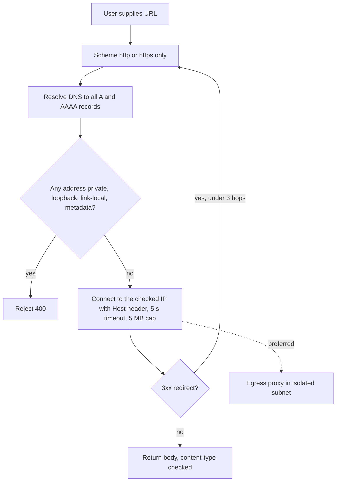

## 44.20 SQL Injection

#### Concept

SQL injection happens when data from a request becomes part of the SQL *text* instead of being passed as a *parameter*. The database cannot tell where your query ends and the attacker's begins. `' OR 1=1 --` is the meme; `'; UPDATE users SET role='admin' WHERE email='attacker@x.com'; --` is the reality.

The fix has been known since the 1990s and is the same everywhere: **parameterised queries**. The query text goes to PostgreSQL with `$1`, `$2` placeholders; the values travel separately and are never interpreted as SQL. Every ORM does this by default. Injection survives because developers step outside the default: string interpolation into `query()`, `createQueryBuilder().where(\`...${x}\`)`, dynamic `ORDER BY`, raw SQL in reports.

#### Why does it exist?

SQL is text, and building text with string concatenation is the most natural thing in a programming language. Frameworks made the safe path easy, but the unsafe path is still one backtick away, and it is usually taken for legitimate reasons: a dynamic sort column, an `IN` list, a search filter, a report someone wrote in a hurry.

#### Mental model

Imagine handing a bank teller a withdrawal slip where the amount box says "100 and also transfer everything to account 5551". If the teller reads the box as instructions, you are robbed. If the teller reads the box strictly as a number and refuses anything else, you are safe. Parameterisation is the teller reading the box as data.

#### How it works

1. The attacker finds an input that reaches SQL: a search box, a sort parameter, a header, a JSON field, even a value stored earlier and used later (second-order injection).
2. They probe with a quote (`'`) and watch for a 500, a changed result set, or a timing difference (`pg_sleep(5)`).
3. They extract data through `UNION SELECT`, boolean conditions, or timing, or they write: `UPDATE`, `INSERT`, `DROP`, or `COPY ... TO PROGRAM` if the database user is a superuser (it never should be).
4. With `pg` parameters (`$1`), TypeORM's `where` objects or `:named` parameters, and Sequelize `replacements`/`bind`, the value is sent in the bind message and the plan is compiled from the query text alone. There is no injection surface.

**Exploit against a NestJS + PostgreSQL app:**

```ts
// VULNERABLE: order search with string interpolation in QueryBuilder
async search(q: string, sort: string) {
  return this.repo.createQueryBuilder('o')
    .where(`o.reference ILIKE '%${q}%'`)          // q = "' OR 1=1 --"  -> returns every order
    .orderBy(`o.${sort}`)                          // sort = "id; DROP TABLE orders; --"
    .getMany();
}
```

A request `GET /orders/search?q=%27%20OR%201%3D1%20--` returns every order in the database. A request with `q=' UNION SELECT email, password_hash, ... FROM users --` dumps the users table if the column counts line up.

#### NestJS example

The fix: parameters everywhere, and an allow-list for the one thing that cannot be a parameter (identifiers like column names).

```ts
// orders.repository.ts (safe)
const SORTABLE = { createdAt: 'o.created_at', total: 'o.total_cents', status: 'o.status' } as const;
type SortKey = keyof typeof SORTABLE;

async search(tenantId: string, q: string, sort: SortKey, dir: 'ASC' | 'DESC') {
  const column = SORTABLE[sort];                        // allow-list: unknown keys are rejected by the DTO
  return this.repo.createQueryBuilder('o')
    .where('o.tenant_id = :tenantId', { tenantId })
    .andWhere('o.reference ILIKE :q', { q: `%${escapeLike(q)}%` })   // value is a parameter; % and _ escaped
    .orderBy(column, dir)                                 // identifier from OUR map, never from the request
    .take(50)
    .getMany();
}

function escapeLike(s: string) { return s.replace(/[\\%_]/g, (c) => `\\${c}`); }
```

```ts
// search-orders.dto.ts: the DTO makes the allow-list explicit
export class SearchOrdersDto {
  @IsString() @MaxLength(100) q: string;
  @IsIn(['createdAt', 'total', 'status']) sort: 'createdAt' | 'total' | 'status' = 'createdAt';
  @IsIn(['ASC', 'DESC']) dir: 'ASC' | 'DESC' = 'DESC';
}
```

Raw SQL is fine when parameterised:

```ts
// pg-style parameters through TypeORM's query()
await this.dataSource.query(
  `SELECT id, total_cents FROM orders WHERE tenant_id = $1 AND created_at >= $2 ORDER BY created_at DESC LIMIT 100`,
  [tenantId, since],
);
```

#### PostgreSQL example

Defense in depth at the database: least privilege makes an injection less damaging, and `pg_stat_statements` plus the log make it detectable.

```sql
-- The API role cannot drop, alter, or read what it does not need.
REVOKE CREATE ON SCHEMA public FROM svc_orders;
REVOKE ALL ON users FROM svc_orders;

-- Detection: unusual statements in pg_stat_statements are a signal (normalised query text).
SELECT query, calls FROM pg_stat_statements
WHERE query ILIKE '%pg_sleep%' OR query ILIKE '%UNION%SELECT%' OR query ILIKE '%information_schema%'
ORDER BY calls DESC;

-- Statement timeout limits time-based extraction:
ALTER ROLE svc_orders SET statement_timeout = '5s';
```

#### TypeORM example

Safe and unsafe forms side by side, because both compile:

```ts
// SAFE: where object -> parameters
repo.find({ where: { email, status: 'active' } });
// SAFE: named parameters in QueryBuilder
qb.where('u.email = :email AND u.status = :status', { email, status: 'active' });
// SAFE: IN with parameter expansion
qb.where('o.id IN (:...ids)', { ids });
// UNSAFE: template string with request data
qb.where(`u.email = '${email}'`);
// UNSAFE: identifier from request
qb.orderBy(req.query.sort as string);
```

#### Sequelize example

```ts
// SAFE: where object
await Order.findAll({ where: { tenantId, status: { [Op.in]: statuses } } });

// SAFE: raw query with replacements (escaped client-side) or bind (server-side $1 parameters; preferred)
await sequelize.query('SELECT id FROM orders WHERE tenant_id = $tenantId AND created_at >= $since', {
  bind: { tenantId, since }, type: QueryTypes.SELECT,
});

// UNSAFE: sequelize.literal with request data
await Order.findAll({ order: [[sequelize.literal(req.query.sort as string), 'ASC']] });
```

#### Production scenario

A marketplace API with 600 endpoints and 2,000 raw queries in its reporting module. The team runs a CI grep for template literals inside `query(`, `where(`, `orderBy(`, `literal(` and a Semgrep rule for the same; findings block the merge. They also run sqlmap against staging quarterly and keep `log_min_duration_statement` and `pg_stat_statements` for detection. Zero injections in three years of pentests, after two in the year before the rules.

#### Failure scenario

A "sort by any column" feature shipped with `orderBy(\`o.${sort}\`)`. A bug-bounty researcher used `sort=(SELECT CASE WHEN (SELECT substr(password_hash,1,1) FROM users WHERE email='admin@x') = '$' THEN id ELSE total END)` to extract the admin's hash one character at a time through result ordering. No error, no `UNION`, just ordering. The fix was the allow-list above. Detection came from the researcher, not from monitoring, because the queries were syntactically valid and fast.

#### Edge cases & failure modes

- **Second-order injection**: a value stored safely (parameterised insert) and later concatenated into another query (a username with a quote used in a report).
- Dynamic identifiers (column and table names) cannot be parameters; allow-list or quote with `format('%I')` server-side.
- `LIKE` wildcards in user input: not injection, but `%` alone matches everything and can be a DoS; escape them.
- JSON path and `jsonb` operators built from request strings.
- ORM escape hatches (`literal`, `raw`, `query`) used "temporarily".
- Stored procedures that build SQL with `EXECUTE 'SELECT ... ' || input` inside PL/pgSQL; use `EXECUTE ... USING $1`.
- Integer parameters that were validated as strings; `ParseIntPipe` and DTO types close this.
- Time-based extraction limited by `statement_timeout`.

#### How a Senior Backend Engineer thinks about this

They accept no string interpolation into SQL in code review, full stop, and they automate that rule so review does not depend on attention. They give the API a least-privilege role so a missed case leaks less. They know the ORM protects the default path and audit the escape hatches. When a report needs dynamic SQL, they write a small query builder with allow-lists rather than trusting a developer to be careful every time.

#### Common mistakes

- Escaping instead of parameterising.
- Validating input "to be safe" as the only control, and then still concatenating.
- Believing an ORM makes injection impossible.
- Superuser or owner role for the application.
- Sort and filter fields taken straight from the query string.

#### Interview questions

1. *How does parameterisation prevent injection at the protocol level?* Expected: query text and values sent separately; the planner never parses values as SQL.
2. *How do you handle a dynamic `ORDER BY` safely?* Expected: allow-list mapping to identifiers.
3. *What is second-order injection?*
4. *How do you detect injection attempts in production?* Expected: `pg_stat_statements` anomalies, WAF signals, 500-rate on parameterised endpoints, `pg_sleep` patterns.
5. *`replacements` vs `bind` in Sequelize?* Expected: client-side escaping vs server-side parameters; prefer `bind`.

#### Practical exercise

Add a Semgrep rule (or a targeted ESLint rule) that flags template literals passed to `query`, `where`, `andWhere`, `orderBy`, `literal`. Fix every finding in a project. Run `sqlmap` against `GET /orders/search` on a local instance. Acceptance criteria: sqlmap reports no injectable parameters; CI fails on a newly introduced interpolation; the API role cannot read `users.password_hash`.

## 44.21 Cross-Site Scripting (XSS)

#### Concept

XSS is JavaScript that an attacker gets to run in another user's browser, inside your site's origin. Once it runs, it can read anything the page can: the DOM, `localStorage`, non-`HttpOnly` cookies, and it can make requests as the user. **Stored XSS** is the backend's problem: attacker-supplied content (a product review, a display name, a support message) is saved and later rendered to other users without encoding.

The backend does not render HTML in an API-only architecture, so it is tempting to say XSS is the frontend's job. It is a shared job: the backend decides what is stored, how it is sanitised, and which security headers (Content Security Policy) limit what injected scripts can do.

#### Why does it exist?

HTML mixes data and code in one text stream, exactly like SQL. A review containing `<script>` is data to your database and code to a browser that renders it unescaped. Modern frontend frameworks escape by default (React's `{}`), and injection survives through the escape hatches: `dangerouslySetInnerHTML`, rich-text fields, server-side templates, email HTML, PDF generators, and old jQuery.

#### Mental model

Imagine a notice board in an office where anyone can pin a note. One day someone pins a note that says "Everyone who reads this: leave your keys on the desk." Nobody would obey a note. But browsers do obey scripts. Output encoding is the rule "notes are displayed in a glass case; they cannot be instructions". CSP is a guard that stops anyone acting on notes that did not come from management.

#### How it works

1. The attacker submits `POST /products/42/reviews` with `body: "Great! "`.
2. The API stores it. Validation checks length, not content.
3. Another user opens the product page. The frontend inserts the review with `innerHTML` (or the mobile app's web view does). The `onerror` handler runs in the victim's origin and sends their access token to the attacker.
4. With the token in `localStorage`, the attacker now is the victim until expiry (44.3). With an `HttpOnly` cookie, the script cannot read the credential, but it can still make requests as the user from within the page (the browser attaches the cookie), so the damage is bounded, not eliminated.

**The fix has three layers:**

1. **Output encoding** at render time is the primary control and belongs to whoever renders: frontend, email templates, PDFs. Encode for the context (HTML body, attribute, URL, JavaScript string). Frameworks do this by default; audit the escape hatches.
2. **Sanitise rich text on input** when the product genuinely needs HTML (a description with bold and links). Use an allow-list sanitiser (`sanitize-html` or DOMPurify with jsdom) on the server, store the sanitised result, and sanitise *again* on output if the renderer is not the one you control. Never write your own regex-based tag stripper.
3. **Content Security Policy** as a backstop: a header that tells the browser which script sources are allowed. With `script-src 'self'` plus nonces, an injected inline `<script>` or `onerror` handler does not execute even if it reaches the DOM.

#### NestJS example

Sanitising a rich-text field in a DTO transform, and setting CSP with `helmet`.

```ts
// create-review.dto.ts
import { IsInt, IsString, Max, MaxLength, Min } from 'class-validator';
import { Transform } from 'class-transformer';
import sanitizeHtml from 'sanitize-html';

const RICH_TEXT = {
  allowedTags: ['b', 'i', 'em', 'strong', 'p', 'br', 'ul', 'ol', 'li', 'a'],
  allowedAttributes: { a: ['href'] },
  allowedSchemes: ['https'],                          // no javascript: or data: URLs
  transformTags: { a: sanitizeHtml.simpleTransform('a', { rel: 'noopener nofollow', target: '_blank' }) },
};

export class CreateReviewDto {
  @IsInt() @Min(1) @Max(5) rating: number;

  @IsString() @MaxLength(5000)
  @Transform(({ value }) => (typeof value === 'string' ? sanitizeHtml(value, RICH_TEXT) : value))
  body: string;                                       // stored already sanitised

  @IsString() @MaxLength(80)
  @Transform(({ value }) => (typeof value === 'string' ? sanitizeHtml(value, { allowedTags: [], allowedAttributes: {} }) : value))
  displayName: string;                                // plain text: strip everything
}
```

```ts
// main.ts: security headers with helmet, CSP tuned for an API + SPA
import helmet from 'helmet';
app.use(helmet({
  contentSecurityPolicy: {
    directives: {
      defaultSrc: ["'self'"],
      scriptSrc: ["'self'"],                          // no inline scripts, no eval; use nonces if you must inline
      styleSrc: ["'self'", "'unsafe-inline'"],        // often needed by CSS-in-JS; tighten if you can
      imgSrc: ["'self'", 'https://cdn.example.com', 'data:'],
      connectSrc: ["'self'", 'https://api.example.com'],
      objectSrc: ["'none'"],
      frameAncestors: ["'none'"],                     // clickjacking defense (replaces X-Frame-Options)
      baseUri: ["'self'"],
      formAction: ["'self'"],
    },
  },
  crossOriginEmbedderPolicy: false,                   // enable only if your assets support COEP
}));
```

For JSON APIs, also set `Content-Type: application/json; charset=utf-8` (NestJS does) and `X-Content-Type-Options: nosniff` (helmet does), so a browser never renders an API response as HTML.

#### PostgreSQL example

The database stores what it is given; the only PostgreSQL angle is not being clever with it. A `CHECK` constraint rejecting `<script` is theatre; attackers use ``, SVG, or encoded forms. Store sanitised text and keep a raw copy only if there is a legal reason, in a column the API never returns.

```sql
CREATE TABLE product_reviews (
  id          uuid PRIMARY KEY DEFAULT gen_random_uuid(),
  product_id  uuid NOT NULL REFERENCES products(id),
  user_id     uuid NOT NULL REFERENCES users(id),
  rating      smallint NOT NULL CHECK (rating BETWEEN 1 AND 5),
  body_html   text NOT NULL,           -- sanitised allow-list HTML
  created_at  timestamptz NOT NULL DEFAULT now()
);
```

#### Production scenario

A marketplace receives 3,000 reviews a day. Server-side sanitisation runs in about 0.5 ms per review. CSP is deployed in report-only mode first (`Content-Security-Policy-Report-Only` with a `report-uri`) for two weeks, which surfaces 14 legitimate inline scripts that must move to files, then enforced. CSP violation reports are collected at about 200 per day, mostly browser extensions; a spike on one page is the alert condition.

#### Failure scenario

A support-chat widget rendered customer messages with `innerHTML` so that links would be clickable. A customer's message contained an `` payload. Every support agent who opened the ticket executed it; the script called the internal admin API from the agent's browser (cookies attached) and exported the customer list. The API had no vulnerability at all; the agent's browser was the attacker. Fixes: encode messages and linkify safely; CSP with `script-src 'self'` on the support app; `SameSite=Strict` on the admin session cookie so a script running elsewhere cannot ride it.

#### Edge cases & failure modes

- Rich text sanitised on input but the allow-list later widened (adding `iframe` or `style`) without re-sanitising stored content.
- Sanitising on the client only; the API is callable without the client.
- Markdown renderers that allow raw HTML.
- SVG uploads (they can contain scripts) served from the main origin; serve user files from a separate origin (44.32).
- JSON responses embedded into server-rendered HTML without `</script>` escaping.
- Emails and PDFs generated from user data by a server-side template with escaping turned off.
- `X-XSS-Protection` header: obsolete; CSP replaces it.
- CSP with `'unsafe-inline'` in `script-src` provides no XSS protection.

#### How a Senior Backend Engineer thinks about this

They classify every user-supplied text field as plain text (strip all HTML) or rich text (allow-list sanitiser with a named policy), and they never store raw HTML for rendering. They deploy CSP in report-only mode, fix what it finds, then enforce. They keep credentials out of script reach (`HttpOnly`) and they serve user-uploaded files from a separate origin so an uploaded SVG cannot become a same-origin script.

#### Common mistakes

- Regex tag stripping.
- Trusting the frontend to escape and shipping a mobile app with a web view that does not.
- CSP that allows `'unsafe-inline'` scripts.
- Storing access tokens in `localStorage` on a site with any user content.

#### Interview questions

1. *Whose job is XSS prevention in an API + SPA architecture?* Expected: shared; encode at render, sanitise rich text on input, CSP as backstop, token storage design.
2. *How does CSP mitigate stored XSS even if the payload reaches the DOM?* Expected: inline and foreign scripts blocked; nonces for allowed inline.
3. *What can an XSS payload do if the session cookie is `HttpOnly`?* Expected: still act as the user from within the page; cannot exfiltrate the cookie.
4. *How would you roll out CSP on a legacy site?* Expected: report-only, collect, fix, enforce.

#### Practical exercise

Add server-side sanitisation to a reviews module and CSP via `helmet` in report-only mode. Submit reviews with ten payloads from the OWASP XSS cheat sheet. Acceptance criteria: stored bodies contain no event handlers, scripts, or `javascript:` URLs; a `<b>` tag survives; CSP reports arrive at your report endpoint for a test inline script; after two weeks the policy is switched to enforcing without breaking the app.

## 44.22 Cross-Site Request Forgery (CSRF)

#### Concept

CSRF tricks a logged-in user's browser into sending a request to your site that the user did not intend: a hidden form on an attacker's page that posts to `https://bank.example/transfer`. The browser attaches the user's cookies automatically, so the request arrives authenticated. The attacker cannot read the response; they only need the side effect.

CSRF exists **only when the credential is attached automatically by the browser**: cookies, and HTTP Basic auth. A bearer token in an `Authorization` header set by JavaScript is not attached to a cross-site form post, which is why token-in-header APIs are immune by construction.

#### Why does it exist?

Cookies were designed to be sent with every request to their domain, from any page. That was fine for 1995's web and is the whole problem for a modern app where a request has side effects. The fixes are all ways of proving that the request came from *your* page, not just from the user's browser.

#### Mental model

Imagine you have a standing arrangement with your bank: any letter with your address as sender is treated as yours. An attacker mails the bank a transfer form with your address as the return address. The bank obeys. The fix is a secret code word on each form that only you and the bank know (CSRF token), or the bank refusing letters that were not posted from your own mailbox (`SameSite`).

#### How it works

1. The victim logs into `app.example.com` and gets a session cookie.
2. The victim visits `evil.example`, which contains `<form action="https://app.example.com/account/email" method="POST"><input name="email" value="attacker@evil.example"></form><script>document.forms[0].submit()</script>`.
3. The browser sends the POST with the victim's cookie. Without defenses, the email is changed and the attacker resets the password.

**Defenses, in order of preference:**

| Defense | How | Notes |
|---|---|---|
| Bearer token in a header | No cookie, no CSRF | Header must be set by your JavaScript; then XSS becomes the concern (44.3) |
| `SameSite=Lax` (default in modern browsers) or `Strict` cookies | Browser does not send the cookie on cross-site POSTs | `Lax` still sends on top-level GET navigation; never mutate on GET |
| Synchroniser token | Server issues a random token tied to the session; forms and AJAX must include it; server compares | Classic; needs state per session |
| Double-submit cookie | A random value in a cookie and the same value in a header/body; the attacker cannot read the cookie to copy it | Stateless; must be signed or bound to the session to resist cookie injection from subdomains |
| Origin / Referer check | Reject state-changing requests whose `Origin` header is not your site | Cheap, effective backstop; some clients omit Origin |
| Custom header requirement | Require `X-Requested-With` or a JSON content type; cross-site forms cannot set custom headers, and a JSON content type triggers a CORS preflight | Strong for JSON APIs; not for form endpoints |

For a NestJS API consumed by an SPA on the same site with cookie sessions: `SameSite=Lax` or `Strict`, plus a double-submit token bound to the session, plus an `Origin` check on all mutating methods, plus JSON-only bodies. The `csurf` package is deprecated; `csrf-csrf` (double-submit, signed) is a maintained alternative, or you write the 30 lines yourself.

#### NestJS example

A middleware that enforces `Origin` and a signed double-submit token on every non-safe method, exempting bearer-authenticated and webhook routes.

```ts
// csrf.middleware.ts
import { Injectable, NestMiddleware, ForbiddenException } from '@nestjs/common';
import type { Request, Response, NextFunction } from 'express';
import { createHmac, randomBytes, timingSafeEqual } from 'node:crypto';
import { ConfigService } from '@nestjs/config';

const SAFE = new Set(['GET', 'HEAD', 'OPTIONS']);

@Injectable()
export class CsrfMiddleware implements NestMiddleware {
  private readonly key: Buffer;
  private readonly allowedOrigins: Set<string>;
  constructor(cfg: ConfigService) {
    this.key = Buffer.from(cfg.getOrThrow<string>('CSRF_KEY'), 'base64');
    this.allowedOrigins = new Set(cfg.getOrThrow<string>('WEB_ORIGINS').split(','));
  }

  // token = random.hmac(random + sessionId): bound to the session, so a cookie injected by a sibling subdomain fails
  issue(res: Response, sessionId: string) {
    const rnd = randomBytes(16).toString('base64url');
    const mac = createHmac('sha256', this.key).update(`${rnd}.${sessionId}`).digest('base64url');
    res.cookie('__Host-csrf', `${rnd}.${mac}`, { httpOnly: false, secure: true, sameSite: 'strict', path: '/' }); // JS must read it to echo it
  }

  use(req: Request, res: Response, next: NextFunction) {
    if (SAFE.has(req.method)) return next();
    if (req.headers.authorization?.startsWith('Bearer ')) return next();        // header-auth clients are not CSRF-able
    const origin = req.headers.origin ?? (req.headers.referer ? new URL(req.headers.referer).origin : undefined);
    if (!origin || !this.allowedOrigins.has(origin)) throw new ForbiddenException('Bad origin');

    const cookie = req.cookies?.['__Host-csrf'] as string | undefined;
    const header = req.headers['x-csrf-token'] as string | undefined;
    const sessionId = req.sessionID;
    if (!cookie || !header || !sessionId || cookie !== header) throw new ForbiddenException('CSRF token missing');
    const [rnd, mac] = cookie.split('.');
    const expected = createHmac('sha256', this.key).update(`${rnd}.${sessionId}`).digest();
    const got = Buffer.from(mac ?? '', 'base64url');
    if (got.length !== expected.length || !timingSafeEqual(got, expected)) throw new ForbiddenException('CSRF token invalid');
    next();
  }
}
```

Apply it in `AppModule` with `consumer.apply(CsrfMiddleware).exclude({ path: 'webhooks/(.*)', method: RequestMethod.ALL }).forRoutes('*')`, and issue the token after login.

#### PostgreSQL example

No table is needed for double-submit tokens; that is the point of the design. If you use synchroniser tokens with a PostgreSQL session table (44.2), add a `csrf_token` column to `sessions` and rotate it on login.

#### Production scenario

A B2C web app on cookie sessions: `SameSite=Lax` blocks the classic attack in every modern browser; the double-submit token and `Origin` check cover old browsers and cookie-injection edge cases. Cost: one HMAC per mutating request, microseconds. The API's mobile clients use bearer tokens and skip the middleware entirely. CSRF rejections are logged; a spike from one origin means either an attack or a deploy that broke the frontend's token echo.

#### Failure scenario

A team moved the frontend to a new domain `app.example.io` and forgot to add it to `WEB_ORIGINS`. Every mutating request failed with 403 after deploy. Rolled back in six minutes; the lesson was to make `WEB_ORIGINS` part of the deployment checklist and to alert on 403-rate per route.

A different team "fixed" a CSRF finding by checking the token only on `POST`, leaving `PUT` and `DELETE` open. Attackers do not care which verb changes state.

#### Edge cases & failure modes

- Mutations on `GET` (`/logout?all=true`), which `SameSite=Lax` does not protect.
- `SameSite=None` for cross-site embedding, which reopens CSRF; then the token is mandatory.
- Login CSRF: the attacker logs the victim into the attacker's account; protect the login form too.
- Subdomain cookie injection defeating unsigned double-submit; use `__Host-` and sign.
- CORS misconfiguration (`Access-Control-Allow-Origin` reflecting any origin with credentials) turns CSRF into full read access (44.26).
- Webhooks and OAuth callbacks that must be exempt; exempt by explicit path list, never by "no token means skip".
- File-upload `multipart/form-data` endpoints: simple requests without preflight; the token check still applies.

#### How a Senior Backend Engineer thinks about this

They first ask whether cookies are involved at all. If not, CSRF is a non-issue and they say so, in writing. If cookies are used, they layer `SameSite`, `Origin` checks and a bound token, exempt webhooks explicitly, and never allow state changes on `GET`. They test with a hostile HTML page, not by reading the code.

#### Common mistakes

- Adding a CSRF token to a bearer-token API "because the scanner said so", and adding complexity for nothing.
- Checking only `POST`.
- Unsigned double-submit cookies with a `Domain` attribute.
- Exempting a route "temporarily".

#### Interview questions

1. *Why is a bearer token in a header immune to CSRF?* Expected: not attached automatically cross-site; custom headers force CORS preflight.
2. *`SameSite=Lax` vs `Strict`: what does each block and break?*
3. *How does double-submit work and why must the cookie be signed or bound?* Expected: attacker cannot read the cookie; unsigned cookies can be injected from subdomains.
4. *Does CORS prevent CSRF?* Expected: no; CORS controls reading responses, not sending requests.

#### Practical exercise

Build a hostile HTML page that auto-submits a form to `PATCH /account/email` (with a hidden `_method` if your app honours it) and to `POST /orders`. Acceptance criteria: with the middleware enabled, both requests are rejected with 403 and the log shows the origin; the SPA's legitimate requests pass; the webhook route remains callable without a token; a request with a bearer token and no cookies passes.

## 44.23 Server-Side Request Forgery (SSRF)

#### Concept

SSRF makes *your server* send a request to a URL chosen by the attacker. The server has network access the attacker does not: to the cloud metadata endpoint (`169.254.254.169`, which hands out IAM credentials), to internal services with no authentication, to the database's admin port, to Redis. Any feature that fetches a URL supplied by a user (import from URL, avatar from URL, webhook target, PDF from a page, link preview) is an SSRF candidate.

#### Why does it exist?

"Fetch this URL for me" is a legitimate feature, and the internal network was built on the assumption that only trusted code makes requests from inside it. SSRF breaks that assumption: the trusted code is running, but the destination is hostile.

#### Mental model

Imagine a hotel concierge who will call any phone number a guest writes down. A guest writes the number of the hotel's internal safe room and says "tell them to open safe 12". The concierge, trusted inside the hotel, makes the call. The fix is a concierge who only dials external numbers, checks the number after the phone company resolves it, and refuses to follow forwarding to internal extensions.

#### How it works

1. A user sets their avatar URL to `http://169.254.169.254/latest/meta-data/iam/security-credentials/app-role`.
2. The server fetches it, stores or displays the response, and the attacker reads temporary AWS credentials with the pod's role. On AWS, IMDSv2 (which requires a `PUT` with a token header first) blocks the naive version; not every cloud or every cluster enforces it.
3. Variations: `http://localhost:6379/` with a crafted path to inject Redis commands; `http://10.0.3.14:9200/_cat/indices` to read Elasticsearch; `http://internal-admin/users/1/promote`.
4. **Bypasses** to expect: a public hostname that resolves to a private IP; **DNS rebinding** (first resolution is public and passes the check, second resolution at connect time is private); redirects from a public URL to a private one; decimal or octal IP forms (`http://2130706433/` is `127.0.0.1`); IPv6 forms (`[::ffff:169.254.169.254]`); `file://`, `gopher://` schemes.

**Defenses:**

1. Allow only `http` and `https`.
2. Resolve the hostname yourself, check **every** resolved address against a block-list of private, loopback, link-local and metadata ranges, then connect to the **checked IP** (not the hostname again) while setting the `Host` header. This defeats rebinding.
3. Do not follow redirects automatically; handle each hop with the same check, cap at 3.
4. Timeouts (3 to 5 seconds), response size caps (a few MB), and a content-type allow-list.
5. Better: send all user-directed outbound traffic through an **egress proxy** in its own network segment that has no route to internal services and whose allow-list is enforced centrally. Then application bugs cannot reach anything sensitive.
6. On AWS, enforce IMDSv2 with a hop limit of 1 so containers cannot reach metadata through forwarding.



#### NestJS example

A `SafeFetch` service used by every user-directed fetch in the codebase.

```ts
// safe-fetch.service.ts
import { BadRequestException, Injectable } from '@nestjs/common';
import { lookup } from 'node:dns/promises';
import { isIP } from 'node:net';
import { Agent, fetch as undiciFetch } from 'undici';

const BLOCKED = [
  /^127\./, /^10\./, /^192\.168\./, /^172\.(1[6-9]|2\d|3[01])\./, /^169\.254\./, /^0\./, /^100\.(6[4-9]|[7-9]\d|1[01]\d|12[0-7])\./,
  /^::1$/, /^fc/i, /^fd/i, /^fe80/i, /^::ffff:(127|10|192\.168|169\.254)/i,
];
const isBlocked = (ip: string) => BLOCKED.some((re) => re.test(ip));

@Injectable()
export class SafeFetch {
  async get(rawUrl: string, hops = 0): Promise<{ contentType: string; body: Buffer }> {
    const url = new URL(rawUrl);
    if (!['http:', 'https:'].includes(url.protocol)) throw new BadRequestException('Unsupported scheme');
    if (url.username || url.password) throw new BadRequestException('Credentials in URL not allowed');

    // Resolve once; reject if ANY answer is private; then pin the connection to the checked address.
    const addresses = isIP(url.hostname) ? [{ address: url.hostname }] : await lookup(url.hostname, { all: true });
    if (addresses.length === 0 || addresses.some((a) => isBlocked(a.address))) throw new BadRequestException('Destination not allowed');
    const pinned = addresses[0].address;

    const agent = new Agent({
      connect: { lookup: (_h, _o, cb) => cb(null, [{ address: pinned, family: isIP(pinned) }]) }, // no second DNS lookup: defeats rebinding
      headersTimeout: 5000, bodyTimeout: 5000,
    });
    const res = await undiciFetch(url, { dispatcher: agent, redirect: 'manual', signal: AbortSignal.timeout(5000),
      headers: { 'User-Agent': 'example-fetcher/1.0' } });

    if (res.status >= 300 && res.status < 400) {
      const loc = res.headers.get('location');
      if (!loc || hops >= 3) throw new BadRequestException('Too many redirects');
      return this.get(new URL(loc, url).toString(), hops + 1);          // every hop re-validated
    }
    if (!res.ok) throw new BadRequestException(`Upstream ${res.status}`);
    const contentType = res.headers.get('content-type') ?? '';
    if (!/^image\/(png|jpeg|webp)/.test(contentType)) throw new BadRequestException('Unsupported content type');

    const chunks: Buffer[] = []; let size = 0;
    for await (const chunk of res.body!) {
      size += chunk.length;
      if (size > 5 * 1024 * 1024) throw new BadRequestException('Response too large');
      chunks.push(Buffer.from(chunk));
    }
    return { contentType, body: Buffer.concat(chunks) };
  }
}
```

#### PostgreSQL example

Store webhook targets and import URLs with their last validated resolution and a validation timestamp; re-validate before every use, because DNS changes.

```sql
CREATE TABLE outbound_webhooks (
  id               uuid PRIMARY KEY DEFAULT gen_random_uuid(),
  tenant_id        uuid NOT NULL,
  url              text NOT NULL,
  last_resolved_ip inet,
  validated_at     timestamptz,
  disabled_reason  text,
  CONSTRAINT https_only CHECK (url LIKE 'https://%')
);
```

#### Production scenario

A CRM imports contacts from a customer-supplied URL, about 500 imports per hour. All user-directed fetches go through an egress proxy (Squid with an allow-list of public ranges) running in a subnet with no route to the VPC's internal services and no metadata access. The application-level `SafeFetch` check remains as defense in depth. Blocked destination attempts are logged with the tenant id; three tenants were suspended for repeated probes in a year.

#### Failure scenario

An "add a link preview" feature in a chat product fetched any URL to extract the title. An attacker posted `http://169.254.169.254/latest/meta-data/iam/security-credentials/chat-app`, received the temporary credentials in the preview text, and used them to list and download an S3 bucket of attachments. The pod's IAM role had `s3:*` on the bucket because "the app needs to read and write attachments". Fixes: IMDSv2 with hop limit 1, `SafeFetch`, egress proxy, and an IAM role limited to `GetObject`/`PutObject` on a prefix.

#### Edge cases & failure modes

- DNS rebinding between check and connect; pin the IP.
- Redirect to a private address; validate every hop.
- IPv6 and mapped addresses; block-list must cover them.
- Hostnames like `localtest.me` or `*.nip.io` that resolve to whatever the name encodes.
- Protocol smuggling via `gopher://` or `dict://` in libraries that support them; allow-list schemes.
- Slow-drip responses to hold connections; body timeout and size cap.
- Internal services trusting any request from inside the VPC; add authentication to internal services regardless (44.19).
- PDF and image libraries that fetch URLs embedded in the input (SVG `<image href>`, HTML-to-PDF with external CSS); run them with networking disabled or behind the proxy.

#### How a Senior Backend Engineer thinks about this

They inventory every place the server makes a request whose destination is influenced by input, including indirect ones like PDF renderers. They route those through one hardened client and, where the budget allows, an egress proxy with no internal routes. They enforce IMDSv2 and least-privilege IAM so a successful SSRF finds nothing worth stealing. They add authentication to internal services because "internal" is a network position, not a trust level.

#### Common mistakes

- Checking the hostname string against `localhost` and `127.0.0.1` only.
- Following redirects automatically.
- Resolving DNS twice (once to check, once to connect).
- Wide-open IAM roles on pods.
- Forgetting non-obvious fetchers (image processors, link previews, PDF engines).

#### Interview questions

1. *What is SSRF and why is the cloud metadata endpoint the classic target?* Expected: server reaches internal network; metadata hands out credentials.
2. *How do you defeat DNS rebinding?* Expected: resolve, check all addresses, pin the connection to the checked IP.
3. *Why is an egress proxy a stronger control than application checks?* Expected: network isolation does not depend on every code path being correct.
4. *What IAM and IMDS settings limit the damage of an SSRF?*

#### Practical exercise

Implement `SafeFetch` and route all URL fetches through it. Write tests with: `http://169.254.169.254/`, `http://2130706433/`, a hostname you control that resolves to `10.0.0.1`, a public URL that redirects to `http://localhost:6379/`, and a 50 MB response. Acceptance criteria: all five are rejected; a legitimate `https://` image fetch succeeds; the connection is made to the checked IP (verify with a DNS mock that resolves differently on the second call).
