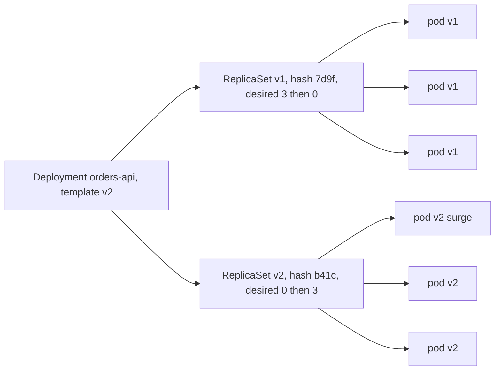
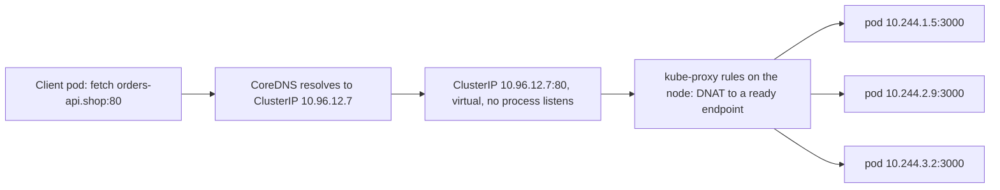

## 45.4 Deployment

#### Concept

A Deployment is the object you use to run a stateless service. It says: run N identical pods from this template, and when the template changes, replace the old pods with new ones gradually. Under it sits a ReplicaSet, which does one thing: keep exactly N pods matching a label selector alive. A Deployment manages a series of ReplicaSets, one per template version, and moves replicas from the old to the new during a rollout. Roll back, and it moves them back.

#### Why does it exist?

Replacing a running version by hand means stopping old containers and starting new ones in the right order, checking each is healthy, stopping if something breaks, and remembering how to undo it. A Deployment encodes that procedure with two numbers (`maxSurge`, `maxUnavailable`), uses readiness probes as the "is it healthy" signal, keeps a history of previous versions, and exposes rollback as one command.

#### Mental model

Imagine replacing the tyres on a moving bus. You cannot stop the bus (traffic keeps coming). A Deployment adds a fifth wheel (surge), waits until it is turning smoothly (ready), removes one old wheel (unavailable), and repeats. If a new wheel wobbles, it stops swapping and the bus keeps rolling on the old wheels. If you say "put the old wheels back", it runs the same procedure in reverse.

#### How it works



1. You change `spec.template` (usually the image tag). The Deployment controller hashes the template; the hash becomes the `pod-template-hash` label and part of the ReplicaSet name (`orders-api-b41c...`).
2. A new ReplicaSet is created with 0 replicas. The rollout begins.
3. With `strategy.rollingUpdate.maxSurge: 1` and `maxUnavailable: 0` on 3 replicas: scale new RS to 1 (4 pods total). Wait for that pod's readiness probe to pass. Scale old RS to 2. Scale new to 2. Wait. Scale old to 1. Scale new to 3. Wait. Scale old to 0. Done.
4. `minReadySeconds` (for example 10) makes the controller wait that long after readiness before counting a pod as available, so a pod that passes readiness and crashes 3 seconds later does not advance the rollout.
5. `progressDeadlineSeconds` (default 600) marks the rollout as failed if it makes no progress for that long; the Deployment condition `Progressing=False, reason=ProgressDeadlineExceeded` is what CI should check.
6. Old ReplicaSets are kept (scaled to 0) up to `revisionHistoryLimit` (default 10). `kubectl rollout undo` scales a previous one back up using the same rolling procedure.

The two rollout parameters:

| Setting | Meaning | Effect on 3 replicas | Choose when |
|---|---|---|---|
| `maxSurge: 25%`, `maxUnavailable: 25%` (defaults) | Up to 1 extra, up to 1 down | Can dip to 2 serving | Capacity headroom exists; fastest |
| `maxSurge: 1`, `maxUnavailable: 0` | Never below desired | Always 3 serving, briefly 4 | Latency-sensitive APIs; the usual choice |
| `maxSurge: 0`, `maxUnavailable: 1` | No extra capacity used | Dips to 2 | Cluster is tight on resources; slower |
| `strategy.type: Recreate` | Kill all, then start all | Downtime | Singleton workers that cannot run two versions at once |

A production Deployment for the orders API (probes, resources and security context are explained in 45.12 to 45.16; here the focus is the rollout fields):

```yaml
apiVersion: apps/v1
kind: Deployment
metadata:
  name: orders-api
  namespace: shop
  labels:
    app.kubernetes.io/name: orders-api
spec:
  replicas: 3
  revisionHistoryLimit: 5
  minReadySeconds: 10
  progressDeadlineSeconds: 300
  strategy:
    type: RollingUpdate
    rollingUpdate:
      maxSurge: 1
      maxUnavailable: 0
  selector:
    matchLabels:
      app.kubernetes.io/name: orders-api
  template:
    metadata:
      labels:
        app.kubernetes.io/name: orders-api
      annotations:
        checksum/config: "8f4e2a"          # bumped when ConfigMap changes; forces a rollout
    spec:
      containers:
        - name: api
          image: 123456789012.dkr.ecr.eu-west-1.amazonaws.com/orders-api:sha-3f9a1c2
          ports:
            - { name: http, containerPort: 3000 }
          readinessProbe:
            httpGet: { path: /health/ready, port: http }
            periodSeconds: 5
            failureThreshold: 3
          resources:
            requests: { cpu: 250m, memory: 256Mi }
            limits: { memory: 512Mi }
```

The commands you will use daily:

```bash
kubectl -n shop set image deployment/orders-api api=REG/orders-api:sha-b41c9d2   # trigger rollout
kubectl -n shop rollout status deployment/orders-api --timeout=300s              # block until done or failed
kubectl -n shop rollout history deployment/orders-api                            # revisions
kubectl -n shop rollout undo deployment/orders-api                               # previous revision
kubectl -n shop rollout undo deployment/orders-api --to-revision=4               # specific revision
kubectl -n shop rollout pause deployment/orders-api                              # stop mid-rollout (canary by hand)
kubectl -n shop rollout restart deployment/orders-api                            # new pods, same template
kubectl -n shop get rs -l app.kubernetes.io/name=orders-api                      # ReplicaSets and their hashes
```

`rollout restart` works by adding an annotation with a timestamp to the template, which changes the hash. It is the right way to pick up a rotated Secret or a new ConfigMap (45.7).

#### Practical example

CI deploys `sha-b41c9d2`. With `maxSurge: 1`, `maxUnavailable: 0`, `minReadySeconds: 10` and a readiness probe every 5 seconds, each pod swap takes about 25 seconds (pull 6 s, boot 4 s, probe 5 s, minReady 10 s). A 3-replica rollout completes in around 80 seconds; a 20-replica one in 8 minutes. If that is too slow, raise `maxSurge` to 25% or 50%; capacity permitting, rollouts parallelise.

#### NestJS example

A version endpoint makes rollouts observable from the outside. Watching it during a rollout shows the mix of versions serving, which is how you confirm a canary or spot a stuck rollout:

```ts
// src/version/version.controller.ts
import { Controller, Get } from '@nestjs/common';

@Controller('internal/version')
export class VersionController {
  @Get()
  version() {
    return {
      version: process.env.APP_VERSION ?? 'unknown',   // semver from the image label, injected as env
      commit: process.env.GIT_SHA ?? 'unknown',
      pod: process.env.POD_NAME,
      startedAt: new Date(Date.now() - process.uptime() * 1000).toISOString(),
    };
  }
}
```

`for i in $(seq 1 20); do curl -s orders-api.shop/internal/version | jq -r .commit; done | sort | uniq -c` from inside the cluster shows, for example, `13 sha-3f9a1c2` and `7 sha-b41c9d2` mid-rollout.

#### PostgreSQL example

During a rolling update, both versions run against the same database for a minute or more. Every schema change must be compatible with the old and the new code at once. Adding a NOT NULL column without a default breaks the old version's inserts the moment the migration runs; renaming a column breaks one version or the other. The expand-and-contract pattern (add the new column nullable, deploy code that writes both, backfill, deploy code that reads the new one, then drop the old) is the only safe way. Part 24 and Part 25 cover this in depth; the Deployment's job is only to make the overlap window explicit.

#### Production scenario

An e-commerce platform performs 200 rollouts a day across 60 Deployments. Their standard: `maxSurge: 25%`, `maxUnavailable: 0`, `minReadySeconds: 15`, `progressDeadlineSeconds: 600`, CI runs `rollout status` and on failure runs `rollout undo` automatically, and a rollout that fails twice pages the owning team. Median rollout of a 6-replica API is 2 minutes. Automated rollbacks fire about twice a week, nearly always for a readiness failure caused by a config or dependency problem, and the customer-visible impact is zero because old pods never left.

#### Failure scenario

At 14:05 a rollout of `catalog-api` stalls: `rollout status` shows `1 of 6 updated replicas available` for 10 minutes, then `ProgressDeadlineExceeded`. The new pod's readiness probe fails because the new version requires `SEARCH_URL`, which was added to the ConfigMap in a different pull request that had not merged. Old pods kept serving; customers saw nothing. CI rolled back. The engineer merged the ConfigMap change and redeployed. Without `maxUnavailable: 0` and readiness gating, the old strategy of "stop all, start all" would have been a 10-minute outage.

#### Edge cases & failure modes

- **Readiness probe too lenient** (or absent) lets a broken version roll out completely; readiness is the gate.
- **Two versions serving at once** breaks clients that assume a single API version; the overlap window is real (see WebSockets in 45.21).
- **`maxUnavailable: 25%` on 2 replicas** rounds down to 0 unavailable but `maxSurge` rounds up to 1, which is fine; on 1 replica with `maxSurge: 0`, `maxUnavailable` must be at least 1 or the rollout deadlocks.
- **Selector immutability.** You cannot change `spec.selector` on a Deployment; changing labels requires a new Deployment.
- **HPA and `replicas` conflict.** If the manifest sets `replicas: 3` and the HPA has scaled to 12, `kubectl apply` resets to 3 and the HPA scales back up; omit `replicas` from the manifest when an HPA owns it (or use server-side apply with field ownership).
- **`revisionHistoryLimit: 0`** deletes rollback targets.
- **`Recreate` strategy** is downtime; only for workloads that cannot overlap.

#### How a Senior Backend Engineer thinks about this

They set `maxUnavailable: 0` for anything customer-facing and accept the extra capacity cost during rollouts. They make readiness honest so that rollouts self-gate. They wire `rollout status` into CI with automatic undo. They treat the overlap window as a design constraint on API and schema changes. And they use `rollout pause` for a manual canary before investing in Argo Rollouts or Flagger.

#### Common mistakes

- No readiness probe, so rollouts replace healthy pods with broken ones at full speed.
- Deploying with `kubectl apply` of a manifest that pins `replicas` while an HPA is active.
- Not checking `rollout status` in CI; the pipeline goes green while the rollout is stuck.
- Assuming rollback reverts the database.
- Editing the ReplicaSet directly.

#### Interview questions

1. *Explain `maxSurge` and `maxUnavailable` and choose values for a latency-sensitive API.* Expected: extra pods allowed and pods allowed down; `1`/`0` or `25%`/`0`; readiness gates progress.
2. *How does `kubectl rollout undo` work?* Expected: scales a retained ReplicaSet back up with the same rolling procedure; template hash identifies revisions; the database is not reverted.
3. *A rollout is stuck at 1 of 6. What do you check?* Expected: new pod's readiness, `describe pod`, logs, `ProgressDeadlineExceeded` condition, ConfigMap/Secret changes; roll back if needed.
4. *Why must schema changes be backward compatible during a rolling update?* Expected: old and new versions run concurrently against one schema; expand-and-contract.
5. *How do you restart pods to pick up a new Secret?* Expected: `rollout restart` or a checksum annotation on the template.

#### Practical exercise

Deploy the orders API with 3 replicas and the strategy above. Trigger a rollout to a version whose readiness fails (point it at a wrong `DB_HOST`). Observe `rollout status`, `get rs`, and `describe deployment` conditions. Roll back. Then perform a manual canary with `rollout pause` after one new pod is ready and use the version endpoint to measure the traffic split. Acceptance criteria: zero failed requests from a load generator during both the failed rollout and the rollback, the `ProgressDeadlineExceeded` condition captured, and the observed canary split within 10% of 1-in-4.

## 45.5 Service

#### Concept

A Service gives a stable name and a virtual IP (the ClusterIP) to a set of pods selected by labels. Pods come and go; the Service stays. Kubernetes keeps an EndpointSlice listing the IPs of the currently *ready* pods behind the Service, and kube-proxy programs every node so that a connection to the ClusterIP is forwarded to one of those pods. CoreDNS gives the Service a name: `orders-api.shop.svc.cluster.local`.

#### Why does it exist?

Pod IPs are unstable and unknowable in advance. Without a Service, every client would need to discover pod IPs, watch for changes, and balance across them. A Service moves that problem into the platform: clients connect to one name, and the platform sends each new connection to a ready pod.

#### Mental model

Imagine a company's main phone number. Callers dial one number; the switchboard connects each call to whichever agent is currently at their desk and not on a break (ready). Agents change shifts all day; the number never changes. The switchboard does not move a call once connected: if you are talking to an agent for an hour, you keep talking to that agent even if ten new agents arrive. That last property is the gRPC and WebSocket caveat.

#### How it works



1. You create a Service with `selector: app.kubernetes.io/name: orders-api`, `port: 80`, `targetPort: http`.
2. The EndpointSlice controller watches pods matching the selector and lists the IPs of those with `Ready=true`. Readiness (45.12) is therefore what adds and removes a pod from traffic.
3. kube-proxy on every node watches EndpointSlices and writes iptables rules (or IPVS entries): packets to `10.96.12.7:80` are DNAT-ed to one endpoint, chosen randomly (iptables) or round-robin (IPVS), *per new connection*. There is no process behind the ClusterIP; it exists only as rules.
4. CoreDNS answers `orders-api.shop.svc.cluster.local` with the ClusterIP. Inside the same namespace, `orders-api` alone resolves through the search path; from another namespace, `orders-api.shop`.
5. Some CNIs (Cilium) replace kube-proxy with eBPF; the behaviour is the same from the application's view.

Service types:

| Type | What you get | Reachable from | Use for |
|---|---|---|---|
| `ClusterIP` (default) | Virtual IP inside the cluster | Pods only | Every internal service; the API behind an Ingress |
| `NodePort` | ClusterIP plus a port (30000 to 32767) on every node | Anything that can reach a node | Rarely; ingress controllers on bare metal |
| `LoadBalancer` | NodePort plus a cloud load balancer (NLB/ALB) | The internet or VPC | One per public entry point; usually the ingress controller, not each app |
| `ExternalName` | A DNS CNAME to an external host | Pods | Pointing `postgres` at an RDS hostname so config looks uniform |
| Headless (`clusterIP: None`) | No VIP; DNS returns the pod IPs directly | Pods | StatefulSets, client-side load balancing, gRPC |

```yaml
apiVersion: v1
kind: Service
metadata:
  name: orders-api
  namespace: shop
  labels:
    app.kubernetes.io/name: orders-api
spec:
  type: ClusterIP
  selector:
    app.kubernetes.io/name: orders-api
  ports:
    - name: http
      port: 80            # what clients connect to
      targetPort: http    # container port by name (3000)
      protocol: TCP
```

The long-lived connection problem: load balancing happens at connection time. HTTP/1.1 with keep-alive from a Node client (`undici` or `axios` with an agent) opens a handful of connections and reuses them for minutes; those connections all go to whichever pods existed when they were opened. Scale from 3 to 10 pods and the new 7 receive almost nothing from existing clients. gRPC (one HTTP/2 connection multiplexing thousands of requests) and WebSockets make it worse: one connection, one pod, forever. Fixes, in increasing effort: client-side keep-alive with a short max age (close and reopen connections every 30 to 60 seconds); a headless Service plus client-side load balancing (gRPC's `dns:///` resolver with round-robin); an L7 proxy in the path (the Ingress controller, Envoy, a service mesh) that balances requests rather than connections.

#### Practical example

`orders-api` calls `inventory-api` at `http://inventory-api.shop/reserve`. Both run as Deployments with ClusterIP Services. `orders-api` uses an `undici` `Agent` with `keepAliveTimeout: 30_000` and `keepAliveMaxTimeout: 60_000` so connections are recycled within a minute and new `inventory-api` pods receive traffic within a minute of becoming ready. External clients never see either Service; they enter through the Ingress (45.6).

#### NestJS example

The outbound client is where the load-balancing caveat is handled. A NestJS provider wrapping `undici` with connection recycling and per-request timeouts:

```ts
// src/inventory/inventory.client.ts
import { Injectable, OnModuleDestroy, ServiceUnavailableException } from '@nestjs/common';
import { Agent, request } from 'undici';

@Injectable()
export class InventoryClient implements OnModuleDestroy {
  private readonly agent = new Agent({
    connections: 20,
    keepAliveTimeout: 30_000,        // idle connections are closed after 30 s
    keepAliveMaxTimeout: 60_000,     // no connection lives longer than 60 s: new pods get traffic
    connect: { timeout: 1_000 },
  });
  private readonly baseUrl = process.env.INVENTORY_URL ?? 'http://inventory-api.shop';

  async reserve(orderId: string, items: { sku: string; qty: number }[]): Promise<void> {
    const res = await request(`${this.baseUrl}/reserve`, {
      method: 'POST',
      dispatcher: this.agent,
      headers: { 'content-type': 'application/json', 'idempotency-key': orderId },
      body: JSON.stringify({ orderId, items }),
      headersTimeout: 2_000,
      bodyTimeout: 2_000,
    });
    if (res.statusCode >= 500) {
      await res.body.dump();
      throw new ServiceUnavailableException('inventory unavailable');
    }
    await res.body.json();
  }

  async onModuleDestroy(): Promise<void> {
    await this.agent.close();
  }
}
```

#### PostgreSQL example

The database usually lives outside the cluster (RDS). An `ExternalName` Service keeps the configuration uniform so that `DB_HOST=postgres` works in every environment, and a later move (to a read replica endpoint, to a proxy) is a Service change rather than a config change on every app:

```yaml
apiVersion: v1
kind: Service
metadata:
  name: postgres
  namespace: shop
spec:
  type: ExternalName
  externalName: orders-prod.cluster-abc123.eu-west-1.rds.amazonaws.com
```

The connection string then uses `postgres.shop.svc.cluster.local` (or `postgres` inside the namespace). Note that TLS certificate validation must still match the RDS hostname; use `sslmode=verify-full` with the RDS CA bundle and set the servername explicitly if your driver checks the connected hostname.

#### Production scenario

A cluster with 400 Services and 3,000 endpoints: iptables mode handles it, but rule updates on endpoint churn take hundreds of milliseconds per node; IPVS or eBPF is preferred beyond a few thousand endpoints. During a rollout of a 20-replica API, endpoint changes propagate to all nodes within 1 to 3 seconds, which is the window that `preStop` sleeps cover (45.14).

#### Failure scenario

At 19:20 `notifications-api` scales from 4 to 16 pods under load, but p99 latency does not improve and the 4 original pods stay at 90% CPU while the 12 new ones idle at 3%. All callers are Node services with default keep-alive agents; their connections were opened an hour ago and pinned to the original 4 pods. The fix that night was `rollout restart` of the callers (forcing new connections); the fix that week was `keepAliveMaxTimeout` in the shared HTTP client library.

#### Edge cases & failure modes

- **Selector mismatch.** A typo in labels gives a Service with zero endpoints; `kubectl get endpointslices -l kubernetes.io/service-name=orders-api` is empty; every request times out.
- **`targetPort` mismatch.** Service points at 8080, container listens on 3000; connection refused.
- **Readiness removes all pods** (dependency down) and the Service has no endpoints; see 45.21.
- **Session affinity** (`sessionAffinity: ClientIP`) pins by source IP, which behind a NAT is one IP; avoid; use Redis for sessions.
- **DNS `ndots:5`.** Resolving `api.stripe.com` from a pod tries `api.stripe.com.shop.svc.cluster.local`, `.svc.cluster.local`, `.cluster.local`, then the real name: four extra lookups. Use a trailing dot (`api.stripe.com.`) or `dnsConfig: { options: [{ name: ndots, value: "2" }] }`.
- **Cross-namespace access** requires the `name.namespace` form; NetworkPolicy may block it.
- **`LoadBalancer` per app** creates one cloud load balancer per Service; expensive; put an Ingress in front instead.

#### How a Senior Backend Engineer thinks about this

They know that a Service balances connections, not requests, and design clients accordingly. They put an L7 proxy in front of anything with long-lived connections. They keep exactly one `LoadBalancer` (the ingress controller) and everything else `ClusterIP`. They check endpoints before they check code when "the service is unreachable".

#### Common mistakes

- Expecting new replicas to receive traffic from clients with persistent connections.
- One `LoadBalancer` Service per application.
- Selector and label typos.
- Hardcoding pod IPs or ClusterIPs anywhere.
- Ignoring `ndots` and paying 4x DNS latency on every external call.

#### Interview questions

1. *How does a ClusterIP work if nothing listens on it?* Expected: kube-proxy DNAT rules per node; per-connection selection among ready endpoints.
2. *Why did scaling an API not reduce latency for existing callers?* Expected: keep-alive connections pinned to old pods; recycle connections or use an L7 proxy.
3. *What is a headless Service and when do you use it?* Expected: no VIP, DNS returns pod IPs; StatefulSets, client-side load balancing, gRPC.
4. *What determines whether a pod is in a Service's endpoints?* Expected: label selector match plus readiness.
5. *Explain the `ndots` problem.* Expected: search-path expansion on external names; trailing dot or lower `ndots`.

#### Practical exercise

Create the Service above and, from a debug pod, run `nslookup orders-api.shop.svc.cluster.local`, `kubectl get endpointslices`, and 100 `curl` requests printing the pod name from the version endpoint. Then open 10 keep-alive connections with a small Node script, scale the Deployment from 3 to 6, and count which pods answer over the next 60 requests. Fix the client with `keepAliveMaxTimeout` and repeat. Acceptance criteria: a table of pod hit counts before and after, showing the new pods receiving traffic only after the fix, and the `ndots` behaviour demonstrated with `tcpdump` or CoreDNS logs on an external lookup.

## 45.6 Ingress

#### Concept

An Ingress is the HTTP entry point to the cluster: rules that map hostnames and paths to Services, plus TLS termination. The Ingress object is just configuration; an **ingress controller** (NGINX, AWS Load Balancer Controller for ALB, Traefik, HAProxy) reads it and does the actual proxying. One controller with one cloud load balancer serves hundreds of Ingress rules, which is why you do not create a `LoadBalancer` Service per app.

#### Why does it exist?

External traffic needs a public IP, TLS certificates, host and path routing, and often rate limits, body-size limits, timeouts and WebSocket support. Doing that per Service would be expensive (a load balancer each) and inconsistent. Ingress centralises it: one place for certificates, one place for routing, one place for edge policies.

#### Mental model

Imagine the building's reception desk with a directory. A visitor asks for "orders, second floor" (host and path); reception checks their ID at the door (TLS), applies house rules (max parcel size, how long they may wait), and sends them to the right floor (Service), where any available agent (pod) takes them.

#### How it works

1. The ingress controller runs as a Deployment (or DaemonSet) with one `LoadBalancer` Service. The cloud provisions an NLB or ALB pointing at it.
2. The controller watches Ingress objects (filtered by `ingressClassName`) and Services, and builds its proxy configuration: for NGINX, an `nginx.conf` regenerated on changes; for ALB, listener rules and target groups pointing directly at pod IPs (`target-type: ip`).
3. A request for `https://api.shop.example.com/orders` hits the load balancer, reaches the controller, matches the host and path rule, and is proxied to the Service's endpoints (NGINX resolves endpoints itself and balances *requests*, which solves the long-connection problem for external traffic).
4. TLS: the controller terminates HTTPS using a certificate stored in a Secret; cert-manager can obtain and renew it from Let's Encrypt automatically.
5. Annotations tune per-Ingress behaviour: timeouts, body size, WebSocket, CORS, rate limits, sticky sessions.

An Ingress for the orders API with NGINX and cert-manager:

```yaml
apiVersion: networking.k8s.io/v1
kind: Ingress
metadata:
  name: orders-api
  namespace: shop
  annotations:
    cert-manager.io/cluster-issuer: letsencrypt-prod
    nginx.ingress.kubernetes.io/proxy-body-size: "10m"          # file uploads up to 10 MB
    nginx.ingress.kubernetes.io/proxy-read-timeout: "60"        # seconds; raise for long polls/WebSockets
    nginx.ingress.kubernetes.io/proxy-send-timeout: "60"
    nginx.ingress.kubernetes.io/proxy-connect-timeout: "5"
    nginx.ingress.kubernetes.io/limit-rps: "50"                 # per client IP, coarse protection
    nginx.ingress.kubernetes.io/ssl-redirect: "true"
spec:
  ingressClassName: nginx
  tls:
    - hosts: [api.shop.example.com]
      secretName: api-shop-example-com-tls
  rules:
    - host: api.shop.example.com
      http:
        paths:
          - path: /orders
            pathType: Prefix
            backend:
              service: { name: orders-api, port: { name: http } }
          - path: /inventory
            pathType: Prefix
            backend:
              service: { name: inventory-api, port: { name: http } }
```

The same for an AWS ALB, where annotations configure the load balancer itself:

```yaml
metadata:
  annotations:
    alb.ingress.kubernetes.io/scheme: internet-facing
    alb.ingress.kubernetes.io/target-type: ip                   # route to pod IPs, not NodePorts
    alb.ingress.kubernetes.io/listen-ports: '[{"HTTPS":443}]'
    alb.ingress.kubernetes.io/certificate-arn: arn:aws:acm:eu-west-1:123456789012:certificate/abcd
    alb.ingress.kubernetes.io/healthcheck-path: /health/ready
    alb.ingress.kubernetes.io/load-balancer-attributes: idle_timeout.timeout_seconds=120
    alb.ingress.kubernetes.io/target-group-attributes: deregistration_delay.timeout_seconds=15
spec:
  ingressClassName: alb
```

WebSockets: NGINX ingress proxies them without special flags, but `proxy-read-timeout` (default 60 s) closes idle sockets; set it to the client's ping interval times a margin (for example 3600 for hourly reconnects, with application-level pings every 30 s). ALB supports WebSockets natively; `idle_timeout` plays the same role.

Gateway API is the successor to Ingress: `Gateway` (the listener, owned by the platform team) and `HTTPRoute` (routing rules, owned by application teams), with typed fields for timeouts, header matching and traffic splitting instead of vendor annotations. New clusters increasingly use it; the concepts are identical.

#### Practical example

`api.shop.example.com` is one ALB serving 22 Ingress rules across 6 namespaces. Certificates come from ACM. Each team owns its Ingress; the platform team owns the controller. Adding a new API is a 15-line Ingress in the team's Helm chart.

#### NestJS example

Behind a proxy, the app must trust the proxy's headers to see the real client IP (for rate limiting and audit logs) and the original protocol. In NestJS with Express:

```ts
// src/main.ts (excerpt)
import { NestExpressApplication } from '@nestjs/platform-express';

const app = await NestFactory.create<NestExpressApplication>(AppModule);
// Trust exactly one hop (the ingress controller), not arbitrary X-Forwarded-For chains
app.set('trust proxy', 1);
```

And a ThrottlerGuard that keys on the forwarded IP rather than the ingress controller's pod IP:

```ts
// src/common/throttler-behind-proxy.guard.ts
import { Injectable } from '@nestjs/common';
import { ThrottlerGuard } from '@nestjs/throttler';

@Injectable()
export class ThrottlerBehindProxyGuard extends ThrottlerGuard {
  protected async getTracker(req: Record<string, any>): Promise<string> {
    // req.ips is populated by Express when trust proxy is set; first entry is the client
    return req.ips?.length ? req.ips[0] : req.ip;
  }
}
```

Without `trust proxy`, every request appears to come from `10.244.x.x` (the controller), and a per-IP rate limit throttles the whole world as one client.

#### Production scenario

An ingress layer handling 4,000 RPS on 3 NGINX controller pods (each at 40% CPU), TLS terminated at the controller, p50 added latency 0.8 ms, p99 3 ms. cert-manager renews 40 certificates automatically; an alert fires if any certificate has under 14 days left. Body size limits stop a 2 GB upload at the edge before it reaches a NestJS pod.

#### Failure scenario

At 03:00 on a Sunday, `api.shop.example.com` starts failing TLS handshakes: the certificate expired. cert-manager had been failing to renew for 30 days because a NetworkPolicy added in a security hardening sprint blocked its HTTP-01 challenge traffic; nobody had alerted on `certmanager_certificate_expiration_timestamp_seconds`. The fix was a NetworkPolicy exception and an alert. The senior lesson: automation without an alert on its failure is a delayed outage.

#### Edge cases & failure modes

- **Default body size** on NGINX ingress is 1 MB; uploads fail with `413` at the edge while the app never sees them.
- **Timeout mismatches.** Ingress read timeout 60 s, app timeout 30 s, ALB idle 60 s, Node `keepAliveTimeout` 5 s: the last one causes intermittent `502` because the proxy reuses a connection Node just closed. Set Node's `keepAliveTimeout` above the proxy's idle timeout (for example 65 s versus 60 s) and `headersTimeout` above that.
- **Path rewrites.** A `Prefix` path of `/orders` forwards `/orders/123` unchanged; if the app expects `/123`, you need a rewrite annotation, which is a common source of 404s.
- **Multiple controllers.** Without `ingressClassName`, an Ingress may be picked up by none or by both.
- **WebSocket idle timeout** dropping connections every 60 s.
- **Health check path** on ALB must return 200 during rollouts; pointing it at `/health/live` (which does not check dependencies) masks dependency failures; point it at `/health/ready`.

#### How a Senior Backend Engineer thinks about this

One ingress controller, one load balancer, certificates automated and alerted. They align every timeout along the path (client, load balancer, ingress, app, database) so the outermost is longest. They put body-size and rate limits at the edge and treat annotations as production configuration under review. They plan for Gateway API on new clusters.

#### Common mistakes

- A `LoadBalancer` Service per application.
- Forgetting `trust proxy` and rate-limiting the ingress controller instead of clients.
- Node `keepAliveTimeout` shorter than the proxy's idle timeout.
- Certificates without expiry alerts.
- Default 1 MB body limit surprising an upload feature.

#### Interview questions

1. *What is the difference between an Ingress and an ingress controller?* Expected: the object is configuration; the controller is the proxy that implements it.
2. *How do you support WebSockets behind NGINX ingress or ALB?* Expected: raise read/idle timeouts; keep application pings; expect reconnects on rollout.
3. *Why do you see intermittent `502` between a proxy and Node?* Expected: keep-alive timeout race; set Node's above the proxy's.
4. *Where should rate limiting and body-size limits live?* Expected: coarse limits at the edge, precise per-user limits in the app with Redis.
5. *What is Gateway API and why does it exist?* Expected: typed, role-separated successor to Ingress; portable configuration instead of annotations.

#### Practical exercise

Expose the orders API through NGINX ingress with TLS from cert-manager (staging issuer). Upload a 5 MB file and observe the `413`; fix it with the annotation. Set Node's `keepAliveTimeout` to 2 s, run a 60-second load test, count `502`s, then set it to 65 s and repeat. Acceptance criteria: a valid certificate, uploads up to 10 MB succeeding, `502` count dropping to zero after the keep-alive fix, and the client IP appearing correctly in the app's request logs.
