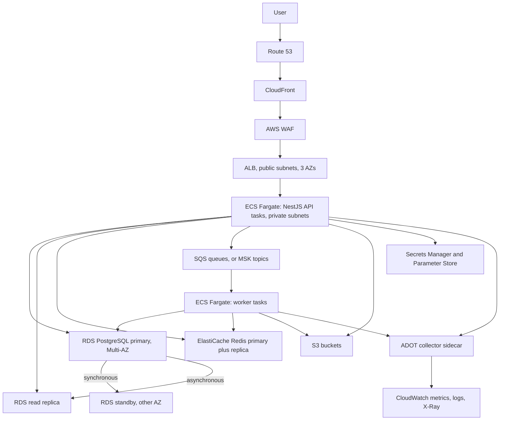
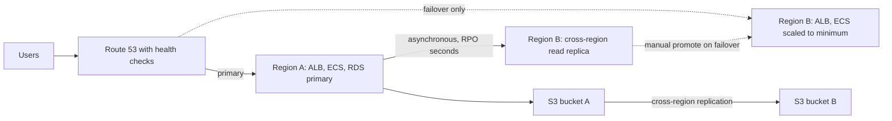
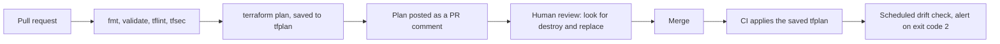

## 45.13 A reference architecture for the NestJS platform on AWS

#### Concept

Everything in Part 45 so far has been a service at a time. This section assembles them into one architecture that a real team can run: a NestJS API and its workers on ECS Fargate, PostgreSQL on RDS, Redis on ElastiCache, a queue, object storage, secrets, and observability, fronted by Route 53, CloudFront, WAF and an ALB. Then it does the part most architecture diagrams skip: it sizes each component for a specific load, explains the arithmetic behind each number, and puts an indicative price on it.

#### Why does it exist?

Because "we'll use ECS and RDS" is not an architecture, it is a shopping list. The design decisions that matter are how many tasks of what size, which database instance class and why, what is synchronous and what is queued, where the network boundaries are, and what each choice costs per month. A senior engineer is expected to produce those numbers in a design review and defend them, and to be able to say which of them are guesses that need a load test.

#### Mental model

Imagine a restaurant. Route 53 is the address on the map, CloudFront is the takeaway window that serves the popular items without bothering the kitchen, WAF is the doorman, the ALB is the host who seats people at whichever table is free, the Fargate tasks are the cooks, RDS is the pantry where everything is really kept, ElastiCache is the counter of prepared items within arm's reach, the queue is the ticket rail for things that do not need to be done while the customer stands there, and CloudWatch is the manager watching how long each order takes.

#### How it works



Component by component, with the decision behind each:

**Route 53.** The hosted zone for `shop.example.com`, an alias record to the CloudFront distribution. Health checks are configured but do nothing yet; they become the failover mechanism in 45.14. TTLs of 60 seconds on records you might need to move.

**CloudFront.** In front of everything, not only static assets. It terminates TLS at the edge (so the handshake happens 20 ms from the user instead of 180 ms away), it caches product images and the built frontend bundle, and it passes API calls through to the ALB over AWS's backbone, which is measurably more reliable than the public internet for the long haul. The cache policy for `/api/*` forwards `Authorization` and sets TTL 0, because caching an authenticated response is one of the worst bugs in this part (45.17).

**WAF.** Attached to the CloudFront distribution, not the ALB, so bad traffic is dropped at the edge and never costs you an ALB LCU or a Fargate CPU cycle. Managed rule groups (core rule set, known bad inputs, IP reputation), a rate-based rule at 2,000 requests per 5 minutes per IP, and a size-constraint rule on request bodies. Every custom rule starts in count mode for a week before it blocks anything.

**ALB.** Public subnets across three AZs, listener on 443 with an ACM certificate, target group of ECS tasks with `/health/ready` as the health check path, `deregistration_delay` of 30 seconds so draining tasks finish their requests, and an idle timeout of 60 seconds that must be **less** than the Node server's `keepAliveTimeout` (45.17 explains what happens when it is not).

**ECS Fargate: the API service.** Private subnets, no public IP, egress through NAT gateways. One task definition, one container plus the ADOT sidecar, a task role scoped to exactly the S3 prefix, SQS queues, and secrets it needs. Autoscaling on ALB request count per target with a target of 120 RPS per task, plus a scheduled minimum before known peaks.

**ECS Fargate: the worker services.** Separate services and separate task definitions from the API, deliberately. Workers doing 20-second jobs must not share an event loop, a deploy cadence or a scaling policy with a latency-sensitive API, and a blocked worker must not fail an API health check (Part 30 — Reliability Engineering: Timeouts, Retries, Circuit Breakers and Backpressure).

**RDS PostgreSQL Multi-AZ, plus a read replica.** The primary and its standby are in different AZs with synchronous replication; the read replica is asynchronous and serves reports and the heavier read paths. RDS Proxy sits in front if Lambda functions also connect. Automated backups with a 7-day window, `performance_insights_enabled = true`, and a parameter group in Terraform (18.13).

**ElastiCache Redis.** Cluster mode disabled, primary plus one replica in another AZ, automatic failover on, `maxmemory-policy = allkeys-lru` for the cache instance. If sessions and rate limits also live in Redis, they belong on a separate instance from the cache, because a cache eviction storm should not delete anyone's session.

**SQS (or MSK).** SQS standard queues with a dead-letter queue after 5 receives, a visibility timeout of 6x the p99 job duration, and long polling. MSK only if you need replay, ordering per key, or fan-out to multiple independent consumer groups (Part 27 — Messaging: Queues, Topics, Kafka, RabbitMQ and SQS).

**S3.** One bucket for user uploads (presigned PUT, block public access, versioning, lifecycle to Intelligent-Tiering at 30 days), one for exports with a 7-day expiry lifecycle rule, one for logs.

**Secrets Manager and Parameter Store.** Database credentials with rotation in Secrets Manager; non-secret configuration in Parameter Store as it is roughly free. Injected into the task definition as `secrets`, which means they arrive as environment variables at task start and are **not** re-read when rotated (45.17).

**CloudWatch and OpenTelemetry.** The ADOT collector sidecar receives OTLP from the NestJS process, exports traces to X-Ray and metrics to CloudWatch; structured JSON logs go to CloudWatch Logs with a retention policy set in Terraform.

#### Sizing for 1,000 RPS

The load: an e-commerce API at **1,000 RPS peak** and about **350 RPS daily average**, p50 25 ms, p99 target 250 ms, read/write ratio about 9:1, roughly 3 database queries per request, 40 percent of reads served from Redis.

| Component | Size | Reasoning |
|---|---|---|
| API tasks | 8 minimum, 24 maximum, 1 vCPU / 2 GB each | A NestJS process doing I/O-bound JSON work handles 120–180 RPS per vCPU before event-loop lag rises. At 150 RPS per task, peak needs 7 tasks; 8 minimum gives AZ spread and headroom, 24 maximum covers a 3x flash sale. 2 GB because Node's default old-space plus the sidecar fits comfortably and OOM is worse than the extra $0.004/hour |
| Worker tasks | 4, 0.5 vCPU / 1 GB | Queue depth, not RPS, sizes these. 200 jobs/s at 40 ms each needs 8 concurrent slots; 4 tasks with a concurrency of 4 gives 16 with headroom for retries |
| RDS instance | `db.r6g.2xlarge` (8 vCPU, 64 GB), Multi-AZ | 3,000 queries/s at p99 8 ms needs roughly 24 concurrently active backends; 8 vCPU handles that with room. 64 GB lets `shared_buffers` be 16 GB and `effective_cache_size` 48 GB, which holds a 40 GB hot working set in memory. Memory, not CPU, is the sizing driver for OLTP PostgreSQL |
| RDS storage | 500 GB gp3, 12,000 IOPS, 500 MB/s | gp3 decouples IOPS from size, so you do not over-provision storage to buy IOPS. 12,000 IOPS covers checkpoint bursts with margin |
| Read replica | 1 × `db.r6g.xlarge` | Reports and heavy list endpoints only, about 15 percent of query volume. Half the primary's size because it does not carry the write path |
| ElastiCache | `cache.r7g.large` primary + 1 replica | 40 percent of reads at 350 RPS average is a few thousand operations/s, far below a single node's 100k+. Sized by **memory**: 13 GB holds the product and session working set. The replica is for failover, not throughput |
| Messaging | SQS standard, 3 queues + 3 DLQs | About 200 events/s. SQS is serverless, needs no capacity decision, and is one tenth the cost of a 3-broker MSK cluster at this volume |
| MSK alternative | 3 × `kafka.m3.small` or `m5.large`, 3 AZs | Only if replay, per-key ordering or multiple independent consumer groups are required |
| NAT gateways | 2 (one per AZ used for egress) | Three would be more available and 50 percent more expensive; two is the common compromise. VPC endpoints for S3, ECR, Secrets Manager and CloudWatch remove most of the traffic that would otherwise cross them |
| ALB | 1, 3 AZs | Scales itself; you size nothing, you only pay LCUs |

#### Indicative monthly cost

Prices move, differ by region, and drop substantially with Savings Plans and Reserved Instances. Treat this as the **shape** of the bill, not a quote. On-demand, one production environment, a mid-size region:

| Line item | Monthly (USD) | Note |
|---|---|---|
| ECS Fargate, API (avg 10 tasks) | 360 | Autoscaled; Compute Savings Plan cuts this ~20 percent |
| ECS Fargate, workers (4 tasks) | 75 | Fargate Spot for workers can halve it |
| ALB | 130 | Fixed hourly plus LCUs |
| CloudFront | 320 | Egress dominates; depends entirely on response sizes |
| WAF | 560 | $0.60 per million requests plus rules; the surprise line for most teams |
| RDS primary, Multi-AZ | 1,410 | Doubled for the standby; this is the price of a 60-second RTO |
| RDS read replica | 355 | |
| RDS storage and backups | 90 | 500 GB gp3 plus snapshot storage |
| ElastiCache (2 nodes) | 330 | |
| SQS | 120 | Batching by 10 cuts request count 10x |
| NAT gateways plus data processing | 290 | Cut sharply by VPC endpoints |
| S3 storage and requests | 130 | |
| CloudWatch logs, metrics, alarms, X-Ray | 310 | Grows silently; set retention |
| Secrets Manager, KMS, Route 53 | 25 | |
| **Total** | **≈ 4,500** | Plus a staging environment at roughly 25 percent of this |

Two observations a senior engineer makes about this table. First, **the database is a third of the bill and Multi-AZ is half of the database**, so "do we need Multi-AZ" is a real question with a real answer (yes, for a production e-commerce system, because the alternative is a 20-minute restore). Second, **WAF and CloudWatch together cost more than the entire compute fleet**, which is not intuitive and is why per-request and per-GB pricing deserves the same review as instance sizing.

#### Production scenario

A team ran exactly this architecture for eighteen months at growing load. The changes they made, in order: added VPC endpoints (NAT bill fell 60 percent), moved workers to Fargate Spot (worker cost halved, with interruption handling already in place because the jobs were idempotent), bought a one-year Compute Savings Plan (compute down 24 percent), set CloudWatch retention to 30 days (log storage stopped compounding), and moved from `db.r6g.2xlarge` to `db.r7g.2xlarge` (about 15 percent more throughput for a similar price). Nothing in that list was an architecture change; all of it was operations, and it cut the bill by about 30 percent.

#### Failure scenario

The first version of this architecture put the NestJS API and the Kafka consumers in the same ECS service to "save a task definition". A poison message caused the consumer to block for 40 seconds on every retry; the shared event loop stopped serving HTTP; the ALB health check failed; ECS killed the task; the replacement task picked up the same message and did it again. Six tasks entered a restart loop and the API was down for eleven minutes because of a message that had nothing to do with any HTTP request. Splitting the services was a thirty-minute change that permanently removed a class of outage.

## 45.14 Multi-AZ and multi-region

**What Multi-AZ actually protects against.** An availability zone is one or more physically separate data centres with independent power, cooling and networking, a few kilometres apart, connected by low-latency fibre (typically under 2 ms round trip). Multi-AZ protects against the loss of one building: a power event, a network device failure, a flood, a fire. It does not protect against a bad deploy, a dropped table, an expired certificate, an IAM misconfiguration, a corrupted schema migration, or a region-wide control-plane failure. Those are the majority of real outages, and no amount of zone redundancy touches them.

**Synchronous within a zone pair, asynchronous across regions.** RDS Multi-AZ replicates synchronously: a commit is not acknowledged until the standby has the WAL record. At 1–2 ms of inter-AZ latency this costs a couple of milliseconds per commit, which is affordable. Across regions the round trip is 60–200 ms, so synchronous replication would make every write unusably slow; cross-region replicas are asynchronous, and asynchronous means a non-zero RPO by definition. Aurora Global Database narrows the window (typically under a second) with storage-level replication, but the window still exists.

**Active-passive versus active-active.** Active-passive means one region serves traffic and another is warm, with data replicating one way. Failover is a decision (usually human-approved) plus a DNS change plus promoting the database. Active-active means both regions accept writes, which requires you to answer one question that has no general answer: **what happens when the same order, the same inventory row or the same user profile is written in both regions at the same time?** The options are all uncomfortable: partition the data by region so each key has one writer (works well for user-scoped data, badly for global inventory), use last-write-wins and accept silent data loss, use CRDTs (which constrain what operations you may express), or route all writes to one region and only reads locally, which is active-passive for writes and honest about it. DynamoDB Global Tables give you last-write-wins across regions; PostgreSQL gives you nothing multi-master out of the box, and the third-party options are heavy operational commitments.

| Posture | Protects against | RPO | RTO | Cost delta | Complexity |
|---|---|---|---|---|---|
| Single AZ | Nothing structural | Last backup, hours | Hours (restore) | Baseline | Low |
| Multi-AZ | Loss of one data centre | 0 (synchronous) | 60–120 s automatic | +100 percent on the database | Low; managed |
| Multi-AZ + cross-region read replica | Data centre loss, plus a manual regional escape | Seconds to minutes | 30–60 min (manual promote, DNS, config) | +30–50 percent overall | Medium |
| Active-passive multi-region, warm standby | Region loss | Seconds | 10–30 min, mostly rehearsal-dependent | +60–90 percent | High |
| Active-active multi-region | Region loss with no failover step | Depends on conflict strategy | Near zero | +100 percent or more | Very high; a permanent design tax |

**The honest recommendation for most teams.** Run Multi-AZ for the database, the cache and the compute, spread across three AZs, and stop there. Add automated cross-region backup copies so a region loss is recoverable, and write down and rehearse the restore. Multi-region active-passive is worth building when you have a contractual RTO measured in minutes, a regulatory requirement, or genuine users on another continent whose latency justifies it. Multi-region active-active is worth building when you have a business that loses more money in an hour of downtime than a dedicated platform team costs in a year, and even then you should expect the conflict-resolution design to be the hardest thing your team does. Most teams that build multi-region before they have mastered Multi-AZ end up with two regions that both fail, because the complexity itself became the outage cause. Part 49 — Backup, Restore and Disaster Recovery covers RTO/RPO targets, backup verification and the failover runbook in depth.



The dotted lines are the ones that fail in a real disaster, because they are the ones nobody exercises. Rehearse them quarterly or assume they do not work.

## 45.15 The Well-Architected pillars applied

**Operational excellence.** Everything in the reference architecture is defined in Terraform, deployed by a pipeline, and observable before it is released. Deploys are rolling with an ECS deployment circuit breaker that rolls back automatically when new tasks fail health checks. Every alarm has a runbook link in its description. *The questions a senior asks:* Can we deploy on a Friday afternoon without discussion, and if not, what specifically stops us? When this alarm fires at 02:14, what is the first command the on-call runs? How do we know a change worked, other than the absence of complaints?

**Security.** Private subnets for everything except the ALB, security groups referencing each other rather than CIDR ranges, one task role per service with least-privilege policies, secrets in Secrets Manager with rotation, KMS customer-managed keys for RDS and S3, TLS everywhere including in-VPC to RDS, S3 buckets with public access blocked at the account level, and WAF at the edge. *The questions:* If one task's credentials leak, what exactly can the attacker reach? Which of our resources would be exposed if someone made a bucket public tomorrow, and what stops that? When did we last rotate the database password, and did anything break?

**Reliability.** Three AZs, Multi-AZ RDS with automatic failover, ElastiCache with automatic failover, ECS spreading tasks across AZs, queues with dead-letter queues, health checks that reflect the pod's real ability to serve, graceful shutdown with `deregistration_delay`, and backups tested by restoring them. *The questions:* What is our RTO and RPO, and when did we last measure them rather than assume them? Which single resource, if it disappeared, would take the whole system down? What happens to in-flight requests during a deploy?

**Performance efficiency.** Sizing derived from measured RPS per task rather than from a guess, autoscaling on a metric that leads rather than lags (request count per target, not CPU), CloudFront doing the work the origin does not need to do, a read replica for the read-heavy paths, and Redis in front of the hot reads. *The questions:* What is the p99 and where does it go: network, application, database, or waiting for a connection? What is the cheapest component we could remove without the user noticing? Are we scaling on the metric that actually predicts saturation for a single-threaded runtime?

**Cost optimisation.** Savings Plans for the steady-state compute, Spot for interruption-tolerant workers, VPC endpoints to avoid NAT data-processing charges, gp3 rather than provisioned IOPS, S3 lifecycle rules, CloudWatch log retention, and a monthly review of Cost Explorer grouped by tag. Every resource carries `Service`, `Environment` and `Owner` tags, enforced by a tag policy, because untagged cost is unattributable cost. *The questions:* Which three line items are the biggest, and does each one buy something the business asked for? What would this cost at 3x traffic, and does that scale linearly? What are we paying for in staging that could be turned off at night?

**Sustainability.** Fewer, better-utilised resources; Graviton (ARM) instance families, which do more work per watt and usually cost less; right-sized tasks rather than generous ones; lifecycle policies so cold data moves to colder storage; and turning non-production environments off outside working hours. *The questions:* Are we running anything only because nobody remembers what it does? Could this workload run on Graviton, and have we tested it? What is the utilisation of our largest instances, honestly measured?

## 45.16 Infrastructure as code

**Why clicking in the console is a production incident waiting to happen.** A console change has no review, no history, no reproducibility and no rollback. Six months later nobody can say why that security group has a rule allowing `0.0.0.0/0` on port 5432, whether the staging environment has it too, or what breaks if it is removed. When the region has an incident and you must rebuild, the console-created resources are the ones you cannot recreate. And the most common real-world outage from console work is subtler: someone fixes a problem by hand, the fix is not in code, the next `terraform apply` reverts it, and the incident happens again with everyone confused.

**Terraform and CDK, positioned honestly.** Terraform is declarative HCL with a mature provider ecosystem, a plan output that is readable by people who do not write the code, and portability across clouds and SaaS providers (you can manage Datadog monitors and GitHub repositories in the same run). Its weakness is that HCL is not a programming language: loops and conditionals are awkward and complex abstractions get ugly. AWS CDK is TypeScript (which your team already writes) compiled to CloudFormation, with high-level constructs that encode good defaults and remove enormous amounts of boilerplate. Its weaknesses are that you inherit CloudFormation's slow, sometimes stuck deployments and its resource coverage gaps, that a `cdk diff` is far less readable than a `terraform plan`, and that it is AWS-only. Neither is wrong. Pick Terraform if your team values explicit, reviewable plans and multi-provider reach; pick CDK if your team is TypeScript-first and wants the abstractions. Do not pick both.

**Module and environment layout.** Keep composition separate from implementation:

```text
infra/
  modules/
    ecs-service/        # one reusable module: task def, service, ALB target group, autoscaling, alarms
    rds-postgres/
    redis/
    network/
  envs/
    staging/
      main.tf           # calls the modules with staging-sized inputs
      backend.tf        # its own state file
      terraform.tfvars
    production/
      main.tf           # same modules, production-sized inputs
      backend.tf
      terraform.tfvars
```

The rule that makes this work: **staging and production call the same modules with different variables.** If staging has a hand-written resource that production does not, staging has stopped being a test of production. Differences should be values (task count, instance class, whether Multi-AZ is on), never structure.

**State and drift.** Terraform state is the map from your code to real resource ids, and it is sensitive (it can contain secrets) and concurrency-critical. Store it in S3 with versioning and encryption, with DynamoDB or S3-native locking so two engineers cannot apply at once. Never edit it by hand; use `terraform import` to adopt an existing resource and `terraform state mv` to rename. **Drift** is reality diverging from code, and it always happens: an emergency console fix, an AWS-side default change, a service that mutates its own tags. Detect it by running `terraform plan -detailed-exitcode` on a schedule in CI and alerting when the exit code is 2; a scheduled drift check is one of the highest-value, lowest-effort pipeline jobs you can add.

**Reviewing infrastructure changes like code.** A pull request that changes infrastructure gets the same treatment as one that changes the order service, plus the plan:

```bash
terraform init -backend-config=envs/production/backend.tf
terraform plan -var-file=envs/production/terraform.tfvars -out=tfplan
terraform show -no-color tfplan > plan.txt   # posted as a PR comment by the pipeline
```

The reviewer reads `plan.txt` for one thing above all others: the word **destroy**. A plan that says `1 to add, 0 to change, 0 to destroy` is routine. A plan that says `must be replaced` next to an RDS instance, a security group referenced by others, or anything holding data is a conversation before it is an approval, because Terraform will happily delete and recreate a database to satisfy a changed field. Also check: does this widen any security group or IAM policy, does it change a subnet or route table, does it touch a resource shared by other services, and is the same change queued for staging first?

**The plan-before-apply discipline.** The pipeline runs `plan` on the pull request and posts the output; a human approves; `apply` runs from the merge commit using the **saved plan file**, not a fresh plan, so what was reviewed is exactly what is executed. Applies happen only from CI, never from a laptop, and the CI role is the only principal with write permissions in production. Engineers get read-only production credentials for investigation. This is the same discipline as database migrations: the change is reviewed as a diff, applied by a machine, and recorded in history.



## 45.17 Edge cases and failure modes

- **An availability zone outage exposing a single-AZ resource.** Everything is Multi-AZ except the one NAT gateway, the one ElastiCache node, or the EBS volume of a legacy EC2 instance. AZ `1b` degrades and that single resource takes the system with it. Find them before the outage: audit every resource for a subnet or AZ attribute, and make "which AZ is this in, and what happens if that AZ is gone" a required question in design review.

- **RDS failover with stale connections held by the pool.** RDS failover swaps the DNS record for the endpoint, typically in 60–120 seconds. Your Node process resolved that DNS at startup and cached it (Node caches DNS for the life of a socket, and the pool holds sockets open indefinitely). The pool keeps sending queries to the old primary's IP, which is now the standby and rejects writes, or simply blackholes. Mitigations: keep connections short-lived (`idleTimeoutMillis` and a `maxLifetime` so sockets are recycled every few minutes), handle `57P01` and `ECONNRESET` by discarding the connection rather than retrying on it, use RDS Proxy which handles failover on your behalf, and never set a DNS TTL override longer than the RDS endpoint's own (5 seconds).

- **Lambda connection storms exhausting `max_connections`.** Each concurrent Lambda execution environment opens its own database connection and holds it while warm. A traffic spike to 800 concurrent executions is 800 connections against a `max_connections` of 500, and the API tasks that share the database are the ones that get `FATAL: too many clients`. The fix is RDS Proxy, which multiplexes thousands of client connections onto a small warm pool; the second fix is reserved concurrency on the function so it cannot exceed a number you chose.

- **A NAT gateway becoming a throughput and cost bottleneck.** A NAT gateway handles up to about 100 Gbps but charges roughly $0.045 per GB processed on top of the hourly rate, and every byte your tasks pull from S3, ECR, Secrets Manager or CloudWatch crosses it unless you have VPC endpoints. A worker fleet pulling 40 TB a month from S3 through NAT costs about $1,800 a month for traffic that a free S3 gateway endpoint would carry for nothing. Add gateway endpoints for S3 and DynamoDB (free) and interface endpoints for the services you use heavily.

- **ALB 502s from a keep-alive timeout mismatch.** The ALB's idle timeout is 60 seconds by default and Node's `server.keepAliveTimeout` is 5 seconds. The ALB reuses a connection at second 6; Node has already closed it; the ALB reports `502 Bad Gateway` for a request the application never saw. The rule is that the application's keep-alive timeout must be **greater** than the load balancer's: set `server.keepAliveTimeout = 65_000` and `server.headersTimeout = 66_000` in `main.ts`. This produces a low but persistent 502 rate that is very hard to diagnose from application logs, because there are none.

- **CloudFront caching an authenticated response.** A cache policy that does not include `Authorization` in the cache key will serve user A's `/api/me` to user B. This is a data breach, not a bug. For any authenticated path, set the cache policy to `CachingDisabled` or include `Authorization` in the key, and add `Cache-Control: private, no-store` from the application as a second line of defence. Test it explicitly: two users, two tokens, same path, different responses.

- **IAM permission denied only at runtime in production.** The task role is missing `s3:PutObject` on one prefix, or `kms:Decrypt` on the key the bucket uses (a very common one: S3 access granted, KMS access forgotten). It works in staging because staging's role is broader. The error surfaces the first time a real user uploads a file. Prevention: identical role *structure* across environments with different resource ARNs, `iam:SimulatePrincipalPolicy` in CI for the critical actions, and a smoke test after deploy that exercises each external permission once.

- **Secret rotation not picked up by running tasks.** ECS injects secrets as environment variables at task start. When Secrets Manager rotates the database password, running tasks keep the old value and start failing authentication at the next reconnect, while a freshly deployed task works fine, which makes the symptom look like a code problem. Either fetch secrets at runtime through the SDK with a short cache, or make rotation trigger a service deployment, and use RDS's two-password rotation strategy so both old and new credentials work during the overlap.

- **API Gateway throttling returning 429 to your own service.** The default account-level limit is 10,000 requests per second with a 5,000 burst, and per-stage or usage-plan limits are often set much lower during a proof of concept and never raised. A legitimate traffic increase produces `429 Too Many Requests` from your own infrastructure, which your client retries, which makes it worse. Set the limits deliberately, alarm on `ThrottleCount`, and make sure your clients honour `Retry-After` with backoff and jitter.

- **SQS duplicate delivery.** Standard queues are at-least-once, and even FIFO queues deduplicate only within a 5-minute window. A visibility timeout shorter than the job's p99 duration guarantees duplicates: the job is still running when the message becomes visible again and a second worker picks it up. Set the visibility timeout to at least 6x the p99, extend it with `ChangeMessageVisibility` for long jobs, and make every handler idempotent on the message's business key.

- **A cost explosion from log volume or cross-AZ traffic.** Two silent line items. Debug logging left on turns 12 GB a day into 2 TB a day and $1,300 before anyone notices. Cross-AZ data transfer at $0.01 per GB in each direction is invisible until a chatty service pair lands in different zones and moves 50 TB a month. Defences: log retention set in Terraform, a budget alarm at 20 percent above forecast, Cost Anomaly Detection enabled, and awareness that AZ-aware routing (or simply keeping chatty pairs together) is a real optimisation.

- **CloudFormation or Terraform stuck mid-apply.** A CDK deployment that fails during `UPDATE_ROLLBACK` can leave a stack in a state that needs manual intervention; a Terraform apply killed halfway leaves state locked and resources created but untracked. Prevention: apply only from CI so there is one actor, keep state locking on, and know the recovery commands (`terraform force-unlock` with the lock id, `continue-update-rollback` for CloudFormation) before you need them at 02:14.

## Senior Checklist — Part 45

- [ ] I understand the concept
- [ ] I can explain it simply
- [ ] I can implement it
- [ ] I understand its failure modes
- [ ] I understand its scaling limitations
- [ ] I understand its security implications
- [ ] I understand its operational implications
- [ ] I can choose between alternatives
- [ ] I can explain the tradeoffs
- [ ] I can answer senior-level interview questions
- [ ] I can explain the region, AZ and edge model and say which of my resources live in exactly one AZ
- [ ] I can choose between EC2, ECS Fargate, EKS and Lambda for a given workload and defend the choice on operational cost, not fashion
- [ ] I know when Lambda is wrong (long-lived connections, strict p99, sustained high throughput) and what it costs at 1,000 RPS versus Fargate
- [ ] I can size an RDS instance from working-set memory and concurrent active backends, and I know why Multi-AZ doubles the price
- [ ] I know when DynamoDB beats PostgreSQL and when it is a trap, and how ElastiCache is sized by memory rather than throughput
- [ ] I can choose between SQS, SNS, EventBridge and MSK, and I know what each costs at my message volume
- [ ] I can explain ALB versus NLB versus API Gateway and configure health checks, deregistration delay and keep-alive timeouts correctly
- [ ] I can configure CloudFront for a mixed static and authenticated API origin without ever caching a private response
- [ ] I can design a VPC with public and private subnets, security groups that reference each other, and VPC endpoints that keep traffic off the NAT gateway
- [ ] I use presigned URLs, block public access, versioning and lifecycle rules on every S3 bucket
- [ ] I can write a least-privilege task role, explain how IRSA or task roles deliver credentials, and handle secret rotation without breaking running tasks
- [ ] I instrument with OpenTelemetry, alarm on symptoms rather than causes, and set log retention on every log group in code
- [ ] I can draw the full reference architecture and justify every component, its size and its monthly cost
- [ ] I can state the RTO and RPO of my architecture and say what Multi-AZ does and does not protect against
- [ ] I can explain why active-active multi-region is hard and what specific write-conflict question it forces me to answer
- [ ] I can apply the six Well-Architected pillars to a concrete architecture with two or three real questions per pillar
- [ ] All my infrastructure is in code, applied only from CI from a reviewed plan, with state locking and a scheduled drift check
- [ ] I read a `terraform plan` for the word "destroy" before anything else

## Part 45 — Key Takeaways

- The cloud is someone else's data centre with an API. The API is the product; the leverage is that capacity becomes a code change instead of a purchase order.
- Managed services trade money and flexibility for operational hours you do not have. That is usually a good trade, and it is always a trade you should be able to price.
- Size compute from measured throughput per task, not from a guess: a NestJS process handles roughly 120–180 RPS per vCPU for I/O-bound work, and it is single-threaded, so scale on request count per target rather than CPU.
- Size PostgreSQL from working-set memory first and CPU second. Multi-AZ doubles the database bill and buys a 60–120 second automatic failover; that is the actual price of your RTO.
- Per-request and per-GB pricing outgrows instance pricing quietly. WAF, CloudWatch Logs, NAT data processing and CloudFront egress can together exceed the entire compute bill.
- VPC endpoints, Savings Plans, Spot for idempotent workers, gp3, and log retention are five changes that cut 30 percent off a typical bill without touching the architecture.
- Multi-AZ protects against losing a building. It does not protect against a bad deploy, a dropped table or an expired certificate, which is what actually causes most outages.
- Cross-region replication is asynchronous, therefore your RPO is not zero. Write the number down and rehearse the restore, or assume the failover path does not work.
- Active-active multi-region forces you to answer "what happens when both regions write the same row", and there is no general answer. Most teams should master Multi-AZ instead.
- Separate the API and the workers into different services. A blocked consumer must never be able to fail an HTTP health check.
- The keep-alive timeout of your Node server must exceed the ALB's idle timeout, or you will serve mysterious 502s that appear in no application log.
- Never let CloudFront cache an authenticated response. Include `Authorization` in the cache key or disable caching on those paths, and test it with two users.
- Console changes are undocumented, unreviewable and reverted by the next apply. Everything in code, applied from CI, from a plan a human read.
- Read every infrastructure plan for "destroy" and "must be replaced" before you read anything else.
- Run a scheduled drift check. Reality and code diverge continuously, and finding out during an incident is the expensive way.
