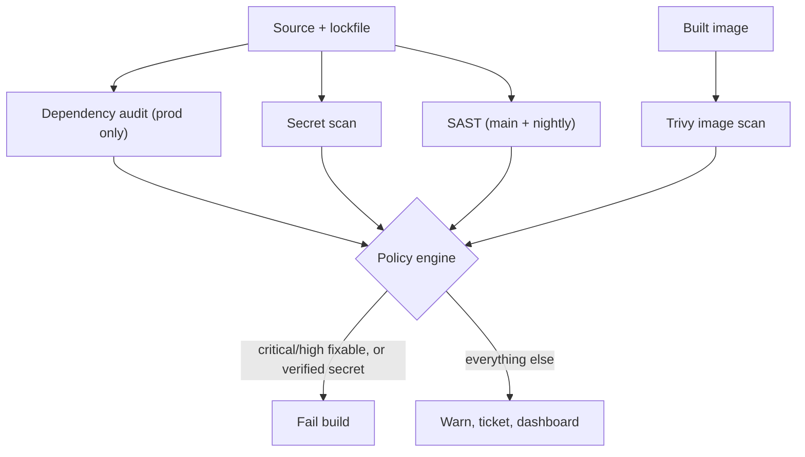

## 46.6 Security scanning

#### Concept

Security scanning in CI is a set of automated checks that look for known-vulnerable dependencies, vulnerable OS packages in the image, hardcoded secrets, insecure code patterns, and license violations, before the artifact reaches a registry or a cluster.

#### Why does it exist?

Because the majority of exploitable vulnerabilities in a typical backend service are not in code you wrote. They are in the 900 packages you depend on, and in the 120 OS packages in your base image. Nobody reads those changelogs. A scanner does, continuously, against a database of published CVEs, and it costs about 40 seconds per build.

The second reason is secrets. A leaked AWS key, database password or Stripe secret in a repository is exploited fast: public GitHub repositories are scanned by attackers continuously, and the observed time-to-abuse for an exposed AWS key is often measured in minutes. A pre-push hook plus a CI check plus provider-side push protection is a layered defence against a mistake that everyone eventually makes.

#### Mental model

Imagine a building inspection. Some findings mean the building cannot open today: no fire exit, live wiring exposed. Some mean a work order within a month: a cracked tile, a flickering light. If the inspector treated every finding as "cannot open", the building would never open and people would start forging inspection reports.

Your scanner is that inspector. The engineering is not in running the scan; it is in deciding which findings stop the world.

#### How it works

Five distinct scan types, each looking at something different:

| Scan | What it inspects | Tools | Typical duration |
|---|---|---|---|
| Dependency audit (SCA) | `package-lock.json` against CVE databases | `npm audit`, Snyk, Dependabot, Trivy fs | 10–30 s |
| Container image scan | OS packages and app libraries in the built image | Trivy, Grype, ECR scanning | 20–60 s |
| Secret scanning | Repository history and working tree for credential patterns | Gitleaks, TruffleHog, GitHub push protection | 15–90 s |
| SAST | Your source code for insecure patterns | CodeQL, Semgrep, `eslint-plugin-security` | 3–12 min |
| License check | Dependency licenses against an allowlist | `license-checker`, FOSSA, Trivy | 10–20 s |

**Dependency audit.** Runs against the lockfile, matches package versions to advisories. The signal problem is severe here: `npm audit` on a typical NestJS project reports 30 to 80 findings, and most are transitive dev dependencies in the build toolchain that never execute in production. A "high severity ReDoS in a package used only by the linter" is not a production risk.

The discipline that fixes this:

- Audit production dependencies separately: `npm audit --omit=dev --audit-level=high`. That is the gate. Dev dependencies get a warning-only run.
- Use `reachability` information where a tool provides it (Snyk, Semgrep supply-chain): a CVE in a code path you never call is a different risk from one in your HTTP parser.
- Maintain an expiring allowlist. If you must accept a finding, record it with an owner, a reason and an expiry date (30 days). When it expires, the build fails again. An allowlist without expiry becomes permanent silence.

**Container image scanning.** Scans the built image before push. Most findings are OS packages in the base image, which means the fix is usually not yours: bump the base image. This is why a weekly automated base image bump plus rebuild of all services is worth more than any individual scan finding. Fail the build on `CRITICAL` and `HIGH` with a fix available; warn on everything else. Trivy's `--ignore-unfixed` is the key flag: failing on a vulnerability with no available patch just blocks you from shipping with no way to comply.

**Secret scanning.** Three layers, and you want all three:

1. **Pre-commit**, via a `gitleaks` hook, so the secret never enters your local history.
2. **Push protection** at the platform, which rejects the push server-side. This is the only layer that stops a secret from becoming public.
3. **CI scan of history**, which catches secrets committed before the other layers existed.

A secret found in history is not fixed by deleting the file in a new commit. The blob is still reachable. The response order is always: **rotate the credential first**, then rewrite history, then coordinate the force-push (the full procedure is in Part 47 — Git, section 47.14).

**SAST.** Static analysis for injection, unsafe deserialisation, path traversal, weak crypto, hardcoded credentials, SSRF patterns. CodeQL is the practical default for TypeScript on GitHub, and Semgrep is excellent for custom organisational rules ("never call `createQueryBuilder().where()` with a template literal", "every controller must have a guard"). SAST is slow (3 to 12 minutes on a large repo) and has a real false-positive rate, so run it on merge to `main` and on a schedule rather than on every PR push, and gate on a curated subset of rules rather than everything.

**License checks.** Fast, boring and occasionally career-saving. A copyleft license (AGPL, GPL) pulled in as a transitive dependency can create a genuine legal obligation for a commercial product. Maintain an allowlist of permissive licenses (MIT, Apache-2.0, BSD, ISC), fail on anything not on it, and route exceptions to legal rather than to a developer's judgement.

**Which findings fail the build.** This table is the actual policy, and it should live in the repository:

| Finding | Action | Reason |
|---|---|---|
| Verified secret in the diff | **Block push**, page security | Time-to-abuse is minutes |
| Critical CVE, production dependency, fix available | **Fail build** | Exploitable, and fixable now |
| High CVE, production dependency, fix available | **Fail build** (grace: 7 days via allowlist) | Exploitable, fixable, some coordination needed |
| High CVE, no fix available | Warn, create ticket, consider mitigation | Blocking helps nobody |
| Any CVE, dev dependency only | Warn | Does not run in production |
| Critical/High in base image OS packages | **Fail** if fixed upstream; else warn and bump on schedule | Base image bump is the fix |
| SAST high-confidence rule (SQL injection, SSRF) | **Fail build** | Direct exploitability |
| SAST medium/low confidence | Comment on PR | False-positive rate too high to gate |
| Non-allowlisted license | **Fail build** | Legal exposure, needs a human decision |
| Medium/low CVE anywhere | Report to dashboard | Noise if gated |

**Keeping the signal-to-noise ratio survivable.** This is the part that decides whether security scanning helps or becomes decoration. The techniques that work:

- Gate on a small, high-confidence set; report the rest. A gate that fires falsely once a week will be disabled within a month.
- Separate production from development dependency findings, always.
- Deduplicate: one dashboard, not five bots commenting on every PR.
- Batch dependency updates. Dependabot configured to open one grouped PR per week for patch and minor updates, and individual PRs only for security fixes, turns 40 PRs a week into 1 plus exceptions.
- Every allowlist entry has an owner and an expiry.
- Measure the false-positive rate. If more than about 1 in 10 gate failures is dismissed as noise, the gate is miscalibrated and you fix the gate, not the people.
- Fix the base image once a week for everyone rather than asking 60 teams to triage the same OS CVE.

#### Practical example

An orders service pipeline runs, in parallel with the tests: `npm audit --omit=dev --audit-level=high` (12 s), Gitleaks on the diff (8 s), and a license check against an allowlist (14 s). After the image is built, Trivy scans it with `--severity CRITICAL,HIGH --ignore-unfixed --exit-code 1` (35 s) *before* the push step, so a vulnerable image never reaches the registry. CodeQL runs on merge to `main` and nightly. Total added time on the PR path: about 35 seconds, because everything runs in parallel with a 6-minute integration job.

#### Failure scenario

At 11:20 a developer pushed a branch containing a `.env.staging` file with a real database password, added by accident because their `.dockerignore` covered it but their `.gitignore` did not. Push protection was not enabled. Gitleaks was in the pipeline but configured to scan only the working tree of the default branch, so it did not run on the feature branch.

The password was rotated 4 hours later when a colleague noticed it during review. The staging database was internet-reachable through a bastion whose security group had been widened for a demo two weeks earlier. Access logs showed no unauthorised connections, but nobody could prove it conclusively because the log retention was 24 hours and the window had partly rolled off.

The three fixes: push protection enabled organisation-wide (server-side, cannot be skipped), Gitleaks running on every push against the diff, and staging credentials moved to a secret manager with 24-hour rotation. The cheapest of these — push protection — is a checkbox.

#### Edge cases & failure modes

- **Scanner database outage.** Trivy cannot fetch its vulnerability DB and exits non-zero; every build fails for a reason unrelated to your code. Cache the DB and treat a fetch failure as a warning, not a gate.
- **New CVE published overnight.** Yesterday's green build is today's red build with no code change. This is correct behaviour, and it surprises people. Communicate it.
- **A CVE with no fix.** Blocking builds on an unfixable finding stops all work including the mitigation. Warn and mitigate.
- **False positive in a critical gate.** A `HIGH` in a package that is bundled but never imported. Allowlist with expiry, and record why.
- **Secrets in build logs rather than code.** Scanners look at the repository, not the logs. Scan logs too, or better, never print them.
- **Scan runs after push.** A vulnerable image is already in the registry and pullable. Scan before push, always.
- **License check that only sees direct dependencies.** The AGPL package is three levels down.
- **Alert fatigue.** 200 open findings, none triaged, everyone has muted the channel. This is the most common end state and the one to design against.
- **Fork PRs cannot upload SARIF results** without elevated permissions, so security results silently disappear for external contributions.

#### How a Senior Backend Engineer thinks about this

They optimise for the number of *acted-upon* findings, not the number of findings. A scanner producing 400 alerts that nobody reads has negative value: it consumes attention and provides false assurance.

They ask of every gate: *if this fires at 4 p.m. on a Friday during a hotfix, is blocking the deploy the right outcome?* For a verified secret, yes. For a medium CVE in a dev dependency, obviously not. That question calibrates the policy better than any severity matrix.

They also push the fix upstream. Sixty services each triaging the same `openssl` CVE is sixty times the work of one platform team bumping the golden base image (Part 43 — Docker for Backend Engineers) and triggering rebuilds. Centralising the fix is the highest-leverage security work available in most organisations.

Explained to a product manager: "We check every build for known security holes. We stop the build only for the ones that are both dangerous and fixable right now; the rest become tickets. Otherwise we would block releases on problems we cannot solve."

#### Common mistakes

- Failing the build on every `npm audit` finding, then adding `|| true` two weeks later.
- Scanning the image after pushing it.
- Treating dev and production dependencies identically.
- An allowlist with no expiry dates, which grows monotonically.
- Running SAST on every push and adding 10 minutes to the feedback loop.
- Relying only on CI secret scanning, with no server-side push protection.
- Ignoring license findings until an acquisition due-diligence process finds them.

#### Interview questions

1. *Which security findings should fail a build, and which should not?* Expected: verified secrets and fixable critical/high in production dependencies fail; unfixable, dev-only, and low-confidence findings warn. Reasoning about actionability.
2. *`npm audit` reports 60 vulnerabilities. What do you do?* Expected: split prod from dev, gate on prod high/critical with a fix, batch updates, allowlist with expiry, and fix the base image centrally.
3. *A secret was committed and pushed. Walk me through your response.* Expected: rotate first, assess exposure from access logs, then rewrite history with `git filter-repo`, coordinate force-push, add push protection.
4. *Why scan the image rather than only the lockfile?* Expected: OS packages, base image libraries and anything installed at build time are invisible to a lockfile scan, and are a large share of findings.
5. *How do you keep security scanning from becoming noise people ignore?* Expected: gate narrowly, report broadly, single dashboard, expiring exceptions, measure false-positive rate, centralise base image fixes.

#### Practical exercise

Configure a full scanning layer on one service: `npm audit --omit=dev --audit-level=high` as a gate with a separate warning-only dev run; Gitleaks on every push; a license allowlist; and Trivy on the built image with `--severity CRITICAL,HIGH --ignore-unfixed --exit-code 1` placed *before* the push step. Then write the policy table above into `SECURITY.md` in the repository, including the allowlist format with mandatory owner and expiry fields. Acceptance criteria: deliberately introducing a known-vulnerable dependency version fails the build; introducing the same one as a dev dependency does not; a fake AWS key in a commit is blocked before it reaches the remote; and every current allowlist entry has an owner and a date under 30 days away.
