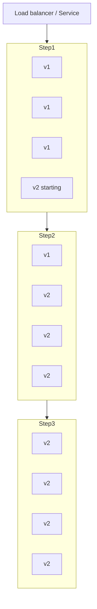
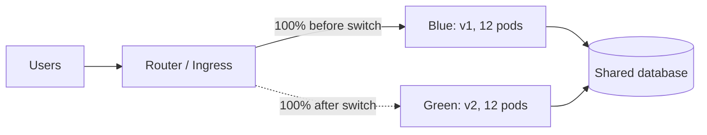
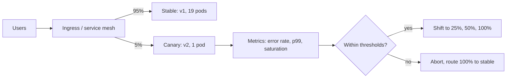
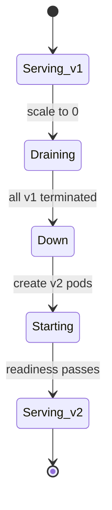
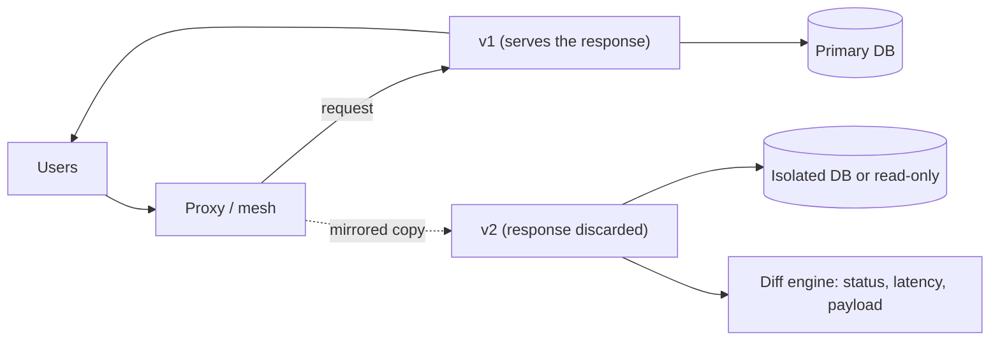

## 46.7 Deployment strategies

#### Concept

A deployment strategy is the answer to one question: *how do you replace running version A with version B while requests keep arriving?* The five common answers differ in how much capacity you must pay for, how fast you can undo the change, how much traffic a bad version touches before you notice, and what they demand of the database.

#### Why does it exist?

Because "stop the old one, start the new one" means downtime, and because the moment of replacement is when almost all deploy-related incidents happen. The strategies exist to trade money and complexity for either less downtime, less blast radius, or a faster undo.

#### Mental model

Imagine replacing the tyres on a car. *Recreate* is stopping the car, changing all four, and driving on: simple, cheap, and you were parked for ten minutes. *Rolling* is changing one tyre at a time while three keep turning: no stop, but for a while you are driving on a mix of old and new tyres, and they had better be compatible. *Blue/green* is having a second identical car waiting; you step out of one and into the other, and if the new one makes a noise you step back. *Canary* is putting the new tyre on and driving slowly around the block before committing to the motorway. *Shadow* is towing the new car behind, spinning its wheels against the same road, measuring, but never steering with it.

#### How it works

**Rolling update.** Replace instances in small batches. Kubernetes does this natively: `maxSurge` controls how many extra pods may exist above the desired count, `maxUnavailable` how many may be missing. With `maxSurge: 25%, maxUnavailable: 0` on 12 replicas, Kubernetes starts 3 new pods, waits for them to pass readiness, terminates 3 old ones, and repeats.



Rollback speed: a rollback is another rolling update in reverse, so it takes as long as a deploy, typically 2 to 6 minutes for a 12-replica service with a 30-second readiness ramp. Database requirement: **strict N-1 compatibility**, because old and new pods serve traffic simultaneously for the whole window. Traffic shifting: implicit, via the service's endpoint list as pods become ready and unready. Cost: near zero extra capacity (only `maxSurge` worth). Choose it when: this is your default. It is what Kubernetes does out of the box and it is correct for the large majority of stateless services.

**Blue/green.** Run two complete environments. Blue serves production. Deploy the new version to green at full capacity, test it, then switch the router from blue to green in one action. Keep blue running for a while as the rollback target.



Rollback speed: **seconds**, and this is the whole point. Flip the router back. Database requirement: still N-1 compatible, because during the switch in-flight requests exist on both sides, and because your rollback target (blue) must work against the schema the new version created. Traffic shifting: a single atomic change (a Kubernetes Service selector change, an ALB target group swap, a DNS change — though DNS is a poor choice because of TTL caching and client-side pinning). Cost: **2x compute during the deploy window**, which on a 12-pod service with 1 vCPU and 2 GB each is real money if the window lasts hours. Choose it when: rollback speed matters more than cost, the release is risky, or you need a full-capacity rehearsal before taking traffic.

The subtlety people miss: blue/green gives you a fast rollback of *code*, not of *data*. Green has been writing to the shared database. Flipping back to blue leaves those writes in place, and blue must tolerate them.

**Canary.** Send a small fraction of traffic to the new version, watch the metrics, and increase the fraction in steps if the metrics stay healthy.



Rollback speed: seconds for the traffic shift; and crucially, only 5% of users saw the problem. Database requirement: N-1 compatible, and for a longer period than a rolling update because canary analysis takes 10 to 60 minutes. Traffic shifting: weighted routing at the ingress (NGINX canary annotations), a service mesh (Istio `VirtualService` weights), an ALB with weighted target groups, or a progressive delivery controller (Argo Rollouts, Flagger) that automates the steps and the analysis. Cost: modest extra capacity plus significant setup complexity plus the metrics infrastructure to judge it. Choose it when: the change is risky, traffic is high enough for 5% to be statistically meaningful, and you have per-version metrics.

The statistical requirement is the one people skip. At 10 requests per second, 5% of traffic is 0.5 rps; over 15 minutes that is 450 requests, and a failure rate change from 0.1% to 0.4% is invisible in that sample. **Canary needs volume.** Below roughly 100 rps on the canary slice, you are watching noise.

**Recreate.** Stop all old instances, then start all new ones.



Rollback speed: another full recreate, so another outage window (1 to 5 minutes). Database requirement: **none** — this is its one genuine advantage. Because no two versions ever run at once, a migration can be destructive and the code can assume the new schema exclusively. Traffic shifting: none; there is downtime equal to shutdown plus startup, typically 30 to 120 seconds for a NestJS service. Cost: zero extra capacity. Choose it when: the workload cannot tolerate two versions running (a singleton scheduler, a stateful consumer holding an exclusive lock, a migration that genuinely cannot be made backward compatible), or it is a low-traffic internal tool where a 60-second maintenance window costs nothing. Also the right default for local development and CI environments.

**Shadow (traffic mirroring).** Send a copy of production traffic to the new version. Its responses are discarded. Compare behaviour, latency and errors against the live version.



Rollback speed: not applicable, because shadow traffic never serves users; you simply stop mirroring. Database requirement: the shadow must **not** write to production data. This is the hard part and the reason shadow deployments are rare: any write path must be routed to a copy, stubbed, or made a no-op, and every outbound side effect (charging a card, sending an email, publishing a Kafka event) must be blocked. Traffic shifting: mirroring at the proxy (Istio `mirror` with `mirrorPercentage`, NGINX `mirror` directive, Envoy request shadowing). Cost: full extra capacity for the shadow plus the isolation engineering plus doubled load on any shared read-only dependency. Choose it when: you are rewriting a critical service and want production-realistic validation with zero user risk — a database engine migration, a framework rewrite, a new pricing engine you need to prove matches the old one on real inputs.

**The comparison table.** This is the one to memorise:

| Strategy | Downtime | Rollback speed | Blast radius of a bad version | DB compatibility needed | Traffic mechanism | Extra capacity | Complexity | Choose when |
|---|---|---|---|---|---|---|---|---|
| Recreate | 30–120 s | Full redeploy (minutes, with downtime) | 100% after switch | None (versions never overlap) | None | 0% | Very low | Singletons, exclusive locks, unavoidable breaking migration, dev environments |
| Rolling | None | Reverse rollout, 2–6 min | 100% by the end | N-1 required | Readiness gates on the Service | +25% during window | Low | Default for stateless services |
| Blue/green | None | Seconds (router flip) | 100% after switch, until you flip back | N-1 required | Atomic router/selector switch | +100% during window | Medium | Risky releases, fast rollback mandated, full-capacity rehearsal |
| Canary | None | Seconds, and only a slice was exposed | 5–10% initially | N-1 required, for a longer window | Weighted routing / mesh | +5–20% | High | High-traffic risky changes with good per-version metrics |
| Shadow | None | N/A (never serves) | 0% | Writes must be isolated | Request mirroring | +100% | Very high | Rewrites and engine swaps needing production-realistic proof |

#### Practical example

An e-commerce platform uses three strategies deliberately:

- `orders-api`, `catalog-api`, `notifications-worker`: **rolling**, `maxSurge: 25%`, `maxUnavailable: 0`, 12 to 40 replicas. This covers about 90% of deploys.
- `payments-api`: **canary** via Argo Rollouts. Steps at 5% for 10 minutes, 25% for 10 minutes, 50% for 5 minutes, then 100%, with automated analysis on error rate, p99 latency and the payment-authorisation success rate. A regression aborts the rollout automatically.
- `scheduler`, a singleton that holds a PostgreSQL advisory lock and must never have two instances: **recreate**, with a 40-second window at 03:00.

#### NestJS example

Rolling and blue/green both depend on your application handling readiness and shutdown correctly, or every deploy drops requests. This is the code that makes the strategy work:

```ts
// src/health/health.controller.ts
import { Controller, Get } from '@nestjs/common';
import {
  HealthCheck, HealthCheckService, TypeOrmHealthIndicator, HttpHealthIndicator,
} from '@nestjs/terminus';

@Controller('health')
export class HealthController {
  private shuttingDown = false;

  constructor(
    private readonly health: HealthCheckService,
    private readonly db: TypeOrmHealthIndicator,
    private readonly http: HttpHealthIndicator,
  ) {}

  // Liveness: is the process wedged? Keep it trivial. A dependency check here
  // means a database blip restarts every pod at once.
  @Get('live')
  live() {
    return { status: 'ok' };
  }

  // Readiness: should this pod receive traffic right now? Checks dependencies,
  // and reports NOT ready as soon as SIGTERM arrives so the Service removes
  // this pod from its endpoints before the process stops accepting sockets.
  @Get('ready')
  @HealthCheck()
  ready() {
    if (this.shuttingDown) {
      throw new Error('shutting down');
    }
    return this.health.check([
      () => this.db.pingCheck('postgres', { timeout: 1500 }),
      () => this.http.pingCheck('payments', 'http://payments-api/health/live', { timeout: 1000 }),
    ]);
  }

  markShuttingDown(): void {
    this.shuttingDown = true;
  }
}
```

The shutdown sequence that pairs with it: on `SIGTERM`, flip readiness to failing, wait about 10 seconds (long enough for the load balancer to notice, typically 2 to 3 failed probes), then stop accepting new connections, drain in-flight requests with a timeout, close the database pool, exit 0. `terminationGracePeriodSeconds` must exceed that total or Kubernetes sends `SIGKILL` mid-request. The mechanics of `preStop`, signal handling and exit codes are in Part 43 — Docker for Backend Engineers and Part 44 — Kubernetes for Backend Engineers.

#### Production scenario

A canary rollout of `payments-api` at 14:00 on a Tuesday. Traffic is 1,800 rps, so the 5% slice is 90 rps — enough for statistics. The analysis window is 10 minutes: 54,000 requests through the canary. Baseline error rate is 0.08%; the abort threshold is 0.25% sustained over 3 minutes, or p99 latency above 1.4x baseline.

At 14:06 the canary's p99 rises from 190 ms to 340 ms. The analysis job flags it at 14:08 and Argo Rollouts aborts, shifting traffic back to stable in 4 seconds. Total user impact: about 90 rps experiencing elevated latency for 8 minutes, roughly 0.3% of requests in that window, no errors. The cause was a missing index on a new `payment_attempts.idempotency_key` column, which only mattered under real cardinality. Staging had 400 rows; production had 60 million.

Note what the canary bought: not the discovery of the bug (a load test might have found it), but the fact that 95% of customers never experienced it and nobody had to be paged.

#### Failure scenario

A team ran blue/green on a service with a shared database. The new version (green) added a `NOT NULL` column with a default and started writing a new `status` value, `PARTIALLY_REFUNDED`, that the old code did not know about. They switched to green at 10:00. At 10:25 an unrelated bug in green caused 500s on the refund endpoint, so they flipped back to blue in 6 seconds — exactly the fast rollback blue/green promises.

Then blue started throwing `Unhandled enum value: PARTIALLY_REFUNDED` on every order-listing request, because 340 orders written in those 25 minutes had a status the old code's exhaustive `switch` did not handle. The fast rollback rolled back the code and could not roll back the data. They spent 50 minutes writing and running a data patch under pressure.

The lesson is the one this part keeps returning to: **rollback speed is a property of the deployment strategy; rollback safety is a property of your compatibility discipline.** New enum values, like new columns, must be readable by the previous version before the version that writes them ships. See Part 24 — Backward Compatibility for the general rule and Part 23 for the schema mechanics.

#### Edge cases & failure modes

- **Readiness probe that always passes.** A `return 'ok'` readiness endpoint means a rolling update replaces every pod with a broken one, cheerfully, in 90 seconds.
- **`maxUnavailable > 0` on a service at capacity.** You remove 25% of capacity during the rollout and the remaining pods saturate.
- **Sticky sessions across a blue/green switch.** Users mid-session get inconsistent behaviour, or the switch does not actually move them.
- **Canary without per-version metrics.** You cannot tell whether the error rate rose because of the canary or in general. Label every metric with the version.
- **Canary at low traffic.** 3 requests per minute through the canary proves nothing; you promote a broken version with a green analysis.
- **Canary that passes at low traffic and fails at peak.** The 5% slice never triggers the connection-pool exhaustion that 100% will. Include a load-proportional step or hold at 50% through a peak.
- **Shadow traffic writing to production.** Duplicate orders, duplicate emails, double charges. This has happened, more than once, at well-known companies.
- **Shadow doubling load on a shared dependency.** The mirrored traffic hits the same third-party API and you exhaust its rate limit.
- **Blue/green with connection-limited dependencies.** Both environments hold full connection pools; 24 pods times 20 connections exceeds `max_connections` (Part 18 — PostgreSQL Architecture and Connections).
- **Long-running requests during a switch.** A 90-second report request is killed mid-flight when blue scales down 30 seconds later.
- **In-flight Kafka messages.** A consumer group rebalance during a rolling update pauses consumption; with a large partition count the rebalance can take longer than the rollout.

#### How a Senior Backend Engineer thinks about this

They pick rolling by default and justify anything else. The question they ask is *what does this change actually risk, and what would we need to see to know it is going wrong?* If the answer is "we would see it in the error rate within two minutes", rolling with automated rollback is sufficient. If the answer is "we would only see it in the refund reconciliation report tomorrow", no deployment strategy saves you and the work belongs in feature flags and better observability instead.

They are sceptical of canary as a default, because it costs real complexity and demands per-version metrics that many teams do not have. A canary you cannot judge is just a slow rolling update with extra YAML.

They also separate the two rollback questions explicitly: *how fast can we get the old code back?* (a strategy question) and *will the old code work?* (a compatibility question). Teams that only answer the first one get the blue/green incident described above.

Explained to a product manager: "We usually replace servers a few at a time so there is no downtime. For risky changes we send a small slice of customers to the new version first and watch. And for anything that touches money, we ship the code turned off and turn it on separately."

#### Common mistakes

- Choosing canary because it sounds advanced, without per-version metrics or enough traffic.
- Assuming blue/green makes a bad migration safe.
- Readiness probes that do not check dependencies, or that check too many.
- Not testing the rollback path, so the first time you use it is during an incident.
- Mirroring traffic to a shadow that shares the production database.
- Setting `terminationGracePeriodSeconds` shorter than the drain time.

#### Interview questions

1. *Compare rolling, blue/green and canary on rollback speed, cost and blast radius.* Expected: the table above, with reasoning. Follow-up: which would you pick for a payments service at 2,000 rps, and why?
2. *What must be true of your database schema for a rolling update to be safe?* Expected: N-1 compatibility; old and new code share one schema; only additive changes at deploy time; destructive changes in a later release.
3. *Blue/green gives a 5-second rollback. What does it not roll back?* Expected: data written by the new version, external side effects, messages published, cache entries; hence compatibility still required.
4. *When is Recreate the right choice?* Expected: singletons with exclusive locks, workloads that cannot tolerate two versions, genuinely non-backward-compatible migrations, low-traffic internal tools.
5. *Your canary passes at 5% and the service falls over at 100%. What happened and how do you prevent it?* Expected: load-dependent failure (pool exhaustion, cache miss storm, lock contention, GC); mitigate with load-proportional steps, holding at 50% through peak, and load testing.
6. *What is required to make shadow traffic safe?* Expected: complete write isolation, side-effect suppression, separate data store, awareness of doubled load on shared dependencies.

#### Practical exercise

Take a service currently deployed with a rolling update and implement blue/green using two Deployments and a Service selector switch. Measure three things: time to switch (should be under 5 seconds), peak resource consumption during the window, and requests lost during the switch under a 200 rps load generator. Then deliberately break the new version's readiness probe and confirm the switch does not happen. Acceptance criteria: zero failed requests during a successful switch, a documented rollback command that takes under 10 seconds, and a written statement of what the switch does *not* protect you from.

