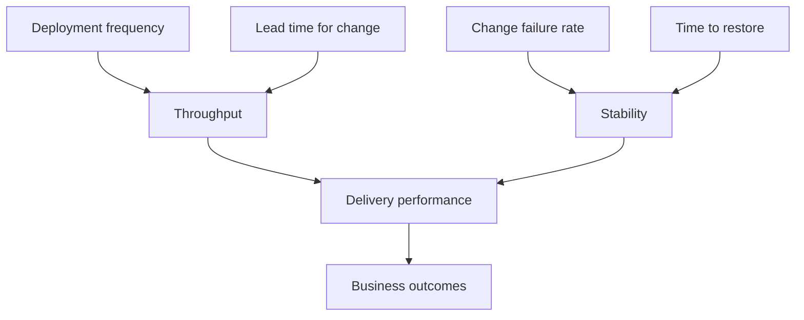

## 46.12 DORA metrics

#### Concept

DORA (the DevOps Research and Assessment program) identified four measurements that together predict both software delivery performance and organisational performance:

1. **Deployment frequency** — how often you deploy to production.
2. **Lead time for change** — from commit to running in production.
3. **Change failure rate** — the percentage of deployments causing a degradation requiring a fix.
4. **Time to restore service** — how long from detection to recovery.

The first two measure speed. The last two measure stability. The central finding, which surprises people every time, is that these do not trade off: teams that deploy more often are also *more* stable, because small batches are easier to verify, easier to diagnose and easier to undo.

#### Why does it exist?

Because engineering organisations otherwise measure the wrong things: story points, lines of code, number of PRs. Those measure activity. DORA measures the delivery system's actual behaviour, and every one of the four is directly influenced by decisions in this part.

#### Mental model

Imagine a kitchen. Deployment frequency is how many plates leave per hour. Lead time is how long a single order takes from ticket to table. Change failure rate is what fraction come back. Time to restore is how fast you replace a returned plate. A kitchen that sends out plates in huge batches every two hours has a terrible lead time, and when a batch is wrong, forty customers are wrong at once.

#### How it works

**How each pipeline decision moves the numbers:**

| Decision | Deploy frequency | Lead time | Change failure rate | Time to restore |
|---|---|---|---|---|
| Cut CI from 22 min to 8 min | Up | Down sharply | Neutral | Down (hotfixes ship faster) |
| Trunk-based development, small PRs | Up | Down | Down (smaller batches) | Down (fewer suspects) |
| Build once, promote the artifact | Neutral | Slightly down | Down (no drift) | Neutral |
| Automated rollback on SLO breach | Neutral | Neutral | Neutral (same failures) | Down sharply |
| Feature flags for risky changes | Up (merge without releasing) | Down | Down | Down sharply (flip, do not deploy) |
| Canary with automated analysis | Slightly down (slower rollout) | Slightly up | Down (caught before 100%) | Down |
| Expand/contract migrations | Neutral | Neutral | Down | Down (rollback stays possible) |
| Manual approval gate at night | Down | Up sharply | Neutral | Up (nobody to approve the fix) |
| Flaky tests tolerated | Down | Up | Up (people bypass checks) | Up |
| Removing the E2E suite entirely | Up | Down | Up sharply | Neutral |

Note the last two rows: not every change that raises speed is good, and DORA is only useful when you read all four together. A team that deletes its tests will show wonderful frequency and lead time, and a change failure rate that makes the point.

**What "elite" actually looks like day to day.** The published thresholds are roughly:

| Metric | Elite | High | Medium | Low |
|---|---|---|---|---|
| Deployment frequency | On demand, multiple per day | Weekly to monthly | Monthly to every 6 months | Less than every 6 months |
| Lead time for change | Under 1 hour | 1 day to 1 week | 1 week to 1 month | 1 to 6 months |
| Change failure rate | 5–10% | 10–15% | 10–15% | 40–60% |
| Time to restore | Under 1 hour | Under 1 day | 1 day to 1 week | Over 6 months |

Numbers are abstract. Here is what an elite team's Tuesday actually looks like:

- 09:20 An engineer opens a PR with 140 changed lines. CI is green in 7 minutes. A colleague reviews in 15 minutes because the diff is small enough to read properly.
- 09:50 Merged. The build workflow produces `sha-a71c33f` and deploys it to staging automatically.
- 10:02 E2E passes on staging. The production deploy runs; nobody approves anything, because the gate was removed once change failure rate stayed under 8% for a quarter.
- 10:09 Rolled out, smoke tests pass, the deploy is annotated on the dashboards. Lead time: 49 minutes.
- 14:30 A different deploy trips the automated analysis: 5xx rate doubled. Rollback is automatic, complete at 14:33. Time to restore: 3 minutes. The engineer who merged it is still at their desk and starts the fix immediately.
- 16:00 That fix ships as a normal deploy. Nobody was paged. Nobody wrote an incident report, because service was never meaningfully degraded.

Twelve deploys that day, one failure, three minutes of recovery. The remarkable part is how boring it is — which is exactly the point. Elite delivery performance does not feel heroic; it feels routine.

**Measuring honestly.** Two traps. First, deployment frequency counted per *service* rather than per *team* rewards splitting services rather than shipping. Second, change failure rate depends on what you count as a failure; if only paging incidents count, teams stop paging. Define it once, write it down (any deploy requiring a rollback, hotfix or flag flip within 24 hours), and hold the definition steady even when the number is embarrassing.

You can compute all four from data you already have: deployment frequency and lead time from the deploy pipeline's own event log joined to commit timestamps; change failure rate from deploys tagged as rollbacks or followed by a hotfix; time to restore from incident open and close timestamps. This is a day of work, and it turns arguments about process into arguments about data.

#### Common mistakes

- Treating DORA as a performance review tool. The moment individuals are measured, the numbers are gamed and become useless.
- Optimising one metric alone. High frequency with a 40% failure rate is chaos, not maturity.
- Measuring lead time from "ticket created" rather than "commit pushed". That measures product prioritisation, not delivery.
- Comparing teams with different risk profiles. A payments core and an internal dashboard should not have identical targets.

#### Interview questions

1. *Name the four DORA metrics and say which measure speed and which measure stability.* Expected: frequency and lead time (speed); change failure rate and time to restore (stability).
2. *Why do teams that deploy more often tend to be more stable?* Expected: smaller batches, fewer suspects per failure, faster diagnosis, cheaper rollback, more practised recovery.
3. *Your change failure rate is 4% and deployment frequency is once a month. Where do you start?* Expected: batch size is the problem; low failure rate reflects small sample and heavy pre-release process; work on CI speed, trunk-based development and flags.
4. *How would you instrument these four metrics with what you already have?* Expected: pipeline event log plus git timestamps plus incident timestamps; define change failure explicitly.

## 46.13 Edge cases and failure modes

Each of these is a real pattern. For each: what happens, why, how you notice, and the fix.

- **Deploy succeeds but the migration failed halfway.** A multi-statement migration adds a column, backfills 40 million rows, then adds an index and times out. The transaction rolls back the DDL but the migration tracking table may or may not record it, and some engines cannot run all DDL transactionally. Notice: migration Job exits non-zero, or the schema does not match either version. Fix: one logical change per migration file, short transactions, `lock_timeout` and `statement_timeout` set, backfills as separate batched jobs rather than inside the migration, and an idempotent design so re-running is safe (Part 23).

- **The migration ran before old pods drained.** A destructive migration (drop column, rename) executes while old pods are still serving. Every request from those pods 500s until the rollout completes. Notice: a burst of `column ... does not exist` errors exactly at the migration timestamp, ending when the rollout finishes. Fix: additive-only at deploy time; destructive changes in a later release when no code references the old shape.

- **Two pipelines deploying concurrently.** Two merges 40 seconds apart. Both jobs run `helm upgrade`. The second starts while the first is mid-rollout; pods from three replica sets exist at once and the final state depends on timing. Notice: `kubectl get rs` shows three sets with non-zero replicas; the running SHA is neither of the deployed ones. Fix: a `concurrency` group per service per environment with `cancel-in-progress: false` so deploys queue, and a check that the rollout is settled before starting.

- **CI cache poisoning.** A `node_modules` cache keyed only on the lockfile hash is written by a job running on a different Node version or architecture. Every subsequent job restores native modules built for the wrong ABI. Notice: segfaults or `invalid ELF header` with no code change; works when the cache is cleared. Fix: include OS, arch and Node version in the cache key; never let a fork PR write to a cache branch protection would not trust; prefer the npm download cache over caching `node_modules` outright.

- **A flaky test blocking a hotfix.** Described fully in 46.1. Notice: repeated re-runs, rising pressure, someone reaching for admin merge. Fix: the quarantine policy, plus a documented, audited emergency path (a labelled hotfix workflow that skips non-gating checks, requires two approvers, and files a ticket automatically) so the bypass is designed rather than improvised.

- **A secret printed in logs.** A debug line, a `set -x` in a shell script, or a tool that dumps its environment on error. Masking only catches exact string matches, so base64 or JSON-wrapped values pass straight through. Notice: a scanner, a colleague, or an abuse alert. Fix: rotate first, then delete the log, then audit usage; disable command tracing around secret-handling steps; never echo an environment variable you have not verified.

- **An image built from a dirty tree.** A self-hosted runner with leftover files, or a build that patches a file before building. The `sha-` tag names a commit whose contents are not what shipped. Notice: the image behaves differently from a rebuild of the same SHA; `docker history` shows unexpected content. Fix: fail the build if `git status --porcelain` is non-empty; use ephemeral runners; never modify files in the build job.

- **Rolling back to an image incompatible with the new schema.** The central hazard of 46.9. Notice: the rollback completes and the old version immediately errors on missing columns or unknown enum values. Fix: N-1 compatibility enforced by a CI check on migration files; expand/contract; tolerant readers shipped one release ahead.

- **A canary that passes at low traffic and fails at peak.** 5% of off-peak traffic never exhausts the connection pool, never triggers the cache stampede, never contends on the hot row. Promoted to 100% at peak, it falls over. Notice: green canary analysis followed by a full outage minutes after promotion. Fix: hold a step through a real peak; make one step proportional to load rather than time; load-test the new version at expected peak concurrency before the canary; alert on saturation metrics (pool utilisation, queue depth), not only errors and latency.

- **A feature flag left on forever.** The dead code path rots and is eventually executed by a cleanup, a default reset or a provider outage. Notice: an error in code nobody has deployed for months. Fix: an owner and expiry on every temporary flag, a nightly job that fails the build on expired flags, and deletion of the branch when the flag reaches 100% and soaks for a week.

- **Environment drift between staging and production.** Different instance sizes, different pool limits, different PostgreSQL minor versions, an extra sidecar in production, a feature flag defaulted differently. Notice: "works in staging" incidents that repeat with different specifics. Fix: generate both environments from the same IaC modules with a small, reviewed diff; run a config-diff job in the pipeline and fail on unexpected keys; test with production-shaped data volumes for the queries that matter.

- **A registry outage blocking rollback.** The rollback pulls an image the nodes no longer have cached and the registry is down. Notice: `ImagePullBackOff` on the rollback, during an incident. Fix: do not aggressively prune node images; prefer a rollback to an existing replica set that is still scaled above zero, which requires no pull at all; keep a pull-through cache or a mirror in a second region; and treat "can we roll back with the registry down?" as a game-day scenario.

- **A health check that passes while the app is broken.** The liveness endpoint returns a static 200 and readiness does not check dependencies. Every pod is "healthy" while every request fails. Notice: green dashboards, red customers. Fix: readiness checks real dependencies with short timeouts; liveness stays trivial (a dependency check in liveness restarts every pod during a database blip); and smoke tests exercise the business path, not the health path.

- **`imagePullPolicy: Always` with a moving tag.** A node autoscaling event at 03:00 pulls whatever the tag points at now. Notice: pods running code nobody deployed. Fix: immutable tags, digest references, registry tag immutability.

- **Deploy annotations missing from dashboards.** Every incident starts with ten minutes of "when did this begin, and did we deploy?" Fix: emit a deploy event to your metrics backend from the pipeline and render it as an annotation on every dashboard.

- **The approval that expires.** A production deploy sits pending overnight, expires, and silently never happens. The team believes the fix is live. Notice: the running SHA is not the expected one. Fix: alert on deploys pending longer than N minutes; assert the deployed SHA in the smoke tests.

- **Runner disk exhaustion.** Docker builds plus caches plus service containers exceed the runner's free space intermittently. Notice: `no space left on device` on some runs. Fix: prune between steps, use a larger runner class for build jobs, keep build and test in separate jobs.

- **Third-party Action tag moved.** `some/action@v3` is repointed by a compromised maintainer account and runs with your secrets. Notice: usually nobody notices, which is the problem. Fix: pin every third-party Action to a full commit SHA, and review the dependency list like any other supply chain.

## Senior Checklist — Part 46

- [ ] I understand the concept
- [ ] I can explain it simply
- [ ] I can implement it
- [ ] I understand its failure modes
- [ ] I understand its scaling limitations
- [ ] I understand its security implications
- [ ] I understand its operational implications
- [ ] I can choose between alternatives
- [ ] I can explain the tradeoffs
- [ ] I can answer senior-level interview questions
- [ ] I can get a PR pipeline under 10 minutes at p95 and explain where every second goes
- [ ] I can write a flaky-test policy and enforce it without blanket retries
- [ ] I can explain why the same artifact must be promoted, and prove two environments run the same digest
- [ ] I can set up OIDC federation to AWS and write a trust policy scoped to one repository and environment
- [ ] I can describe the blast radius of a compromised CI runner and the controls that shrink it
- [ ] I can start PostgreSQL and Redis as CI service containers with working health checks
- [ ] I can design coverage gates that catch real regressions instead of rewarding trivial tests
- [ ] I can state which security findings fail the build and defend the line
- [ ] I can compare rolling, blue/green, canary, recreate and shadow on rollback speed, cost and database requirements
- [ ] I can explain what blue/green does not roll back
- [ ] I can implement a flag-driven read switch during a migration with deterministic bucketing
- [ ] I can explain why roll-forward is the default and when rollback is safe
- [ ] I can write smoke tests that would have caught a broken Kafka topic name
- [ ] I can build the three workflows in 46.11 from scratch and explain every step
- [ ] I can compute the four DORA metrics from data my organisation already has

## Part 46 — Key Takeaways

- CI's job is fast, trustworthy feedback; the moment red might mean nothing, the pipeline has stopped working regardless of how much it runs.
- Never blanket-retry tests. Quarantine within an hour, fix within a sprint, delete if nobody will.
- Build the artifact once and promote that exact digest through every environment; a rebuild per environment turns your staging results into guesses.
- `latest` and moving tags make rollback impossible and let nodes silently diverge; deploy by digest or an immutable `sha-` tag, with registry tag immutability enforced.
- Replace long-lived cloud keys with OIDC federation, and scope the trust policy to your repository and environment; a `sub` condition of `repo:org/*` is a role published to the internet.
- Gate on deterministic, high-confidence checks and report everything else; a security gate that fires falsely once a week will be disabled within a month.
- Rolling is the correct default. Blue/green buys seconds of rollback for 100% extra capacity. Canary needs volume and per-version metrics or it is theatre.
- Deployment strategy controls how fast you get the old code back; only compatibility discipline controls whether the old code still works.
- The database migration runs before the rollout, once, as its own job, and is additive-only, because old and new pods share one schema.
- Roll forward by default. A down migration is not a rollback plan, and a rollback path you have never executed is a hypothesis.
- Feature flags decouple deploy from release and give you a ten-second undo; every temporary flag needs an owner, an expiry, and eventual deletion.
- `rollout status: success` is not "it works". Smoke tests must place a synthetic order through every dependency the service owns, in under 60 seconds.
- Automate rollback on SLO breach, including one domain metric, because a deploy can return 200 on every request while orders quietly stop.
- Deploy frequency and stability rise together; small batches are the mechanism, and everything in this part exists to make small batches cheap.
