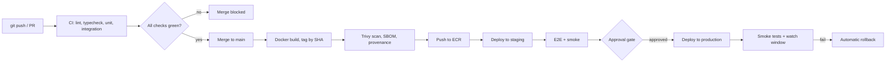
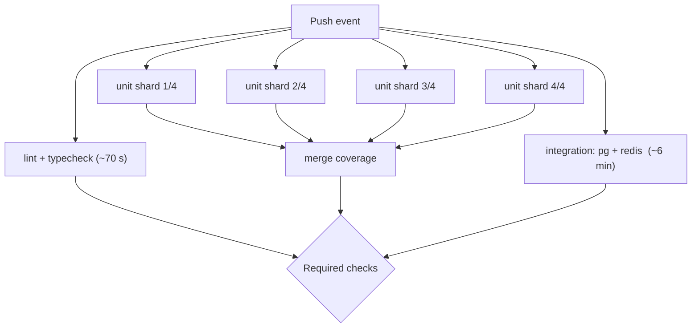

# Part 47 — CI/CD and Deployment Strategies

There is a moment in every engineer's career when deployment stops being someone else's job. You have written the service, tested it, containerised it, and now the question is not "does it work?" but "how does it get from my laptop to a machine serving real customers, safely, twenty times a day, at 4 p.m. on a Friday, without anyone holding their breath?"

That question is what CI/CD answers. Continuous integration is the machine that tells you within minutes whether your change is safe to merge. Continuous delivery is the machine that turns a merged commit into a deployable artifact and puts it in front of an approval gate. Continuous deployment is what happens when you trust that machine enough to remove the gate. The whole discipline exists to shrink one number: the time between "I wrote a line of code" and "I know whether that line is good", and then the time between "it is good" and "it is live".

This part builds the pipeline from the first push to the last smoke test. It covers what belongs in CI and what does not, why you must promote the same immutable artifact rather than rebuild it per environment, how to get secrets into a runner without ever storing a long-lived key, the five deployment strategies and what each one really costs, feature flags as the thing that separates deploy from release, and the honest truth about rollbacks (the image rolls back easily; the database usually does not). The centrepiece is three complete GitHub Actions workflows with every meaningful step explained. Then DORA metrics, and a long catalogue of the failure modes that turn a routine deploy into an incident.

The pipeline this part builds looks like this:

```text
Git Push -> Build -> Unit Tests -> Integration Tests -> Security Scan -> Docker Build -> Push Image -> Deploy -> Smoke Tests -> Production
```



Note one thing about that diagram before we go further: the same artifact flows all the way through. There is exactly one `docker build` in the whole pipeline. Everything after it moves bytes that already exist. That single property is what makes staging a meaningful test of production, and it is the property most teams get wrong first.

## 47.1 Continuous integration

#### Concept

Continuous integration is the practice of merging every developer's work into a shared main branch frequently (at least daily), with an automated build and test run on every change, so that integration problems surface in minutes instead of at the end of a release cycle.

The word people forget is *integration*. CI is not "we have a pipeline". CI is "we integrate constantly, and a machine proves the integration is sound". A team with a beautiful pipeline and three-week feature branches is not doing continuous integration; they are doing automated testing on a batch of divergence that will hurt when it lands.

#### Why does it exist?

Before CI, teams did "integration weeks". Everybody worked in isolation for a month, then spent a week merging, and the merge exposed every conflicting assumption at once: two people renamed the same column, one team's DTO change broke another team's consumer, a dependency bump changed behaviour nobody noticed. The cost of a bug rises steeply with the time between writing it and finding it. A type error found by CI in 90 seconds costs 90 seconds. The same error found by a customer costs an incident, a rollback, a postmortem, and trust.

CI attacks that curve directly. Small change, fast feedback, merged immediately. The main branch is always in a known state, so anyone can cut a release from it at any time.

#### Mental model

Imagine a restaurant kitchen. Continuous integration is the head chef tasting every sauce as it is made, not the whole dish at service time. If the sauce is too salty, you find out with 200 ml of sauce in the pan, not with forty plates going out.

The other half of the analogy matters too: tasting is only useful if it is *fast*. If tasting took twenty minutes, the chef would stop doing it. A CI pipeline that takes 45 minutes will be worked around: people will push and go to lunch, batch three changes into one push, or merge on red "because it's probably that flaky test again". Speed is not a nice-to-have; it is what keeps the practice alive.

#### How it works

A push triggers a workflow. The workflow runs a sequence of jobs on ephemeral machines (runners), each starting from a clean image. The essential shape:

1. **Checkout.** Fetch the commit. For most jobs a shallow clone (`fetch-depth: 1`) is enough and saves 10 to 30 seconds on a repo with long history. Jobs that need history (changelog generation, `git describe`, SonarQube blame) need full depth.
2. **Restore toolchain.** Install the exact Node version from `.nvmrc` or `package.json` `engines`. Never "whatever the runner has".
3. **Restore cache.** Dependencies, build outputs, Docker layers.
4. **Install deterministically.** `npm ci`, not `npm install`. `npm ci` deletes `node_modules`, installs exactly what `package-lock.json` says, and fails if the lockfile and `package.json` disagree. `npm install` is allowed to update the lockfile, which means two runs of your pipeline can install different code.
5. **Static checks.** Lint, format check, TypeScript `tsc --noEmit`. These are cheap (10 to 40 seconds) and catch a surprising share of review comments before a human sees the diff.
6. **Unit tests.** Fast, isolated, no network, no database. Target: under 3 minutes.
7. **Integration tests.** Real PostgreSQL and Redis, started as service containers. Target: under 8 minutes.
8. **Report.** Coverage, test results, artifacts. Post a summary on the PR.

**What belongs in CI:** anything that is deterministic, fast, and can fail the change. Compilation, type checking, linting, unit tests, integration tests against real ephemeral dependencies, database migration dry-runs, dependency audit, secret scanning, license checks, contract tests, build of the Docker image.

**What does not belong in CI:** anything slow, flaky, or environment-dependent that does not gate correctness of *this change*. A full 40-minute load test on every PR. End-to-end tests against a shared staging environment that three other teams are also deploying to. Long-running security scans that take 20 minutes. Manual QA steps. These belong on a schedule (nightly), on the merge to main, or on the pre-production stage. The rule: **if a failure would not clearly mean "this PR is wrong", it does not gate the PR.**

**Reproducible builds.** A build is reproducible when the same inputs give the same output. In practice this means: pin the Node version, commit the lockfile and use `npm ci`, pin the base image by digest, do not fetch anything from the internet at build time that is not pinned, and never let the build read the current time or a random value into the artifact. When a build is not reproducible, "it passed yesterday and fails today with no code change" becomes a normal event, and people stop believing the pipeline.

**Caching, with real numbers.** For a NestJS monorepo package with roughly 900 direct plus transitive dependencies:

| Step | Cold | Cached | How |
|---|---|---|---|
| `npm ci` | 95–140 s | 22–35 s | `actions/setup-node` with `cache: npm` (caches the npm download cache, still unpacks) |
| `npm ci` | 95–140 s | 10–18 s | `actions/cache` on `node_modules` keyed by `hashFiles('**/package-lock.json')` (skips install entirely on hit) |
| `tsc` build | 45 s | 12 s | `tsBuildInfoFile` incremental cache |
| Jest | 6 min | 5 min | Jest cache helps transform, not execution |
| Docker build (4-stage) | 6–8 min | 50–90 s | BuildKit `cache-from`/`cache-to` against a registry cache tag |

The Docker number is the big one. A registry-backed BuildKit cache turns a 7-minute image build into 70 seconds when only `src/` changed, because the `npm ci` layer is a cache hit. On a team doing 30 merges a day that is roughly three hours of runner time saved daily, and, more importantly, it is the difference between a hotfix reaching production in 9 minutes and in 25.

Caching `node_modules` directly is faster but riskier: the cache key must include the lockfile hash *and* the Node version *and* the OS, because native modules compiled against Node 20 will crash under Node 22. Get the key wrong and you have a cache-poisoning bug that is very hard to see.

**Matrix and parallel jobs.** Two different uses. A *matrix* runs the same job across several dimensions (Node 20 and 22; PostgreSQL 15 and 16) to prove compatibility. *Sharding* splits one slow suite across N runners to cut wall-clock time. Jest supports this natively with `--shard=1/4`. A 12-minute suite on four shards lands at about 3.5 minutes (never exactly a quarter, because setup cost is paid per shard). Beyond 4 to 6 shards you usually stop winning: the fixed cost of checkout, install and database startup dominates.



**Required status checks.** Branch protection on `main` lists which checks must pass before merge. Two rules senior engineers insist on: (1) the list must be *exactly* the checks that mean correctness, no more, or people will beg for exceptions; (2) "require branches to be up to date before merging" must be considered carefully. It prevents *semantic* conflicts (your PR is green, my PR is green, together they break) but it serialises merges: every merge invalidates every other open PR, which on a busy repo means constant rebasing. The middle ground most teams land on is a merge queue, which tests the *combined* result of the queued PRs and merges them in order.

**The flaky-test policy.** This is where seniority shows. A flaky test is one that passes and fails on the same code. It is not a minor annoyance; it is an active attack on the pipeline's authority. Once people learn that red might mean nothing, red always means nothing.

The policy that actually works:

1. **Never blanket-retry.** `jest --retries=3` on the whole suite is how you hide a real race condition for eight months and then meet it in production. Retrying is not a fix; it is a way to stop measuring.
2. **Detect flakiness explicitly.** Run the suite against `main` on a schedule (say hourly). Any failure there, where the code did not change, is by definition flaky. Record it.
3. **Quarantine within an hour.** Move the test to a non-blocking suite with an owner and a ticket. It still runs; it just does not block merges. The quarantine list is visible on a dashboard and reviewed in standup.
4. **Fix within a sprint or delete.** A quarantined test that nobody fixes in two weeks is dead weight pretending to be coverage. Delete it and write the ticket for the real gap.
5. **Cap the quarantine.** If more than about 1% of tests are quarantined, stop feature work and fix the suite. That number is a canary for test design problems: shared state, real timers, `sleep`, order dependence, unseeded randomness.

The common root causes, in the order you will meet them: unmocked time (`Date.now()` and real `setTimeout`), tests sharing a database without truncation between them, tests depending on execution order, a race between an async write and a read, an external network call, and unseeded random data that collides once every few hundred runs (see Part 41 — Testing Backend Systems with Jest and NestJS for the mechanics of fixing each).

#### Practical example

An orders API. The CI contract is written into `package.json` so the same commands run locally and in CI:

```json
{
  "scripts": {
    "lint": "eslint \"src/**/*.ts\" --max-warnings=0",
    "typecheck": "tsc --noEmit -p tsconfig.json",
    "test:unit": "jest --config jest.unit.config.js --ci",
    "test:int": "jest --config jest.int.config.js --ci --runInBand",
    "test:cov": "jest --config jest.unit.config.js --coverage --ci",
    "build": "nest build",
    "migration:dry": "typeorm-ts-node-commonjs migration:show -d src/data-source.ts"
  },
  "engines": { "node": ">=20.18 <21" }
}
```

Two Jest configs, not one. Unit tests have no `globalSetup` and no database; integration tests do, and run with `--runInBand` because they share a PostgreSQL instance and parallel workers would fight over the same tables unless each worker gets its own schema.

#### NestJS example

The one piece of application code CI depends on is configuration validation, because a service that boots with a missing variable will fail in the integration job in a confusing way:

```ts
// src/config/config.module.ts
import { Module } from '@nestjs/common';
import { ConfigModule } from '@nestjs/config';
import * as Joi from 'joi';

@Module({
  imports: [
    ConfigModule.forRoot({
      isGlobal: true,
      // Fail fast and loudly. In CI this turns a mysterious timeout into
      // a one-line error naming the missing variable.
      validationSchema: Joi.object({
        NODE_ENV: Joi.string().valid('development', 'test', 'production').required(),
        DATABASE_URL: Joi.string().uri().required(),
        REDIS_URL: Joi.string().uri().required(),
        JWT_SECRET: Joi.string().min(32).required(),
        PORT: Joi.number().default(3000),
      }),
      validationOptions: { abortEarly: false },
    }),
  ],
})
export class AppConfigModule {}
```

#### Production scenario

A team of 22 engineers on a food-delivery platform, 8 services, roughly 40 merges to `main` per day. Their PR pipeline takes 7 minutes p50 and 11 minutes p95: 70 seconds of lint and typecheck, 3.5 minutes of sharded unit tests, 6 minutes of integration tests running in parallel with the unit shards. Docker build runs only on merge to `main`, not on the PR, because a PR does not need an image. Cache hit rate on `npm ci` sits around 92%; the misses are lockfile changes.

They measure one number weekly: **time from push to first red signal**. It is 95 seconds, because lint and typecheck run first and independently. That number matters more than total pipeline time, because most failures are caught by the cheap checks and the developer can start fixing while the rest still runs.

#### Failure scenario

At 16:40 on a Thursday a payments bug is found: refunds above 10,000 currency units are rejected by a validation rule that should have been removed. The fix is four characters. The engineer pushes the hotfix and CI goes red on `notifications.e2e.spec.ts`, a test unrelated to payments that has been flaky for three months and is "usually fine on a re-run".

They re-run. Red again, different test. They re-run again. Twelve minutes per attempt. At 17:25 someone suggests merging with admin override; the tech lead refuses because the last time that happened it shipped a broken migration. At 17:50 the fix goes out, 70 minutes after it was ready, and roughly 400 refunds failed in that window.

The postmortem action was not "make the pipeline faster". It was the flaky-test policy above: quarantine within an hour, owner assigned, fixed or deleted in a sprint. Nine tests moved to quarantine that week; six were fixed (all shared-state bugs), three were deleted. The suite has been trustworthy since, which means that when it is red, people believe it.

#### Edge cases & failure modes

- **The green pipeline that tests nothing.** Coverage thresholds are met by tests that assert `expect(service).toBeDefined()`. See 47.5 for gates that actually mean something.
- **Cache key too loose.** `node_modules` cached without the Node version in the key; a runner image upgrade changes Node and native modules segfault with no useful message.
- **Cache key too tight.** Keyed on the commit SHA, so it never hits. Silent, and costs you 90 seconds every run forever.
- **Secrets unavailable on fork PRs.** GitHub does not give repository secrets to workflows triggered by a fork's pull request. A job that needs a token will fail on every external contribution. Split it: run the secret-needing job only on `push` to internal branches.
- **Runner disk exhaustion.** GitHub-hosted runners have around 14 GB free. A Docker build with several large stages plus a `node_modules` cache plus test containers can hit `no space left on device` intermittently, which reads exactly like flakiness.
- **Concurrent runs on the same PR.** Push three times in a minute and you have three runs competing for cache and CI minutes. Use a `concurrency` group with `cancel-in-progress: true`.
- **Time-dependent tests.** Anything asserting on "today" breaks at midnight UTC, at month boundaries, and on 29 February.
- **Order-dependent tests.** Pass locally where Jest picks one order, fail in CI where it picks another after sharding.

#### How a Senior Backend Engineer thinks about this

They treat CI as a product with users (the engineers) and an SLO (p95 under 10 minutes). When it degrades, that is a real ticket, not background noise.

They ask three questions of any proposed CI step: *Does a failure here unambiguously mean the change is wrong? Is it deterministic? Does it cost less time than the bugs it catches?* A step that fails "sometimes" is worse than no step, because it teaches people to ignore red.

They refuse two things absolutely: blanket test retries, and admin merge overrides as a routine tool. Both trade a small amount of short-term pain for the permanent loss of the pipeline's authority.

Explained to a product manager: "CI is the smoke alarm. If it goes off for burnt toast twice a week, someone takes the battery out, and then it does not help during a real fire. Keeping it accurate is why we spend time on test quality."

#### Common mistakes

- Using `npm install` in CI, so builds are not reproducible.
- Running everything sequentially in one job, so a lint error is discovered at minute 11.
- Adding a retry wrapper instead of fixing a race condition.
- Making every check "required", including optional ones, then routinely bypassing branch protection.
- Building the Docker image on every PR push when nothing consumes it.
- Long-lived feature branches with a beautiful pipeline, and calling it continuous integration.

#### Interview questions

1. *What is the difference between `npm ci` and `npm install`, and why does CI care?* Expected: `ci` is deterministic from the lockfile, wipes `node_modules`, fails on lockfile/manifest mismatch; `install` may mutate the lockfile, so two runs can differ. Follow-up: what else makes a build non-reproducible?
2. *A test fails 1 in 20 runs. What do you do?* Expected: quarantine immediately so it stops blocking, assign an owner, find the root cause (shared state, time, ordering, async race), fix or delete within a sprint; never blanket-retry. Follow-up: how would you *detect* flakiness systematically?
3. *How would you get a 22-minute pipeline under 10 minutes?* Expected: measure stage times first; parallelise independent jobs; shard the slow suite; cache dependencies and Docker layers; move slow non-gating checks off the PR path; fail fast on cheap checks.
4. *What should not run in CI on every PR?* Expected: load tests, long security scans, E2E against a shared environment, anything non-deterministic or slow whose failure does not clearly indict the PR.
5. *You cache `node_modules` keyed by the lockfile hash. What can go wrong?* Expected: native modules compiled for a different Node/OS/arch; cache poisoning across branches; key must include runner OS, arch and Node version.

#### Practical exercise

Take an existing service pipeline and instrument it. Record the duration of every step for 20 runs and build a table of p50 and p95. Then make three changes: split lint/typecheck into their own fast job, shard the unit suite four ways, and add a dependency cache with a correct key. Acceptance criteria: p95 total time reduced by at least 40%, time-to-first-red-signal under 2 minutes, and a written note explaining why your cache key includes each of its components.

