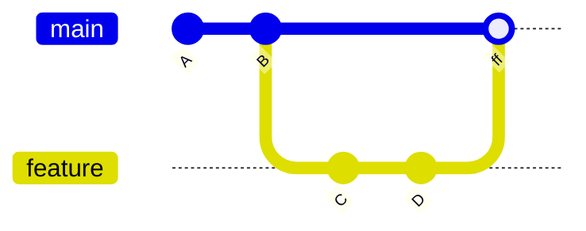

## 47.3 Branches

#### Concept

A branch is a movable pointer to a commit, plus one automatic behaviour: when you commit while `HEAD` points at that branch, the branch pointer moves forward to the new commit.

#### Why does it exist?

To let several lines of work exist at once without copying the repository. Because a branch is 41 bytes and commits are shared objects, having 200 branches costs essentially nothing. This is a genuine architectural difference from older systems where a branch meant a server-side copy of the tree.

#### Mental model

Imagine a row of stepping stones (commits) across a river. A branch is a coloured flag placed on one stone. Standing on a stone with your flag and adding a new stone moves your flag onto it. Other flags do not move. Switching branches is walking to a different flag, and the stones between the two are untouched.

#### How it works

**Creating and switching.** Modern Git splits the overloaded `git checkout` into two clearer commands, and you should use them:

```bash
$ git switch -c feature/idempotent-orders          # create and switch
Switched to a new branch 'feature/idempotent-orders'

$ git switch main                                   # switch to an existing branch
Switched to branch 'main'
Your branch is up to date with 'origin/main'.

$ git switch -                                      # switch back to the previous branch
$ git switch --detach v1.4.2                        # explicit detached HEAD at a tag
```

`git switch` only changes branches. `git restore` only restores file content. `git checkout` still does both, which is precisely why it confused a generation of engineers: `git checkout main` and `git checkout main -- src/file.ts` do completely different things.

**Tracking remotes.** A remote-tracking ref (`refs/remotes/origin/main`) is your local record of where the remote's branch was at your last fetch. It is not live; it updates only on `fetch` or `pull`. An *upstream* is a configured link between your local branch and a remote branch, which is what makes bare `git push` and `git pull` work and what produces "ahead 2, behind 1".

```bash
$ git push -u origin feature/idempotent-orders
$ git branch -vv
* feature/idempotent-orders 7b2e5d1 [origin/feature/idempotent-orders] feat(orders): add idempotency key
  main                      9f3c1a2 [origin/main: behind 3] chore: bump deps
```

`git fetch` updates remote-tracking refs and touches nothing else — it is always safe. `git pull` is `fetch` plus `merge` (or `rebase` with `--rebase`), and it is the one that can surprise you. Configuring `pull.rebase=true` and `pull.ff=only` prevents the accidental merge commits that clutter feature branches:

```bash
$ git config --global pull.ff only        # refuse to create a merge commit implicitly
$ git config --global fetch.prune true    # delete local refs for deleted remote branches
```

**Restoring files.** `git restore` is the safe, explicit replacement for the destructive half of `checkout`:

```bash
$ git restore src/orders/orders.service.ts            # discard working-tree changes (DESTRUCTIVE)
$ git restore --staged src/orders/orders.service.ts   # unstage, keep working-tree changes
$ git restore --source=HEAD~2 src/orders/orders.service.ts  # bring back an older version
```

The first form permanently discards uncommitted work with no reflog entry. It is the second most common way engineers lose work, after `reset --hard`.

**Naming and hygiene.** Conventions that pay off: a type prefix and a ticket (`feat/ORD-4182-idempotent-orders`, `fix/ORD-4199-refund-rounding`), lowercase with hyphens, and no slashes that collide (`feature` and `feature/x` cannot both exist, because refs are files and a file cannot also be a directory). Delete merged branches promptly — `git branch --merged main` lists candidates — and set `fetch.prune` so remote deletions clean up locally.

The most important branch hygiene rule is not naming, though. It is **lifetime**. A branch that lives three weeks accumulates divergence, and the merge cost grows superlinearly with the number of commits on both sides. Keep branches under two days where you can, which is a statement about how you slice work, not about Git (47.12).

#### Practical example

An engineer starts `feat/ORD-4182-idempotent-orders` from `main`, pushes with `-u`, and opens a draft PR immediately so CI runs on every push. `main` receives 6 commits over the next day. Rather than merging `main` in repeatedly and producing a tangled history, they rebase once before requesting review:

```bash
$ git fetch origin
$ git rebase origin/main
Successfully rebased and updated refs/heads/feat/ORD-4182-idempotent-orders.
$ git push --force-with-lease
```

`--force-with-lease` rather than `--force` is the important detail: it refuses the push if the remote branch has moved since your last fetch, which is what protects a colleague who pushed to the same branch (47.15).

#### Failure scenario

A team kept a `develop` branch and a `release/2.0` branch that diverged for four months. When the time came to merge `release/2.0` into `develop`, there were 340 commits on one side, 510 on the other, and 62 conflicting files including a lockfile and a generated API client. The merge took two engineers three days, produced a broken build for two more, and one conflict was resolved incorrectly — reintroducing a bug that had been fixed on `develop` in month two.

Nothing about Git caused this. The branching strategy did (47.12). The cost of integration is a function of how long you defer it, and Git only makes deferral *possible*, not free.

#### Edge cases & failure modes

- **`git restore <file>` discards uncommitted work permanently**, with no reflog entry.
- **Branch name collisions with directory structure.** `feature` and `feature/x` cannot coexist as refs.
- **Stale remote-tracking refs.** `origin/main` is a cached value; "up to date" after a week means nothing without a fetch.
- **Detached HEAD from `git checkout <sha>`.** Commits there vanish from view when you switch away.
- **Case-only renames** (`Orders.ts` to `orders.ts`) on macOS or Windows appear to do nothing (47.15).
- **`git pull` creating surprise merge commits** on a feature branch. Set `pull.ff only` or `pull.rebase true`.
- **Deleting an unmerged branch.** `git branch -D` succeeds silently; recovery is via reflog only.
- **Branch protection bypassed by admins**, so `main` receives an unreviewed force-push.

#### How a Senior Backend Engineer thinks about this

They see branches as cheap and branch *lifetime* as expensive. The question is never "should I branch?" but "how do I get this merged today?" — which leads to smaller slices, feature flags (Part 46, section 46.8), and expand/contract migrations (Part 23).

They standardise the safe commands across the team: `switch` and `restore` over `checkout`, `push --force-with-lease` over `--force`, `pull.ff only`, `fetch.prune true`. These are small settings that remove entire categories of accident.

Explained to a product manager: "A branch is a label, and making one is free. What costs us is keeping work separate for weeks; the longer two versions drift apart, the more expensive and risky it is to bring them together."

#### Common mistakes

- Using `git checkout` for everything and eventually running the destructive form by accident.
- Long-lived branches, then blaming Git for the merge pain.
- `git push --force` on a shared branch instead of `--force-with-lease`.
- Never pruning, so `git branch -a` lists 400 dead branches.
- Assuming `origin/main` is current without fetching.

#### Interview questions

1. *What physically happens when you create a branch and commit on it?* Expected: a 41-byte ref file is written; committing creates objects and moves that ref; other refs are untouched.
2. *What is the difference between `git fetch` and `git pull`?* Expected: fetch updates remote-tracking refs only and is always safe; pull also merges or rebases into your branch.
3. *Why prefer `switch` and `restore` over `checkout`?* Expected: `checkout` conflates branch switching and file restoration; the split is explicit and the destructive operation is named.
4. *What does "ahead 2, behind 3" mean and against what?* Expected: compared to the remote-tracking ref as of the last fetch, which may be stale.
5. *Why is `--force-with-lease` safer than `--force`?* Expected: it refuses if the remote moved since your last fetch, protecting a colleague's push.

#### Practical exercise

Configure `pull.ff only`, `fetch.prune true` and an alias for `push --force-with-lease`. Then create a feature branch, have a colleague (or a second clone) push a commit to `main`, and bring your branch up to date with a rebase rather than a merge. Deliberately attempt a `--force-with-lease` push after simulating a colleague pushing to your branch from the second clone, and confirm it is rejected. Acceptance criteria: a linear feature branch history, an explanation of what the rejected force-push protected, and a `git branch -vv` output you can read aloud and interpret.

## 47.4 Merge

#### Concept

Merging combines two lines of history into one. Git finds the best common ancestor of the two branches, computes what each side changed since that ancestor, and produces a result containing both sets of changes — recorded as a new commit with **two parents**.

#### Why does it exist?

Because parallel work is the normal state of a team, and the history must record that it happened. A merge commit is not clutter; it is a factual statement that two independent lines of development were brought together at a specific point, by a specific person, and here is the result they verified.

#### Mental model

Imagine two people editing copies of the same document from a shared starting version. Merging is a third person comparing both copies against the original and producing one document containing both sets of edits. Where the two edited *the same sentence*, the third person cannot decide — that is a conflict, and a human must choose.

#### How it works

**Fast-forward.** If the target branch has no commits since the branch point, there is nothing to combine. Git simply moves the branch pointer forward. No merge commit is created, and history stays linear.



```bash
$ git switch main
$ git merge feature/idempotent-orders
Updating 9f3c1a2..7b2e5d1
Fast-forward
 src/orders/orders.service.ts | 24 ++++++++++++++++++------
 src/migrations/1725870000-add-idempotency-index.ts | 18 ++++++++++++++++++
 2 files changed, 36 insertions(+), 6 deletions(-)
```

**Three-way merge.** If both branches have moved since the common ancestor, Git performs a three-way merge using the merge base, and records a commit with two parents:

```bash
$ git merge feature/refunds
Merge made by the 'ort' strategy.
 src/orders/refunds.service.ts | 61 +++++++++++++++++++++++++++++++++++++++
 1 file changed, 61 insertions(+)
```

The default strategy is `ort` ("ostensibly recursive's twin"), which replaced `recursive` in Git 2.34. It handles the case of multiple merge bases (criss-cross merges) by merging the bases first, and it is substantially faster on large repositories.

**`--no-ff`.** Forces a merge commit even when a fast-forward is possible:

```bash
$ git merge --no-ff feature/idempotent-orders
```

Why you would want that: the merge commit is a record that these five commits belong to one unit of work, which makes `git log --first-parent` a clean list of features rather than a list of individual commits, and makes reverting the whole feature one command (47.8). Why you might not: on a busy repository it produces a merge commit for every trivial branch, and the graph becomes hard to read.

The practical policy most teams land on: `--no-ff` for feature branches merged into `main` (so each feature is one node), fast-forward for trivial single-commit branches, and never a merge commit produced accidentally by `git pull` (set `pull.ff only`).

**Conflict resolution workflow.** A conflict occurs when both sides changed the same region of the same file, or when one side edited a file the other deleted. Git stops and leaves the repository in a merging state:

```bash
$ git merge feature/refunds
Auto-merging src/orders/orders.service.ts
CONFLICT (content): Merge conflict in src/orders/orders.service.ts
Automatic merge failed; fix conflicts and then commit the result.

$ git status --short
UU src/orders/orders.service.ts
M  src/orders/refunds.service.ts
```

`UU` means both sides modified it. Other codes you will meet: `AA` both added, `DU` deleted by us and modified by them, `UD` the reverse.

The file contains conflict markers:

```ts
<<<<<<< HEAD
    const total = items.reduce((sum, i) => sum + i.priceMinor * i.qty, 0);
=======
    const total = calculateTotal(items, { includeTax: true });
>>>>>>> feature/refunds
```

Turning on `merge.conflictstyle=zdiff3` adds the common ancestor, which is the single highest-value Git configuration change most engineers can make:

```ts
<<<<<<< HEAD
    const total = items.reduce((sum, i) => sum + i.priceMinor * i.qty, 0);
||||||| merge base
    const total = items.reduce((sum, i) => sum + i.price * i.qty, 0);
=======
    const total = calculateTotal(items, { includeTax: true });
>>>>>>> feature/refunds
```

Now you can see that one side renamed a field and the other extracted a function — so the correct resolution is neither side verbatim, it is `calculateTotal` using `priceMinor`. Without the base, you would have picked one and silently reverted the other's change.

The workflow:

1. `git status` to list conflicted paths.
2. Resolve each file. Understand *both* intents; do not pick a side to make it compile.
3. `git add <file>` for each resolved file, which sets the merge stage to 0.
4. Run the tests. A merge that compiles is not a merge that works.
5. `git commit` (the message is pre-filled) or `git merge --continue`.
6. `git merge --abort` at any point returns you to exactly where you started.

**`ours` and `theirs`.** During a merge, "ours" is the branch you are on and "theirs" is the branch being merged in:

```bash
$ git checkout --ours package-lock.json     # take our version entirely
$ git checkout --theirs docs/api.md         # take their version entirely
$ git add package-lock.json docs/api.md
```

Two warnings. First, during a **rebase** the meanings invert, because rebase replays your commits on top of the target: "ours" is the branch you are rebasing onto, "theirs" is your own work. This reversal catches everyone once. Second, `--ours` on a lockfile is almost always wrong; the correct fix is to regenerate it (47.14).

There is also `git merge -X ours` / `-X theirs`, a *strategy option* that auto-resolves conflicting hunks in favour of one side while still merging non-conflicting changes normally. Different from `-s ours`, which discards the other side's changes entirely and keeps only the merge record — occasionally useful to mark a branch as merged without taking its content, and dangerous if used by accident.

**`rerere`.** "Reuse recorded resolution". When enabled, Git records how you resolved each conflict hunk and replays that resolution automatically the next time it sees the same conflict:

```bash
$ git config --global rerere.enabled true
$ git config --global rerere.autoupdate true
```

```bash
$ git rebase origin/main
CONFLICT (content): Merge conflict in src/orders/orders.service.ts
Resolved 'src/orders/orders.service.ts' using previous resolution.
```

This is transformative in exactly one situation: a long-lived branch that you rebase repeatedly, or a release branch you merge forward every day, hitting the same conflicts each time. Without `rerere` you resolve them again on every attempt. With it, you resolve once. It is also useful during a difficult rebase you abort and retry.

The caveat: `rerere` replays a resolution that was correct *then*. If the surrounding code has changed meaning, it will confidently apply a stale resolution. Review what it did (`git rerere diff`) rather than trusting it blindly, and `git rerere forget <path>` to drop a bad recording.

#### Practical example

Two engineers work on `orders.service.ts` for two days. One extracts a `RefundCalculator`; the other renames `price` to `priceMinor` throughout for a currency-precision fix. Merging produces four conflicts. With `zdiff3` the resolution is mechanical, because in each hunk the base shows exactly which side introduced which change and the correct result combines both. It takes 15 minutes. Without the base, the reviewer of a similar merge the previous month had picked "theirs" wholesale and silently reverted a currency fix, which surfaced three weeks later as a rounding discrepancy in a reconciliation report.

#### Production scenario

A monorepo with 40 engineers takes about 55 merges into `main` per day through a merge queue. Merges are `--no-ff` squash-free merges of already-rebased branches, so conflicts at merge time are rare (the rebase happened in the PR). `git log --first-parent --oneline` gives a clean, readable feature-level history that release notes are generated from. Average time from "approved" to "on main" is 9 minutes, dominated by the queue re-running CI on the combined result.

#### Failure scenario

At 14:50 a merge of a four-week branch produced 31 conflicting files. The engineer worked through them quickly under release pressure, resolving several with `--theirs` "because the branch is newer". Tests passed, because the tests for the reverted code lived on the other side of the merge and had been resolved away too.

Three days later, rate limiting was found to be disabled in production. The merge had silently reverted a `ThrottlerGuard` registration and its test. `git log -S 'ThrottlerGuard' --oneline` found the commit that added it and the merge commit that removed it in about a minute — but the three days had already happened.

The postmortem produced three rules: branches live under three days; `zdiff3` is set globally; and a conflict resolution that *deletes* lines from either side gets a second reviewer. That last one is the sharpest, because a merge diff against both parents (`git show -m <merge>`) reveals exactly this class of error and almost nobody looks at it.

#### Edge cases & failure modes

- **Silent revert during conflict resolution.** The most dangerous merge failure, because tests can pass. Review `git show -m` or `git diff HEAD^1 HEAD^2` on a big merge.
- **Semantic conflict with no textual conflict.** One side renames a method, the other adds a call to the old name in a different file. Git merges cleanly; the build breaks. Only CI on the merged result catches this — which is what a merge queue is for.
- **Lockfile conflicts.** Never resolve by hand (47.14).
- **Generated files committed.** Every merge conflicts on them. Do not commit build output.
- **Criss-cross merges.** Multiple merge bases; `ort` handles them, but the result can be surprising. Prefer rebasing feature branches to keep the graph simple.
- **`-s ours` used by mistake**, silently discarding a whole branch's changes while claiming it was merged.
- **Merging with a dirty working tree.** Git refuses if the merge would overwrite local changes; commit or stash first.
- **Line-ending conflicts.** A whole file conflicts because one side has CRLF (47.15).

#### How a Senior Backend Engineer thinks about this

They optimise for the size of the merge, not the technique. A one-day branch merges cleanly with any strategy; a four-week branch is dangerous no matter how skilled the resolver.

When resolving, they reconstruct intent before touching the file: what was each side trying to do? The `zdiff3` base makes that mechanical. They refuse to resolve a large conflict at the end of a long day under release pressure, because that is precisely when silent reverts happen.

They also treat "tests pass after the merge" as necessary and not sufficient, because a resolution can delete both the code and its test.

Explained to a product manager: "Combining two weeks of separate work is where mistakes hide. Merging small pieces daily is not bureaucracy; it is how we avoid quietly deleting each other's work."

#### Common mistakes

- Resolving conflicts by picking whichever side compiles.
- Leaving conflict markers in the file and committing them.
- `git checkout --ours` on a lockfile.
- Not running tests after resolving.
- Merging `main` into a feature branch repeatedly, producing a tangled graph that nobody can read.

#### Interview questions

1. *What is the difference between a fast-forward and a three-way merge?* Expected: fast-forward moves a pointer when the target has not diverged; three-way creates a commit with two parents using the merge base.
2. *When would you use `--no-ff` and why?* Expected: to record a feature as one unit, enabling `log --first-parent` and a single-command revert of the whole feature.
3. *What is `zdiff3` and why does it matter?* Expected: shows the merge base in conflict markers, revealing which side changed what, preventing silent reverts.
4. *During a rebase, what do "ours" and "theirs" refer to?* Expected: inverted relative to merge — "ours" is the upstream you are replaying onto, "theirs" is your commit being applied.
5. *What is `rerere` and what is its risk?* Expected: records and replays conflict resolutions; risk is applying a stale resolution when surrounding code changed meaning.
6. *A merge had no conflicts and the build broke. How?* Expected: semantic conflict; textual merge cannot see meaning; CI on the merged result is the defence.

#### Practical exercise

Create a conflict deliberately: two branches, both editing the same function, one renaming a field and one extracting a helper. Resolve it twice — once with the default conflict style and once with `zdiff3` — and write down which resolution you would have got wrong without the base. Then enable `rerere`, abort the merge, redo it, and confirm the resolution is replayed. Acceptance criteria: a correct resolution combining both intents, tests passing, and a `git show -m` review of your merge commit showing no accidental deletions.

