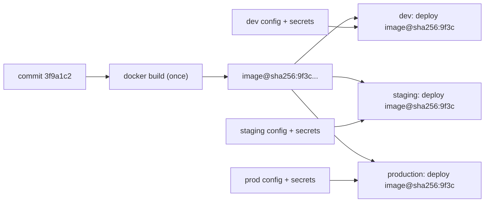
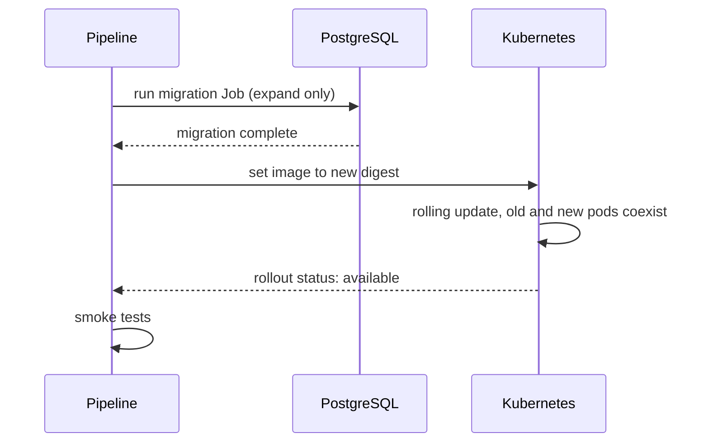

## 47.2 Continuous delivery and deployment

#### Concept

**Continuous delivery** means every commit that passes the pipeline produces an artifact that *could* be released to production at the push of a button. The gate is a human decision, not a technical obstacle.

**Continuous deployment** removes the button. Every commit that passes goes to production automatically.

The distinction is one of policy, not capability. A team practising continuous delivery has already done all the engineering; they have simply decided that a human should look before the last step. That decision is legitimate for a payments core, a medical records system, or anything with a regulator. It is usually *not* legitimate for an internal admin API, and teams that keep the gate out of habit rather than reason pay for it in batch size: gates encourage waiting, waiting encourages batching, and a deploy of 14 commits is far harder to debug than a deploy of one.

#### Why does it exist?

Because the alternative is the release train, and the release train has a specific failure mode. When you deploy once a fortnight, each deploy contains 60 changes. When something breaks, you have 60 suspects, the rollback reverts 59 innocent changes along with the guilty one, and nobody remembers the context of the code they wrote nine days ago. Risk per deploy scales with batch size, which is why deploying more often makes each deploy *safer*, which is the counter-intuitive result at the heart of the DORA research (47.12).

#### Mental model

Imagine a bakery. Continuous delivery is having bread cooling on the rack, ready to sell, and a manager who decides when to open the shop door. Continuous deployment is the door opening by itself as each loaf is ready. Either way the bread is baked, wrapped and priced. The argument is only about the door.

Now the important part of the analogy: the loaf on the rack must be the *same loaf* that goes into the bag. You do not bake a "test loaf" and then bake a fresh one for the customer, because the second one might come out different. That is the immutable artifact rule, and it is the single most important idea in this section.

#### How it works

**Environments** are stages that an artifact passes through, each closer to production:

| Environment | Purpose | Data | Who deploys | Typical gate |
|---|---|---|---|---|
| CI ephemeral | Prove the change is correct | Throwaway containers | Automatic | All checks green |
| Development / integration | Services talk to each other | Synthetic, resettable | Automatic on merge | Deploy succeeds |
| Staging / pre-production | Production-shaped rehearsal | Anonymised copy or realistic synthetic | Automatic | E2E + smoke pass |
| Production | Real customers | Real | Automatic or approved | Approval, change window, SLO health |

**The rule that matters: promote the same immutable artifact.** Build once, in one place, from one commit. Everything downstream references that artifact by digest. You do not run `docker build` again for staging and again for production. Ever.

Why so strict? Because if you rebuild per environment, the thing you tested in staging is not the thing you shipped. A transitive dependency published a patch between the two builds. The base image tag moved. A build-time environment variable differed. Now your staging test result is an *opinion* about production rather than evidence, and you have reintroduced exactly the class of bug containers were supposed to eliminate.

What *does* change per environment is configuration, injected at run time: database URLs, feature flag defaults, log level, replica counts, resource limits, secret references. This is the twelve-factor separation of config from code, and it has a practical test: **if you cannot take the production image, point it at staging config, and have it work, your artifact is not really immutable.**

**Approvals and environment protection.** GitHub Actions models this with `environments`: a named environment can require specific reviewers, enforce a wait timer, restrict which branches may deploy to it, and hold environment-scoped secrets. The important design points:

- Required reviewers should be a *team*, not a person, or the deploy blocks when that person is on holiday.
- A wait timer (say 5 minutes) between staging and production is sometimes more useful than a human approval: it gives monitoring time to react while requiring nobody to be awake.
- Restrict the production environment to the `main` branch and to tags. Otherwise a feature branch can reach production secrets.
- The approver should see *what* they are approving: the commit range, the image digest, and the migration plan. An approval button with no context is theatre.

**Where the database migration goes.** This is the question that separates people who have deployed a schema change from people who have not. The short answer: **the migration runs before the new code, and the migration must be safe for the old code that is still running.**

During the rolling update, old pods and new pods run simultaneously against one schema. That schema must satisfy both. This is why migrations are restricted to *additive* (expand) operations at deploy time: add a nullable column, add a new table, add an index concurrently, add a constraint as `NOT VALID` and validate later. The destructive half (drop the old column, drop the old table, add `NOT NULL`) happens in a *later* deploy, after all code that referenced the old shape is gone. The full mechanics, including backfills, dual writes and the exact lock behaviour of each DDL statement, are in Part 24 — Database Migrations and Zero-Downtime Schema Changes, and the compatibility rules that make it work are in Part 25 — Backward Compatibility.

Running the migration *as a separate step before the rollout* (a Kubernetes `Job`, not an init container on every pod, and never on application boot) matters for three reasons: it runs exactly once rather than once per replica; a failure stops the pipeline before any new code is live; and you can see it as a discrete, timed, logged event when you are reading a timeline at 3 a.m.

#### Practical example

An e-commerce platform ships `orders-api` roughly 12 times a day. Merge to `main` triggers: build image tagged `sha-3f9a1c2`, push to ECR, deploy to staging automatically, run 40 E2E tests (4 minutes), then the workflow pauses on the `production` environment which requires one reviewer from the `@acme/backend` team. Median time in the approval queue is 6 minutes during working hours. Outside working hours the pipeline stops there and the deploy happens the next morning, which the team accepts because their change failure rate does not justify waking anyone.

The migration step is a separate `Job` executed against the production database *before* the `kubectl set image`, with `statement_timeout` and `lock_timeout` set so a blocked DDL fails in 5 seconds instead of queueing behind a long report query and locking the orders table.

#### Failure scenario

A team rebuilt their image per environment. Staging built at 14:05, production at 14:40. Between those two builds, a transitive dependency (`fast-json-stringify`, pulled in by their logger) published a patch release that changed how it serialised `BigInt`. Their `package-lock.json` pinned direct dependencies but a `^` range in a sub-dependency allowed the drift, and they used `npm install` rather than `npm ci`.

Staging was fine. Production started throwing `TypeError: Do not know how to serialize a BigInt` on the order-total field, which is a `bigint` column mapped to a JavaScript `BigInt`. It affected 100% of order responses. The rollback worked (the previous image was intact), but the debugging took 40 minutes because the code was byte-identical and everyone was looking for a config difference.

Two fixes went in: `npm ci` with a fully resolved lockfile, and build-once-promote-everywhere. The second fix would have prevented it on its own.

#### Edge cases & failure modes

- **Config drift between environments.** Staging has `POOL_MAX=5`, production has `50`; a connection-pool bug never appears until production. Diff environment config in the pipeline and alert on unexpected keys.
- **Staging data is nothing like production.** 500 orders in staging, 40 million in production. A query with a missing index passes staging in 3 ms and takes 9 seconds in production.
- **Approval that never comes.** The workflow sits pending for 6 hours and expires; the deploy silently never happened. Alert on deploys stuck in approval for more than N minutes.
- **The environment allows any branch.** Someone deploys a feature branch to production because the environment protection rule was never set.
- **Migration and deploy in the wrong order.** New code deployed first, reads a column that does not exist yet, every request 500s (47.13).
- **Two pipelines deploying at once.** Two merges within a minute; both run `kubectl set image`; the second overwrites the first mid-rollout. Use a `concurrency` group per environment.
- **A "config-only" deploy that rebuilds.** Changing a ConfigMap should not require a new image; if it does, your config is baked in.

#### How a Senior Backend Engineer thinks about this

They ask: *what is the smallest thing we can ship, and how quickly can we un-ship it?* Everything else follows. Small batches make failures obvious and rollbacks cheap. They would rather deploy 12 times a day with a 5% change failure rate than once a fortnight with 2%, because the first team restores service in 8 minutes and the second takes 4 hours to find which of 60 changes did it.

On the delivery-versus-deployment question they are pragmatic. They will argue for removing the approval gate only after the team can show: reliable smoke tests, automated rollback, feature flags for risky changes, and a change failure rate under about 10%. Removing the gate before those exist is not maturity, it is optimism.

They also treat "promote the artifact" as non-negotiable and will block a design review over it, because every environment-specific build quietly converts your test results into guesses.

Explained to a product manager: "We bake the software once and move that exact copy through testing to production. If we baked it again for production, we would be shipping something nobody tested."

#### Common mistakes

- Rebuilding the image for each environment, or building from a branch name rather than a commit SHA.
- Running migrations on application startup, so ten replicas race to run the same DDL.
- Putting the approval gate on staging rather than production, where it slows learning and protects nothing.
- Baking environment config into the image, then needing a rebuild to change a log level.
- Treating "continuous deployment" as a goal in itself rather than as the result of trustworthy automation.

#### Interview questions

1. *What is the difference between continuous delivery and continuous deployment?* Expected: both produce a deployable artifact automatically; deployment removes the human gate. Follow-up: what must be true before you would remove the gate?
2. *Why must the same artifact be promoted across environments?* Expected: rebuilding introduces dependency drift, base image drift, build-env differences; staging results stop being evidence about production. Follow-up: what differs between environments, then?
3. *Where does a database migration run relative to the deploy, and why?* Expected: before the rollout, as a separate one-shot job, and it must be backward compatible because old and new pods coexist. Follow-up: what do you do about dropping a column?
4. *How do you prevent two deploys colliding?* Expected: concurrency group per environment, queue rather than cancel for production, deploy locks, or a merge queue.
5. *Your approval gate adds 6 hours of latency at night. Is that a problem?* Expected: depends on lead time targets and incident risk; discuss automated rollback plus canary as the alternative to a human.

#### Practical exercise

Take a service that currently builds per environment. Restructure the pipeline so the image is built once on merge, tagged `sha-<short>`, pushed, and then referenced by digest in staging and production deploys. Add an environment protection rule requiring a team review for production and restricting it to `main`. Acceptance criteria: `docker inspect` on a staging pod and a production pod shows the same `RepoDigest`; the pipeline contains exactly one `docker build`; and a deploy from a feature branch to production is rejected by the platform, not by convention.

## 47.3 Artifacts and supply chain

#### Concept

An artifact is the immutable output of your build: for a backend service, a container image. Supply chain security is the practice of knowing exactly what is inside that artifact, where each piece came from, and being able to prove it later.

#### Why does it exist?

Two forces. The first is operational: you cannot roll back to a version you cannot name. The second is security: modern attacks target the build pipeline rather than the running system, because a compromised build injects code into an artifact that everyone already trusts. The `event-stream` npm incident, the `xz` backdoor and the SolarWinds compromise all worked this way. When a CVE lands on a Friday, the only question that matters is "which of our 60 services contain this package, at which version?" and you can only answer it in minutes if you recorded the answer at build time.

#### How it works

**Tagging.** Every image gets at least two tags plus its digest:

- `orders-api:sha-3f9a1c2` — the immutable identity. Points at exactly one commit, forever. This is what deployment manifests reference.
- `orders-api:1.14.3` — the semantic version, for humans, release notes and support conversations.
- `orders-api@sha256:9f3c...` — the digest, which the registry computes. This is the only reference that cannot be moved.

You may also push a floating `1.14` or an environment pointer like `production-current`, but nothing in a deployment manifest should reference a moving tag.

**Why `latest` makes rollbacks meaningless.** `latest` is a mutable pointer, and it points at whatever was pushed most recently. Three concrete consequences: two nodes that pull at different times run different code with no way to tell from the manifest; a rollback has no target, because the previous image has no name you can reference; and `imagePullPolicy: Always` combined with `latest` means a pod restart at 3 a.m. silently upgrades to code nobody deployed. Configure the registry to **reject** pushes to immutable tags after the first (ECR supports tag immutability per repository), and never let a manifest contain a moving tag.

**SBOM (Software Bill of Materials).** A machine-readable list of every package in the image with name, version, license and, ideally, its source. Generate it at build time with Syft or `docker buildx --sbom=true`, in SPDX or CycloneDX format, and store it as an artifact attached to the image. It costs about 10 seconds per build. When the next `log4shell`-class vulnerability drops, you query SBOMs and know your exposure in two minutes instead of grepping 60 repositories for a day.

**Build provenance (attestations).** A signed statement describing how the artifact was produced: which source commit, which builder, which parameters, at what time. The SLSA framework defines levels; the practical target for most teams is provenance generated by the CI platform itself (GitHub's `actions/attest-build-provenance`, or `docker buildx --provenance=mode=max`) and verified at deploy time. This is what lets you answer "was this image built from our repository by our pipeline, or did someone push it from a laptop?" — a question that has an uncomfortable answer in most organisations.

**Signing.** Cosign signs an image digest with a key or, better, with keyless OIDC identity tied to the workflow. An admission controller in the cluster (Kyverno, Sigstore policy-controller) refuses to run images without a valid signature from your CI identity. That single control turns "an attacker with registry write access owns production" into "an attacker with registry write access owns nothing".

**Retention.** Storage is cheap until it is not; more importantly, an unbounded registry makes it hard to find anything. A workable policy for ECR lifecycle rules:

| Tag pattern | Keep | Reason |
|---|---|---|
| `sha-*` | Last 50 images per repository | Rollback targets for recent history |
| Semver `v*` | All, or last 2 years | Support, audit, reproducing old bugs |
| Untagged manifests | Delete after 7 days | Build cache and orphaned layers |
| `cache-*` (BuildKit cache) | Delete after 14 days | Regenerated on demand |

Keep at least the last 10 deployable images. A team that keeps 3 discovers, during a bad week with three consecutive rollbacks, that there is nothing left to roll back to.

#### Production scenario

A platform with 60 services, 200 deploys a day, ECR in `eu-west-1`. Each image build produces: the image (about 210 MB, of which 130 MB is the shared base layer), a CycloneDX SBOM (roughly 400 KB), a provenance attestation, and a Trivy scan report stored as a workflow artifact for 90 days. Storage sits around 900 GB after lifecycle rules, costing roughly 90 USD a month, which is one hour of engineer time. The SBOM index is queryable: when a critical CVE in `undici` was announced, the security team produced the list of 23 affected services in under 5 minutes and the platform team shipped base image bumps the same afternoon.

#### Failure scenario

A team deployed with `imagePullPolicy: Always` and the tag `orders-api:production`. During a node autoscaling event at 02:50, three new pods started and pulled `production` — which had been overwritten 20 minutes earlier by a broken build from a developer testing the pipeline locally with their own credentials. The cluster now ran two versions simultaneously: seven pods on the good code and three on code that had never passed CI. Requests failed for roughly 30% of users, and `kubectl get deployment` showed everything healthy because the tag matched.

The fix took three changes: tag immutability enabled in ECR, deployments referencing `sha-*` tags only, and registry write permission restricted to the CI role via OIDC (47.4). None of these are expensive; all of them were "we'll do it later" items on a backlog.

#### Edge cases & failure modes

- **Tag reuse.** Someone force-pushes a tag; two nodes now differ. Enable tag immutability.
- **Registry garbage collection deletes a layer still referenced.** Rare, but it makes an old image unpullable exactly when you need it for a rollback.
- **Dirty build tree.** An image built from a working directory with uncommitted changes has a `sha-` tag that lies. Fail the build if `git status --porcelain` is non-empty (47.13).
- **Multi-arch confusion.** An `arm64`-only image deployed to `amd64` nodes fails with `exec format error` at pod start, after the deploy has been declared successful by the pipeline.
- **SBOM generated from the source tree rather than the image.** It then misses OS packages, which is where a large share of CVEs live. Scan the built image.
- **Provenance that nobody verifies.** Generating attestations without an admission policy is documentation, not a control.

#### How a Senior Backend Engineer thinks about this

They ask one question about every artifact: *can I name it, find it, and prove where it came from, in six months, during an incident, at 3 a.m.?* If yes, the supply chain hygiene is adequate. If not, everything else is decoration.

They also weigh cost honestly. Full SLSA level 3 with hermetic builds is real work; SBOM generation, digest-pinned deploys, tag immutability and Trivy in the pipeline take an afternoon and remove most of the risk. Do the afternoon's work first, and add the rest when a customer questionnaire or a regulator asks.

#### Common mistakes

- Deploying `latest` or an environment-named tag.
- Keeping only 3 images and losing rollback targets.
- Generating an SBOM and never storing or querying it.
- Allowing developer credentials to push to the production registry.
- Tagging by branch name, so two branches with the same name collide.

#### Interview questions

1. *Why is `latest` dangerous in production?* Expected: mutable pointer, nodes diverge, no rollback target, silent upgrade on restart. Follow-up: what would you tag instead, and what enforces it?
2. *What is an SBOM and when has it saved you time?* Expected: package inventory per image; answers "am I affected by CVE-X" in minutes across all services.
3. *What does build provenance prove that a signature alone does not?* Expected: not just "signed by us" but "built from commit X by workflow Y with these inputs"; ties artifact to source.
4. *How do you stop an image that did not come from CI from running in the cluster?* Expected: keyless signing in CI plus an admission policy verifying the signer identity.

#### Practical exercise

Add three things to an existing build workflow: SBOM generation with Syft attached as a workflow artifact, tag immutability on the registry repository, and a build step that fails if the working tree is dirty or the commit is not on `main`. Then write an ECR lifecycle policy implementing the retention table above. Acceptance criteria: a pushed image cannot be overwritten; an SBOM can be downloaded for any image from the last 90 days; and you can answer "which services contain `axios@1.6.0`?" from stored SBOMs without cloning any repository.

