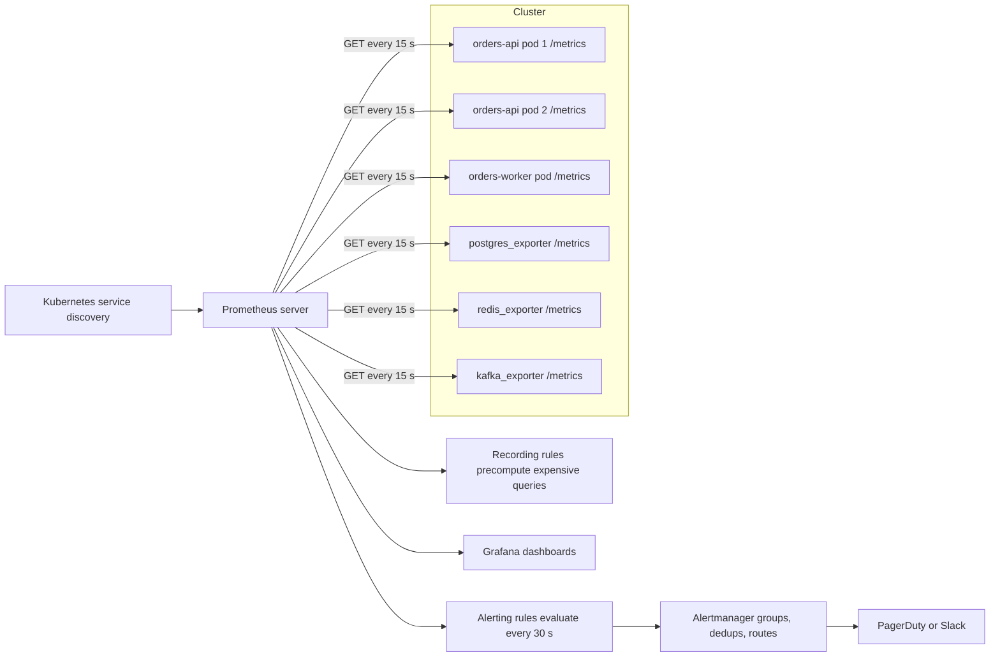
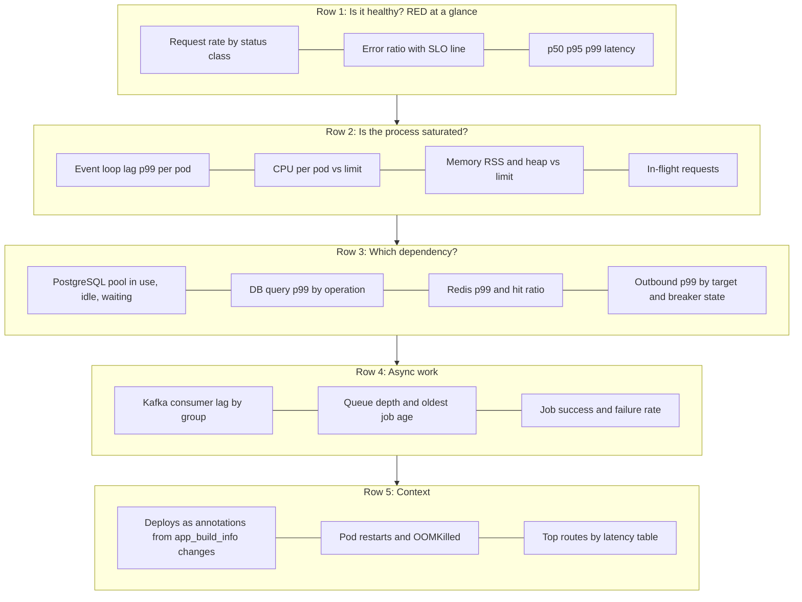

## 47.3 Metrics

### 47.3.1 Metric types: counter, gauge, histogram, summary

#### Concept

A metric is a named number, with a small set of labels, sampled over time. `http_requests_total{route="/orders",status="201"}` is a metric. The value is stored every 15 seconds or so, and you can graph it, compare it with last week, and alert when it crosses a line. Metrics are the cheapest signal to store and the fastest to query, which is why almost every alert is built on them.

#### Why does it exist?

You cannot alert on logs at scale without paying to index every line, and you cannot alert on traces because they are sampled. Metrics exist to answer "how is the system doing right now, and is that different from normal" in one cheap query, regardless of how many requests happened.

#### Mental model

Imagine a car dashboard. The odometer only ever goes up (a counter). The fuel gauge goes up and down (a gauge). The trip computer that says "your average speed was 62 km/h, and you spent 15 percent of the trip above 100" is a histogram. Nobody wants the car to log every rotation of the wheel; the dashboard summarizes.

#### How it works

| Type | Behaviour | Use for | Query pattern |
|---|---|---|---|
| Counter | Only increases; resets to 0 on restart | Requests, errors, bytes, jobs processed, messages consumed | `rate(x[5m])` turns it into per-second |
| Gauge | Goes up and down | In-flight requests, pool connections in use, queue depth, memory, temperature | Use the raw value; `max_over_time` for peaks |
| Histogram | Counts observations into fixed buckets, plus sum and count | Latency, payload size, job duration | `histogram_quantile(0.99, rate(x_bucket[5m]))` |
| Summary | Client-side quantiles over a sliding window | Rarely; when you cannot aggregate across instances | Cannot be aggregated across pods correctly |

Histograms beat summaries almost always. A histogram is a set of counters (`le="0.05"`, `le="0.1"`, ...) that Prometheus can add across pods and then compute a quantile from. A summary computes p99 inside each pod; the average of ten pods' p99 is not the fleet's p99. Choose bucket boundaries deliberately: for HTTP latency, `[0.005, 0.01, 0.025, 0.05, 0.1, 0.25, 0.5, 1, 2.5, 5, 10]` seconds covers a typical API; for a batch job, use seconds to minutes.

#### Common mistakes

- Using a gauge for something that only goes up, and then being unable to compute a rate after restarts.
- Recording latency in milliseconds under a metric named `_seconds`, or the reverse. Prometheus convention is base units: seconds, bytes.
- Default buckets that stop at 10 seconds when your slow path is 30 seconds; everything above the last bucket lands in `+Inf` and the quantile lies.

### 47.3.2 RED, USE and the Golden Signals

#### Concept

Three small frameworks tell you *which* metrics to collect. They exist so that you do not have to invent a dashboard from scratch for every service.

- **RED** for request-driven services: **Rate** (requests per second), **Errors** (failed requests per second), **Duration** (latency distribution). Every API, every consumer, every worker gets these three.
- **USE** for resources: **Utilization** (how busy: CPU percent, pool in-use over pool size), **Saturation** (how much work is queued: run queue, waiting connections, event loop lag), **Errors** (hardware or driver errors). Every CPU, disk, connection pool and queue gets these three.
- **Google's four Golden Signals**: latency, traffic, errors, saturation. RED plus saturation, in practice.

#### Mental model

Imagine a bank branch. RED is about customers: how many arrive per minute, how many leave unhappy, how long each waits. USE is about tellers: how busy they are, how long the queue is, how many computers crashed. You need both to know whether to hire more tellers or fix the software.

#### How it works

For a NestJS service the RED metrics come from one interceptor. The USE metrics come from `prom-client`'s default collectors (CPU, memory, event loop lag, GC) and from your own gauges on pools and queues.

#### The key backend metrics

This is the list a senior engineer expects to find for every service. If one is missing, the first outage will show why.

| Area | Metric | Type | Why it matters |
|---|---|---|---|
| Process | `process_cpu_seconds_total` | counter | CPU usage as `rate()`; over 0.8 of a core means the loop is saturated |
| Process | `process_resident_memory_bytes`, `nodejs_heap_size_used_bytes` | gauge | Leak detection; OOMKilled prediction |
| Process | `nodejs_eventloop_lag_seconds` (p50, p99) | gauge | The most important Node.js metric: how long a callback waits to run. Over 100 ms means every request is slow regardless of dependencies |
| Process | `nodejs_gc_duration_seconds` | histogram | Long GC pauses explain latency spikes with no dependency cause |
| HTTP | `http_requests_total{method,route,status}` | counter | Rate and error rate |
| HTTP | `http_request_duration_seconds{method,route}` | histogram | Latency per route |
| HTTP | `http_requests_in_flight` | gauge | Saturation; rises before latency does |
| PostgreSQL | `db_pool_connections{state="in_use|idle|waiting"}` | gauge | `waiting` above 0 for more than a few seconds is the pool exhausted |
| PostgreSQL | `db_query_duration_seconds{operation}` | histogram | Slow queries by operation, not by full SQL text |
| Redis | `redis_command_duration_seconds{command}` | histogram | Redis should be under 1 ms; a spike is network or a blocked Redis |
| Redis | `cache_requests_total{result="hit|miss"}` | counter | Hit ratio as a ratio of rates |
| Kafka | `kafka_consumer_lag{topic,group,partition}` | gauge | The consumer is falling behind |
| Kafka | `kafka_messages_consumed_total{topic,result}` | counter | Consumer RED |
| Jobs | `jobs_processed_total{queue,result}`, `job_duration_seconds{queue}` | counter, histogram | Worker RED |
| Jobs | `queue_depth{queue,state}` | gauge | Saturation |
| Dependencies | `outbound_request_duration_seconds{target}` | histogram | Which third party is slow |
| Dependencies | `circuit_breaker_state{target}` | gauge | 0 closed, 1 half-open, 2 open |
| Build | `app_build_info{version,commit}` | gauge, always 1 | Join with any other metric to see which version is misbehaving |

### 47.3.3 Cardinality

#### Concept

Cardinality is the number of distinct time series a metric produces, which is the product of the number of distinct values of each label. `http_requests_total` with 30 routes, 5 methods and 10 status codes is at most 1,500 series per pod. The same metric with a `userId` label and one million users is a million series, and it will take your Prometheus down.

#### Why it matters

Prometheus keeps an index and a recent-data chunk in memory for every active series. Roughly, 1 million active series costs 4 to 8 GB of RAM and slows every query. A single bad label added in a single service has taken down company-wide monitoring more than once.

#### Rules

- **Never** label by user id, order id, session id, email, IP, request id, or any free-form value.
- Use the **route template** (`/orders/:id`), never the raw path (`/orders/8812`).
- Bound status codes to the ones you emit, or group them (`2xx`, `4xx`, `5xx`) if you must.
- Keep a mental multiplication: routes × methods × statuses × pods. If the number is above 10,000 for one metric, redesign.
- High-cardinality questions ("which user is slow?") belong to traces and logs, which is exactly why exemplars link the two.

### 47.3.4 Exposing `/metrics` in NestJS

#### NestJS example

`prom-client` is the standard Node.js Prometheus library. `@willsoto/nestjs-prometheus` wraps it with providers and a controller. Both are shown; the manual approach is ten more lines and has no dependency.

```ts
// metrics/metrics.module.ts
import { Module } from '@nestjs/common';
import { PrometheusModule, makeCounterProvider, makeHistogramProvider, makeGaugeProvider } from '@willsoto/nestjs-prometheus';

@Module({
  imports: [
    PrometheusModule.register({
      path: '/metrics',
      defaultMetrics: { enabled: true },   // process CPU, memory, event loop lag, GC, handles
      defaultLabels: { service: 'orders-api' },
    }),
  ],
  providers: [
    makeCounterProvider({
      name: 'http_requests_total',
      help: 'HTTP requests by method, route template and status',
      labelNames: ['method', 'route', 'status'],
    }),
    makeHistogramProvider({
      name: 'http_request_duration_seconds',
      help: 'HTTP request latency',
      labelNames: ['method', 'route'],
      buckets: [0.005, 0.01, 0.025, 0.05, 0.1, 0.25, 0.5, 1, 2.5, 5, 10],
    }),
    makeGaugeProvider({ name: 'http_requests_in_flight', help: 'Requests currently being handled' }),
  ],
  exports: [PrometheusModule],
})
export class MetricsModule {}
```

```ts
// metrics/http-metrics.interceptor.ts
import { CallHandler, ExecutionContext, Injectable, NestInterceptor } from '@nestjs/common';
import { InjectMetric } from '@willsoto/nestjs-prometheus';
import { Counter, Gauge, Histogram } from 'prom-client';
import { finalize, Observable, tap } from 'rxjs';

@Injectable()
export class HttpMetricsInterceptor implements NestInterceptor {
  constructor(
    @InjectMetric('http_requests_total') private readonly requests: Counter<string>,
    @InjectMetric('http_request_duration_seconds') private readonly duration: Histogram<string>,
    @InjectMetric('http_requests_in_flight') private readonly inFlight: Gauge<string>,
  ) {}

  intercept(ctx: ExecutionContext, next: CallHandler): Observable<unknown> {
    const http = ctx.switchToHttp();
    const req = http.getRequest();
    const method = req.method;
    // Route template, never the raw URL: "/orders/:id" not "/orders/8812".
    const route = req.route?.path ?? 'unmatched';
    this.inFlight.inc();
    const stop = this.duration.startTimer({ method, route });
    return next.handle().pipe(
      tap({
        next: () => this.requests.inc({ method, route, status: String(http.getResponse().statusCode) }),
        error: (err) => this.requests.inc({ method, route, status: String(err.status ?? 500) }),
      }),
      finalize(() => { stop(); this.inFlight.dec(); }),
    );
  }
}
```

The manual alternative, if you prefer no wrapper:

```ts
// metrics/metrics.controller.ts
import { Controller, Get, Header } from '@nestjs/common';
import { collectDefaultMetrics, Registry } from 'prom-client';

export const registry = new Registry();
registry.setDefaultLabels({ service: 'orders-api' });
collectDefaultMetrics({ register: registry, eventLoopMonitoringPrecision: 10 });

@Controller('metrics')
export class MetricsController {
  @Get()
  @Header('Content-Type', registry.contentType)
  async scrape(): Promise<string> {
    return registry.metrics();   // text exposition format, one line per series
  }
}
```

Two things to add on day one: the build info gauge and the database pool gauges.

```ts
// metrics/build-info.provider.ts
import { Gauge } from 'prom-client';
new Gauge({
  name: 'app_build_info',
  help: 'Always 1; labels carry version and commit',
  labelNames: ['version', 'commit'],
  registers: [registry],
}).set({ version: process.env.APP_VERSION ?? 'dev', commit: process.env.GIT_SHA ?? 'unknown' }, 1);
```

#### TypeORM example

TypeORM's PostgreSQL driver wraps a `pg.Pool`, which exposes `totalCount`, `idleCount` and `waitingCount`. Read them in a `collect` callback so the gauge is fresh at scrape time.

```ts
// metrics/db-pool.metrics.ts
import { Injectable, OnModuleInit } from '@nestjs/common';
import { DataSource } from 'typeorm';
import { Gauge } from 'prom-client';
import type { Pool } from 'pg';

@Injectable()
export class DbPoolMetrics implements OnModuleInit {
  constructor(private readonly dataSource: DataSource) {}

  onModuleInit() {
    const pool = (this.dataSource.driver as any).master as Pool;   // pg.Pool behind TypeORM
    new Gauge({
      name: 'db_pool_connections',
      help: 'PostgreSQL pool connections by state',
      labelNames: ['state'],
      registers: [registry],
      collect() {
        this.set({ state: 'total' }, pool.totalCount);
        this.set({ state: 'idle' }, pool.idleCount);
        this.set({ state: 'in_use' }, pool.totalCount - pool.idleCount);
        this.set({ state: 'waiting' }, pool.waitingCount);   // callers blocked waiting for a connection
      },
    });
  }
}
```

#### Sequelize example

Sequelize's connection manager holds a `generic-pool` instance with `size`, `available`, `borrowed` and `pending`.

```ts
// metrics/sequelize-pool.metrics.ts
const pool = (sequelize.connectionManager as any).pool;
new Gauge({
  name: 'db_pool_connections',
  help: 'PostgreSQL pool connections by state',
  labelNames: ['state'],
  registers: [registry],
  collect() {
    this.set({ state: 'total' }, pool.size);
    this.set({ state: 'idle' }, pool.available);
    this.set({ state: 'in_use' }, pool.borrowed);
    this.set({ state: 'waiting' }, pool.pending);
  },
});
```

#### PostgreSQL example

The database has its own metrics, exposed by `postgres_exporter`, which runs SQL against the catalog views. The three queries you would put on a dashboard:

```sql
-- Connections by state: watch "idle in transaction" and "active" trending up
SELECT state, count(*) FROM pg_stat_activity WHERE datname = current_database() GROUP BY state;

-- Cache hit ratio: below 0.99 on a hot OLTP database means shared_buffers or the working set is wrong
SELECT sum(blks_hit)::float / nullif(sum(blks_hit) + sum(blks_read), 0) AS cache_hit_ratio
FROM pg_stat_database WHERE datname = current_database();

-- Top statements by total time (requires pg_stat_statements)
SELECT calls, round(total_exec_time::numeric, 1) AS total_ms, round(mean_exec_time::numeric, 2) AS mean_ms,
       left(query, 80) AS query
FROM pg_stat_statements ORDER BY total_exec_time DESC LIMIT 10;
```

### 47.3.5 Prometheus scraping, PromQL and recording rules

#### How it works

Prometheus is a **pull** system. Every 15 seconds (the scrape interval) it makes an HTTP GET to each target's `/metrics`, parses the text, and appends samples to its time-series database. In Kubernetes it discovers targets from the API server (pod annotations or a `ServiceMonitor`), so a new pod is scraped within one interval of becoming ready.



Pull has consequences. A pod that is overloaded may fail its scrape, which shows up as `up == 0` and is itself an alert. A pod that lives for 10 seconds (a short job) is never scraped; for those you use the Pushgateway, or better, emit job metrics from the long-lived worker.

PromQL, the query language, is small. Five expressions cover most dashboards:

```text
# Request rate per second, per route, over the last 5 minutes
sum by (route) (rate(http_requests_total{service="orders-api"}[5m]))

# Error ratio: 5xx over all requests
sum(rate(http_requests_total{service="orders-api", status=~"5.."}[5m]))
  / sum(rate(http_requests_total{service="orders-api"}[5m]))

# p99 latency per route from the histogram buckets
histogram_quantile(0.99, sum by (le, route) (rate(http_request_duration_seconds_bucket{service="orders-api"}[5m])))

# Event loop lag p99 per pod
nodejs_eventloop_lag_p99_seconds{service="orders-api"}

# Pool exhaustion: callers waiting for a connection
max by (pod) (db_pool_connections{service="orders-api", state="waiting"})
```

`rate()` needs a range at least four times the scrape interval to be stable; `[5m]` with 15 second scrapes is conventional. `histogram_quantile` over `sum by (le)` is how you aggregate latency across pods correctly.

**Recording rules** precompute expensive expressions on a schedule and store the result as a new series. The p99 query above scans every bucket of every pod; on a dashboard refreshing every 10 seconds with 20 panels, that is real load. A rule turns it into a single series lookup.

```yaml
# prometheus/rules/orders-api.yml
groups:
  - name: orders-api.rules
    interval: 30s
    rules:
      - record: service:http_request_duration_seconds:p99_5m
        expr: histogram_quantile(0.99, sum by (le, service, route) (rate(http_request_duration_seconds_bucket[5m])))
      - record: service:http_requests:error_ratio_5m
        expr: |
          sum by (service) (rate(http_requests_total{status=~"5.."}[5m]))
            / sum by (service) (rate(http_requests_total[5m]))
```

The naming convention `level:metric:operations` is a Prometheus community standard and makes rules discoverable.

### 47.3.6 Grafana dashboards: the service overview

#### Concept

A dashboard is a question-answering layout, not a wall of graphs. The first screen for any service should answer, in 30 seconds, "is it healthy, and if not, where do I look next". A senior engineer builds one dashboard template and stamps it on every service using a `service` variable.

#### The recommended layout



Design rules that come from painful experience:

- Put the error ratio next to its SLO line so anyone can see "we are burning budget" without reading a number.
- Show latency as p50, p95 and p99 together, never as an average. An average of 40 ms can hide a p99 of 4 seconds.
- Use per-pod lines for saturation panels; a single hot pod is a common failure mode and a fleet average hides it.
- Add deploy annotations. Half of all incidents begin at a vertical line.
- Link every panel to the query that would come next: from the error panel to the log query with `level="error"`, from the latency panel to the trace search with `duration > 2s`.

### 47.3.7 Alerting rules

#### Concept

An alert is a promise: "when this fires, a human must act now". Every alert that does not meet that bar trains the on-call to ignore the pager. The goal is few alerts, each pointing at a symptom customers feel, each with a runbook.

#### How it works

**Alert on symptoms, not causes.** "Error ratio above 1 percent for 5 minutes" is a symptom. "CPU above 80 percent" is a cause, and a cause that may not matter; a batch job at 95 percent CPU with fine latency is not an incident. Causes go on dashboards for diagnosis; symptoms go to the pager.

**Alert on SLOs with burn rates.** If your SLO is 99.9 percent availability over 30 days, your error budget is 0.1 percent of requests, about 43 minutes of full outage a month. A **burn rate** of 1 means you are consuming the budget exactly on schedule; a burn rate of 14.4 means you will exhaust the month's budget in 50 hours. Multi-window burn rate alerting pages when the error ratio over both a long window (1 hour) and a short window (5 minutes) exceed a burn-rate threshold. The long window proves it is real; the short window proves it is still happening, so the alert resolves as soon as the fix lands.

```yaml
# prometheus/rules/orders-api-alerts.yml
groups:
  - name: orders-api.slo
    rules:
      - alert: OrdersApiHighErrorBurn
        # 14.4x burn over 1h and 5m: exhausts a 30-day 99.9 percent budget in about 2 days
        expr: |
          (service:http_requests:error_ratio_1h{service="orders-api"} > (14.4 * 0.001))
          and
          (service:http_requests:error_ratio_5m{service="orders-api"} > (14.4 * 0.001))
        for: 2m
        labels: { severity: page, team: orders }
        annotations:
          summary: "orders-api is burning error budget fast"
          runbook_url: "https://runbooks.internal/orders-api/high-error-rate"
      - alert: OrdersApiLatencyP99
        expr: service:http_request_duration_seconds:p99_5m{service="orders-api", route="/orders"} > 1.5
        for: 10m
        labels: { severity: page, team: orders }
        annotations:
          summary: "POST /orders p99 above 1.5 s for 10 minutes"
          runbook_url: "https://runbooks.internal/orders-api/latency"
      - alert: OrdersApiDbPoolExhausted
        expr: max by (pod) (db_pool_connections{service="orders-api", state="waiting"}) > 5
        for: 3m
        labels: { severity: ticket, team: orders }
        annotations:
          summary: "callers waiting for a DB connection on {{ $labels.pod }}"
```

Notice the two severities. `page` wakes someone. `ticket` creates a work item for business hours. Most cause-based conditions (pool nearly full, disk 70 percent) belong at `ticket`.

**Avoiding alert fatigue.**

- Every alert has an owner team, a runbook link and a `for:` duration. No `for:` means one bad scrape pages someone.
- Group in Alertmanager by service so a database outage produces one page, not forty.
- Inhibit child alerts when a parent fires: if `PostgresDown` is firing, mute `DbPoolExhausted`.
- Review the pager weekly: any alert that fired and needed no action gets fixed or deleted that week.
- Never alert on averages; alert on ratios and quantiles.

#### Production scenario

A payments service with 200 RPS and an SLO of 99.95 percent. The monthly budget is 0.05 percent of about 518 million requests, roughly 259,000 failed requests. A provider outage causes a 3 percent error rate. The 5 minute window crosses the 14.4x threshold (0.72 percent) within 2 minutes; the 1 hour window crosses after 15 minutes; the alert pages at minute 17. That is deliberately slower than a naive "error rate above 1 percent for 1 minute" alert, but it never pages for a 90 second blip, and the on-call has learned to trust it.

#### Failure scenario

At 09:03 a deploy to the catalog service ships a query with a missing index. p99 goes from 40 ms to 900 ms. No alert fires because the only latency alert is on the average, which moves from 25 ms to 60 ms. Customers complain on social media at 09:40. The retrospective adds p99 alerts per route, deploy annotations to the dashboard and a canary step to the pipeline; the alert would have fired at 09:14.

#### Edge cases & failure modes

- A counter reset after a restart looks like a dip; `rate()` handles it, raw subtraction does not.
- Scrapes failing under load produce gaps that look like zero traffic. Alert on `up == 0` separately.
- A metric registered twice (two modules creating the same `Counter`) throws at startup; keep one registry module.
- Many pods restarting at once (a rollout) reset all counters; `rate()` over `[5m]` smooths it, `[1m]` does not.
- Histogram buckets changed in a deploy make old and new series unmergeable for the overlap.

#### How a Senior Backend Engineer thinks about this

They design the alert set with the on-call rota in mind: what will I be woken for, and will I know what to do. They insist every page has a runbook and every runbook has been used at least once in a game day. They treat "alert fired, nothing to do" as a bug with the same priority as a real incident. When a product manager asks for "an alert if anything goes wrong", they translate it into two or three SLO burn-rate alerts and explain that anything more will be ignored within a month.

#### Interview questions

1. *Why histograms rather than summaries for latency?* Expected: histograms aggregate across instances; summaries do not. Follow-up: how do you pick bucket boundaries?
2. *What is cardinality and why does it matter?* Expected: number of distinct series; memory and query cost grow with it; never label by user id. Follow-up: where do per-user questions go? (Traces and logs.)
3. *Explain multi-window burn-rate alerting.* Expected: long window proves severity, short window proves it is ongoing; thresholds derived from the SLO. Follow-up: why not alert on "error rate above 1 percent"?
4. *What is the single most important Node.js process metric?* Expected: event loop lag; it explains latency that no dependency explains.
5. *What is the difference between a symptom-based and a cause-based alert, and which should page?* Expected: symptoms page; causes inform.
6. *A dashboard shows average latency 50 ms but users complain. What do you check?* Expected: p95 and p99, per-route, per-pod; averages hide tails.

#### Practical exercise

Instrument a NestJS `orders` service and build its overview dashboard:

1. Expose `/metrics` with default process metrics, `http_requests_total`, `http_request_duration_seconds` with explicit buckets, `http_requests_in_flight`, `db_pool_connections{state}`, `app_build_info`.
2. Run Prometheus and Grafana locally in Docker Compose scraping the service every 15 seconds.
3. Build the five-row overview dashboard with a `service` variable.
4. Write two recording rules (p99 and error ratio) and one multi-window burn-rate alert for a 99.9 percent SLO.
5. Acceptance: a load test with `autocannon` at 200 RPS shows rate, p99 and pool in-use panels moving; killing PostgreSQL makes the error-ratio panel cross the SLO line and the alert reach `firing` in Prometheus within 5 minutes; `sum(count by (__name__) ({service="orders-api"}))` stays under 500 series per pod.
